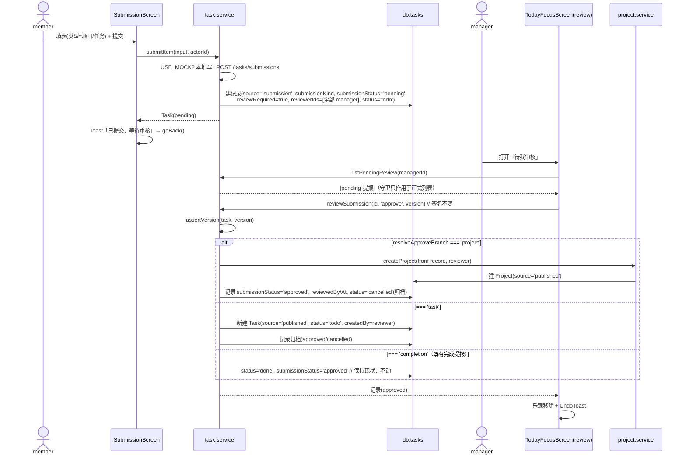
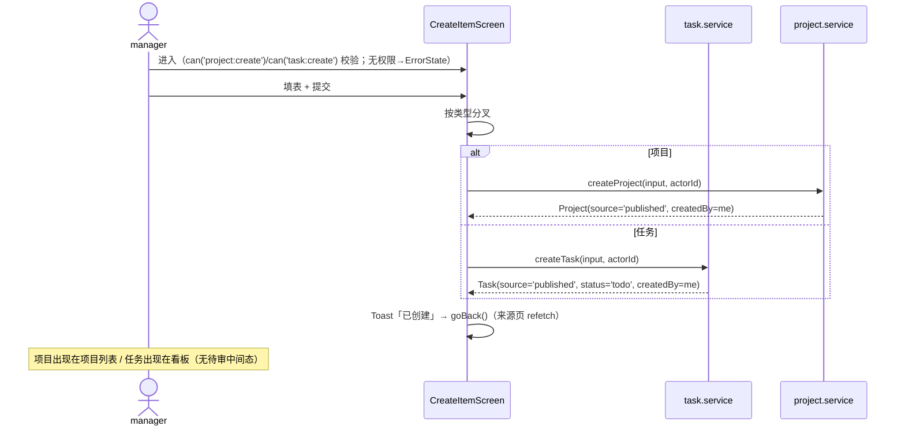
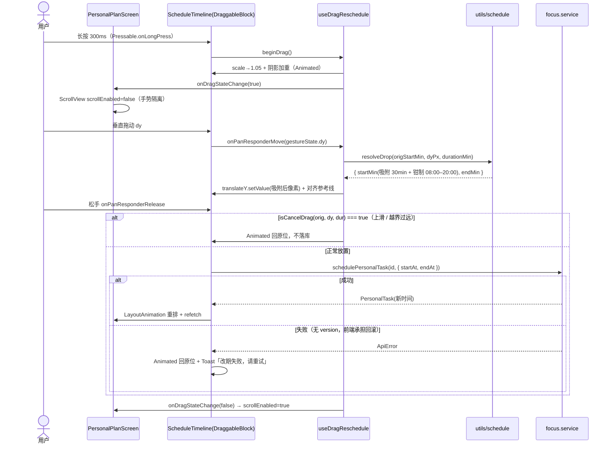
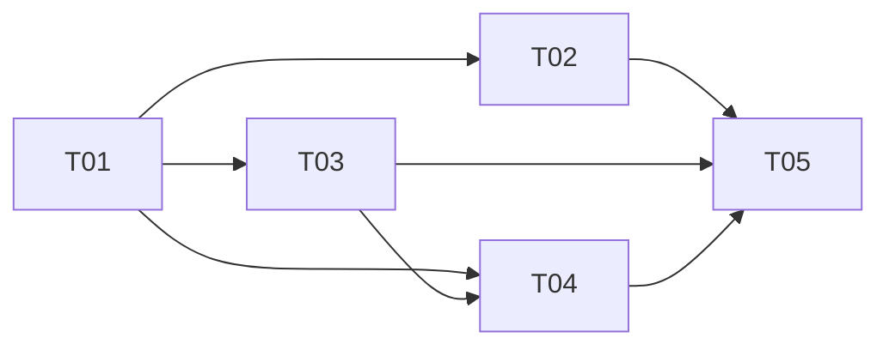

# ARCH（增量 1）— OpenSchedule 移动端：提报 / 创建 / 个人计划 / 待审详情入口

> 档位：**增量架构**（只写变更）· 架构师：高见远 · 基线：`PRD-mobile-increment-1.md` v1.2 · 首版约束以 `ARCH-mobile.md` 为准（技术选型 / 设计 token / 跨文件约定不重复设计）。
> 交付路径：`apps/mobile` · 硬约束：Expo 57 / RN 0.86.3 / React 19 / TS 6 / React Navigation 7；**零新增依赖**；禁 `reanimated` / `gesture-handler`；禁 pnpm。

---

## 1. 实现方案概述

### 1.1 分层落点

| 层 | 落点 | 内容 |
| --- | --- | --- |
| **类型层** | `types/task.ts` / `types/navigation.ts` | `SubmissionStatus` 扩展、新增 `SubmissionKind`、`Task` 加 3 字段、根栈加 4 条路由 |
| **纯工具层** | `utils/permission.ts`（新）、`utils/submission.ts`（新）、`utils/schedule.ts`（新） | 权限矩阵、提报状态机/落地分叉判定、拖拽位移↔分钟换算。**全部纯函数，可被 service/纯函数测试覆盖** |
| **数据层** | `services/{task,project,focus}.service.ts` + `services/index.ts` | 新增 8 个写方法；`reviewSubmission` **签名不变**、仅扩展 approve 分支；6 处列表加提报记录守卫 |
| **组件层** | `components/{PickerSheet,DateTimeField,ItemForm,ScheduleTimeline}.tsx` + `index.ts` | 补齐选择控件短板 + 提报/创建共用表单骨架 + 排期拖拽视图 |
| **hook 层** | `hooks/useDragReschedule.ts` + `index.ts` | 拖拽手势（PanResponder + Animated），**对照 `useSwipeAction.ts` 的现成写法** |
| **页面层** | `screens/{Submission,CreateItem,PersonalPlan,MySubmissions}Screen.tsx`（新）+ `TodayFocusScreen` / `ProfileScreen` / `WorkspaceScreen`（改） | 4 新页 + 待审卡片显式「查看详情」+ 两处二级入口 |
| **导航层** | `navigation/{stacks.tsx,linking.ts}` | 注册 4 新页 + 深链路径（**生成与解析必须同源**） |
| **种子层** | `data/seed.ts` | 补 1 个 manager 用户（`reviewerIds` 需含全部 manager） |

### 1.2 关键取舍

1. **权限工具的形态与位置**：纯函数 `PERMISSIONS` + `can(role, action)` 放 `utils/permission.ts`（无 React 依赖，可被 service/测试复用）；`useCan()` 同文件薄封装（读 `AppProvider.role`）。**单一事实来源 = `PERMISSIONS` 映射表**，`can` 与 `useCan` 都只读它。页面统一姿势：`const can = useCan()` → `can('task:create')` 条件渲染（**隐藏而非置灰**）；深链进入无权限 → `ErrorState`「无权限」。
2. **提报载荷复用 `Task` 字段，不新增 payload 结构**：`title/description/priority/estimatedHours/dueAt` 直用；`projectId`=目标项目（`kind='task'`）、`assigneeId`=拟负责人（`kind='project'`）；新增 `submissionKind` 区分 `'project'|'task'`。`reviewedBy/reviewedAt` 记录实际审核人。
3. **提报记录可见性（关键）**：新事项提报记录（`source==='submission' && submissionKind!=null`）一律不进正式列表。用 `isSubmissionRecord(task)` 守卫在 6 处列表过滤（今日到期/临期/项目任务/看板列/排期任务/日历天）。**种子无任何 `submissionKind` 任务 ⇒ 该守卫对既有 237 用例零影响**。提报记录生命周期 `status`：`pending` 期 `'todo'`，approve/reject/withdraw 后置 `'cancelled'`（归档标记，且被守卫隐藏）。
4. **拖拽零手势库实现**：手势起点用 `Pressable.onLongPress`（300ms）置「拖拽态」；`PanResponder.onStartShouldSetPanResponder` 恒 `false`（不抢初始触摸），`onMoveShouldSetPanResponder` 仅在「已进入拖拽态且 `|dy|>2`」时接管；换算/吸附/钳制/取消全部下沉为 `utils/schedule.ts` 纯函数；父级 `ScrollView scrollEnabled={!dragging}` 联动（`onDragStateChange` 回调）。

---

## 2. 文件清单

| 类型 | 相对路径 | 职责 | 预估行数 |
| --- | --- | --- | --- |
| 新增 | `src/utils/permission.ts` | `PermissionAction`/`PERMISSIONS`/`can`/`useCan` | ~70 |
| 新增 | `src/utils/submission.ts` | `isSubmissionRecord` / 提报状态机迁移表 / `resolveApproveBranch` 落地分叉纯函数 | ~60 |
| 新增 | `src/utils/schedule.ts` | 拖拽常量 + `pxToMinutes`/`snapToSlot`/`clampStartMin`/`resolveDrop`/`isCancelDrag`/`minutesToIso` | ~95 |
| 新增 | `src/components/PickerSheet.tsx` | 复用型选择抽屉（BottomSheet + 选项列表 + 勾选态） | ~130 |
| 新增 | `src/components/DateTimeField.tsx` | 日期/时间选择字段（→ PickerSheet 快捷列表） | ~120 |
| 新增 | `src/components/ItemForm.tsx` | 提报/创建共用表单骨架（按角色/场景分叉） | ~210 |
| 新增 | `src/components/ScheduleTimeline.tsx` | 排期视图：时间轴 + 块 + 拖拽 + 参考线（内嵌 DraggableBlock） | ~230 |
| 新增 | `src/hooks/useDragReschedule.ts` | 拖拽手势 hook（PanResponder + Animated，返回 `panHandlers/translateY/scale/dragging`） | ~130 |
| 新增 | `src/screens/SubmissionScreen.tsx` | 提报页（member 待审 / manager 免审落地） | ~140 |
| 新增 | `src/screens/CreateItemScreen.tsx` | 创建页（manager 直接创建项目/任务） | ~120 |
| 新增 | `src/screens/PersonalPlanScreen.tsx` | 个人计划页（列表 今天/本周/以后 + 排期视图） | ~300 |
| 新增 | `src/screens/MySubmissionsScreen.tsx` | 我的提报（状态查看 + 撤回，P1） | ~160 |
| 新增 | `tests/permission.test.ts` | 权限矩阵全组合 | ~80 |
| 新增 | `tests/schedule.test.ts` | 换算/吸附/钳制/取消纯函数 | ~95 |
| 新增 | `tests/submission-flow.test.ts` | 提报状态机全迁移 + 落地分叉 | ~120 |
| 修改 | `src/types/task.ts` | `SubmissionStatus` 扩展 + `SubmissionKind` + `Task` 加字段 | +12 |
| 修改 | `src/types/navigation.ts` | `MainRootStackParamList` 追加 4 条 | +6 |
| 修改 | `src/services/task.service.ts` | `submitItem`/`listMySubmissions`/`withdrawSubmission`/`createTask` + `reviewSubmission` 分叉 + 列表守卫 | +150 |
| 修改 | `src/services/project.service.ts` | `createProject` | +35 |
| 修改 | `src/services/focus.service.ts` | 个人任务 CRUD + `schedulePersonalTask` + `buildCalendarDay` 守卫 | +110 |
| 修改 | `src/services/index.ts` | 导出新方法与类型 | +5 |
| 修改 | `src/components/index.ts` | 导出 4 个新组件与 props 类型 | +8 |
| 修改 | `src/hooks/index.ts` | 导出 `useDragReschedule` | +2 |
| 修改 | `src/screens/TodayFocusScreen.tsx` | `review` 分组卡片注入「查看详情」按钮 | +15 |
| 修改 | `src/screens/ProfileScreen.tsx` | 「我的」加「个人计划」设置条目 | +8 |
| 修改 | `src/screens/WorkspaceScreen.tsx` | 工作台快捷入口加「提报/创建/个人计划」 | +20 |
| 修改 | `src/navigation/stacks.tsx` | 注册 4 个新页到根栈 | +10 |
| 修改 | `src/navigation/linking.ts` | 追加 4 条深链路径 | +5 |
| 修改 | `src/data/seed.ts` | 补 1 个 manager 用户（`DEMO_USER_IDS`） | +18 |
| 修改 | `tests/linking.test.ts` | 追加新路径解析 + 往返用例 | +20 |
| 删除 | — | 无 | — |

---

## 3. 数据结构与接口（类图）

```mermaid
classDiagram
  class Task {
    +SubmissionKind submissionKind  «新增»
    +string reviewedBy  «新增»
    +string reviewedAt  «新增»
    +SubmissionStatus submissionStatus  «扩展 draft / withdrawn»
    +source 'published' / 'submission'
    +boolean reviewRequired
    +string[] reviewerIds
    +number version  «仅团队 Task 有»
  }
  class PersonalTask {
    <<无扩展>>
    +string userId / startAt / endAt
    «无 version：不做乐观锁»
  }
  class permission_ts {
    +PERMISSIONS: Record~PermissionAction, AppRole[]~
    +can(role, action) boolean
    +useCan() (action)=>boolean
  }
  class submission_ts {
    +isSubmissionRecord(task) boolean
    +SUBMISSION_TRANSITIONS
    +resolveApproveBranch(task) 'project'|'task'|'completion'
  }
  class schedule_ts {
    +SLOT_MINUTES=30 / AXIS_START_MIN=480 / AXIS_END_MIN=1200
    +pxToMinutes(dyPx) / snapToSlot(min) / clampStartMin(target,dur)
    +resolveDrop(orig,dyPx,dur) {startMin,endMin}
    +isCancelDrag(orig,dyPx,dur) boolean
    +minutesToIso(day,min,tz) string
  }
  class SubmitItemInput {
    +SubmissionKind kind / string title / description / priority
    +string projectId / dueAt / ownerId / note / number estimatedHours
  }
  class CreateTaskInput {
    +string projectId / title / assigneeId / dueAt / TaskPriority priority
  }
  class CreateProjectInput {
    +string name / description / ownerId / deadline
  }
  class UpdatePersonalTaskInput {
    +string title / startAt / endAt / TaskPriority priority / TaskStatus status
  }
  class SchedulePersonalTaskInput {
    +string startAt / endAt
  }
  class PickerSheetProps {
    +boolean visible / string title / PickerOption~T~[] options / T value
    +fn onSelect / onClose / boolean clearable / fn onClear
  }
  permission_ts ..> Task : 无
  submission_ts ..> Task : 判定
```

**`PERMISSIONS` 单一事实来源（与 PRD §3 逐项对齐）**：

```ts
export type PermissionAction =
  | 'project:create' | 'task:create'
  | 'submission:create' | 'submission:review' | 'submission:withdraw'
  | 'item:edit' | 'item:delete' | 'review:view_pending' | 'personal:manage'

export const PERMISSIONS: Record<PermissionAction, AppRole[]> = {
  'project:create':       ['manager'],
  'task:create':          ['manager'],
  'submission:create':    ['manager', 'member'],   // 同一入口，行为按角色分叉
  'submission:review':    ['manager'],
  'submission:withdraw':  ['manager', 'member'],   // 仅本人 pending
  'item:edit':            ['manager'],
  'item:delete':          ['manager'],
  'review:view_pending':  ['manager'],             // 与 submission:review 同源
  'personal:manage':      ['manager', 'member'],   // 覆盖个人任务 CRUD（个人计划不做团队事项编辑）
}
export function can(role: AppRole, action: PermissionAction): boolean {
  return PERMISSIONS[action].includes(role)
}
export function useCan(): (action: PermissionAction) => boolean {
  const { role } = useAppContext()
  return useCallback((action) => can(role, action), [role])
}
```

**提报状态机迁移表（`utils/submission.ts`）**：

```ts
export const SUBMISSION_TRANSITIONS = {
  draft:     ['pending', 'published'],
  pending:   ['approved', 'rejected', 'withdrawn'],
  approved:  [],
  rejected:  ['draft'],
  withdrawn: ['draft'],
} as const

/** 审核通过后的落地分叉（reviewSubmission 唯一新增逻辑，签名不变） */
export function resolveApproveBranch(task: Task): 'project' | 'task' | 'completion' {
  if (task.source === 'submission' && task.submissionKind === 'project') return 'project'
  if (task.source === 'submission' && task.submissionKind === 'task') return 'task'
  return 'completion' // 既有「完成提报」：保持现状（回归红线）
}
```

---

## 4. 程序调用流程（时序图）

### 链路 ① member 提报 → pending → manager 通过 → 落地



### 链路 ② manager 直接创建（免审）



### 链路 ③ 排期视图长按拖拽改期



---

## 5. 任务列表（有序 · 按实现顺序 · 按模块聚合）

> 说明：本次为**增量**，无新工程基础设施（`package.json`/babel/tsconfig 不动），故首任务为「数据契约与纯工具」。分组按「同一模块相关文件一起写」，工程师可批量实现。

| 编号 | 任务名 | 涉及文件（相对 `apps/mobile/`） | 前置依赖 | 完成判据 |
| --- | --- | --- | --- | --- |
| **T01** | 数据契约 + 权限/提报/排期纯工具 + 种子 | `src/types/task.ts`、`src/types/navigation.ts`、`src/utils/permission.ts`(新)、`src/utils/submission.ts`(新)、`src/utils/schedule.ts`(新)、`src/data/seed.ts`、`tests/permission.test.ts`(新)、`tests/schedule.test.ts`(新) | — | `tsc` 0 error；`npx jest tests/permission.test.ts tests/schedule.test.ts` 全绿；`PERMISSIONS` 与 PRD §3 逐项一致；种子新增 manager 用户且 `seed-integrity` 仍全绿 |
| **T02** | 数据层 service（提报 / 创建 / 审核分叉 / 个人计划 CRUD / 列表守卫） | `src/services/task.service.ts`、`src/services/project.service.ts`、`src/services/focus.service.ts`、`src/services/index.ts`、`tests/submission-flow.test.ts`(新)、`tests/round2-regression.test.ts`（不改，须仍绿） | T01 | 新增 8 个写方法均有 `USE_MOCK` 分支 + 末尾 `// TODO(real-api)`；`reviewSubmission` 签名不变且 `task-014/015` 行为不变（`services.test.ts:168-180` 全绿）；6 处列表守卫生效；`tests/submission-flow.test.ts` 全绿 |
| **T03** | 通用表单/选择组件 | `src/components/PickerSheet.tsx`(新)、`src/components/DateTimeField.tsx`(新)、`src/components/ItemForm.tsx`(新)、`src/components/index.ts` | T01 | 组件 props 与 §7 契约一致；样式全取 token、**零内联魔法数字**；无新增依赖 |
| **T04** | 排期视图与拖拽 | `src/components/ScheduleTimeline.tsx`(新)、`src/hooks/useDragReschedule.ts`(新)、`src/hooks/index.ts` | T01、T03 | 仅用 `Animated`/`PanResponder`/`LayoutAnimation`；`scrollEnabled` 受控联动；团队块（`kind='task'`）不可拖；`package.json` 不新增依赖 |
| **T05** | 页面 + 导航装配 + 集成 | `src/screens/SubmissionScreen.tsx`、`CreateItemScreen.tsx`、`PersonalPlanScreen.tsx`、`MySubmissionsScreen.tsx`、`src/screens/TodayFocusScreen.tsx`、`ProfileScreen.tsx`、`WorkspaceScreen.tsx`、`src/navigation/stacks.tsx`、`src/navigation/linking.ts`、`tests/linking.test.ts` | T02、T03、T04 | 4 新页三态齐全；待审卡片出现「查看详情」；两处二级入口可达；深链 4 条路径可解析且往返一致；`npx jest` 全量绿 + `tsc` 0 error |

**依赖图**：



---

## 6. 依赖包列表

**结论：零新增依赖。** 全部能力来自既有依赖与 RN 内置：

| 能力 | 复用来源 | 说明 |
| --- | --- | --- |
| 抽屉 / 遮罩 / 弹入 | `components/BottomSheet.tsx`（既有） | `PickerSheet` 直接包它 |
| 动画 / 手势 | RN 内置 `Animated` / `PanResponder` / `LayoutAnimation` | 拖拽，**不引 `reanimated`/`gesture-handler`** |
| 图标 | `@expo/vector-icons`（Feather） | 既有 |
| 导航 | `@react-navigation/native`(7) | 既有 |
| 测试 | `jest-expo`（既有） | 无组件测试能力，见 §8 |

> 若后续确需拖拽库（如 `gesture-handler`）才能满足验收，须先提交理由并预计被驳回；当前设计**已证明可零依赖实现**（`useSwipeAction.ts` 为同一手法的现成先例）。

---

## 7. 共享知识（跨文件约定）

| 项 | 约定 |
| --- | --- |
| **权限工具调用姿势** | 页面顶部 `const can = useCan()`；JSX 内 `can('task:create') ? <入口/> : null`（**隐藏，不置灰**）。`useCan` 返回 `useCallback` 稳定函数，可安全入依赖数组。禁止在页面里手写 `role === 'manager'`。 |
| **提报状态字段读写规则** | `submissionStatus` 与 `submissionKind` **只在 `utils/submission.ts` 判定、只在 service 层写**；页面只读、不改。`isSubmissionRecord(task)` 为「新事项提报记录」唯一判定；正式列表统一 `&& !isSubmissionRecord(task)`。`PersonalTask` **无 `version`**，个人计划不做乐观锁。 |
| **`PickerSheet` props 契约** | `{ visible, title?, options: {value,label,description?}[], value, onSelect(value), onClose, clearable?, onClear? }`；泛型 `T extends string`；样式全取 token（行高 `spacing.xxl+`，勾选 `Feather.check` + `colors.primary`）。 |
| **拖拽态全局约定** | 单一布尔 `dragging` 由页面持有，经 `ScheduleTimeline.onDragStateChange` 回调上抛；`<ScrollView scrollEnabled={!dragging}>`。拖拽期间**禁点击/编辑**；仅 `kind==='personal'` 块可拖。换算公式集中在 `utils/schedule.ts`（常量见 §1.2-4）。 |
| **新增深链路径** | `Submission: 'submit'`、`CreateItem: 'create'`、`PersonalPlan: 'personal-plan'`、`MySubmissions: 'my-submissions'`；**`linking.ts` 的生成与解析必须共用同一映射**，改这里同步 `tests/linking.test.ts`。 |
| **新增页面注册位置** | 4 新页注册在 **`MainRootStack`（Tab 之上，根共享栈）**，与 `TaskDetail` 同级 → 全屏覆盖 TabBar；`AiProposalSheet` 的 `presentation:'transparentModal'` 不受影响。 |
| **Mock 切换点** | 全部新增写方法首行 `if (USE_MOCK) {...}`，末尾保留 `// TODO(real-api): <METHOD> <path>`。 |
| **设计 token** | 全部取自 `theme/tokens.ts`（`spacing`/`radius`/`shadow`/`motion`/`layout`），**禁止内联魔法数字**。拖拽的 `300ms`/`30min`/`56px` 等业务常量集中在 `utils/schedule.ts` 命名导出。 |

---

## 8. 测试策略（无组件测试能力，全部走纯函数 / service / hook 测试）

| 覆盖目标 | 测试文件 | 关键断言 |
| --- | --- | --- |
| **权限矩阵全组合** | `tests/permission.test.ts` | 遍历 `PERMISSIONS` 的每个 `action × {manager,member}`，断言 `can()` 与矩阵逐格一致；`member` 下 `task:create`/`project:create`/`submission:review`/`review:view_pending`/`item:edit`/`item:delete` 全 `false`；`submission:create`/`submission:withdraw`/`personal:manage` 双角色 `true` |
| **提报状态机全迁移** | `tests/submission-flow.test.ts` | `SUBMISSION_TRANSITIONS` 全组合合法/非法；`draft→pending` 生成记录字段齐（`reviewerIds` 非空含全部 manager、`submissionStatus='pending'`）；`pending→approved/rejected/withdrawn` 副作用正确；`reject` 原因 <4 字被拒；`withdraw` 仅本人 + `pending` |
| **落地分叉（回归红线）** | `tests/submission-flow.test.ts` | `resolveApproveBranch` 三分支；`kind='project'` → 新建 Project 且记录归档；`kind='task'` → 新建 `source='published', status='todo'` 任务；**`task-014/015`（无 `submissionKind`）approve → `status='done'`、reject → `status='in_progress'` 保持不变** |
| **列表守卫** | `tests/submission-flow.test.ts` | 造一条 `submissionKind='task'` 的 pending 记录（`projectId`/`dueAt`/`startAt` 均落当前范围）→ 断言 `listTodayDue`/`listBoardColumns`/`listTasksByProject`/`listScheduledTasks`/`getCalendarDay` **均不含**该记录；`listPendingReview` **含**该记录 |
| **排期时间吸附与边界钳制** | `tests/schedule.test.ts` | `snapToSlot` 到 30min 网格（含 .5 向上/向下取整）；`clampStartMin`：<08:00 → 480、>20:00−dur → 1200−dur；时长恒定不变 |
| **拖拽位移 → 时间换算纯函数** | `tests/schedule.test.ts` | `pxToMinutes(56)===60`、`pxToMinutes(28)===30`；`resolveDrop` 对一组 `dy` 的 `{startMin,endMin}` 快照；`isCancelDrag`：`dy<=-56` → true、越界 >60min → true、正常 → false |
| **深链回归** | `tests/linking.test.ts`（改） | 4 新路径解析 + 往返一致（沿用现有 B1/B2 结构，避免 `linking.ts` 改动引发回归） |
| **既有回归** | `tests/services.test.ts` / `round2-regression.test.ts` / `seed-integrity.test.ts`（不改） | 必须全绿：`reviewSubmission` 既有分支、撤销语义、种子完整性 |

> **不新增** `@testing-library/react-native`；拖拽的手势层（`useDragReschedule` 的 PanResponder 装配）不做组件测试，改由 `utils/schedule.ts` 的纯函数覆盖全部数学逻辑（PRD AC2/AC6/AC7 的判据均可纯函数验证）。

---

## 9. 风险与兜底

| # | 风险 | 触发条件 | 缓解 / 兜底 |
| --- | --- | --- | --- |
| R1 | **拖拽与 `ScrollView` 滚动冲突** | PanResponder 抢手势导致无法滚动 / 拖拽被打断 | ① 进入拖拽态才接管：`onStartShouldSetPanResponder:()=>false`、`onMoveShouldSetPanResponder:(_,g)=>draggingRef.current && Math.abs(g.dy)>2`；② `dragging` 期 `scrollEnabled=false`；③ `onPanResponderTerminationRequest:()=>false`；④ 仍冲突 → 降级为「点块 → PickerSheet 改期」（AC9 已内建兜底，功能不丢失） |
| R2 | **`linking.ts` 改动导致深链回归** | 4 新路径写法与既有嵌套映射不一致（历史缺陷：只写字符串→生成/解析不对称） | 新路径全部写成**根栈扁平字符串**（与 `TaskDetail`/`Notifications` 同级），不嵌进 `Tabs`；**同步补 `tests/linking.test.ts` 解析 + 往返用例**；跑全量 linking 套件（37 用例） |
| R3 | **`Task` 字段扩展影响既有 237 用例** | 新字段必填 / 序列化断言 | `submissionKind`/`reviewedBy`/`reviewedAt` 全部**可选**；`isSubmissionRecord` 依赖新字段 ⇒ 对无该字段的种子恒 `false`，**列表守卫对既有用例零影响**；`reviewSubmission` 签名不变、`completion` 分支保持现状 |
| R4 | **`seed.ts` 补 manager 用户对既有测试的影响** | `seed-integrity` 的「同租户/字段齐全/关联可解析」断言 | 新用户字段与既有 3 个用户完全对齐（同 `TENANT_ID`、必填齐）；仅追加、不改既有 id；`DEMO_USER_IDS` 追加键，不重排 |
| R5 | **提报记录泄漏进正式列表** | pending/approved 记录带 `projectId`/`dueAt`/`startAt` | 统一 `isSubmissionRecord` 守卫 6 处列表；记录审核后 `status='cancelled'`（`cancelled` 本就被多数列表排除）双保险；新增专项测试（§8 列表守卫） |
| R6 | **AC6（取消）与 AC7（钳制）语义看似冲突** | 拖拽超出 08:00–20:00 时「取消」还是「钳制」 | 以「超出幅度」区分：`|越界|≤60min` → 钳制；`>60min` 或 `dy≤-56px`（上滑）→ 取消。写入 `utils/schedule.ts` 常量并在 §10 标注待确认 |
| R7 | **`personal:*` 通配与单 key 的偏差** | PRD §3 写 `personal:*`，实现用 `personal:manage` | 收敛为单一 `personal:manage`（覆盖个人任务 CRUD），语义等价、更易测；如需细分再拆 key |
| R8 | **拖拽态 `Animated` 阴影无法用 native driver** | `shadowOpacity`/`elevation` 非 transform 属性 | 阴影变化用 `useNativeDriver:false`（低频、块数少），`translateY`/`scale` 仍走 native driver |

---

## 10. 待明确事项

| # | 事项 | 影响 | 我的默认处置（不阻塞开工） |
| --- | --- | --- | --- |
| Q1 | **AC6 与 AC7 的边界**：拖出 08:00–20:00 时，「移出时间轴范围即取消」与「越界钳制」互斥 | 拖拽取消/钳制的判定阈值 | 按 R6 方案：小幅越界钳制、大幅越界（>60min）或上滑取消。请 PM 确认阈值 |
| Q2 | **提报记录「归档」后的 `status` 取值**：PRD 未明确记录本体状态 | 提报记录是否出现在任何列表 | 默认 `status='cancelled'`（复用「被列表天然排除」语义）+ 守卫双保险；`MySubmissions` 按 `submissionStatus` 展示 |
| Q3 | **`listMySubmissions` 返回类型**：PRD §8.3 写作 `Promise<Task>`（单条），语义应为列表 | 我的提报页取数签名 | 默认按 **`Promise<Task[]>`** 实现（疑似 PRD 笔误），已在 T02 落地 |
| Q4 | **`SubmissionScreen` 与 `CreateItemScreen` 是否合并为一页** | 页面数量 / 导航注册 | 按 PRD §8.4 保留**两页**、共用 `ItemForm` 骨架（提报页按角色分叉按钮文案，创建页仅 `project:create`/`task:create`） |
| Q5 | **`item:edit`/`item:delete` 在本次是否真有入口** | 是否需要团队事项编辑页 | PRD §3 定义了权限但 §2.1 未列编辑/删除团队事项的页面 ⇒ **本次只落权限 key，不建编辑页**；member 的个人任务编辑走 `personal:manage` |

---

## 11. 修订记录

| 版本 | 日期 | 修订内容 |
| --- | --- | --- |
| v1.0 | 本次 | 增量架构初版：权限工具 / 提报落地 / 创建 / 个人计划 / 排期拖拽 / 待审详情入口；5 任务分解；零新增依赖 |
