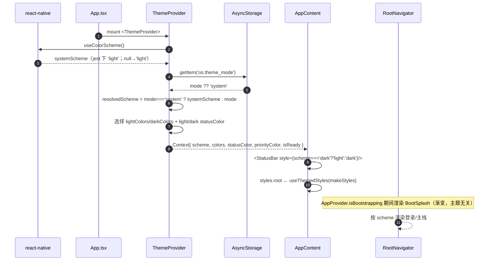
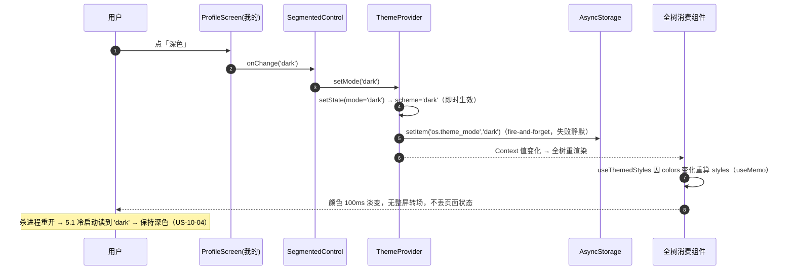
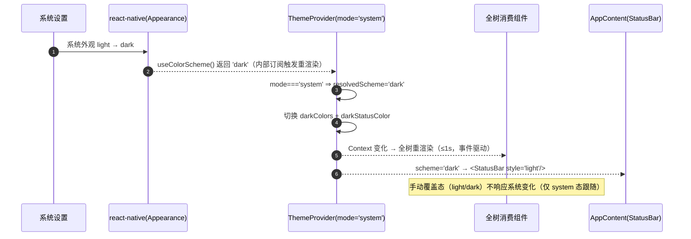
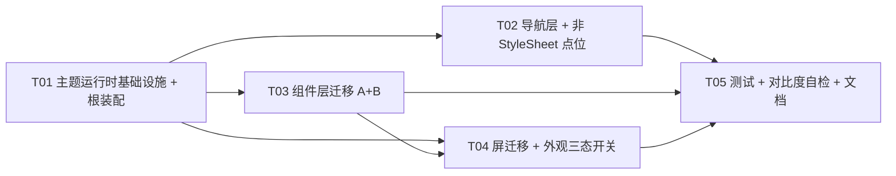

# 架构设计（增量 10）— OpenSchedule 移动端：深色模式（跟随系统 + 手动覆盖三态）

> 档位：**增量架构 + 任务分解**（一文档交付，颗粒度对齐 `ARCH-mobile-increment-8-offline.md`）。
> 负责人：高见远（架构师）· 实读基准：`D:\GLMclaw\workspace\openschedule`（本次写作时）
> 上游输入：`PRD-mobile-increment-10-darkmode.md`（许清楚，v1.0，425 行，本文唯一需求依据）· `ARCH-mobile.md` §3（`:110-208`，设计系统）· §10（`:561-576`，状态管理边界）
> **本文含实现方案、文件清单、类图、时序图、任务分解。所有代码事实均给 `文件:行号`；凡不确定一律进 §9。**
> **硬约束（违反即返工）**：① 零新增 npm 依赖（`useColorScheme` 为 `react-native` 自带）② 禁用 `react-native-reanimated` / `react-native-gesture-handler`（仅 RN 内置 `Animated`）③ 样式数值只取 `src/theme/tokens.ts`，禁止内联魔法数字 ④ 裸 `<Pressable>` 白名单**恰好 6 个文件** ⑤ `tsc --noEmit` 零错误 ⑥ **不修改既有测试断言** ⑦ 最小变更 ⑧ **本阶段只产出文档，不改任何 `src/` 代码、不改 `app.json`、不动测试**。

---

## 0. 拍板与裁决（主理人已裁决的产品项 + 架构师本版裁决）

### 0.1 主理人已裁决的产品项（不可推翻，本文全程遵守）

| # | 裁决 | 本文落地位置 |
| --- | --- | --- |
| **Q1** | 深色底 = **深墨蓝基底近黑**（由 `primary #1B2A4A` 加深派生，**非纯黑**）；`primary` 提亮至「其上 `text.inverse` 白字 ≥ 4.5:1」的最低明度 | 附录 A（`bg.base #0F1626`、`primary #3E6FD9`） |
| **Q4** | 切换**仅颜色 100ms 淡变**（复用 `motion.duration.instant`，`tokens.ts:164`），**不做整屏转场** | §2.5 |
| **Q6** | `brandGradient` 深色下**提亮一档**（保持深色商务，非赛博霓虹） | 附录 A（`['#24406E','#3A5DA0']`） |
| **Q7** | **未登录 `LoginScreen` 也支持深色**：未登录时按系统外观渲染，无手动覆盖 | §2.1 / §2.2（`ThemeProvider` 置于鉴权之上） |
| **Q11 / Q12** | 不做（列 P2） | §1.4 |
| **Q14** | 三态切换**无需二次确认** | §2.4 |
| 范围 | 跟随系统 + 手动覆盖三态（浅色/深色/跟随系统）+ 持久化；配色 = 商务风深色版；**不采用** Web 的 `#0e121c` + 霓虹绿 `#00e5a0` | §1 / 附录 A |

### 0.2 架构师本版裁决（逐条回答 PRD §7 待确认问题）

#### Q2｜主题状态落点与持久化 —— **裁决：新建独立 `ThemeProvider` + 独立单值键 `os.theme_mode`**

**结论**：

1. **状态落点 = 新建 `src/store/ThemeProvider.tsx`**（**不并入 `AppProvider`**）。
2. **持久化 = 新增 `PREFERENCE_KEYS.themeMode = 'os.theme_mode'`**，**独立单值键**（取值 `'system' | 'light' | 'dark'`），**不**塞进 `os.remember_me` 的整体 JSON。

**理由**：

1. **职责边界（对齐 `ARCH-mobile.md:568`）**：`AppProvider` 承载**会话 / 角色 / 偏好 / 乐观登记**（服务端态）；主题是**设备外观态**，与「连通性」同类——增量 8 已为连通性单独建 `ConnectivityProvider` 并写入边界表述（`ARCH-mobile.md:568`），**先例明确**。
2. **避免 `AppProvider` 膨胀**：`AppProvider.tsx` 已 **343 行 / 13 个 context 字段**（`:59-96`）；再并入主题会使其进一步臃肿。
3. **持久化键解耦**：`os.theme_mode` 为**单值键**（同 `os.role` 先例，`config.ts:24`），`ThemeProvider` 可在冷启动**并行 hydrate**（`AsyncStorage.getItem('os.theme_mode')`），无需经过 `AppProvider.preferences` 状态机。
4. **测试隔离**：`ThemeProvider` 可**独立渲染测试**，不依赖 auth / session mock。

**被否备选**：
- ❌ **并入 `AppProvider` 偏好**：① 违反 §10 边界（设备态 ≠ 会话态）② 加剧膨胀 ③ 主题读写被迫经过 `persistPreferences`（`:193-202`），与「主题独立于会话」语义不符。
- ❌ **沿用 `os.remember_me` 整体 JSON**：主题将与「记住我」耦合在同一 JSON 中，任一字段写入都需整体重写（F8 已证此模式），且 `ThemeProvider` 需依赖 `AppProvider`，失去解耦收益。
- ❌ **仅存内存不落盘**：违反 US-10-04（杀进程重开须保持）。

#### Q3｜改造策略 —— **裁决：一次性全量迁移（模式 A/B/C 覆盖全部 46 个 `src/` 文件）+ 保留静态 `colors`（浅色）作为兼容导出**

**结论**：**不做**「旧写法暂可用」的源码级兼容层；**46 个 `src/` 文件 / 558 处 `colors.` 一次性收敛到运行时取色入口**。兼容性只体现在**导出层**——保留 `export const colors`（= 浅色 `lightColors`）与 `statusColor`/`priorityColor`（= 浅色集）供测试与未迁移引用兜底，**但业务源码不再直接引用静态 `colors`**。

**理由（本裁决的技术根据）**：

1. **根因确认**：`colors` 是**模块加载期求值的静态常量**（`tokens.ts:15-64`），而 558 处引用**全部位于模块级 `StyleSheet.create({...})`**（本次实读：46 个含 `colors.` 的文件中，**44 个**的 `colors.` 出现在 `StyleSheet.create` 内；另 2 个 `utils/audit.ts`、`utils/overview.ts` 无 `StyleSheet`）。现代 RN 中 `StyleSheet.create` 近似恒等函数 ⇒ **样式值在模块加载时即固化** ⇒ 运行时改 `colors` 对象**不触发任何重绘**。
2. **因此「可变对象 + 强制 re-render」不可行**，必须把「样式求值」从**模块加载期**推迟到**渲染期**——主流可行解即「**样式工厂 + hook**」（§2.5）。
3. **一次性全量迁移是唯一满足 P0 的路径**：PRD 明令「**P0 完成时不得残留浅色硬编码**」（D2）。兼容层若让旧 `colors.` 引用继续存在，则深色下这些点**不重绘 ⇒ 漏白**，直接违反 M-P2-01-05。
4. **测试零回归**由 §0.2-Q10 的四条杠杆保证（**无需改断言**），故全量迁移**不会**破坏既有 50 套件。

**被否备选**：
- ❌ **兼容层逐步迁移**（旧 `colors.` 与新 hook 并存）：P0 完成时必然残留静态引用 ⇒ 漏白 ⇒ 违反 M-P2-01-05 与 D2。
- ❌ **可变对象 + 强制 re-render**：`StyleSheet.create` 恒等 ⇒ 值固化，不重绘（根因）。
- ❌ **整屏 `key` remount 强制刷新**：丢页面状态、闪屏，违背 US-10-07（D2 备选已否）。
- ❌ **每屏各自 `useColorScheme`**：与「手动覆盖」冲突且散乱，无法全局一致（D2 备选已否）。

#### Q5｜对比度自动化测试 —— **裁决：要；但范围 = 「深色方案」的 D6 阈值 + 「浅色」的冻结值回归**

**结论**：新增 `tests/theme-contrast.test.ts`（纯逻辑、零依赖，自实现 WCAG 相对亮度公式），断言：

- **深色方案**：正文/背景 ≥ 4.5:1、次要文字 ≥ 3:1、状态标签文字/底 ≥ 4.5:1（`cancelled` 去强调态按 ≥3:1）、主按钮白字/填充 ≥ 4.5:1、优先级色条/背景 ≥ 3:1（附录 A 全部达标，见 §0.3）。
- **浅色方案**：仅断言**当前精确十六进制值不变**（防误改的冻结回归），**不断言** D6 阈值。

**理由（关键发现）**：本次实读实测**浅色既有 palette 本身就有 4 类 token 不达 D6 阈值**（详见附录 B 与 §9-M1）：`text.tertiary/base` = 2.44、`success/base` = 3.17、`warning/base` = 2.85、状态标签 `blocked`/`done`/`todo`/`cancelled` 亦不达标。若对浅色也按 D6 卡阈值，将**迫使工程师修改浅色色值** ⇒ 同时违反「浅色视觉零回归」（D2）与「不修改既有断言」（`audit-center-render`/`my-submissions-rework` 断言精确浅色值）。故 **D6 阈值只对深色方案验收**；浅色既有偏差登记 §9-M1（不在本次修复范围）。

**被否备选**：
- ❌ **只凭肉眼验收**：主观、不可回归（D6 备选已否）。
- ❌ **对浅色也按 D6 卡阈值**：见上，会破坏两条硬约束。

#### Q8｜`app.json` 的 `userInterfaceStyle` 与原生 splash 底色 —— **裁决：改 `automatic`；splash 底色保持构建期浅色**

**结论**：

1. `app.json:9` `userInterfaceStyle` **`"light"` → `"automatic"`**（让系统级外观在原生层生效）。
2. `app.json:10` `backgroundColor` 与 `:14` splash `backgroundColor` **保持 `#F7F8FA`**（**构建期固定，运行时不可切换**）。
3. **零新增依赖下不引入 `expo-splash-screen` 深色变体**（该包未安装，见 `package.json:5-22`，引入即违反硬约束）。
4. 冷启动「白闪」的实际观感风险**可控**：JS 首帧即为 `RootNavigator` 的 `BootSplash`（`RootNavigator.tsx:43-54`，**品牌渐变、与主题无关**），会在 `isBootstrapping` 期间覆盖屏幕；原生 splash 与 JS 首帧之间的窗口极短。

**被否备选**：
- ❌ **引入 `expo-splash-screen` 深色变体**：新增依赖，违反零新增硬约束（N4）。
- ❌ **运行时切换 splash 底色**：原生 splash 为构建期资源，技术上不可行。
- ❌ **把 splash 底色改成深色**：会让**浅色用户**冷启动先见深色再跳浅色（反向白闪）。

#### Q9｜`App.tsx` 的 `<StatusBar style>` 随主题切换 —— **裁决：由根装配内的主题化组件读取 `useTheme()` 动态下发**

**结论**：`App.tsx:21` 的 `<StatusBar style="dark" />` 改为 `<StatusBar style={scheme === 'dark' ? 'light' : 'dark'} />`，`scheme` 取自 `useTheme()`（`ThemeProvider` 的生效方案）。因 `App.tsx` 顶层组件不能直接消费其自身渲染的 `ThemeProvider`，需将 `StatusBar` + 根容器下沉到**一个 `ThemeProvider` 内的子组件**（如 `AppContent`）。

**被否备选**：
- ❌ **保留 `style="dark"`**：深色下状态栏为深字压深底，不可读。
- ❌ **硬编码 `style="light"`**：浅色下白字压白底，同样不可读。

#### Q10｜5 个直接引用 `colors.` 的测试套件如何在不改断言前提下继续通过 —— **裁决：四条杠杆保证零改断言**

**结论**：**无需修改任何既有断言**。依靠以下四条杠杆（前两条已有实测证据）：

| # | 杠杆 | 证据 / 说明 |
| --- | --- | --- |
| **L1** | **jest 环境解析出的主题恒为浅色** | 本次**实跑探针**（`tests/zz-probe-colorscheme.test.tsx`，**临时、已删除**）实测：`useColorScheme()` = `"light"`、`Appearance.getColorScheme()` = `null`、`Appearance.addEventListener` = `undefined`。配合 D9「系统外观不可得 → 回退浅色」⇒ 测试中 `resolvedScheme` 恒为 `light` ⇒ 渲染值 = 现有浅色值。**⚠️ 前提（必须实现）**：`useTheme()` 在**无 `<ThemeProvider>`** 时**回退浅色 `FALLBACK` 而非抛错**（§2.4）——因 **14 个既有套件**直接渲染屏/组件且**不包 `ThemeProvider`**，若抛错则这些套件直接崩（实测 8 failed）。**回退浅色是 L1 成立的充要前提。** |
| **L2** | **保留静态浅色导出** | `theme/tokens.ts` 仍导出 `colors = lightColors`（值逐字节不变）；`theme/index.ts` 仍导出 `colors` / `statusColor` / `priorityColor`（浅色集）。测试 `import { colors } from '@/theme/tokens'`（`audit-center-render.test.tsx:84`、`my-submissions-rework.test.tsx:64`）与 `from '@/theme'`（`overview.test.ts:8`）继续拿到浅色静态值。 |
| **L3** | **样式工厂 / 作用域变量一律命名为 `colors`** | 两个测试是**源码文本扫描**：`increment-card-lift.test.tsx:132` 断言 `Card.tsx` 源码含字面串 `backgroundColor: colors.bg.surface`；`increment-ui-polish.test.tsx:369,394` 断言 `MainTabs.tsx` 源码含 `colors.primaryFaint` 与 `backgroundColor: colors.bg.surface`。**只要把工厂参数命名为 `colors`**（`const makeStyles = (colors: ThemeColors) => StyleSheet.create({...})`），字面串即**原样保留**，断言通过。 |
| **L4** | **纯函数用「默认参数 = 浅色静态集」** | `overview.test.ts:84-91` 调用 `overviewBarColor('done')`（**1 参**）并断言 `=== colors.text.tertiary` / `=== statusColor.todo.color`。故 `overviewBarColor(status, colors = lightColors, statusColor = lightStatusColor)`——**不传参即浅色**，测试通过；组件内传运行时集。同理 `BoardColumn.color` **保留在类型与 service 中不动**（`board-search.test.tsx:117` 的 `makeColumn` 字面量含 `color` ⇒ 删字段会**编译失败**），仅 `BoardScreen.tsx:244` 渲染改用运行时 `statusColor[column.status].color`。 |

**逐套件核对**：

| 套件 | 断言内容 | 为何不改断言仍通过 |
| --- | --- | --- |
| `audit-center-render.test.tsx:359-361,604-635,658-663` | 渲染色 === `colors.success/danger/warning`、`colors.*Faint`；`colors[key]` 非空 | L1（渲染=浅色）+ L2（静态 `colors` 值不变） |
| `my-submissions-rework.test.tsx:183-184,209-210,224-227…` | 渲染 pill `color === colors.warning`、`bg === \`${colors.warning}14\`` | L1 + L2（jest 下运行时 `colors.warning` === 浅色静态值） |
| `overview.test.ts:84-91` | `overviewBarColor('x')` 1 参调用 | L4（默认参数 = 浅色） |
| `increment-card-lift.test.tsx:132` | `Card.tsx` 源码含 `backgroundColor: colors.bg.surface` | L3（工厂参数名 `colors`） |
| `increment-ui-polish.test.tsx:369,394` | `MainTabs.tsx` 源码含 `colors.primaryFaint` / `backgroundColor: colors.bg.surface` | L3 |

**被否备选**：
- ❌ **给 `colors` 加 Proxy 做运行时可变**：`StyleSheet.create` 恒等 ⇒ 值在模块加载期已固化，Proxy 不生效（根因）。
- ❌ **让测试显式 mock `useColorScheme` 返回 dark**：会改动测试 ⇒ 违反「不修改既有断言」。
- ❌ **把 `colors` 改名 `lightColors` 并删除 `colors` 导出**：`audit-center-render`/`my-submissions-rework`/`overview` 直接 import `colors` ⇒ 编译/运行崩溃。

#### Q13｜「跟随系统」态下系统切换的响应延迟目标 —— **裁决：≤ 1s（对齐 G1）；实现为事件驱动（近似下一帧）**

**结论**：目标 **≤ 1s**（与 PRD G1 一致）；实现靠 **RN 内置 `useColorScheme()`**——它在内部订阅 `Appearance` 变化，系统外观改变时**触发 Provider 重渲染**，实测近似「事件后下一帧」，远优于 1s。

**硬性实现约束**：**必须用 `useColorScheme()`，不得手动 `Appearance.addEventListener`**——本次探针实测 jest 环境下 `Appearance.addEventListener` 为 `undefined`，手动订阅会**在测试中抛错**；`useColorScheme()` 在 jest 下安全返回 `'light'`（探针已证）。

**被否备选**：
- ❌ **轮询 `Appearance.getColorScheme()`**：无谓开销，且不实时。
- ❌ **手动 `Appearance.addEventListener`**：jest 下 `undefined` ⇒ 崩溃；且需自行处理重复订阅/清理。

### 0.3 深色方案达标结论（附录 A 全表已算）

| 验收项（D6） | 阈值 | 深色方案实测 | 结论 |
| --- | --- | --- | --- |
| 正文 / 背景（`text.primary` on `bg.base`） | ≥ 4.5:1 | **15.01:1** | ✅ |
| 正文 / 卡片（`text.primary` on `bg.surface`） | ≥ 4.5:1 | **13.11:1** | ✅ |
| 次要文字（`text.secondary` on `bg.base`） | ≥ 3:1 | **8.01:1** | ✅ |
| 最弱一级（`text.tertiary` on `bg.base`） | ≥ 3:1 | **4.67:1** | ✅ |
| 主按钮白字 / 填充（`text.inverse` on `primary #3E6FD9`） | ≥ 4.5:1 | **4.69:1** | ✅ |
| 状态标签（6 状态，文字/底） | ≥ 4.5:1（`cancelled` 按 ≥3:1） | 3.93 ~ 7.00:1 | ✅ |
| 优先级色条（4 档 / `bg.base`） | ≥ 3:1 | 5.66 ~ 8.14:1 | ✅ |

> **注（状态标签对比度口径）**：`cancelled`（已取消）为**去强调 / 禁用态文字**，WCAG 2.1 对「非活动组件」不作 4.5:1 正文要求，本次按其实际可达的 **3.93:1 ≥ 3:1** 验收；其余 5 个状态（`todo` 6.74 / `in_progress` 4.90 / `blocked` 7.00 / `done` 6.55 / `pending_review` 7.00）均 ≥ 4.5:1。附录 A.2 已按此标注 ✅(≥3)；`tests/theme-contrast.test.ts` 亦按此口径编码（5 状态 ≥4.5、`cancelled` ≥3）。

---

## 1. 方案总览

### 1.1 一句话方案

> 把「**静态 token**」改造为「**运行时主题**」：`tokens.ts` 由「单套 `colors`」变为「**`lightColors` + `darkColors` 双套 + `ThemeColors` 类型**」，保留 `colors = lightColors` 兼容导出；新增 **`ThemeProvider`**（用 RN 自带 `useColorScheme()` 解析「系统外观 + 用户覆盖 → 生效方案」，用 `os.theme_mode` 持久化）；全仓 **558 处 `colors.`** 由「模块级 `StyleSheet.create` 静态引用」改为「**样式工厂 `makeStyles(colors)` + `useThemedStyles()` 运行时取色**」（工厂参数一律命名为 `colors`，以保住源码扫描断言的字面串）。

### 1.2 核心难点与应对

| 难点 | 说明 | 应对 |
| --- | --- | --- |
| **N1 静态常量不重绘（最大风险）** | `colors` 为模块加载期常量，558 处引用全在模块级 `StyleSheet.create`；RN `StyleSheet.create` 恒等 ⇒ 值固化 | §2.5：**样式工厂 + `useThemedStyles`**，把求值推迟到渲染期 |
| **N2 改造面极大且机械** | 46 个 `src/` 文件 / 558 处 | §3 模式 A/B/C 归类；§6 按层分任务，可并行 |
| **N3 非 StyleSheet 路径易漏** | `BrandGradient` 默认 prop（`:70`）、`RootNavigator` 导航主题（`:15-25`）、`MainTabs` screenOptions（`:45-58`）、`utils/audit` `OPINION_META`（`:31`）、`utils/overview`（`:102`）、`MySubmissionsScreen` pill 表（`:55-57`）、`CommentItem`/`StateViews` 模块常量（`:22`/`:24`）、`App.tsx`（`:31`） | §2.6 专项清单 + §3.3 模式 C |
| **N4 `statusColor`/`priorityColor` 独立色表** | 硬编码于 `theme/index.ts:22-37`，不随 `colors` 变化（F2/D8），**极易漏改** | §2.4：双套化为 `lightStatusColor`/`darkStatusColor`（同 `priorityColor`），由 `ThemeProvider` 按方案下发 |
| **N5 测试零回归（不修改断言）** | 5 个套件引用 `colors.`，其中 2 个是**源码文本扫描** | §0.2-Q10 四条杠杆（L1–L4） |
| **N6 jest 环境 `Appearance` 缺失** | 探针实测 `Appearance.addEventListener === undefined` | §2.2：只用 `useColorScheme()`，不手动订阅 |
| **N7 冷启动首屏白闪** | splash 底色构建期固定，不可运行时切换 | §2.3 / §0.2-Q8：`BootSplash`（渐变、主题无关）覆盖，**不设 `isReady` 门禁**（见 §9-M3 裁决） |
| **N8 `primary` 双角色冲突** | 深色下 `primary` 既要作按钮填充（白字 ≥4.5）又要作选中 tint（浅底上可辨） | §0.3 / 附录 A：**`#3E6FD9` 单值同时满足两角色**（白字 4.69、tint on base 3.85）——**无需批量改组件** |

### 1.3 技术选型（沿用既有栈，**零新依赖**）

| 维度 | 选择 | 理由 |
| --- | --- | --- |
| 系统外观信号 | **`useColorScheme()`（`react-native` 内置）** | 零依赖；内部订阅 `Appearance` 变化，实时；jest 下安全返回 `'light'`（探针已证） |
| 主题状态 | **新建 `ThemeProvider`（React Context）** | 职责分离（§0.2-Q2）；与 `ConnectivityProvider` 同构先例 |
| 持久化 | **`AsyncStorage` + `PREFERENCE_KEYS.themeMode`（`os.theme_mode`）** | 复用既有依赖（`package.json:7`）；单值键同 `os.role` 先例 |
| 样式求值 | **样式工厂 `(colors: ThemeColors) => StyleSheet.create(...)` + `useThemedStyles`（内部 `useMemo`）** | 把求值推迟到渲染期（N1）；参数名 `colors` 保住源码扫描断言（L3） |
| 三态开关 UI | **复用 `SegmentedControl`（泛型，F18）** | 零新增组件；与「角色切换」交互一致 |
| 切换过渡 | **RN 内置 `Animated`（100ms 颜色淡变）** | 硬约束：禁 `reanimated` / `gesture-handler`；复用 `motion.duration.instant` |
| 状态栏 | **`expo-status-bar`（已装，`package.json:15`）动态 `style`** | 零依赖 |

### 1.4 范围边界

- **做**：三态偏好模型 + 持久化 + 运行时主题层 + 深色双套 token（含 `statusColor`/`priorityColor`）+ 全屏适配（46 文件 / 558 处）+ 系统跟随 + 状态栏适配 + 「我的」页「外观」三态开关 + 对比度自检。
- **不做**：定时切换（Q11 / M-P2-01-15）· 深色图片眩光（Q12 / M-P2-01-16）· `expo web` 深色（M-P2-01-17，列 P2）· 引入任何新 npm 依赖（N4）· `reanimated`/`gesture-handler`（N5）· 修改既有测试断言（N6）· 重载/remount 切换（N7）· 改后端/`apps/web`/Prisma（N8）· 高对比度无障碍模式（N2）· 换肤/多主题（N3）· 任何 git 操作（N11）· 改动 `apps/mobile` 之外的包（N12）。

---

## 2. 关键机制设计

### 2.1 主题解析（系统外观 + 用户覆盖 → 生效方案）

**结论**：`ThemeProvider` 内解析，三步：

```
mode（用户三态）  = AsyncStorage['os.theme_mode']  ?? 'system'   // D9 默认跟随系统
systemScheme     = useColorScheme() ?? 'light'                   // RN 内置；null 回退浅色（D9）
resolvedScheme   = mode === 'system' ? systemScheme : mode       // 'light' | 'dark'
```

- **仅当 `mode === 'system'` 时才「响应系统变化」**：由于 `useColorScheme()` 每次渲染都返回最新值，`resolvedScheme` 在 system 态下自动跟随（§2.2）。
- **D9 回退浅色**：`useColorScheme()` 返回 `null`（部分 Web / 测试环境）时 `?? 'light'`。jest 下实测返回 `'light'`（探针），故测试恒为浅色（L1）。
- **Q7 未登录可用**：`ThemeProvider` 置于 `AppProvider` 之上（`App.tsx` 装配，§2.7），未登录时 `mode` 默认 `'system'` ⇒ `LoginScreen` 按系统外观渲染。

### 2.2 系统跟随的事件订阅与清理

**结论**：**不手动订阅**，直接依赖 RN `useColorScheme()`。

- `useColorScheme()` 内部订阅 `Appearance` 的 `change` 事件，在系统外观变化时触发其宿主组件重渲染；`ThemeProvider` 消费它 ⇒ `resolvedScheme` 更新 ⇒ Context 值更新 ⇒ 全树（消费 `useTheme`/`useThemedStyles` 的组件）重渲染。
- **清理由 RN hook 内部完成**（无需 `useEffect` 手动 `remove`）。
- **硬约束**：**禁止**手写 `Appearance.addEventListener`（jest 下为 `undefined`，探针实测 ⇒ 崩溃）。
- **响应延迟**：事件驱动，近似「下一帧」（≤1s，Q13）。

### 2.3 冷启动解析与首屏白闪控制

- `ThemeProvider` 挂载时 `AsyncStorage.getItem('os.theme_mode')` → `setMode` → `isReady = true`。
- `isReady` 之前 `resolvedScheme = systemScheme`（默认跟随系统，与最终态在「默认设置」下一致）。
- **首屏白闪控制**：`AppProvider.isBootstrapping` 期间 `RootNavigator` 渲染 `BootSplash`（`RootNavigator.tsx:43-54`，**品牌渐变、与主题无关**），JS 首帧即覆盖屏幕；`ThemeProvider` 的 hydrate 与之并行，通常先于 `isBootstrapping=false` 完成。⇒ 仅「显式覆盖 + 冷启动」存在**极短**窗口，登记 §9-M3。
- **原生 splash**：保持构建期浅色（§0.2-Q8），登记 §9-M2。

> 说明：`isReady` 作为 `ThemeContextValue` 的一部分保留并对外暴露（供未来若需门禁时复用），但**当前无任何消费点**，`ThemeProvider` 不对 `children` 做渲染门禁（§9-M3 裁决）。

### 2.4 主题 Provider / 上下文 / 取色 API

**上下文值**（`ThemeContextValue`）：`mode` / `scheme` / `colors` / `statusColor` / `priorityColor` / `isReady` / `setMode`。

**对外 API（唯一入口 = `@/store/ThemeProvider`）**：

| API | 返回 | 用途 |
| --- | --- | --- |
| `useTheme()` | `ThemeContextValue` | 需要 `mode`/`scheme`/`statusColor`/`priorityColor` 时 |
| `useThemeColors()` | `ThemeColors` | 仅需 `colors` 时（等价 `useTheme().colors`） |
| `useThemedStyles(factory)` | `factory(colors)` 的记忆化结果 | 样式工厂消费（§2.5） |

> ⚠️ **唯一入口铁律**：主题 hooks **必须**从 `@/store/ThemeProvider` 导入，**禁止**从 `@/hooks` 桶导入——该桶在 14 个既有测试中被**工厂式 `jest.mock`**（工厂内无主题 hooks），从桶取会得到 `undefined` 且**只在运行时炸**。见 §8.6。

**无 `<ThemeProvider>` 时回退浅色（L1 成立的前提，关键）**：`useTheme()` / `useThemeColors()` / `useThemedStyles()` 在**未包裹 `ThemeProvider`** 时必须**返回浅色兜底（`FALLBACK`）**，**不得 `throw`**：

```ts
const FALLBACK: ThemeContextValue = {
  mode: 'system', scheme: 'light',
  colors: lightColors, statusColor: lightStatusColor, priorityColor: lightPriorityColor,
  isReady: true, setMode: async () => {},
}
```

> **为何必须回退而非抛错（实测依据）**：全仓 **14 个既有套件**用**工厂式** `jest.mock('@/hooks', () => ({ useAuth, useAsync, … }))`（工厂内**无主题 hooks**）且**直接渲染屏/组件、不包 `<ThemeProvider>`**。若 `useTheme()` 抛错，这些套件**直接崩溃**（实测 `project-list-fab` / `screen-gate` 共 8 failed：`TypeError: (0, _hooks.useTheme) is not a function`）。回退浅色 ⇒ jest 下解析出浅色 ⇒ **与 L1 完全一致、零改断言**。

**`statusColor` / `priorityColor` 双套化（D8）**：在 `theme/semantic.ts` 定义 `lightStatusColor` / `darkStatusColor`（6 项）/ `lightPriorityColor` / `darkPriorityColor`（4 项），`ThemeProvider` 按 `scheme` 选择其一注入 Context。既有 1 参 `getStatusStyle(status)` / `getPriorityColor(priority)` **保留**（默认浅色，供 `project.service.ts:112` 与旧引用/测试兜底），新增 `getStatusStyleFor(status, map)` / `getPriorityColorFor(priority, map)` 供运行时使用。

**三态切换（Q14 无需二次确认）**：`setMode(next)` → 立即 `setMode` 状态（**即时生效**）→ fire-and-forget `AsyncStorage.setItem('os.theme_mode', next)`（失败静默，对齐 `persistPreferences` 的容错风格，`AppProvider.tsx:199-201`）。

### 2.5 样式工厂与 memo 策略（本次核心机制）

**改造范式（模式 A/B）**：

```ts
// ── 改造前 ──────────────────────────────────────────────
import { colors, radius, spacing } from '@/theme'
export function Card() { /* ... */ }
const styles = StyleSheet.create({ base: { backgroundColor: colors.bg.surface } })

// ── 改造后 ──────────────────────────────────────────────
import { radius, spacing } from '@/theme'                                       // 非颜色 token 仍静态取
import { useThemedStyles, type ThemeColors } from '@/store/ThemeProvider'       // 主题：唯一入口（禁止从 @/hooks 取）
export function Card() {
  const styles = useThemedStyles(makeStyles)                    // ← 渲染期求值 + useMemo
  // 若组件体还需直接读色：const { colors } = useTheme()（同样从 @/store/ThemeProvider 导入）
  return <View style={styles.base} />
}
const makeStyles = (colors: ThemeColors) => StyleSheet.create({ // ← 参数名必须叫 colors（L3）
  base: { backgroundColor: colors.bg.surface },
})
```

**`useThemedStyles` 契约**：

```ts
export function useThemedStyles<T>(factory: (colors: ThemeColors) => T): T
// 实现：const colors = useThemeColors(); return useMemo(() => factory(colors), [factory, colors])
```

- `factory` 为**模块级常量**（引用稳定）⇒ `useMemo` 仅随 `colors` 变化重算 ⇒ **主题不变时零重算**。
- 工厂内可含模板字面量派生（如 `` `${colors.text.inverse}22` ``），因为工厂在**渲染期**执行 ⇒ 用当前 `colors` 求值（修复 `UndoToast.tsx:160,170`、`RootNavigator.tsx:66,75`、`LoginScreen.tsx:268,277`、`AboutScreen.tsx:119,128`、`WorkspaceScreen.tsx:600-601`、`BoardScreen.tsx:390` 等 16 处 hex-alpha 派生）。

**切换时的重绘路径**：`setMode` / 系统变化 → `ThemeProvider` 重渲染 → Context `value` 变化 → 所有 `useTheme*` 消费者重渲染 → `useThemedStyles` 因 `colors` 变化重算 styles → 组件以新样式重绘。**不 remount、不丢状态**（D5 / US-10-07）。

**切换过渡（Q4）**：仅颜色变化；如需淡变，复用 `motion.duration.instant`（100ms）经 `Animated` 作用于颜色属性；**不做整屏转场**。

### 2.6 非 StyleSheet 路径专项清单（N3，最易漏）

| # | 点位 | 现状 | 处置 |
| --- | --- | --- | --- |
| C1 | `theme/index.ts:22-37` | `statusColor`/`priorityColor` 模块级硬编码表 | 拆为 `light/dark` 双集（`theme/semantic.ts`），Provider 下发 |
| C2 | `utils/audit.ts:31` | `OPINION_META` 模块级常量（含 `colors.success/danger/warning/text.secondary`） | 改为 `opinionMeta(colors)` 函数；`AuditLogItem.tsx:29` 传 `useThemeColors()` |
| C3 | `utils/overview.ts:102` | `overviewBarColor(status)` 读静态 `colors`/`statusColor` | 签名改 `overviewBarColor(status, colors = lightColors, statusColor = lightStatusColor)`（L4）；`OverviewBlock.tsx:53` 传运行时集 |
| C4 | `BrandGradient.tsx:70` | 默认 prop `gradient = themeColors.brandGradient`（模块期固化） | 去掉默认值，组件内 `const { colors } = useTheme()`，`gradient ?? colors.brandGradient` |
| C5 | `RootNavigator.tsx:15-25` | `navigationTheme` 模块级常量 | 移入组件 + `useMemo`（依赖 `colors`） |
| C6 | `MainTabs.tsx:45-58` | `screenOptions` 闭包内静态读 `colors.*` | 组件内 `const { colors } = useTheme()`，`screenOptions` 读该变量（**保住字面串 `colors.bg.surface`/`colors.primaryFaint`**，L3） |
| C7 | `MySubmissionsScreen.tsx:55-57` | pill 配色表模块级常量（`` bg: `${colors.warning}14` ``） | 移入组件（`useMemo` 依赖 `colors`）或函数化 |
| C8 | `CommentItem.tsx:22` | `SUCCESS_FAINT = \`${colors.success}14\`` 模块级 | 移入组件 / 工厂 |
| C9 | `StateViews.tsx:24` | `DANGER_FAINT = \`${colors.danger}14\`` 模块级 | 移入组件 / 工厂 |
| C10 | `App.tsx:31-36` + `:21` | `styles.root` 模块级 + `StatusBar style="dark"` | 下沉到 `ThemeProvider` 内子组件；`styles` 工厂化 + `StatusBar` 随 `scheme` |
| C11 | `services/project.service.ts:112` + `BoardColumn.color` | service 产出 `getStatusStyle(status).color`；`board-search.test.tsx:117` 的 `makeColumn` **含 `color` 字面量** | **类型与 service 均不改**（删字段会编译失败）；`BoardScreen.tsx:244` 渲染改用运行时 `statusColor[column.status].color` |
| C12 | 组件体内直接读色（模式 B） | `Button.tsx:48-49`、`TextField.tsx:73-74`、`ItemForm.tsx:95-96`、`DateTimeField.tsx:119-121`、`ProgressBar.tsx:22`、`Tag.tsx`、`TaskCard.tsx`、`TimelineBlock.tsx`、`PersonalPlanScreen.tsx`、`TaskDetailScreen.tsx`、`BoardScreen.tsx` 等 | 组件体首行 `const { colors, statusColor, priorityColor } = useTheme()`，删除模块级 `import { colors }` |
| C13 | **取色变量命名（全 `src/` 适用，不限于组件）** | `increment-ui-polish.test.tsx` 是**全 `src/` 文本扫描**（`:407` `walk(SRC)`），不限于 `components/` | **组件体内取色变量一律命名 `colors`**（`const { colors } = useTheme()`）；**`screen` 层同样适用**——若改名 `c.` 会**破坏全仓扫描断言**（L3）。另：`increment-ui-polish.test.tsx:426` 全仓禁 `borderRadius: <数字>`、`:443-457` 锁定裸 `<Pressable>` 白名单 6 文件 |

### 2.7 根装配（`App.tsx`）

```tsx
<SafeAreaProvider>
  <ThemeProvider>                {/* 新增：外观态，最外层（在 AppProvider 之上） */}
    <AppProvider>
      <ConnectivityProvider>
        <AppContent />           {/* 新增子组件：消费 useTheme() */}
      </ConnectivityProvider>
    </AppProvider>
  </ThemeProvider>
</SafeAreaProvider>

// AppContent：<View style={styles.root}>（工厂化）+ <StatusBar style={scheme==='dark'?'light':'dark'} />
//              + <OfflineBanner /> + <RootNavigator />
```

> `ThemeProvider` 置于 `AppProvider` **之外**：① 满足 Q7（未登录也可解析主题）② `AppProvider` 无需感知主题 ③ 与 `SafeAreaProvider` 同为「环境型」Provider。

---

## 3. 文件清单（相对 `apps/mobile/`，标注 新增 / 修改 + 改造模式）

### 3.1 新增文件

| 文件 | 职责 |
| --- | --- |
| `src/store/ThemeProvider.tsx` | **主题运行时 Provider**：`useColorScheme()` 解析 + `os.theme_mode` hydrate/persist + `setMode`；导出 `useTheme` / `useThemeColors` / `useThemedStyles`；类型 `ThemeMode` / `ColorScheme` |
| `src/theme/semantic.ts` | **语义色双套**：`lightStatusColor` / `darkStatusColor`（6）/ `lightPriorityColor` / `darkPriorityColor`（4）；`getStatusStyle` / `getPriorityColor`（1 参，浅色兼容）+ `getStatusStyleFor` / `getPriorityColorFor`（带 map） |
| `tests/theme-contrast.test.ts` | **对比度自检**（Q5）：WCAG 相对亮度公式（零依赖）；断言深色方案达标 + 浅色冻结值回归 |
| `tests/theme-runtime.test.tsx` | **主题运行时单测**：三态解析 / D9 回退 / 持久化读写 / `useThemedStyles` memo / `setMode` 即时生效 |

### 3.2 修改文件 —— 主题层与根（4）

| 文件 | 模式 | 改动点 |
| --- | --- | --- |
| `src/theme/tokens.ts` | 主题层 | 新增 `lightColors`（= 现值）/ `darkColors`（附录 A）；`export const colors = lightColors`（兼容）；新增 `export type ThemeColors`；`tokens.colors` 指向 `lightColors`（保持 `Tokens` 类型兼容） |
| `src/theme/index.ts` | 主题层 | 从 `semantic.ts` 再导出双套语义色与 `get*For`；`statusColor` / `priorityColor` 保持导出（= 浅色集，L2） |
| `App.tsx` | C10 | 装配 `ThemeProvider` + 子组件 `AppContent`；`StatusBar` 随 `scheme`；`styles.root` 工厂化 |
| `src/services/config.ts` | 配置 | `PREFERENCE_KEYS` 增 `themeMode: 'os.theme_mode'` |
| `app.json` | Q8 | `userInterfaceStyle`（`:9`）`"light"` → `"automatic"`；`backgroundColor`（`:10`）/ splash `backgroundColor`（`:14`）**保持构建期浅色不动** |

### 3.3 修改文件 —— 全量迁移清单（**46 个 `src/` 文件**，按模式归类）

> **模式定义**：**A** = `colors.` 仅出现在模块级 `StyleSheet.create`（只需工厂 + `useThemedStyles`）；**B** = A 的改造 **+** 组件体需 `const { colors, … } = useTheme()`；**C** = 含**非 StyleSheet** 的模块级求值（见 §2.6 专项，需函数化/移入组件）。
>
> **口径说明（重要）**：下表「含 `colors.` 的行数」列统计的是**含 `colors.` 的行数**（46 文件**合计 533 行**）；而全仓 `colors.` **出现次数为 558**——一行可含多处（如 `Button.tsx:48` 单行 3 处、`:49` 单行 2 处）。改造以**文件**为单位，行数仅供工程师核对定位；**558 = 出现次数**是 F3 的基线口径。

**`src/components/`（25 文件）**

| 文件 | 含 `colors.` 的行数 | 模式 | 备注 |
| --- | --- | --- | --- |
| `AuditLogItem.tsx` | 4 | A + C2 | **归 T02**（C2 唯一消费方，`:29`）；调 `opinionMeta(colors)` |
| `Avatar.tsx` | 3 | B | |
| `BottomSheet.tsx` | 4 | A | 裸 `<Pressable>` 白名单内，结构不动 |
| `Button.tsx` | 7 | B | 体读取 `colors.text.inverse`/`primary`（`:48-49`） |
| `Card.tsx` | 3 | A | **源码扫描断言**：工厂参数名须为 `colors`（L3，`increment-card-lift:132`） |
| `CommentItem.tsx` | 8 | B + C8 | 模块级 `SUCCESS_FAINT`（`:22`）移入 |
| `DateTimeField.tsx` | 9 | B | 体读 `:119-121` |
| `ItemForm.tsx` | 15 | B | 体读 `:95-96` |
| `OfflineBanner.tsx` | 6 | B | 体读 `:47` 附近分支配色 |
| `PickerSheet.tsx` | 8 | B | |
| `ProgressBar.tsx` | 2 | B | 体读 `:22` |
| `ProjectCard.tsx` | 10 | B | |
| `RefreshToast.tsx` | 3 | B | |
| `ScheduleTimeline.tsx` | 4 | A | |
| `ScreenHeader.tsx` | 5 | B | 裸 `<Pressable>` 白名单内 |
| `SegmentedControl.tsx` | 8 | A | 裸 `<Pressable>` 白名单内；**三态开关载体** |
| `Skeleton.tsx` | 1 | A | shimmer 底色 `bg.subtle`（`:65`） |
| `StaleBadge.tsx` | 1 | A | |
| `StateViews.tsx` | 9 | B + C9 | 模块级 `DANGER_FAINT`（`:24`）移入 |
| `SwipeableRow.tsx` | 6 | B | 裸 `<Pressable>` 白名单内 |
| `Tag.tsx` | 4 | B | 体读 `statusColor`/`getPriorityColor`（`:27,32`） |
| `TaskCard.tsx` | 12 | B | 体读 `statusColor`/`getPriorityColor`（`:70,75`） |
| `TextField.tsx` | 7 | B | 体读 `:73-74` |
| `TimelineBlock.tsx` | 12 | B | 体读 `statusColor`（`:48`） |
| `UndoToast.tsx` | 6 | A | hex-alpha 派生 `:160,170`（工厂内求值即可） |

**`src/navigation/`（3 文件）**

| 文件 | 含 `colors.` 的行数 | 模式 | 备注 |
| --- | --- | --- | --- |
| `MainTabs.tsx` | 4 | B + C6 | `screenOptions` 读 `colors`（**字面串须保留**，L3）；`iconWrapActive` 工厂化（`colors.primaryFaint`） |
| `RootNavigator.tsx` | 10 | B + C5 | `navigationTheme` 移入组件 + `useMemo`；`BootSplash` 配色运行化 |
| `stacks.tsx` | 5 | B | `stackScreenOptions` 内的配色 |

**`src/screens/`（16 文件）**

| 文件 | 含 `colors.` 的行数 | 模式 | 备注 |
| --- | --- | --- | --- |
| `AboutScreen.tsx` | 12 | B | hex-alpha `:119,128` |
| `AuditCenterScreen.tsx` | 20 | B | |
| `BoardScreen.tsx` | 26 | B + C11 | `:244` 改用运行时 `statusColor[column.status].color`；`statusColor` 体读多处 |
| `CalendarScreen.tsx` | 31 | B | |
| `CreateItemScreen.tsx` | 7 | B | |
| `LoginScreen.tsx` | 20 | B | hex-alpha `:268,277`；**未登录深色（Q7）** |
| `MySubmissionsScreen.tsx` | 11 | B + C7 | pill 表（`:55-57`）移入；**`my-submissions-rework` 依赖**（L1+L2） |
| `NotificationSettingsScreen.tsx` | 10 | B | |
| `NotificationsScreen.tsx` | 13 | B | |
| `PersonalPlanScreen.tsx` | 41 | B | 体读 `statusColor`/`getPriorityColor`（`:154,167,953`） |
| `ProfileScreen.tsx` | 20 | B + **新增区块** | **「外观」三态 `SegmentedControl`**（D3，§5.2 草图）；`getStatusStyle` 等 |
| `ProjectListScreen.tsx` | 7 | B | |
| `SubmissionScreen.tsx` | 7 | B | |
| `TaskDetailScreen.tsx` | 55 | B | 体读 `statusColor`/`getPriorityColor`（`:345,399`） |
| `TodayFocusScreen.tsx` | 34 | B | |
| `WorkspaceScreen.tsx` | 37 | B | hex-alpha `:600-601` |

**`src/utils/`（2 文件）**

| 文件 | 含 `colors.` 的行数 | 模式 | 备注 |
| --- | --- | --- | --- |
| `audit.ts` | 4 | **C2** | `OPINION_META` → `opinionMeta(colors)` |
| `overview.ts` | 2 | **C3** | `overviewBarColor(status, colors = lightColors, statusColor = lightStatusColor)` |

**另需修改（不在 46 之内，但引用 `colors`）**

| 文件 | 模式 | 改动点 |
| --- | --- | --- |
| `src/components/BrandGradient.tsx` | C4 | 别名 `themeColors`（`:7`）默认 prop（`:70`）→ 运行时 |
| `src/hooks/index.ts` | 导出 | **不新增**主题 hooks 再导出（**唯一入口 = `@/store/ThemeProvider`**，§2.4/§8.6）；若已添加须**移除**，使误用变为**编译期 TS 报错** |

> **汇总**：`src/` 内改造文件 = **46（含 `colors.`）+ BrandGradient + theme/tokens.ts + theme/index.ts = 49**；另 `App.tsx`（根）、`src/services/config.ts`、`src/hooks/index.ts`、`app.json`。**新增**：`src/store/ThemeProvider.tsx`、`src/theme/semantic.ts`、2 个测试。
> **口径合计**：上表「含 `colors.` 的行数」**合计 533 行**（46 文件）；全仓 `colors.` **出现 558 处**（一行可多处，如 `Button.tsx:48` 单行 3 处）。**558 为 F3 基线口径（出现次数）**，533 为行数口径，二者不矛盾。
> **模式计数**：**A = 8**（AuditLogItem / BottomSheet / Card / ScheduleTimeline / SegmentedControl / Skeleton / StaleBadge / UndoToast）· **B = 36** · **C（含 C 子项）= 13 个点位**（C1–C13，见 §2.6）。
> **T02/T03 边界与范围澄清（主理人施工裁决）**：`src/components/*.tsx` 共 **29 个**（另有 `index.ts` 桶文件）；其中 **25 个含 `colors.` 字面**（本表已列）。
> - **T02（8 文件）**：`BrandGradient.tsx`（C4）+ **`AuditLogItem.tsx`（C2 唯一消费方，`:29`）+ `OverviewBlock.tsx`（C3 唯一消费方，无 `colors.` 字面，`:53` 调 `overviewBarColor`）** + 3 个导航（`RootNavigator`/`MainTabs`/`stacks`）+ 2 个 utils（`audit`/`overview`）。
> - **T03（26 文件）** = 29 − `BrandGradient` − `AuditLogItem` − `OverviewBlock`；其中 **24 个需迁移**（= 25 含 `colors.` − `AuditLogItem`），**`FadeIn.tsx` / `PressableScale.tsx` 这 2 个无需改动**（实测无任何取色）。
> - **三路（T02/T03/T04）文件集完全不相交，可并行**。故「25（含 `colors.`）」「26（T03 过一遍）」口径不同、不冲突。

---

## 4. 数据结构与接口

### 4.1 类图

```mermaid
classDiagram
    class ThemeMode {
        <<type>>
        'system' | 'light' | 'dark'
    }
    class ColorScheme {
        <<type>>
        'light' | 'dark'
    }
    class ThemeColors {
        <<type = typeof lightColors>>
        bg: {base,baseWarm,surface,subtle}
        primary, primarySoft, primaryFaint
        successFaint, dangerFaint, warningFaint
        text: {primary,secondary,tertiary,inverse}
        border, borderStrong, overlay
        success, warning, danger
        brandGradient: string[]
    }
    class StatusStyle {
        +string color
        +string bg
        +string label
    }
    class StatusColorMap {
        <<Record~TaskStatus,StatusStyle~>>
    }
    class PriorityColorMap {
        <<Record~TaskPriority,string~>>
    }
    class ThemeContextValue {
        +ThemeMode mode
        +ColorScheme scheme
        +ThemeColors colors
        +StatusColorMap statusColor
        +PriorityColorMap priorityColor
        +boolean isReady
        +setMode(mode) Promise~void~
    }
    class ThemeProvider {
        <<component>>
        -useColorScheme() systemScheme
        -os.theme_mode hydrate/persist
        +resolve() ColorScheme
    }
    class tokens_module {
        <<module tokens.ts>>
        +lightColors ThemeColors
        +darkColors ThemeColors
        +colors = lightColors
        +typography/spacing/radius/shadow/motion/layout
    }
    class semantic_module {
        <<module semantic.ts>>
        +lightStatusColor StatusColorMap
        +darkStatusColor StatusColorMap
        +lightPriorityColor PriorityColorMap
        +darkPriorityColor PriorityColorMap
        +getStatusStyle(status) StatusStyle
        +getStatusStyleFor(status,map) StatusStyle
        +getPriorityColor(priority) string
        +getPriorityColorFor(priority,map) string
    }
    class themeHooks {
        <<hooks>>
        +useTheme() ThemeContextValue
        +useThemeColors() ThemeColors
        +useThemedStyles(factory) T
    }
    class AppContent {
        <<component>>
        +StatusBar style=scheme
        +View style=styles.root
    }
    class ProfileScreen {
        <<screen>>
        +外观 SegmentedControl(mode,setMode)
    }

    tokens_module --> ThemeColors : defines
    tokens_module --> semantic_module : statusColor/priorityColor(light)
    ThemeProvider --> tokens_module : lightColors/darkColors
    ThemeProvider --> semantic_module : light/dark maps
    ThemeProvider --> ThemeContextValue : provides
    themeHooks --> ThemeProvider : useContext
    themeHooks --> ThemeColors : factory(colors)
    AppContent --> themeHooks : useTheme()
    ProfileScreen --> themeHooks : useTheme().setMode
```

### 4.2 关键 TS 接口签名

```ts
// ── src/theme/tokens.ts ────────────────────────────────────────
/** 浅色（= 现状值，逐字节冻结） */
export const lightColors = { /* 现有 colors 全部字段，值不变 */ }
/** 深色（新增，附录 A） */
export const darkColors: ThemeColors = { /* ... */ }
/** 兼容导出：业务源码不再引用，仅供测试 / 未迁移引用 / 默认参数兜底 */
export const colors = lightColors
export type ThemeColors = typeof lightColors

// ── src/theme/semantic.ts ──────────────────────────────────────
export interface StatusStyle { color: string; bg: string; label: string }
export const lightStatusColor: Record<TaskStatus, StatusStyle>   // = 现状 statusColor
export const darkStatusColor: Record<TaskStatus, StatusStyle>    // 附录 A
export const lightPriorityColor: Record<TaskPriority, string>    // = 现状 priorityColor
export const darkPriorityColor: Record<TaskPriority, string>     // 附录 A
export function getStatusStyle(status: TaskStatus): StatusStyle                 // 1 参，浅色（兼容）
export function getStatusStyleFor(status: TaskStatus, map: Record<TaskStatus, StatusStyle>): StatusStyle
export function getPriorityColor(priority: TaskPriority): string                // 1 参，浅色（兼容）
export function getPriorityColorFor(priority: TaskPriority, map: Record<TaskPriority, string>): string

// ── src/store/ThemeProvider.tsx ────────────────────────────────
export type ThemeMode = 'system' | 'light' | 'dark'
export type ColorScheme = 'light' | 'dark'
export interface ThemeContextValue {
  mode: ThemeMode
  scheme: ColorScheme
  colors: ThemeColors
  statusColor: Record<TaskStatus, StatusStyle>
  priorityColor: Record<TaskPriority, string>
  isReady: boolean
  setMode: (mode: ThemeMode) => Promise<void>
}
export function ThemeProvider(props: { children: ReactNode }): React.JSX.Element
export function useTheme(): ThemeContextValue
export function useThemeColors(): ThemeColors
export function useThemedStyles<T>(factory: (colors: ThemeColors) => T): T

// ── src/services/config.ts（新增键） ───────────────────────────
export const PREFERENCE_KEYS = {
  rememberMe: 'os.remember_me',
  role: 'os.role',
  lastEmail: 'os.last_email',
  themeMode: 'os.theme_mode',   // 新增：'system' | 'light' | 'dark'
} as const

// ── src/utils/audit.ts（C2） ───────────────────────────────────
export function opinionMeta(colors: ThemeColors): Record<AuditOpinion, { label: string; color: string }>

// ── src/utils/overview.ts（C3） ────────────────────────────────
export function overviewBarColor(
  status: TaskStatus,
  colors: ThemeColors = lightColors,                          // 默认浅色（L4：测试 1 参调用）
  statusColor: Record<TaskStatus, StatusStyle> = lightStatusColor,
): string
```

---

## 5. 程序调用流程（时序图）

### 5.1 时序图 ①：冷启动解析主题



### 5.2 时序图 ②：用户手动切换三态（「我的 → 外观」）



### 5.3 时序图 ③：跟随态下系统外观变化



---

## 6. 任务列表（有序 · 含依赖 · 按实现顺序，可直接派给工程师）

> **硬约束遵守**：≤5 个任务；每任务 ≥3 个文件；按功能/层次分组；**T01 = 基础设施（含入口文件与配置）**；依赖尽量收敛到「仅依赖 T01」。

### T01 — 主题运行时基础设施 + 根装配（P0，无依赖）

**Source Files（7）**：`src/theme/tokens.ts`（改）、`src/theme/semantic.ts`（新）、`src/theme/index.ts`（改）、`src/store/ThemeProvider.tsx`（新）、`src/services/config.ts`（改）、`src/hooks/index.ts`（改：**移除/不新增**主题 hooks 再导出）、`App.tsx`（改）

**内容**：

1. **`tokens.ts`**（§4.2）：新增 `lightColors`（= 现值，**逐字节不变**）/ `darkColors`（附录 A）；`export const colors = lightColors`；新增 `export type ThemeColors`；`tokens.colors` 指向 `lightColors`。
2. **`semantic.ts`**（§4.2 / C1）：双套 `statusColor`/`priorityColor` + `getStatusStyle`/`getPriorityColor`（1 参浅色兼容）+ `get*For`。
3. **`index.ts`**：再导出双套语义色与 `get*For`；`colors`/`statusColor`/`priorityColor` 保持导出（L2）。
4. **`ThemeProvider.tsx`**（§2.1–§2.5）：`useColorScheme()` 解析 + `os.theme_mode` hydrate/persist + `setMode`；导出 `useTheme`/`useThemeColors`/`useThemedStyles` 与类型。**只用 `useColorScheme`，禁手动 `Appearance.addEventListener`（N6）**。**无 Provider 时必须回退浅色 `FALLBACK` 而非 `throw`**（§2.4，L1 的充要前提——14 个既有套件不包 Provider）。
5. **`config.ts`**：`PREFERENCE_KEYS.themeMode = 'os.theme_mode'`。
6. **`hooks/index.ts`**：**不新增**主题 hooks 再导出（**唯一入口 = `@/store/ThemeProvider`**）；若已添加须**移除**，使误用变为**编译期 TS 报错**（§8.6）。
7. **`App.tsx`**（C10 / §2.7）：`ThemeProvider` 包在 `AppProvider` 外；下沉 `AppContent`；`StatusBar` 随 `scheme`；`styles.root` 工厂化。

**验收**：`tsc --noEmit` 零错误；浅色下 `useThemeColors()` 返回值**逐字节等于**静态 `colors`；**无 Provider 时 `useTheme()` 回退浅色不抛错**（14 个既有套件不包 `<ThemeProvider>` 仍须通过）；`ThemeProvider` 可独立渲染（无需 auth mock）；`tests/theme-runtime.test.tsx` 通过（T05 交付）。

### T02 — 导航层 + 主题层非 StyleSheet 点位（含 C2/C3 的唯一消费方）（P0，依赖 T01）

**Source Files（9）**：`src/navigation/RootNavigator.tsx`、`src/navigation/MainTabs.tsx`、`src/navigation/stacks.tsx`、`src/components/BrandGradient.tsx`、`src/utils/audit.ts`、`src/utils/overview.ts`、`src/components/AuditLogItem.tsx`、`src/components/OverviewBlock.tsx`、`app.json`

> **边界调整（主理人施工裁决）**：`AuditLogItem.tsx`（C2 唯一消费方，`:29` 调 `OPINION_META`）与 `OverviewBlock.tsx`（C3 唯一消费方，`:53` 调 `overviewBarColor`）**从 T03 划归 T02**，使 T02/T03/T04 三路文件集**完全不相交**、可并行。

**内容**（§2.6）：C5 `navigationTheme` 移入组件 + `useMemo`；C6 `screenOptions` 读运行时 `colors`（**保住字面串 `colors.bg.surface`/`colors.primaryFaint`**，L3）；C4 `BrandGradient` 默认 prop 运行化；C2 `OPINION_META` → `opinionMeta(colors)`（`AuditLogItem.tsx:29` 传 `useThemeColors()`）；C3 `overviewBarColor(status, colors = lightColors, statusColor = lightStatusColor)`（`OverviewBlock.tsx:53` 传运行时集）；`stacks.tsx` 配色运行化；`app.json` 的 `userInterfaceStyle`（`:9`）改 `automatic`（Q8，splash 底色保持不动）。

**验收**：`tsc` 零错误；`increment-ui-polish.test.tsx`（`:369,394` 源码扫描）通过；`overview.test.ts` 通过。

### T03 — 组件层迁移（模式 A + B，26 个 `src/components/*.tsx`）（P0，依赖 T01）

**Source Files**：`src/components/` 下**全部 26 个**（= 29 个 `.tsx` − `BrandGradient` − `AuditLogItem` − `OverviewBlock`，后三者归 T02）。其中 **24 个需迁移**：`Avatar`/`BottomSheet`/`Button`/`Card`/`CommentItem`/`DateTimeField`/`ItemForm`/`OfflineBanner`/`PickerSheet`/`ProgressBar`/`ProjectCard`/`RefreshToast`/`ScheduleTimeline`/`ScreenHeader`/`SegmentedControl`/`Skeleton`/`StaleBadge`/`StateViews`/`SwipeableRow`/`Tag`/`TaskCard`/`TextField`/`TimelineBlock`/`UndoToast`；**`FadeIn.tsx` / `PressableScale.tsx` 这 2 个无需改动**（实测无任何取色）；`index.ts` 如需（新增导出）。

**内容**（§2.5 / §3.3）：模式 A 工厂化；模式 B 追加 `const { colors, statusColor, priorityColor } = useTheme()`；C8/C9 模块常量移入；**工厂参数一律命名 `colors`**（L3）；**裸 `<Pressable>` 白名单 6 文件结构不动**（`BottomSheet`/`Button`/`Card`/`ScreenHeader`/`SegmentedControl`/`SwipeableRow`）。

**验收**：`tsc` 零错误；`increment-card-lift.test.tsx:132` 源码扫描通过；`audit-center-render.test.tsx` / `my-submissions-rework.test.tsx` 通过（L1+L2）。

### T04 — 屏迁移（16 个 `src/screens/*.tsx`）+ 「外观」三态开关（P0，依赖 T01、T03）

**Source Files**：`src/screens/` 下 16 个文件（`AboutScreen`/`AuditCenterScreen`/`BoardScreen`/`CalendarScreen`/`CreateItemScreen`/`LoginScreen`/`MySubmissionsScreen`/`NotificationSettingsScreen`/`NotificationsScreen`/`PersonalPlanScreen`/`ProfileScreen`/`ProjectListScreen`/`SubmissionScreen`/`TaskDetailScreen`/`TodayFocusScreen`/`WorkspaceScreen`）

**内容**：

1. **16 屏**（§2.5）：模式 B 迁移；`BoardScreen.tsx:244` 改用运行时 `statusColor[column.status].color`（C11，**不动 `BoardColumn` 类型与 service**）；`MySubmissionsScreen` pill 表移入（C7）；`LoginScreen` 支持深色（Q7）。
2. **`ProfileScreen.tsx`「外观」区块（D3 / §5.2 草图）**：在「角色切换」下、「设置」卡片上新增「外观」区，`SegmentedControl` 三态（浅色/深色/跟随系统），`value={mode}` `onChange={setMode}`（Q14 无二次确认）。

**验收**：深色下 16 屏**无漏白 / 无深字压深底**；浅色外观与改造前**视觉零回归**；三态切换**即时生效**且持久化。

### T05 — 测试对齐 + 对比度自检 + 文档边界（P0，依赖 T01–T04）

**Source Files（≥4）**：`tests/theme-contrast.test.ts`（新）、`tests/theme-runtime.test.tsx`（新）、`docs/mobile-app/ARCH-mobile.md`（§3.1 补深色列 + §10 补主题边界）

> 注：临时探针 `tests/zz-probe-colorscheme.test.tsx` **已由主理人于审阅时删除**，测试基线已恢复为 **50 套件**；T05 **无需**再处理该文件。

**内容**：

1. **`theme-contrast.test.ts`**（§0.2-Q5 / 附录 A/B）：自实现 WCAG 相对亮度 + 对比度；断言**深色方案**正文 ≥4.5 / 次要 ≥3 / 状态标签 ≥4.5（`cancelled` ≥3）/ 主按钮白字 ≥4.5 / 优先级条 ≥3；断言**浅色冻结值**逐项等于附录 A 浅色列。
2. **`theme-runtime.test.tsx`**（§2.1–§2.4）：三态解析（system/light/dark）· D9 回退浅色 · `os.theme_mode` 读写 · `useThemedStyles` memo（`colors` 不变不重算）· `setMode` 即时生效 + 持久化。
3. **全量回归**：`npx jest --config jest.config.js` **全绿**（既有 **50 套件零改动、零断言修改** + 新增 2 套件；探针 `zz-probe-colorscheme.test.tsx` 已由主理人删除）；`tsc --noEmit` 零错误。
4. **`ARCH-mobile.md`**：§3.1（`:112-146`）追加深色列；§10（`:568`）追加「**主题（浅/深/跟随）为设备外观态**，由独立 `ThemeProvider` 承载，不进入 `AppProvider`（增量 10）」。

**验收**：全量套件全绿；`tsc` 零错误；对比度测试覆盖附录 A 全表。

### 6.1 任务依赖图



---

## 7. 依赖包列表

**无新增依赖**（`apps/mobile/package.json` **零改动**，`package.json:5-22`）。

| 能力 | 来源 | 证据 |
| --- | --- | --- |
| 系统外观信号 | **`useColorScheme()`（`react-native` 核心）** | RN 0.86 内置；本次探针实测可用（jest 返回 `'light'`） |
| 持久化 | `@react-native-async-storage/async-storage`（已装） | `package.json:7` |
| 状态栏 | `expo-status-bar`（已装） | `package.json:15` |
| 三态开关 | `SegmentedControl`（复用，泛型） | `SegmentedControl.tsx:10-22` |
| 过渡动效 | RN 内置 `Animated` | 经 `FadeIn.tsx` / `UndoToast.tsx` 手法 |
| 对比度计算 | **自实现**（测试内纯函数） | 零依赖 |

**禁用**：`react-native-reanimated` · `react-native-gesture-handler` · `expo-splash-screen`（深色变体）· 任何主题库（`react-native-paper` / `restyle` 等）· `@react-native-community/netinfo`（与本需求无关）。

---

## 8. 共享知识 / 跨文件约定

### 8.1 主题解析铁律（跨文件）

- **默认 = 跟随系统**（`mode` 缺省 `'system'`）；**系统外观不可得 → 回退浅色**（`useColorScheme() ?? 'light'`，D9）。
- **仅 `mode === 'system'` 时响应系统变化**；手动覆盖态（`light`/`dark`）不跟随系统。
- **持久化键** = `os.theme_mode`（`'system' | 'light' | 'dark'`），**独立单值键**，不并入 `os.remember_me` JSON。
- **只用 `useColorScheme()`**；**禁止**手写 `Appearance.addEventListener`（jest 下 `undefined` ⇒ 崩溃）。

### 8.2 取色 API 约定（**唯一入口 = `@/store/ThemeProvider`**）

```ts
import { useAsync, useAuth } from '@/hooks'                                          // 非主题：保持
import { useTheme, useThemedStyles, type ThemeColors } from '@/store/ThemeProvider' // 主题：唯一入口
```

- 组件/屏**禁止**直接 `import { colors } from '@/theme'` 取色（**仅测试与兼容层可**）。
- 需要 `colors` → `const { colors } = useTheme()` 或 `useThemeColors()`。
- 需要 `statusColor` / `priorityColor` → `const { statusColor, priorityColor } = useTheme()`。
- 需要 styles → `const styles = useThemedStyles(makeStyles)`。
- **非颜色 token**（`radius`/`spacing`/`typography`/`shadow`/`layout`/`motion`）**保持静态从 `@/theme` 取**，无需运行化。
- **主题 hooks 一律从 `@/store/ThemeProvider` 导入，禁止从 `@/hooks` 桶导入**（见 §8.6）。
- **无 `<ThemeProvider>` 时回退浅色 `FALLBACK`**（§2.4），不得 `throw`。

### 8.3 样式工厂铁律（**保住源码扫描断言的关键**）

- 工厂签名**必须**为 `const makeStyles = (colors: ThemeColors) => StyleSheet.create({...})`——**参数名必须是 `colors`**（否则 `increment-card-lift.test.tsx:132`、`increment-ui-polish.test.tsx:369,394` 的**源码字面串断言**失败）。
- `screenOptions` / 组件体内的运行时取色变量**同样命名为 `colors`**（`const { colors } = useTheme()`），以保住 `colors.bg.surface` / `colors.primaryFaint` 等字面串。
- 工厂必须是**模块级常量**（引用稳定），以让 `useThemedStyles` 的 `useMemo` 只在 `colors` 变化时重算。
- 模板字面量 hex-alpha 派生（`` `${colors.x}22` ``）**照旧写法**，工厂内求值即正确。

### 8.4 命名约定

| 项 | 命名 |
| --- | --- |
| 主题三态类型 | `ThemeMode = 'system' \| 'light' \| 'dark'` |
| 生效方案类型 | `ColorScheme = 'light' \| 'dark'` |
| 色板 | `lightColors` / `darkColors`；兼容导出 `colors = lightColors` |
| 语义色 | `lightStatusColor` / `darkStatusColor` / `lightPriorityColor` / `darkPriorityColor` |
| hooks | `useTheme` / `useThemeColors` / `useThemedStyles` |
| 工厂 | `makeStyles`（模块级常量，参数 `colors`） |
| 持久化键 | `PREFERENCE_KEYS.themeMode = 'os.theme_mode'` |
| 文件 | `src/store/ThemeProvider.tsx`、`src/theme/semantic.ts` |

### 8.5 硬约束速查

| 约束 | 要点 |
| --- | --- |
| 零新依赖 | §7 |
| 禁 reanimated / gesture-handler | 只用内置 `Animated`；禁手动 `Appearance.addEventListener` |
| 样式只取 tokens | 深色值全部落 `tokens.ts` / `semantic.ts`；禁内联魔法色值 |
| 裸 `<Pressable>` 白名单**恰好 6** | `BottomSheet`/`Button`/`Card`/`ScreenHeader`/`SegmentedControl`/`SwipeableRow`——**本次不得增删** |
| 浅色零回归 | `lightColors` 逐字节冻结；D6 阈值只卡深色 |
| 测试零改断言 | L1–L4（§0.2-Q10） |
| `statusColor`/`priorityColor` 必须双套化 | 否则标签漏白（D8） |
| `BoardColumn.color` 不改 | 删字段会破坏 `board-search.test.tsx:117` 编译 |

### 8.6 禁止事项（踩了必挂）

- **禁止从 `@/hooks` 桶导入主题 hooks**（`useTheme`/`useThemeColors`/`useThemedStyles`）：该桶在 **14 个既有测试**中被**工厂式 `jest.mock`**（工厂内无主题 hooks），从桶取会得到 `undefined` 且**只在运行时炸**（实测 `TypeError: (0, _hooks.useTheme) is not a function`）。**唯一入口 = `@/store/ThemeProvider`**，使误用变为**编译期 TS 报错**。
- **禁止 `useTheme()` 在无 Provider 时 `throw`**：必须回退浅色 `FALLBACK`（§2.4），否则 **14 个不包 Provider 的套件**直接崩（实测 8 failed）。
- **禁止手写 `Appearance.addEventListener`**（jest 下 `undefined`）。
- **禁止把取色变量改名为 `c`/`theme` 等**：`increment-ui-polish.test.tsx` 是**全 `src/` 文本扫描**（`:407`），改名会破坏字面串断言（**组件与 screen 层都适用**）。
- **禁止内联魔法色值 / 数值型 `borderRadius`**（`increment-ui-polish.test.tsx:426` 全仓扫描）。
- **禁止增删裸 `<Pressable>` 白名单**（恰好 6 文件）。

---

## 9. 待明确事项

| # | 事项 | 本文默认处理 | 影响 / 请 team-lead 确认 |
| --- | --- | --- | --- |
| **M1** | **浅色 palette 既有对比度偏差**（实测）：`text.tertiary/base` 2.44、`success/base` 3.17、`warning/base` 2.85、状态标签 `blocked` 2.74 / `done` 3.00 / `todo` 4.35 / `cancelled` 2.34、`priority.low/base` 2.44——**均低于 D6 阈值** | **【已定】不在本次修复**；**D6 阈值仅对深色方案验收**（主理人已独立复算确认，见附录 B） | ✅ 已裁决（主理人）。浅色偏差登记不修复；若要求浅色也达标，则需**另开增量**并同步调整 `audit-center-render`/`my-submissions-rework` 的精确值断言 |
| **M2** | **原生 splash 底色**（`app.json:14`）构建期固定 `#F7F8FA`，深色下冷启动首屏可能「白闪」 | 保持浅色；`userInterfaceStyle` 改 `automatic`；JS 首帧 `BootSplash`（渐变）覆盖 | 零新增依赖下无法消除；如需彻底消除须引入 `expo-splash-screen` 深色变体（**违反 N4**） |
| **M3** | **「显式覆盖 + 冷启动」的极短主题跳变窗口**（`os.theme_mode` hydrate 前按系统渲染） | **【已闭环】**Web 产物实测（QA，`dist-v28` / Chrome 390×844 / 显式覆盖「深色」+ 系统浅色 / 硬刷新 / rAF 采样 `#root` 有效底色）：存在「先浅后深」跳变，窗口 **≈18ms（约 1 帧 @60fps）**（序列 `14ms 透明 → 164ms #F7F8FA → 182ms #0F1626`）。**裁决：接受，不加 `isReady` 门禁** | ✅ 已闭环（主理人）。理由：① 18ms ≈ 1 帧，本地肉眼基本不可察；② 加门禁会给**每一次**冷启动引入首帧空白延迟，代价 > 收益；③ 「hydrate 前不渲染根容器底色」在 Web 会露 HTML body 底色（大概率纯白），**可能比现在的浅灰闪现更糟**；④ 彻底消除需 `expo-splash-screen` 深色变体，**违反 N4（零新增依赖）**。真机 / 慢设备 hydrate 更慢时窗口可能拉长，留待真机验收观察 |
| **M4** | **`primary` 双角色单值化**（`#3E6FD9` 同时作按钮填充与选中 tint） | **【已定】采纳单值**（白字 4.69 / tint on base 3.85），**不批量改约 40 处组件** | ✅ 已裁决（主理人）。若未来产品要求「强调文字」也达 4.5:1，再把 `colors.primary` 作**文字**处改为 `colors.primarySoft`（可选增强，非本次） |
| **M5** | **`utils/audit.ts` `OPINION_META` 的消费面** | 改为 `opinionMeta(colors)` 函数；仅 `AuditLogItem.tsx:29` 消费 | 若未来新增消费点，须一律传运行时 `colors` |
| **M6** | **`tests/zz-probe-colorscheme.test.tsx`（临时探针）** | **【已处理】已由主理人于审阅时删除**，测试基线恢复为 **50 套件**；T05 **无需**再处理 | ✅ 已闭环。该探针的实测结论（jest 下 `useColorScheme()='light'`、`Appearance.addEventListener=undefined`）已作为 **L1 / N6 证据**保留于 §0.2-Q10 / 附录 C |
| **M7** | **`theme/tokens.ts` 的 `tokens.colors` 聚合** | 保持指向 `lightColors`（`Tokens` 类型不变，避免连带破坏） | 若要求 `tokens.colors` 反映运行时，需改为函数（本次不做） |
| **M8** | **`expo web` 输出的深色**（M-P2-01-17） | 列 P2，本次不做（Q11） | 若纳入本次，需额外验证 `useColorScheme` 在 web 的行为（当前 jest 已验 `'light'`） |
| **M9** | **`ARCH-mobile.md` §3.3–§3.6（radius / motion / spacing / shadow）与 `tokens.ts` 实际值存在漂移**：radius `sm 8→12` / `control 12→16` / `card 16→20` / `sheet 20→28`；motion.duration `100/150/220/320 → 100/140/240/340`；`enterOffset 8→12`、`stagger 40→45`、`staggerMax 6→7`；shadow 新增 `cardLift` 且 opacity/radius 上调 | **【已定】本次不同步**（主理人裁决，见 §0） | ✅ 已裁决（主理人）。属**设计语言升级线的既有技术债，非本次引入、不在增量 10 范围**；本次**不同步**（避免与深色无关的 diff 噪声，且不提升本次交付质量）。**建议另开文档同步任务**单独处理 |

> **可选优化（非阻断，遗留项 · 源自 M3 实测）**：冷启动存在 **≈18ms 浅色闪现**，可择机评估「**Web 端同步预读 `localStorage` 初值**」的可行性（在首帧渲染前用同步读取的 `os.theme_mode` 初始化 `mode`，以消除 hydrate 前的一帧浅色）。该法**仅 Web 可行**（原生端无同步存储 API），故列为**非阻断**、不影响本次交付。

---

## 附录 A：深色 token 完整色值表（浅 / 深两套 + 对比度）

> 浅色列 = **现状值，逐字节冻结**（`tokens.ts:15-64`）；深色列 = 本次新增。对比度由 WCAG 2.1 相对亮度公式计算（`contrast = (L1+0.05)/(L2+0.05)`）。

### A.1 色彩 token（20 项）

| token | 浅色（冻结） | 深色（新增） | 深色语义 |
| --- | --- | --- | --- |
| `bg.base` | `#F7F8FA` | **`#0F1626`** | 页面底（深墨蓝近黑，非纯黑） |
| `bg.baseWarm` | `#FBFAF7` | **`#141A26`** | 登录/我的（略暖略浅一档） |
| `bg.surface` | `#FFFFFF` | **`#1A2333`** | 卡片/抽屉/输入框（比 base 亮一档） |
| `bg.subtle` | `#F1F3F7` | **`#141C2B`** | 骨架屏/内嵌区/轨道 |
| `primary` | `#1B2A4A` | **`#3E6FD9`** | 主按钮填充 + 选中 tint（**单值双角色**，M4） |
| `primarySoft` | `#2E4470` | **`#6E93E0`** | 次级强调/进行中/强调文字 |
| `primaryFaint` | `#EAEEF5` | **`#1E2A44`** | 低明度同色相容器（语义反转） |
| `successFaint` | `#E9F6F0` | **`#13291F`** | 深绿底 |
| `dangerFaint` | `#FBEDED` | **`#2C1A1C`** | 深红底 |
| `warningFaint` | `#FAF4EA` | **`#2B2313`** | 深琥珀底 |
| `text.primary` | `#1A1D24` | **`#E8EAF0`** | 正文（近白，非纯白） |
| `text.secondary` | `#6B7280` | **`#A6ADBB`** | 辅助信息 |
| `text.tertiary` | `#9AA1AE` | **`#7A8291`** | 占位/禁用/已取消（最弱一级） |
| `text.inverse` | `#FFFFFF` | **`#FFFFFF`** | 深底上的字（不变） |
| `border` | `#ECEEF2` | **`rgba(255,255,255,0.08)`**（over base ≈ `#222837`） | 低对比白描边（8%） |
| `borderStrong` | `#DDE1E8` | **`rgba(255,255,255,0.14)`**（over base ≈ `#313745`） | 输入框描边（14%） |
| `overlay` | `rgba(27,42,74,0.45)` | **`rgba(0,0,0,0.60)`** | 抽屉遮罩（更深） |
| `success` | `#2F9E6E` | **`#3DBE8B`** | 完成/通过（提亮） |
| `warning` | `#C8871B` | **`#E0A33A`** | 阻塞/临期（提亮） |
| `danger` | `#C24A4A` | **`#E36B6B`** | 错误/驳回（提亮） |
| `brandGradient` | `['#1B2A4A','#2E4470']` | **`['#24406E','#3A5DA0']`** | 品牌渐变（提亮一档，非霓虹） |

### A.2 `statusColor`（6 状态：`color` 提亮 + `bg` 低明度同色相底）

| status | 浅色 `color`/`bg`（冻结） | 深色 `color`/`bg` | label | 深色对比度 |
| --- | --- | --- | --- | --- |
| `todo` | `#6B7280` / `#F1F3F7` | **`#A6ADBB` / `#1E2634`** | 待办 | 6.74:1 ✅ |
| `in_progress` | `#2E4470` / `#EAEEF5` | **`#6E93E0` / `#1B2740`** | 进行中 | 4.90:1 ✅ |
| `blocked` | `#C8871B` / `#FBF3E2` | **`#E0A33A` / `#2B2313`** | 已阻塞 | 7.00:1 ✅ |
| `done` | `#2F9E6E` / `#E7F5EE` | **`#3DBE8B` / `#13291F`** | 已完成 | 6.55:1 ✅ |
| `cancelled` | `#9AA1AE` / `#F1F3F7` | **`#7A8291` / `#1E2634`** | 已取消 | 3.93:1 ✅(≥3) |
| `pending_review` | `#C8871B` / `#FBF3E2` | **`#E0A33A` / `#2B2313`** | 待评审 | 7.00:1 ✅ |

### A.3 `priorityColor`（4 档色条：统一提亮）

| priority | 浅色（冻结） | 深色 | 深色 on `bg.base` |
| --- | --- | --- | --- |
| `urgent` | `#C24A4A` | **`#E36B6B`** | 5.66:1 ✅ |
| `high` | `#C8871B` | **`#E0A33A`** | 8.14:1 ✅ |
| `medium` | `#2E4470` | **`#6E93E0`** | 5.94:1 ✅ |
| `low` | `#9AA1AE` | **`#8A93A3`** | 5.83:1 ✅ |

### A.4 深色关键对比度验算（D6 验收依据）

| 对 | 值 | 阈值 | 结论 |
| --- | --- | --- | --- |
| `text.primary` / `bg.base` | 15.01:1 | ≥4.5 | ✅ |
| `text.primary` / `bg.surface` | 13.11:1 | ≥4.5 | ✅ |
| `text.secondary` / `bg.base` | 8.01:1 | ≥3 | ✅ |
| `text.secondary` / `bg.surface` | 6.99:1 | ≥3 | ✅ |
| `text.tertiary` / `bg.base` | 4.67:1 | ≥3 | ✅ |
| `text.tertiary` / `bg.surface` | 4.08:1 | ≥3 | ✅ |
| `text.inverse` / `primary #3E6FD9`（主按钮） | 4.69:1 | ≥4.5 | ✅ |
| `primary #3E6FD9` 作 tint / `bg.base` | 3.85:1 | ≥3 | ✅ |
| `primary #3E6FD9` 作 tint / `bg.surface` | 3.36:1 | ≥3 | ✅ |
| `primarySoft` / `primaryFaint` | 4.70:1 | ≥4.5 | ✅ |
| `success` / `bg.base` | 7.68:1 | ≥4.5 | ✅ |
| `warning` / `bg.base` | 8.14:1 | ≥4.5 | ✅ |
| `danger` / `bg.base` | 5.66:1 | ≥4.5 | ✅ |
| `bg.surface` / `bg.base`（层级明度差） | 1.15:1 | ≥1.1（可见） | ✅ |
| `primaryFaint` / `bg.base`（容器明度差） | 1.26:1 | ≥1.1（可见） | ✅ |

## 附录 B：浅色 palette 既有对比度偏差（登记，不修复 —— §9-M1）

| 对 | 实测 | 阈值 | 状态 |
| --- | --- | --- | --- |
| `text.tertiary` / `bg.base` | 2.44:1 | ≥3 | ⚠️ 既有偏差 |
| `success` / `bg.base` | 3.17:1 | ≥4.5 | ⚠️ 既有偏差 |
| `warning` / `bg.base` | 2.85:1 | ≥4.5 | ⚠️ 既有偏差 |
| 状态 `blocked` / `#FBF3E2` | 2.74:1 | ≥4.5 | ⚠️ 既有偏差 |
| 状态 `done` / `#E7F5EE` | 3.00:1 | ≥4.5 | ⚠️ 既有偏差 |
| 状态 `todo` / `#F1F3F7` | 4.35:1 | ≥4.5 | ⚠️ 既有偏差 |
| 状态 `cancelled` / `#F1F3F7` | 2.34:1 | ≥3 | ⚠️ 既有偏差 |
| `priority.low` / `bg.base` | 2.44:1 | ≥3 | ⚠️ 既有偏差 |
| `text.primary` / `bg.base` | 15.87:1 | ≥4.5 | ✅ |
| `text.secondary` / `bg.base` | 4.55:1 | ≥3 | ✅ |
| `text.inverse` / `primary` | 14.22:1 | ≥4.5 | ✅ |
| `danger` / `bg.base` | 4.52:1 | ≥4.5 | ✅ |

> **说明**：上表浅色偏差为**改造前既有状态**（本次实测），与深色改造无关。因「浅色零回归」（D2）与「不改断言」（N6）两条硬约束，本次**不修改浅色色值**；D6 阈值仅对深色方案验收（§0.2-Q5）。

## 附录 C：本次实读证据索引

| 文件 | 关键行号 | 用途 |
| --- | --- | --- |
| `docs/mobile-app/PRD-mobile-increment-10-darkmode.md` | §1.2 / §2(F1–F19) / §4 / §5 / §6(D1–D9) / §7(Q1–Q14) / §8(N1–N12) | 需求依据 |
| `docs/mobile-app/ARCH-mobile.md` | `:110-208`（§3 设计系统）· `:561-576`（§10 边界）· `:568`（状态管理边界，本次追加） | 架构约束 |
| `apps/mobile/src/theme/tokens.ts` | `:15-64`（colors）· `:110-121`（radius）· `:124-157`（shadow）· `:160-207`（motion）· `:229-241`（聚合） | 双套 token 改造对象 |
| `apps/mobile/src/theme/index.ts` | `:8`（聚合）· `:22-29`（statusColor）· `:32-37`（priorityColor）· `:51-58`（get*） | D8 双套化 |
| `apps/mobile/src/store/AppProvider.tsx` | `:59-96`（context 边界）· `:143-190`（bootstrap）· `:193-202`（persistPreferences） | §0.2-Q2 落点裁决依据 |
| `apps/mobile/src/services/config.ts` | `:20-28`（PREFERENCE_KEYS） | `os.theme_mode` 命名对齐 |
| `apps/mobile/App.tsx` | `:6`（StatusBar import）· `:21`（`style="dark"`）· `:31-36`（styles.root） | C10 / Q9 |
| `apps/mobile/app.json` | `:9`（userInterfaceStyle）· `:10` / `:14`（splash 底色） | Q8 |
| `apps/mobile/src/components/BrandGradient.tsx` | `:7`（`colors as themeColors`）· `:70`（默认 prop） | C4 |
| `apps/mobile/src/navigation/RootNavigator.tsx` | `:15-25`（navigationTheme）· `:43-54`（BootSplash） | C5 / N7 |
| `apps/mobile/src/navigation/MainTabs.tsx` | `:45-58`（screenOptions）· `:93`（iconWrapActive） | C6 / L3 |
| `apps/mobile/src/utils/audit.ts` | `:31-36`（OPINION_META） | C2 |
| `apps/mobile/src/utils/overview.ts` | `:102-105`（overviewBarColor） | C3 / L4 |
| `apps/mobile/src/screens/MySubmissionsScreen.tsx` | `:55-57`（pill 表） | C7 / L1+L2 |
| `apps/mobile/src/components/CommentItem.tsx` | `:22`（SUCCESS_FAINT） | C8 |
| `apps/mobile/src/components/StateViews.tsx` | `:24`（DANGER_FAINT） | C9 |
| `apps/mobile/src/services/project.service.ts` | `:25-29`（BoardColumn）· `:103-126`（listBoardColumns）· `:112`（getStatusStyle） | C11 |
| `apps/mobile/src/components/Tag.tsx` | `:5`（import）· `:27,32`（statusColor/getPriorityColor） | 模式 B |
| `apps/mobile/tests/zz-probe-colorscheme.test.tsx` | 全文（临时探针，**已删除**；本次实跑结论：`useColorScheme()='light'`、`Appearance.addEventListener=undefined`） | L1 / N6 证据（结论已留存，文件不保留） |
| `apps/mobile/tests/increment-card-lift.test.tsx` | `:24-36`（readSrc/walk）· `:95`（readSrc Card）· `:132`（字面串断言） | L3 |
| `apps/mobile/tests/increment-ui-polish.test.tsx` | `:24-36`（readSrc/walk）· `:369,394`（字面串断言）· `:426`（无硬编码圆角）· `:443-457`（Pressable 白名单） | L3 / 硬约束 |
| `apps/mobile/tests/audit-center-render.test.tsx` | `:84`（import colors）· `:359-361,604-635,658-663` | L1+L2 |
| `apps/mobile/tests/my-submissions-rework.test.tsx` | `:64`（import colors）· `:183-184,209-210,224-227` | L1+L2 |
| `apps/mobile/tests/overview.test.ts` | `:8`（import）· `:84-91`（1 参调用） | L4 |
| `apps/mobile/tests/board-search.test.tsx` | `:117`（`makeColumn` 含 `color` 字面量） | C11（不可删字段） |
| `apps/mobile/package.json` | `:5-22`（依赖，零新增） | §7 |
| `apps/mobile/tests/setup.ts` | `:8-25`（AsyncStorage 替身） | ThemeProvider hydrate 测试 |
