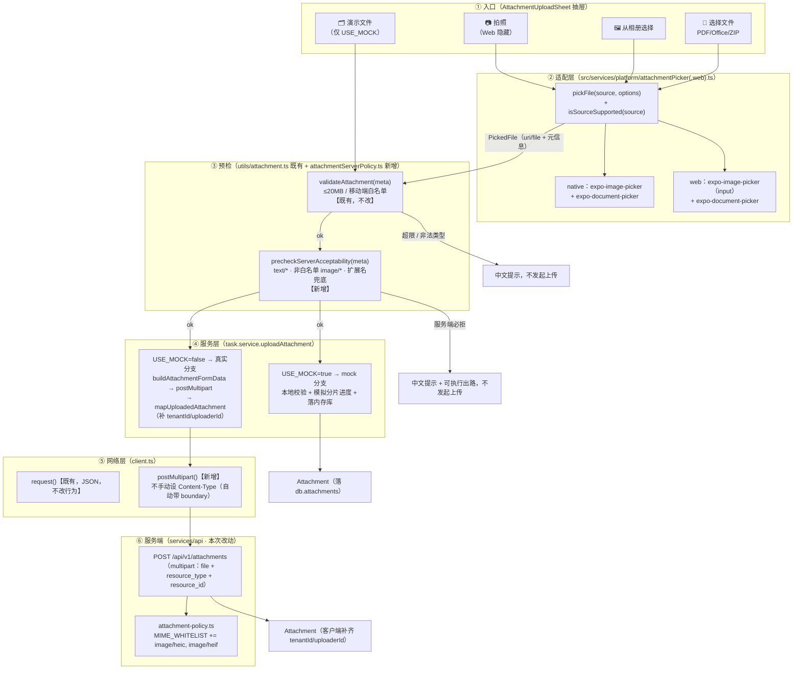
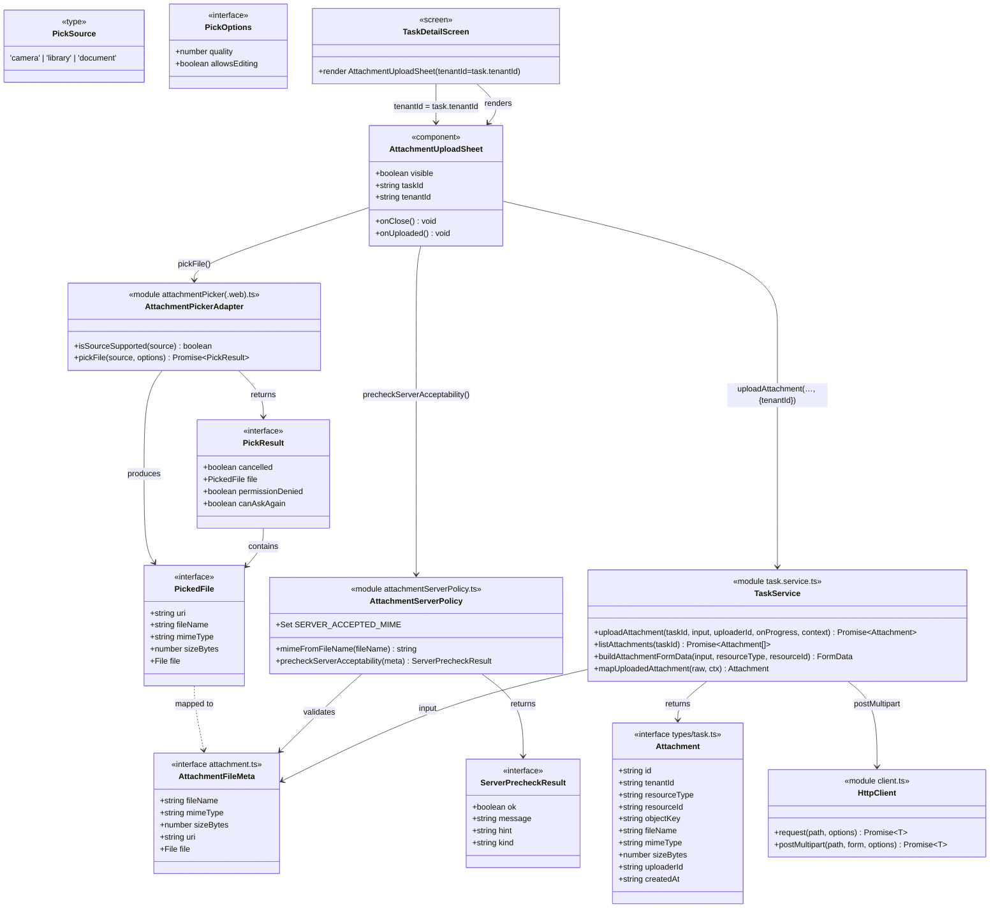
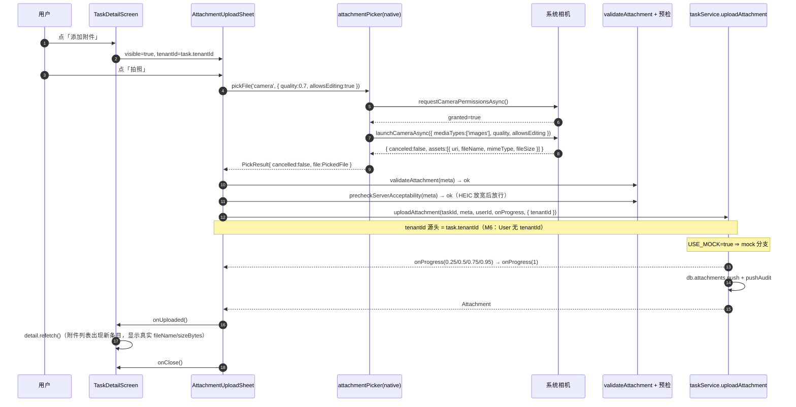
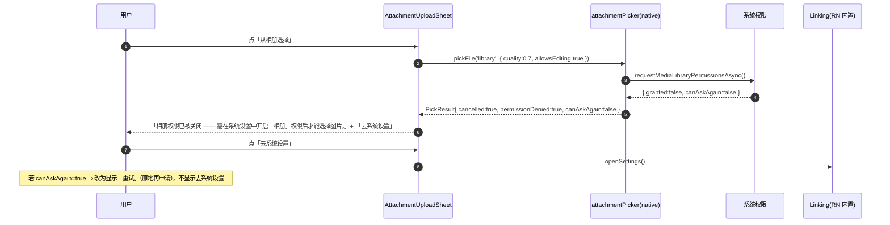
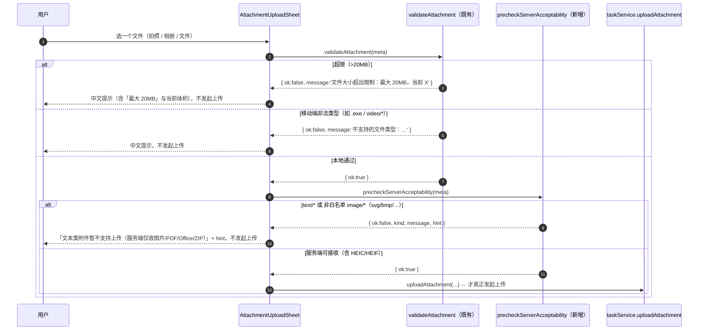
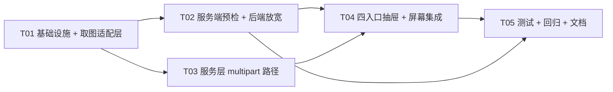

# 架构设计（增量 11）— OpenSchedule 移动端：任务附件拍照直传（M-P2-03）

> 档位：**增量架构 + 任务分解**（一文档交付，颗粒度对齐 `ARCH-mobile-increment-10-darkmode.md`）。
> 负责人：高见远（架构师）· 实读基准：`D:\GLMclaw\workspace\openschedule`（本次写作时）
> 上游输入：`PRD-mobile-increment-11-attachment-capture.md`（许清楚，v1.0，559 行，本文唯一需求依据）· `ARCH-mobile.md` §10（`:561-576` 状态管理边界）· §11（`:585-600` 风险与降级 R1/R4）· 参照范例：`ARCH-mobile-increment-10-darkmode.md`（结构与文风）
> **本文含实现方案、文件清单、类图、时序图、任务分解。所有代码事实均给 `文件:行号`；凡不确定一律进 §9。**
> **硬约束（违反即返工）**：① 新增依赖**仅 2 个 expo 官方包**（`expo-image-picker` + `expo-document-picker`）② **禁用** `react-native-reanimated` / `react-native-gesture-handler` / `expo-camera` / `expo-image-manipulator` ③ 样式数值只取 `src/theme/tokens.ts`；新增 UI 走增量 10 **样式工厂范式**（`const makeStyles = (colors: ThemeColors) => StyleSheet.create({...})` + `useThemedStyles(makeStyles)`，**工厂参数名必须叫 `colors`**）④ 裸 `<Pressable>` 白名单**恰好 6 个文件**，其它一律 `PressableScale` ⑤ **不修改任何既有测试文件与其断言**（可新增文件/新增用例）⑥ 新增 UI **必须同时适配浅色与深色** ⑦ `tsc --noEmit` 零错误 ⑧ 最小变更 ⑨ **本阶段只产出文档，不改任何源码 / 测试 / `app.json`**。

---

## 0. 拍板与裁决

### 0.1 用户已拍板的三项决策（不可推翻，本文全程遵守）

| # | 决策 | 本文落地位置 |
| --- | --- | --- |
| **① HEIC 口径 = 推后端放宽收 HEIC** | 在 `services/api/src/modules/attachments/attachment-policy.ts` 的 `MIME_WHITELIST`（`:3-9`）加入 `image/heic`、`image/heif`；**属本增量实现范围**（不再是"另立工单"） | §2.7 / §3.2 / §9-M2 |
| **② 破例边界 = 2 个包** | `expo-image-picker`（拍照 + 相册 + 权限 + Web）+ `expo-document-picker`（任意文件：PDF / Office / ZIP）；**不加 `expo-camera`** | §1.3 / §7 |
| **③ `allowsEditing` = 开启** | 拍照 / 选图后进系统裁剪确认界面；**iOS 因此强制转码为 JPEG**（顺带绕开 HEIC） | §2.3 / §9-M1 |

### 0.2 主理人已定事项（直接落进设计，不再讨论）

| # | 事项 | 落地位置 |
| --- | --- | --- |
| **M-a** | 必须**显式关闭** `expo-image-picker` config plugin 默认的麦克风用途与 Android `RECORD_AUDIO`（`microphonePermission: false`） | §2.10 / §7 |
| **M-b** | 真实上传分支：**代码到位、本次不验收**（只跑 `USE_MOCK=true` mock 路径）；但**代码完整** + **补单测**（mock `fetch` 验证 multipart 请求构造） | §2.5 / §2.6 / §6-T03 |
| **M-c** | **不做视频**（服务端白名单完全不收 `video/*`） | §1.4 / §0.3-D14 |

### 0.3 架构师本版裁决 —— 逐条回答 PRD D1–D14 与 Q1–Q17

> 口径：**采纳** = 与 PRD 一致；**改动** = 因用户三项拍板 / 主理人事项而与 PRD 不同；**已定** = PRD 已表态且本次无需变更。

#### D1–D14 裁决表

| 编号 | PRD 原表态 | 本版裁决 | 理由 |
| --- | --- | --- | --- |
| **D1** 依赖取舍 | 只加 `expo-image-picker`，不加 `expo-camera` | **改动**：加 **2 个包**（+`expo-document-picker`），仍不加 `expo-camera` | 用户拍板 ② 已授权第 2 个包，用于「选择任意文件」入口；`expo-camera` 仍零命中（只多自绘取景器） |
| **D2** 契约不一致（HEIC / `text/*`） | ①推后端放宽（长期工单）②客户端转码 ③仅提示 ④组合（①长期+③兜底，②不做） | **改动**：**①后端放宽 = 本增量实现**（`attachment-policy.ts` 加 `image/heic`/`image/heif`）；**③兜底提示保留**（改用于 `text/*` 与其它非白名单 `image/*`）；**②不做** | 用户拍板 ① 把"长期工单"提前到本次；`text/*` 仍须靠预检拦截（移动端白名单不许收紧，F20） |
| **D3** 入口形态 | 三入口（拍照 / 相册 / 演示文件）；native 不选任意文件 | **改动**：**四入口**（拍照 / 从相册选择 / 选择文件 / 演示文件） | 用户拍板 ② 带来 `expo-document-picker` ⇒ 「选择文件」入口可行 |
| **D4** 权限时机与降级 | 点按即申请；`canAskAgain===false` 给「去系统设置」（`Linking.openSettings()`）；Web 跳过 | **采纳** | 与用户拍板无冲突 |
| **D5** Web 行为 | Web 不显示「拍照」；用 `assets` 空判空；用 `asset.file` 组 `FormData` | **采纳** | 同上 |
| **D6** 上传分支 | `USE_MOCK` 双分支；字段 `file`+`resource_type=task`+`resource_id`；响应补齐 `tenantId`/`uploaderId`；列表端点校正 | **采纳** | 同上 |
| **D7** 进度与重试 | 真实分支不伪造百分比；失败可重试（保留文件）；上传中禁关闭抽屉 | **采纳** | 同上 |
| **D8** 命名与临时文件 | `IMG_YYYYMMDD_HHmmss.<ext>` 兜底；mock 用 `sanitizeFileName`、真实以服务端 `objectKey` 为准；不引 `expo-file-system` | **采纳** | 同上 |
| **D9** 大小与压缩 | `quality: 0.7`；**`allowsEditing` 建议先关**；20MB 上限不改 | **改动**：`quality: 0.7` **+ `allowsEditing: true`** | 用户拍板 ③ 明确开启 `allowsEditing` |
| **D10** `MOCK_UPLOAD_FILES` 去留 | 保留 + `USE_MOCK` 门禁 | **采纳** | 保留 6 条（含超限 `.mov` / 非法 `.exe` 两条校验分支演示样本） |
| **D11** 测试与打包隔离 | 适配层（native/web）+ 新增测试 mock 适配层 + 不改既有测试 + 新字段可选 + 不破坏 `runTransition` 片段 | **采纳** | 同上 |
| **D12** 预览 | 本次不接真实下载端点；P0 保证列表显示真实 `fileName`/`sizeBytes` | **采纳** | 同上 |
| **D13** 深色与样式 | 样式工厂 + `PressableScale` + 裸 `<Pressable>` 恰好 6 + 只取 tokens + 浅深双适配 | **采纳** | 同上 |
| **D14** 不做视频 | 不做；`mediaTypes` 只取图片；关麦克风权限 | **采纳** | 服务端不收 `video/*`（F8），录了也传不上去 |

#### Q1–Q17 裁决表

| 编号 | 问题 | 本版裁决 | 说明 |
| --- | --- | --- | --- |
| **Q1** | 入口形态 / native 是否选任意文件 | **改动**：**四入口**，且 **native 支持选任意文件**（`expo-document-picker`） | 用户拍板 ② 授权第 2 包 |
| **Q2** | 权限时机 / 拒绝降级 | **采纳**：点按即申请；`canAskAgain===false` 给「去系统设置」 | — |
| **Q3** | Web 降级 | **采纳**：Web 不显示「拍照」，保留「选择图片 / 选择文件 / 演示文件」 | — |
| **Q4** | 上传分支 | **采纳**：真实 multipart + `USE_MOCK` 双分支（默认 mock） | — |
| **Q5** | 进度与重试 | **采纳**：真实分支不确定态 + 失败可重试（保留文件） | — |
| **Q6** | 命名规则 | **采纳**：`IMG_YYYYMMDD_HHmmss.<ext>`；`objectKey` 真实以服务端为准 | — |
| **Q7** | 压缩参数 / `allowsEditing` | **改动**：`quality: 0.7` **+ `allowsEditing: true`** | 用户拍板 ③（iOS 强制转码 → 绕开 HEIC） |
| **Q8** | `MOCK_UPLOAD_FILES` 去留 | **采纳**：保留 + `USE_MOCK` 门禁 | — |
| **Q9** | 测试与打包隔离 | **采纳**：适配层 + mock 适配层 + 不改既有测试（含 `tests/setup.ts`） | — |
| **Q10** | 预览 | **采纳**：本次不接真实下载；列表显示真实 `fileName`/`sizeBytes` | — |
| **Q11** | 🔴 HEIC 最终口径 | **改动/已裁决**：**①后端放宽 = 本增量实现**；②客户端转码 **不做**；③兜底提示保留（服务于 `text/*` 与其它非白名单 `image/*`） | 用户拍板 ① |
| **Q12** | `Attachment` 类型差异 | **采纳**：**客户端补齐** `tenantId`/`uploaderId`（不改 `Attachment` 类型，避免影响既有测试） | — |
| **Q13** | 真实分支本次是否验收 | **采纳**：**代码到位、本次不验收**，登记为**已知限制**（本地无运行中的后端） | 主理人事项 M-b |
| **Q14** | 20MB 上限 | **采纳**：本次不改（改上限需动后端与 Web） | — |
| **Q15** | 多图选择 | **采纳**：本次不做（列 P1） | `allowsEditing` 与多选互斥 |
| **Q16** | 上传成功后排序 | **采纳**：按 `createdAt` 倒序置顶 | — |
| **Q17** | 抽屉高度 | **改动**：`heightRatio` 由 `0.62` **上调到 `0.72`** + 内部 `ScrollView` | 四入口 + 演示文件列表需要更多竖向空间（§2.9） |

### 0.4 本次架构层面的三条关键结论（先说结论）

1. **HEIC 从"主路径必失败"变为"服务端可接收"**：用户拍板①把后端白名单放宽落地到本次，`image/heic`/`image/heif` 入 `MIME_WHITELIST`。⇒ PRD §2-F9 的"iPhone 拍照必然失败"风险**在本增量被消除**（前提：后端随本次一起部署）。
2. **契约不一致的残余面收窄为「`text/*` + 非白名单 `image/*`」**：这两类仍「移动端放行、服务端必拒」⇒ 由**新增的「服务端可接收性预检」**在上传前拦截（§2.4），**不动既有 `validateAttachment` / `isAllowedMimeType`**（F20 锁定）。
3. **隔离必须靠「适配层 + 新增测试 mock 适配层」**：`jest-expo` 的 `haste.defaultPlatform='ios'`（F18）⇒ `.web.ts` 在测试里**完全不生效**；好消息是**没有任何既有测试 render / import `TaskDetailScreen`**（F19），故新增 import 不会拖垮既有 50 套件——但**不得改写被源码文本断言的 `runTransition`→`handleClaim` 片段**（N15）。

---

## 1. 方案总览

### 1.1 一句话方案

> 把任务详情页的「添加附件」从**挑硬编码假文件**变成**真的能拍照 / 选图 / 选文件并上传**：抽屉给 **拍照 / 从相册选择 / 选择文件 / 演示文件（仅 `USE_MOCK`）** 四个入口；原生能力（相机 / 相册 / 文件选择）**全部关进适配层** `src/services/platform/attachmentPicker.ts` + `.web.ts`（照 `biometrics.ts` 范式）；新增一层**「服务端可接收性预检」**（`text/*` 与其它非白名单 `image/*` 在上传前拦截）；`uploadAttachment` 沿用 `if (USE_MOCK) {…} else {…}` 双分支，真实分支走**新增的 `postMultipart`** 打 `POST /api/v1/attachments`（字段 `file` + `resource_type=task` + `resource_id`），并**同步放宽后端白名单收 HEIC/HEIF**。

### 1.2 方案总览图（入口 → 适配层 → 预检 → 服务层 → mock / 真实分支）



### 1.3 技术选型（沿用既有栈 + **仅 2 个新依赖**）

| 维度 | 选择 | 理由 |
| --- | --- | --- |
| 拍照 / 相册 | **`expo-image-picker`（expo 官方，`~57.x`）** | 一个包覆盖**拍照 + 相册 + 权限 + Web**；`node_modules` 实测未装（需 `npx expo install`） |
| 任意文件选择 | **`expo-document-picker`（expo 官方，`~57.x`）** | 用户拍板②授权；PDF / Office / ZIP 的唯一可行路径 |
| 原生能力隔离 | **适配层 `src/services/platform/attachmentPicker.ts` + `.web.ts`** | 照 `biometrics.ts` / `biometrics.web.ts` 既有范式（F18）；业务层零直接 import |
| 系统设置降级 | **`Linking.openSettings()`（RN 内置）** | 零依赖；`Linking.d.ts:48` 确认可用（F13） |
| multipart 上传 | **`fetch` + `FormData`（RN/Web 内置）** | 零新增依赖；`FormData`/`File`/`Blob` 类型由 `expo/tsconfig.base` 的 `lib: ["DOM","ESNext"]` 提供（本次实读确认） |
| 后端白名单 | **改 `attachment-policy.ts`（+2 个 MIME）** | 用户拍板①；既有 spec 未断言白名单精确内容（§9-M2），零破坏 |
| 样式 | **增量 10 样式工厂 + `PressableScale`** | 硬约束；浅深双适配 |
| 进度条 | **复用 `ProgressBar`** | mock 分支百分比 / 真实分支不确定态 |

### 1.4 核心难点与应对

| 难点 | 说明 | 应对 |
| --- | --- | --- |
| **N1 `.web.ts` 在测试里不生效（最大心智陷阱）** | `jest-expo` 继承 RN `haste.defaultPlatform='ios'`（F18）⇒ 测试永远解析 native `.ts` | §2.1：隔离靠**适配层 + 新增测试 mock 适配层**（照 `auth.test.ts:5` mock 原生模块姿势） |
| **N2 契约不一致（HEIC / `text/*`）** | 移动端收 `image/*`+`text/*`，服务端精确枚举（F8/F9） | §2.4 + §2.7：**后端放宽收 HEIC** + **新增服务端预检拦截 `text/*`**；**不动既有 `validateAttachment`/`isAllowedMimeType`**（F20） |
| **N3 `client.ts` 只支持 JSON** | `request()` 强制 `Content-Type: application/json` + `JSON.stringify`（F5） | §2.6：**新增独立 `postMultipart`**，**不改 `request` 行为** |
| **N4 响应字段缺口** | 上传响应不含 `tenantId`/`uploaderId`（F7） | §2.5：真实分支 `mapUploadedAttachment` 客户端补齐（**`tenantId` 取 `task.tenantId`**（经 props 下传）、`uploaderId` 取入参）——**不是** `user.tenantId`（`User` 无该字段，M6） |
| **N5 源码文本断言（最小变更落点）** | `increment4-qa.test.ts:651-694` / `increment4-withdraw.test.ts:308-334` 对 `runTransition`→`handleClaim` 片段做 `toContain` 断言 | §2.9 + §8.4：**保持 `runTransition` 与 `handleClaim` 的源码形态逐字节不变**；抽屉逻辑**迁出**到新组件（不触及该片段） |
| **N6 `tsc` 覆盖 `tests/`** | `tsconfig.json:11-14` `include: **/*.ts(x)`（F21） | §4.1：`AttachmentFileMeta` 新增字段**必须可选** |
| **N7 麦克风权限污染** | plugin 默认为录像声明麦克风（PRD D1 代价） | §2.10：`"microphonePermission": false` |
| **N8 真机 / Web 三端语义分叉** | 权限、`cancelled`、`asset.file`、`quality` 三端不同（F14/F15/官方文档） | §2.2 / §2.3 / §2.9：适配层内 `Platform` 分叉 + `.web.ts` 覆盖 |
| **N9 真实分支无后端可验收** | 本地无运行中的后端 | §0.3-Q13：代码到位 + 单测（mock `fetch`）+ 登记已知限制 |

### 1.5 范围边界

- **做**：2 个新依赖 + `app.json` config plugin（含关麦克风）+ 适配层（native/web）+ 服务端可接收性预检 + 后端白名单放宽 + `uploadAttachment` 真实 multipart 分支 + `client.ts` `postMultipart` + `MOCK_UPLOAD_FILES` 的 `USE_MOCK` 门禁 + 四入口抽屉 UI（含权限降级 / 预检提示 / 重试）+ 浅深双适配 + 新增测试（mock 适配层 / mock fetch）。
- **不做**：视频录制（D14）· `expo-camera`（D1）· `expo-image-manipulator`（客户端 HEIC 转码，D2）· `expo-file-system` / `expo-sharing`（真实预览落地 / 临时文件清理，D8/D12）· 修改 `apps/web` 功能（N13）· 修改任何既有测试文件与断言（N7）· `reanimated` / `gesture-handler`（N8）· 伪造真实分支百分比（N9）· 多图选择（Q15）· 改 20MB 上限（Q14）· 任何 git 操作（N14）· 改写 `runTransition` 片段（N15）· 给 `AttachmentFileMeta` 加必填字段（N16）。

---

## 2. 关键机制设计

### 2.1 适配层接口与 `.web.ts` 分叉（N1 / N8）

**结论**：新增 `src/services/platform/attachmentPicker.ts`（native）+ `attachmentPicker.web.ts`（web），**业务层只依赖适配层**，屏幕 / 组件内**零** `expo-image-picker` / `expo-document-picker` import。

**统一对外接口（两个实现逐字节同签名）**：

```ts
// src/services/platform/attachmentPicker.ts（native）/ attachmentPicker.web.ts（web）
export type PickSource = 'camera' | 'library' | 'document'

export interface PickOptions {
  /** 图片压缩质量（0..1），仅 camera / library 生效；document 忽略 */
  quality?: number
  /** 是否允许系统裁剪 / 编辑（仅 camera / library 生效；iOS 开启会强制转码） */
  allowsEditing?: boolean
}

/** 取图结果（已归一化三端差异） */
export interface PickedFile {
  /** native：临时文件 uri（cache 目录）；web：blob: URL 或 '' */
  uri: string
  fileName: string
  mimeType: string
  sizeBytes: number
  /** Web 专有 File（组 FormData 用）；native 为 undefined */
  file?: File
}

export interface PickResult {
  /** 用户取消 / 未选（三端统一） */
  cancelled: boolean
  file: PickedFile | null
  /** 权限被拒（仅 camera / library；document 恒 false） */
  permissionDenied: boolean
  /** 被拒时是否还可再次询问（false ⇒ UI 引导去系统设置） */
  canAskAgain: boolean
}

/** 该来源在当前平台是否可用（Web：camera=false；其余 true） */
export function isSourceSupported(source: PickSource): boolean

/** 取一个文件（含权限申请；点按入口时调用） */
export function pickFile(source: PickSource, options?: PickOptions): Promise<PickResult>
```

**native 实现要点**：

- `camera` → `ImagePicker.requestCameraPermissionsAsync()` → `launchCameraAsync({ mediaTypes: ['images'], quality, allowsEditing })`。
- `library` → `ImagePicker.requestMediaLibraryPermissionsAsync()` → `launchImageLibraryAsync({ mediaTypes: ['images'], quality, allowsEditing })`。
- `document` → `DocumentPicker.getDocumentAsync({ copyToCacheDirectory: true, multiple: false })`（**无权限环节**）。
- **取消判定**：`ImagePicker` 的 `result.canceled`（native 有）；`DocumentPicker` 的 `result.canceled`（SDK 49+ 返回 `{ canceled, assets }`）。
- **元信息归一化**：`fileName = asset.fileName ?? 生成名`（D8）；`mimeType = asset.mimeType ?? 由扩展名推导`（§2.4 的 `mimeFromFileName`）；`sizeBytes = asset.fileSize ?? 0`。

**web 实现要点（关键差异）**：

- `isSourceSupported('camera')` → **`false`**（`capture` 属性桌面端普遍被忽略，D5 / US-11-10）；`library` / `document` → `true`。
- **Web 不返回 `cancelled`**（官方文档）⇒ 判空**只能用 `assets` 为空**（`assets == null || assets.length === 0` ⇒ `cancelled: true`）。
- Web 上传必须用 **`asset.file`（`File` 对象）**组 `FormData`，不能用 `uri`。
- Web 权限 API 是 **no-op** ⇒ `permissionDenied` 恒 `false`、`canAskAgain` 恒 `true`（不进入权限分支）。

> **为何不把 native 与 web 合并成单文件 + `Platform.OS` 分支**：可行，但（a）与既有 `biometrics.ts`/`biometrics.web.ts` 范式不一致；（b）`.web.ts` 让 Web 打包**不进入 native 权限代码路径**，隔离更干净。**本文采用 `.web.ts` 分叉**；单文件方案作为备选登记 §9-M4。

### 2.2 权限流程与降级（D4 / US-11-03 / US-11-04）

**结论**：**点按入口时才申请**（不在抽屉打开时预申请）；拒绝后给中文说明；`canAskAgain === false` 时提供**「去系统设置」**。

```
点按「拍照」/「从相册选择」
  → 适配层 requestXxxPermissionsAsync()
     ├─ granted            → 取图
     ├─ !granted && canAskAgain → PickResult{ permissionDenied:true, canAskAgain:true }  → UI：中文说明 + 「重试」
     └─ !granted && !canAskAgain → PickResult{ permissionDenied:true, canAskAgain:false } → UI：「去系统设置」按钮
```

- **「去系统设置」= `Linking.openSettings()`**（RN 内置，零依赖；`Linking.d.ts:48` 确认，F13）。这是拒绝后**唯一能真正解除阻塞**的路径。
- **Web 端跳过整个权限环节**（官方文档：`requestCameraPermissionsAsync`/`requestMediaLibraryPermissionsAsync` 在 Web 不做任何事）⇒ `.web.ts` 直接取图。
- **iOS**：相机需 `NSCameraUsageDescription`、相册需 `NSPhotoLibraryUsageDescription`（由 config plugin 写入，§2.10）；**只读相册**（不申请写入 / `writeOnly`）。
- **Android**：plugin 自动加 `CAMERA`；Android 13+ 相册走系统 Photo Picker（无需存储权限）。
- **文案**（面向用户可读，中文）：如「相机权限已被关闭 —— 需要在系统设置中开启「相机」权限后才能拍照。」

### 2.3 `allowsEditing` + `quality` 叠加语义（用户拍板 ③ / D9）

**结论**：取图时统一传 **`allowsEditing: true` + `quality: 0.7`**（`mediaTypes: ['images']`）。

| 平台 | `allowsEditing: true` | `quality: 0.7` | 叠加后实际语义 |
| --- | --- | --- | --- |
| **iOS** | 拍照 / 选图后进入系统**裁剪确认界面** | 作用于**重编码** | **iOS 通常因 `allowsEditing` 触发重编码 ⇒ 输出 JPEG**（`image/jpeg`），**顺带绕开 HEIC**——这是用户拍板③的**预期收益**（⚠️ **无真机未验证**，见 §9-M1；**放行不依赖它**，见下） |
| **Android** | 进入系统裁剪界面（部分机型实现差异） | 对 JPEG 生效；**对 `.png`/`.bmp` 被忽略**（官方文档） | 输出通常为 JPEG；`quality` 可能被忽略 ⇒ **必须保留超限兜底**（§2.4 / §2.5 复用 `validateAttachment`） |
| **Web** | **被忽略**（无裁剪 UI） | **被忽略**（原文件直传） | 上传**用户所选原文件**；HEIC 与否取决于用户所选文件（Web 上 HEIC 较少） |

- **`allowsEditing` 与多选互斥**：`allowsMultipleSelection` 与 `allowsEditing` 在 iOS 上互斥（官方文档）⇒ 本增量不做多选（Q15），无冲突。
- **不传 `aspect`** ⇒ iOS 为自由裁剪。
- **注意（重要）**：`allowsEditing` 的转码**不能 100% 保证**输出 JPEG（Android 部分机型、Web 均不保证）⇒ §2.4 的**扩展名兜底预检**仍必须保留。
- **🔴 放行不依赖转码（M1 裁决）**：上传能否成功**只取决于服务端白名单**（HEIC 已放宽放行，§2.7），**与「iOS 是否真的转码」无关**。「iOS `allowsEditing` 是否真产出 JPEG」仅为 **QA 观察项**（§9-M1，标「无真机，未验证」），**不作为阻断条件**。

### 2.4 服务端可接收性预检（新增一层，不改既有函数）（D2 / Q11 / N2）

**结论**：**保持既有 `validateAttachment` / `isAllowedMimeType` 逐字节不动**（F20 锁定：`isAllowedMimeType('text/plain') === true` 等），**新增** `src/utils/attachmentServerPolicy.ts`，对「本地放行、服务端必拒」的类型在上传前拦截。

**服务端白名单（本次放宽后）镜像**（对齐 `attachment-policy.ts:3-9` + 用户拍板①）：

```
image/jpeg · image/png · image/gif · image/webp · image/heic · image/heif   ← 本次新增后两者
application/pdf · application/msword · ...wordprocessingml.document
application/vnd.ms-excel · ...spreadsheetml.sheet
application/vnd.ms-powerpoint · ...presentationml.presentation
application/zip · application/x-zip-compressed · application/x-7z-compressed
```

**预检规则**（纯函数，零依赖，便于单测）：

```ts
// src/utils/attachmentServerPolicy.ts（新增）
export interface ServerPrecheckResult {
  ok: boolean
  /** ok=false 时的中文原因（可直接展示） */
  message: string
  /** ok=false 时可执行的替代做法（可选） */
  hint?: string
  /** 归类（供 UI 选图标 / 措辞） */
  kind?: 'text' | 'video' | 'image-unsupported' | 'unknown'
}

/** 由文件名扩展名推导 MIME（兜底；asset.mimeType 可能为 null / 被错标） */
export function mimeFromFileName(fileName: string): string

/** 服务端可接收性预检（移动端放行但服务端必拒 ⇒ 拦截） */
export function precheckServerAcceptability(meta: AttachmentFileMeta): ServerPrecheckResult
```

**判定逻辑**：

1. `declaredMime` = `meta.mimeType` 归一化（小写、去 `;` 参数）；`extMime` = `mimeFromFileName(meta.fileName)`。
2. `effectiveMime` = `declaredMime || extMime`（**declared 为空时用扩展名兜底**——`asset.mimeType` 可为 null）。
3. **命中服务端白名单** ⇒ `ok: true`（**HEIC / HEIF 在放宽后属于白名单，直接放行**）。
4. **否则按类给中文出路**：
   - `text/*` ⇒ `kind:'text'`，message「文本类附件暂不支持上传（服务端仅收图片 / PDF / Office / ZIP）」，hint「可先另存为 PDF 后再上传」。
   - `video/*` ⇒ `kind:'video'`，message「暂不支持视频附件」。
   - 其它 `image/*`（svg / bmp / tiff / avif 等）⇒ `kind:'image-unsupported'`，message「暂不支持该图片格式（仅支持 JPEG/PNG/GIF/WebP/HEIC）」，hint「可在相册中另存为 JPEG 后重选」。
   - 都不匹配 ⇒ `kind:'unknown'`，message「无法识别的文件类型」。
5. **扩展名兜底（expo/expo#35714 对策）**：若 `extMime` 属**硬拒类别**（`text/*` / `video/*`）或 `application/x-msdownload` 等，即使 `declaredMime` 看起来可接受，也按 `extMime` **拦截**——防止「mimeType 被错标」导致的漏判。反之（`declaredMime` 硬拒）亦拦截。

> **🔴 预检层不得假设「已转码」（M1 裁决）**：无论取图结果的 `asset.mimeType` / 实际字节是 **JPEG 还是 HEIC**，预检**一律放行**（HEIC/HEIF 已进服务端白名单，§2.7）。**即：预检的正确性不依赖 `allowsEditing` 是否真的触发了 iOS 转码**（§2.3 的转码是"锦上添花"，不是放行前提）。「iOS `allowsEditing` 是否真的产出 JPEG」列为 **QA 观察项**（§9-M1），**不作为阻断条件**。

> **与既有 `validateAttachment` 的关系**：预检**不改**它，二者**串联**执行——先 `validateAttachment`（≤20MB + 移动端白名单），再 `precheckServerAcceptability`（服务端口径）。两条都通过才发起上传。

### 2.5 上传服务改造（mock + 真实 multipart）（D6 / D7 / D8 / N4）

**结论**：`uploadAttachment(taskId, input, uploaderId, onProgress?)` 保持双分支；**mock 分支行为逐字节不变**（既有测试断言 `attachment.test.ts:75-95,138-148,150-157,159-173` 依赖它）；真实分支走新增 multipart。

**签名（加法扩展，不破坏既有调用）**：

```ts
// src/services/task.service.ts
export type UploadAttachmentInput = AttachmentFileMeta

export interface UploadContext {
  /** 真实分支补齐响应缺失字段用。**来源 = task.tenantId**（由屏幕经 props 下传；见 §2.5 注） */
  tenantId: string
}

export async function uploadAttachment(
  taskId: string,
  input: UploadAttachmentInput,
  uploaderId: string,
  onProgress?: (ratio: number) => void,
  context?: UploadContext,           // ← 新增（可选，第 5 参）
): Promise<Attachment>
```

> **⚠️ `tenantId` 来源订正（M6 裁决 · 硬事实）**：移动端 `User` 类型**不含 `tenantId`**（`src/types/user.ts:7-26`：只有 `id/email/displayName/avatarUrl/locale/timezone/status/…`）⇒ **`useAuth().user.tenantId` 会 `tsc` 报错**，**不得使用**。
> **正确来源 = `task.tenantId`**（与既有 mock 分支 `task.service.ts:690-691` **逐字一致**）：`TaskDetailScreen` 在 `if (!task) return …`（`:348-355`）之后 `task` 必非空，故把 **`task.tenantId`** 经 `<AttachmentUploadSheet tenantId={task.tenantId} />` 下传，sheet 再以 `{ tenantId }` 作为第 5 参传入。
> **不填 `''` 兜底、不加显式 throw**：`task.tenantId` 是必填 `string`，**不存在"缺失"态**（`UploadContext.tenantId` 亦为必填 `string`），加防御代码是噪声。

**mock 分支（保持不变）**：`validateAttachment(input)` → 分片进度 `[0.25,0.5,0.75,0.95]`（各 `delay(80)`）→ `onProgress(1)` → 组装 `Attachment`（`tenantId` 取自 `task.tenantId`、`objectKey = <tenantId>/<taskId>/<sanitizeFileName>`）→ `db.attachments.push` → `pushAudit`。

**真实分支（新增）**：

```ts
// 1) 组 FormData（字段以 API 为准，F11）
const form = buildAttachmentFormData(input, 'task', taskId)
//   form.append('file', input.file ?? { uri: input.uri, name: sanitizeFileName(input.fileName), type: input.mimeType })
//   form.append('resource_type', 'task')
//   form.append('resource_id', taskId)

// 2) 进度：真实 fetch 无上传进度事件 ⇒ 不伪造百分比（D7）
onProgress?.(0)
const raw = await postMultipart<ServerAttachment>('/attachments', form)   // 见 §2.6
onProgress?.(1)

// 3) 响应补齐（服务端上传响应不含 tenantId/uploaderId，F7）
//    tenantId 来自第 5 参 context.tenantId（源头 = task.tenantId，见上）
return mapUploadedAttachment(raw, { tenantId: context!.tenantId, uploaderId })
```

**新增导出（便于单测，additive）**：

```ts
/** 组 multipart FormData（native 用 {uri,name,type} 形态；Web 用 File） */
export function buildAttachmentFormData(
  input: UploadAttachmentInput,
  resourceType: 'task' | 'comment' | 'project',
  resourceId: string,
): FormData

/** 上传响应 → 移动端 Attachment（客户端补齐 tenantId/uploaderId；tenantId 源头 = task.tenantId） */
export function mapUploadedAttachment(
  raw: ServerUploadedAttachment,
  ctx: { tenantId: string; uploaderId: string },
): Attachment
```

- **真实分支前置守卫**：`USE_MOCK === false` 且 `input.file == null && !input.uri` ⇒ 抛 `ApiError(ERR_INVALID_ATTACHMENT, '未能读取所选文件内容，请重新选择')`（不发起请求）。
- **列表端点校正（F4）**：`listAttachments` 真实分支改为

  ```ts
  // 旧（错）：GET /tasks/:taskId/attachments
  const page = await httpClient.get<Attachment[] | { data: Attachment[] }>(
    '/attachments', { query: { resource_type: 'task', resource_id: taskId } })
  ```

  > ⚠️ **响应形态核对（本次实读确认）**：`attachments.controller.listByResource`（`:34-43`）直接返回 `{ data: items, meta }`；`client.ts` 的 `request()` 解包 `envelope.data`（`:159`）⇒ 直接得到 `items` 数组。**上传响应**同理（`{ data: {...}, meta }` ⇒ `request` 解包出单个附件对象）。**注意**：列表 `items` 是 Prisma 原始行（**含 `tenantId`/`uploaderId`**），故列表无需补齐；**只有上传响应**需要补齐（F7）。

### 2.6 `client.ts` multipart 路径（N3 / M-b）

**结论**：**新增** `postMultipart<T>(path, form, options?)`；**`request()` 保持逐字节不变**（它被全仓大量使用，F5）。

```ts
// src/services/client.ts（新增函数，位于文件末尾）
export async function postMultipart<T>(
  path: string,
  form: FormData,
  options: Omit<RequestOptions, 'method' | 'body'> = {},
): Promise<T> {
  const { query, signal, skipAuth = false } = options
  const url = `${API_BASE}${path}${buildQueryString(query)}`

  const headers: Record<string, string> = { Accept: 'application/json' }
  // ⚠️ 绝不手动设 Content-Type —— 由运行时自动带 multipart/form-data; boundary=...
  if (!skipAuth) {
    const token = tokenProvider()
    if (token) headers.Authorization = `Bearer ${token}`
  }

  let response: Response
  try {
    response = await fetch(url, { method: 'POST', headers, body: form, signal })
  } catch (error) {
    throw new ApiError(0, '网络连接失败，请检查网络后重试', error)
  }
  // 解包 / 错误归一化与 request() 同口径（自带一份，避免改动 request）
  return parseEnvelope<T>(response)
}
```

- **`parseEnvelope`**：把 `request()` 中「读 text → JSON.parse → 401 回调 → `!response.ok` 抛 `ApiError` → 业务码校验 → 返回 `envelope.data`」的逻辑抽为**私有 helper**，供 `request` 与 `postMultipart` 共用。**本文建议**：`postMultipart` 自带一份等价实现（或抽 helper 但**保持 `request` 行为不变**）——两种都满足「不改 `request` 行为」；抽 helper 更 DRY，自带一份更保守。**推荐抽 helper（行为保持）+ 在 T03 回归全量 `request` 用例**。
- **不手动设 boundary**：手动设 `Content-Type: multipart/form-data` 会**丢掉 boundary**，导致服务端 multer 解析失败。**这是本增量最易踩的坑之一**（§8.5）。

### 2.7 后端白名单放宽（用户拍板 ① / Q11 / M2）

**结论**：修改 `services/api/src/modules/attachments/attachment-policy.ts`（`:3-9`）的 `MIME_WHITELIST`，**新增 `image/heic` 与 `image/heif`**：

```ts
const MIME_WHITELIST = new Set([
  'image/jpeg', 'image/png', 'image/gif', 'image/webp',
  'image/heic', 'image/heif',                                  // ← 本次新增（用户拍板①）
  'application/pdf',
  'application/msword', 'application/vnd.openxmlformats-officedocument.wordprocessingml.document',
  'application/vnd.ms-excel', 'application/vnd.openxmlformats-officedocument.spreadsheetml.sheet',
  'application/vnd.ms-powerpoint', 'application/vnd.openxmlformats-officedocument.presentationml.presentation',
  'application/zip', 'application/x-zip-compressed', 'application/x-7z-compressed',
])
```

- **既有 `attachment-policy.spec.ts` 零破坏**（本次实读确认）：它只断言 `text/html` 被拒（`:7`）、`IMAGE/PNG`/`application/pdf` 被接受（`:11-12`）、空文件 / 超限被拒（`:5-6`）——**未断言白名单的精确内容**。⇒ 新增 2 个 MIME **不影响任何既有断言**（详见 §9-M2）。
- **测试**：**新增** `attachment-policy-heic.spec.ts`（新文件）断言 `validateAttachmentMetadata(1024, 'image/heic') === null` 与 `'image/heif'` 同理；**不改既有 spec**（严守硬约束⑤）。
- **`apps/web` 影响**：`attachmentApi.ts`（`:34-47`）**无 `accept` 过滤**（本次实读：直接 `client.post('/attachments', form)`，axios 自动处理 multipart），且 **grep 确认 `uploadAttachment` 全仓无调用方**（未接线的参考实现）⇒ **本轮 Web 不做任何改动**；其价值 = 移动端 multipart 的**字段名参考**（axios↔fetch 调用方式不可照抄）（§9-M3）。
- **`FileInterceptor` 无需改**：multer 不按 mimetype 过滤，白名单由 service 校验（`attachments.service.ts:39`）。

### 2.8 `MOCK_UPLOAD_FILES` 的 `USE_MOCK` 门禁（D10 / Q8）

**结论**：**保留** `MOCK_UPLOAD_FILES`（6 条，含 `.mov` 超限 / `.exe` 非法两条校验分支演示样本），**只在 `USE_MOCK === true` 时渲染**「演示文件」区块。

```tsx
import { USE_MOCK } from '@/services'
// ...
{USE_MOCK ? <演示文件区块 files={MOCK_UPLOAD_FILES} onPick={handlePickMock} /> : null}
```

- 真实构建（`USE_MOCK=false`）下**不渲染**该区块 ⇒ 不会把假文件往真后端传。
- **`MOCK_UPLOAD_FILES` 迁至新组件** `AttachmentUploadSheet.tsx`（§2.9）；**不破坏** `TaskDetailScreen.tsx` 的 `runTransition` 源码片段（N15）。
- **保留超限 / 非法类型两条样本的价值**：它们是 QA 现有验收手法（点 `.mov` 见「最大 20MB」、点 `.exe` 见「不支持的文件类型」）的可演示基础。

### 2.9 UI 抽屉四入口与深色适配（D3 / D13 / Q17 / US-11-09）

**结论**：把「添加附件」抽屉从 `TaskDetailScreen.tsx` **抽为独立组件** `src/components/AttachmentUploadSheet.tsx`，内含四入口 + 全部状态。

**抽屉结构（四入口动作区）**：

| 入口 | 语义 | `USE_MOCK=true` | `USE_MOCK=false` | Web |
| --- | --- | --- | --- | --- |
| **拍照** | 调起系统相机 | ✅ | ✅ | ❌ **不渲染**（`isSourceSupported('camera')===false`） |
| **从相册选择** | 调起系统相册（仅图片） | ✅ | ✅ | ✅（等价「选择图片」） |
| **选择文件** | PDF / Office / ZIP（`expo-document-picker`） | ✅ | ✅ | ✅ |
| **演示文件** | 复用 `MOCK_UPLOAD_FILES` 六条 | ✅ 渲染 | ❌ **不渲染** | ✅ 渲染 |

**抽屉状态**（对齐 PRD §5.1 状态机）：

- **入口态** → 四入口动作行（`PressableScale` 行：图标 + 标题 + 副标题）。
- **权限拒绝态** → 中文说明 + （`canAskAgain` 时「重试」/ 否则「去系统设置」`Button`）。
- **上传中（mock 分支）** → 文件名 + **`ProgressBar value={progress}` + 「上传中… N%」**（**保持原样不变**——mock 有真实 `onProgress` 序列，既有测试断言进度最终为 1，F20）+ **禁止关闭抽屉**（保留既有行为，F16）。
- **上传中（真实分支）** → 文件名 + **`ActivityIndicator`（不确定态）** + 「上传中…」**无百分比**（**M5 裁决**：`fetch` 无上传进度 ⇒ **不自实现循环 `ProgressBar`**，那是假进度）+ **禁止关闭抽屉**。
- **失败态** → 错误文案 + **「重试」（保留上次文件，无需重拍）** + 「取消」（D7）。
- **预检拦截态** → `precheckServerAcceptability` 的 message + hint（HEIC 之外的 `text/*` / 非白名单 `image/*`）。

**深色适配（硬约束）**：

- 组件内 `const styles = useThemedStyles(makeStyles)`；`const { colors } = useTheme()`。
- **工厂签名必须为** `const makeStyles = (colors: ThemeColors) => StyleSheet.create({...})`（**参数名必须叫 `colors`**，L3 源码扫描断言，§8.4）。
- 颜色只取 `colors.*`（`bg.surface` / `bg.subtle` / `text.primary` / `text.secondary` / `primary` / `warning` / `danger` / `border`）；间距 / 圆角 / 图标尺寸只取 `spacing` / `radius` / `layout`。
- 交互元素一律 **`PressableScale`**（不新增裸 `<Pressable>`）；按钮用 `Button`。
- `heightRatio` 由 `0.62` → **`0.72`**，内部用 `ScrollView`（Q17）。
- **浅 / 深双套逐一自检**（PRD §5.4 矩阵）。

### 2.10 `app.json` config plugin（关麦克风）（M-a / D14）

**结论**：新增 `expo-image-picker` 与 `expo-document-picker` 两个 plugin 条目；`expo-image-picker` **显式设 `microphonePermission: false`**。

```jsonc
// apps/mobile/app.json → expo.plugins（:38-46 追加）
"plugins": [
  "expo-secure-store",
  ["expo-local-authentication", { "faceIDPermission": "用于快捷解锁 OpenSchedule，免去重复输入密码。" }],
  ["expo-image-picker", {
    "photosPermission": "用于从相册选择图片作为任务附件。",
    "cameraPermission": "用于拍摄照片作为任务附件。",
    "microphonePermission": false                       // ← 关闭默认麦克风用途（不做录像，M-a）
  }],
  "expo-document-picker"
]
```

- **`microphonePermission: false`**：官方 plugin 选项类型为 `string | false`（本次核实），设为 `false` ⇒ **不写入 `NSMicrophoneUsageDescription`**，Android 侧**不注入 `RECORD_AUDIO`**。避免「上传附件却索要麦克风权限」的隐私观感与审核风险。
- **iOS 新增**：`NSCameraUsageDescription`（cameraPermission）/ `NSPhotoLibraryUsageDescription`（photosPermission）；**不应出现** `NSMicrophoneUsageDescription`。
- **Android**：自动加 `CAMERA`；**不应出现** `RECORD_AUDIO`。
- **`userInterfaceStyle`（`:9`）保持 `automatic`**（增量 10 成果，不动）。

---

## 3. 文件清单（标注 新建 / 修改 + 模式与风险）

### 3.1 新建文件

| 文件 | 职责 | 风险 |
| --- | --- | --- |
| `apps/mobile/src/services/platform/attachmentPicker.ts` | **原生取图适配层（native）**：`pickFile` / `isSourceSupported`；import `expo-image-picker` + `expo-document-picker`；权限申请 + 元信息归一化 | 中（新原生模块接入） |
| `apps/mobile/src/services/platform/attachmentPicker.web.ts` | **原生取图适配层（web）**：`camera` 不支持；`assets` 空判空；`asset.file` | 中（三端语义分叉） |
| `apps/mobile/src/utils/attachmentServerPolicy.ts` | **服务端可接收性预检**：`SERVER_ACCEPTED_MIME` / `mimeFromFileName` / `precheckServerAcceptability` | 低（纯函数） |
| `apps/mobile/src/components/AttachmentUploadSheet.tsx` | **四入口上传抽屉组件**：四入口 + 权限降级 + 预检提示 + 上传进度 / 重试 + 浅深双适配；接收 `tenantId: string` prop（源头 = `task.tenantId`，M6） | 中（新组件 + 状态机） |
| `apps/mobile/tests/attachment-picker.test.ts` | 适配层单测（**mock 适配层 / 原生模块**，照 `auth.test.ts:5` 姿势） | 低 |
| `apps/mobile/tests/attachment-server-policy.test.ts` | 预检纯函数单测（HEIC 放行 / `text/*` 拦截 / 扩展名兜底） | 低 |
| `apps/mobile/tests/attachment-multipart.test.ts` | `postMultipart` + `buildAttachmentFormData` 单测（mock `fetch`） | 低 |
| `services/api/src/modules/attachments/attachment-policy-heic.spec.ts` | 后端 HEIC/HEIF 白名单新增用例（**新文件，不改既有 spec**） | 低 |

### 3.2 修改文件

| 文件 | 模式 | 改动点 | 风险 |
| --- | --- | --- | --- |
| `apps/mobile/package.json` | 依赖 | 新增 `expo-image-picker@~57.x`、`expo-document-picker@~57.x`（由 `npx expo install` 解析版本，**不手写**） | 低 |
| `apps/mobile/app.json` | 配置 | `plugins` 追加 2 条（§2.10）；**不改** `userInterfaceStyle` / splash | 低 |
| `apps/mobile/src/utils/attachment.ts` | 类型 | `AttachmentFileMeta` **新增可选字段** `uri?: string` / `file?: File`（**必须可选**，N16）；**既有函数逐字节不动** | 低（若改必填 ⇒ `tsc` 挂） |
| `apps/mobile/src/services/client.ts` | 网络 | **新增** `postMultipart`（+ 可选私有 `parseEnvelope` helper）；**`request` 行为不变** | 中（全仓核心文件） |
| `apps/mobile/src/services/task.service.ts` | 服务 | `uploadAttachment` 真实分支 + `UploadContext` 第 5 参（`tenantId` 必填，**源头 = `task.tenantId`**）+ 新增 `buildAttachmentFormData` / `mapUploadedAttachment`；`listAttachments` 真实端点校正（F4） | 中（**mock 分支逐字节不变**） |
| `apps/mobile/src/screens/TaskDetailScreen.tsx` | 屏 | 「添加附件」抽屉**替换为** `<AttachmentUploadSheet tenantId={task.tenantId} …>`；删除已迁出的 `MOCK_UPLOAD_FILES` / `handlePickAttachment`；**`runTransition`→`handleClaim` 片段逐字节不变**（N15） | **高**（源码文本断言敏感） |
| `apps/mobile/src/components/index.ts` | 桶 | 导出 `AttachmentUploadSheet` | 低 |
| `services/api/src/modules/attachments/attachment-policy.ts` | 后端 | `MIME_WHITELIST` += `image/heic` / `image/heif` | 低 |
| `docs/mobile-app/ARCH-mobile.md` | 文档 | §10 追加「附件取图为设备能力态，经适配层隔离」；§11 补 R1/R4 的取图降级 | 低 |

> **注**：`apps/web` **不改**（`attachmentApi.ts` 无 `accept` 过滤，§2.7 / §9-M3）；Prisma **不改**。
> **`tenantId` 传导链**（M6）：`TaskDetailScreen` 的 `task.tenantId`（`:348-355` 判空后 `task` 必非空）→ `<AttachmentUploadSheet tenantId={task.tenantId}>` prop → sheet 内 `uploadAttachment(…, { tenantId })` 第 5 参 → `mapUploadedAttachment` 补齐 `Attachment.tenantId`。**全链路不用 `User`（`User` 无 `tenantId`）。**

---

## 4. 数据结构与接口

### 4.1 类图



### 4.2 关键 TS 接口签名

```ts
// ── src/services/platform/attachmentPicker.ts（native）/ attachmentPicker.web.ts（web）──
export type PickSource = 'camera' | 'library' | 'document'
export interface PickOptions { quality?: number; allowsEditing?: boolean }
export interface PickedFile {
  uri: string
  fileName: string
  mimeType: string
  sizeBytes: number
  file?: File                          // Web 专有
}
export interface PickResult {
  cancelled: boolean
  file: PickedFile | null
  permissionDenied: boolean
  canAskAgain: boolean
}
export function isSourceSupported(source: PickSource): boolean
export function pickFile(source: PickSource, options?: PickOptions): Promise<PickResult>

// ── src/utils/attachment.ts（仅新增可选字段；既有函数不动）──
export interface AttachmentFileMeta {
  fileName: string
  mimeType: string
  sizeBytes: number
  uri?: string                         // 新增（可选）：native 临时文件 uri
  file?: File                          // 新增（可选）：Web File
}
export function validateAttachment(meta: AttachmentFileMeta): AttachmentValidationResult   // 既有，不动
export function isAllowedMimeType(mimeType: string): boolean                              // 既有，不动
export function sanitizeFileName(fileName: string): string                                // 既有，不动

// ── src/utils/attachmentServerPolicy.ts（新增）──
export const SERVER_ACCEPTED_MIME: ReadonlySet<string>
export function mimeFromFileName(fileName: string): string
export interface ServerPrecheckResult {
  ok: boolean
  message: string
  hint?: string
  kind?: 'text' | 'video' | 'image-unsupported' | 'unknown'
}
export function precheckServerAcceptability(meta: AttachmentFileMeta): ServerPrecheckResult

// ── src/services/client.ts（新增）──
export function postMultipart<T>(
  path: string,
  form: FormData,
  options?: Omit<RequestOptions, 'method' | 'body'>,
): Promise<T>

// ── src/services/task.service.ts（修改：真实分支 + 可选第 5 参 + 新导出）──
export type UploadAttachmentInput = AttachmentFileMeta
/** tenantId 为必填：源头 = task.tenantId（User 无 tenantId，M6） */
export interface UploadContext { tenantId: string }
export interface ServerUploadedAttachment {
  id: string
  resourceType: 'task' | 'comment' | 'project'
  resourceId: string
  objectKey: string
  fileName: string
  mimeType: string
  sizeBytes: number
  createdAt: string
}
export function buildAttachmentFormData(
  input: UploadAttachmentInput,
  resourceType: 'task' | 'comment' | 'project',
  resourceId: string,
): FormData
export function mapUploadedAttachment(
  raw: ServerUploadedAttachment,
  ctx: { tenantId: string; uploaderId: string },
): Attachment
export function uploadAttachment(
  taskId: string,
  input: UploadAttachmentInput,
  uploaderId: string,
  onProgress?: (ratio: number) => void,
  context?: UploadContext,
): Promise<Attachment>
export function listAttachments(taskId: string): Promise<Attachment[]>   // 真实端点校正为 GET /attachments?resource_type=task&resource_id=

// ── src/components/AttachmentUploadSheet.tsx（新增）──
export interface AttachmentUploadSheetProps {
  visible: boolean
  taskId: string
  /** 源头 = task.tenantId（M6：User 无 tenantId，不得用 useAuth().user.tenantId） */
  tenantId: string
  onClose: () => void
  /** 上传成功后回调（父屏 refetch 附件列表） */
  onUploaded: () => void
}
export function AttachmentUploadSheet(props: AttachmentUploadSheetProps): React.JSX.Element
```

> **`File` 类型可用性（本次实读确认）**：`expo/tsconfig.base.json` 的 `compilerOptions.lib = ["DOM","ESNext"]` ⇒ `File` / `Blob` / `FormData` 全局类型在移动端 `tsc` 下**可用**，无需引入额外 `@types`。

---

## 5. 程序调用流程（时序图）

### 5.1 时序图 ①：拍照上传成功（native · 默认 mock 构建）



### 5.2 时序图 ②：权限被拒（不可再问）→ 去系统设置



### 5.3 时序图 ③：超限 / 非法类型 / 服务端必拒 被预检拦截



### 5.4 时序图 ④：Web 相册选择（无 `cancelled` · 用 `asset.file`）

```mermaid
sequenceDiagram
    autonumber
    participant U as Web 用户
    participant SH as AttachmentUploadSheet
    participant AD as attachmentPicker.web
    participant IN as <input type=file>
    participant SV as taskService.uploadAttachment

    Note over SH: Web：isSourceSupported('camera')===false ⇒ 不渲染「拍照」入口
    U->>SH: 点「从相册选择」
    SH->>AD: pickFile('library', { quality:0.7, allowsEditing:true })
    Note over AD: Web 权限 API 为 no-op ⇒ 跳过权限环节
    AD->>IN: 触发文件选择（accept=image/*）
    IN-->>AD: File / 或 用户取消（assets 为空）
    alt assets 为空（浏览器不返回 cancelled，只能用空判空）
        AD-->>SH: PickResult{ cancelled:true, file:null }
        SH-->>U: 回落「入口态」
    else 选中
        AD-->>SH: PickResult{ cancelled:false, file:{ file:File, uri:'', … } }
        SH->>SV: uploadAttachment(...)（真实分支用 asset.file 组 FormData）
    end
```



---

## 6. 任务列表（有序 · 含依赖 · 按实现顺序，可直接派给工程师）

> **硬约束遵守**：≤5 个任务；每任务 ≥3 个文件；按功能 / 层次分组；**T01 = 基础设施（依赖声明 + 配置 + 适配层骨架 + 类型扩展）**；依赖尽量收敛到「仅依赖 T01」。

### T01 — 基础设施 + 取图适配层（P0，无依赖）

**Source Files（5）**：`package.json`（改）、`app.json`（改）、`src/services/platform/attachmentPicker.ts`（新）、`src/services/platform/attachmentPicker.web.ts`（新）、`src/utils/attachment.ts`（改：`AttachmentFileMeta` 可选字段）

**内容**：

1. **`package.json`**：`npx expo install expo-image-picker expo-document-picker`（**不手写版本号**，解析到 `~57.x`）。
2. **`app.json`**（§2.10）：`plugins` 追加 `expo-image-picker`（含 `photosPermission`/`cameraPermission`/`microphonePermission:false`）与 `expo-document-picker`；**不改** `userInterfaceStyle` / splash。
3. **`attachmentPicker.ts`（native）**（§2.1/§2.2/§2.3）：`pickFile` / `isSourceSupported`；camera/library 走 `expo-image-picker`（`mediaTypes:['images']`, `quality`, `allowsEditing`），document 走 `expo-document-picker`；权限申请 + 元信息归一化（`fileName` 兜底 `IMG_YYYYMMDD_HHmmss.<ext>`、`mimeType` 由扩展名兜底）。
4. **`attachmentPicker.web.ts`（web）**（§2.1）：`camera` 不支持；`assets` 空判空；回传 `asset.file`；权限环节跳过。
5. **`attachment.ts`**：`AttachmentFileMeta` **新增可选** `uri?` / `file?`；**既有 `validateAttachment` / `isAllowedMimeType` / `sanitizeFileName` / `mockAttachmentUrl` 逐字节不变**。

**验收**：`tsc --noEmit` 零错误；`package.json` 依赖**净增 2 项**；`app.json` **不含** `microphonePermission` 字符串值（为 `false`）；适配层两实现**签名一致**；`attachment.test.ts` 全绿（既有断言不动）。

**可并行边界**：T01 是**唯一根**，T02/T03 依赖它；T04 依赖 T01+T02+T03。

### T02 — 服务端可接收性预检 + 后端白名单放宽（P0，依赖 T01）

**Source Files（3）**：`src/utils/attachmentServerPolicy.ts`（新）、`services/api/src/modules/attachments/attachment-policy.ts`（改）、`services/api/src/modules/attachments/attachment-policy-heic.spec.ts`（新）

**内容**：

1. **`attachmentServerPolicy.ts`**（§2.4）：`SERVER_ACCEPTED_MIME`（镜像放宽后白名单）/ `mimeFromFileName` / `precheckServerAcceptability`（`text/*` / 非白名单 `image/*` / 扩展名兜底）；**HEIC/HEIF 放行**。
2. **`attachment-policy.ts`**（§2.7）：`MIME_WHITELIST` += `image/heic` / `image/heif`。
3. **`attachment-policy-heic.spec.ts`**（新文件）：断言 `validateAttachmentMetadata(1024,'image/heic') === null`、`'image/heif'` 同理、`'text/plain'` 仍被拒。**不改**既有 `attachment-policy.spec.ts`。

**验收**：既有 `attachment-policy.spec.ts` **零改动通过**；新增 spec 通过；`tsc` 零错误；预检对 `text/*` 返回 `kind:'text'` 且 `hint` 非空。

**可并行边界**：与 T03 **完全不相交**（T02 改 `utils` + `services/api`；T03 改 `client.ts` + `task.service.ts`）⇒ **T02 与 T03 可并行**。

### T03 — 服务层 multipart 路径 + 上传 / 列表真实分支（P0，依赖 T01）

**Source Files（3）**：`src/services/client.ts`（改）、`src/services/task.service.ts`（改）、`tests/attachment-multipart.test.ts`（新）

**内容**：

1. **`client.ts`**（§2.6）：新增 `postMultipart`（**不手动设 `Content-Type`**，自动带 boundary）+ 可选私有 `parseEnvelope` helper；**`request()` 行为不变**（回归全量 `request` 用例）。
2. **`task.service.ts`**（§2.5）：`uploadAttachment` 真实分支（`buildAttachmentFormData` → `postMultipart` → `mapUploadedAttachment` 补齐 `tenantId`/`uploaderId`）+ 可选第 5 参 `context`（`UploadContext.tenantId` **必填**，源头 = `task.tenantId`，**不得用 `User.tenantId`**，M6）；`listAttachments` 真实端点校正为 `GET /attachments?resource_type=task&resource_id=`；**mock 分支逐字节不变**。
3. **`tests/attachment-multipart.test.ts`**（§6 验收要点，M-b）：mock `global.fetch`，断言（a）URL 以 `/api/v1/attachments` 结尾；（b）`headers` **无** `Content-Type`（⇒ 运行时自动带 boundary）；（c）`headers.Authorization === 'Bearer <token>'`；（d）`body` 为 `FormData` 且字段含 `file` / `resource_type` / `resource_id`（经 `getParts()` / `_parts` 读取）；（e）`method === 'POST'`。

**验收**：`attachment.test.ts` **既有断言零改动通过**（mock 分支行为不变）；新增 multipart 单测通过；`tsc` 零错误。

**可并行边界**：与 T02 不相交，可并行。

### T04 — 四入口上传抽屉 + 屏幕集成 + 深色适配（P0，依赖 T01、T02、T03）

**Source Files（3）**：`src/components/AttachmentUploadSheet.tsx`（新）、`src/screens/TaskDetailScreen.tsx`（改）、`src/components/index.ts`（改）

**内容**：

1. **`AttachmentUploadSheet.tsx`**（§2.9）：四入口（拍照 / 相册 / 选择文件 / 演示文件-仅 `USE_MOCK`）；权限降级（重试 / 去系统设置）；串联 `validateAttachment` + `precheckServerAcceptability`；上传中（mock 分支 `ProgressBar` + 百分比**保持原样** / 真实分支 `ActivityIndicator` 不确定态，M5）+ 失败重试（保留文件）；样式工厂 + `PressableScale`；`heightRatio 0.72` + 内部 `ScrollView`；接收 `tenantId: string` prop（源头 = `task.tenantId`，M6）。
2. **`TaskDetailScreen.tsx`**（§3.2）：抽屉替换为 `<AttachmentUploadSheet taskId={taskId} tenantId={task.tenantId} …>`（`task` 在 `:348-355` 判空后必非空）；删除迁出的 `MOCK_UPLOAD_FILES` / `handlePickAttachment`；**`runTransition`→`handleClaim` 片段逐字节不变**（N15）；入口 `PressableScale`（`:644-655`）保留。
3. **`components/index.ts`**：导出 `AttachmentUploadSheet`。

**验收**：`tsc` 零错误；`increment4-qa.test.ts:651-694` 与 `increment4-withdraw.test.ts:308-334` **源码文本断言通过**；`increment-ui-polish.test.tsx` 全仓红线通过（裸 `<Pressable>` **恰好 6**、无硬编码 `borderRadius: <数字>`）；浅 / 深两套无漏白（PRD §5.4）。

**可并行边界**：串在 T01/T02/T03 之后（UI 集成层）。

### T05 — 测试对齐 + 回归 + 文档边界（P0，依赖 T01–T04）

**Source Files（4）**：`tests/attachment-picker.test.ts`（新）、`tests/attachment-server-policy.test.ts`（新）、`docs/mobile-app/ARCH-mobile.md`（改）、`tests/attachment.test.ts`（**仅新增用例**，可选）

**内容**：

1. **`attachment-picker.test.ts`**：`jest.mock('@/services/platform/attachmentPicker')`（照 `auth.test.ts:5` 姿势）验证四入口状态机 / 权限降级 / 预检拦截分支。
2. **`attachment-server-policy.test.ts`**（§2.4）：HEIC/HEIF 放行 · `text/plain` 拦截且 `kind:'text'` · 扩展名兜底（`mimeType` 空 / 错标）· 非白名单 `image/svg+xml` 拦截。
3. **`docs/mobile-app/ARCH-mobile.md`**：§10（`:568` 附近）追加「**附件取图为设备能力态**，经 `src/services/platform/attachmentPicker(.web).ts` 适配层隔离（增量 11）」；§11 补 R1/R4 的取图降级说明。
4. **`tests/attachment.test.ts`（可选）**：**仅新增用例**（如 `AttachmentFileMeta` 带 `uri` 时 mock 分支仍正常），**不改任何既有断言**。
5. **全量回归**：`npx jest --config jest.config.js` **全绿**（既有 **50 套件零改动** + 新增 3 套件）；`tsc --noEmit` 零错误。

**验收**：全量套件全绿；`tsc` 零错误；既有 50 套件用例数不减少。

### 6.1 任务依赖图



> **并行提示**：T02 与 T03 文件集**完全不相交**（T02 = `utils` + `services/api`；T03 = `services/client.ts` + `services/task.service.ts` + 测试），**可并行**。

---

## 7. 依赖包列表

**新增依赖仅 2 个（均为 expo 官方）**：

| 包 | 版本 | 来源 | 用途 |
| --- | --- | --- | --- |
| `expo-image-picker` | `~57.x`（`npx expo install` 解析，实测可装 `57.0.20`） | expo 官方 | **拍照 + 相册 + 权限 + Web**（`launchCameraAsync` / `launchImageLibraryAsync` / `requestCameraPermissionsAsync` / `requestMediaLibraryPermissionsAsync`） |
| `expo-document-picker` | `~57.x`（`npx expo install` 解析） | expo 官方 | **任意文件选择**（PDF / Office / ZIP；`getDocumentAsync`） |

**`app.json` 配置改动**：`plugins` 追加 2 条，其中 `expo-image-picker` **必须**含 `"microphonePermission": false`（§2.10）。

**明确不引入**：

| 包 | 不引入理由 |
| --- | --- |
| `expo-camera` | 只多一个**应用内自绘取景器**，本需求零命中（要的是"调起相机权限并拿到一张照片"）；多一份权限 / 打包 / mock 面（D1 / N2） |
| `expo-image-manipulator` | 客户端 HEIC→JPEG 转码：性能 / OOM 风险、丢 EXIF（现场照最需拍摄时间与地点）、口径再分叉；**用户拍板改为后端放宽**（D2 / N4） |
| `expo-file-system` / `expo-sharing` | 真实预览落地 / 临时文件清理，超出 `M-P2-03` 验收要点（D8 / D12 / N5） |
| `react-native-reanimated` / `react-native-gesture-handler` | 硬约束（N8） |
| 任何非 expo 官方包（如 `react-native-image-picker`） | 越界（破例边界 = expo 官方 + 取最少） |

**其余能力全部复用既有依赖 / RN 内置**：`fetch` + `FormData`（上传）、`Linking.openSettings()`（权限降级）、`ProgressBar` / `Button` / `PressableScale` / `BottomSheet`（UI）、`useThemedStyles` / `useTheme`（浅深适配）。

---

## 8. 共享知识 / 跨文件约定

### 8.1 适配层铁律（跨文件）

- **业务层（屏幕 / 组件）零 `expo-image-picker` / `expo-document-picker` import**——一切经 `@/services/platform/attachmentPicker`（native）/ `attachmentPicker.web.ts`（web）。
- **两个实现签名逐字节一致**（`PickSource` / `PickOptions` / `PickedFile` / `PickResult` / `isSourceSupported` / `pickFile`）。
- **取消判定统一为 `PickResult.cancelled`**：native 用 `result.canceled`；**web 只能用 `assets` 空判空**（Web 不返回 `cancelled`）。
- **Web 上传必须用 `PickedFile.file`**（`File` 对象）组 `FormData`；native 用 `{ uri, name, type }` 形态。

### 8.2 预检顺序铁律

```
取图 → validateAttachment(meta)      // 既有：≤20MB + 移动端白名单（不许改）
     → precheckServerAcceptability(meta)  // 新增：服务端口径（text/* 等）
     → 二者皆 ok 才 uploadAttachment()
```

- **HEIC / HEIF**：后端放宽后**属白名单 ⇒ 放行**（不再是拦截项）。
- **`text/*` 与其它非白名单 `image/*`**：拦截 + 中文出路。

### 8.3 上传 / 网络铁律

- **`postMultipart` 绝不手动设 `Content-Type`**（否则丢 boundary ⇒ 服务端 multer 解析失败）；`Accept: application/json` 可设。
- **鉴权头照旧**：`Authorization: Bearer <token>`（经 `tokenProvider()`）。
- **表单字段以 API 为准**：`file` + `resource_type='task'` + `resource_id=<taskId>`；**不是**旧 TODO 的 `taskId`（F3）。
- **列表端点**：`GET /attachments?resource_type=task&resource_id=<taskId>`；**不是**旧 TODO 的 `GET /tasks/:taskId/attachments`（F4）。
- **`tenantId` 只来自 `task.tenantId`**（M6）：**移动端 `User` 无 `tenantId`**（`src/types/user.ts:7-26`）⇒ **禁用 `useAuth().user.tenantId`**；由屏幕 `task.tenantId` 经 props 下传。
- **真实分支不伪造百分比**：`fetch` 无上传进度；开始 `onProgress(0)`、结束 `onProgress(1)`，中间不确定态（D7）。

### 8.4 样式 / 主题铁律（硬约束）

- **工厂签名必须为** `const makeStyles = (colors: ThemeColors) => StyleSheet.create({...})`——**参数名必须是 `colors`**（`increment-card-lift.test.tsx:132`、`increment-ui-polish.test.tsx:369,394` 的源码字面串断言）。
- **组件体内取色变量同样命名为 `colors`**（`const { colors } = useTheme()`）。
- **交互元素一律 `PressableScale`**；**裸 `<Pressable>` 白名单恰好 6 文件**（`BottomSheet`/`Button`/`Card`/`ScreenHeader`/`SegmentedControl`/`SwipeableRow`）——**不得增删**。
- **禁止内联魔法色值 / 数值型 `borderRadius`**（`increment-ui-polish.test.tsx:426` 全仓扫描）；间距 / 圆角 / 图标尺寸只取 `tokens.ts`。
- **浅 / 深双套逐一自检**（PRD §5.4）。

### 8.5 禁止事项（踩了必挂）

- **禁止**在屏幕 / 组件内直接 `import` `expo-image-picker` / `expo-document-picker`（必须经适配层）。
- **禁止**依赖 `.web.ts` 做测试隔离：`jest-expo` 继承 RN `haste.defaultPlatform='ios'`（F18）⇒ 测试**只解析 native `.ts`**；隔离必须靠「适配层 + 新增测试 mock 适配层」。
- **禁止修改任何既有测试文件与其断言**（含 `tests/setup.ts`）；新增测试**必须 mock 适配层 / 原生模块**（照 `auth.test.ts:5`）。
- **禁止修改 `client.ts` 的 `request()` 行为**（全仓大量使用，F5）。
- **禁止在 `postMultipart` 手动设 `Content-Type: multipart/form-data`**（丢 boundary ⇒ 上传必失败）。
- **禁止给 `AttachmentFileMeta` 新增必填字段**（`tsc` 覆盖 `tests/`，既有 3 字段字面量会类型报错，F21 / N16）。
- **禁止改写 `TaskDetailScreen.tsx` 的 `runTransition`→`handleClaim` 源码片段**（`increment4-qa.test.ts:651-694` / `increment4-withdraw.test.ts:308-334` 文本断言，N15）。
- **禁止新增裸 `<Pressable>`**（白名单恰好 6）；**禁止**把取色变量改名（必须叫 `colors`）；**禁止**内联魔法色值 / 数字 `borderRadius`。
- **禁止在 `app.json` 保留麦克风权限**（`microphonePermission: false` 必须落地，M-a）。
- **禁止引入** `expo-camera` / `expo-image-manipulator` / `expo-file-system` / `expo-sharing` / `reanimated` / `gesture-handler`。
- **禁止在真实分支伪造上传百分比**（D7 / N9）。
- **禁止在真实构建（`USE_MOCK=false`）渲染「演示文件」区块**（会把假文件往真后端传，D10）。

---

## 9. 待明确事项

| # | 事项 | 本文默认处理 | 影响 / 请 team-lead 确认 |
| --- | --- | --- | --- |
| **M1** | **`allowsEditing: true` 的真机产出格式**（用户拍板③） | **裁决（team-lead）**：**不增加阻断性真机任务**（真机是全项目级验收盲区，`DELIVERY-mobile.md` 已知限制 #6，本轮同样无真机）。**要求**：① §2.3/§2.4 已明确「**放行不依赖转码**」——无论 `asset.mimeType`/字节是 JPEG 还是 HEIC，**一律放行**（HEIC 已进服务端白名单）；② 「iOS `allowsEditing` 是否真产出 JPEG」列为 **QA 报告的一条观察项**，标注「**无真机，未验证**」，**不作为阻断条件** | ✅ 已按裁决写入 §2.3 / §2.4；QA 报告请收录该观察项 |
| **M2** | **既有 `attachment-policy.spec.ts` 是否断言白名单精确内容**（团队指派核对项） | **本次实读结论：否**。该 spec 只断言 `text/html` 被拒、`IMAGE/PNG`/`application/pdf` 被接受、空文件 / 超限被拒（`:5-12`），**未断言白名单精确内容** ⇒ 新增 `image/heic`/`image/heif` **零破坏**。**方案 = 新增独立 spec 文件 `attachment-policy-heic.spec.ts`（不改既有 spec）**，严守硬约束⑤ | ✅ 已核实，无需再确认；若主理人更倾向「在既有 spec 内新增用例」亦可（同样不改既有断言），但**默认取新文件**最保守 |
| **M3** | **`apps/web` 是否需要同步 `accept` 过滤**（团队指派核对项） | **本次实读结论：本轮 Web 不做任何功能改动**（N13）。① `apps/web/src/api/attachmentApi.ts:34-47` 的 `uploadAttachment` **无 `accept` 过滤**，且 **grep 确认它全仓无调用方**（仅 `:35` 定义处 + `mock/handlers.ts:7` 只 import 类型）⇒ 它是**未接线的参考实现**，严格讲「后端放宽对 Web 是静默受益」受益的是一个**没人调用的函数**；② 它的**真实价值 = 移动端 multipart 路径的现成参考**：`form.append('file'\|'resource_type'\|'resource_id')` **三字段名与 API DTO 完全对齐**——但 **Web 用 axios（`client.post('/attachments', form)` 由 axios 自动补 boundary），移动端用 `fetch`，只能照抄字段名、不能照抄调用**；③ `apps/web` 里确实存在 `accept` 过滤，但均在**其它功能**上（`TaskExecutionPanel.tsx:990`、`ImageUpload.tsx:79`、`PersonalProfilePage.tsx:158`、`UserManagementPage.tsx:270`、`MetaSettingsModal.tsx:150`、`ImportExportPage.tsx:119`），**经 grep 确认与附件上传无关** ⇒ 「Web 本轮不做功能改动」成立 | ✅ 已核实（grep）；如未来 Web 要接附件上传，须另立 Web 工单 |
| **M4** | **适配层用 `.web.ts` 分叉 vs 单文件 `Platform.OS` 分支** | **采纳 `.web.ts` 分叉**（对齐 `biometrics.ts`/`biometrics.web.ts` 范式，Web 打包隔离更干净）。单文件方案为备选 | 若工程师认为 `.web.ts` 增加维护成本，可改用单文件 + `Platform.OS` 分支（同样满足硬约束），但**须保证测试 mock 适配层** |
| **M5** | **真实分支的上传进度 UI**（不确定态的具体呈现） | **裁决（team-lead）：真实分支用 `ActivityIndicator`（不确定态），不自实现循环 `ProgressBar`**（`fetch` 无上传进度，自造循环 = 假进度）。**同时要求：mock 分支的 `ProgressBar` 行为保持原样不变**（它有真实 `onProgress` 序列，既有测试断言进度最终为 1，F20）。**严禁**定时器伪造百分比 | ✅ 已按裁决写入 §2.9；mock 分支不动 |
| **M6** | **`tenantId` 的来源** | **裁决（team-lead）+ 硬事实订正**：**移动端 `User` 类型不含 `tenantId`**（`src/types/user.ts:7-26`：仅 `id/email/displayName/avatarUrl/locale/timezone/status/…`）⇒ **`useAuth().user.tenantId` 会 `tsc` 报错，禁用**。（本文 v1.0 曾误引 `src/types/domain.ts:66` —— 那是 **`AiProposal.tenantId`**，非 `User`。）**正确来源 = `task.tenantId`**，与既有 mock 分支 `task.service.ts:690-691` **逐字一致**：屏幕在 `:348-355` 判空后 `task` 必非空 ⇒ `<AttachmentUploadSheet tenantId={task.tenantId} />` → `uploadAttachment(…, { tenantId })`。**不填 `''`、不加显式 throw**（`task.tenantId` 是必填 `string`，不存在缺失态）。备选：`AppContextValue.tenant`（`AppProvider.tsx:59-63`，`TenantSummary.id` 才是租户 id），但**主方案用 `task.tenantId`**（与 mock 一致，保证两分支 `objectKey` 结构相同） | ✅ 已按裁决写入 §2.5 / §3 / §4 / §5 / §8.3 / §8.5 |
| **M7** | **Web 端「选择文件」与「从相册选择」是否合并** | **采纳**：**不合并**（保持四入口语义清晰；Web 上两者都是 `<input>`，但 `accept` 不同） | 若 Web 上两者体验重叠，可考虑合并为一个「选择文件」入口（本轮不做） |
| **M8** | **真机权限文案的措辞** | 默认：「用于拍摄照片作为任务附件。」/「用于从相册选择图片作为任务附件。」 | 请产品 / 主理人确认最终文案（面向用户可读、中文） |
| **M9** | **真实分支本次不验收**（Q13） | **采纳**：代码到位 + 单测（mock `fetch`）+ **登记为已知限制**（本地无运行中的后端）；切换方式 = `EXPO_PUBLIC_USE_MOCK=false` | ✅ 已由主理人定（M-b）；请 QA 在验收报告中**明确标注真实分支未跑通** |

---

## 附录 A：本次实读证据索引

| 文件 | 关键行号 | 用途 |
| --- | --- | --- |
| `docs/mobile-app/PRD-mobile-increment-11-attachment-capture.md` | §1.2 / §2(F1–F21) / §3(US) / §4(需求池) / §5 / §6(D1–D14) / §7(Q1–Q17) / §8(N1–N16) | 需求依据（本文唯一需求来源） |
| `docs/mobile-app/ARCH-mobile-increment-10-darkmode.md` | 全文 | 结构 / 文风 / 硬约束对齐 |
| `docs/mobile-app/ARCH-mobile.md` | `:561-576`（§10 边界）· `:585-600`（§11 R1/R4） | 架构约束 |
| `apps/mobile/src/screens/TaskDetailScreen.tsx` | `:67-78`（`MOCK_UPLOAD_FILES` 6 条）· `:234-239`（`handleOpenUpload`）· `:241-264`（`handlePickAttachment`）· `:644-655`（「添加附件」入口）· `:799-852`（上传抽屉）· `:854-896`（预览抽屉）· `:1327`（总行数） | 现状 F1/F16/F17；N15 片段定位 |
| `apps/mobile/src/services/task.service.ts` | `:648-656`（`listAttachments` + 旧 TODO `:654`）· `:658-659`（`UploadAttachmentInput`）· `:666-704`（`uploadAttachment`：mock `:672-700`、`objectKey` `:690`、旧 TODO `:702`、真实分支 `:703`） | 现状 F2/F3/F4 |
| `apps/mobile/src/utils/attachment.ts` | `:8`（20MB）· `:14`（精确 MIME）· `:17-21`（前缀 MIME）· `:24-28`（`AttachmentFileMeta`）· `:48-67`（`validateAttachment`）· `:70-72`（`sanitizeFileName`）· `:75-77`（`mockAttachmentUrl`） | 现状 F6；类型扩展点 |
| `apps/mobile/src/types/task.ts` | `:113-125`（`Attachment` 含 `tenantId`/`uploaderId`） | 现状 F7 |
| `apps/mobile/src/types/user.ts` | `:7-26`（**`User` 无 `tenantId`**：仅 `id/email/displayName/avatarUrl/locale/timezone/status/…`）· `:39-44`（`TenantSummary.id`） | M6 依据（订正 v1.0 误引 `domain.ts:66`） |
| `apps/mobile/src/types/domain.ts` | `:63-73`（`AiProposal.tenantId`，**非 `User`**） | M6 误引订正（v1.0 错误来源） |
| `apps/mobile/src/store/AppProvider.tsx` | `:59-63`（`AppContextValue.user` / `tenant`） | M6 备选来源（`tenant.id`） |
| `apps/mobile/src/screens/TaskDetailScreen.tsx` | `:155`（`task = detail.data?.task ?? null`）· `:348-355`（`if (!task) return …` ⇒ 之后 `task` 必非空） | M6（`task.tenantId` 可用性） |
| `apps/mobile/src/services/client.ts` | `:103-160`（`request`：仅 JSON `:110`/`:121`、解包 `:159`）· `:163-174`（`httpClient`） | 现状 F5；`postMultipart` 插入点 |
| `apps/mobile/src/services/config.ts` | `:12`（`USE_MOCK` 默认 true）· `:6`（`API_BASE = /api/v1`） | 现状 F13 |
| `apps/mobile/src/services/platform/biometrics.ts` · `biometrics.web.ts` | `:1-5`（适配层范式 + Web 打包安全注释） | 现状 F18；适配层范式 |
| `apps/mobile/app.json` | `:9`（`userInterfaceStyle: automatic`）· `:18-20`（仅 FaceID 文案）· `:30-38`（plugins） | 现状 F15；plugin 追加点 |
| `apps/mobile/package.json` | `:5-22`（依赖 14 项，无 image-picker / camera / document-picker） | 现状 F14；依赖净增 2 |
| `apps/mobile/tsconfig.json` | `:11-18`（`include: **/*.ts(x)` ⇒ 覆盖 tests；`exclude: node_modules/dist`） | 现状 F21（新字段必须可选） |
| `apps/mobile/jest.config.js` | `:6-13`（`preset: jest-expo`、`setupFilesAfterEnv: tests/setup.ts`） | 现状 F18 |
| `apps/mobile/tests/setup.ts` | `:8-25`（AsyncStorage 替身） | 既有测试文件（不可改） |
| `apps/mobile/tests/attachment.test.ts` | `:45-55`、`:114-129`（`text/plain`/`text/csv` 必须 true）· `:75-95`、`:138-148`（42201 断言）· `:150-157`、`:159-173`（mock 进度断言） | 现状 F20（不可修改） |
| `apps/mobile/tests/increment4-qa.test.ts` · `increment4-withdraw.test.ts` | `:651-694` / `:308-334`（对 `TaskDetailScreen.tsx` 的 `runTransition`→`handleClaim` 源码文本断言） | 现状 F19 / N15 |
| `apps/mobile/tests/auth.test.ts` | `:5`（显式 mock `expo-local-authentication`） | 新增测试 mock 原生模块姿势 |
| `apps/mobile/tests/increment-ui-polish.test.tsx` | `:20`（`SRC = ../src`）· `:406-457`（全仓红线：禁 reanimated / 禁硬编码 `borderRadius: <数字>` / 裸 `<Pressable>` 恰好 6 / `PressableScale` ≥15 文件） | 硬约束 / L3 |
| `apps/mobile/tests/increment-card-lift.test.tsx` | `:132`（`Card.tsx` 源码含 `backgroundColor: colors.bg.surface`） | L3（工厂参数名 `colors`） |
| `apps/mobile/src/store/ThemeProvider.tsx` | `:147-167`（`useTheme` / `useThemeColors` / `useThemedStyles`） | 浅深适配 API |
| `apps/mobile/src/theme/tokens.ts` | `:19-68`（浅色 token）· `:74-123`（深色 token）· `:158-186`（spacing / radius）· `:275-292`（layout） | 样式 token 唯一来源 |
| `apps/mobile/src/components/BottomSheet.tsx` · `ProgressBar.tsx` · `PressableScale.tsx` · `Button.tsx` | `BottomSheet:22-30,119-156`（props + 工厂）· `ProgressBar:9-15,44-55`（props + 工厂）· `PressableScale:25-33`（props）· `Button:16-26`（props） | 复用载体 |
| `apps/mobile/src/data/index.ts` · `seed-extra.ts` | `index.ts:256-258`（`attachmentsByTask`）· `seed-extra.ts:373+`（`mockAttachments`） | mock 落库 / 列表 |
| `services/api/src/modules/attachments/attachment-policy.ts` | `:1`（20MB）· `:3-9`（`MIME_WHITELIST`）· `:11-16`（`validateAttachmentMetadata`） | 现状 F8；本次放宽点 |
| `services/api/src/modules/attachments/attachment-policy.spec.ts` | `:4-13`（**未断言白名单精确内容**） | §9-M2 依据 |
| `services/api/src/modules/attachments/attachments.controller.ts` | `:17-25`（POST）· `:28-31`（GET `:id`）· `:34-43`（列表） | 现状 F10 |
| `services/api/src/modules/attachments/attachments.service.ts` | `:39`（校验）· `:48`（`buildObjectKey`）· `:80-90`（上传返回字段）· `:102-103`（`expiresIn=300`）· `:112-124`（下载返回）· `:141`（列表返回原始行） | 现状 F7/F10；响应形态核对 |
| `services/api/src/modules/attachments/dto/upload-attachment.dto.ts` | `:14-22`（`resource_type` 枚举 + `resource_id` `@IsUUID()`）· `:24-31`（列表 DTO） | 现状 F11 |
| `apps/web/src/api/attachmentApi.ts` | `:16-25`（`Attachment` 无 `tenantId`/`uploaderId`）· `:34-47`（multipart 参考，**无 accept 过滤、无调用方**）· `:50-54`（`getAttachment`） | 现状 F7/F12；§9-M3 依据 |
| `apps/web/src/api/client.ts` | `:17-21`（axios 请求拦截注入 Bearer） | §9-M3（Web 无 accept 过滤） |
| `node_modules/@react-native/jest-preset/jest-preset.js` | `:16-19`（`haste.defaultPlatform='ios'`、`platforms=['android','ios','native']`） | 现状 F18（`.web.ts` 在测试中不生效） |
| `apps/mobile/node_modules/expo/tsconfig.base.json` | `compilerOptions.lib = ["DOM","ESNext"]` | `File`/`Blob`/`FormData` 类型可用（§4.2 注） |
| `node_modules/react-native/Libraries/Linking/Linking.d.ts` | `:48`（`openSettings(): Promise<void>`） | D4 零依赖降级路径 |
| 官方文档 `docs.expo.dev/versions/latest/sdk/imagepicker` | 平台支持（android/ios/web/expo-go）、SDK 54+ 默认返回原始资源（含 HEIC/AVIF）、`quality` 在 iOS 对 `.png`/`.bmp` 被忽略、`asset` 字段（`uri`/`fileName` 可空/`mimeType` 可空/`fileSize`/`file` 仅 Web）、权限 API 在 Web 为 no-op、Web 不返回 `cancelled`、config plugin 选项（`cameraPermission`/`photosPermission`/**`microphonePermission: string \| false`**）、Android 自动加 `CAMERA`/存储权限 | D1/D2/D4/D5/D8/D9；§2.10 |
| 社区问题 `github.com/expo/expo/issues/35714` | `mimeType`/`fileName` 被标为 JPEG 而**字节实为 HEIC** | §2.4 扩展名兜底依据 |

---

## 附录 B：本次方案的一句话总结（供主理人快速对齐）

> 把任务详情页的「添加附件」从**挑假文件**变成**真的能拍照 / 选图 / 选文件并上传**：抽屉给 **拍照 / 从相册选择 / 选择文件 / 演示文件（仅 `USE_MOCK`）** 四入口；原生能力全部关进 **适配层** `attachmentPicker(.web).ts`（照 `biometrics.ts` 范式，**业务层零直接 import**）；取图统一 `allowsEditing:true` + `quality:0.7`（iOS 因此强制转码 JPEG，顺带绕开 HEIC）；上传沿用 **`USE_MOCK` 双分支**——mock 分支**逐字节不变**，真实分支走**新增的 `client.postMultipart`** 打 `POST /api/v1/attachments`（字段 **`file` + `resource_type=task` + `resource_id`**，**不是**旧 TODO 的 `taskId`），并**同步放宽后端白名单收 `image/heic`/`image/heif`**（用户拍板①）。
> **依赖只加 2 个 expo 官方包**（`expo-image-picker` + `expo-document-picker`），**不加** `expo-camera` / `expo-image-manipulator`，并**关掉 plugin 默认的麦克风权限**（`microphonePermission: false`）。
> **工程上最容易踩的坑**：`jest-expo` 的 `defaultPlatform='ios'` ⇒ **`.web.ts` 在测试里完全不生效**，隔离必须靠「**适配层 + 新增测试 mock 适配层**」；好消息是**没有任何既有测试 render `TaskDetailScreen`**（两个套件是读源码文本），但**不得改写被文本断言的 `runTransition`→`handleClaim` 片段**，且**新增字段必须是可选的**（`tsc` 覆盖 `tests/`）。**本增量最易踩的运行时坑**：`postMultipart` **绝不能手动设 `Content-Type`**（会丢 boundary）。
> **本轮不做**：Web 端功能改动（`uploadAttachment` 无 `accept` 过滤、**且全仓无调用方**）、视频、多图、20MB 上限调整、真实预览落地、任何既有测试改动。
> **已裁决（team-lead）**：**M1**（不增阻断性真机任务；预检**不依赖转码**；iOS 转码列 QA 观察项）· **M5**（真实分支用 `ActivityIndicator`，mock 分支 `ProgressBar` 不变）· **M6**（`tenantId` 只取 **`task.tenantId`**，`User` 无 `tenantId`）。
> **待确认（非阻断）**：**M4**（`.web.ts` 分叉 vs 单文件，默认分叉）· **M8** 权限文案措辞 · **M9** 真实分支本次不验收的验收口径标注。
