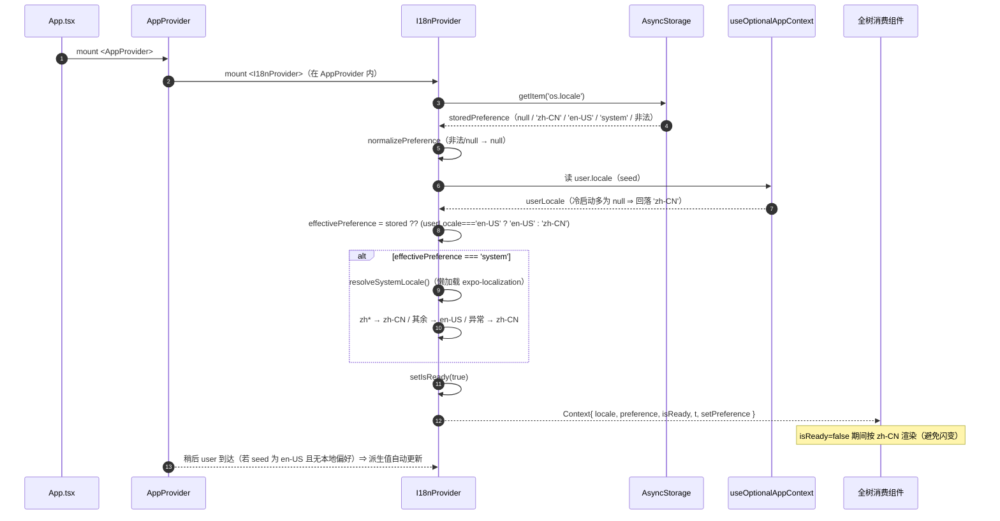
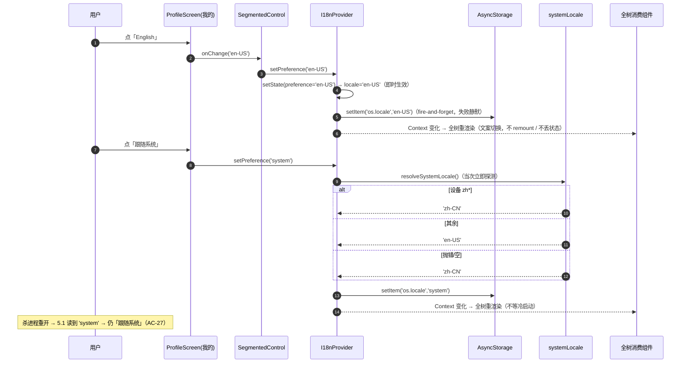
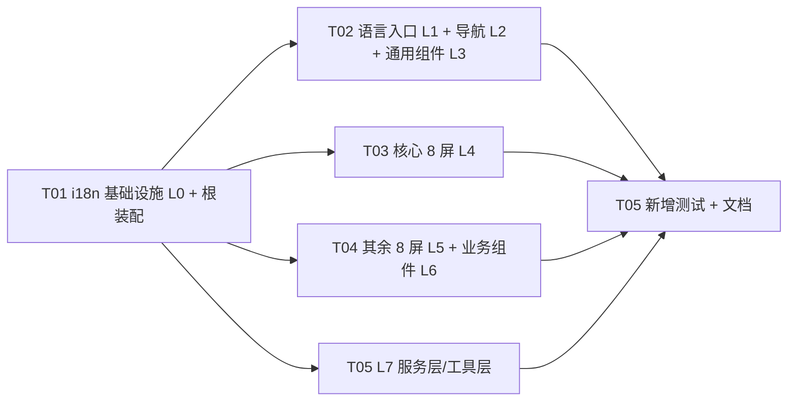

# 架构设计（增量 12）— OpenSchedule 移动端：多语言（中文 / English / 跟随系统）

> 档位：**增量架构 + 任务分解**（一文档交付，颗粒度对齐 `ARCH-mobile-increment-10-darkmode.md`，二者同为「全局横切能力」改造）。
> 负责人：高见远（架构师）· 实读基准：`D:\GLMclaw\workspace\openschedule`（本次写作时）
> 上游输入：`docs/mobile-app/PRD-mobile-increment-12-i18n.md`（许清楚，**v2.0**，700 行，本文唯一需求依据）· 主 PRD `PRD-mobile.md:116`（`M-P2-05`）· 最可类比架构先例 `ARCH-mobile-increment-10-darkmode.md`
> **本文含实现方案、文件清单、类图、时序图、任务分解。所有代码事实均给 `文件:行号`；凡不确定一律进 §12。**
> **硬约束（违反即返工）**：① **i18n 运行时零第三方库**（不得引入 `i18n-js` / `react-i18next` / `i18next` / `@formatjs/*` / `@lingui/*`）② **仅允许新增 `expo-localization` 一个包**（唯一破例，仅用于设备语言探测）③ 禁用 `react-native-reanimated` / `react-native-gesture-handler` ④ 样式数值只取 `src/theme/tokens.ts` ⑤ 组件样式沿用 `makeStyles(colors: ThemeColors)` + `useThemedStyles`（**参数名必须叫 `colors`**）⑥ 裸 `<Pressable>` 白名单**恰好 6 文件** ⑦ **不修改任何既有测试文件与断言** ⑧ 新增 UI 必须同时适配浅 / 深 ⑨ `tsc --noEmit` 零错误 ⑩ **默认语言 `zh-CN` 且 zh 输出逐字节不变** ⑪ 最小变更 ⑫ **本阶段只产出文档，不改任何 `src/` 代码、不改测试、不执行 git 操作**。

---

## 0. 拍板与裁决

### 0.1 用户已拍板的产品项（不可推翻，本文全程遵守）

| # | 裁决 | 本文落地位置 |
| --- | --- | --- |
| **前提 1** | **语言三态**：中文 / English / **跟随系统**（第三态由用户显式选择才生效）；**破例授权新增 `expo-localization`（唯一新增依赖）** | §1 / §2.4 / §2.5 / §7 |
| **前提 2** | **本期范围 = 全量（L0–L7）**：基础设施 + 三态入口 + 导航层 + 通用组件层 + **全部 16 屏** + 全部业务组件 + 服务层 / 工具层用户可见提示（≈437 处）；**唯一延后层 = L8** | §1.4 / §6 |
| **前提 3** | **默认偏好 = `'zh-CN'`（不是 `'system'`）** | §2.3 / §2.4 / §10.1 |
| **前提 4** | **i18n 运行时零第三方库**（自研）；语言入口放「我的」页，与「外观」**同构并列** | §1.3 / §3 / §5.2 |
| 前提 5 | 复用 `user.locale: string`（`src/types/user.ts:14`）作**首次 seed**；本地偏好优先；**登出不清语言** | §2.4 / §2.6 |
| 前提 6 | 无 Provider 必须**回退中文**而非抛错；新全局 hook **不得走 `@/hooks` 桶**；**独立 Provider**（不并入 `AppProvider`） | §2.4 / §2.6 / §9.4 |

### 0.2 架构师本版裁决（逐条回答 PRD §7 架构类开放问题）

#### Q6｜偏好键名与三态取值 —— **裁决：`os.locale`，取值 `'zh-CN' | 'en-US' | 'system'`（镜像 `os.theme_mode`）**

**结论**：在 `src/services/config.ts:21-30` 的 `PREFERENCE_KEYS` 新增 `locale: 'os.locale'`，**独立单值键**（不并入 `os.remember_me` 整体 JSON，与增量 10 的 `os.theme_mode` 完全同构）。

**理由**：① 与 `PREFERENCE_KEYS.themeMode`（`config.ts:28-29`）同构，`I18nProvider` 可在冷启动**并行 hydrate**，无需经过 `AppProvider.preferences` 状态机；② 单值键同 `os.role`（`config.ts:25`）先例；③ **合法值含第三态 `'system'`**（AC-27：写入 `'system'` 后重开仍是「跟随系统」）。

**被否备选**：❌ 并入 `os.remember_me` 整体 JSON（任一次写入都要整体重写，且与「记住我」耦合）；❌ 键名用 `os.language` / `os.lang`（与既有 `themeMode` / `role` 命名风格不一致，且 `locale` 与字段 `user.locale` 对齐）。

#### Q9｜`StatusStyle.label` 是否保持不动 —— **裁决：保持不动，i18n 只能"旁挂"**

**结论**：`theme/semantic.ts:15-42` 的 `StatusStyle` 结构与其 6 个中文 `label` **一律不动**（浅色集 + 深色集均不改）；`lightStatusColor` / `darkStatusColor` 的**对象同一性**与**逐项值**均冻结。i18n 新增 `taskStatus.*` 词条，**zh 值直接从 `lightStatusColor[s].label` 派生**（单一事实来源），组件渲染改走 `t('taskStatus.<s>')`。

**理由（硬证据）**：`tests/theme-contrast.test.ts:245-255` 对 `lightStatusColor` 做 `toEqual(frozen)` **深比较**（`frozen` 每项含 `label: '待办' | …`）；`:267-270` 断言 `colors === lightColors`（**对象同一性**）；`tests/theme-runtime.test.tsx:101/123/155/382` 断言 `statusColor` **同一性**。⇒ 删字段 / 改值 / 换结构都会红（F9）。

**被否备选**：❌ 把 `label` 从 `StatusStyle` 拆掉改由 `t()` 取值（**直接打破深比较**）；❌ 新增 `lightStatusColorEn` / `darkStatusColorEn`（把「颜色 × 语言」做成 **2×2 组合爆炸**，每加语言就要复制一遍色表）。

#### Q10｜被源码文本断言的 11 个文件，zh 字面串留原文件还是搬进语言包 —— **裁决：留在原文件（D6）**

**结论**：PRD **F12** 列出的 11 个被源码文本扫描的文件，其**被断言的 zh 字面串必须继续出现在原文件**。i18n 只能"旁挂 / 派生"，**不得"抽出即删"**。

**理由**：`tests/increment-ui-polish.test.tsx:358-365` 对 `MainTabs.tsx` 源码做 `expect(tabs).toContain(label)`（`['工作台','今日','项目','时间','我的']`）；`increment-card-lift.test.tsx:132`、`increment-ui-polish.test.tsx:369/394` 对 `Card.tsx` / `MainTabs.tsx` 源码做字面串断言；另有 `stacks.tsx` / `task.service.ts` / `NotificationsScreen.tsx` / `domain.ts` / `TaskDetailScreen.tsx` / `utils/submission.ts` 等的源码文本断言（F12）。这些断言**不可修改**（硬约束）。

**落地手法（关键）**：`MainTabs.tsx:33-39` 的 `TAB_LABEL`（含 5 个中文 Tab 名）**原样保留**，新增 `TAB_LABEL_EN`（或渲染期用 `t()`），组件按当前语言**选表**：

```ts
// MainTabs.tsx（改造后，示意——非最终实现）
const TAB_LABEL: Record<keyof TabParamList, string> = { Workspace: '工作台', … }   // ★ 字面串必须保留（F10）
const TAB_LABEL_EN: Record<keyof TabParamList, string> = { Workspace: 'Workspace', … }
// 渲染期：options={{ title: locale === 'zh-CN' ? TAB_LABEL[name] : TAB_LABEL_EN[name] }}
```

**被否备选**：❌ 把中文全部搬进语言包、原文件只留键（F10 等断言必红）；❌ 给被断言文件加"豁免"（断言在测试里，不可改）。

#### Q11｜语言包用 `.ts` 还是 `.json` —— **裁决：`.ts`，且满足 4 条全仓静态红线（而非绕过）**

**结论**：字典 / 运行时文件一律 `.ts`（`.tsx` 仅 Provider）。**不得**用 `.json` 绕过 `walk(src)` 扫描（F11）。

**理由**：`increment-ui-polish.test.tsx:29-36` 的 `walk()` **只收 `.ts/.tsx`**；`.json` 虽不在扫描面内，但**失去键的编译期类型约束**（D1 核心收益：漏键变编译期错误）。红线应被**满足**而非**绕过**。

**新增 `.ts` 文件必须同时满足**（F11，`increment-ui-polish.test.tsx:406-457` + `increment-card-lift.test.tsx:274-313`）：① 不得出现 `react-native-(reanimated|gesture-handler)`（**含注释**）；② 不得出现 `borderRadius:\s*<数字>`；③ 不得含 `<Pressable `（否则打破"恰好 6 文件"白名单）；④ 不得残留 `pressedBg={colors.bg.surface}`。⇒ **语言包注释里不得写"不使用 reanimated"之类字样**（隐形陷阱）。

#### Q12｜本期是否做日期 / 相对时间本地化 —— **裁决：不做（列 P2）；且绝不触碰 `utils/date.ts` 的 `'en-US'`**

**结论**：`formatDate` / `formatDateFull` / `formatWeekday` / `formatRelativeTime` / `formatBytes` / `formatHoursLong` 的**输出格式本期不改**（L8，`M-P2-05-21`）。

**理由（本增量最易误改处，F19）**：`utils/date.ts:32`、`:42-52` 的 `Intl.DateTimeFormat('en-US', {…})` 是**取数用的、不是显示用的**——它只用于 `formatToParts()` 提取数字分量，并靠 `WEEKDAY_SHORT_INDEX`（`utils/date.ts:14-22`，`Sun..Sat` 英文键）把英文星期缩写映射回 `0..6`（`:71-90`）。**把 `'en-US'` 换成用户语言会打断星期解析**。显示层本地化必须**另走一条路**（P2）。另注：`formatRelativeTime` **有两份实现**（`utils/date.ts:230-243` 与 `utils/format.ts:47-68`），`StaleBadge` 用前者、其余 5 处用后者。

**被否备选**：❌ 本期就做（同时触碰 F18 逐字锁定 + F19 取数陷阱，风险最高收益最低）；❌ 直接把 `'en-US'` 改成 `locale`（**打断星期解析的 bug**）；❌ 为 en 复制一份 `date.ts`（两份实现必然漂移）。

#### Q19｜是否启用 `expo-localization` 的 config plugin（`supportedLocales`） —— **裁决：不启用**

**结论**：**不改 `app.json` 的 `plugins`**。本期只需"能读到设备语言"，`supportedLocales`（主要收窄 iOS 的 `CFBundleLocalizations`）对本需求**无收益**，反而扩大改动面与 iOS 构建期行为的不确定性。

**被否备选**：❌ 启用 `supportedLocales`（需改 `app.json` 的 `plugins`，且 iOS 行为需真机验证；本需求只在中 / 英间切换，不涉及系统级语言声明）。⇒ 与增量 10 Q8「把改动面压到最小」同款取舍。

### 0.3 架构师补充裁决（PRD 未直接问、但设计必须拍板的项）

| # | 事项 | 裁决 | 依据 |
| --- | --- | --- | --- |
| **A1** | **字典文件组织** | **按域拆分**为多个 `.ts`（`common` / `domain` / `nav` / `ui` / `screens.core` / `screens.more` / `business` / `services`），zh / en 各一套，**每个域文件由唯一任务拥有** | 避免 T02–T05 争抢同一字典文件（§6.2 / §7）；保证可并行 |
| **A2** | **`user.locale` 的读取方式** | `I18nProvider` 通过**新增的非抛错访问器 `useOptionalAppContext()`**（`AppProvider` 新增导出）读取，**不调用会 `throw` 的 `useAppContext()`** | `useAppContext()` 在无 `AppProvider` 时**抛错**（`AppProvider.tsx:337-340`）；Provider 需可独立渲染（§2.4） |
| **A3** | **探测求值时机** | 冷启动 hydrate + `AppState` 转 `'active'`（**仅当偏好 = `'system'` 时注册监听**；默认路径零订阅） | `M-P2-05-20` 最低要求；`M-P2-05-27` 默认路径零副作用（§2.5） |
| **A4** | **`t` 引用稳定性** | `t` 经 `useCallback` 记忆化（依赖 `locale`），Context 值 `useMemo` | D10-⑥；避免子组件无谓重渲染（与 `useThemedStyles` 同款考量） |
| **A5** | **缺键开发期告警** | 缺键回退 zh → 键名，且**仅 `__DEV__` 下 `console.warn`**（零依赖） | `Q16`；漏键可发现且生产不崩 |
| **A6** | **`'system'` 与字典边界** | `translate()` 的 `locale` 参数类型**只接受 `Locale`（`'zh-CN' | 'en-US'`）**，`'system'` **在类型层不可传入** | `M-P2-05-01`：`'system'` 只存在于偏好层 |

---

## 1. 方案总览

### 1.1 一句话方案

> 新建**轻量自研 i18n 运行时**（零第三方库）：`src/i18n/` 放**类型 + zh/en 字典（按域拆分）+ `translate()` 纯函数 + 设备语言探测适配层**；新建**独立 `I18nProvider`**（`src/store/I18nProvider.tsx`，**不并入 `AppProvider`**）用**独立单值键 `os.locale`** 持久化，解析「偏好（`'zh-CN' | 'en-US' | 'system'`）+ `user.locale` seed + 设备语言探测 → 生效 `Locale`」，向全树下发 `locale` / `preference` / `setPreference` / `t` / `isReady`；「我的」页在「**外观**」之下新增「**语言**」区块（`SegmentedControl` **三态**，与「外观」同构）；**全量（L0–L7）**把 87 个含中文文案文件中的用户可见字符串改为 `t('键')`，**被源码断言的 zh 字面串原样留在原文件**。**默认 `zh-CN`，zh 输出逐字节不变。**

### 1.2 核心难点与应对

| 难点 | 说明 | 应对 |
| --- | --- | --- |
| **N1 回归可行性（最大风险）** | 既有 ≈216 处中文断言（31 文件）+ `lightStatusColor` 深比较 + `MainTabs` 源码文本断言 | **默认 `zh-CN` + zh 逐字节不变 + 无 Provider 回退中文**；`StatusStyle.label` 不动（§0.2-Q9）；被断言字面串留原文件（§0.2-Q10） |
| **N2 改造面极大且"碎"** | 1208 处中文字面量 / 87 文件（F3，本次实读复算**逐字节吻合**） | §6 机械可验证清单（逐文件 → 逐字符串 → 键）+ 分层任务（§7） |
| **N3 测试稳定性（v2.0 最关键）** | 三态引入 `expo-localization`；若进默认路径，55 套件稳定性由"跑测试的机器"决定 | **默认偏好 `'zh-CN'` ⇒ 默认路径永不触碰探测**；探测**收敛单一适配层 + 懒加载**；显式 `'system'` 的新增测试**必须 mock**（§2.5 / §10.4） |
| **N4 字典是共享写热点** | 多任务若同写一个字典文件则必须串行 | **按域拆分字典**，每域文件唯一归属（§0.3-A1 / §6.2 / §7） |
| **N5 无 Provider 兜底** | 31 个渲染套件不包任何 Provider；`useAppContext()` 无 Provider **抛错** | i18n hooks **回退中文**；Provider 用**非抛错** `useOptionalAppContext()` 读 seed（§0.3-A2 / §2.4） |
| **N6 hook 落点铁律** | `@/hooks` 桶被 14 个测试**工厂式 mock**；`@/store/AppProvider` 被 12 个 mock | i18n hooks **只从 `@/store/I18nProvider` 导出**；`src/hooks/index.ts` **零新增导出**（§9.4） |
| **N7 F19 取数陷阱** | `utils/date.ts` 的 `'en-US'` 是取数用，本地化会打断星期解析 | 日期本地化**本期不做**；文档显式警告（§0.2-Q12 / §10.5） |
| **N8 英文文案长度** | TabBar 5 标签 / 三态 `SegmentedControl` / 状态标签变长易截断 | 术语表最短化 + 320pt 走查（§10.6） |

### 1.3 技术选型（沿用既有栈，**仅新增 1 个依赖**）

| 维度 | 选择 | 理由 |
| --- | --- | --- |
| i18n 运行时 | **自研纯函数 + Context**（零库） | 硬约束；本需求只需"两语言 + 极简插值" |
| 字典 | **`.ts` 按域拆分 + `keyof typeof zh` 派生 en 类型** | 键的编译期安全（漏键 = 编译错误）；避免写热点（§0.3-A1） |
| 状态载体 | **新建独立 `I18nProvider`（React Context）** | 职责分离（§0.2-Q9 域外）；与 `ThemeProvider` / `ConnectivityProvider` 同构先例 |
| 持久化 | **`AsyncStorage` + `PREFERENCE_KEYS.locale`（`os.locale`）** | 复用既有依赖（`package.json:7`）；单值键同 `os.theme_mode` |
| 设备语言探测 | **`expo-localization`（唯一新增依赖）**，封装在**单一适配层**、**懒加载** | 用户授权破例；收敛 + 默认路径零副作用（N3） |
| 三态开关 UI | **复用 `SegmentedControl`（泛型，`SegmentedControlOption<T extends string>`）** | 零新增组件；与「外观」交互一致 |
| hooks | `useI18n` / `useT`，**只从 Provider 模块导出** | hook 落点铁律（N6） |
| 切换过渡 | **无动效**（纯文案变更） | D9-③ |

### 1.4 范围边界

- **做（L0–L7）**：语言模型（`Locale` / `LocalePreference`）· 字典（zh/en，按域）· `translate()` 纯函数 · 设备语言探测适配层 · `I18nProvider` + hooks · 持久化 `os.locale` · 「我的 → 语言」三态区块 · 导航层（5 Tab + 各 Stack 标题）· 通用组件层 + 全局提示层（离线横幅 / 缓存标记 / 两种 Toast）· **全部 16 屏** · 全部业务组件 · **服务层 / 工具层用户可见提示**（`ApiError` / HTTP 兜底 / 校验 / 权限 / mock 通知与审计，≈437 处）。
- **不做（L8 及范围外）**：日期 / 星期 / 相对时间 / 字节 / 工时的 en 分支（`M-P2-05-21`）· 复数规则（`-22`）· 第三语言 / 懒加载（`-23`）· RTL（`-24`）· 后端文案本地化（`-25`）· `app.json` 应用名 / 启动页多语言（`-26`）· **mock 种子数据**（`data/` 180 处，N12）· **修改任何既有测试**（N8）· **给既有套件补包 Provider**（N9）· **引入任何 i18n 库**（N1）· **把「跟随系统」设为默认**（N2）· **用 `.json` 绕过红线**（N16）· **把 `utils/date.ts` 的 `'en-US'` 换掉**（N15）· 改 `apps/web` / `services/api` / Prisma（N17）· 任何 git 操作（N18）。

---

## 2. 关键机制设计

### 2.1 i18n 运行时分层（代码职责）

```
┌─ 类型层  src/i18n/types.ts ─────────────────────────────────────────────┐
│  Locale = 'zh-CN' | 'en-US'                                             │
│  LocalePreference = Locale | 'system'                                   │
│  TranslationKey = keyof typeof zh   （zh 域合并后的键联合）              │
│  TParams = Record<string, string | number>                              │
└─────────────────────────────────────────────────────────────────────────┘
                              │
┌─ 字典层  src/i18n/locales/{zh,en}/*.ts ─────────────────────────────────┐
│  zh/{common,domain,nav,ui,screens.core,screens.more,business,services}.ts│
│  en/*（同构，类型 Record<对应域键, string>，键集合由 zh 派生强制一致）    │
│  zh/index.ts 合并全部域 → zh 对象；en/index.ts 合并 → en 对象             │
└─────────────────────────────────────────────────────────────────────────┘
                              │
┌─ 纯函数层  src/i18n/translate.ts ────────────────────────────────────────┐
│  translate(locale: Locale, key: TranslationKey, params?: TParams): string│
│  interpolate(template, params)                                          │
│  ★ 零 React 依赖，可单测；缺键回退 zh → key；locale 只认 Locale           │
└─────────────────────────────────────────────────────────────────────────┘
                              │
┌─ 适配层  src/i18n/systemLocale.ts ───────────────────────────────────────┐
│  resolveSystemLocale(): Locale   ★ 唯一封装 expo-localization 的模块      │
│  懒加载 + try/catch 三级兜底；仅偏好='system' 时被调用                    │
└─────────────────────────────────────────────────────────────────────────┘
                              │
┌─ Provider 层  src/store/I18nProvider.tsx ───────────────────────────────┐
│  hydrate(os.locale) / resolve(偏好 + user.locale seed + 探测) / persist   │
│  useI18n() / useT()   ★ hooks 唯一入口（不走 @/hooks 桶）                  │
└─────────────────────────────────────────────────────────────────────────┘
                              │
┌─ 消费方 ────────────────────────────────────────────────────────────────┐
│  导航 / 通用组件 / 16 屏 / 业务组件 / 服务层 / 工具层                      │
│  const { t } = useI18n()  →  t('nav.tab.workspace')                       │
└─────────────────────────────────────────────────────────────────────────┘
```

### 2.2 目录落点（确切路径）

```
apps/mobile/
├─ package.json                          ← 修改：dependencies 增 expo-localization（19 → 20）
├─ App.tsx                               ← 修改：装配 I18nProvider（§2.7）
├─ src/
│  ├─ i18n/                              ← 新增目录
│  │  ├─ types.ts                        ← Locale / LocalePreference / TranslationKey / TParams
│  │  ├─ translate.ts                    ← translate() + interpolate()（纯函数）
│  │  ├─ systemLocale.ts                 ← resolveSystemLocale()（唯一 expo-localization 封装）
│  │  ├─ index.ts                        ← 桶：再导出类型 + translate + zh/en（★ 不含 hooks）
│  │  └─ locales/
│  │     ├─ zh/{index,common,domain,nav,ui,screens.core,screens.more,business,services}.ts
│  │     └─ en/{index,common,domain,nav,ui,screens.core,screens.more,business,services}.ts
│  ├─ store/
│  │  ├─ I18nProvider.tsx                ← 新增：Provider + useI18n / useT
│  │  └─ AppProvider.tsx                 ← 修改：新增 useOptionalAppContext()（非抛错）
│  ├─ services/config.ts                 ← 修改：PREFERENCE_KEYS.locale = 'os.locale'
│  └─ hooks/index.ts                     ← 修改：★ 零新增导出（保持现状即满足）
└─ tests/
   ├─ i18n.test.ts                       ← 新增：纯函数单测
   ├─ i18n-provider.test.tsx             ← 新增：Provider 单测（含三态 / 兜底）
   └─ i18n-zh-freeze.test.ts             ← 新增：zh 零回归冻结守卫（抽样 P0）
```

### 2.3 与既有 `@/hooks` / `AppProvider` / `ThemeProvider` 的边界关系

| 边界 | 规则 | 依据 |
| --- | --- | --- |
| **`@/hooks` 桶** | **零新增导出**。`useI18n` / `useT` **只从 `@/store/I18nProvider` 导出**；误用（从桶取）应为**编译期 TS 报错** | `hooks/index.ts:1-20`；**14 个**测试对 `@/hooks` 工厂式 mock（本次实读 = 14）；增量 10 同款铁律 |
| **`AppProvider`** | i18n 状态**不并入** `AppProvider`；仅**新增一个非抛错访问器** `useOptionalAppContext()` 供 Provider 读 `user.locale` seed | `AppProvider.tsx:39-48`（`AppPreferences` 无 locale）、`:337-340`（`useAppContext` 抛错）；**12 个**测试 mock `@/store/AppProvider` |
| **`ThemeProvider`** | i18n **不依赖**主题；主题 **不依赖** i18n。二者均为"环境型"独立 Provider，**互不读取对方 `isReady`** | `ThemeProvider.tsx:14`（边界声明）；`App.tsx:20-29`（装配） |
| **`useThemedStyles` / `colors`** | 语言**不改变任何配色**；i18n 改造**不得触碰**样式工厂参数名 `colors`（源码扫描断言，L3） | `increment-ui-polish.test.tsx:369/394`；`increment-card-lift.test.tsx:132` |

### 2.4 语言解析（状态机 → 代码职责）

把 PRD §5.2 的 Mermaid 落到"代码职责"层面。**纯函数边界**已标注（可单测 = 不碰 React / 原生模块）。

```
① Hydrate（唯一不确定态，isReady=false 期间按 zh-CN 渲染，避免闪变）
      storedPreference = await AsyncStorage.getItem('os.locale')          // 副作用：AsyncStorage（jest 已 mock）
      normalize: 'zh-CN' | 'en-US' | 'system' → 保留；其余 / null → null   // ★ 纯函数 normalizePreference()
      isReady = true

② Resolve（每次渲染派生，无副作用）
      effectivePreference =
          storedPreference ?? (userLocale === 'en-US' ? 'en-US' : 'zh-CN') // ★ 纯函数 resolvePreference()
      locale =
          effectivePreference === 'system' ? probe() : effectivePreference  // ★ probe 有副作用（见 ③）

③ Probe（仅在 effectivePreference === 'system' 时求值；懒加载 + 三级兜底）
      resolveSystemLocale(): Locale                                        // ★ 纯函数外壳，内部懒 require
          设备语言 zh*  → 'zh-CN'
          其余一切      → 'en-US'
          抛错 / 空     → 'zh-CN'

④ 兜底（永不崩、永不空白）
      无 Provider        → FALLBACK（locale='zh-CN'）
      本地非法 / 读取失败 → 'zh-CN'
      字典缺键           → zh → key 本身
```

**纯函数（可单测，零 React / 零原生）**：`normalizePreference` · `resolvePreference(stored, userLocale)` · `translate` · `interpolate` · `resolveSystemLocale`（mock 掉 `expo-localization` 后可单测）。
**有副作用（碰 React / AsyncStorage / 原生）**：`I18nProvider` 的 hydrate / persist / AppState 订阅；`resolveSystemLocale` 的懒 `require`。

### 2.5 设备语言探测适配层（`src/i18n/systemLocale.ts`）

**唯一职责**：把"设备语言"收敛为 `Locale`。**全仓仅此一个文件可引用 `expo-localization`**。

```ts
// src/i18n/systemLocale.ts（接口契约 + 骨架，非完整实现）
import type { Locale } from './types'
// ★ 只做「类型」引用（import type 编译期擦除）——顶层**不做**运行时 import
import type * as ExpoLocalization from 'expo-localization'

/** 解析设备语言 → 生效 Locale（三级兜底，永不抛错） */
export function resolveSystemLocale(): Locale {
  try {
    // ★ 懒加载：默认路径（偏好 ≠ 'system'）永不执行此 require ⇒ 不加载原生模块
    // eslint-disable-next-line @typescript-eslint/no-var-requires
    const mod = require('expo-localization') as typeof ExpoLocalization
    const locales = mod.getLocales?.() ?? []
    const tag = String(locales[0]?.languageTag ?? locales[0]?.languageCode ?? '').toLowerCase()
    if (!tag) return 'zh-CN'                       // 空 → zh
    return tag.startsWith('zh') ? 'zh-CN' : 'en-US' // zh* → zh；其余一切 → en
  } catch {
    return 'zh-CN'                                  // 抛错 → zh
  }
}
```

- **为何懒加载而非顶层 `import`**：`M-P2-05-27` ④ 要求"探测适配层在默认路径上零副作用（不 import 即不执行）"。顶层 `import` 会让**任何 import 了 Provider 的测试**（含默认路径新测试）在加载期触碰原生模块；懒 `require` 使 `expo-localization` **仅在显式 `'system'` 时才被加载**。`import type` 编译期擦除，不产生运行时加载。
- **Web 支持**：`expo-localization` 在 Web 走 `navigator.language`（F21），`getLocales()` 返回同一形状 ⇒ 上述代码**天然支持 Web**（Q18）。无需 Web 专用分支。
- **不监听运行时语言变更**：仅冷启动 hydrate + `AppState` 转 `'active'` 时求值（§2.6）。**禁止**用 `Intl.DateTimeFormat().resolvedOptions().locale` 代替（Hermes 不保证带 locale 数据，N20）。

### 2.6 Provider 设计（`src/store/I18nProvider.tsx`）

**上下文取值**：

```ts
export interface I18nContextValue {
  locale: Locale                       // 已解析（永远只有 'zh-CN' | 'en-US'）
  preference: LocalePreference         // 偏好（含 'system'），供三态控件 value
  isReady: boolean                     // 冷启动 hydrate 完成
  t: (key: TranslationKey, params?: TParams) => string
  setPreference: (preference: LocalePreference) => Promise<void>
}
```

**无 Provider 回退（L1 前提，关键）**：

```ts
const FALLBACK_I18N: I18nContextValue = {
  locale: 'zh-CN',
  preference: 'zh-CN',
  isReady: true,
  t: (key, params) => translate('zh-CN', key, params),
  setPreference: async () => undefined,
}
export function useI18n(): I18nContextValue { return useContext(I18nContext) ?? FALLBACK_I18N }
export function useT() { return useI18n().t }
```

> **为何必须回退而非抛错**：全仓 **31 个渲染套件**直接渲染屏 / 组件且**不包任何 Provider**（F15）；若 `useI18n()` 抛错，这些套件全红。回退 `zh-CN` ⇒ jest 下默认解析出中文 ⇒ 与既有 ≈216 处中文断言**完全一致、零改断言**。

**hydrate / persist / setPreference（照 `ThemeProvider` 范式）**：

- hydrate：`AsyncStorage.getItem('os.locale')` → `normalizePreference` → `setStoredPreference` → `setIsReady(true)`；读取失败静默保持 `null`（⇒ 走 seed / 默认 zh）。
- `setPreference(next)`：**即时 `setState`（即时生效）** + **fire-and-forget `AsyncStorage.setItem('os.locale', next)`（失败静默）**，对齐 `ThemeProvider.tsx:116-123`。
- **`user.locale` seed**：`const app = useOptionalAppContext()`；`userLocale = app?.user?.locale ?? null`。当 `storedPreference === null` 时，`effectivePreference = userLocale === 'en-US' ? 'en-US' : 'zh-CN'`。**本地偏好一旦存在即覆盖 seed**（D4）。**登出不清语言**（`os.locale` 独立于 `AppProvider.signOut`，`AppProvider.tsx:229-247` 不触碰该键）。

**探测求值时机（A3）**：

```ts
// 仅当偏好 = 'system' 时注册 AppState 监听；默认路径零订阅
useEffect(() => {
  if (storedPreference !== 'system') return
  const sub = AppState.addEventListener('change', (s) => { if (s === 'active') setProbeEpoch((e) => e + 1) })
  return () => sub.remove()
}, [storedPreference])

const locale = useMemo(
  () => (effectivePreference === 'system' ? resolveSystemLocale() : effectivePreference),
  [effectivePreference, probeEpoch],
)
```

### 2.7 根装配（`App.tsx`）与 Provider 层级关系

**裁决：`I18nProvider` 置于 `AppProvider` 之内、`ConnectivityProvider` 之外。**

```tsx
<SafeAreaProvider>
  <ThemeProvider>                        {/* 外观态（增量 10） */}
    <AppProvider>                        {/* 会话 / 角色 / 偏好 / 乐观登记 */}
      <I18nProvider>                     {/* ★ 新增：语言态（需读 user.locale seed ⇒ 必须在 AppProvider 内） */}
        <ConnectivityProvider>
          <AppContent />
        </ConnectivityProvider>
      </I18nProvider>
    </AppProvider>
  </ThemeProvider>
</SafeAreaProvider>
```

**为何在 `AppProvider` 之内**：`M-P2-05-06` 要求 `user.locale` 作**首次 seed**，而 `user` 由 `AppProvider` 提供 ⇒ `I18nProvider` **必须位于 `AppProvider` 之下**才能读取。**这不违反"独立 Provider"**——语言**状态**仍由 `I18nProvider` 独有（不并入 `AppProvider` 的 `AppPreferences`，`AppProvider.tsx:39-48` 保持无 `locale`）。

**为何所有可见文案仍在 `I18nProvider` 之下**：`OfflineBanner`（`App.tsx:40`）与 `RootNavigator`（含 `LoginScreen`，`App.tsx:41`）都在 `AppContent` 内 ⇒ 全部位于 `I18nProvider` 之下。⇒ **登录页可显示英文**（US-12-02 / US-12-13）成立。

**Provider 层是否需要读取彼此 `isReady` —— 不需要**：

| 组合 | 是否需要对方 `isReady` | 说明 |
| --- | --- | --- |
| `ThemeProvider` ↔ `I18nProvider` | **否** | 主题 hydrate 与语言 hydrate **互相独立**，均可在对方未就绪时工作 |
| `I18nProvider` → `AppProvider.user` | **否（但读 `user`）** | seed 缺失时回退 zh；`user` 到达后**派生值自动更新**（§2.6 的 `useMemo` 依赖） |
| 任何 Provider → 其 `children` 门禁 | **否** | `I18nProvider` **不**对 `children` 做渲染门禁；`isReady=false` 期间按 **zh-CN** 渲染（对齐状态机"唯一不确定态" + 增量 10「不设 isReady 门禁」裁决） |

### 2.8 `t()` 与插值（能力边界，D10）

```ts
// src/i18n/translate.ts（接口契约 + 骨架）
import type { Locale, TParams, TranslationKey } from './types'
import { zh } from './locales/zh'
import { en } from './locales/en'

const DICTS: Record<Locale, Record<TranslationKey, string>> = { 'zh-CN': zh, 'en-US': en }

/** 极简插值：{name} → params.name（缺失参数保留占位符，不抛错） */
export function interpolate(template: string, params?: TParams): string {
  if (!params) return template
  return template.replace(/\{(\w+)\}/g, (m, k) => (k in params ? String(params[k]) : m))
}

/** 取词（缺键回退 zh → 键名；绝不抛错、绝不空白） */
export function translate(locale: Locale, key: TranslationKey, params?: TParams): string {
  const dict = DICTS[locale] ?? zh
  const template = dict[key] ?? zh[key]
  if (template === undefined) {
    if (__DEV__) console.warn(`[i18n] missing key: ${key}`)   // A5：仅开发期告警
    return key
  }
  return interpolate(template, params)
}
```

- **键 = 点分命名空间**（`nav.tab.workspace` / `taskStatus.todo` / `profile.language.*` / `common.*`），按**领域**组织。
- **不做** ICU / 复数 / 性别 / 语序（本期用中性措辞规避，如 `Pending: {count}`）。
- **`t` 引用稳定**（A4）：`useCallback(() => (key, params) => translate(locale, key, params), [locale])`。

### 2.9 F6 去重：zh 词条**同源派生**（消灭漂移）

**规则：zh 词条对"既有集中式常量"一律从常量派生，禁止手写第二遍。**

| 域键 | 来源（单一事实来源） | 消灭的重复（F6） |
| --- | --- | --- |
| `taskStatus.*`（6） | `lightStatusColor[s].label`（`theme/semantic.ts:25-32`） | ① 浅色集 + ③ `BOARD_COLUMNS` |
| `boardColumn.*`（5） | `lightStatusColor[s].label`（`BOARD_COLUMNS` 5 项 label 与状态词同值） | ③ |
| `taskAction.*`（8） | 派生自 `TASK_TRANSITION_ACTIONS`（`types/task.ts:157-183`，提供 `deriveActionLabels()` 去重收集） | ④ |
| `role.*`（2） | `ROLE_LABEL`（`types/user.ts:57-60`） | — |
| 其余集中式词表 | `PROJECT_STATUS_LABEL` / `SUBMISSION_STATUS_LABEL` / `AI_PROPOSAL_TYPE_LABEL` / `NOTIFICATION_EVENT_LABEL` / `DEPENDENCY_TYPE_LABEL` / `HTTP_DEFAULT_MESSAGE`（9）等**同源派生** | F7 |

```ts
// src/i18n/locales/zh/domain.ts（骨架）
import { lightStatusColor } from '@/theme/semantic'
import { ROLE_LABEL } from '@/types/user'
// …
export const domain = {
  'taskStatus.todo': lightStatusColor.todo.label,          // '待办'（派生，零漂移）
  'taskStatus.in_progress': lightStatusColor.in_progress.label,
  // …（6 项）
  'boardColumn.todo': lightStatusColor.todo.label,
  // …（5 项）
  'role.manager': ROLE_LABEL.manager,
  // …
} as const
```

> **方向铁律**：派生方向**只能**是"字典 ← 常量"。**禁止**反向（把常量改为引用字典）——`lightStatusColor` 被 `theme-contrast.test.ts:245-255` 深比较冻结（§0.2-Q9），任何改动都会红。`darkStatusColor` 的 6 个 label 是**冻结的重复**，不再处理（其一致性由既有冻结测试守护）。

### 2.10 切换即时生效（D9）

`setPreference(next)` → 即时 `setState` → Context 值变化 → 所有 `useI18n`/`useT` 消费者**重渲染** → 文案切换。**不重载、不 remount、不丢页面 / 滚动 / 表单 / 抽屉状态、无 loading、无遮罩、无转场**。切「跟随系统」时**当次立即探测并生效**（不等冷启动）。导航标题必须**渲染期求值**（`Tab.Screen options.title` / Stack `options` 目前读模块级常量 `TAB_LABEL`，须改为读当前语言，§0.2-Q10 选表手法）。

---

## 3. 文件清单（相对 `apps/mobile/`，标注 新增 / 修改）

### 3.1 新增文件

| 文件 | 职责 | 归属任务 |
| --- | --- | --- |
| `src/i18n/types.ts` | `Locale` / `LocalePreference` / `TranslationKey` / `TParams` | T01 |
| `src/i18n/translate.ts` | `translate()` + `interpolate()`（纯函数） | T01 |
| `src/i18n/systemLocale.ts` | `resolveSystemLocale()`（唯一 `expo-localization` 封装，懒加载 + 三级兜底） | T01 |
| `src/i18n/index.ts` | 桶：再导出类型 + `translate` + `zh`/`en`（**不含 hooks**） | T01 |
| `src/i18n/locales/zh/index.ts` · `en/index.ts` | 合并各域字典 → `zh` / `en` 对象 | T01 |
| `src/i18n/locales/zh/common.ts` · `en/common.ts` | `common.*`（确认 / 取消 / 重试 / 加载中…） | T01 |
| `src/i18n/locales/zh/domain.ts` · `en/domain.ts` | 状态 / 优先级 / 看板列 / 动作 / 角色 / 枚举词（**同源派生**） | T01 |
| `src/i18n/locales/zh/nav.ts` · `en/nav.ts` | `nav.*`（Tab + Stack 标题） | **T02** |
| `src/i18n/locales/zh/ui.ts` · `en/ui.ts` | `component.*` / `hint.*`（通用组件 + 全局提示 + 「语言」区块） | **T02** |
| `src/i18n/locales/zh/screens.core.ts` · `en/…` | `screen.*`（核心 8 屏） | **T03** |
| `src/i18n/locales/zh/screens.more.ts` · `en/…` | `screen.*`（其余 8 屏） | **T04** |
| `src/i18n/locales/zh/business.ts` · `en/…` | `business.*`（业务组件） | **T04** |
| `src/i18n/locales/zh/services.ts` · `en/…` | `error.*` / `http.*` / `validation.*` / `permission.*`（服务层 / 工具层） | **T05** |
| `src/store/I18nProvider.tsx` | i18n 运行时 Provider + `useI18n` / `useT`（唯一 hook 入口） | T01 |
| `tests/i18n.test.ts` | 纯函数单测（键一致性 / 插值 / 缺键 / 非法 locale） | T05 |
| `tests/i18n-provider.test.tsx` | Provider 单测（默认 zh / 切换 / 持久化 / hydrate / 非法值 / 无 Provider 兜底 / 三态） | T05 |
| `tests/i18n-zh-freeze.test.ts` | zh 零回归冻结守卫（抽样，P0 `M-P2-05-15`） | T05 |

> **域文件在 T01 建立为"空骨架"**（`export const nav = {} as const` 之类），`zh/index.ts` / `en/index.ts` **一次性注册全部域**；T02–T05 **只填充自己拥有的域文件**，**不触碰 `index.ts`** ⇒ 无写冲突（§0.3-A1）。

### 3.2 修改文件（基础设施，T01）

| 文件 | 改动点 |
| --- | --- |
| `package.json` | `dependencies` 新增 `expo-localization`（19 → **20**）；**不得**含 `reanimated` / `gesture-handler` |
| `App.tsx` | 装配 `I18nProvider`（`AppProvider` 内、`ConnectivityProvider` 外，§2.7） |
| `src/services/config.ts` | `PREFERENCE_KEYS` 新增 `locale: 'os.locale'` |
| `src/store/AppProvider.tsx` | 新增**非抛错** `useOptionalAppContext(): AppContextValue | null`（供 Provider 读 seed） |
| `src/hooks/index.ts` | **零新增导出**（现状即满足；若已添加须移除，使误用变编译期报错） |

### 3.3 迁移文件清单（按层，详见 §6.3）

> 汇总：**含中文字面量的 87 个文件**（本次实读复算与 PRD F3 **逐字节吻合**：107 个 `.ts/.tsx` 中 87 个含中文，共 **1208 处**行）。**`data/`（180 处）= mock 种子，不迁移**。实际迁移面 = 87 − 3（data）= **84 个文件**中的**用户可见字符串**（约 1028 处行，剔除注释噪声后更少，见 §6.1）。

---

## 4. 数据结构与接口

### 4.1 类图

```mermaid
classDiagram
    class Locale {
        <<type>>
        'zh-CN' | 'en-US'
    }
    class LocalePreference {
        <<type>>
        'zh-CN' | 'en-US' | 'system'
    }
    class TranslationKey {
        <<type>>
        keyof typeof zh（zh 各域合并后的键联合）
    }
    class TParams {
        <<type>>
        Record~string, string|number~
    }
    class ZhDict {
        <<module locales/zh/*>>
        +common: {...}
        +domain: {...}   (派生自常量)
        +nav: {...}
        +ui: {...}
        +screens.core / screens.more / business / services
    }
    class EnDict {
        <<module locales/en/*>>
        +Record~DomainKey, string~  （键集合由 zh 派生强制一致）
    }
    class translate_fn {
        <<pure function>>
        +translate(locale, key, params?) string
        +interpolate(template, params?) string
    }
    class systemLocale_adapter {
        <<adapter>>
        +resolveSystemLocale() Locale
        懒 require expo-localization
        三级兜底
    }
    class I18nContextValue {
        +Locale locale
        +LocalePreference preference
        +boolean isReady
        +t(key, params?) string
        +setPreference(pref) Promise~void~
    }
    class I18nProvider {
        <<component>>
        -hydrate os.locale
        -resolve(偏好, user.locale seed)
        -AppState probe (仅 system)
        +persist os.locale
    }
    class i18nHooks {
        <<hooks · 唯一入口>>
        +useI18n() I18nContextValue
        +useT() t
    }
    class AppProvider {
        <<modified>>
        +useOptionalAppContext() AppContextValue|null
    }
    class config_module {
        <<modified>>
        +PREFERENCE_KEYS.locale = 'os.locale'
    }
    class Consumer {
        <<导航/组件/屏/服务>>
        +useI18n().t(key)
    }

    ZhDict --> TranslationKey : defines
    EnDict --> TranslationKey : constrained by
    translate_fn --> ZhDict : reads
    translate_fn --> EnDict : reads
    I18nProvider --> translate_fn : uses
    I18nProvider --> systemLocale_adapter : calls (仅 system)
    I18nProvider --> config_module : os.locale
    I18nProvider --> AppProvider : useOptionalAppContext (seed)
    I18nProvider --> I18nContextValue : provides
    i18nHooks --> I18nProvider : useContext ?? FALLBACK
    i18nHooks --> translate_fn : FALLBACK 用 zh
    Consumer --> i18nHooks : useI18n/useT
```

### 4.2 关键 TS 接口签名（**只写契约与骨架，不含完整业务实现**）

```ts
// ── src/i18n/types.ts ──────────────────────────────────────────
/** 已解析语言（字典查找只认这两个值；'system' 不得流入） */
export type Locale = 'zh-CN' | 'en-US'
/** 用户偏好三态（第三态由用户显式选择才生效；默认 'zh-CN'） */
export type LocalePreference = Locale | 'system'
/** 插值参数 */
export type TParams = Record<string, string | number>

// ── src/i18n/locales/zh/index.ts ───────────────────────────────
import { common } from './common'
import { domain } from './domain'
import { nav } from './nav'
import { ui } from './ui'
import { screensCore } from './screens.core'
import { screensMore } from './screens.more'
import { business } from './business'
import { services } from './services'
/** zh 权威字典（各域合并） */
export const zh = { ...common, ...domain, ...nav, ...ui, ...screensCore, ...screensMore, ...business, ...services } as const

// ── src/i18n/types.ts（续，依赖 zh 派生键）──────────────────────
import type { zh } from './locales/zh'
/** 全部键（zh 单一事实来源；en 必须与之一致） */
export type TranslationKey = keyof typeof zh

// ── src/i18n/locales/en/index.ts ───────────────────────────────
import type { TranslationKey } from '../../types'
import { common } from './common' /* …其余域… */
/** en 字典：Record<TranslationKey, string> ⇒ 漏键 / 多键均为编译错误 */
export const en: Record<TranslationKey, string> = { ...common, ...domain, ...nav, /* … */ }

// ── src/i18n/translate.ts ──────────────────────────────────────
export function interpolate(template: string, params?: TParams): string
export function translate(locale: Locale, key: TranslationKey, params?: TParams): string

// ── src/i18n/systemLocale.ts ───────────────────────────────────
/** 解析设备语言 → Locale（三级兜底；懒加载 expo-localization；仅偏好='system' 时调用） */
export function resolveSystemLocale(): Locale

// ── src/store/I18nProvider.tsx ─────────────────────────────────
export interface I18nContextValue {
  locale: Locale
  preference: LocalePreference
  isReady: boolean
  t: (key: TranslationKey, params?: TParams) => string
  setPreference: (preference: LocalePreference) => Promise<void>
}
export function I18nProvider(props: { children: ReactNode }): React.JSX.Element
export function useI18n(): I18nContextValue                 // 无 Provider ⇒ FALLBACK（locale='zh-CN'）
export function useT(): (key: TranslationKey, params?: TParams) => string

// ── src/store/AppProvider.tsx（新增导出）───────────────────────
/** 非抛错访问器：无 <AppProvider> 时返回 null（供 I18nProvider 读 user.locale seed） */
export function useOptionalAppContext(): AppContextValue | null

// ── src/services/config.ts（新增键）────────────────────────────
export const PREFERENCE_KEYS = {
  /* …既有… */
  locale: 'os.locale',   // 'zh-CN' | 'en-US' | 'system'
} as const
```

**键类型约束方案（如何做到编译期安全）**：
1. `zh` 各域用 `as const` ⇒ 键为字面量联合；`zh/index.ts` 合并后 `keyof typeof zh` = 全部键 ⇒ `TranslationKey`。
2. `en` 显式标注 `Record<TranslationKey, string>` ⇒ **漏键**（缺属性）与**多键**（多余属性，对象字面量触发 excess property check）**均为编译错误**。
3. `translate(locale, key, …)` 的 `key: TranslationKey` ⇒ 调用方写错键名 = **编译错误**；`locale: Locale` ⇒ 传 `'system'` = **编译错误**（A6）。
4. `tsc --noEmit` 覆盖 `tests/`（`tsconfig.json:11-18`）⇒ 上述约束对测试同样生效。

---

## 5. 程序调用流程（时序图）

### 5.1 时序图 ①：冷启动 hydrate（含 `user.locale` seed 与三级兜底）



### 5.2 时序图 ②：用户切换三态（「我的 → 语言」）



### 5.3 时序图 ③：组件消费 `t()`（含无 Provider 兜底）

```mermaid
sequenceDiagram
    autonumber
    participant Cmp as 组件 / 屏
    participant Hook as useI18n()/useT()
    participant IP as I18nProvider
    participant TR as translate()

    Cmp->>Hook: useI18n()
    alt 有 <I18nProvider>
        Hook->>IP: useContext(I18nContext)
        IP-->>Hook: { locale, preference, t, … }
    else 无 Provider（31 个渲染套件）
        Hook-->>Hook: 回退 FALLBACK_I18N（locale='zh-CN'，绝不 throw）
    end
    Cmp->>TR: t('taskStatus.todo')
    TR->>TR: dict = DICTS[locale]; template = dict[key] ?? zh[key] ?? key
    TR-->>Cmp: '待办'（zh）/ 'To do'（en）
    Note over Cmp: zh 下输出与改造前逐字节一致（既有 ≈216 处中文断言仍绿）
```

---

## 6. 全量迁移的机械可验证清单（PRD §1.3 要求）

### 6.1 如何机械枚举 + 如何防漏

**① 粗枚举（基线口径，= F3 的 1208 处）**：

```bash
cd apps/mobile
grep -rnP "['\"\`][^'\"\`\n]*[\x{4e00}-\x{9fff}]" src --include='*.ts' --include='*.tsx'
```

本次实读复算：**107** 个 `.ts/.tsx`，其中 **87** 个含中文，共 **1208** 处行；逐目录：`screens 329 / services 266 / data 180 / utils 171 / components 104 / types 57 / theme 33 / store 30 / navigation 24 / hooks 14`（与 PRD F3 **完全一致**）。

**② 精炼枚举（真实"用户可见字符串"）**：粗枚举**含大量注释噪声**（例：`theme/tokens.ts:5-6` 的 JSDoc 里 `` `lightColors`（= 改造前 `colors`…） `` 命中反引号 + 中文；`hooks/useAsync.ts:5-7`、`store/AppProvider.tsx:340` 同理）。**必须过滤**：

```bash
# 排除整行注释 / 块注释行（以 // 或 * 或 /* 起始，允许前导空白）
grep -rnP "['\"\`][^'\"\`\n]*[\x{4e00}-\x{9fff}]" src --include='*.ts' --include='*.tsx' \
  | grep -vP "^\s*[^:]+:\d+:\s*(//|\*|/\*)"
```

**③ 逐条分类**（每一条命中归入且仅归入一类）：

| 分类 | 处置 | 例 |
| --- | --- | --- |
| **A. UI 文案（用户可见）** | **抽键 + 改 `t('键')`** | `'工作台'` / `'确认退出登录？'` / `'无权限：当前角色不能创建事项'` |
| **B. mock 种子数据** | **不动**（N12） | `data/seed.ts` / `data/seed-extra.ts` 的任务标题 / 评论正文（180 处） |
| **C. 格式输出（L8）** | **不动**（D8） | `formatDate` → `9月12日`；`formatRelativeTime` → `5 分钟前`；`formatHoursLong` → `4 小时` |
| **D. 源码断言必需字面串** | **保留原文件**（D6 / Q10） | `MainTabs.tsx` 的 5 个 Tab 名；`utils/submission.ts` / `types/domain.ts` / `task.service.ts` 等被扫描的字面串 |
| **E. 非用户可见（开发报错 / key / 注释）** | **不动** | `AppProvider.tsx:340` 的 `throw new Error('useAppContext 必须在…')`；注释 |

**④ 防漏三道闸**：
1. **键集合一致性**：`en: Record<TranslationKey, string>` 编译期强制（§4.2）。
2. **残留中文白名单核对**：迁移后重跑精炼枚举，**剩余命中必须逐条命中 B/C/D/E 白名单**（对应 AC-13）。
3. **zh 冻结守卫**：抽样断言 zh 输出 === 冻结字面量（`tests/i18n-zh-freeze.test.ts`，P0 `M-P2-05-15`）。

**⑤ 逐文件 → 逐字符串 → 对应键 清单结构（模板 + 样例）**：

| 文件:行号 | 原中文字面串 | 建议键 | 分类 | 备注 |
| --- | --- | --- | --- | --- |
| `navigation/MainTabs.tsx:34` | `'工作台'` | `nav.tab.workspace` | **D+A** | ★ 字面串**留原文件**（F10）；新增 en 表 `'Workspace'` |
| `theme/semantic.ts:26` | `'待办'`（label） | `taskStatus.todo` | **D** | ★ `label` **不动**；zh 词条**派生自** `lightStatusColor` |
| `screens/ProfileScreen.tsx:104` | `'我的'` | `screen.profile.title` | A | 页头标题 |
| `screens/ProfileScreen.tsx:154` | `'外观'` | `screen.profile.appearance` | A | 与「语言」同构区块标题 |
| `services/client.ts:27` | `'请求参数有误'` | `http.400` | A | `HTTP_DEFAULT_MESSAGE`（9 条） |
| `utils/date.ts:12` | `'周日'` | —（C） | C | L8，**不动** |

### 6.2 字典域 ↔ 任务 归属（**防写冲突**）

| 域文件（zh / en 各一） | 归属 | 覆盖层 |
| --- | --- | --- |
| `common.ts` | **T01** | 全局通用（确认 / 取消 / 重试 / 加载中 / 空态通用词） |
| `domain.ts` | **T01** | L6 词表（状态 / 优先级 / 看板列 / 动作 / 角色 / 枚举，**派生**） |
| `nav.ts` | **T02** | L2 导航层 |
| `ui.ts` | **T02** | L3 通用组件 + 全局提示 + L1「语言」区块 |
| `screens.core.ts` | **T03** | L4 核心屏 |
| `screens.more.ts` | **T04** | L5 其余屏 |
| `business.ts` | **T04** | L6 业务组件 |
| `services.ts` | **T05** | L7 服务层 / 工具层 |

> **`index.ts`（合并文件）由 T01 独占**；T02–T05 **只写自己拥有的域文件** ⇒ **字典层无写冲突**。

### 6.3 分层文件清单（迁移对象）

**L0 基础设施**（T01）：新增 `src/i18n/*`（§3.1）+ `src/store/I18nProvider.tsx`；修改 `package.json` / `App.tsx` / `src/services/config.ts` / `src/store/AppProvider.tsx` / `src/hooks/index.ts`。

**L1 语言切换入口**（T02）：`screens/ProfileScreen.tsx`（`APPEARANCE_OPTIONS` 同构模板，`ProfileScreen.tsx:36-41`、`:152-162`）。

**L2 导航层**（T02，4 文件）：`navigation/MainTabs.tsx`（★F10 字面串保留）· `navigation/stacks.tsx`（★F12）· `navigation/RootNavigator.tsx` · `navigation/linking.ts`。

**L3 通用组件层 + 全局提示层**（T02，通用组件子集）：`components/` 中无业务语义者：`Button` · `Card`（★F12 字面串）· `ScreenHeader` · `SegmentedControl` · `BottomSheet` · `StateViews` · `Skeleton` · `Tag` · `Avatar` · `ProgressBar` · `FadeIn` · `PressableScale` · `RefreshToast` · `UndoToast` · `OfflineBanner` · `StaleBadge` · `ScheduleTimeline` · `index.ts`（如需）。

**L4 核心 8 屏**（T03，7 文件 + ProfileScreen 已在 T02）：`LoginScreen` · `WorkspaceScreen` · `TodayFocusScreen` · `ProjectListScreen` · `BoardScreen` · `TaskDetailScreen`（★F12）· `AboutScreen`。（`ProfileScreen` = L1，归 T02，**不再重复**。）

**L5 其余 8 屏**（T04）：`CalendarScreen` · `PersonalPlanScreen` · `NotificationsScreen`（★F12）· `NotificationSettingsScreen` · `MySubmissionsScreen` · `AuditCenterScreen` · `SubmissionScreen` · `CreateItemScreen`。

**L6 业务组件**（T04）：`TaskCard`（★F12）· `ProjectCard`（★F12）· `ItemForm` · `CommentItem` · `AuditLogItem` · `DateTimeField` · `PickerSheet` · `AttachmentUploadSheet` · `BrandGradient` · `OverviewBlock`（消费 `utils/overview.ts`）。

**L7 服务层 / 工具层**（T05）：`services/`（`client.ts`〔HTTP 兜底 9〕· `auth.service.ts` · `project.service.ts` · `task.service.ts`（★F12）· `focus.service.ts` · `summary.service.ts` · `audit.service.ts` · `cache.ts` · `connectivity.ts` · `config.ts` · `platform/*`）· `utils/`（`submission.ts`（★F12）· `attachment.ts` · `attachmentServerPolicy.ts` · `audit.ts` · `focus.ts` · `format.ts`〔仅 UI 提示部分，**不含 L8 格式〕· `navigation.ts` · `overview.ts` · `permission.ts` · `schedule.ts` · `search.ts`）· `types/`（`domain.ts`（★F12）· `api.ts` · `project.ts` · `summary.ts` · `task.ts` · `user.ts` · `navigation.ts` 的用户可见词表）。

> ★ 标记 = **F12 被源码文本扫描的文件**，其被断言字面串**必须原样保留**（§0.2-Q10）。

---

## 7. 任务分解（T01–T05）

> **硬约束遵守**：≤5 个任务；每任务 ≥3 个文件；按功能 / 层次分组；**T01 = i18n 基础设施（含入口文件与配置）**；依赖尽量收敛到「仅依赖 T01」；**同一文件只由一个任务写**（§6.2）。

### T01 — i18n 基础设施（L0）+ 根装配（P0，**无依赖**）

**新建**：`src/i18n/types.ts` · `translate.ts` · `systemLocale.ts` · `index.ts` · `locales/zh/index.ts` · `locales/zh/common.ts` · `locales/zh/domain.ts` · `locales/zh/{nav,ui,screens.core,screens.more,business,services}.ts`（**空骨架**）· `locales/en/`（同构 9 文件）· `src/store/I18nProvider.tsx`
**修改**：`package.json` · `App.tsx` · `src/services/config.ts` · `src/store/AppProvider.tsx` · `src/hooks/index.ts`

**内容**：
1. **类型层**（§4.2）：`Locale` / `LocalePreference` / `TParams`；`zh/index.ts` 合并各域 → `TranslationKey = keyof typeof zh`。
2. **字典骨架**：`common.ts`（通用词）+ `domain.ts`（**同源派生**自 `lightStatusColor` / `ROLE_LABEL` / `BOARD_COLUMNS` / `TASK_TRANSITION_ACTIONS`，§2.9）；其余域**空骨架**；`en` 全量 `Record<TranslationKey, string>`。
3. **纯函数**（§2.8）：`translate` / `interpolate`（缺键回退 zh → key；`__DEV__` 告警）。
4. **适配层**（§2.5）：`resolveSystemLocale()`（懒 `require('expo-localization')` + 三级兜底；**顶层不 import**）。
5. **Provider**（§2.6）：hydrate `os.locale` / `resolve` / `persist` / AppState 探测（仅 `'system'`）/ `useI18n` / `useT`；**无 Provider 回退 `zh-CN`**。
6. **配置**：`PREFERENCE_KEYS.locale = 'os.locale'`；`package.json` 加 `expo-localization`。
7. **`AppProvider.tsx`**：新增非抛错 `useOptionalAppContext()`。
8. **`App.tsx`**：装配 `I18nProvider`（`AppProvider` 内、`ConnectivityProvider` 外）。
9. **`src/hooks/index.ts`**：**零新增导出**（保持现状）。

**验收**：`tsc --noEmit` 零错误；`zh` 各域键与 `en` **集合一致**（编译期）；无 Provider 时 `useT()('common.confirm')` 返回中文且**不抛错**；**默认路径不加载 `expo-localization`**；`package.json` 依赖 19 → 20。

### T02 — 语言入口（L1）+ 导航层（L2）+ 通用组件层（L3）（P0，依赖 T01）

**新建**：`locales/zh/{nav,ui}.ts` · `locales/en/{nav,ui}.ts`（填充）
**修改**：`screens/ProfileScreen.tsx` · `navigation/{MainTabs,stacks,RootNavigator,linking}.tsx|ts` · 通用组件（§6.3 L3）

**内容**：
1. **「语言」区块**（`M-P2-05-07` / `M-P2-05-13`）：`ProfileScreen` 在「外观」之下新增「语言」`SegmentedControl` **三态**（`中文` / `English` / `跟随系统`；**两个语言名用自身语言书写**，第三态 `System` 随界面语言）；`value={preference}` `onChange={(next) => void setPreference(next)}`（**无二次确认**）；区块下方新增**残留范围说明**（随语言切换）。**与「外观」同构（`ProfileScreen.tsx:152-162`）**。
2. **导航层**（`M-P2-05-08`）：`MainTabs.tsx` 的 `TAB_LABEL` **保留 5 个中文 Tab 字面串**（★F10），新增 en 表并按语言选表；`stacks.tsx` / `RootNavigator.tsx` 屏标题**渲染期求值**。
3. **通用组件 + 全局提示**（`M-P2-05-09`）：`ui.ts` 键 + 组件改 `t()`；**不得改动** `colors` 参数名 / `colors.primaryFaint` / `backgroundColor: colors.bg.surface` 等被扫描字面串（L3）。

**验收**：切英文后 Tab / 页头 / 通用组件 / 提示语为英文；`increment-ui-polish.test.tsx`（`:358-365` 等）**仍绿**；`tsc` 零错误。

### T03 — 核心 8 屏（L4，去重后 7 屏）（P0，依赖 T01）

**新建**：`locales/zh/screens.core.ts` · `locales/en/screens.core.ts`（填充）
**修改**：`screens/{LoginScreen,WorkspaceScreen,TodayFocusScreen,ProjectListScreen,BoardScreen,TaskDetailScreen,AboutScreen}.tsx`

**内容**：7 屏用户可见文案改 `t()`；`TaskDetailScreen.tsx` **保留** `runTransition` 片段被断言字面串（★F12，`'重开任务'` 等）；`BoardScreen` 状态标签改 `t('taskStatus.<s>')`（**不动** `BoardColumn` 类型与 service，§0.2-Q9 边界）。`ProfileScreen`（L4 第 8 屏）已在 T02 完成。

**验收**：中文下 7 屏与改造前**逐字一致**；英文下**无中文残留**（除 B/C/D）；`tsc` 零错误。

### T04 — 其余 8 屏（L5）+ 业务组件（L6）（P0，依赖 T01）

**新建**：`locales/zh/screens.more.ts` · `locales/en/screens.more.ts` · `locales/zh/business.ts` · `locales/en/business.ts`（填充）
**修改**：`screens/{CalendarScreen,PersonalPlanScreen,NotificationsScreen,NotificationSettingsScreen,MySubmissionsScreen,AuditCenterScreen,SubmissionScreen,CreateItemScreen}.tsx` + 业务组件（§6.3 L6）

**内容**：8 屏 + 业务组件文案改 `t()`；`NotificationsScreen.tsx` / `TaskCard` / `ProjectCard` 等**保留**被源码断言字面串（★F12）；`OverviewBlock` 消费 `utils/overview.ts`（T05）时**不破坏** `overviewBarColor` 的 1 参默认行为（L4）。

**验收**：中文零回归；英文无残留；`tsc` 零错误。

### T05 — 服务层 / 工具层（L7）+ 新增测试 + 文档（P0，**L7 部分依赖 T01；测试部分依赖 T02–T04**）

**新建**：`locales/zh/services.ts` · `locales/en/services.ts`（填充）· `tests/i18n.test.ts` · `tests/i18n-provider.test.tsx` · `tests/i18n-zh-freeze.test.ts`
**修改**：`services/*` · `utils/*` · `types/*`（用户可见词表）；`docs/mobile-app/ARCH-mobile.md`（§10 补语言边界）

**内容**：
1. **L7 提示双语**（`M-P2-05-18`）：`ApiError` 文案 / `HTTP_DEFAULT_MESSAGE`(9) / 提报与附件校验 / 权限提示 / mock 通知与审计；**服务端返回文案除外**（N7，登记已知限制）。
2. **新增测试**（`M-P2-05-15`）：
   - `i18n.test.ts`：zh/en **键集合一致**、无空值、插值、缺键回退、非法 locale 回退、**`'system'` 不可传入 `translate`**（编译期 + 运行期）。
   - `i18n-provider.test.tsx`（范式照 `theme-runtime.test.tsx`）：默认 zh / 切换即时 / `os.locale` 持久化 / hydrate / **非法值回退** / **无 Provider 兜底** / **三态解析**；**凡显式 `'system'` 的用例必须 `jest.mock('expo-localization', …)`**（照 `tests/auth.test.ts:5`）。
   - `i18n-zh-freeze.test.ts`：抽样断言 zh 输出 === 冻结字面量；断言 `zh['taskStatus.*'] === lightStatusColor[*].label`（派生一致性）。
3. **文档**：`ARCH-mobile.md` §10 追加「**语言（中 / 英 / 跟随系统）为设备语言态**，由独立 `I18nProvider` 承载，不进入 `AppProvider`（增量 12）」。

**验收**：全量 `jest` 全绿（**既有 55 套件零改动** + 新增 3 套件）；`tsc --noEmit` 零错误；`git diff --stat tests/` 仅新增文件。

### 7.1 任务依赖图



### 7.2 推荐执行顺序与并行批次

| 批次 | 任务 | 并行性 | 说明 |
| --- | --- | --- | --- |
| **批次 1** | **T01** | 串行（唯一前置） | 基础设施；必须先落地（其余全部 `blockedBy: T01`） |
| **批次 2** | **T02 ∥ T03 ∥ T04 ∥ T05(L7 部分)** | **完全并行** | 四路**文件集不相交**：T02 写 `navigation/` + 通用组件 + `ProfileScreen` + `{nav,ui}.ts`；T03 写 7 核心屏 + `screens.core.ts`；T04 写 8 屏 + 业务组件 + `{screens.more,business}.ts`；T05 写 `services/` + `utils/` + `types/` + `services.ts`。**字典域文件互不相交**（§6.2） |
| **批次 3** | **T05(测试 + 文档)** | 串行（收口） | 需全量键就绪（依赖 T02/T03/T04）⇒ 新增测试 + 全量回归 + 文档 |

> **写冲突规避**：① 字典**按域拆分**，每域文件唯一归属（§6.2）；② `src/i18n/locales/*/index.ts` 由 T01 独占；③ `App.tsx` / `config.ts` / `AppProvider.tsx` 由 T01 独占；④ 屏幕 / 组件文件互斥划分（§6.3）；⑤ **`types/task.ts` 的 `TASK_TRANSITION_ACTIONS` / `BOARD_COLUMNS` 不改**（字典派生自它们，方向单向，§2.9）。

---

## 8. 依赖包列表

| 能力 | 来源 | 说明 |
| --- | --- | --- |
| 设备语言探测 | **`expo-localization`（★唯一新增）** | 支持 native + **web**（`navigator.language`，F21）；封装于 `src/i18n/systemLocale.ts`，**懒加载** |
| 持久化 | `@react-native-async-storage/async-storage`（已装 `package.json:7`） | `os.locale` |
| 三态开关 | `SegmentedControl`（复用，泛型） | 零新增组件 |
| i18n 运行时 | **自研**（纯函数 + Context） | 零第三方库 |

**依赖变化**：`dependencies` **19 → 20**（仅 + `expo-localization`）。**禁止**：`i18n-js` · `react-i18next` · `i18next` · `@formatjs/*` · `@lingui/*` · `react-native-reanimated` · `react-native-gesture-handler` · `@react-native-community/netinfo`。

---

## 9. 共享知识 / 跨文件约定

### 9.1 语言解析铁律（跨文件）

- **默认偏好 = `'zh-CN'`（不是 `'system'`）**；无 Provider / 本地非法 / 读取失败 / seed 非 `en-US` / 字典缺键 / 探测异常 ⇒ **一律 `zh-CN`**。
- **`'system'` 只存在于偏好层**；`translate` 的 `locale` 参数**类型层不接受 `'system'`**（A6）。
- **探测三级兜底**：设备 `zh*` → `zh-CN`；其余 → `en-US`；**抛错 / 空 → `zh-CN`**。
- **本地偏好 > `user.locale` seed**；**登出不清语言**。

### 9.2 取词 API 约定（**唯一入口 = `@/store/I18nProvider`**）

```ts
import { useAsync, useAuth } from '@/hooks'                        // 非 i18n：保持
import { useI18n, useT } from '@/store/I18nProvider'               // i18n：唯一入口
import { translate, type Locale } from '@/i18n'                    // 纯函数 / 类型：可
```

- 组件 / 屏 / 服务：`const { t, locale } = useI18n()` 或 `const t = useT()`。
- **i18n hooks 一律从 `@/store/I18nProvider` 导入，禁止从 `@/hooks` 桶导入**（§9.4）。
- 非 React 环境（service / util 纯函数）若需取词：由调用方把 `t` 传入，**不在模块顶层 import Provider**。

### 9.3 命名约定

| 项 | 命名 |
| --- | --- |
| 解析语言类型 | `Locale = 'zh-CN' \| 'en-US'` |
| 偏好类型 | `LocalePreference = Locale \| 'system'` |
| 键类型 | `TranslationKey = keyof typeof zh` |
| 字典 | `zh` / `en`（各域 `common` / `domain` / `nav` / `ui` / `screens.core` / `screens.more` / `business` / `services`） |
| 纯函数 | `translate` / `interpolate` |
| 适配层 | `resolveSystemLocale` |
| hooks | `useI18n` / `useT` |
| 持久化键 | `PREFERENCE_KEYS.locale = 'os.locale'` |
| 文件 | `src/i18n/*`、`src/store/I18nProvider.tsx` |

### 9.4 禁止事项（踩了必挂）

- **禁止从 `@/hooks` 桶导入 i18n hooks**：该桶在 **14 个既有测试**中被**工厂式 `jest.mock`**，从桶取会得到 `undefined` 且**只在运行时炸**（增量 10 实测 `TypeError: (0, _hooks.useTheme) is not a function`）。**唯一入口 = `@/store/I18nProvider`**。
- **禁止 `useI18n()` 在无 Provider 时 `throw`**：必须回退 `FALLBACK_I18N`（`zh-CN`），否则 **31 个不包 Provider 的渲染套件**直接崩。
- **禁止把 i18n 状态并入 `AppProvider`**（12 个测试 mock 它；登出会干扰语言保留）。
- **禁止 `I18nProvider` 顶层 import `expo-localization`**（默认路径零副作用铁律；用 `systemLocale.ts` 懒 `require`）。
- **禁止在 `src/hooks/index.ts` 新增导出**。
- **禁止把取色变量改名为 `c`/`theme` 等**（全 `src/` 文本扫描断言，L3）。
- **禁止内联魔法色值 / 数值型 `borderRadius`**；**禁止增删裸 `<Pressable>` 白名单**（恰好 6 文件）。
- **禁止改动被源码断言的字面串**（§0.2-Q10 的 11 文件）；**禁止改动 `StatusStyle.label`**（§0.2-Q9）；**禁止改 `utils/date.ts` 的 `'en-US'`**（§0.2-Q12）。

---

## 10. 风险与回归护栏

### 10.1 ① 216 处中文断言的"默认 zh 零回归"如何保证

**四条同时成立（缺一不可，= 回归可行性的充要条件）**：

| # | 条件 | 落地 |
| --- | --- | --- |
| **R1** | 默认语言 = 中文 | 默认偏好 `'zh-CN'`；无 Provider ⇒ `FALLBACK_I18N.locale = 'zh-CN'` |
| **R2** | zh 输出逐字节不变 | zh 词条对既有常量**同源派生**（§2.9）；`StatusStyle.label` **不动**（§0.2-Q9）；被断言字面串**留原文件**（§0.2-Q10） |
| **R3** | 无 Provider 回退中文而非抛错 | `useI18n() = useContext(...) ?? FALLBACK_I18N`（§2.6） |
| **R4** | 默认偏好 = `'zh-CN'`（非 `'system'`） | **默认路径不 import / 不调用 `expo-localization`** ⇒ 既有 55 套件**零新增 mock**、不受设备语言影响 |

**建议的 zh 冻结守卫测试**：
- **P0 抽样**（`M-P2-05-15`，`tests/i18n-zh-freeze.test.ts`）：断言 `translate('zh-CN', 'taskStatus.todo') === '待办'` 等抽样；断言 `zh['taskStatus.*'] === lightStatusColor[*].label`（派生一致）。
- **P1 完整版**（`M-P2-05-19`）：对**全部** zh 词条做冻结快照断言（任何 zh 误改即红）。

### 10.2 ② 三类硬边界的逐条化解

| 硬边界 | 化解方案 |
| --- | --- |
| **F8（≈216 处中文断言 / 31 文件）** | R1–R4（§10.1）；**既有测试文件零改动**（AC-22：`git diff --stat tests/` 仅新增） |
| **F9（`lightStatusColor` 深比较 + `colors === lightColors` 同一性 + `statusColor` 同一性）** | `StatusStyle.label` 与两套色表**一律不动**；字典**派生自**常量（单向）；组件渲染改 `t('taskStatus.<s>')`（§0.2-Q9） |
| **F10/F12（`MainTabs.tsx` 等 11 文件源码文本断言）** | 被断言字面串**留原文件**（`TAB_LABEL` 保留 5 个中文 Tab 名，新增 en 表选表）；改这些文件**前先读对应测试的源码文本断言**（§0.2-Q10） |

### 10.3 ③ 全仓静态红线（F11）如何让新增 i18n 文件满足

`walk(src)` **扫描全部 `.ts/.tsx`**（含新增 i18n 文件），4 条红线（§0.2-Q11）：① 无 `react-native-(reanimated|gesture-handler)`（**含注释**）；② 无 `borderRadius:\s*<数字>`；③ 无 `<Pressable `（白名单恰好 6 文件）；④ 无 `pressedBg={colors.bg.surface}`。
⇒ **语言包 / 运行时用 `.ts`**；注释**不得**出现"reanimated / gesture-handler"字样；i18n 文件**不写样式**（天然满足 ②③④）。**满足而非绕过**（不靠 `.json`，D7/Q11）。

### 10.4 ④ `expo-localization` 在 jest 与 Web 的行为与 mock 策略

| 环境 | 行为 | 策略 |
| --- | --- | --- |
| **jest（`jest-expo` preset）** | 既有 55 套件**不 import Provider** ⇒ **不加载** `expo-localization`（懒 `require`）⇒ 零影响、**零新增 mock** | 新增测试**凡显式 `'system'`** 必 `jest.mock('expo-localization', () => ({ getLocales: jest.fn(() => [{ languageTag: 'en-US' }]) }))`（范式：`tests/auth.test.ts:5`） |
| **Web 产物** | 走 `navigator.language`（F21）⇒ `getLocales()` 返回同一形状 | 无需 Web 专用分支；三态 `SegmentedControl` 在 Web 需走查（Q18） |
| **native** | `NSLocale` / `Locale` | 懒加载，仅 `'system'` 时读取 |

**默认路径零副作用的证明点**：`systemLocale.ts` 顶层**不** `import 'expo-localization'`（仅 `import type`，编译期擦除）；`I18nProvider` 仅在 `effectivePreference === 'system'` 时调用 `resolveSystemLocale()`。

### 10.5 ⑤ F19 陷阱（**显式警告开发者**）

> ⚠️ **`utils/date.ts` 的 `Intl.DateTimeFormat('en-US', …)`（`:32`、`:42-52`）是"取数用"的，不是"显示用"的**——它只用于 `formatToParts()` 提取数字分量，并靠 `WEEKDAY_SHORT_INDEX`（`:14-22`，`Sun..Sat` 英文键）把英文星期缩写映射回 `0..6`（`:71-90`）。**把 `'en-US'` 换成用户语言会打断星期解析**（`WEEKDAY_SHORT_INDEX` 只有英文键）。**本增量禁止改动此处**（§0.2-Q12 / N15）。显示层本地化必须另走一条路（P2）。

### 10.6 ⑥ 英文文案长度溢出风险

| 对象 | 中文 → 英文 | 风险 | 应对 |
| --- | --- | --- | --- |
| **TabBar 5 标签** | `工作台/今日/项目/时间/我的` → `Workspace/Today/Projects/Time/Me`（最长 9 字符） | **高**（易截断 / 挤压） | 术语表**最短化**（D12）；`tabBarLabelStyle` 字号取自 `typography.label`；320pt 走查（AC-14） |
| **三态 `SegmentedControl`** | `中文/English/跟随系统` ↔ `中文/English/System`（**三段**，比「外观」更长） | **中高** | 走查 320pt × 浅/深（AC-29）；必要时 `numberOfLines` |
| **状态标签** | `待评审` → `Pending review`（**含空格，最长项**） | 中 | `Tag` 不换行校验（AC-14）；术语表统一 |
| **按钮 / 抽屉标题 / 提示整句** | `确认` → `Confirm` 等变长 | 中 | 术语表 + 走查；不截断关键信息 |

> **术语表**以 PRD §6-D12 为准（`工作台/今日/项目/时间/我的` → `Workspace/Today/Projects/Time/Me`；`待办/进行中/已阻塞/待评审/已完成/已取消` → `To do/In progress/Blocked/Pending review/Done/Cancelled`；`跟随系统` → `System`；语言名 `中文`/`English` **用自身语言书写、不翻译**）。

### 10.7 回归护栏清单（供 QA 直接引用）

| # | 护栏 | 判定 |
| --- | --- | --- |
| G-1 | 既有 **55 套件 / 966 用例**全绿、**零改动** | `npx jest --config jest.config.js`；`git diff --stat tests/` 仅新增 |
| G-2 | `tsc --noEmit` 零错误（覆盖 `tests/`） | CI 命令 |
| G-3 | 依赖 **19 → 20**（仅 + `expo-localization`；**不含** `reanimated`/`gesture-handler`） | `package.json` 核对 |
| G-4 | 全仓 4 条静态红线仍绿（含新增 i18n 文件） | 既有 2 组审计测试 |
| G-5 | **默认路径不加载 `expo-localization`**（连跑 3 次结果一致） | 全量 `jest` ×3（AC-26） |
| G-6 | 残留中文仅 B/C/D/E 白名单 | 精炼枚举核对（AC-13） |
| G-7 | `src/hooks/index.ts` 零新增导出 | 源码核对 + `tsc`（误用应为编译错误） |

---

## 11. 明确不做什么（对齐 PRD §8）

| # | 不做 | 理由 |
| --- | --- | --- |
| N1 | 引入 `i18n-js` / `react-i18next` / `i18next` / `@formatjs/*` / `@lingui/*` | i18n 运行时零库（硬约束） |
| N2 | 把「跟随系统」设为**默认** | 会让设备语言为 en 的 CI / 沙箱使中文断言**随机变红**（D3/D14） |
| N3 | ICU MessageFormat / 复数 / 性别 / 语序引擎 | 中性措辞规避（D10） |
| N4 | 第三语言 / 语言包懒加载 | `M-P2-05` 只要求中 / 英 |
| N5 | **RTL**（`I18nManager` + 全量样式） | 独立增量（`M-P2-05-24`） |
| N6 | **日期 / 星期 / 相对时间 / 字节 / 工时的 en 分支** | 触碰 F18（逐字锁定）+ F19（取数陷阱），风险最高收益最低（D8） |
| N7 | 后端返回文案本地化（`Accept-Language`）/ 语言回写服务端 profile | 跨包；**英文界面下 `ApiError.message` 仍可能为中文** ⇒ 登记已知限制（D13 残留类型三） |
| N8 | 修改任何既有测试文件与断言（含 `tests/setup.ts`） | 硬约束 |
| N9 | 给既有 31 个渲染套件补包 Provider | 硬约束 + 改动面爆炸；正确做法是"无 Provider 兜底中文" |
| N10 | 引入 `reanimated` / `gesture-handler` | 硬约束 + F11 全仓扫描变红 |
| N11 | 语言切换时重载 App / remount 整棵树 | 丢状态、闪屏（D9） |
| N12 | **翻译 mock 种子数据（`data/` 180 处）** | 演示业务数据，非 UI 文案（F3） |
| N13 | 把 `StatusStyle.label` 从数据结构移除 | F9 深比较冻结 |
| N14 | 把被源码断言的 11 文件的 zh 字面串"抽出即删" | F10/F12 直接变红 |
| N15 | 把 `utils/date.ts` 的 `'en-US'` 换成用户语言 | 打断 `WEEKDAY_SHORT_INDEX` 星期解析（F19） |
| N16 | 用 `.json` 语言包绕过全仓静态红线扫描 | 规避审计而非满足，且失去键的编译期约束（D7） |
| N17 | 改动 `apps/web` / `services/api` / Prisma | 最小变更 |
| N18 | 执行任何 git 操作 | 硬约束 |
| N19 | 改 `app.json` 的应用名 / 启动页多语言 / **启用 `expo-localization` config plugin** | 构建期配置，独立课题；Q19 裁决不启用 |
| N20 | 用 `Intl.DateTimeFormat().resolvedOptions().locale` 代替 `expo-localization` | Hermes 不保证带 locale 数据（D14 备选已否） |

---

## 12. 待明确事项

| # | 事项 | 本文默认处理 | 影响 / 请 team-lead 确认 |
| --- | --- | --- | --- |
| **M1** | **`AppProvider` 新增 `useOptionalAppContext()` 导出** | 采用（非抛错，供 `I18nProvider` 读 `user.locale` seed） | 若 team-lead 认为"不改 `AppProvider`"优先级更高，备选：`I18nProvider` **不读 seed**（`user.locale` 仅由 seed 数据体现，实际 4 个 mock 用户全为 `zh-CN` ⇒ 默认路径无差异）。**推荐采用本方案**（满足 `M-P2-05-06`「复用 `user.locale`」验收要点） |
| **M2** | **`AppState` 监听（探测求值时机）** | 采用（仅 `storedPreference==='system'` 时注册；默认路径零订阅） | 若 jest 下 `AppState` 行为不可控，可降级为"仅冷启动 hydrate 求值"，仍满足最低要求 |
| **M3** | **`expo-localization` 懒加载实现方式** | 懒 `require()`（`import type` 仅类型） | 若 `require` 触发 lint / 打包告警，备选：顶层静态 `import`（因既有 55 套件不 import Provider，默认路径仍不加载） |
| **M4** | **字典域拆分的粒度** | 8 域（§6.2） | 若 team-lead 希望更少文件，可合并 `screens.core` + `screens.more`（代价：T03/T04 需串行写同一文件） |
| **M5** | **`ProfileScreen` 归属（L1 与 L4 重叠）** | 归 **T02**（L1 入口），L4 核心 8 屏去重为 7 屏 | 需 team-lead 确认（避免 T02/T03 双写同一文件） |
| **M6** | **残留中文白名单核对是否落为自动化测试** | 建议 P1（AC-13）；P0 用人工 + 精炼枚举 | 若纳入 P0，需新增 `tests/i18n-residual.test.ts`（扫描 `src/` 残留） |
| **M7** | **zh 冻结守卫范围** | P0 抽样（`-15`）；P1 全量（`-19`） | 全量快照会产生大体积测试文件；建议 P1 |

---

## 附录 A：本次实读证据索引（复核通过）

| 事实 | 文件:行号 | 本次复核 |
| --- | --- | --- |
| `user.locale: string`（"中/英双语预留"，只写不读） | `src/types/user.ts:13-14` | ✅ |
| `PREFERENCE_KEYS`（含 `themeMode: 'os.theme_mode'`） | `src/services/config.ts:21-30` | ✅ |
| `ThemeProvider` 范式（`FALLBACK_THEME` / `normalizeMode` / hydrate / `setMode` / `?? FALLBACK`） | `src/store/ThemeProvider.tsx:71-79`、`:81-84`、`:92-113`、`:116-123`、`:147-148` | ✅ |
| `useAppContext()` **无 Provider 抛错** | `src/store/AppProvider.tsx:337-340` | ✅ |
| `AppPreferences` **无 locale** | `src/store/AppProvider.tsx:39-48` | ✅ |
| 装配顺序 `SafeAreaProvider > ThemeProvider > AppProvider > ConnectivityProvider > AppContent` | `App.tsx:20-29` | ✅ |
| `src/hooks/index.ts` 桶（不含主题/i18n hooks） | `src/hooks/index.ts:1-20` | ✅ |
| 「外观」区块（`APPEARANCE_OPTIONS` 三态，同构模板） | `src/screens/ProfileScreen.tsx:36-41`、`:152-162` | ✅ |
| `MainTabs.tsx` 的 `TAB_LABEL`（5 中文 Tab 名） | `src/navigation/MainTabs.tsx:33-39` | ✅ |
| `StatusStyle.label` + 浅/深两套 6 项中文 | `src/theme/semantic.ts:15-42` | ✅ |
| `TASK_TRANSITION_ACTIONS`（8 动作）/ `BOARD_COLUMNS`（5 列） | `src/types/task.ts:157-195` | ✅ |
| `ROLE_LABEL`（2） | `src/types/user.ts:57-60` | ✅ |
| `HTTP_DEFAULT_MESSAGE`（9 条） | `src/services/client.ts:26-36` | ✅ |
| **F19**：`Intl.DateTimeFormat('en-US')`（取数用）+ `WEEKDAY_SHORT_INDEX`（英文键） | `src/utils/date.ts:12-22`、`:32`、`:42-52` | ✅ |
| `lightStatusColor` 深比较冻结（含中文 label） | `tests/theme-contrast.test.ts:245-255`、`:267-270` | ✅ |
| `MainTabs.tsx` 5 个中文 Tab 名源码断言 | `tests/increment-ui-polish.test.tsx:358-365` | ✅ |
| 全仓 4 条静态红线（`walk` 只收 `.ts/.tsx`） | `tests/increment-ui-polish.test.tsx:29-36`、`:406-457`；`tests/increment-card-lift.test.tsx:274-313` | ✅ |
| 中文断言样例：`'分钟前'` / 6 状态词 / `'完成数（项）'` / `'无权限：当前角色不能创建事项'` | `tests/offline-banner.test.tsx:196`；`tests/my-submissions-rework.test.tsx:136`；`tests/workspace-summary-card.test.tsx:123`；`tests/screen-gate.test.tsx:83` | ✅ |
| mock Expo 模块既有范式 | `tests/auth.test.ts:5`、`tests/useTimer.test.tsx:5`、`tests/attachment-picker.test.ts:19,26` | ✅ |
| **实读计数**：`src/` 107 个 `.ts/.tsx` / 87 含中文 / 1208 处行 | 逐目录 `screens 329 / services 266 / data 180 / utils 171 / components 104 / types 57 / theme 33 / store 30 / navigation 24 / hooks 14` | ✅ **与 F3 逐字节吻合** |
| `jest.mock('@/hooks')` = **14** 文件 | `tests/` 实读 | ✅ |
| `jest.mock('@/store/AppProvider')` = **12** 文件 | `tests/` 实读 | ✅（PRD 记 11，实测 12，**以 12 为准**） |
| `expo-localization` **未安装** | `package.json:5-23`（`dependencies` 19 项） | ✅ |
| **测试基线**：**55 套件 / 966 用例** 全绿 | `npx jest --config jest.config.js` | ✅（本次复跑，见文末） |

## 附录 B：任务 → 文件 → 验收 一览（速查）

| 任务 | 新建（关键） | 修改（关键） | 依赖 | 验收 |
| --- | --- | --- | --- | --- |
| **T01** | `src/i18n/*`（types/translate/systemLocale/index + 16 域文件 + 骨架）、`src/store/I18nProvider.tsx` | `package.json`、`App.tsx`、`services/config.ts`、`store/AppProvider.tsx`、`hooks/index.ts` | — | `tsc` 零错误；无 Provider 回退 zh 不抛错；默认路径不加载 `expo-localization` |
| **T02** | `locales/{zh,en}/{nav,ui}.ts` | `ProfileScreen.tsx`、`navigation/*`、通用组件 | T01 | 切英文 Tab/页头/组件为英文；`increment-ui-polish.test.tsx` 仍绿 |
| **T03** | `locales/{zh,en}/screens.core.ts` | 7 核心屏 | T01 | 中文逐字一致；英文无残留 |
| **T04** | `locales/{zh,en}/{screens.more,business}.ts` | 8 屏 + 业务组件 | T01 | 同上 |
| **T05** | `locales/{zh,en}/services.ts`、3 个新增测试 | `services/*`、`utils/*`、`types/*`、`ARCH-mobile.md` | T01（L7）/ T02–T04（测试） | 全量 `jest` 全绿；`tsc` 零错误；服务层提示英文 |

---

> **基线复跑（本次写作时，仅写文档、未改任何源码 / 测试）**：
> `cd apps/mobile && npx jest --config jest.config.js` ⇒ **Test Suites: 55 passed, 55 total；Tests: 966 passed, 966 total** ✅（与 PRD 基线一致）。
> `npx tsc --noEmit` ⇒ **零错误** ✅（详见交付报告）。
