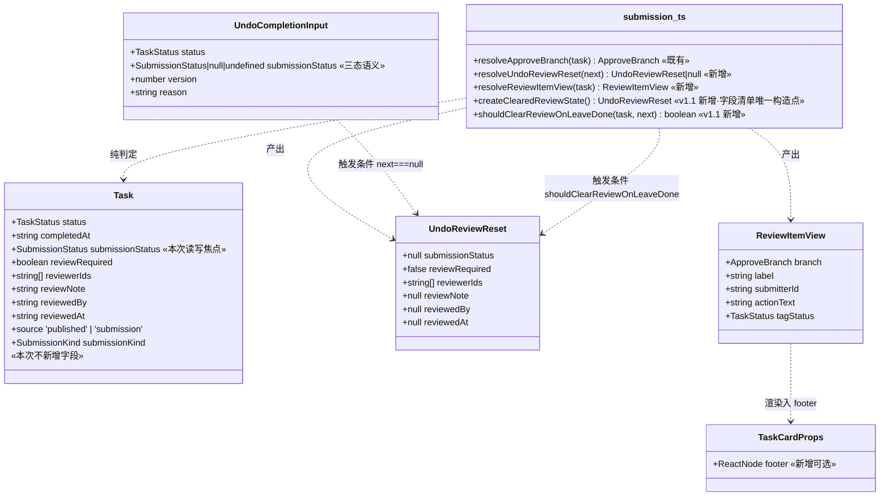
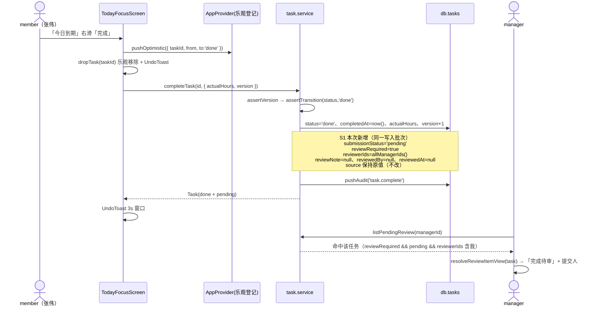
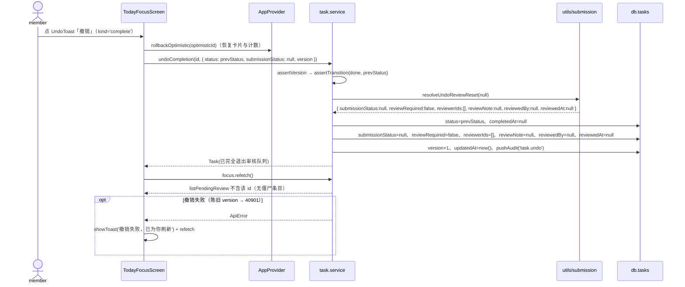
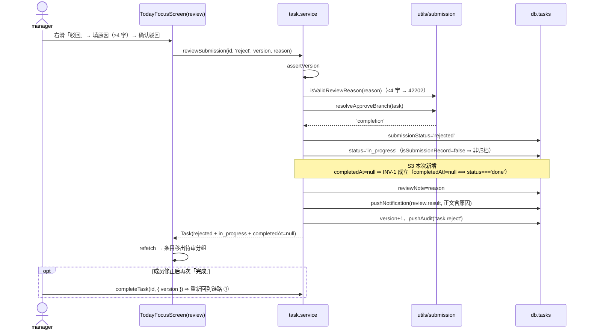
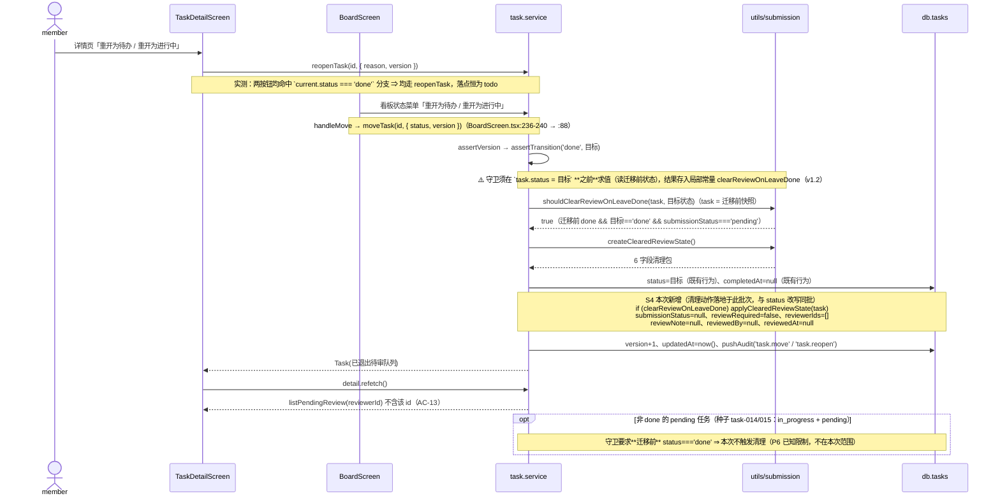
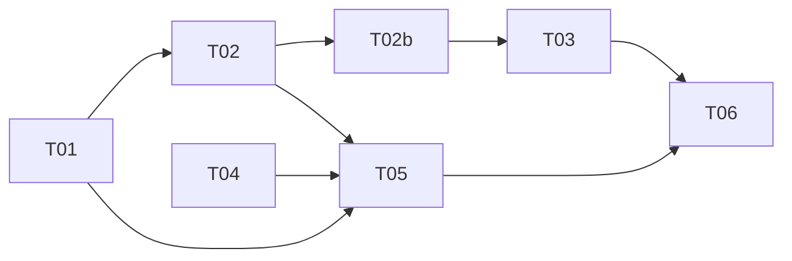

# ARCH（增量 2）— OpenSchedule 移动端：接通 `completeTask` → 待审核 断链

> 档位：**增量架构**（只写变更）· 架构师：高见远 · 基线：`PRD-mobile-increment-2.md` v1.0 · `ARCH-mobile-increment-1.md` v1.0 · `ARCH-mobile.md` v1.0
> 交付路径：`apps/mobile` · 硬约束：Expo 57 / RN 0.86.3 / React 19 / TS 6 / React Navigation 7；**零新增依赖**；禁 `reanimated` / `gesture-handler`；禁 pnpm。
> **范围铁律（主理人裁定，不可扩张）**：只接通 `completeTask` → 待审核 断链。双计去重、待你审核通知、撤回入口、权限分叉、重构**一律不做**。
> **范围澄清（v1.1 · 主理人裁定）**：「**离开 `done` 的退出路径清理审核态**」（`reopenTask`；`moveTask`）属**本断链的必要组成**——变更前 `completeTask` 不写提报态、该路径无审核态可泄漏，变更后泄漏成立；且其与 R1 属同一缺陷类（任务滞留审核队列），故**已纳入本次**（T02b / AC-13 / K8）。除该路径外，其余优化仍**一律不做**。

**摘要（TL;DR）**：本次只有 **4 个文件改动 + 1 个新测试文件**，核心是 4 处写入补齐（`completeTask` 写提报态三字段、`undoCompletion` 支持审核态清理、`reviewSubmission` reject 分支清 `completedAt`、`moveTask` / `reopenTask` 离开 `done` 时清理审核态）与 1 处展示分叉（`resolveApproveBranch` 驱动的审核条目标签），外加 1 处屏幕侧入参修正（撤销完成必须显式传 `submissionStatus: null`）。**零新增依赖、零类型破坏性变更、零既有断言修改。**

> **v1.1 增补**：纳入「离开 `done` 的审核态清理」——新增任务 **T02b**（紧随 T02，依赖 T02）、新增验收 **AC-13**、新增不变式 **INV-4**，并改写 **K8** / 修订 **K1** / 新增 **P6** 核实结论。详见 §10 修订记录。

---

## 1. 实现方案总览

### 1.1 一句话

在 `completeTask` 末尾补齐提报态三字段写入，让「成员完成 → 待我审核 → 通过 / 驳回」形成与增量 1 对称的第二条审核闭环；同时把「撤销完成」的回滚语义补齐为**审核态清理**（`createClearedReviewState()` 的六字段复位；其中 **4 个字段**——`submissionStatus` / `reviewRequired` / `reviewerIds` / `reviewNote`——由清理包贡献，第 5 个字段 `completedAt` **不在**清理包内，由 `undoCompletion` **另行**清空（`task.service.ts:419` 的 `task.completedAt = null`，该行对三态**均**执行）；**清理包贡献的 4 个字段 + `completedAt` 二者合计**，才构成 PRD AC-05 的五字段断言面），并让审核列表按 `resolveApproveBranch` 分叉展示两类条目。**v1.1 补充**：把同一清理规则接到「**离开 `done`**」的第二条退出路径（`reopenTask` / `moveTask`，T02b），确保任一退出路径都不留僵尸待审条目。

### 1.2 变更点清单（文件 → 改什么 → 为什么）

| # | 文件（相对 `apps/mobile/`） | 改什么 | 为什么 |
| --- | --- | --- | --- |
| **C1** | `src/utils/submission.ts` | 新增纯函数 `resolveUndoReviewReset(next)`（撤销回滚三态判定）+ `createClearedReviewState()`（审核态清理字段包的**唯一构造点**，v1.1 增补）+ `shouldClearReviewOnLeaveDone(task, nextStatus)`（「离开 `done`」判定，v1.1 增补）+ `resolveReviewItemView(task)`（审核条目分叉视图模型）及其返回类型 | 把「`submissionStatus` 三态 → 是否清理审核态」「**离开 `done` → 是否必须清理审核态**」与「分支 → 标签 / 提交人 / 副文案」三个判定**收敛为单一口径纯函数**，可被单测直接覆盖（ARCH-mobile §10「样式/判定下沉」+ 增量 1 §7「纯判定放 `utils/`」）；`createClearedReviewState` 保证「审核态清理字段清单」**全仓唯一**（undo 路径与离开 `done` 路径共用，杜绝两份清单漂移） |
| **C2** | `src/services/task.service.ts` | ① `completeTask` 末尾写 6 个提报态字段（S1）；② `undoCompletion` 增加 `submissionStatus === null` 的**审核态清理分支**（S2）；③ `reviewSubmission` reject 分支在 `'completion'` 时清 `completedAt`（S3）；④ `UndoCompletionInput` 补 JSDoc 说明三态；⑤ **（v1.1）`moveTask` / `reopenTask` 在「离开 `done` 且仍在待审」时清理审核态（S4）** | 这是「断链」的唯一根因所在（PRD §1.2 证据表：提交侧不写三字段）；S1/S2/S3/S4 是本次全部 P0 写入。S4 修复**变更直接引入的第二条泄漏路径**（详见 §9.2-P3 / K8） |
| **C3** | `src/components/TaskCard.tsx` | 新增**可选** prop `footer?: ReactNode`（渲染在 `metaRow` 之下） | 「待我审核」条目需要承载分叉标签 + 提交人副文案，而 `TaskCard` 现无第二行文本槽；**附加式可选 prop，既有 3 处调用点零改动、零风险**（实测清单见 §3.4；替代方案见 §3.5 备注） |
| **C4** | `src/screens/TodayFocusScreen.tsx` | ① `handleUndo` 对 `kind === 'complete'` 显式传 `submissionStatus: null`（修 R1 断点）；② `review` 分组卡片经 `resolveReviewItemView` 注入 `footer` | 屏幕是撤销入参的**唯一构造点**（`:248-253`），不修则僵尸条目永久滞留（AC-05 直接失败）；② 是 S4 分叉展示的落点（D2 结论） |
| **C5** | `tests/increment2-completion.test.ts`（**新增**） | 纯函数用例 + service 全链路用例（AC-01~AC-07 / AC-09~AC-13 / INV-1~4） | PRD §6.3 要求新增测试**独立成文件**，避免污染既有 25 套件 |
| — | `src/types/task.ts`、`src/data/seed.ts`、`src/data/index.ts`、`src/navigation/*`、`src/theme/*`、`src/services/focus.service.ts`、`src/services/project.service.ts` | **零变更** | `CompleteTaskInput` 签名不变（AC-01 只传 `{ version }`）；`reviewerIds` 复用既有 `allManagerIds()`；`getTodayFocus` 返回类型不变（D2）；本次不改种子（`seed-integrity` 必须全绿） |

### 1.3 分层落点

| 层 | 落点 | 内容 |
| --- | --- | --- |
| **纯工具层** | `utils/submission.ts` | `resolveUndoReviewReset` / `resolveReviewItemView`（纯函数，无 React、无 IO）+ **v1.1：`createClearedReviewState`（清理字段包唯一构造点）/ `shouldClearReviewOnLeaveDone`（离开 `done` 判定）** |
| **数据层** | `services/task.service.ts` | `completeTask` / `undoCompletion` / `reviewSubmission` 三处写入补齐 + **v1.1：`moveTask` / `reopenTask` 离开 `done` 时清理审核态** |
| **组件层** | `components/TaskCard.tsx` | 新增可选 `footer` 槽 |
| **页面层** | `screens/TodayFocusScreen.tsx` | 撤销入参修正 + `review` 分组分叉展示 |
| **测试层** | `tests/increment2-completion.test.ts`（新） | 纯函数 + service 集成（含 v1.1 的 AC-13） |

> **不动的层**：导航层、种子层、主题层、`focus.service`（D2 结论：`getTodayFocus` 保持 `Task[]`）、`project.service`。

---

## 2. 文件列表

### 2.1 新增（1 个）

| 相对路径 | 职责 | 预估行数 |
| --- | --- | --- |
| `tests/increment2-completion.test.ts` | 增量 2 独立测试：`resolveUndoReviewReset` / `resolveReviewItemView` 纯函数全分支 + `completeTask`/`undoCompletion`/`reviewSubmission` 全链路（AC-01~AC-07 / AC-09~AC-11 / INV-1~3）**+ v1.1：`shouldClearReviewOnLeaveDone` / `createClearedReviewState` 纯函数用例与「离开 `done`」全链路（AC-13 / INV-4）** | ~195 |

### 2.2 修改（4 个）

| 相对路径 | 改什么（精确定位） | 预估改动行数 |
| --- | --- | --- |
| `src/utils/submission.ts` | 末尾追加 `UndoReviewReset` / `ReviewItemView` 两个类型 + `resolveUndoReviewReset` / `resolveReviewItemView` 两个纯函数；**v1.1 追加 `createClearedReviewState()` 与 `shouldClearReviewOnLeaveDone()`（并把 `resolveUndoReviewReset(null)` 的返回值改为 `createClearedReviewState()` 以统一字段清单）**；文件头职责注释补一行 | **+60** |
| `src/services/task.service.ts` | `completeTask:323-327` 后插入 6 行字段写入；`undoCompletion:382-384` 处把单行赋值改为三分支；`reviewSubmission:936-939` 处插入 1 行条件清空；`UndoCompletionInput:360-368` 补 JSDoc（无签名变更）；**v1.1：`moveTask:288-299` 与 `reopenTask:349-350` 各插入 1 处「离开 `done` 清理」守卫（含私有 `applyClearedReviewState` 小助手）** | **+36** |
| `src/components/TaskCard.tsx` | `TaskCardProps` 加 `footer?: ReactNode`（`:16-32`）；函数签名解构加 `footer = undefined`（`:55-65`）；`metaRow` 之后插入 `{footer ? <View style={styles.footer}>{footer}</View> : null}`（`:123` 后）；`styles` 加 `footer` 一条 | **+10** |
| `src/screens/TodayFocusScreen.tsx` | `handleUndo:250` 一行改；`useMemo` 引入 `userMap`；`currentTasks.map` 内为 `review` 分组计算视图并传 `footer`（`:455-480`）；`styles` 加 2 条 | **+35** |

**合计**：新增 ~195 行 / 修改 ~141 行。（v1.1 相对 v1.0：新增 +25 行、修改 +29 行）

---

## 3. 数据结构与接口变更

### 3.1 `CompleteTaskInput` —— **无变更**（明确声明）

`src/types/task.ts:171-175` 保持原样。理由：`reviewerIds` 由 service 内部取 `allManagerIds()`（S6 / AC-10），**不由调用方传入**；PRD AC-01 的调用形态即 `completeTask(id, { version })`。**禁止**为本次需求给该接口加字段（否则会把「审核人是谁」这一服务端职责泄漏给页面）。

| 字段 | 类型 | 本次处置 |
| --- | --- | --- |
| `summary?` | `string` | 不变 |
| `actualHours?` | `number` | 不变 |
| `version` | `number` | 不变 |

### 3.2 `UndoCompletionInput` —— **签名不变，语义显式化（D1 结论）**

```ts
/** 撤销「完成 / 审核通过」入参（按目标状态回滚，可复位提报态） */
export interface UndoCompletionInput {
  /** 回滚目标状态（原状态，非固定 todo） */
  status: TaskStatus
  /**
   * 提报态处置（三态，缺一不可）：
   * - `undefined`（不传）→ **不动**提报态（保持原值）；
   * - `null`           → **清理审核态**：submissionStatus=null、reviewRequired=false、
   *                      reviewerIds=[]、reviewNote=null、reviewedBy=null、reviewedAt=null
   *                      （撤销「完成」用；字段清单唯一来源 = `createClearedReviewState()`，v1.1）；
   * - `'pending'`      → 仅把 submissionStatus 置回 `'pending'`，**不得**复位
   *                      reviewRequired / reviewerIds（撤销「审核通过」用，Q3-9）。
   */
  submissionStatus?: Task['submissionStatus']
  version: number
  reason?: string
}
```

**D1 裁定：复用 `submissionStatus === null` 作为「清理审核态」信号，不新增显式字段。** 理由：

1. **与 PRD 契约逐字一致**：AC-05 的调用形态就是 `undoCompletion(id, { status, submissionStatus: null, version })`，新增 `clearReviewState` 之类的字段会与 PRD 契约产生**两套等价表达**，反而制造歧义。
2. **三态天然可区分**：`undefined`（不传）/ `null`（清理）/ `'pending'`（仅置回）在 TS 中互不相等，且既有实现已依赖 `input.submissionStatus !== undefined` 判定（`task.service.ts:383`），沿用同一约定，无新概念。
3. **语义自洽**：`submissionStatus === null` 表示「无提报态」，而 `reviewRequired === true` / `reviewerIds` 非空**只有在存在待审提报时才有意义**（INV-2 的语义逆否）。因此「置 null ⇒ 同步清理审核态」是唯一自洽解释，不存在「想置 null 但想保留 reviewerIds」的合法调用方。
4. **真实 API 面对齐成本最低**：`// TODO(real-api)` 的 body 无需新增字段（`{ status, submissionStatus, version, reason }` 已足够表达）。

**为何不会误伤 `tests/round2-regression.test.ts:43-60`**：

| 用例 | 传入 | 新实现命中分支 | 断言 | 结论 |
| --- | --- | --- | --- | --- |
| `:19-31` / `:33-41`（撤销完成回 `in_progress` / `todo`） | **不传** `submissionStatus`（`undefined`） | 「不动」分支（提报态保持原值） | `status` / `completedAt===null` / `version+1` / `audit[0].action==='task.undo'` | ✅ 全绿 |
| `:43-60`（撤销审核通过） | `submissionStatus: 'pending'` | 「仅置回 pending」分支，**不触碰** `reviewRequired` / `reviewerIds` | `status==='in_progress'` / `submissionStatus==='pending'` / `completedAt===null` | ✅ 全绿（且这正是 Q3-9 的要求：`task-014` 的 `reviewerIds=['user-001']` 得以保留，任务不丢出待审队列） |
| `:62-69`（不传 `submissionStatus` 保持原值） | 不传 | 「不动」分支 | `undone.submissionStatus === before.submissionStatus`（二者同为 `undefined`） | ✅ 全绿 |

> ⚠️ 关键：**只有 `=== null` 才触发清理**，`undefined` 与 `'pending'` 都**不得**复位 `reviewRequired` / `reviewerIds`。这是本次最容易写错的一处（PRD §5.3 注）。

### 3.3 新增纯函数（`src/utils/submission.ts`）

```ts
/** 「撤销完成」/「离开 done」需复位的审核态字段包（唯一构造点：createClearedReviewState()） */
export interface UndoReviewReset {
  submissionStatus: null
  reviewRequired: false
  reviewerIds: string[]
  reviewNote: null
  /** v1.1 纳入：`pending` 态任务二者恒为 null（`completeTask` 亦写 null）⇒ 行为等价、回归面为零 */
  reviewedBy: null
  reviewedAt: null
}

/**
 * 解析「撤销完成」需复位的审核态字段（纯函数）。
 * - next === null → 返回清理包（三字段 + reviewNote 复位）；
 * - 其它取值（含 undefined / 'pending' / 'approved' …）→ 返回 null（不清理）。
 */
export function resolveUndoReviewReset(next: Task['submissionStatus']): UndoReviewReset | null

/** 「待我审核」条目视图模型（列表分叉展示用） */
export interface ReviewItemView {
  branch: ApproveBranch
  /** 状态标签文案：「完成待审」/「提报待审 · 新任务」/「提报待审 · 新项目」 */
  label: string
  /** 提交人字段来源：完成提报 = assigneeId；新事项提报 = createdBy */
  submitterId: string | null
  /** 副文案：「提交了完成提报」/「提报了新任务」/「提报了新项目」 */
  actionText: string
  /** 标签配色复用的既有状态色槽（不新增 token）：completion → 'done'；task/project → 'in_progress' */
  tagStatus: TaskStatus
}

/**
 * 解析审核条目分叉视图（纯函数，判定依据 = resolveApproveBranch(task)，**禁止**用 source / status）。
 */
export function resolveReviewItemView(
  task: Pick<Task, 'source' | 'submissionKind' | 'assigneeId' | 'createdBy'>,
): ReviewItemView
```

**`resolveReviewItemView` 伪代码（分支表即 PRD §5.5）**：

```
branch ← resolveApproveBranch(task)
completion → { label:'完成待审',            submitterId: assigneeId, actionText:'提交了完成提报', tagStatus:'done' }
task       → { label:'提报待审 · 新任务',   submitterId: createdBy,  actionText:'提报了新任务',   tagStatus:'in_progress' }
project    → { label:'提报待审 · 新项目',   submitterId: createdBy,  actionText:'提报了新项目',   tagStatus:'in_progress' }
```

### 3.3b 新增纯函数（v1.1 · 「离开 `done`」清理，T02b）

```ts
/**
 * 构造「审核态已清理」字段包（**每次返回新对象**，避免共享可变引用）。
 * 本函数是「审核态清理字段清单」在全仓的**唯一构造点**：T02 的 undo 路径与 T02b 的
 * 「离开 done」路径必须共用，禁止在 service 内另行手写第二份字段列表。
 */
export function createClearedReviewState(): UndoReviewReset

/**
 * 「离开 done」是否必须清理审核态（纯判定，T02b 的唯一触发口径）。
 *
 * ⚠️ 入参 `task` 必须是**迁移前**的对象（改写 `status` / `submissionStatus` 之前的状态）：
 *    本判定读的是**迁移前**的 `status` / `submissionStatus`，**必须**在 `task.status = <目标>`
 *    **之前**调用（求值时机见下方落点与 §10-v1.2）。
 *
 * 三条同时成立才为 true：
 *   ① task.status === 'done'            —— **迁移前**处于 done（**仅覆盖由 done 迁出的路径**）；
 *   ② nextStatus !== 'done'             —— 目标不是 done（`moveTask` 迁往 done 时不得清理）；
 *   ③ task.submissionStatus === 'pending' —— 仍在待审（非 pending 无需清理）。
 */
export function shouldClearReviewOnLeaveDone(
  task: Pick<Task, 'status' | 'submissionStatus'>,
  nextStatus: TaskStatus,
): boolean
```

**为何抽纯函数而非内联 4 行（回应「避免过度抽象」）**：

| 方案 | 评估 | 裁定 |
| --- | --- | --- |
| **A. 两处内联同一布尔表达式** | 表达式为 3 条件复合式，在 `moveTask` / `reopenTask` 各写一遍 ⇒ 两份口径**存在漂移风险**（例如后续有人只改一处，就会出现「看板重开清、详情页重开不清」的不一致缺陷） | ❌ 否决 |
| **B. 抽 `shouldClearReviewOnLeaveDone` + 复用 `createClearedReviewState`**（采纳） | 判定下沉 `utils/submission.ts`，与 T01 的 `resolveUndoReviewReset` **同风格、同文件、同测试文件**；判定与字段清单各只有一个来源；单测可脱离 DB 覆盖 3 个条件的边界组合 | ✅ **采纳** |

**落点（service 侧，仅签名与目标片段）**：

```ts
/** task.service.ts 私有助手：把清理字段包落到任务对象上（唯一落地实现） */
function applyClearedReviewState(task: Task): void {
  Object.assign(task, createClearedReviewState())
}

// moveTask（:301 / :302 / :313 区段）
// ⚠️ 守卫**必须在改写 `task.status` 之前**求值（它读的是**迁移前**状态），
//    求值结果存入局部常量，清理动作仍落地在 status / completedAt 赋值**之后**。
const clearReviewOnLeaveDone = shouldClearReviewOnLeaveDone(task, input.status) // :301 —— 在 :302 之前求值
task.status = input.status                                                       // :302（既有）
// …（completedAt / version / updatedAt 等既有写入，不变）
if (clearReviewOnLeaveDone) applyClearedReviewState(task)                        // :313 —— 在赋值之后落地

// reopenTask（:371 / :376 区段）—— 与 moveTask 同一模式
const clearReviewOnLeaveDone = shouldClearReviewOnLeaveDone(task, 'todo')        // :371 —— 在 :376 之前求值
// …（改写 task.status = 'todo' / completedAt = null，既有）
if (clearReviewOnLeaveDone) applyClearedReviewState(task)                        // :376 —— 在赋值之后落地
```

> ⚠️ **守卫求值时机（v1.2 修正 · 工程师实现期发现的实质错误）**：`shouldClearReviewOnLeaveDone` 的第 ① 条读的是**迁移前**的 `task.status`。若在 `task.status = input.status` **之后**才求值，条件 ①（`task.status === 'done'`）**恒为假** ⇒ 清理**永不触发** ⇒ **AC-13 必然失败**（`reopenTask` 因先置 `task.status = 'todo'` 同理恒假）。故必须「**先求值 → 后赋值 → 再清理**」：局部常量 `clearReviewOnLeaveDone` 正是为承接「求值」与「落地」之间的时间差而存在，`applyClearedReviewState(task)` 仍放在赋值之后，确保清理与状态改写落在**同一写入批次**。
> `reopenTask` 的第二个实参恒为 `'todo'`（`:349` 硬编码目标），故守卫退化为「**迁移前**为 `done` 且仍待审」。
> **`withdrawSubmission` / `reviewSubmission(reject)` 不接入本守卫**：二者自身即把 `submissionStatus` 置为 `'withdrawn'` / `'rejected'`（`:870` / `:936`），**不产生 pending 泄漏**（详见 §7-K7 与 §9.2-P6）。
> **类型名沿用 `UndoReviewReset`**：v1.1 起它同时服务 undo 与「离开 done」两条路径；改名会波及 T01 已定契约，按最小 diff 保留，语义以本注释为准。

> **实现建议（v1.2 采纳 · 从类型上杜绝上述误用，后续增量可选）**：`shouldClearReviewOnLeaveDone` 现签名为 `(task: Pick<Task, 'status' | 'submissionStatus'>, nextStatus)`，调用方仍可传入**已改写**的 `task`（本次缺陷的根因即在于此——类型无法阻止「先赋值后求值」）。建议后续增量把入参由**可变对象**改为**迁移前状态快照**，即改签名为
> `shouldClearReviewOnLeaveDone(prev: { status: TaskStatus; submissionStatus: SubmissionStatus }, nextStatus: TaskStatus)`，
> 调用方显式构造 `{ status: <迁移前>, submissionStatus: <迁移前> }` 传入。这样「读迁移前状态」被提升为**签名契约**，误传当前对象即类型/取值不符，从源头消灭该误用。**本次不改**：现签名与「**v1.2 时点快照：26 套件 / 422 用例全绿**」（v1.2 后 QA 补测 `tests/increment2-qa.test.ts` 与 `tests/increment2-focus-footer.test.tsx` 共 2 个套件，**当前验收态为 28 套件 / 445 用例**）状态已定稿，改动会波及 T01 契约与既有用例，收益（防未来误用）小于当前回归成本，故仅列为建议、待后续增量评估。

### 3.4 `TaskCardProps` 变更（附加式）

```ts
export interface TaskCardProps {
  /* …既有 9 个 prop 全部不变（新增 `footer` 后共 10 个）… */
  /** 卡片底部附加内容（仅「待我审核」分叉标签 + 提交人副文案使用） */
  footer?: ReactNode
}
```

> **D3 备注（共享组件触碰的正当性）**：`footer` 是**可选** prop，默认 `undefined` ⇒ 既有 3 处调用点（清单见下方 v1.3 实测）渲染结果**逐像素不变**，不构成重构。替代方案（在 `SwipeableRow` 内把徽标行渲染在卡片**外部**）会造成标签与卡片视觉脱节且破坏 `SwipeableRow` 的子节点度量，故否决。

> **v1.3 实测 · `<TaskCard` 调用点清单**（检索范围：`apps/mobile/src` 全域，含别名导入与 `React.createElement` 写法排查）：
>
> | # | 调用点（文件:行号） | 导入位置 |
> | --- | --- | --- |
> | 1 | `src/screens/WorkspaceScreen.tsx:352` | `WorkspaceScreen.tsx:18`（具名导入） |
> | 2 | `src/screens/TodayFocusScreen.tsx:470` | `TodayFocusScreen.tsx:20`（具名导入） |
> | 3 | `src/screens/BoardScreen.tsx:197` | `BoardScreen.tsx:18`（具名导入） |
>
> **实测结论：共 3 处。** 补充核实：① 三处**均为具名导入、无 `as` 别名**；② 全域**不存在** `React.createElement(TaskCard, …)` 写法；③ `src/components/index.ts:37-38` 是唯一再导出点（`TaskCard` / `TaskCardProps`）；④ **不计入**：`src/screens/PersonalPlanScreen.tsx:665` / `:779` 的 `<PersonalTaskCard`（其组件定义在 `:143`）是**形态对齐但独立的屏幕内联组件**，**不是** `TaskCard` 的调用点。故 v1.0~v1.2 所称「**5 处调用点**」为**误计**，正确值为 **3 处**。

### 3.5 类图（可选）



---

## 4. 程序调用流程

### 4.1 链路 ① 完成提报 → 进入「待我审核」



### 4.2 链路 ② 撤销完成（审核态清理，D1 契约落地）



### 4.3 链路 ③ 审核驳回（含 `completedAt` 清空）



> 对照：`'task'` / `'project'` 分支（新事项提报）**行为完全不变**（`status='cancelled'` 归档、不清 `completedAt`），符合 AC-07 红线。

### 4.4 链路 ④ 离开 `done` 的第二条退出路径（v1.1 · T02b 新增清理）

> 触发面经**实读核实**（见 §9.2-P6）：详情页两个「重开」按钮**均走 `reopenTask`**（`TaskDetailScreen.tsx:129-133`，落点恒为 `todo`）；看板状态菜单走 `moveTask`（`BoardScreen.tsx:236-240` → `:88`）。



**对照（不变项）**：`moveTask` 迁往 `done`（`in_progress/blocked → done`）时守卫第 ② 条为假 ⇒ **不清理**；无 `submissionStatus === 'pending'` 的任务（绝大多数正式任务，如种子 `task-007`）守卫第 ③ 条为假 ⇒ **不清理**。两条否决保证了 §8.1 既有迁移用例零影响。

> ⚠️ **步骤顺序补注（v1.2）**：图中 `shouldClearReviewOnLeaveDone` 的求值**先于** `status=目标` 的写入，这不是排版顺序，而是**实现约束**——守卫读的是**迁移前** `task.status`，故必须「**先求值（存局部常量）→ 再改写 status / completedAt → 最后 `applyClearedReviewState`**」。若误将求值挪到 `status=目标` 之后，条件 ①（`task.status === 'done'`）恒为假，链路整条失效（AC-13 必红）。详见 §3.3b ⚠️ 与 §10-v1.2。

---

## 5. 增量任务列表（有序 · 含依赖 · 按实现顺序）

> 粒度约定：**一个任务 = 一批可连续写盘的文件**。T01 先落「契约 + 纯工具 + 纯函数测试」，T02 再改 service，**T02b 紧接着补齐「离开 `done`」的第二条退出路径（与 T02 同属 `task.service.ts`，必须紧随其后以保持同一文件上下文）**，T03 补 service 用例，T04/T05 做展示层，T06 收尾复跑。**无前置「先改断言」任务**（D4 检索结论：不存在全字段快照断言，见 §8.3）。

| 任务号 | 内容 | 涉及文件（相对 `apps/mobile/`） | 依赖 | 对应 AC |
| --- | --- | --- | --- | --- |
| **T01** | **契约 + 纯工具 + 纯函数测试**：新增 `UndoReviewReset` / `ReviewItemView` 类型与 `resolveUndoReviewReset` / `resolveReviewItemView` 两个纯函数；新建测试文件并写纯函数全分支用例（`null` vs `undefined` vs `'pending'`；三分支标签/提交人/`tagStatus`） | `src/utils/submission.ts`、`tests/increment2-completion.test.ts`(新) | — | AC-09（判定部分） |
| **T02** | **service 写入补齐（本次核心）**：① `completeTask` 末尾写 `submissionStatus='pending'` / `reviewRequired=true` / `reviewerIds=allManagerIds()` / `reviewNote=null` / `reviewedBy=null` / `reviewedAt=null`（**不改 `source`**）；② `undoCompletion` 增加 `submissionStatus===null` 的审核态清理分支（走 `resolveUndoReviewReset`）；③ `reviewSubmission` reject 分支在 `resolveApproveBranch==='completion'` 时清 `completedAt`；④ `UndoCompletionInput` 补三态 JSDoc | `src/services/task.service.ts` | T01 | AC-01、AC-02、AC-04、AC-05、AC-06、AC-10、AC-11、INV-1~3 |
| **T02b** | **「离开 `done`」退出路径清理审核态（v1.1 · 主理人裁定纳入）**：① `moveTask` 在 `shouldClearReviewOnLeaveDone(task, input.status)` 为真时调用 `applyClearedReviewState(task)`；② `reopenTask` 同守卫（`nextStatus` 传 `'todo'`）；③ 清理字段包**必须**经 `createClearedReviewState()`（禁止手写第二份字段列表）；④ 在测试文件追加 AC-13 用例（`reopenTask` 与 `moveTask` 各一条：断言 `submissionStatus===null` / `reviewRequired===false` / `reviewerIds===[]` / `reviewNote===null` / `completedAt===null`，且 `listPendingReview(reviewerId)` **不含**该 id）+ 守卫的**否决用例**（迁往 `done` 时不清、非 pending 时不清） | `src/services/task.service.ts`、`src/utils/submission.ts`、`tests/increment2-completion.test.ts` | **T02** | **AC-13**、INV-4 |
| **T03** | **service 全链路测试**：在既有新测试文件追加 `completeTask` / `listPendingReview` / `undoCompletion` / `reviewSubmission(approve/reject)` 用例；覆盖 `resetDatabase()` 后的重入（AC-06）、`reviewerIds` 集合等于 `allManagerIds()`（集合比较、顺序无关）、`listPendingReview` 不含已撤销 id | `tests/increment2-completion.test.ts` | T02b | AC-01~AC-07、AC-10、AC-11 |
| **T04** | **卡片 footer 槽**：`TaskCardProps` 增 `footer?: ReactNode` 并渲染在 `metaRow` 之后；样式取 token（`marginTop: spacing.xs`） | `src/components/TaskCard.tsx` | —（独立） | AC-09（承载面） |
| **T05** | **页面接入**：① `handleUndo` 的 `kind==='complete'` 传 `submissionStatus: null`（`kind==='approve'` 仍传 `'pending'`）；② `review` 分组卡片按 `resolveReviewItemView` 注入 `footer`（标签 `Tag` + 提交人姓名 + 副文案），提交人姓名经 `userMap()`（与 `BoardScreen`/`CreateItemScreen` 同姿势）解析；③ `due` / `approaching` 分组**不传** `footer` | `src/screens/TodayFocusScreen.tsx` | T01、T02、T04 | AC-05、AC-08、AC-09 |
| **T06** | **收尾复跑与工程门槛**：全量 `npx jest --config jest.config.js` + `npx tsc --noEmit`；核对 §8.1 九项回归清单**与 §8.1b T02b 六项回归面（#10~#15）**逐条全绿、套件/用例数不减少；核对 `package.json` 零新增依赖；（可选）按 PRD §6.3 建议把 `round2-regression.test.ts:62` 的用例标题改为「不传 `submissionStatus` 时 service 保持原值（调用方须显式传 `null` 才能回滚）」 | `tests/round2-regression.test.ts`（**仅可选改标题，断言不动**） | T03、T05 | AC-07、AC-08、AC-12、**AC-13** |

**依赖图**：



**任务条数**：**7 条**，严格按 T01 → T02 → T02b → T03 → T04 → T05 → T06 顺序执行（T04 可与 T02/T02b/T03 并行，但建议按序写盘以保持上下文连续）。

---

## 6. 依赖包列表

**结论：零新增依赖。** `package.json` 本次**不产生任何 diff**。

| 能力 | 复用来源（均已存在） | 说明 |
| --- | --- | --- |
| `reviewerIds` 来源 | `@/data` 的 `allManagerIds()` | 既有导出（`data/index.ts:178-180`），`task.service.ts:7` 已 import，**无需新增 import** |
| 分叉判定 | `@/utils/submission` 的 `resolveApproveBranch` | 既有导出，`task.service.ts:50` 已 import |
| **v1.1：离开 `done` 判定 / 清理字段包** | `@/utils/submission` 的 `shouldClearReviewOnLeaveDone` / `createClearedReviewState` | **同模块内新增导出**（T01 落盘），T02b 只需在 `task.service.ts` 既有的 `@/utils/submission` import 行**追加 2 个名字**——不新增包、不新增文件、`Task` / `TaskStatus` 类型亦已 import（`:34` / `:36`） |
| 标签配色 | `@/theme` 的 `statusColor`（`done` 绿 / `in_progress` 墨蓝） | 既有 token，**不新增 token、不改 `Tag` 组件** |
| 提交人姓名解析 | `@/data` 的 `userMap()` | 既有；`BoardScreen` / `CreateItemScreen` / `SubmissionScreen` 已是同一姿势 |
| 卡片 footer 槽 | `react` 的 `ReactNode` | 既有 |
| 测试 | `jest` / `jest-expo` / `react-test-renderer`（devDependencies） | 既有 |

> **明确否决**：`react-native-reanimated`、`react-native-gesture-handler`、`@testing-library/react-native`、任何状态管理 / 表单 / 日期库 —— 本增量**不需要**任何新增依赖。若工程师在实现中认为需要新增依赖，**必须先停下并回报**（视为设计走偏信号）。

---

## 7. 共享知识（跨文件约定 · 可直接引用）

| # | 规则 | 说明 |
| --- | --- | --- |
| **K1** | **`submissionStatus === null` 的语义** = 「无提报态」，且**蕴含**审核态已清理（`reviewRequired === false`、`reviewerIds === []`、`reviewNote === null`、`reviewedBy === null`、`reviewedAt === null`）。**写入点共 3 处**（v1.1 修订）：① `undoCompletion` 的清理分支（`submissionStatus === null` 触发）；② **`reopenTask`**；③ **`moveTask`**——后两者在「离开 `done` 且仍为 `pending`」时经 `createClearedReviewState()` 写入（K8）。**字段清单的唯一构造点是 `createClearedReviewState()`，禁止在别处手写第二份**。 | 任何模块判定「任务是否已彻底退出审核队列」应看 `submissionStatus === null` 或 `listPendingReview` 结果，不得只看 `status`。⚠️ **v1.0 表述「唯一写入点是 `undoCompletion` 的清理分支」在纳入 T02b 后已不准确，以本行为准。** |
| **K2** | **`UndoCompletionInput.submissionStatus` 三态**：`undefined` = 不动；`null` = 清理审核态；`'pending'` = 仅置回待审（**不复位** `reviewRequired` / `reviewerIds`）。 | 三个取值互斥且必须显式。新增调用方**必须**在注释里写明走哪一态。 |
| **K3** | **审核态三字段（`reviewRequired` / `reviewerIds` / `reviewNote`）的复位规则**：**仅当** `submissionStatus === null` 时复位。撤销「审核通过」（`'pending'`）时**禁止**复位 `reviewRequired` / `reviewerIds`。 | 二者方向相反，是本次最易写错处（PRD §5.3 注 / Q3-9）。 |
| **K4** | **禁止用 `source` / `status` 判定「完成提报」**，一律用 `resolveApproveBranch(task)`。 | ① `completeTask` **不改 `source`**（保持 `published`）⇒ 存在 `source !== 'submission'` 但 `submissionStatus === 'pending'` 的组合；② 种子 `task-014/015` 的 `status === 'in_progress'` ⇒ `status` 不可作依据（PRD §1.5 / F1）。 |
| **K5** | **硬不变式（写入点职责）**：INV-1 `completedAt != null ⟺ status === 'done'`（`completeTask` / `undoCompletion` / `reviewSubmission` 三处共同维护）；INV-2 `submissionStatus === 'pending' ⇒ reviewRequired === true 且 reviewerIds 非空`；INV-3 `submissionStatus ∈ {null,'approved','rejected'} ⇒ 不在待审队列`；**INV-4（v1.1 新增）「离开 `done` ⇒ `submissionStatus !== 'pending'`」**（由 `done` 迁出的任务保持 `pending` 为**非法中间态**；`reopenTask` / `moveTask` 由 S4 保证）。 | 任一写入路径违反 INV 即为缺陷。INV-4 的**适用边界**：仅约束「由 `done` 迁出」的迁移；种子 `task-014` / `task-015`（`in_progress` + `pending`，**非**由 `done` 迁出）不在其约束内，属 §9.2-P6 记录的既有缺口。 |
| **K6** | **`reviewerIds` 唯一来源 = `allManagerIds()`**；业务代码**禁止**硬编码 id 数组（如 `['user-001', …]`）。 | AC-10 的检索判据；`allManagerIds()` 每次返回**新数组**，可直接赋值。 |
| **K7** | **完成提报的合法退出路径 = `undoCompletion` / `reopenTask` / `moveTask` / `reviewSubmission`（后三者必须同时清理或改写 `submissionStatus`，见 K1/K8）**；**禁止**对完成提报调用 `withdrawSubmission`（其实现会把 `status` 置 `'cancelled'`，对正式任务是错误语义）。 | PRD §5.3 注 / §8-3 / Q3-10。补充（v1.1 核实）：`withdrawSubmission:870-871` 自身会把 `submissionStatus` 置 `'withdrawn'` ⇒ **不构成 pending 泄漏**，故**不**接入 K8 守卫；仅语义不当，继续禁止。 |
| **K8** | **（v1.1 改写 · 主理人裁定）任何离开 `done` 的迁移——`reopenTask`（目标恒为 `todo`），以及 `moveTask` 且**迁移前** `status === 'done'` 且目标 `status !== 'done'`——当 `task.submissionStatus === 'pending'` 时，必须清理审核态**（`submissionStatus = null`、`reviewRequired = false`、`reviewerIds = []`、`reviewNote = null`、`reviewedBy = null`、`reviewedAt = null`，统一经 `createClearedReviewState()` 写入）。**除此之外的顺手优化仍一律禁止**（双计去重、通知、权限分叉、详情页标签统一 P4、`SUBMISSION_TRANSITIONS` 补表 F2 等）。 | 触发口径唯一来源 = `shouldClearReviewOnLeaveDone(task, nextStatus)`（三条同时成立：**迁移前** `done`、目标非 `done`、`submissionStatus === 'pending'`）；**禁止**在 `moveTask` / `reopenTask` 内手写第二份布尔表达式或字段列表。⚠️ **（v1.2 明确化）** 该守卫读的是**迁移前**的 `task.status`，**必须**在改写 `task.status` **之前**求值（结果存局部常量，清理动作在赋值之后落地）；若在赋值后求值则条件恒假、清理永不触发（详见 §3.3b ⚠️ 与 §10-v1.2）。裁定人：**主理人**；缺陷机理与演示路径见 §9.2-P3，核实结论与残留缺口见 §9.2-P6。 |
| **K9** | **`TaskCard.footer` 只服务「待我审核」分组的分叉展示**；`due` / `approaching` 分组**不得**传该 prop。 | 避免分叉标签泄漏到非审核场景。 |
| **K10** | **分叉标签配色复用既有 `statusColor` 调色板**（`completion → 'done'` 绿、`task`/`project → 'in_progress'` 墨蓝），**不新增 token、不改 `Tag` 组件、不写内联魔法值**。 | 满足 PRD M3-P1-01「样式全部取自 `theme/tokens.ts`」且零共享组件风险。 |
| **K11** | **新增用例一律写在 `tests/increment2-completion.test.ts`**；**禁止**修改既有 25 套件的任何断言（唯一例外：T06 可选用例标题改名，断言不变）。 | PRD §6.3 附加要求。 |
| **K12** | **Mock ↔ 真实切换点**：本次新增写入逻辑全部位于既有 `if (USE_MOCK)` 分支内；`// TODO(real-api)` body 注释需同步反映 `submissionStatus` 三态语义，**不新增** service 方法。 | 沿用 ARCH-mobile §10。 |

---

## 8. 回归红线与测试策略

### 8.1 PRD §6.3 九项清单 → 复跑落点

| # | 文件 : 位置 | 断言内容 | 本次影响 | 复跑任务 | 结论 |
| --- | --- | --- | --- | --- | --- |
| 1 | `tests/services.test.ts:168-184` | `task-014` approve → `status='done'`；`task-015` reject → `status='in_progress'` + `reviewNote` | **红线**（单字段断言，未断言 `completedAt`）⇒ S3 清 `completedAt` **不破坏** | **T02**（改完即跑）、**T06** | ✅ 必须全绿 |
| 2 | `tests/services.test.ts:122-135` | `completeTask('task-004')` → `status` / `actualHours` / `completedAt` | 新增字段为**附加**，断言为单字段 | **T02**、**T06** | ✅ 不破坏 |
| 3 | `tests/round2-regression.test.ts:19-31` | 撤销完成回 `in_progress`，`completedAt===null` | 不传 `submissionStatus` ⇒ 走「不动」分支 | **T02**、**T06** | ✅ 不破坏 |
| 4 | `tests/round2-regression.test.ts:33-41` | 撤销完成回 `todo` | 同上 | **T02**、**T06** | ✅ 不破坏 |
| 5 | `tests/round2-regression.test.ts:43-60` | 撤销审核通过 → `submissionStatus='pending'` + `completedAt===null` | 传 `'pending'` ⇒ **不得**复位 `reviewRequired`/`reviewerIds`（K3） | **T02**、**T06** | ✅ 不破坏（须严格遵守 K3） |
| 6 | `tests/round2-regression.test.ts:62-69` | 「不传 `submissionStatus` 时保持原值不动」 | 断言不变；其**标题语义**已被 R1 取代 | **T02**、**T06** | ⚠️ 断言保持绿；**可选**改名（T06） |
| 7 | `tests/round2-regression.test.ts:73-85` | 陈旧 `version` → 40901；非法目标状态 → 40902 | 不受影响 | **T02**、**T06** | ✅ 必须全绿 |
| 8 | `tests/today-focus-gate.test.tsx:205/219` | `共 0 项 / 共 1 项待处理`（`visibleTotal` 口径） | **R4 不处理** ⇒ 不受影响；`footer` 新增不改变 `visibleTotal`；`reviewTask` 的 `submissionKind='task'` ⇒ 新标签为「提报待审 · 新任务」，与断言文本 `待审核：完成提报`（**任务标题**）无冲突。<br>**（v1.5 复核补注 · 实测）** 该两条断言**即使后续增量修正双计也无需修改**，与本次「R4 不做」无关 —— 依据：① 该用例的聚焦数据**全部**来自 `jest.mock` 替身（`:107-120` 的 `getTodayFocus` 返回 `{dueToday:[],pendingReview:[],approaching:[]}`）与 `mockFocus`（`:29-33`），`beforeEach`（`:170-175`）把三分组重置为空 ⇒ **不含任何种子数据**，与 `listTodayDue` 的过滤条件变更**完全解耦**；② `:219` 的 `reviewTask`（`:36-71`，`id='task-901'`）**只出现在 `pendingReview` 一个分组**，无可去重项 ⇒ 并集仍为 `\|{task-901}\| = 1`；`:205` 为 member 角色（`review` 组不计入）⇒ 并集 `\|∅ ∪ ∅\| = 0`。**故两条期望值恒为 `共 0 项` / `共 1 项`，断言一字不改。** ⚠️ **归属更正**：v1.1 期本文件**并未**出现过「修正双计需同步更新该断言」的表述（本行 v1.1 原文即为「不受影响 / 必须全绿」）；该错误依据的真实出处是 **`PRD-mobile-increment-2.md:265`（§8-2 末句「后续增量建议」）**，本行 v1.5 一并更正该归属（详见 §9.2-P6 的 v1.5 归属更正说明） | **T05**、**T06** | ✅ 必须全绿（这也是 R4 本次不动的理由之一）；**v1.5：后续增量修正双计后仍必须全绿，且断言一字不改** |
| 9 | `tests/seed-integrity.test.ts` | 种子完整性 | 本次**不改种子** | **T06** | ✅ 必须全绿 |

### 8.1b T02b 新增改动的回归面（v1.1 · 已逐点实读核实）

| # | 文件 : 位置 | 断言内容 | 与 S4 守卫的关系 | 结论 |
| --- | --- | --- | --- | --- |
| 10 | `tests/services.test.ts:93-110` | `moveTask('task-006', done)` 合法；`moveTask('task-007', cancelled)` 非法（40902） | `task-006` 由 `in_progress → done`（守卫 ② 假）；`task-007` 迁移非法、在 `assertTransition` 即抛错（守卫不可达） | ✅ 不破坏 |
| 11 | `tests/services.test.ts:139-143` | `reopenTask('task-007')` → `status==='todo'` + `completedAt===null` | `task-007`（`seed.ts:310-330`）为 `status:'done'` 的**正式任务，无 `submissionStatus`** ⇒ 守卫 ③ 假 ⇒ 不清理 | ✅ 不破坏 |
| 12 | `tests/task-state-machine.test.ts:40-56` | `done → todo / in_progress` 合法；`done → cancelled / blocked` 非法 | 该套件仅断言 **`TASK_TRANSITIONS` 纯表**（`isLegal`），不触及 service 写入 | ✅ 不破坏 |
| 13 | `tests/submission-flow.test.ts:243-261` | `withdrawSubmission` 越权 40302 / 撤回成功 | 未改动 `withdrawSubmission`（K7 明确不接入守卫） | ✅ 不破坏 |
| 14 | 种子 `task-014` / `task-015`（`seed.ts:435-479`） | `in_progress` + `submissionStatus:'pending'` | 守卫 ① 假（当前非 `done`）⇒ **不触发**，行为与 v1.0 完全一致 | ✅ 行为不变（残留缺口见 P6） |
| 15 | 种子 `task-019~023`（含 `reviewedBy`/`reviewedAt`） | 均为 `status:'cancelled'` | 守卫 ① 假 ⇒ 不受 6 字段清理包扩项影响 | ✅ 不破坏 |

### 8.2 新增测试落点（独立文件，避免污染既有套件）

**新文件**：`tests/increment2-completion.test.ts`（由 T01 创建，**T02b / T03 追加**）。

| describe | 覆盖 | 关键断言 |
| --- | --- | --- |
| `resolveUndoReviewReset —— 三态判定` | AC-05 / D1 | `null` → 返回清理包（`submissionStatus===null`、`reviewRequired===false`、`reviewerIds` 空数组、`reviewNote===null`、**`reviewedBy===null`、`reviewedAt===null`**）且**与 `createClearedReviewState()` 同型同值**；`undefined` / `'pending'` / `'approved'` / `'rejected'` → 返回 `null` |
| `resolveReviewItemView —— 分叉视图` | AC-09 | `task-014` → `'completion'` + 「完成待审」+ `submitterId===assigneeId`；`submissionKind='task'` → 「提报待审 · 新任务」+ `submitterId===createdBy`；`submissionKind='project'` → 「提报待审 · 新项目」 |
| `shouldClearReviewOnLeaveDone / createClearedReviewState —— 离开 done 判定（v1.1）` | **AC-13** / INV-4 | 真值：`{status:'done',submissionStatus:'pending'}` + 目标 `'todo'`/`'in_progress'` → `true`；**否决**：目标 `'done'` → `false`、当前非 `done`（`in_progress` + `pending`，即 `task-014` 形态）→ `false`、`submissionStatus` 为 `undefined`/`'approved'`/`'rejected'` → `false`；`createClearedReviewState()` **每次返回新对象**（`a !== b`）且字段包为 6 字段全清 |
| `reopenTask / moveTask → 离开 done 清理审核态（v1.1）` | **AC-13** / INV-4 | 造出「已完成待审」任务后：`reopenTask` → `status==='todo'`、`submissionStatus===null`、`reviewRequired===false`、`reviewerIds` 空数组、`reviewNote===null`、`completedAt===null`、`version+1`、`audit[0].action==='task.reopen'`，且 `listPendingReview(reviewerId)` **不含**该 id；`moveTask(id,{status:'in_progress'})` 同断言（`audit[0].action==='task.move'`）；**否决用例**：`in_progress` 迁往 `done` 时 `submissionStatus` **保持** `'pending'`（守卫 ② 假） |
| `completeTask → 待我审核 断链接通` | AC-01 / AC-02 / AC-10 / AC-11 / INV-2 | `status==='done'`、`completedAt` 非空、`submissionStatus==='pending'`、`reviewRequired===true`、`reviewerIds` **集合等于** `allManagerIds()` 且非空、`reviewNote===null`、`source` **未被改写**、`version+1`、`audit[0].action==='task.complete'`；`listPendingReview(任一 manager)` 含该 id；manager（张伟）完成任务同样入队（AC-11） |
| `undoCompletion → 审核态清理（AC-05 五字段）` | AC-05 / AC-06 / INV-1 / INV-3 | 撤销后五字段同时复位（`submissionStatus===null`、`reviewRequired===false`、`reviewerIds===[]`、`reviewNote===null`、`completedAt===null`；另 `reviewedBy`/`reviewedAt` 同清）、`status===原状态`、`listPendingReview(reviewerId)` **不含**该 id；**再次 `completeTask` 可重新入队**（AC-06） |
| `reviewSubmission('completion') —— 通过 / 驳回` | AC-03 / AC-04 / INV-1 | approve → `approved` + `done` + `completedAt` 非空 + `reviewNote===null` + 1 条 `review.result` 通知；reject → `rejected` + `in_progress` + **`completedAt===null`** + `reviewNote` 为原因 + 通知正文含原因 |
| `回归红线（本文件内复述，不改既有套件）` | AC-07 | `task-014` approve → `done`；`task-015` reject → `in_progress` + `reviewNote==='说明不充分'`（与 `services.test.ts:168-184` 逐条一致） |

### 8.3 D4 全字段快照断言检索结论（已实际执行）

**检索范围**：`apps/mobile/tests/` 全域。

| 检索式 | 命中 | 判定 |
| --- | --- | --- |
| `completeTask\|undoCompletion` | `round2-regression.test.ts:18/24/35/51/64/72/76/83`、`services.test.ts:122/125/132`、`today-focus-gate.test.tsx:116/118` | 均为**单字段断言**（`status` / `completedAt` / `version` / `reviewNote` / `submissionStatus`）或 `jest.fn` 替身，**无**对返回值的全字段快照 |
| `toEqual(\{` | `draft.test.ts:101`、`schedule.test.ts:103/107/111/115` | 命中项分别为草稿构造结果与 `resolveDrop` 的 `{startMin,endMin}`，**与 `completeTask` / `undoCompletion` 返回值无关** |

**结论**：**不存在**对 `completeTask` / `undoCompletion` 返回值做全字段快照（`toEqual({...全部字段})`）的断言 ⇒ **无需新增「先改断言」前置任务**。本次对返回值的字段附加（S1）与 `completedAt` 清空（S3）均**不会**触发既有断言失败。

> 与 PRD §6.3 末尾「本 PRD 编写期已抽查 `services.test.ts` 与 `round2-regression.test.ts`，未发现此类断言」一致；本次检索**扩展至 `tests/` 全域**，结论不变。

---

## 9. 待明确事项

### 9.1 阻塞实现的事项

**无。** 全部实现所需契约、判定口径、依赖与回归边界均已闭合，T01 可直接开工。

**v1.1 补充**：P3（详情页 / 看板的「离开 `done`」第二条退出路径）经**主理人裁定纳入本次**，已落为 **T02b**（依赖 T02）与 **AC-13** / **INV-4**，并改写 **K8**；其触发口径、字段清单与回归面均已核实闭合（见 §3.3b / §8.1b / §9.2-P6），**不阻塞**。`§9.2` 其余 P1/P2/P4/P5/P6 仍为「不阻塞」。

### 9.2 本次发现的 PRD 歧义 / 与代码现状冲突（已给出裁定，**不阻塞**）

| # | 发现 | 与现状的冲突 / 歧义 | 我的裁定（可直接执行） |
| --- | --- | --- | --- |
| **P1** | **AC-05 的五字段清单未包含 `reviewedBy` / `reviewedAt`** | PRD §2-R1 只列「三字段 + `completedAt` + `reviewNote`」；但「清理审核态」语义上应连审核人信息一并清空 | **（v1.1 修订）本次**一并置 `null`，即清理包统一为 **6 字段**，由 `createClearedReviewState()` 单一构造、undo 路径与「离开 `done`」路径共用。修订理由：① 主理人裁定 K8 的措辞显式包含 `reviewedBy` / `reviewedAt`，且两路径共用同一字段包可**杜绝两份清单漂移**；② `pending` 态任务二者**恒为 `null`**（`completeTask` 本次亦显式写 `null`；`reviewSubmission` 的 `completion` 分支 `:903-917` 从不写二者），**清与不清行为完全等价 ⇒ 回归面为零**（已核 `seed.ts:596/626/651` 三处带 `reviewedBy` 的种子任务均为 `status:'cancelled'`，不受影响，见 §8.1b-#15）。**v1.0 原裁定「按 PRD 原样不清」作废** |
| **P2** | **PRD §6.3 建议改名 `round2-regression.test.ts:62` 的用例标题** | 该文件由 QA 独立维护（文件头声明「由 QA 独立编写，不改动业务源码」） | 列为 **T06 可选项**（只改 `it(...)` 标题字符串、**断言一字不动**）。若 QA 不同意，跳过该可选项，**不影响任何 AC** |
| **P3** | **详情页 / 看板存在「完成提报」的第二条退出路径**（v1.0 已发现） | `TaskDetailScreen.tsx:116` 对 `status==='done'` 渲染 `TASK_TRANSITION_ACTIONS.done` = 「重开为待办」（`:143`）/「重开为进行中」（`:144`）；两条路径**均不触碰审核态** ⇒ 任务 `status` 变 `todo`、`completedAt=null`，但 `submissionStatus` 仍为 `'pending'`、`reviewRequired` 仍为 `true` ⇒ **仍留在待审队列**（`listPendingReview:178-183` 只过滤 `reviewRequired` + `pending` + `reviewerIds`，**不看 `status`**）。**演示可达且后果真实**：完成任务 → 打开详情页 →「重开为进行中」→ 任务仍在「待我审核」；此时任务已是 `in_progress`（并未完成），审核人点「通过」即命中 `reviewSubmission:903-917` 的 `'completion'` 分支 → **把任务误标为 `done`**（正确性缺陷，非文案瑕疵） | **（v1.1 修订）本次已纳入，落为 T02b（依赖 T02）+ AC-13 + INV-4 + K8 改写。裁定人：主理人。** 裁定理由：① 与 **R1 属同一缺陷类**（R1 原文「否则任务会**永久滞留审核队列**」），同类第二路径不应排除；② 这是本次变更**直接引入**的新泄漏（变更前 `completeTask` 不写提报态，该路径无审核态可泄漏），属「把断链接通**接对**」的必要组成，非顺手优化；③ 成本约 4 行 + 1 条用例。**v1.0 原裁定「本次不改 / 列为已知限制」作废**；**但 v1.0 对实现方式的建议①（在 `moveTask` / `reopenTask` 中清理）被采纳，建议②（隐藏「重开」类动作）不采纳**（属 UI 侧规避，未修根因） |
| **P4** | **详情页状态标签与列表分叉文案不一致** | `TaskDetailScreen.tsx:331-336` 对 `submissionStatus === 'pending'` 渲染中性 `Tag text="待审核"`（灰底、无「提报」字样）；接通后「已完成待审」任务会同时显示「已完成」+「待审核」。**核实结论**：该分支**不含**「提报」「新事项」等字样，**不会**被误显示为「新事项提报待审」⇒ **语义无错**，仅与列表新标签「完成待审」措辞不统一 | **本次不调整**（D3 结论）。理由：① 语义正确，非缺陷；② PRD §5.5「不变项」明确详情页**不加审批区**、分叉仅规定在列表；③ 改文案会新增组件测试断言面，属范围扩张。**列为后续可选优化**（如需统一，改为 `resolveReviewItemView(task).label` 即可，改动 1 行） |
| **P5** | **`reviewSubmission` reject 分支的分叉依据混用** | 现状 `:938` 用 `isSubmissionRecord(task)` 判归档，`:903` approve 分支用 `resolveApproveBranch(task)` 判落地 —— 同一函数内两种口径 | **本次不动既有判定**（保持红线最小面），S3 的 `completedAt` 清空**复用 `resolveApproveBranch === 'completion'`**（与 approve 分支同源），不引入第三种口径。**建议后续增量统一为 `resolveApproveBranch`**，本次仅记录 |
| **P6** | **（v1.1 新增）「离开 `done`」路径的实读核实结论（3 问 3 答）** | 见下方「P6 核实结论」三段 | 结论直接决定 T02b 的守卫条件与范围边界：**`moveTask` 确实可离开 `done`（可达）；不存在第三种泄漏路径；另有两处非泄漏路径与一处既有缺口**。故守卫定为「当前 `done` + 目标非 `done` + `pending`」三条同时成立 |

#### P6 核实结论（实读源码，非推断）

**① `moveTask` 是否真能被用于「离开 `done`」？——是，且演示可达。**

| 证据链 | 位置 | 内容 |
| --- | --- | --- |
| 迁移表允许 | `src/types/task.ts:110` | `done: ['todo', 'in_progress']` ⇒ `assertTransition('done', 'todo' \| 'in_progress')` **通过**（`task.service.ts:286` / `:99`） |
| service 无额外拦截 | `src/services/task.service.ts:280-312` | `moveTask` 仅校验 `version` + `assertTransition`；`done → todo/in_progress` 分支会置 `completedAt = null`（`:298`）但**不触碰**审核态 |
| UI 入口可达 | `src/screens/BoardScreen.tsx:236-240` → `:88` | 看板卡片状态菜单渲染 `TASK_TRANSITION_ACTIONS[menuTask.status]`（**对 `done` 同样渲染**，即「重开为待办 / 重开为进行中」），`onPress` → `handleMove` → `moveTask(id, { status, version })`。看板无拖拽实现（全文件仅此 1 处 `handleMove` 调用），**菜单即唯一入口，且对 `done` 开放** |
| ⚠️ v1.0 表述纠错 | `src/screens/TaskDetailScreen.tsx:126-140` | 详情页 `runTransition` 的分支顺序为 `to==='done'` → `completeTask`；**`else if (current.status === 'done')` → `reopenTask`**；`else` → `moveTask`。⇒ **详情页两个「重开」按钮均走 `reopenTask`，落点恒为 `todo`**。v1.0 所称「重开为进行中（走 `moveTask`）」**不准确**（`moveTask` 离开 `done` 的真实入口是**看板状态菜单**）。P3 的缺陷结论不变，仅入口归属更正 |

**② 是否存在第三种「离开 `done`」的路径？——不存在泄漏型第三路径。**

穷举 `db.tasks[].status` 的**全部**写入点（`grep` 全域 + 逐处实读），并按「离开 `done` × 是否清理审核态」分类：

| # | 写入点 | 位置 | 能否离开 `done` | 审核态处置 | 判定 |
| --- | --- | --- | --- | --- | --- |
| 1 | `moveTask` | `:289` | ✅（`done → todo/in_progress`） | ❌ 不触碰 | **泄漏 ⇒ T02b 修复** |
| 2 | `reopenTask` | `:349` | ✅（`done → todo`） | ❌ 不触碰 | **泄漏 ⇒ T02b 修复** |
| 3 | `undoCompletion` | `:382` | ✅（`done → 原状态`） | ✅ `=== null` 时清理 | 已由 **T02（S2）** 修复 |
| 4 | `withdrawSubmission` | `:870-871` | ✅（→ `cancelled`） | ✅ 自身置 `submissionStatus='withdrawn'` | **非泄漏**；且 K7 **禁止**对完成提报调用（语义不当） |
| 5 | `reviewSubmission(reject)` | `:936-938` | ✅（→ `in_progress`） | ✅ 自身置 `'rejected'` | **非泄漏**（正常审核出口） |
| 6 | `reviewSubmission(approve)` | `:905-907` | ❌（→ `done`，未离开） | — | 不适用 |
| 7 | `claimTask` | `:264-268` | ⚠️ **理论可**（`assertTransition('done','in_progress')` 通过）但 **UI 不可达** | ❌ 不触碰 | **非泄漏（不可达）**，见下方说明 |
| 8 | `createTask` 类（新任务初始化） | `:660` / `:735` | ❌（新建对象） | — | 不适用 |
| 9 | `focus.service` 的 `updatePersonalTask` / `completePersonalTask` | `focus.service.ts:321` / `:355` | ❌ | — | **不适用**：二者操作的是 `db.personalTasks`（`PersonalTask`，`:310` / `:353`），与 `db.tasks` 是**不同集合**，不可能命中任务 `Task` |

> **`claimTask` 不可达的实证**：三处调用点全部以 `status === 'todo'` 为前置——`WorkspaceScreen.tsx:200`（`if (task.status === 'todo')`）、`TodayFocusScreen.tsx:333-334`（`if (task.status === 'todo')` → return claim）、`TaskDetailScreen.tsx:284`（`canClaim = assigneeId === null && status !== 'cancelled' && status !== 'done'`，**显式排除 `done`**）。故 `done + pending` 任务**无法**经 UI 走到 `claimTask`。**本次不为其加守卫**（不可达 ⇒ 加了也无法被用例覆盖，属无效扩张）；已记录，若后续出现新调用点须回归 K8。

**③ 既有缺口（本次明确不修，与 T02b 无关）**：种子 `task-014` / `task-015` 为 `in_progress` + `submissionStatus:'pending'`（`seed.ts:435-479`）——**不是**由 `done` 迁出，故**不在** INV-4 与 K8 的约束内；在详情页对其点「退回待办」（`in_progress → todo`，走 `moveTask`）仍会把 `pending` 留在队列里。这是**接通前既存**的行为（v1.0 已识别），本次按范围铁律**不动**。若后续要收口，建议单独增量把 K8 的守卫 ① 放宽为「任何迁出当前『提报中』状态的迁移」，并同步评估对 `services.test.ts` 通用迁移用例的影响。

> **v1.1 结论**：P1~P6 均**不阻塞**实现。**P3 已从「本次不改」转为「本次已纳入（T02b，主理人裁定）」**；P6 是本次核实新增，其 3 问答案即 T02b 的设计依据（守卫 3 条件 + 明确不做的 3 项：`claimTask` 守卫、`withdrawSubmission` / reject 分支接入、非 `done` 的 `pending` 缺口收口）。

#### P6 归属更正与复核补注（v1.5 · 已实读核实）

> **本小节不改变 P6 的结论**（P6 的 3 问 3 答、T02b 守卫 3 条件、以及「非 `done` 的 `pending` 缺口不修」的裁定**全部保持有效**），仅更正一处**被错误归到本文件 §9.2-P6 名下的表述**。

| 项 | 内容 |
| --- | --- |
| **被更正的表述** | 「修正双计需同步更新 `today-focus-gate.test.tsx:205/219` 的断言」（大意） |
| **复核结论** | **该表述有误。** 这两条断言的期望值**恒为**「共 0 项待处理」（`:205`）与「共 1 项待处理」（`:219`），**即使后续增量修正双计也无需修改**。 |
| **复核依据（实读 `apps/mobile/tests/today-focus-gate.test.tsx`）** | ① 聚焦数据**全部来自 `jest.mock` 替身**（`:107-120` 的 `getTodayFocus: jest.fn(async () => ({ dueToday: [], pendingReview: [], approaching: [] }))`）与 `mockFocus`（`:29-33`），`beforeEach`（`:170-175`）把三分组重置为空 ⇒ **不含任何种子数据**，与 `listTodayDue` 的过滤条件变更**完全解耦**；② `:219` 的 `reviewTask`（`:36-71`，`id='task-901'`）**只出现在 `pendingReview` 一个分组**（`:213`），无可去重项 ⇒ 并集 = `\|{task-901}\| = 1`；③ `:205` 用例为 `mockRole='member'`（`:199`）且 `dueToday=[]`、`approaching=[]` ⇒ 并集 = `\|∅ ∪ ∅\| = 0`。 |
| **归属更正（关键）** | 该错误表述的**真实出处**是 **`PRD-mobile-increment-2.md:265`（§8-2 末句「后续增量建议」）**，原文为「两者均需同步更新 `today-focus-gate.test.tsx:205/219` 的断言」—— 这是一句写在**已知限制里的推测**，增量 2 因未处理双计而**从未验证**。<br>**本文件 §9.2-P6 从未包含该表述**：P6 的主题是「离开 `done` 路径的实读核实结论」（3 问 3 答），与 `today-focus-gate.test.tsx` 无关；本文件涉及该断言的位置是 **§8.1-#8**，其 v1.1 原文即为「**R4 不处理 ⇒ 不受影响** … ✅ 必须全绿」，**结论本就正确**。<br>（`DELIVERY-mobile-increment-2.md:227` 的勘误把出处写作「ARCH §9.2-P6 / PRD-increment-2 §8-2」，其中的 **ARCH §9.2-P6 部分属二次误引**，一并由此更正。） |
| **本文件的实际动作** | ① **§8.1-#8 就地补注**（该行是本文件唯一涉及 `:205/219` 的位置）：补上「即使后续增量修正双计也无需修改」的实测依据，并声明 v1.1 原文结论本即正确、未含错误依据；② 本小节登记**归属更正**；③ §10 追加 `v1.5` 修订行。**未改动任何源码，未改动 P6 / T02b / K1~K12 的任何结论。** |
| **教训（写给后续增量）** | 把「某测试会受影响」写进文档前，**必须实际打开该测试确认其数据来源**（真种子 vs `jest.mock` 替身）与「被断言的 id 是否跨分组」——**不得**从"改动点看起来相关"推断"断言需改"。 |

---

## 10. 修订记录

| 版本 | 日期 | 修订内容 |
| --- | --- | --- |
| **v1.0** | 2026-09-27 | 增量 2 架构初版：§1 变更点 5 项（含 1 处共享组件附加式改动）+ 明确零变更边界；§2 新增 1 / 修改 4；§3 给出 D1 裁定（复用 `submissionStatus === null` 作清理信号）与 2 个新增纯函数签名，明确 `CompleteTaskInput` 不变；§4 三张时序图（完成提报 / 撤销完成 / 审核驳回）；§5 六条有序任务（T01→T06，含依赖图）；§6 零新增依赖确认；§7 十二条跨文件规则（K1~K12）；§8 九项回归清单逐一映射复跑任务 + D4 全字段快照检索结论（**无命中，无需前置改断言任务**）+ 新增独立测试文件落点；§9 无阻塞项 + 5 条 PRD 歧义/连带影响（P3 为详情页第二条退出路径，本次不改并列为已知限制） |
| **v1.1** | 2026-09-27 | **依主理人裁定：纳入 `reopen` / `moveTask` 退出路径的审核态清理**（推翻 v1.0 的「本次刻意不改」）。具体：① §3.3b 新增两个纯函数 `createClearedReviewState()`（6 字段清理包唯一构造点）与 `shouldClearReviewOnLeaveDone(task, nextStatus)`（3 条件守卫），并说明「抽函数 vs 内联」的取舍；② §1.2-C2 增补 S4、§2 行数重估（新增 ~195 / 修改 ~141）、§1.3 分层落点同步；③ §4 新增**链路 ④「离开 `done` 的第二条退出路径」**时序图；④ §5 新增 **T02b**（紧随 T02、依赖 T02）并更新依赖图与任务条数（6 → **7 条**）；⑤ §8 新增 **AC-13** 用例落点与 **§8.1b 回归面（#10~#15，逐点实读核实）**；⑥ §7 **改写 K8**（从「刻意不改 / 禁止顺手修」→「必须清理 + 其余优化仍禁止」，裁定人=主理人）、**修订 K1**（写入点由 1 处 → 3 处）、**修订 K5**（新增 INV-4「离开 `done` ⇒ 非 `pending`」）、**修订 K7**（合法退出路径清单 + `withdrawSubmission` 不接入的理由）；⑦ §9.2 **P3 改为「本次已纳入（T02b）」**、**P1 修订**（清理包统一为 6 字段，含 `reviewedBy`/`reviewedAt`，行为等价）、**新增 P6**（实读核实 3 问 3 答：`moveTask` 可达 ✅、无第三泄漏路径 ✅、`claimTask` 理论可但 UI 不可达、非 `done` 的 `pending` 缺口不修；并**纠正 v1.0 对详情页入口的错误归属**——详情页两按钮均走 `reopenTask`，`moveTask` 的真实入口是看板状态菜单）；⑧ 未扩大范围：`claimTask` 守卫、`withdrawSubmission`/reject 接入、P4 详情页标签、F2 补表等**一律不做** |
| **v1.2** | 2026-09-27 | **修正 §3.3b 守卫求值时机（工程师实现期发现：按 v1.1 字面实现会导致清理永不触发、AC-13 必失败）**。v1.1 §3.3b 落点草图把 `shouldClearReviewOnLeaveDone(task, …)` 写在 `task.status = input.status` **之后**，而守卫第 ① 条读 `task.status === 'done'` ⇒ 赋值后恒为假，`reopenTask`（先置 `task.status='todo'`）同理。具体：① §3.3b 落点改为「**先求值（存局部常量 `clearReviewOnLeaveDone`）→ 后赋值 → 再 `applyClearedReviewState`**」，并新增 ⚠️ 说明「守卫读迁移前状态，赋值后求值恒假、清理永不触发」；② §3.3b 守卫 JSDoc 补「入参必须是迁移前对象、必须在 `task.status` 改写前调用」；③ §7-K8 措辞「**当前** `status === 'done'`」→「**迁移前** `status === 'done'`」并补求值时机约束；④ §4.4 时序图补 `Note` 与图后补注，明确「先求值 → 改写 status/completedAt → 后落地清理」为**实现约束**（非排版顺序），并将 `opt` 中「守卫要求 `status==='done'`」改为「**迁移前** `status==='done'`」；⑤ §3.3b 新增**实现建议**（后续增量可选）：守卫签名改收「迁移前状态快照」以从类型上杜绝误用（本次不改，理由见该条）。**未改动 §5 任务编号与依赖、§6 零依赖结论、§9 已知限制结论；未改任何源码。** |
| **v1.3** | 2026-09-27 | **按 QA P3-③ 修正 §3.4 调用点计数（5 → 实测 3），并复核同节计数类断言**（纯文档口径修订，**未改任何源码**）。① §3.4「D3 备注」与 §1.2-C3 的「既有 **5 处**调用点」改为「**3 处**」，并在 §3.4 新增 **`<TaskCard` 调用点实测清单**（`WorkspaceScreen.tsx:352` / `TodayFocusScreen.tsx:470` / `BoardScreen.tsx:197`；三处均具名导入、无 `as` 别名、无 `createElement` 写法；`PersonalPlanScreen.tsx:665/779` 的 `<PersonalTaskCard` 为同名近似内联组件，**不计入**）；② §3.4 代码块「既有 **10 个 prop**」→ 实测 **9 个**（`TaskCardProps` 新增 `footer` 后共 10 个）；③ §摘要「**5 个文件改动**」→ **4 个**（与 §2.1 新增 1 + §2.2 修改 4 对齐）；④ 复核**一致、未改**：§1.2-C5「既有 25 套件」（= 测试目录实测 28 套件 − 3 个 increment2 套件）、§5「7 条」、§8.1「九项」、§8.1b「六项（#10~#15）」、§7-K1「写入点 3 处」、§9.2-P6「`claimTask` 三处调用点」「看板 1 处 `handleMove` 调用」、§1.2-C1/§2.2「2 类型 + 4 纯函数」、§3.3b「3 条件 / 6 字段」；⑤ **未改动**：§5 任务编号与依赖、§6 零依赖结论、§7 K1~K12 规则、§9 已知限制结论，以及任何设计性/结论性表述。 |
| **v1.4** | 2026-09-27 | **按主理人裁定澄清两处口径**（纯文档表述修订，**未改任何源码**，**未改动任何结论性内容**）。① **§3.3b 测试指标标注为时点快照**：原文「现签名与 **26 套件 / 422 用例**全绿状态已定稿」为 **v1.2 时点**指标（v1.2 后 QA 新增 `tests/increment2-qa.test.ts` / `tests/increment2-focus-footer.test.tsx`），现改为「**v1.2 时点快照：26 套件 / 422 用例全绿**（v1.2 后 QA 补测 2 个套件，**当前验收态为 28 套件 / 445 用例**）」，**设计理由与「本次不改」结论不变**；② **§1.1 字段集合关系修正**：原文「`createClearedReviewState()` 六字段复位，其中 **5 个字段**即 AC-05 断言面」表述不准确，现改为明确区分「**清理包贡献的 4 个字段**（`submissionStatus` / `reviewRequired` / `reviewerIds` / `reviewNote`）」与「**`undoCompletion` 另行清空的 `completedAt`**（`task.service.ts:419`，对三态均执行）」，并指出**二者合计**构成 AC-05 的五字段断言面（`completedAt` **不在**清理包内）；③ **过期指标全档检索**：检索 `422` / `26 套件` / `445` / `28 套件` 等运行时测试指标，**仅 §3.3b 一处**命中过期值（已修）；§1.2-C5 与 §7-K11 的「既有 25 套件」为**派生计数**（= 实测 28 套件 − 3 个 increment2 套件），**非过期指标**，保持不动。**未改动**：§5 任务编号与依赖、§6 零依赖结论、§7 K1~K12 规则、§9 已知限制结论，以及任何设计性/结论性表述。 |
| **v1.5** | 2026-09-27 | **按增量 3 产品经理实测结论，就地更正一处「需改断言」的错误依据，并更正其归属**（纯文档修订，**未改任何源码**，**未改动任何结论性内容**）。**背景**：主理人指出本文件 §9.2-P6 曾称「修正双计需同步更新 `today-focus-gate.test.tsx:205/219` 的断言」。**实读复核（`apps/mobile/tests/today-focus-gate.test.tsx` 全文）结论**：该说法**有误** —— 该套件的聚焦数据**全部来自 `jest.mock` 替身**（`:107-120`）与 `mockFocus`（`:29-33`），`beforeEach`（`:170-175`）清空三分组，**不含种子数据**；`:219` 的 `reviewTask`（`:36-71`，`id='task-901'`）**只出现在 `pendingReview` 一个分组**，无可去重项 ⇒ 两条期望值恒为「共 **0** 项」/「共 **1** 项」，**即使后续增量修正双计也无需修改**。具体：① **§8.1-#8 就地补注**（该行是本文件唯一涉及 `:205/219` 的位置）：补上上述实测依据，并声明 v1.1 原文结论（「**R4 不处理 ⇒ 不受影响** / ✅ 必须全绿」）**本即正确、未含错误依据**，同时明确「修正双计后该两条断言仍必须全绿且一字不改」；② **§9.2-P6 新增「归属更正与复核补注」小节**：登记该错误依据的**真实出处是 `PRD-mobile-increment-2.md:265`（§8-2 末句「后续增量建议」）**，**本文件 §9.2-P6 从未包含该表述**（P6 主题为「离开 `done` 路径的实读核实」，与 `today-focus-gate.test.tsx` 无关）；并指出 `DELIVERY-mobile-increment-2.md:227` 勘误中的「ARCH §9.2-P6」部分属**二次误引**，一并更正；③ 补记教训（「判定某测试是否受影响前必须实读其数据来源与跨分组情况，不得由『改动点看起来相关』推断『断言需改』」）。**保留不变**：P6 的 3 问 3 答与 T02b 守卫 3 条件、§5 任务编号与依赖、§6 零依赖结论、§7 K1~K12 规则、§9 已知限制结论，以及任何设计性/结论性表述。 |
