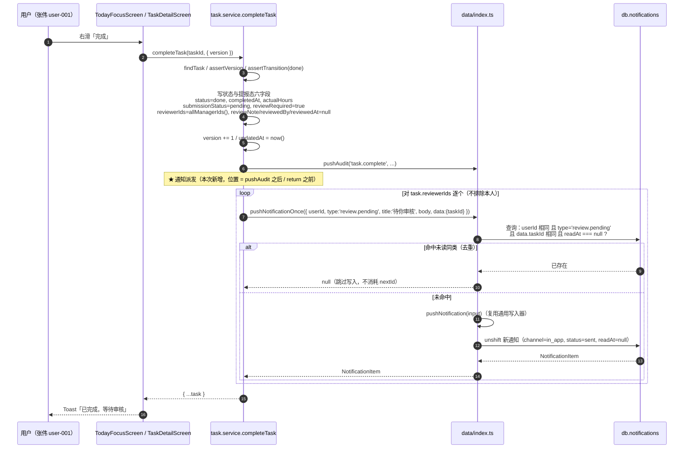
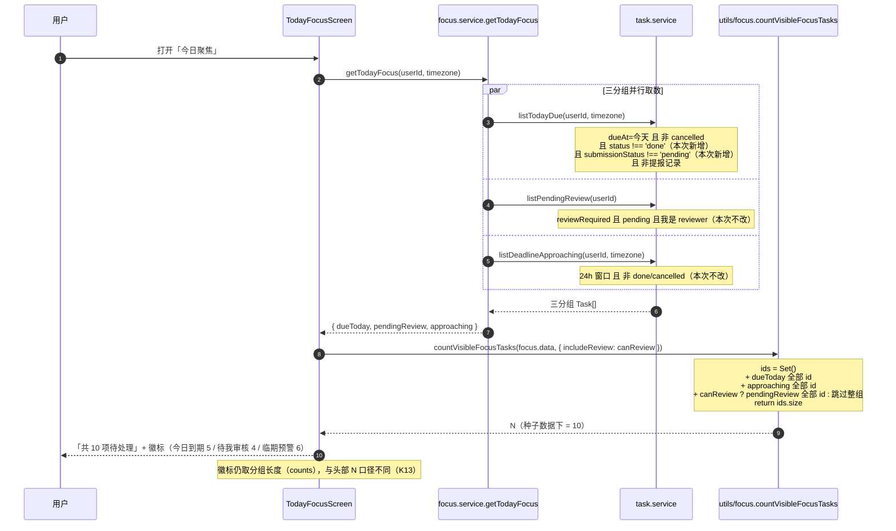

# ARCH（增量 3）— OpenSchedule 移动端：双计去重 + 「待你审核」站内通知

> 档位：**增量架构**（只写变更）· 架构师：高见远 · 基线：`PRD-mobile-increment-3.md` v1.0 · `ARCH-mobile-increment-2.md` v1.4 · `PRD-mobile-increment-2.md` §4 `M3-P2-01`
> 交付路径：`apps/mobile` · 硬约束：Expo 57 / RN 0.86.3 / React 19 / TS 6 / React Navigation 7；**零新增依赖**；禁 `reanimated` / `gesture-handler`；禁 pnpm。
> **范围铁律（用户拍板，不可扩张）**：本增量**只**做两项 —— ① **双计去重**（列表层 + 汇总层）；② **「待你审核」站内通知**（原 `M3-P2-01`）。**零新增依赖、零重构、零既有断言修改、零源码范围外改动。**
> **前置裁定（主理人，直接生效）**：PRD §7.1 的 11 项裁定全部生效；**Q4-12（列表互斥）不做**、**Q4-13（纠正种子 `notif-002`）不改**、**Q4-14（「今日到期」加 `assigneeId` 过滤）不做**，但 Q4-14 所依据的既有事实**必须**在本文档登记（见 §9-4）。

**摘要（TL;DR）**：本次只有 **5 个源文件改动 + 1 个新工具文件 + 1 个新测试文件**，核心是 **3 处写入/口径补齐 + 1 处展示口径切换**：① `listTodayDue` 补两条排除条件（`status !== 'done'` + `submissionStatus !== 'pending'`）；② 头部 `visibleTotal` 由「三组长度相加」改为「三组按 `task.id` 取并集」（下沉为**唯一纯函数** `countVisibleFocusTasks`）；③ 新增去重写入器 `pushNotificationOnce`；④ `completeTask` 末尾向 `task.reviewerIds` 派发 `review.pending` 通知；⑤ 新通知类型的三处映射同步。**零新增依赖、零类型破坏性变更、零既有断言修改（含 `today-focus-gate.test.tsx:205/219`）。**

> **本次三项「不做」的显式声明**（范围铁律，禁止顺手做）：**N1** 完成提报撤回入口；**N2** 非 `done` 的既存 `pending` 缺口收口（种子 `task-014` / `task-015` 经 `moveTask` 仍留待审队列）；**N3** 详情页状态标签统一 / 任何重构（`listPendingReview` 抽取、`SUBMISSION_TRANSITIONS` 补表、service 口径统一）。另：**Q4-12 列表内容互斥**、**Q4-13 种子纠正**、**Q4-14 `assigneeId` 过滤** 三项**不做**（PRD §1.4 N1~N6 与 §7 已裁定）。

---

## 1. 实现方案总览

### 1.1 一句话

把「今日聚焦」的**列表口径**（`listTodayDue` 排除已完成与待审中）与**汇总口径**（头部 N 改为三分组 `task.id` 并集）两层同时修正，使「共 N 项待处理」成为真实待办数；同时在 `completeTask` 末尾向 `task.reviewerIds` 逐个派发「待你审核」站内通知，并经新增的**未读级去重写入器** `pushNotificationOnce` 保证「完成 → 撤销 → 再完成」不刷屏。两条改动均**零新增依赖、零既有断言修改**。

### 1.2 变更点清单（文件 → 改什么 → 为什么）

| # | 文件（相对 `apps/mobile/`） | 改什么（精确定位） | 为什么 |
| --- | --- | --- | --- |
| **C1** | `src/utils/focus.ts`（**新增**） | 新增纯函数 `countVisibleFocusTasks(groups, options)` + 类型 `FocusGroups` | PRD `M4-P0-02` 要求汇总口径 = 「三分组按 `task.id` 取并集」。「并集 + 角色门禁」需要**可独立单测**的断言点（AC-02 / INV-7），且「member 时整组剔除」不是内联 `Set` 能自然表达的语义（见 §3.1-D1③） |
| **C2** | `src/services/task.service.ts` | ① `listTodayDue:171-178` 的过滤条件补两条（S1 / `M4-P0-01`）；② `completeTask:349-355` 的 `pushAudit` 之后、`return` 之前插入通知派发循环（S3 / `M4-P0-03`）；③ 顶部 `@/data` 导入补 `pushNotificationOnce` | ① 是「双计」的**列表层根因**（唯一生产调用方是 `focus.service.ts:72`）；② 是通知的唯一产生点（提报侧） |
| **C3** | `src/data/index.ts` | 紧随 `pushNotification:145-161` 之后新增 `pushNotificationOnce`（约 +14 行） | `M4-P0-04` 要求「同一 `userId` + `type` + `data.taskId` 已存在**未读**通知时跳过写入」。落点与 `pushNotification` 同模块（PRD R-A5 方案 ③）。**`pushNotification` 本体零改动**（其 3 处既有调用点 `task.service.ts:946/958/979` 的稳定契约不可动） |
| **C4** | `src/screens/TodayFocusScreen.tsx` | ① `:140` 的 `visibleTotal` 由三组相加改为 `countVisibleFocusTasks(focus.data, { includeReview: canReview })`；② 导入 `@/utils/focus`；③ `:107-114` 的 `counts`（徽标）**保持不变** | `M4-P0-02` 的 UI 层落点。**徽标仍是分组长度（5 / 4 / 6），头部才是并集（10）** —— 二者口径不同、不得混用（K13） |
| **C5** | `src/types/domain.ts` | ① `:125-132` `NOTIFICATION_EVENT_LABEL` 追加 `'review.pending': '待审核提醒'`；② `:98` 的 `NotificationItem.type` 注释枚举追加 `review.pending` | `M4-P0-05` 第 ① / ③ 处同步点（AC-08① / AC-08③） |
| **C6** | `src/screens/NotificationsScreen.tsx` | `:24-31` `NOTIFICATION_ICON` 追加 `'review.pending': 'inbox'` | `M4-P0-05` 第 ② 处同步点（AC-08②）；不加则降级为 `bell`（`:123` 的 fallback） |
| **C7** | `tests/increment3-dedup-notify.test.ts`（**新增**） | 纯函数用例 + service 全链路用例（AC-01~AC-08 / AC-10~AC-12 / INV-5~9） | PRD `M4-P1-01` 要求新增测试**独立成文件**，既有 28 套件断言**零改动** |
| — | `src/data/seed.ts`、`src/data/seed-extra.ts`、`src/services/focus.service.ts`、`src/components/*`、`src/navigation/*`、`src/theme/*`、`package.json`、`pnpm-lock.yaml` | **零变更** | 本次不改种子（`seed-integrity` 必须全绿 / Q4-13）；`getTodayFocus` 返回类型不变；`NotificationsScreen` 的深链实现（`:55-63`）已满足 AC-09 ⇒ **零改动复用**；零新增依赖 |

### 1.3 分层落点

| 层 | 落点 | 内容 |
| --- | --- | --- |
| **纯工具层** | `utils/focus.ts`（新） | `countVisibleFocusTasks`（无 React、无 IO、无 `db` 访问，可独立单测） |
| **数据层** | `data/index.ts` | `pushNotificationOnce`（去重写入器，唯一实现点） |
| **数据层** | `services/task.service.ts` | `listTodayDue` 过滤条件加强 + `completeTask` 通知派发 |
| **类型/映射层** | `types/domain.ts`、`screens/NotificationsScreen.tsx` | `review.pending` 的文案标签 / 图标 / 注释登记三处同步 |
| **页面层** | `screens/TodayFocusScreen.tsx` | 头部汇总口径切换（**唯一**改动点；徽标与列表内容不变） |
| **测试层** | `tests/increment3-dedup-notify.test.ts`（新） | 纯函数 + service 集成 |

> **不动的层**：种子层、导航层、主题层、组件层（`TaskCard` / `SegmentedControl` / `SwipeableRow` 全不动）、`focus.service`、`project.service`。

---

## 2. 文件列表

### 2.1 新增（2 个）

| 相对路径 | 职责 | 预估行数 |
| --- | --- | --- |
| `src/utils/focus.ts` | 「今日聚焦」头部汇总口径的**唯一**纯函数实现点：`countVisibleFocusTasks` + `FocusGroups` 类型 + JSDoc（口径定义、`includeReview` 语义、去重规则） | ~45 |
| `tests/increment3-dedup-notify.test.ts` | 增量 3 独立测试：`countVisibleFocusTasks` 全分支（含 member 剔除、跨组去重、null 容错）+ `listTodayDue` 两条排除条件 + `INV-5` 交集为空 + `completeTask` 通知条数/字段 + `pushNotificationOnce` 未读去重与已读后可再通知 | ~175 |

### 2.2 修改（5 个）

| 相对路径 | 改什么（精确定位） | 预估改动行数 |
| --- | --- | --- |
| `src/services/task.service.ts` | `listTodayDue:175` 后插入 2 行过滤条件；`completeTask:354` 后插入通知派发循环（约 10 行，含 1 行注释）；顶部 `@/data` 导入表（`:6-20`）补 `pushNotificationOnce` | **+14** |
| `src/data/index.ts` | `pushNotification:145-161` 之后新增 `pushNotificationOnce`（含 JSDoc 与去重键说明） | **+16** |
| `src/screens/TodayFocusScreen.tsx` | `:140` 一行改为纯函数调用；`utils` 导入区（`:36-38`）补一行 | **+2 / -1** |
| `src/types/domain.ts` | `:132` 后追加 1 行映射；`:98` 注释行追加 `review.pending` | **+1 / ~1** |
| `src/screens/NotificationsScreen.tsx` | `:31` 后追加 1 行图标映射 | **+1** |

**合计**：新增 ~220 行 / 修改 ~34 行。（全部为**附加式**改动，无既有行删除，唯一「改」是 `TodayFocusScreen:140` 的 1 行替换。）

---

## 3. 数据结构与接口变更

### 3.1 D1 · `visibleTotal` 的并集口径（纯函数设计）

#### 3.1.1 签名与语义

```ts
// src/utils/focus.ts
import type { Task } from '@/types'

/** 「今日聚焦」三分组的最小结构约束（`TodayFocusData` 结构上满足之） */
export interface FocusGroups {
  dueToday: readonly Task[]
  pendingReview: readonly Task[]
  approaching: readonly Task[]
}

/**
 * 今日聚焦头部汇总口径：**三分组按 `task.id` 取并集后计数**（PRD M4-P0-02 / INV-7）。
 *
 * 语义：
 * - `groups == null` ⇒ 返回 `0`（页面取数未就绪时的等价空口径）；
 * - `options.includeReview === false`（member 角色）⇒ `pendingReview` 分组**整组不参与并集**；
 * - 同一 `task.id` 在多个分组出现 ⇒ 去重后**计 1**；
 * - 计数单位是**唯一任务**，与「分组徽标 = 分组长度」是两个不同口径。
 */
export function countVisibleFocusTasks(
  groups: FocusGroups | null | undefined,
  options: { includeReview: boolean },
): number
```

**返回**：唯一任务数（`number`，非负整数）。**无副作用、无 IO、不读 `db`。**

#### 3.1.2 ① member 角色（`canReview === false`）时并集如何表达

**表达方式 = 「整组不加入集合」，而不是「先并集再减 1」。**

```
ids = new Set()
for (task of dueToday)       ids.add(task.id)
for (task of approaching)    ids.add(task.id)
if (includeReview) for (task of pendingReview) ids.add(task.id)   // ← 角色门禁
return ids.size
```

为什么必须「整组剔除」而不是「减 1」：若某任务**同时**出现在 `pendingReview` 与 `dueToday`（修复后理论上不会，但纯函数不应依赖列表层的互斥保证），在 member 视角下它**仍应计 1** —— 因为它确实出现在「今日到期」里。整体跳过 `pendingReview` 组恰好表达这一语义，且**天然不依赖** MUT-1 的互斥性（函数自洽）。

> 这与页面既有语义完全一致：`TodayFocusScreen:120` 在 member 下**隐藏**「待我审核」分组（隐藏而非置灰，ARCH §7），故该分组对 member 的汇总贡献应为 0。

#### 3.1.3 ② 同一 id 出现多次 ⇒ 去重后计 1

以 `Set<string>` 承载 `task.id`，`Set` 的基数即并集大小。**不使用**数组 `concat` + `filter(indexOf)` 等 O(n²) 写法，也**不**引入任何库。

#### 3.1.4 ③ 为什么抽纯函数而不是页面内联 `new Set(...)`

| # | 论据 |
| --- | --- |
| 1 | **AC 需要一个可独立断言的口径点**：AC-02（N=10）/ INV-7（「一条任务同属两组时 N 只 +1」）若只能在页面层验证，需 `react-test-renderer` + 6 个 `jest.mock` + 渲染文本匹配（见 `today-focus-gate.test.tsx:73-120`），成本高且断言间接。纯函数单测**零依赖、直接断言数值**。 |
| 2 | **内联极易退化为旧口径**：内联的自然写法就是 `counts.due + counts.approaching + (canReview ? counts.review : 0)` —— 这正是本次要修的那行。抽函数把「并集 + 角色门禁」变成**签名级契约**（`options.includeReview`），无法被"顺手改回去"。 |
| 3 | **唯一实现点惯例**：与 `createClearedReviewState()`（增量 2 · K1）同族的「唯一构造点」思路 —— 口径只有一处，杜绝两份漂移。若未来新增第四分组，改一处即可。 |
| 4 | **符合既有分层惯例**：`utils/` 已沉淀 `overview.ts`（整周概览纯逻辑）、`submission.ts`（审核判定纯逻辑）等同姿势文件；ARCH-mobile §10「纯判定下沉 `utils/`」。 |

> **反方意见（已权衡）**：该函数仅 1 处调用，内联 3 行可读性也不差，抽函数属"为 1 个调用点建抽象"。**裁定仍抽函数**，决定性理由是 #1（PRD 明确把 AC-02 / INV-7 作为单测断言点）与 #2（防退化）；代价仅 ~45 行、零依赖、零风险。

### 3.2 D2 · `listTodayDue` 的过滤条件（顺序与表述）

#### 3.2.1 目标片段（`src/services/task.service.ts:166-183`）

```ts
/** 今日到期：dueAt 落在目标时区的今天，且**仍需处理**（未完成、未取消、非待审中） */
export async function listTodayDue(userId: string, timezone: string): Promise<Task[]> {
  if (USE_MOCK) {
    await simulateLatency()
    const today = toDateKey(new Date(), timezone)
    const tasks = db.tasks.filter(
      (task) =>
        task.dueAt !== null &&
        toDateKey(task.dueAt, timezone) === today &&
        task.status !== 'cancelled' &&
        task.status !== 'done' &&               // ← 新增 ①（M4-P0-01）
        task.submissionStatus !== 'pending' &&  // ← 新增 ②（M4-P0-01）
        // 提报记录不进正式列表（ARCH §7 列表守卫）
        !isSubmissionRecord(task),
    )
    return sortTasks(tasks)
  }
  // TODO(real-api): GET /tasks?scope=today_due&timezone=:timezone  ← 无需改（服务端过滤）
  return httpClient.get<Task[]>('/tasks', { query: { scope: 'today_due', assigneeId: userId, timezone } })
}
```

**顺序与表述（裁定）**：

| 项 | 裁定 | 理由 |
| --- | --- | --- |
| 插入位置 | 两条新条件**紧跟** `task.status !== 'cancelled'`，位于 `isSubmissionRecord` 守卫**之前** | ① 两条均为「状态类」条件，与既有状态条件聚合可读性最好；② `isSubmissionRecord` 是**列表守卫**，全仓 4 个列表函数一律放**最后一位**（`listMyTodos:157`、`listTodayDue:176`、`listDeadlineApproaching:210`、`listTasksByProject:226`），保持姿势一致 |
| 条件之间的顺序 | **不影响语义**（纯 `&&` 链，无短路依赖、无副作用） | 此处仅为可读性排序，**不得**据此推断"必须按此顺序求值" |
| 表述 | 「排除所有 `done`」+「排除待审中（`submissionStatus === 'pending'`）」 | 与 PRD R-A1 裁定一致；「待审中」**只**用 `submissionStatus` 判定（K4 延续 / PRD §1.5） |
| JSDoc | 补「且仍需处理（未完成、未取消、非待审中）」 | 原 JSDoc 只写「dueAt 落在目标时区的今天」，已不足以描述新语义 |

#### 3.2.2 ① 实际种子数据推演：修复前 7 → 修复后 **5**

**数据来源**：`src/data/seed.ts` 逐条实读（`task-001:202` / `task-004:253` / `task-005:272` / `task-014:435` / `task-015:459` / `task-016:482` / `task-017:499`；`done` 任务 `task-007:310`、`task-008:330`）。

| 任务 | 标题 | `status` | `submissionStatus` | 新增条件① `!== 'done'` | 新增条件② `!== 'pending'` | 修复后仍在「今日到期」 |
| --- | --- | --- | --- | --- | --- | --- |
| `task-001` | 需求文档评审 | `todo` | 无 | ✅ 通过 | ✅ 通过 | ✅ **保留** |
| `task-004` | 首页原型设计 | `in_progress` | 无 | ✅ 通过 | ✅ 通过 | ✅ **保留** |
| `task-005` | 组件库搭建 | `in_progress` | 无 | ✅ 通过 | ✅ 通过 | ✅ **保留** |
| `task-014` | 完成提报：首页原型评审 | `in_progress` | **`pending`** | ✅ 通过 | ❌ **命中** | ❌ **消失** |
| `task-015` | 完成提报：组件库文档 | `in_progress` | **`pending`** | ✅ 通过 | ❌ **命中** | ❌ **消失** |
| `task-016` | 本周复盘会材料 | `todo` | 无 | ✅ 通过 | ✅ 通过 | ✅ **保留** |
| `task-017` | 官网改版验收清单 | `todo` | 无 | ✅ 通过 | ✅ 通过 | ✅ **保留** |

**两条新增条件的实际命中数（种子数据）**：

| 新增条件 | 命中数 | 命中任务 | 说明 |
| --- | --- | --- | --- |
| ① `status !== 'done'` | **0** | 无 | 种子里**没有**「`dueAt` 为今天 且 `status === 'done'`」的任务（`task-007` 的 `dueAt = demoDayAt(-4,18,0)`、`task-008 = demoDayAt(-6,18,0)`）⇒ **单靠条件① 在当前种子数据上零影响** |
| ② `submissionStatus !== 'pending'` | **2** | `task-014`、`task-015` | 二者为 `in_progress` + `pending`（**非** `done`）⇒ 这是本次唯一真正生效的条件（与 PRD F1 结论一致） |
| 合计（去重后） | **2** | `task-014`、`task-015` | ⇒ **修复前 7 → 修复后 5**，且二者**完整保留在「待我审核」**（`listPendingReview` 本次未改，`task-014/015` 的 `reviewRequired=true` + `reviewerIds=[user-001]` 未动） |

> **结论**：**本次「今日到期」只消失 2 条**，无其它既存任务受影响。**其它调用方亦无新增消失项**（`listTodayDue` 的生产调用方唯一 = `focus.service.ts:72`；测试调用方 2 处判定见 §8.2-#5 / §8.2-#12）。
> ⚠️ **实现红线**：条件① 虽在当前种子上零命中，**仍必须写入** —— 否则 AC-04（「完成任务后该任务离开今日到期」）失败，且与 `listMyTodos:154` / `listDeadlineApproaching:209` 的既有口径不一致（PRD R-A1 裁定 (b)）。

#### 3.2.3 ② 对 `listDeadlineApproaching` 的一致性影响

**裁定：本次不改 `listDeadlineApproaching`；由此产生一处「有意的」口径差异，须登记而非消除。**

| 维度 | `listTodayDue`（修复后） | `listDeadlineApproaching`（不动） | 差异 |
| --- | --- | --- | --- |
| 时间窗 | `dueAt` 落在目标时区**今天** | `[now − 1h, now + 24h]` 滑动窗 | 既有差异（设计使然） |
| `status` | 排除 `cancelled` **+ 排除 `done`** | 排除 `done` / `cancelled` | 修复后**一致** |
| `submissionStatus` | **排除 `pending`** | **不排除 `pending`** | ⚠️ **修复后新增的差异** |
| 提报记录守卫 | 排除 | 排除 | 一致 |

- **新增差异的具体表现**：非 `done` 的待审任务（种子 `task-014` / `task-015`）修复后**不再出现**在「今日到期」，但**仍出现**在「临期预警」（其实测数量 6 中包含 `task-014`，见 PRD §2.1 表 1）。
- **判定：这是 PRD 明确期望的结果** —— PRD §5.1 规则 3 规定 `in_progress + pending` 组合的「临期预警」为 ✅，规则 4 规定 `done + pending` 为 ❌（由 `done` 排除命中）。即「临期预警」回答的是「**未来 24h 内到期且未完成**」，**包含**待审中任务是**正确的**。
- **禁止**为「口径统一」去给 `listDeadlineApproaching` 加 `submissionStatus !== 'pending'`：那会**改变「临期预警」的可见内容**，直接命中 PRD §5.1 的 **MUT-2 / N5 实现红线**（「不得为满足 MUT-2 / MUT-3 去修改『今日到期』或『临期预警』的列表内容」）与 `services.test.ts:44-51` 的断言面。
- **结论**：无**破坏性**影响（既有断言均不受影响，见 §8.2）；产生一处**有意登记**的口径差异（§7-K15 备注 + §9-5）。

### 3.3 D3 · `pushNotificationOnce` 的设计

#### 3.3.1 签名（复用 `PushNotificationInput`）

```ts
// src/data/index.ts（紧随 pushNotification:145-161 之后）

/**
 * 去重写入器：同一 `userId` + 同一 `type` + 同一 `data.taskId` 已存在**未读**通知时**跳过写入**
 * （PRD M4-P0-04 / Q4-2）。
 *
 * - 「未读」判定字段 = **`readAt === null`**（与 `NotificationsScreen.tsx:74`、`focus.service.ts:167`
 *   的 `getUnreadCount` 同口径；**不**用 `status === 'sent'`）；
 * - `input.data?.taskId == null` ⇒ 无法构成去重三元组，**退化为无条件写入**（等同 `pushNotification`）；
 * - 未命中去重时**直接复用** `pushNotification(input)`，不复制任何字段构造逻辑。
 *
 * @returns 新写入的通知；**去重命中（跳过写入）时返回 `null`**
 */
export function pushNotificationOnce(input: PushNotificationInput): NotificationItem | null
```

#### 3.3.2 目标片段（去重判定）

```ts
export function pushNotificationOnce(input: PushNotificationInput): NotificationItem | null {
  const taskId = input.data?.taskId
  if (taskId != null) {
    const duplicated = db.notifications.some(
      (item) =>
        item.userId === input.userId &&
        item.type === input.type &&
        item.data?.taskId === taskId &&
        item.readAt === null, // 「未读」的唯一判定字段
    )
    if (duplicated) return null
  }
  return pushNotification(input)
}
```

#### 3.3.3 设计裁定表

| 问题 | 裁定 | 理由 |
| --- | --- | --- |
| 是否复用 `PushNotificationInput`？ | **复用**（签名不新增类型） | 该接口（`data/index.ts:130-139`）已是「站内通知唯一写入口」的入参契约（M2-P1-03）；新增参数类型会造成两份入参语义 |
| 去重键是什么？ | **`userId` + `type` + `data.taskId`（三元组）** | PRD §1.5「通知去重键」与 Q4-2 已裁定；AC-06 / AC-07 / INV-9 均按此三元组断言 |
| 「未读」的判定字段？ | **`readAt === null`** | 实读 `domain.ts:106` `readAt: string \| null`；`NotificationsScreen.tsx:74`、`focus.service.ts:167`、`:194` 三处既有判定**全部**用 `readAt === null`。`status` 在未读时为 `'sent'`、已读后为 `'read'`（`focus.service.ts:181/196`），但**不**作为未读真值（`'sent'` 亦可能表示"已发送但语义未读"） |
| 落点 | `src/data/index.ts`（与 `pushNotification` 同模块，紧随其后） | PRD R-A5 方案 ③ 裁定；不选方案 ①（业务层直连通知表）/ ②（污染通用写入契约） |
| 与 `pushNotification` 的关系 | **调用（复用），不抽取共用内部实现** | ① `pushNotification` 本体**零改动** ⇒ 其 3 处既有调用点（`task.service.ts:946/958/979`）的契约与行为**逐字节不变**；② 字段构造 / `unshift` 位置 / `nextId('notif')` 序号推进**完全同源**，不可能漂移；③ 若抽 `buildNotification()` 私有函数，则需改 `pushNotification` 本体（虽行为等价），触碰 PRD 明确要求"零改动"的稳定契约 |
| 去重命中时的副作用 | **不消耗 `nextId` 序号**（因为根本没调用 `pushNotification`） | 「跳过写入」的自然结果；须在测试中体现为「id 序列不变」（AC-06 的「`id` / `createdAt` / `readAt` 均未变化」） |
| `data.taskId` 缺省时 | **退化为无条件写入** | 三元组不完整 ⇒ 无法判定"同类"；本次唯一调用方恒带 `taskId`，该分支仅作契约完备性（JSDoc 显式声明） |

### 3.4 D4 · 通知类型三处同步（真实同步点清单）

**先纠正一个前提（PRD §2.2-F3 已实测）**：主理人所述「`NotificationType` 联合类型」**在当前代码中不存在** —— `NotificationItem.type` 是 `string`（`domain.ts:99`），全仓无 `NotificationType` 类型别名。因此新增类型**不会**产生编译期错误，**漏改的后果是降级显示**：

| 降级路径 | 位置 | 现状行为 |
| --- | --- | --- |
| 图标缺失 | `NotificationsScreen.tsx:123` | `NOTIFICATION_ICON[item.type] ?? 'bell'` ⇒ 渲染铃铛图标（**不报错**） |
| 标签缺失 | `NotificationSettingsScreen.tsx:89` | `NOTIFICATION_EVENT_LABEL[preference.eventType] ?? preference.eventType` ⇒ 显示原始英文 key（**不报错**） |
| 类型缺失 | `domain.ts:99` | `type: string` ⇒ `tsc` **无约束** |

#### 3.4.1 真实同步点清单（3 处，含实测行号）

| # | 文件 : 行 | 现状内容 | 改为 | 对应 AC |
| --- | --- | --- | --- | --- |
| 1 | `src/types/domain.ts:125-132`（`NOTIFICATION_EVENT_LABEL`；`:131` 是 `'review.result': '审核结果'` 行） | 6 个键：`task.assigned` / `mention` / `deadline_approaching` / `ai.proposal` / `task.completed` / `review.result` | 追加 `'review.pending': '待审核提醒'` | AC-08① |
| 2 | `src/screens/NotificationsScreen.tsx:24-31`（`NOTIFICATION_ICON`；`:30` 是 `'review.result': 'award'` 行） | 同上 6 个键的图标 | 追加 `'review.pending': 'inbox'` | AC-08② |
| 3 | `src/types/domain.ts:98`（`NotificationItem.type` 上方的注释枚举） | `/** task.assigned / mention / deadline_approaching / ai.proposal */` | 追加 `review.pending` | AC-08③ |

> **`'inbox'` 的合法性**：`inbox` 是 Feather 图标集的标准图标名（与 `bell` / `award` 同集），且 `NOTIFICATION_ICON` 的取值类型为 `keyof typeof Feather.glyphMap` ⇒ **若拼写错误会立即产生 `tsc` 错误**（该 map 是强类型的，与 `type: string` 不同）。这使 AC-08② 的"非 fallback"要求可被 `tsc` 兜底。
> **语义区分**：`review.pending` → `inbox`（「待处理队列」），`review.result` → `award`（「审核结论」）；二者不同图标，可在通知列表一眼区分。

#### 3.4.2 是否顺带补 `:98` 注释枚举的既有遗漏？——**只追加 `review.pending`，不补既有遗漏**

- **事实**：`:98` 的注释当前只列 4 个类型，**已漏** `task.completed`（种子 `notif-005:261` 在用）与 `review.result`（`:131` / `NotificationsScreen.tsx:30` 已登记）。
- **裁定**：本次**只追加 `review.pending`**。理由：① PRD AC-08③ 的判据是「注释中已登记 `review.pending`」，最小满足即可；② 补全既有遗漏属**顺手优化**，命中范围铁律（PRD §1.4 注 / Q4-13 同族）；③ 补全会扩大 diff 面而不带来任何 AC 收益。
- **残留**：注释登记处仍不完整 ⇒ 登记为 §9-6 已知限制，建议后续增量单独收口（届时可考虑把该注释改为**唯一类型登记表**并在 CI 校验）。
- ⚠️ **PRD 观察点**：PRD `M4-P0-05` 第 ③ 条把「注释登记」列为 P0 验收项，但同时 §1.4 禁止顺手优化 —— 二者在"既有遗漏"上存在张力。**我的裁定如上（只加新类型）**；若 PM 认为注释应一次补全，请拍板（属 1 行改动，不影响任何 AC）。

### 3.5 D5 · `completeTask` 的通知写入位置

#### 3.5.1 目标片段（`src/services/task.service.ts:329-359`）

```ts
    task.status = 'done'
    task.completedAt = now()
    task.actualHours = input.actualHours ?? task.actualHours ?? task.estimatedHours ?? null
    // S1（增量 2）：写入提报态 —— 完成提报进入待审队列（K4：不改 source，保持原值）
    task.submissionStatus = 'pending'
    task.reviewRequired = true
    task.reviewerIds = allManagerIds()
    task.reviewNote = null
    task.reviewedBy = null
    task.reviewedAt = null
    task.version += 1
    task.updatedAt = now()
    pushAudit(
      'task.complete',
      task.assigneeId ?? task.createdBy,
      taskId,
      `完成了「${task.title}」${input.summary ? `：${input.summary}` : ''}`,
    )
    // S3（增量 3）：向全部审核人派发「待你审核」通知（未读级去重，M4-P0-03 / M4-P0-04）
    for (const reviewerId of task.reviewerIds) {
      pushNotificationOnce({
        userId: reviewerId,
        type: 'review.pending',
        title: '待你审核',
        body: `「${task.title}」已完成提报，等待你的审核`,
        data: { taskId },
      })
    }
    return { ...task }
```

#### 3.5.1a 完成态样本选取（**v1.1 更正 · 事实性设计错误**）

**本链路（以及 §4.1 链路①、§5-T07 用例④⑤⑥⑦）的完成态样本一律使用 `task-004`（「首页原型设计」，`in_progress` + `dueAt` 为今天），不得使用 `task-001`。**

| 判据 | 实读位置 | 事实 |
| --- | --- | --- |
| 迁移表 | `src/types/task.ts:107` | `TASK_TRANSITIONS.todo = ['in_progress', 'blocked', 'cancelled']` ⇒ **`todo → done` 不是合法迁移** |
| 服务守卫 | `src/services/task.service.ts:338` | `completeTask` 的第二道守卫即 `assertTransition(task.status, 'done')` ⇒ 对 `todo` 任务**抛 40902**（`ERR_ILLEGAL_TRANSITION`，`details` 带 `allowed_transitions`） |
| 种子状态 | `src/data/seed.ts:206` | `task-001`（「需求文档评审」）的 `status` 是 **`'todo'`** ⇒ **物理不可行** |
| 种子状态 | `src/data/seed.ts:257` | `task-004`（「首页原型设计」）的 `status` 是 **`'in_progress'`**，且 `dueAt = demoDayAt(0, 20, 0)`（今天）⇒ 合法且与「今日聚焦」场景同源 |
| UI 一致性 | `src/screens/TodayFocusScreen.tsx:340-341` | `buildActions` 对 `status === 'todo'` 返回的是「**承接**」（`claimTask`，`:179`），对其它状态才返回「**完成**」（`completeTask`，`:201`）⇒ 与状态机裁定**完全一致** |

> **结论**：`todo` 任务在 UI 上根本**不会出现**「完成」动作，故 §3.5.1 的链路样本必须换为 `in_progress` 任务。**若要完成一个 `todo` 任务，必须先 `claimTask`（`todo → in_progress`）再 `completeTask`（`in_progress → done`）**，两步各自合法。生产代码未做任何迁就性改动（`TASK_TRANSITIONS` / `completeTask` 均**零改动**），本处仅为**文档侧样本更正**。

#### 3.5.2 插入位置裁定：`pushAudit` **之后**、`return` **之前**

| # | 理由 |
| --- | --- |
| 1 | **必须在 `task.reviewerIds = allManagerIds()` 之后**：接收人来源依赖该字段（见 3.5.3） |
| 2 | **与既有书写姿势完全一致**：`reviewSubmission` 的三处通知写入**一律**是「`pushAudit` 先 → `pushNotification` 后」（`:944→:946`、`:956→:958`、`:977→:979`）⇒ 零新姿势，评审可一眼对照 |
| 3 | **语义顺序**：审计记录的是「任务已完成」这一**事实**，通知是**下游派发**；先记录事实、再派发 |
| 4 | **不得插在提报态六字段中间**：那会让「字段写入块」（K1 的字段清单可核对区）被 IO 调用打断，破坏该块的可读性与可核对性 |
| 5 | **`version` / `updatedAt` 之后**：元数据先行落定，通知的 `createdAt` 不会早于任务的 `updatedAt`（时间戳单调，便于排查） |

#### 3.5.3 审核人来源裁定：**`task.reviewerIds`**（而非二次 `allManagerIds()`）

| # | 理由 |
| --- | --- |
| 1 | **单一真值来源（决定性）**：`listPendingReview:193` 用 `(task.reviewerIds ?? []).includes(userId)` 判定可见性 ⇒ 通知接收人**必须与可见性判定同源**，否则会出现「通知了 A，但 A 在「待我审核」看不到该条目」的错配 |
| 2 | **K6 未被破坏**：`reviewerIds` 的唯一来源**仍**是上一行的 `allManagerIds()`；业务代码未硬编码任何 id |
| 3 | **只取一次**：杜绝"两次 `allManagerIds()` 之间 `db.users` 变化导致接收人集合漂移"的理论风险（mock 下虽不会发生，但契约上应闭合） |
| 4 | **可测性**：AC-05 断言「新增 2 条，`userId` = `user-001` / `user-004`」⇔ 断言「通知 `userId` 集合 === `task.reviewerIds`」，二者等价 |

#### 3.5.4 通知文案（PRD Q4-8 已裁定，照抄执行）

| 字段 | 取值 |
| --- | --- |
| `type` | `'review.pending'` |
| `title` | `'待你审核'` |
| `body` | `` `「${task.title}」已完成提报，等待你的审核` `` |
| `data` | `{ taskId }`（**不新增字段**，因深链只认 `taskId`，见 `NotificationsScreen.tsx:62`） |
| `userId` | 逐个 `task.reviewerIds`（**不排除操作人本人**，Q4-1 裁定） |
| `channel` / `status` / `readAt` | 由 `pushNotification` 统一构造（`'in_app'` / `'sent'` / `null`） |

### 3.6 D6 · 通知与「撤销完成」的时序

**裁定：「不撤回」的实现含义 = `undoCompletion` 的函数体内不出现任何通知相关操作。**

| 项 | 内容 |
| --- | --- |
| `undoCompletion` 的改动量 | **零**。函数体（`task.service.ts:406-430`）**不出现** `pushNotification` / `pushNotificationOnce` / `db.notifications` 的任何访问 |
| 「不撤回」的确切含义 | ① 不删除任何已发出的 `review.pending` 通知；② 不修改其 `readAt` / `status`；③ 不写入任何"撤销"类补偿通知 |
| 由此产生的正确行为 | 「完成 → 撤销 → 再完成」时：旧通知**仍未读** ⇒ `pushNotificationOnce` 跳过写入（AC-06：总数不增）；旧通知**已读** ⇒ 新增 1 条（AC-07：`user-001` +1，`user-004` 仍为未读故不增） |
| 已知限制 | 撤销后通知仍在 ⇒ **过期通知**（「任务已不在待审队列，但通知仍显示待你审核」）。影响面仅通知列表的文案时效性：点击后 `TaskDetail` 按 `taskId` 取**真实**任务数据，用户看到真实状态 ⇒ **不产生错误决策**。登记为 §9-2 |

> **实现约束（红线）**：**禁止**为「让通知与撤销同步」而在 `undoCompletion` 内加任何通知清理逻辑 —— 该行为由主理人 Q4-3 明确裁定为**不做**（保持最小改动）。

### 3.7 D7 · 全字段快照断言排查（**已实际执行**）

**检索范围**：`apps/mobile/tests/` 全域（28 个套件）。**检索式与结果**：

| # | 检索式 | 命中（原文行） | 判定 |
| --- | --- | --- | --- |
| 1 | `grep -rn "listTodayDue\|getTodayFocus\|pushNotification\|dueToday\|visibleTotal\|approaching" tests/` | `services.test.ts:32/34/187-191`、`submission-flow.test.ts:297-301`、`seed-integrity.test.ts:118-140`、`today-focus-gate.test.tsx:30-32/109/152/172-174/205/219/252`、`increment2-focus-footer.test.tsx:5/16-18/128/156/175-177/182/193-195` | 均为**单字段 / 布尔 / `length > 0` / `Array.isArray`** 断言，或 `jest.fn` 替身与 `mockFocus` 构造。**无** `toEqual({...全部字段})` 全字段快照，**无**分组长度精确断言 |
| 2 | `grep -rn "toHaveLength\|toEqual(" tests/ \| grep -i "due\|focus\|approaching\|review\|notif"` | `increment2-completion.test.ts:46/80/179/197/323/354/367`、`increment2-qa.test.ts:54/74/135/181/194`、`today-focus-gate.test.tsx:251/266`、`personal-plan.test.ts:34` | 全部为 `reviewerIds` 数组相等 / `actionKeys` 长度 / `personalTasks` 空数组，**与本次三个目标函数（`listTodayDue` / `getTodayFocus` / `pushNotification`）无关** |

**结论：无命中 ⇒ 本次无需「先改断言」前置任务。** 本次改动（过滤条件加强、汇总口径切换、通知写入）**不会**触发任何既有断言失败。与 PRD §6.3 末尾「附加扫描要求」的结论一致。

### 3.8 D8 · 既有 445 用例的回归面（逐项判定）

> 判定依据：实读每个用例的断言内容与调用路径（非推断）。「必须保持」= 红线，实现后**必须**全绿且**一字不改**。

| # | 文件 : 行 | 断言内容 | 与本次改动的关系 | 判定 |
| --- | --- | --- | --- | --- |
| 1 | `services.test.ts:34-42` | `listTodayDue`：`length > 0`、`dueAt` 在今天、`status !== 'cancelled'` | 排除条件**加强**，被断言的三条性质**仍成立**；修复后 5 条 ⇒ `length > 0` 成立 | ✅ **必须保持**（不改） |
| 2 | `services.test.ts:44-51` | `listDeadlineApproaching`：`length > 0`、`status !== done/cancelled` | 本次**未改**该函数 | ✅ **必须保持** |
| 3 | `services.test.ts:122-135` | `completeTask('task-004')` → `status` / `actualHours` / `completedAt`；陈旧 `version` → 40901 | 通知写入是**附加副作用**，不改变返回值的任何字段与错误码 | ✅ **必须保持** |
| 4 | `services.test.ts:187-191` | `getTodayFocus` 三分组 `Array.isArray` | 返回类型未变（仍是 `{ dueToday, pendingReview, approaching }` 三个 `Task[]`） | ✅ **必须保持** |
| 5 | `submission-flow.test.ts:297-298` | 新提报记录**不**出现在 `listTodayDue` | 新记录 `submissionStatus='pending'` ⇒ 与新增条件②**同向**（结论不变，且守卫更强） | ✅ **必须保持** |
| 6 | `submission-flow.test.ts:300-301` | 同上，`listDeadlineApproaching` | 本次**未改**该函数 | ✅ **必须保持** |
| 7 | `submission-flow.test.ts:334-372` | 三条通知用例对 `db.notifications.length` 做**精确计数**（`before + 1` / `before + 1` / `before`），并读 `db.notifications[0]` | ⚠️ **最脆弱的既有断言面**：它们经 `submitItem` + `reviewSubmission`，**全程不含 `completeTask`** ⇒ 本次新增的通知**不会**插入其计数区间 | ✅ **必须保持**（本设计天然满足；实现时**禁止**把通知写入挪到 `submitItem` / `reviewSubmission` 路径） |
| 8 | `increment2-completion.test.ts:388-397` | `db.notifications.filter(n => n.type === 'review.result').length` **按类型过滤**后 `+1` | 新通知 `type='review.pending'` **不计入**该过滤 ⇒ 计数不变 | ✅ **必须保持** |
| 9 | `increment2-completion.test.ts:419` | `db.notifications.find(n => n.type === 'review.result')` | `find` 按类型过滤 ⇒ 仍命中 `review.result`（新通知类型不同，不会顶替） | ✅ **必须保持** |
| 10 | `increment2-completion.test.ts:338-345` | 「完成 → 撤销 → 再完成」断言 `status` / `version` | 无任何通知断言 ⇒ 去重跳过/新增均不影响 | ✅ **必须保持** |
| 11 | `increment2-qa.test.ts`（全文件，含 `:31` 的 `completeAndSnapshot` / `:155` 重入用例） | `submissionStatus` / `reviewRequired` / `reviewerIds` / `listPendingReview` 成员关系 | **无任何** `db.notifications` / 未读数断言 | ✅ **必须保持** |
| 12 | `today-focus-gate.test.tsx:205` / `:219` | 「共 **0** 项待处理」/「共 **1** 项待处理」（`visibleTotal` 口径） | 数据全部来自 `jest.mock` 替身（`:107-120`）+ `mockFocus`（`:29-33`，`beforeEach:170-175` 清空三分组），**不含种子数据**；`:219` 的 `reviewTask`（`id='task-901'`）**只在 `pendingReview` 一个分组** ⇒ 并集仍为 `\|∅ ∪ ∅\| = 0` / `\|{task-901}\| = 1`。**与 `listTodayDue` 过滤变更完全解耦** | ✅ **必须保持**（**断言一字不改**，见 §8.1） |
| 13 | `today-focus-gate.test.tsx:251` / `:266` | `actionKeys(renderer)` 长度为 0 | 与汇总口径、通知无关 | ✅ **必须保持** |
| 14 | `increment2-focus-footer.test.tsx`（全文件） | `due` / `approaching` 分组**不**传 `footer`；两类审核条目同屏可区分 | 本次**不改** `TaskCard` / `footer` / 分组渲染 | ✅ **必须保持** |
| 15 | `seed-integrity.test.ts:116-141` | 直读 `mockTasks` 断言「今天到期数 > 0」「待审数 > 0」「临期数 > 0」 | **不经过 service**；本次**不改种子** | ✅ **必须保持** |
| 16 | `mention.test.ts:43-89` | `db.notifications.length` 精确计数 + `listNotifications` 分用户过滤 | 经 `addComment`（@提及）触发，**不含 `completeTask`** | ✅ **必须保持** |
| 17 | `round2-regression.test.ts:19-85` | 撤销链路 5 组（含 40901 / 40902） | `undoCompletion` **零改动** | ✅ **必须保持** |
| 18 | `task-state-machine.test.ts:40-56` | 纯 `TASK_TRANSITIONS` 表断言 | 不触及 service 写入 | ✅ **必须保持** |

**汇总判定**：**18 项中 18 项为「必须保持 / 不改」**，**无一项需修改断言**，**无一项会因本次改动变红**。唯一需要实现期**主动警惕**的是 **#7**（`db.notifications.length` 的精确计数）—— 本次通知只写在 `completeTask`，该用例路径不经过它，故天然安全；若未来有人把通知写入挪到 `submitItem`，则该用例会红（登记为 §7-K16 的红线备注）。

---

## 4. 程序调用流程

### 4.1 链路 ① 完成任务 → 写提报态 → 发通知（含去重分支）



> **注**：`task.reviewerIds` 来自上一行的 `allManagerIds()`（K6 / K16），通知接收人与 `listPendingReview` 的可见性判定**同源**。**本链路样本 = `completeTask('task-004')`（v1.1 更正）** —— **不得**使用 `todo` 状态的 `task-001`（`todo → done` 非法，`assertTransition` 会抛 40902；原因见 §3.5.1a）。

### 4.2 链路 ② 审核人点通知 → 深链任务详情

```mermaid
sequenceDiagram
  autonumber
  participant M as 审核人（张伟 user-001）
  participant N as NotificationsScreen
  participant F as focus.service
  participant DB as db.notifications
  participant NAV as React Navigation
  participant TD as TaskDetailScreen

  M->>N: 打开通知列表
  N->>F: listNotifications(userId)
  F->>DB: filter(userId) + createdAt 倒序
  DB-->>F: NotificationItem[]
  F-->>N: 列表（review.pending 渲染 inbox 图标 + 「待你审核」标题）
  N-->>M: 显示「· 点击查看任务」（data.taskId 存在时）
  M->>N: 点击该条目
  N->>F: markNotificationRead(notification.id)
  F->>DB: readAt = readAt ?? now() ; status = 'read'
  DB-->>F: NotificationItem（已读）
  F-->>N: 已读
  N->>F: refetch()（未读数 −1）
  N->>NAV: navigate('TaskDetail', { taskId, from: 'notification' })
  NAV->>TD: 渲染任务详情（按 taskId 取真实数据）
  TD-->>M: 显示任务真实状态（含「待审核」标签）
  Note over N,DB: 本次该链路零改动（NotificationsScreen.tsx:55-63 既有实现已满足 AC-09）
```

### 4.3 链路 ③ 今日聚焦汇总计数（并集口径）



---

## 5. 增量任务列表（有序 · 含依赖 · 按实现顺序）

> 粒度约定：**一个任务 = 一批可连续写盘的文件**。T01 先落「纯函数 + 口径契约」，T02 修 service 列表口径，T03 落去重写入器，T04 接通知派发（依赖 T03），T05 补映射，T06 切页面口径（依赖 T01），T07 统一补测试，T08 收尾复跑。**无前置「先改断言」任务**（D7 检索结论：不存在全字段快照断言，见 §3.7）。

| 任务号 | 内容 | 涉及文件 | 依赖 | 对应 AC |
| --- | --- | --- | --- | --- |
| **T01** | **新增并集口径纯函数**：新建 `src/utils/focus.ts` —— `FocusGroups` 类型 + `countVisibleFocusTasks(groups, { includeReview })`（`null` ⇒ 0；`includeReview=false` ⇒ `pendingReview` 整组不参与并集；同 id 去重计 1）+ JSDoc（口径定义 / 角色门禁语义 / 与徽标口径的区别） | `src/utils/focus.ts`（**新增**） | — | `M4-P0-02`、AC-02、INV-7 |
| **T02** | **`listTodayDue` 补两条排除条件**：在 `:175` 之后插入 `task.status !== 'done'` 与 `task.submissionStatus !== 'pending'`；同步改 JSDoc 为「且仍需处理（未完成、未取消、非待审中）」 | `src/services/task.service.ts` | — | `M4-P0-01`、AC-01、AC-03、AC-04、INV-5、INV-6、INV-8 |
| **T03** | **新增去重写入器**：在 `pushNotification:145-161` 之后新增 `pushNotificationOnce(input): NotificationItem \| null` —— 去重键 `userId` + `type` + `data.taskId`，未读判定 `readAt === null`，命中即 `return null`，否则 `return pushNotification(input)`；**`pushNotification` 本体零改动** | `src/data/index.ts` | — | `M4-P0-04`、AC-06、AC-07、INV-9 |
| **T04** | **`completeTask` 派发通知**：在 `pushAudit('task.complete', …)` 之后、`return { ...task }` 之前插入 `for (const reviewerId of task.reviewerIds) pushNotificationOnce({…})`（`type='review.pending'` / `title='待你审核'` / `body='「{title}」已完成提报，等待你的审核'` / `data={taskId}`）；顶部 `@/data` 导入补 `pushNotificationOnce`。**审核人来源 = `task.reviewerIds`（禁止二次 `allManagerIds()`）** | `src/services/task.service.ts` | **T03** | `M4-P0-03`、AC-05、AC-12 |
| **T05** | **通知类型三处映射同步**：① `domain.ts:132` 后追加 `'review.pending': '待审核提醒'`；② `NotificationsScreen.tsx:31` 后追加 `'review.pending': 'inbox'`；③ `domain.ts:98` 注释枚举追加 `review.pending`（**只加新类型，不补既有遗漏**） | `src/types/domain.ts`、`src/screens/NotificationsScreen.tsx` | T04 | `M4-P0-05`、AC-08 |
| **T06** | **页面汇总口径切换**：`TodayFocusScreen.tsx:140` 的 `visibleTotal` 改为 `countVisibleFocusTasks(focus.data, { includeReview: canReview })`；`utils` 导入区补 `@/utils/focus`；**`counts`（`:107-114`）与 `currentTasks`（`:142-147`）保持不变** | `src/screens/TodayFocusScreen.tsx` | **T01** | `M4-P0-02`、AC-02、AC-10 |
| **T07** | **新增独立测试文件**：`tests/increment3-dedup-notify.test.ts` —— ① `countVisibleFocusTasks` 全分支（null ⇒ 0；member 剔除 review；跨组同 id 计 1；同组重复 id 计 1；manager 计入 review）；② `listTodayDue` 修复后 = 5 条且不含 `task-014`/`task-015`、不含 `done`/`pending`；③ `INV-5` 交集为空（种子态 / 完成后 / 撤销后三种状态各一次）；④ `completeTask('task-004')` ⇒ 新增恰好 2 条 `review.pending`（`user-001`/`user-004`，`readAt=null`、`channel='in_app'`、`status='sent'`、`data.taskId='task-004'`、`title='待你审核'`、`body` 含标题与「已完成提报」）——**v1.1 更正：完成态样本由 `task-001` 改为 `task-004`（`todo` 不可直接 `completeTask`，原因见 §3.5.1）**；⑤ 去重：`完成 → undoCompletion(null) → 再完成` ⇒ 总数仍 2、原 `id`/`createdAt`/`readAt` 不变（AC-06）；⑥ 已读后可再通知：`markNotificationRead(user-001 那条)` 后再走 ⑤ ⇒ `user-001` +1、`user-004` 不变（AC-07）；⑦ `INV-9` 反复 3 轮后三元组未读条数 ≤ 1；⑧ `AC-12` 未读数 4 → 5 | `tests/increment3-dedup-notify.test.ts`（**新增**） | T01、T02、T03、T04、T05、T06 | `M4-P1-01`、AC-10、AC-11、INV-5~9 |
| **T08** | **收尾复跑与工程门槛**：全量 `npx jest --config jest.config.js` + `npx tsc --noEmit`；核对 §8.2 的 **18 项回归清单**逐条全绿、套件数 28 → **29**、用例数 **≥ 445**；核对 `package.json` / `pnpm-lock.yaml` **零新增依赖**；核对 `today-focus-gate.test.tsx:205/219` 的断言**一字未改** | （无源码改动，仅复跑） | T07 | AC-10、AC-11 |

**依赖图**：

```
T01 ──┐
      ├──> T06 ──┐
T02 ──┼──────────┤
      │          ├──> T07 ──> T08
T03 ──> T04 ──> T05 ────────┘
```

**任务条数**：**8 条**（T01 ~ T08），按上表顺序实现。**无前置「先改断言」任务**（D7 已检索，无命中）。

---

## 6. 依赖包列表

**预期「零新增」—— 确认。**

| 项 | 结论 | 依据 |
| --- | --- | --- |
| 新增运行时依赖 | **无** | 本次仅用 `Set`（JS 内建）、既有模块（`@/data` / `@/types`）与既有测试栈（`jest-expo` + `react-test-renderer`，均为既有 `devDependencies`） |
| `package.json` | **不动** | 无 `dependencies` / `devDependencies` 变更 |
| `pnpm-lock.yaml` | **不动** | 无依赖树变化 |
| 新引入的库 | **无** | 不引入 `lodash`（并集用 `Set`）、不引入 `date-fns`（不涉及时间计算）、不引入任何状态库 |
| 硬约束遵守 | ✅ | 未触碰 `reanimated` / `gesture-handler`；未使用 pnpm；未新增任何 Expo 模块 |

> **验收判据（AC-11）**：`npx tsc --noEmit` **0 error**（strict）；全量测试**全绿**且用例数**不少于 445**；`package.json` **零新增依赖**。

---

## 7. 共享知识（跨文件约定 · 可直接引用）

> **声明：`ARCH-mobile-increment-2.md` §7 的 K1~K12 全部继续有效**，本次**不修订、不废止**任何一条。以下 K13~K18 为本次**新增**的跨文件约定，编号续接。
>
> ⚠️ **K11 的唯一例外 —— 落点规则由 `M4-P1-01` 取代（v1.1 更正）**：K11（源自 ARCH-2）规定「新增用例一律写在 `tests/increment2-completion.test.ts`」，而本增量 **`M4-P1-01` / 本文档 §8.3** 明确要求新用例写在**独立新文件**（实现落地为 `tests/increment3-dedup-notify.test.ts`）—— 二者对**同一增量**直接冲突。**裁定：K11 的「落点」规则由 `M4-P1-01` 取代（本增量及其后增量新增用例一律写独立新文件）；K11 的实质精神（禁止改动既有套件的任何断言）继续有效。** 后续实现者**禁止**按 K11 把本增量的用例塞回 `increment2-completion.test.ts`（详见 §8.3）。**除该「落点」规则外，K11 其余表述仍继续有效。**

| # | 规则 | 说明 |
| --- | --- | --- |
| **K13** | **「今日聚焦头部汇总 N」的唯一实现点 = `src/utils/focus.ts` 的 `countVisibleFocusTasks`**。页面**禁止**再写 `counts.due + counts.approaching + (canReview ? counts.review : 0)`，也**禁止**在页面内联 `new Set([...])`。 | 「唯一构造点」惯例（同 `createClearedReviewState()`）。⚠️ **头部 N（并集口径）与分组徽标（分组长度口径）是两个不同口径**：徽标取 `counts[tab]`（`TodayFocusScreen.tsx:107-124`，**保持不变**），头部取 `countVisibleFocusTasks`。**禁止**把徽标也改成并集（会破坏「各分组各有几条」的语义）。 |
| **K14** | **并集口径定义**：N = 「**计入分组的 `task.id` 集合的基数**」。`includeReview === false`（member 角色 / 无 `review:view_pending`）时，`pendingReview` 分组**整组不参与并集** —— **不是**「先并集再减 1」。同一 `task.id` 无论出现在几个分组，**恒计 1**。 | 表达「member 不计数 review 组，但同属 due 的任务仍计 1」的唯一正确写法。函数对 `groups == null` 返回 `0`。 |
| **K15** | **「待审中」的唯一判定字段 = `submissionStatus === 'pending'`**（延续 K4，**禁止**用 `status` 判定）。「今日到期」的排除条件 = **`status !== 'done'` 且 `submissionStatus !== 'pending'`（两条都要，缺一修不掉双计）**。 | 种子 `task-014` / `task-015` 是 `in_progress` + `pending`（**非** `done`）⇒ 单靠「排除 `done`」在当前种子数据上**零命中**，AC-01 会失败（PRD §2.1 表 4 补充结论 / F1）。<br>⚠️ **口径差异（有意保留，见 §9-5）**：`listDeadlineApproaching` **不**排除 `pending`（其语义是「未来 24h 内到期且未完成」）⇒ 待审中的非 `done` 任务仍在「临期预警」。**禁止**为「统一口径」去改 `listDeadlineApproaching`（命中 MUT-2 / N5 实现红线）。 |
| **K16** | **通知去重键 = `userId` + `type` + `data.taskId`（三元组）；「未读」的唯一判定字段 = `readAt === null`**（**禁止**用 `status === 'sent'` 判未读）。去重写入器的唯一实现点 = `src/data/index.ts` 的 `pushNotificationOnce`。**`pushNotification` 本体零改动**，其 3 处既有调用点（`task.service.ts:946 / 958 / 979`）**逐字节不变**。 | ⚠️ **红线备注**：`tests/submission-flow.test.ts:334-372` 对 `db.notifications.length` 做**精确计数** ⇒ **禁止**把任何新通知写入挪到 `submitItem` / `reviewSubmission` 路径（本次只写在 `completeTask`，故该用例天然安全）。`data.taskId == null` 时 `pushNotificationOnce` 退化为无条件写入。 |
| **K17** | **通知类型的同步点仅 3 处**：① `NOTIFICATION_EVENT_LABEL`（`types/domain.ts:125-132`）；② `NOTIFICATION_ICON`（`screens/NotificationsScreen.tsx:24-31`）；③ `types/domain.ts:98` 的 `NotificationItem.type` 注释登记。**不存在** `NotificationType` 联合类型（`type: string`，`:99`）⇒ **漏改的后果是降级显示**（icon → `bell`；label → 原始英文 key），**不是**报错。`review.pending` 取值：label `'待审核提醒'`、icon `'inbox'`。 | `NOTIFICATION_ICON` 的取值类型是 `keyof typeof Feather.glyphMap`（强类型）⇒ 图标名拼错会被 `tsc` 拦住（这是唯一有编译期兜底的一处）。`NOTIFICATION_EVENT_LABEL` 是 `Record<string, string>`（弱类型）⇒ 漏改只降级。 |
| **K18** | **「待你审核」通知的接收人来源 = `task.reviewerIds`（写入后读回）**，**禁止**在 `completeTask` 内二次调用 `allManagerIds()`。**`undoCompletion` 禁止触碰通知**（不撤回、不置读、不写补偿通知 —— Q4-3 裁定）。 | 接收人必须与 `listPendingReview:193` 的可见性判定（`task.reviewerIds.includes(userId)`）**同源**，否则出现「通知了 A，A 却看不到待审条目」的错配。K6 未被破坏：`reviewerIds` 的唯一来源仍是 `allManagerIds()`。 |

---

## 8. 回归红线与测试策略

### 8.1 本次唯一的「断言零改动」红线

| 位置 | 断言 | 为何**不改** | 复跑任务 |
| --- | --- | --- | --- |
| `tests/today-focus-gate.test.tsx:205` | `expect(text).toContain('共 0 项待处理')` | 数据来自 `jest.mock` 替身（`:107-120`）+ `mockFocus`（`:29-33`），`beforeEach:170-175` 清空三分组 ⇒ **不含种子**；`dueToday=[]`、`approaching=[]`、`pendingReview=[reviewTask]` 且 member ⇒ `includeReview=false` ⇒ 并集 `\|∅ ∪ ∅\| = 0` | **T08** |
| `tests/today-focus-gate.test.tsx:219` | `expect(text).toContain('共 1 项待处理')` | 同源 mock；manager ⇒ `pendingReview=[reviewTask]`（`id='task-901'`）**只在一个分组**、无可去重项 ⇒ 并集 `\|{task-901}\| = 1` | **T08** |

> **这两条断言本次「一字不改」**，是 PRD AC-10 的硬性验收项，也是 §3.8-#12 的判定结论。实现期**禁止**为了"让测试变绿"而修改它们。

### 8.2 回归红线逐项判定（D8 结论，共 18 项）

**完整逐项判定见 §3.8 的表格**。要点复述：

| 结论分类 | 项数 | 明细 |
| --- | --- | --- |
| ✅ **必须保持（不改）** | **18 / 18** | §3.8 表格全部 18 行 |
| ⚠️ 需改 | **0** | 无 |
| ⚠️ 需警惕（但本设计天然满足） | **1** | `submission-flow.test.ts:334-372` 的 `db.notifications.length` 精确计数（#7）—— 本次通知只写在 `completeTask`，该路径不经过它 |
| 前置「先改断言」任务 | **0 条** | D7 检索无命中（§3.7） |

### 8.3 新增测试落点（独立新文件）

| 文件 | 落点理由 | 覆盖 |
| --- | --- | --- |
| `tests/increment3-dedup-notify.test.ts`（**新增**） | PRD `M4-P1-01` 明确要求新增用例写在**独立新文件**，避免污染既有 28 套件；`jest.config.js:9` 的 `testMatch` 已覆盖 `tests/**/*.test.ts` ⇒ 零配置改动 | AC-01~AC-08 / AC-10~AC-12 / INV-5~9（详见 §5-T07） |

**套件/用例数预期**：28 套件 → **29 套件**；445 用例 → **≥ 445 + 新增用例数**（AC-11 要求"不少于 445"）。

---

## 9. 已知限制

> 前 4 条为 PRD §8 已登记项（本次**必须**在架构层确认），第 5~9 条为本次核实新增，第 10~13 条为 **v1.1** 按工程师实现期上报的偏差登记（偏差-3 ~ 偏差-6）。

| # | 限制 | 说明 | 来源 |
| --- | --- | --- | --- |
| **1** | **演示环境「通知自己」** | 演示账号张伟（`user-001`）既是操作人又是 `reviewerIds` 成员（`allManagerIds()` = `['user-001', 'user-004']`）。按 Q4-1 **不排除本人** ⇒ 张伟完成任务后会收到**自己触发**的「待你审核」通知，未读数 **4 → 5**（种子 `notif-001/002/003/006` 为未读）。真实 RBAC 下该通知应由 `user-004`（陈明）接收。**演示数据限制，非功能缺陷** | Q4-1 / AC-12 |
| **2** | **撤销完成后通知不撤回** | 按 Q4-3，`undoCompletion` **零改动**、不触碰任何通知 ⇒ 可能出现「任务已不在待审队列，但通知仍显示待你审核」的**过期通知**。影响面仅通知列表的**文案时效性**：点击后 `TaskDetail` 按 `taskId` 取真实数据，用户看到真实状态 ⇒ **不产生错误决策** | Q4-3 / §3.6 |
| **3** | **「今日到期」与「临期预警」的列表内容仍重叠** | 二者定义上是包含关系，实测重叠 5 条（`task-001` `task-004` `task-005` `task-014` `task-017`）。本次**只修头部汇总口径**（并集去重），**列表内容不变**。修复后朴素相加仍为 15 > 并集 10 ⇒ 该重叠的重复**只体现在徽标之和**上，不影响头部 N | N5 / Q4-12 / MUT-2 |
| **4** | **「今日到期」不过滤 `assigneeId`（全租户口径）** | `listTodayDue(userId, timezone)` 的 `userId` 在 mock 分支（`:171-178`）**未被使用** ⇒ 展示的是**全租户**今天到期的任务，而非「我的」。属接通前既存行为，本次**不改**（Q4-14 / 范围铁律）。**本次两条新增条件不改变该事实**（不引入 `assigneeId` 过滤） | Q4-14 / PRD F2 |
| **5** | **「今日到期」与「临期预警」新增一处有意口径差异** | 修复后「今日到期」排除 `submissionStatus === 'pending'`，而 `listDeadlineApproaching` **不**排除 ⇒ 非 `done` 的待审任务（种子 `task-014` / `task-015`）**只在**「临期预警」出现。这是 PRD §5.1 规则 3 的明确期望（临期预警语义 = 「未来 24h 内到期且未完成」）；**禁止**为统一口径去改 `listDeadlineApproaching`（命中 MUT-2 / N5 红线）。已由 K15 登记 | 本次核实 |
| **6** | **`NotificationItem.type` 的注释登记处本身不完整** | `domain.ts:98` 的注释当前只列 4 个类型，**已漏** `task.completed`（种子 `notif-005` 在用）与 `review.result`（`:131` / `NotificationsScreen.tsx:30` 已登记）。本次按范围铁律**只追加 `review.pending`**，不补既有遗漏 ⇒ 该注释仍是"不完整的事实登记处"。建议后续增量单独收口（可考虑改为唯一登记表 + CI 校验） | §3.4.2 / 本次核实 |
| **7** | **种子 `notif-002` 的类型与实际语义不符** | `notif-002`（标题「李娜提交了「首页原型设计」完成提报」、正文「待你评审确认。」、`data.taskId='task-014'`、未读）的 `type` 为 `'task.assigned'` 而非 `'review.pending'`（`seed-extra.ts:219-230`）。本次**不改种子** ⇒ ① 演示中同一任务可能出现两条语义重复的未读通知；② 二者类型不同，**不互相去重** | Q4-13 / PRD F4 |
| **8** | **通知偏好表不登记新类型** | `mockNotificationPreferences`（`seed-extra.ts:286-327`）不含 `review.result` / `task.completed` ⇒ 本次也**不为 `review.pending` 补偏好项**（保持口径一致）。后果：该类型无独立渠道开关（现状所有类型均走 `in_app` 写入，无实际影响） | PRD F5 / `M4-P2-01` |
| **9** | **单用户演示 / 内存库刷新复位** | `authService.login` 恒返回演示账号；mock 数据在内存中，整页刷新即回到种子状态 ⇒ **「他人收到通知」在演示环境无法验证**（`user-004` 无法登录）；端到端验证必须在**单会话内用应用内导航**完成。**数量口径随当前时刻漂移**（「临期预警」是 24h 滑动窗，实测 6 / 交付态 7；唯一任务数 10 在本批种子下稳定，但 AC-02 的 `10` 需「当日同一时刻」复跑为准） | 增量 1 / 2 遗留 + PRD §8-10 |
| **10** | **新增测试文件首行使用 `/// <reference types="node" />`（偏差-3）** | `tests/increment3-dedup-notify.test.ts` 首行加该三斜线指令，以便在测试内使用 `node:fs`（`readFileSync`）与 `__dirname` 做**源码文本断言**（见第 11 条），规避 `expo/tsconfig.base` 下 `@types/node` 未纳入 `types` 导致的 **TS2591**（`Cannot find name '__dirname'` 等）。**`tsconfig.json` 零改动**（指令为文件级作用域，不外溢）。**边界**：该指令只影响该测试文件的类型解析，不改变生产代码的任何编译结果（`npx tsc --noEmit` 仍为 0 error） | 工程师实现期上报（偏差-3） |
| **11** | **AC-08②/③ 以「源码文本断言」实现，非运行时断言（偏差-4）** | 实现以 `readFileSync` 读取 `src/screens/NotificationsScreen.tsx`，断言其 `NOTIFICATION_ICON` 映射行含 `'review.pending'`（对应 `:24-31`）与 `types/domain.ts:98` 注释含 `review.pending`，**而非**在测试内真实加载图标映射。原因：① `NOTIFICATION_ICON` 是 `NotificationsScreen.tsx` 的**模块私有常量**（未导出）⇒ 测试无法 import；② `@expo/vector-icons` 依赖**未安装**的 `expo-asset` ⇒ 测试内无法真实加载 `Feather.glyphMap`。**`'inbox'` 的合法性由 `tsc` 强类型兜底**（`NOTIFICATION_ICON` 取值类型是 `keyof typeof Feather.glyphMap`，拼错即编译失败）。⚠️ **断言强度边界（如实登记）**：该断言验证「**映射存在且拼写经类型检查**」，**不验证运行时渲染**（即不断言该条目实际渲染出 `inbox` 图标而非 fallback `bell`）。运行时渲染正确性由 `tsc` + §3.4.1 的映射登记表共同保证 | 工程师实现期上报（偏差-4） |
| **12** | **`TodayFocusScreen:139` 的注释一并更新为并集口径描述（偏差-5）** | 随 §5-T06 的口径切换，该行**注释**同步改为并集口径描述。**纯注释改动，行为零变化**（不触碰 `counts` / `currentTasks`，与 §1.2-C4「徽标保持不变」一致） | 工程师实现期上报（偏差-5） |
| **13** | **`pushNotificationOnce` 实际 +25 行（§2.2 预估 +16 行）（偏差-6）** | 实际新增行数因**照抄完整 JSDoc**（§3.3.1 的签名注释 + 去重键/未读判定说明）而高于 §2.2 的预估。**行为与 §3.3.2 草图逐字节一致**，属行数预估偏差，非设计偏差；不影响 §6 零新增依赖结论与任何 AC | 工程师实现期上报（偏差-6） |

---

## 10. 修订记录

| 版本 | 日期 | 修订内容 |
| --- | --- | --- |
| **v1.1** | 2026-09-27 | 按工程师实现期上报的 **6 处偏差**更正：**① `task-001` → `task-004`（`todo` 不可直接完成）** —— 全文更正所有把 `task-001` 当作「可被 `completeTask` 完成」的写法（§3.5.1a 新增「完成态样本选取」说明 + §4.1 链路① 样本注 + §5-T07 用例④⑤⑥⑦ 样本与 `data.taskId` 字面量），原因：`TASK_TRANSITIONS.todo` 不含 `'done'`（`types/task.ts:107`）且 `completeTask` 有 `assertTransition(task.status, 'done')` 守卫（`task.service.ts:338`）⇒ 对 `todo` 的 `task-001` 会抛 40902；UI 侧 `TodayFocusScreen:340-341` 对 `todo` 给「承接」而非「完成」，与之一致；**② K11 落点规则由 `M4-P1-01` 取代** —— 在 §7 声明「K11 的『落点』规则由 `M4-P1-01` 取代（新用例写独立新文件）；K11 的实质精神（禁止改动既有套件的任何断言）继续有效」；**③~⑥ 登记见 §9**（第 10~13 条：偏差-3 测试文件 `/// <reference types="node" />` + `tsconfig.json` 零改动；偏差-4 AC-08②/③ 以源码文本断言实现及其强度边界；偏差-5 `TodayFocusScreen:139` 纯注释更新；偏差-6 `pushNotificationOnce` 实际 +25 行、行为与草图逐字节一致）。**结论性内容（§5 任务编号与依赖、§6 零依赖、§7 K1~K10/K12~K18、§9 其它已知限制）一律未动；未修改任何源码或测试文件。** |
| **v1.0** | 2026-09-27 | 增量 3 架构初版：§1 变更点 7 项（含 1 处新增工具文件 + 1 处新测试文件）+ 零变更边界；§2 新增 2 / 修改 5；§3 给出 **D1~D8 全部结论** —— D1 并集口径纯函数 `countVisibleFocusTasks` 签名与语义（含 member 整组剔除、同 id 去重计 1、抽函数 vs 内联的 4 条论据）、D2 `listTodayDue` 两条排除条件的顺序/表述 + 种子推演（**修复前 7 → 修复后 5**，消失清单 = `task-014`/`task-015`；条件① 在当前种子零命中）+ 对 `listDeadlineApproaching` 的一致性影响（有意差异，禁改）、D3 `pushNotificationOnce` 签名（复用 `PushNotificationInput`）/ 去重键（`userId`+`type`+`data.taskId`）/ 未读判定字段（`readAt === null`）/ 与 `pushNotification` 的「调用而非抽取」关系、D4 真实同步点 3 处（含实测行号）+ 降级行为（icon→`bell` / label→英文 key）+ `:98` 注释只加新类型的裁定、D5 通知写入位置（`pushAudit` 后 / `return` 前）+ 接收人来源裁定（`task.reviewerIds`，4 条理由）、D6「不撤回」的实现含义（`undoCompletion` 零改动）+ 已知限制、D7 全字段快照检索（**2 条检索式 / 无命中 / 无需前置改断言任务**）、D8 既有 445 用例回归面（**18 项逐条判定，18/18 必须保持**）；§4 三张 Mermaid 时序图（完成任务派发含去重分支 / 审核人深链 / 汇总并集计数）；§5 **8 条有序任务**（T01→T08，含依赖图，**无前置改断言任务**）；§6 零新增依赖确认；§7 **新增 K13~K18** 六条跨文件规则并**声明 K1~K12 继续有效**；§8 断言零改动红线（`today-focus-gate.test.tsx:205/219`）+ 18 项回归判定汇总 + 新增独立测试文件落点；§9 **9 条已知限制**（含 Q4-1 自通知 / Q4-3 不撤回 / Q4-12 列表重叠 / Q4-14 全租户口径 + 本次新增 4 条口径差异与注释不完整登记） |
