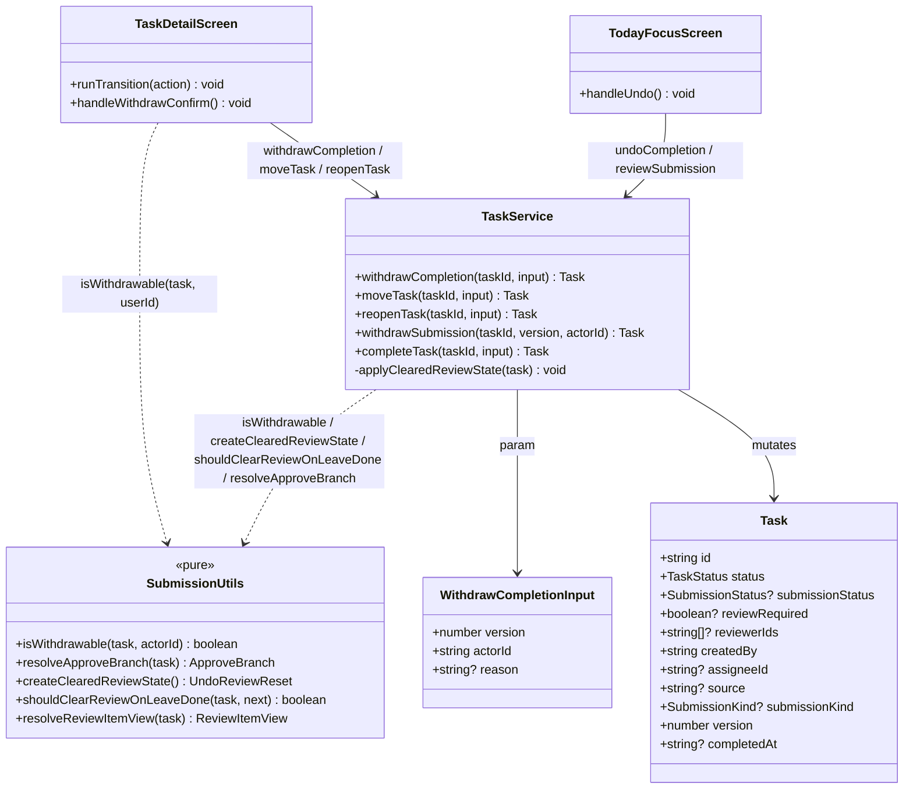
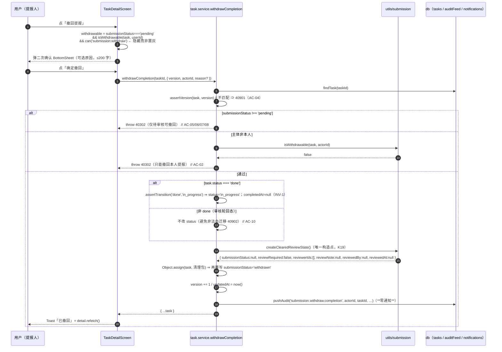
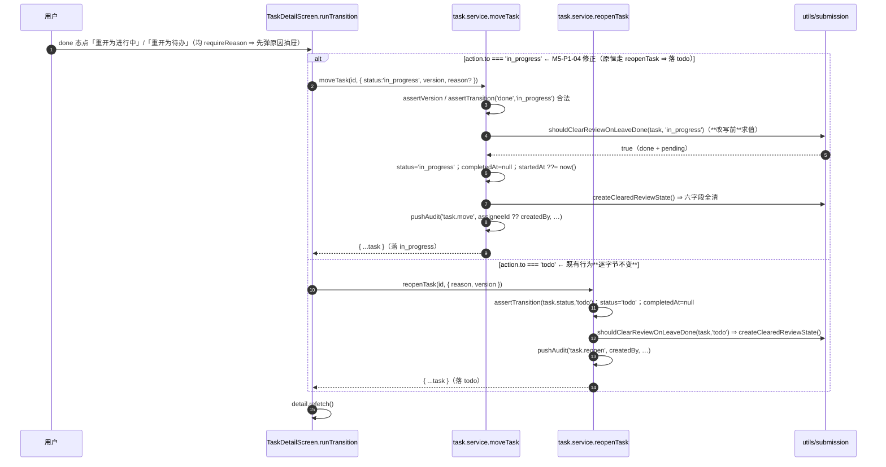
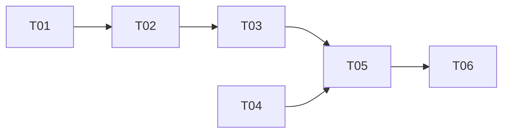

# ARCH（增量 4）— OpenSchedule 移动端：提报 / 审核状态机收口

> 档位：**增量架构 + 任务分解**（只写变更）· 架构师：**高见远（Gao）** · 基线：`PRD-mobile-increment-4.md` **v1.0** · `ARCH-mobile-increment-3.md`（K13~K18）· `ARCH-mobile-increment-2.md`（K1~K12）
> 交付路径：`apps/mobile` · 硬约束：Expo 57 / RN 0.86.3 / React 19 / TS 6 / React Navigation 7；**零新增依赖**；禁 `reanimated` / `gesture-handler`；禁 `pnpm`（用 `npm` / `npx`）。
> **回归基线（开工前实测，本文写作时复核）**：`npx jest --config jest.config.js` ⇒ **31 套件 / 502 用例全部通过**；`npx tsc --noEmit` ⇒ **exit 0**。
> **范围（用户拍板 = 三件事）**：① 列表内容互斥（原 Q4-12）；② 非 `done` 的 `pending` 收口（原 N2）；③「完成提报」撤回入口（原 N1）。**PM 裁定：三件事里只有 ③ 需要写代码**（① / ② = 裁定 + 注释级登记，零行为变更）。
> **主理人裁定（直接生效）**：PM 的 Q5-1~Q5-7 **全部接受**；**推翻** PM 在 Q5-2 / `M5-P2-02` 上的「不修」裁定，**将「重开为进行中」标签与行为不符的修复纳入本增量**（本 ARCH 编号 **M5-P1-04**，见 §3.5）。

---

## 0. TL;DR

本次**只有 3 处行为变更**（1 处新增撤回入口 + 1 处 UI 分支修正 + 1 处纯函数主体收敛），其余全部是**注释级口径登记**与**新增独立测试**：

| # | 行为变更 | 位置 | 性质 |
| --- | --- | --- | --- |
| **B1** | 新增 `withdrawCompletion`（完成提报撤回，**主体=提报人本人**、落 `in_progress`、**永不写 `cancelled`**、零通知） | `services/task.service.ts`（新增函数） | 新增独立入口，**既有函数零改动** |
| **B2** | 任务详情页新增「撤回提报」入口（隐藏而非置灰）+ 二次确认 + 轻提示 + refetch | `screens/TaskDetailScreen.tsx` | 新增 UI |
| **B3** | 「**重开为进行中**」由 `reopenTask`（恒落 `todo`）改走 `moveTask`（落 `in_progress`）⇒ 标签与行为一致 | `screens/TaskDetailScreen.tsx` `runTransition` | **主理人推翻 PM 的 Q5-2**，纳入本增量 |
| **B4** | `isWithdrawable` 修正为**分叉主体**（`completion ⇒ assigneeId ?? createdBy`；否则 `createdBy`） | `utils/submission.ts` | 纯函数语义修正；**修正前是死代码（全仓零引用）⇒ 运行时零影响** |

**零行为变更的登记项**（只补注释 / 口径锚点）：① 三分组口径（`M5-P0-04`）、②「审核轮回态」定义（`M5-P0-05`）。

**关键实读结论（本 ARCH 的裁决依据，行号级证据见 §3）**：
1. ✅ **主理人对「重开为进行中」的判断成立，且证据比预期更强** —— `tests/increment2-completion.test.ts:190-205` **已经**直接断言 `moveTask('task-004', { status:'in_progress' })`（`done + pending`）⇒ 六字段全清 + 审计 `task.move` + 退出待审队列，**当前全绿**。即「目标实现已存在且已被测试覆盖」，**只有 UI 分支未被覆盖**（`grep -rln "TaskDetailScreen" tests/` **零命中**）。
2. ✅ 改 UI 分支选择**不会触碰任何既有断言**：`increment2-completion.test.ts:185` 的 `task.reopen` 与 `:203` 的 `task.move` 断言**均来自对 service 的直接调用**，不经 UI。
3. ⚠️ **PM §3.6-C1 的纠正成立**：`SUBMISSION_TRANSITIONS` 在 `src/utils/submission.ts:19-25`（**不在** `types/task.ts`），且是**死表**（`canTransition` 全仓无运行时调用）。
4. ⚠️ **PM §3.6-C3 的纠正成立**：「完成提报」的退出路径**不止一条**（`undoCompletion` + 详情页两个重开动作）；「重开为进行中」确为**标签/行为不符**。

**产出规模**：源码 **修改 5 个文件 / 新增 0 个**；测试**新增 1 个独立文件**；**依赖包零新增**；共享知识新增 **K19~K26**。

---

## 1. 变更点清单（文件 → 改什么 → 为什么）

| # | 文件（相对 `apps/mobile/`） | 改什么（精确定位） | 为什么 | 零行为变更？ |
| --- | --- | --- | --- | --- |
| **C1** | `src/utils/submission.ts` | ① `isWithdrawable:90-95` 修正为**分叉主体**（`Pick` 扩为 `createdBy \| assigneeId \| source \| submissionKind \| submissionStatus`）；② `shouldClearReviewOnLeaveDone:160-165` 上方补「**审核轮回态**」注释（`M5-P0-05`） | ① `M5-P0-02`：收敛「撤回主体判定」为**单一事实来源**，消除「谓词/实现漂移」（原谓词用 `createdBy`，与完成提报的提报人 = `assigneeId` 错位）；② `M5-P0-05`：把「非 `done` + `pending` 离开不清理」固化为**有意口径** | ① 否（纯函数语义修正，**运行时零影响**：修正前零引用）；② **是**（纯注释） |
| **C2** | `src/services/task.service.ts` | ① 新增 `WithdrawCompletionInput` + `withdrawCompletion(taskId, input)`（`M5-P0-01`）；② 写入 `pushAudit('submission.withdraw.completion', …)`（`M5-P1-01`）；③ `reason?` 可选（`M5-P1-02`）；④ `// TODO(real-api)` 调用位；⑤ 顶部 `@/utils/submission` 导入补 `isWithdrawable` | 本增量**唯一的新增服务入口**；`withdrawSubmission` 对正式任务语义错误（会写 `cancelled`）⇒ 必须新增独立函数（`M5-P0-01` / R5-7 / R5-9） | 否（新增函数；**既有函数零改动**） |
| **C3** | `src/services/index.ts` | 类型桶 `export type { … }` 追加 `WithdrawCompletionInput` | 页面统一从 `@/services` 取类型（既有桶文件惯例） | 否（仅类型导出，运行时零影响） |
| **C4** | `src/screens/TaskDetailScreen.tsx` | ① 新增「撤回提报」入口（隐藏而非置灰）+ 二次确认 `BottomSheet` + 轻提示 Toast + 成功后 `detail.refetch()`（`M5-P0-03`）；② `runTransition:129-133` 的 `done` 分支拆分（`done → in_progress` 走 `moveTask`，`done → todo` 仍走 `reopenTask`）（`M5-P1-04`）；③ 导入 `useCan` / `isWithdrawable` | ① `M5-P0-03`：为完成提报提供**持久**撤回入口（不依赖数秒 Toast）；② `M5-P1-04`：修「标签/行为不符」，与本增量的 `withdrawCompletion` 落点（`in_progress`）对齐 | 否（新增 UI + 分支修正） |
| **C5** | `src/utils/focus.ts` | `countVisibleFocusTasks` 的 JSDoc 补「**徽标 ≠ 头部**」口径锚点（`M5-P0-04`） | ① 裁定落地：**徽标 = 分组长度**、**头部 = 并集基数**、**允许不等**、**不得为相等而改任一分组内容** | **是**（纯注释） |
| **C6** | `src/screens/TodayFocusScreen.tsx` | `counts:108-115` 附近补「徽标 = 分组长度，非并集」注释（`M5-P0-04`） | 同上（`M5-P0-04` 的另一落点） | **是**（纯注释） |
| **C7** | `tests/increment4-withdraw.test.ts`（**新增**） | 撤回链路（AC-01~AC-11）+ 重开分支源码断言（`M5-P1-04`） | 新用例写**独立新文件**（增量 3 `M4-P1-01` 已取代 K11 的「落点」规则） | 否（新增测试文件） |
| — | `src/types/task.ts`、`src/data/seed.ts`、`src/utils/permission.ts`、`src/services/focus.service.ts`、`src/components/*`、`src/navigation/*`、`src/theme/*`、`package.json`、`tsconfig.json`、`jest.config.js` | **零变更** | ① `TASK_TRANSITION_ACTIONS.done` 的 `requireReason: true` **保留**（见 §3.5.2）；② 种子禁止改（§2.2-8）；③ 复用既有 `submission:withdraw` key，**不新增 key**（§2.2-7）；④ 零新增依赖 | — |

---

## 2. 实现方案总览

### 2.1 一句话

在**不引入任何新框架、不改任何既有函数行为、不改任何既有测试断言**的前提下，**新增一个独立服务入口** `withdrawCompletion`（撤回完成提报：主体=提报人本人、落 `in_progress`、永不成 `cancelled`、零通知），并在**任务详情页**补一个「撤回提报」入口；同时**修正一处既有 UI 缺陷**（「重开为进行中」改走 `moveTask`）与**收敛一处纯函数主体判定**（`isWithdrawable`）；① / ② 两件事以**注释级口径登记**闭合（零行为变更）。

### 2.2 框架 / 分层选型说明（**本增量不引入任何新框架**）

| 维度 | 选型 | 说明 |
| --- | --- | --- |
| 框架 | **无新增** | 沿用 Expo 57 / RN 0.86.3 / React 19 / TS 6 / React Navigation 7 |
| 状态管理 | **无新增** | 沿用既有 `AppProvider`（`pushOptimistic` 等）+ `useAsync` / `useAuth` / `useCan` |
| UI 组件 | **无新增** | 复用既有 `BottomSheet` / `Button` / `Card` / `TextField` / `Tag`（`@/components`） |
| 依赖 | **零新增** | 见 §6（显式声明为空） |
| 分层落点 | 纯判定 → `utils/`；写入 → `services/`；页面编排 → `screens/` | 与 `ARCH-mobile.md §10` 及增量 2/3 完全一致 |
| 撤回二次确认姿势 | **照抄 `MySubmissionsScreen.tsx:179-207`**（`BottomSheet` + 取消 / 确定双按钮 + `variant="danger"`） | 零新姿势，评审可一眼对照 |

### 2.3 分层落点

| 层 | 落点 | 内容 |
| --- | --- | --- |
| **纯工具层** | `utils/submission.ts` | `isWithdrawable` 分叉主体（唯一事实来源）+ 审核轮回态注释 |
| **纯工具层** | `utils/focus.ts` | 三分组口径注释锚点（纯注释） |
| **服务层** | `services/task.service.ts` | 新增 `withdrawCompletion`（唯一写入点） |
| **类型层** | `services/index.ts` | 导出 `WithdrawCompletionInput` |
| **页面层** | `screens/TaskDetailScreen.tsx` | 撤回入口 + 重开分支修正 |
| **页面层** | `screens/TodayFocusScreen.tsx` | 徽标口径注释（纯注释） |
| **测试层** | `tests/increment4-withdraw.test.ts`（新） | 撤回链路 + 重开分支 |

> **不动的层**：`types/`（含 `TASK_TRANSITIONS` / `TASK_TRANSITION_ACTIONS`）、`data/`（含 `seed.ts`）、`theme/`、`components/`、`navigation/`、`services/focus.service.ts`、`utils/permission.ts`。

---

## 3. 数据结构与接口

### 3.1 `WithdrawCompletionInput` 与 `withdrawCompletion` 签名（`M5-P0-01`）

```ts
// src/services/task.service.ts（新增）

/** 撤回「完成提报」入参（M5-P0-01 / M5-P1-02） */
export interface WithdrawCompletionInput {
  /** 乐观锁版本；与 task.version 不一致 ⇒ 抛 40901（ERR_OPTIMISTIC_LOCK） */
  version: number
  /** 撤回发起人；必须 === 提报人本人，否则抛 40302（ERR_SUBMISSION_FORBIDDEN） */
  actorId: string
  /** 撤回原因（**可选**，≤200 字；填写时并入 audit summary；不强制 ≥4 字，M5-P1-02） */
  reason?: string
}

/**
 * 撤回「完成提报」（M5-P0-01）：把提报人本人已提交的完成提报撤回，任务退出审核队列继续推进。
 *
 * 与 `withdrawSubmission` 的区别（R5-7 / R5-9）：
 * - 语义：`withdrawSubmission` = 撤回「新事项提报记录」（提报记录归档为 `cancelled`，正确）；
 *         `withdrawCompletion` = 撤回「正式任务的完成提报」（任务回到 `in_progress`，**永不写 `cancelled`**）。
 * - 主体：`withdrawCompletion` 主体 = 提报人（完成提报 = `assigneeId ?? createdBy`，M5-P0-02）。
 *
 * 行为约束：
 * - 主体判定**唯一事实来源** = `isWithdrawable(task, actorId)`（禁止内联手写第二份主体判据，K20）；
 * - 审核态清理**必须复用** `createClearedReviewState()`（唯一构造点，K19）；
 * - **零通知**（不新增通知类型、不触碰通知系统，K24）。
 */
export async function withdrawCompletion(
  taskId: string,
  input: WithdrawCompletionInput,
): Promise<Task>
```

> **签名裁定（input-object vs positional）**：PRD §5.1 的 AC 以 positional 书写（`withdrawCompletion('task-014', v, 'user-002')`）。本 ARCH **裁定采用 input-object**（`(taskId, input)`），理由：① 本 service 的**多数**写操作已是 input-object（`completeTask` / `reopenTask` / `moveTask` / `undoCompletion`）；② 主理人明确要求 `WithdrawCompletionInput` 类型；③ 3 个字段 + 可选 reason 用对象更易读。**AC 映射**：`withdrawCompletion('task-014', v, 'user-002')` ⇔ `withdrawCompletion('task-014', { version: v, actorId: 'user-002' })`，**语义逐字段等价**。QA 用例请以本 ARCH 签名为准（接口细节归 ARCH；本增量测试文件尚未存在，无迁移成本）。

**目标实现片段（`src/services/task.service.ts`，紧随 `withdrawSubmission` 之后）**：

```ts
export async function withdrawCompletion(
  taskId: string,
  input: WithdrawCompletionInput,
): Promise<Task> {
  if (USE_MOCK) {
    await simulateLatency()
    const task = findTask(taskId)
    if (!task) throw new ApiError(40401, '任务不存在或不可见')
    assertVersion(task, input.version) // ① 乐观锁 ⇒ 40901（AC-04）

    // ② 前置态：仍待审（精确提示；AC-05/06/07/08 均命中此处 ⇒ 40302）
    if (task.submissionStatus !== 'pending') {
      throw new ApiError(ERR_SUBMISSION_FORBIDDEN, '仅待审核的完成提报可撤回')
    }
    // ③ 主体：唯一事实来源 = isWithdrawable（M5-P0-02；AC-02 命中 ⇒ 40302）
    if (!isWithdrawable(task, input.actorId)) {
      throw new ApiError(ERR_SUBMISSION_FORBIDDEN, '只能撤回本人提交的完成提报')
    }

    // ④ 任务状态：done ⇒ in_progress（先校验迁移合法，INV-1 保持）；非 done ⇒ 不改 status（避免非法自迁移 40902）
    if (task.status === 'done') {
      assertTransition('done', 'in_progress')
      task.status = 'in_progress'
      task.completedAt = null // INV-1：completedAt != null ⟺ status === 'done'
    }

    // ⑤ 审核态清理：复用唯一构造点（K19），再覆写 submissionStatus
    applyClearedReviewState(task) // submissionStatus=null / reviewRequired=false / reviewerIds=[] / reviewNote=null / reviewedBy=null / reviewedAt=null
    task.submissionStatus = 'withdrawn' // 覆写（INV-8：pending → withdrawn 合法）

    task.version += 1
    task.updatedAt = now()
    const reasonSuffix = input.reason ? `（原因：${input.reason}）` : ''
    pushAudit(
      'submission.withdraw.completion',
      input.actorId,
      taskId,
      `撤回了「${task.title}」的完成提报${reasonSuffix}`,
    ) // M5-P1-01：写团队动态；**零通知**（K24）
    return { ...task }
  }
  // TODO(real-api): POST /tasks/:taskId/submissions/withdraw-completion  body: { version, actorId, reason }
  return httpClient.post<Task>(`/tasks/${taskId}/submissions/withdraw-completion`, input)
}
```

**关键点（逐条对齐 PRD `M5-P0-01` 的 ①~⑧）**：

| PRD 子项 | 实现 | 锚点 |
| --- | --- | --- |
| ① 主体 = 提报人本人 | `isWithdrawable(task, actorId)`（分叉主体） | AC-02 |
| ② 前置 = `pending` | `submissionStatus !== 'pending'` ⇒ 40302 | AC-05/06/07/08 |
| ③ `assertVersion` | 40901 | AC-04 |
| ④ 置 `submissionStatus='withdrawn'` | ⑤ 之后覆写 | AC-01/03 |
| ⑤ 复用 `createClearedReviewState()` | `applyClearedReviewState(task)` | INV-4 |
| ⑥ `status`：`done ⇒ in_progress`（+`completedAt=null`）/ 非 `done ⇒ 不改` | `if (task.status === 'done')` | AC-03/AC-10 |
| ⑦ `version += 1` / `updatedAt` | 同左 | AC-01 |
| ⑧ 零通知 | 函数体内**无**任何 `pushNotification*` / `db.notifications` 访问 | AC-09 / INV-6 |

> **`applyClearedReviewState` 的可见性**：它是 `task.service.ts:144-146` 的**模块私有函数**（唯一落地实现，K1/K8），`withdrawCompletion` 与它同文件 ⇒ **可直接复用**，无需导出、无需新增构造点。

### 3.2 `isWithdrawable` 修正（`M5-P0-02`）

```ts
// src/utils/submission.ts（修改 :90-95）

/**
 * 是否可撤回（**分叉主体**，唯一事实来源；M5-P0-02）。
 *
 * 主体判定（与 `resolveReviewItemView:191/200` 同源）：
 * - `resolveApproveBranch(task) === 'completion'` ⇒ 提报人 = `task.assigneeId ?? task.createdBy`
 *   （完成提报由负责人提交，待我审核卡片显示「李娜 提交了完成提报」）；
 * - 否则（新事项提报）⇒ 提报人 = `task.createdBy`。
 *
 * 且必须 `submissionStatus === 'pending'`。
 */
export function isWithdrawable(
  task: Pick<Task, 'createdBy' | 'assigneeId' | 'source' | 'submissionKind' | 'submissionStatus'>,
  actorId: string,
): boolean {
  if (task.submissionStatus !== 'pending') return false
  const submitter =
    resolveApproveBranch(task) === 'completion' ? task.assigneeId ?? task.createdBy : task.createdBy
  return submitter === actorId
}
```

| 项 | 裁定 | 理由 |
| --- | --- | --- |
| 主体分叉依据 | `resolveApproveBranch(task)`（**不是** `source` / `status`） | K4：`completeTask` 不改 `source`；种子 `task-014/015` 的 `status='in_progress'` |
| `completion` 分支主体 | `assigneeId ?? createdBy` | 完成提报的提报人 = 负责人（`submission.ts:191`）；`?? createdBy` 兜底 `assigneeId` 为空的边界 |
| 是否保留 `pending` 条件 | **保留** | 与原文档注释「仅本人 + `pending`」一致；`withdrawCompletion` 以此谓词为**主闸**（真正引用，消除死代码） |
| `withdrawSubmission` 内联判据 | **不动**（R5-9） | 避免触碰 `tests/submission-flow.test.ts:240-263`；且其判据（`createdBy`）对**提报记录**（非 completion 分支）与修正后的 `isWithdrawable` **语义等价**（见 §10-9） |
| 是否新增 `PermissionAction` key | **否** | 复用既有 `submission:withdraw`（`permission.ts:39`） |

### 3.3 类图（依赖关系）



### 3.4 依赖关系说明

- **`withdrawCompletion` → `isWithdrawable`（纯函数）**：主体判定的唯一事实来源（K20）。这是「消除死代码 + 谓词/实现漂移」的落点（`M5-P0-02`）。
- **`withdrawCompletion` → `applyClearedReviewState` → `createClearedReviewState`（同文件私有）**：审核态清理字段包**唯一构造点**（K1/K8/K19）。**禁止**在 `withdrawCompletion` 内手写第二份字段清单。
- **`TaskDetailScreen` → `isWithdrawable`**：入口可见性判定（`M5-P0-03`）与 `withdrawCompletion` 的服务端主体判定**同源**（否则会出现「按钮可见但服务拒绝」的错配）。
- **`TaskDetailScreen.runTransition` → `moveTask` / `reopenTask`**：`done → in_progress` 走 `moveTask`（B3），`done → todo` 走 `reopenTask`（既有行为不变）。

### 3.5 「重开为进行中」专项评估（主理人推翻 PM 的 Q5-2 / `M5-P2-02`，纳入本增量）

#### 3.5.1 缺陷事实（实读，行号级）

| 事实 | 位置 | 证据 |
| --- | --- | --- |
| `done` 态有两个动作，均 `requireReason` | `types/task.ts:142-145` | `{ to:'todo', label:'重开为待办', requireReason:true }` / `{ to:'in_progress', label:'重开为进行中', requireReason:true }` |
| 两个动作**都**走 `reopenTask` | `TaskDetailScreen.tsx:129-133` | `else if (current.status === 'done') { await taskService.reopenTask(...) }`（**未区分 `action.to`**） |
| `reopenTask` 目标**恒为 `todo`** | `task.service.ts:382` | `assertTransition(task.status, 'todo')` … `task.status = 'todo'` |
| ⇒ 「重开为进行中」实际落 `todo` | — | **标签与行为不符** |

#### 3.5.2 最小变更方案（裁定）

**只改 `TaskDetailScreen.runTransition` 的 `done` 分支选择，不动 `TASK_TRANSITION_ACTIONS` 配置表，不动 `reopenTask` / `moveTask`。**

```ts
// src/screens/TaskDetailScreen.tsx  runTransition（:126-140 目标片段）
if (action.to === 'done') {
  const hours = actualHours.trim() ? Number(actualHours) : current.actualHours ?? current.estimatedHours ?? 1
  await taskService.completeTask(current.id, { actualHours: hours, version: current.version })
} else if (current.status === 'done') {
  if (action.to === 'in_progress') {
    // M5-P1-04：done → in_progress 走 moveTask（标签与行为一致；moveTask 亦清理审核态、completedAt 置空）
    await taskService.moveTask(current.id, {
      status: 'in_progress',
      version: current.version,
      reason: reason.trim() || undefined,
    })
  } else {
    // done → todo：保持既有行为**逐字节不变**
    await taskService.reopenTask(current.id, {
      reason: reason.trim() || '重开任务',
      version: current.version,
    })
  }
} else {
  await taskService.moveTask(current.id, {
    status: action.to,
    version: current.version,
    reason: reason.trim() || undefined,
  })
}
```

#### 3.5.3 `requireReason` 差异的裁定：**保留 UI 层必填（`requireReason: true` 不变）**

| 项 | 裁定 | 理由 |
| --- | --- | --- |
| `TASK_TRANSITION_ACTIONS.done` 的 `requireReason` | **保持 `true`**（`types/task.ts` **零改动**） | ① `requireReason` 是 **UI 配置**（决定是否弹原因抽屉 + 确认按钮是否禁用），不是 service 契约；② 两个 done 动作**对称**要求原因，改其一会造成 UX 不一致；③ 改它需动**共享类型文件** `types/task.ts`，违背「最小变更 / 不动共享类型」；④ 零功能收益 |
| `moveTask.reason` 可选 | **不收紧** | `MoveTaskInput.reason?: string`（`types/task.ts:167`）；UI 已保证 ≥4 字（`TaskDetailScreen.tsx:632-636` 的确认按钮禁用逻辑），service 端可选**不构成漏洞** |
| 传参 | `reason: reason.trim() \|\| undefined` | 与既有 `else` 分支（`moveTask`）**同一写法**；空串退化为 `undefined`，`moveTask` 的 audit 摘要自动省略原因后缀 |

> **结论**：**不放宽**。UI 层必填门禁保留，`moveTask` 的可选 `reason` 无需改动 —— 二者本就兼容，**改动面仅「分支选择」**。

#### 3.5.4 audit 动作名与既有断言核对结果（**已实读**）

| 路径 | audit 动作名 | actorId | 既有断言 | 判定 |
| --- | --- | --- | --- | --- |
| `reopenTask`（`done → todo`） | `'task.reopen'`（`task.service.ts:391`） | `task.createdBy` | `increment2-completion.test.ts:185` 断言 `task.reopen` —— **来自直接调用 `reopenTask`**（`:174`），**不经 UI** | ✅ **不受影响**（UI 的 `done→todo` 仍走 `reopenTask`，行为逐字节不变） |
| `moveTask`（`done → in_progress`） | `'task.move'`（`task.service.ts:320`） | `task.assigneeId ?? task.createdBy` | `increment2-completion.test.ts:203` 断言 `task.move` —— **来自直接调用 `moveTask`**（`:192`），**且该用例正是 `done + pending → in_progress`** | ✅ **不受影响**（UI 改走 `moveTask` 恰好与既有断言**同向**；该路径**已被覆盖且全绿**） |
| UI 分支 | — | — | `grep -rln "TaskDetailScreen" tests/` ⇒ **零命中** | ✅ **无任何断言覆盖 UI 分支** ⇒ 改分支选择**不触碰任何断言** |

> **审计链结论**：**不断裂、不失败**。`done→todo` 仍发 `task.reopen`（不变）；`done→in_progress` 改发 `task.move`，而 `task.move` 正是**已存在且已被 `increment2-completion.test.ts:190-205` 断言为绿**的服务行为。两条路径的 audit 语义均自洽（都是任务状态迁移的团队动态）。
>
> ⚠️ **唯一可观测差异（如实登记，非缺陷）**：`done→in_progress` 的 **audit actorId** 由 `reopenTask` 的 `createdBy` 变为 `moveTask` 的 `assigneeId ?? createdBy`（见 §10-12）。无任何断言覆盖该字段的这条路径。

#### 3.5.5 `blocked` 来源的任务不受影响

- `TASK_TRANSITIONS.done = ['todo', 'in_progress']`（`types/task.ts:110`）⇒ **`done → blocked` 非法**（会抛 40902）。
- `TASK_TRANSITION_ACTIONS.done` **无 `blocked` 动作** ⇒ UI 不提供该入口。
- 故「由 `blocked` 完成的任务」只能重开为 `todo` / `in_progress`，**与本次改动无交集**。§10-5 的既有已知限制（撤回/重开对 `blocked` 来源任务会解除阻塞）**不因本改动变化**。

#### 3.5.6 主理人判断复核结论：**同意纳入（证据比预期更强）**

| 主理人的论据 | 我的实读复核 | 结论 |
| --- | --- | --- |
| 「全仓无测试覆盖 `TaskDetailScreen` 该分支」 | `grep -rln "TaskDetailScreen" tests/` **零命中** | ✅ **成立** |
| 「既有断言针对 service 层 `reopenTask`，非 UI 分支」 | `increment2-completion.test.ts:174/185`、`increment2-qa.test.ts:69/220`、`services.test.ts:139` 均**直接调用** `reopenTask` | ✅ **成立** |
| 「`moveTask` 对 `done → in_progress` 完全正确」 | `assertTransition` 合法；`completedAt=null`；`shouldClearReviewOnLeaveDone` 改写前求值 ⇒ `applyClearedReviewState`；`startedAt ??= now()`；`pushAudit('task.move')` | ✅ **成立** |
| 「本增量会放大该不一致」 | `withdrawCompletion` 落 `in_progress`，而「重开为进行中」落 `todo` ⇒ 同一语义两种结果 | ✅ **成立** |
| （**我补充的更强证据**） | `increment2-completion.test.ts:190-205` **已直接断言** `moveTask('task-004',{status:'in_progress'})` 全链路正确且**当前全绿** ⇒ **目标实现已存在且已被测试锁定**，只需改 UI 分支 | ✅ **强化主理人结论** |

**是否存在主理人未预料的副作用？** 实读后**未发现**破坏性副作用。仅两处**非破坏性可观测差异**：① audit actorId 口径（§3.5.4 / §10-12）；② `startedAt ??= now()`（`moveTask` 对 `in_progress` 目标会补 `startedAt`，`reopenTask` 不会）—— 对已完成过的任务 `startedAt` 通常已非空，**实际无变化**。

---

## 4. 程序调用流程

### 4.1 链路 ① 撤回完成提报（`withdrawCompletion`）



### 4.2 链路 ② 修正后的「重开」链路（`M5-P1-04`）



---

## 5. 任务列表（有序 · 含依赖 · 按实现顺序）

> 粒度约定：**一个任务 = 一批可连续写盘的文件**。T01 落纯工具层，T02 落服务层，T03 落页面层（撤回入口 + 重开分支修正），T04 落纯注释口径登记（与 T01~T03 **无依赖**，可并行），T05 统一补测试，T06 收尾复跑。

| 编号 | 文件（相对 `apps/mobile/`） | 内容 | 依赖 | 验收锚点 | 零行为变更？ |
| --- | --- | --- | --- | --- | --- |
| **T01** | `src/utils/submission.ts` | ① 修正 `isWithdrawable` 为分叉主体（`M5-P0-02`）；② 在 `shouldClearReviewOnLeaveDone:160-165` 上方补「**审核轮回态**」注释（`M5-P0-05`） | — | `M5-P0-02` / `M5-P0-05`；AC-02；INV-7；AC-13/AC-14 | ① 否（纯函数语义修正，**运行时零影响**）；② **是**（纯注释） |
| **T02** | `src/services/task.service.ts`、`src/services/index.ts` | 新增 `WithdrawCompletionInput` + `withdrawCompletion`（`M5-P0-01`）+ `pushAudit('submission.withdraw.completion', …)`（`M5-P1-01`）+ `reason?` 可选（`M5-P1-02`）+ `// TODO(real-api)`；桶文件导出类型 | **T01**（引用 `isWithdrawable`） | AC-01~AC-11；INV-1/4/5/6/8 | 否（新增函数；既有函数零改动） |
| **T03** | `src/screens/TaskDetailScreen.tsx` | ① 新增「撤回提报」入口（隐藏而非置灰）+ 二次确认 `BottomSheet` + 轻提示 + `detail.refetch()`（`M5-P0-03`）；② `runTransition` 的 `done` 分支拆分（`M5-P1-04`）；③ 导入 `useCan` / `isWithdrawable` | **T02** | `M5-P0-03` / `M5-P1-04`；AC-01（UI 链路）；US5-02；§3.5.6 | 否 |
| **T04** | `src/utils/focus.ts`、`src/screens/TodayFocusScreen.tsx` | ① 三分组口径注释锚点（徽标 = 分组长度、头部 = 并集基数、允许不等）（`M5-P0-04`） | — | `M5-P0-04`；INV-2；AC-13 | **是**（纯注释，**零行为变更**） |
| **T05** | `tests/increment4-withdraw.test.ts`（**新增**） | 撤回链路 AC-01~AC-11（含 40302 / 40901 / 零通知 / 幂等 / `listPendingReview` 收敛 / `listTodayDue` 复现）+ 「重开为进行中」源码文本断言（`M5-P1-04`，照增量 3 的 `readFileSync` 姿势） | T01、T02、T03、T04 | AC-01~AC-11；AC-13/AC-14 | 否（新增测试文件） |
| **T06** | （无源码改动，仅复跑） | 全量 `npx jest --config jest.config.js` + `npx tsc --noEmit`；核对 §8 回归矩阵逐条全绿、套件数 31 → **32**、用例数 ≥ 502 | T05 | AC-12；§8 回归矩阵 | **是**（零源码变更） |

**依赖图**：



**任务条数**：**6 条**（T01 ~ T06）。**零行为变更任务：T04（1 条纯注释任务）+ T06（复跑）；另有 T01 的 `M5-P0-05` 子项亦为零行为变更**。

> **与 PM 的 `M5-P1-01/02/03` 的映射**：`M5-P1-01`（写团队动态）与 `M5-P1-02`（原因可选）并入 **T02**；`M5-P1-03`（撤回后「待我审核」即时收敛）由 **T03** 的 `detail.refetch()` + **T05** 的 `listPendingReview` 断言共同覆盖（无需独立任务）。
> **与 PM 的 `M5-P2-02` 的关系**：PM 原裁定「不修」，主理人**推翻并纳入** ⇒ 落地为 **T03 的第 ② 项（`M5-P1-04`）**。

---

## 6. 依赖包列表

**预期「零新增」—— 确认：`依赖包列表 = 空`。**

| 项 | 结论 | 依据 |
| --- | --- | --- |
| 新增运行时依赖 | **无** | 仅用既有模块（`@/services` / `@/utils` / `@/components` / `@/theme` / `@/types`）与 JS 内建 |
| 新增开发依赖 | **无** | 测试沿用既有 `jest-expo` + `react-test-renderer`（均为既有 `devDependencies`） |
| `package.json` | **不动** | 无 `dependencies` / `devDependencies` 变更 |
| 锁文件 | **不动** | 无依赖树变化（`npm`；**不使用 `pnpm`**） |
| 新引入的库 | **无** | 不引入 `lodash` / `date-fns` / 任何状态库 / `reanimated` / `gesture-handler` |

> **验收判据**：`npx tsc --noEmit` **0 error**；全量测试**全绿**；`package.json` **零新增依赖**。

---

## 7. 共享知识 / 铁律（K19 ~ K26）

> **声明**：`ARCH-mobile-increment-2.md` §7 的 **K1~K12** 与 `ARCH-mobile-increment-3.md` §7 的 **K13~K18** 全部**继续有效**，本次**不修订、不废止**任何一条。以下 K19~K26 为本次**新增**的跨文件约定。
>
> **K11 落点规则的现状**：K11 的「新增用例写在 `tests/increment2-completion.test.ts`」已被增量 3 `M4-P1-01` 取代（新用例一律写**独立新文件**）；K11 的**实质精神（禁止改动既有套件的任何断言）继续有效**。本增量新用例落在 `tests/increment4-withdraw.test.ts`。

| # | 规则 | 说明 |
| --- | --- | --- |
| **K19** | **审核态清理字段包唯一构造点 = `createClearedReviewState()`**（`utils/submission.ts:126-135`）。**`withdrawCompletion` 必须复用 `applyClearedReviewState(task)`（`task.service.ts:144-146`）**，再覆写 `submissionStatus='withdrawn'`；**禁止**在 `withdrawCompletion` 内手写第二份字段清单（延续 K1 / K8）。 | 字段清单 = `submissionStatus` / `reviewRequired` / `reviewerIds` / `reviewNote` / `reviewedBy` / `reviewedAt` 六字段。新增撤回路径与既有 `reopenTask` / `moveTask` / `undoCompletion` 清理分支**同源**。 |
| **K20** | **撤回主体判定的唯一事实来源 = `isWithdrawable(task, actorId)`**（`utils/submission.ts`，**分叉主体**：`completion ⇒ assigneeId ?? createdBy`；否则 `createdBy`）。**`withdrawCompletion` 必须真正引用该纯函数**；**禁止**在 `withdrawCompletion` 内联第二份主体判据。 | 「主体判定」= **谁有权撤回**（分叉派生）；`submissionStatus === 'pending'` 是**状态门禁**（非主体判定），允许在 `withdrawCompletion` 与 `isWithdrawable` 内各出现一次（纵深防护）。⚠️ **残留**：`withdrawSubmission:913` 的内联 `createdBy` 判据**保留**（R5-9，避免触碰 `submission-flow.test.ts:240-263`）⇒ 仓内仍有**两处**主体判定，但对**提报记录**（非 completion 分支）二者**语义等价**（§10-9）。 |
| **K21** | **不得混用「任务状态机」与「提报状态机」**：`TASK_TRANSITIONS`（`types/task.ts:106-112`，管 `status`）与 `SUBMISSION_TRANSITIONS`（`utils/submission.ts:19-25`，管 `submissionStatus`）是**两套独立状态机**。**禁止**把「撤回提报」动作塞进 `TASK_TRANSITION_ACTIONS`（它只描述 `status` 迁移）；**禁止**用 `status` 判定「完成提报」（一律用 `resolveApproveBranch`，K4）。 | 撤回提报是**提报状态机**的迁移（`pending → withdrawn`）+ **可选**的**任务状态机**迁移（`done → in_progress`），二者**分开表达**。UI 入口独立于 `TASK_TRANSITION_ACTIONS`（`M5-P0-03` 明令）。 |
| **K22** | **错误码约定（本增量）**：乐观锁版本冲突 ⇒ **40901**（`ERR_OPTIMISTIC_LOCK`）；主体不合法 / 前置态不合法 ⇒ **40302**（`ERR_SUBMISSION_FORBIDDEN`）；**非法任务状态迁移** ⇒ **40902**（`ERR_ILLEGAL_TRANSITION`，`details.allowed_transitions`）。 | `withdrawCompletion` 的检查顺序：`assertVersion`（40901）→ 前置态 `pending`（40302）→ 主体 `isWithdrawable`（40302）→ `status` 分支（`done` 时 `assertTransition` 40902）。**校验一律在写入之前**（失败时任务零变化）。 |
| **K23** | **`SUBMISSION_TRANSITIONS` 是「死表」，不得据其推断运行时可写入集合**：`canTransition`（`utils/submission.ts:83-87`）**全仓无运行时调用**；表内 `approved: []` 与产品实际的 `approved → pending`（`TodayFocusScreen.tsx:257`）**矛盾**、且缺 `rejected → pending`。**本增量禁止改表内容**（`tests/submission-flow.test.ts:76` 锁定 `canTransition('approved','pending') === false`）。 | 撤回的合法性**不**由该表守卫（`withdrawCompletion` 用显式前置态检查）。**唯一**可据该表的是 `tests/submission-flow.test.ts:61-80` 的纯函数断言（文档性质）。 |
| **K24** | **撤回动作「零通知」**：`withdrawCompletion` 函数体内**不得**出现 `pushNotification` / `pushNotificationOnce` / `db.notifications` 的任何访问（与 `undoCompletion` 零通知口径一致，`tests/increment3-qa.test.ts:329-345`）。**不得动通知系统**（不新增通知类型、不改既有通知函数）。 | AC-09 断言 `db.notifications` 前后**逐字节相等**；`db.auditFeed.length` **+1** 且 `action === 'submission.withdraw.completion'`。 |
| **K25** | **「重开」的路径归属（M5-P1-04）**：`done → in_progress` **走 `moveTask`**（标签与行为一致）；`done → todo` **走 `reopenTask`**（既有行为逐字节不变）。**禁止**改 `TASK_TRANSITION_ACTIONS` 配置表、**禁止**改 `reopenTask` / `moveTask` 函数体。 | 两条路径均清理审核态（`createClearedReviewState`）且 `completedAt=null`；audit 动作名分别 `task.move` / `task.reopen`（§3.5.4 已核对：**不触碰任何既有断言**）。 |
| **K26** | **「审核轮回态」定义（M5-P0-05）**：**非 `done`** 且 `submissionStatus === 'pending'`，且 `reviewRequired=true` / `reviewerIds` 非空，**是合法态**（由「撤销审核通过」产生，`TodayFocusScreen.tsx:247-257`）。该态下任务**离开当前状态不清理审核态**（`shouldClearReviewOnLeaveDone` 的窄口径是**有意为之**：离开 `done` = 撤回完成声明 ⇒ 清理；非 `done` 的 `pending` 下任务仍在推进 ⇒ 审核人必须仍能看到它，K3）。 | **禁止**为「统一清理口径」而修改 `shouldClearReviewOnLeaveDone` 的判据、或给 `moveTask` / `reopenTask` 增加新清理分支（PRD §2.2-2）。 |

---

## 8. 回归矩阵（既有 31 套件逐条判定）

> 判据：实读每个套件的断言内容与调用路径。「应不受影响」= 改动面与该套件无交集；「需重点复跑」= 该套件覆盖本次触碰的层（`isWithdrawable` / `TaskDetailScreen` / 任务状态机 / 提报状态机 / 权限）。

| # | 套件 | 覆盖 | 判定 | 依据 |
| --- | --- | --- | --- | --- |
| 1 | `increment2-completion.test.ts` | `reopenTask` / `moveTask` / `completeTask` / `undoCompletion` / `reviewSubmission` 全链路 | **需重点复跑** | `:174/185`（`reopenTask` → `task.reopen`）、`:190-205`（**`moveTask done→in_progress` → `task.move`，与 M5-P1-04 同路径**）、`:96-100`（`shouldClearReviewOnLeaveDone`） |
| 2 | `increment2-qa.test.ts` | 守卫求值时机 / K3 方向性 / INV / 异常码 | **需重点复跑** | `:66-79`（`reopenTask` 由 done 迁出）、`:107-117`（**task-014 `in_progress+pending` 迁往 todo 保持 pending**，即「审核轮回态」保护）、`:177-199`（K3）、`:306-314`（陈旧 version 40901） |
| 3 | `increment3-qa.test.ts` | K15 有意差异 / `listTodayDue` / 零通知 | **需重点复跑** | `:79`（`dueToday` 精确 5 条）、`:306-316`（K15）、`:329-345`（**`undoCompletion` 零通知**，与本增量「撤回零通知」同口径参照） |
| 4 | `submission-flow.test.ts` | `SUBMISSION_TRANSITIONS` / `submitItem` / `withdrawSubmission` / 通知计数 | **需重点复跑** | `:76`（**受保护断言**：`canTransition('approved','pending')===false`）、`:240-263`（`withdrawSubmission` 主体/状态/幂等）、`:334-372`（通知精确计数） |
| 5 | `round2-regression.test.ts` | `undoCompletion` 语义 / 竞态 / 时区 | **需重点复跑** | `:19-31`（撤销回原状态 + `task.undo`）、`:43-60`（撤销审核通过 → `pending`）、`:72-85`（40901 / 40902） |
| 6 | `services.test.ts` | `listTodayDue` / `completeTask` / `reopenTask` / `getTodayFocus` | **需重点复跑** | `:122-141`（`reopenTask` → `todo`） |
| 7 | `seed-submissions.test.ts` | task-022/023 种子约束 + `listPendingReview` / `listMySubmissions` | **需重点复跑** | `:43-54`（列表成员关系；撤回后不得污染） |
| 8 | `today-focus-gate.test.tsx` | 徽标 / 头部 N / 权限门禁 | **需重点复跑** | `:205/219`（`共 N 项待处理`，并集口径）、`:251/266`（actionKeys） |
| 9 | `task-state-machine.test.ts` | 纯 `TASK_TRANSITIONS` 表断言 | **需重点复跑** | 本次**不动** `types/task.ts` ⇒ 断言应逐字节不变 |
| 10 | `permission.test.ts` | `PERMISSIONS` / `can()` | **需重点复跑** | 本次复用 `submission:withdraw`，**不新增 key** ⇒ 断言应不变 |
| 11 | `permission-hook.test.tsx` | `useCan` 稳定性 | **需重点复跑** | `TaskDetailScreen` 新增 `useCan` 调用，但不动 hook 本体 |
| 12 | `screen-gate.test.tsx` | `CreateItemScreen` / `SubmissionScreen` 深链门禁 | 应不受影响 | 实读：仅渲染 `CreateItemScreen` / `SubmissionScreen`（`:59-60`），**不含** `TaskDetailScreen` |
| 13 | `increment2-focus-footer.test.tsx` | `TaskCard.footer` 分叉（K9） | 应不受影响 | 不动 `TaskCard` / 分组渲染 |
| 14 | `increment3-dedup-notify.test.ts` | `countVisibleFocusTasks` / `listTodayDue` / 通知去重 | 应不受影响 | 本次不动 `focus.ts` 逻辑（仅注释）/ 通知 |
| 15 | `increment3-notify-screen.test.tsx` | 通知列表渲染 | 应不受影响 | 不动通知系统 |
| 16 | `seed-integrity.test.ts` | 直读 `mockTasks` 计数 | 应不受影响 | 不动种子 |
| 17 | `attachment.test.ts` | 附件校验 / 上传 | 应不受影响 | 不动附件 |
| 18 | `auth.test.ts` | 登录 | 应不受影响 | 不动 auth |
| 19 | `calendar-lane.test.ts` | 日历泳道 | 应不受影响 | 不动日历 |
| 20 | `date.test.ts` | 日期工具 | 应不受影响 | 不动 `utils/date` |
| 21 | `draft.test.ts` / `draft-persist.test.tsx` | 草稿 | 应不受影响 | 不动草稿 |
| 22 | `format.test.ts` | 格式化 | 应不受影响 | 不动 `utils/format` |
| 23 | `linking.test.ts` | 深链 | 应不受影响 | 不动导航 / 深链 |
| 24 | `mention.test.ts` | @提及通知 | 应不受影响 | 不动评论 / 通知 |
| 25 | `overview.test.ts` / `overview-qa.test.ts` | 概览 | 应不受影响 | 不动概览 |
| 26 | `personal-plan.test.ts` | 个人计划 | 应不受影响 | 不动个人任务 |
| 27 | `project-list-fab.test.tsx` | 项目列表 | 应不受影响 | 不动项目页 |
| 28 | `schedule.test.ts` | 排期 | 应不受影响 | 不动排期 |
| 29 | `useTimer.test.tsx` | 计时 hook | 应不受影响 | 不动计时 |

**汇总**：**需重点复跑 11 项**（#1~#11）；**应不受影响 18 项**（#12~#29）；**需修改断言的项 = 0**。**无前置「先改断言」任务**（本增量新增测试文件尚未存在，既有断言零改动）。

**套件 / 用例数预期**：31 套件 → **32 套件**（+ `tests/increment4-withdraw.test.ts`）；502 用例 → **≥ 502 + 新增用例数**。

---

## 9. 待明确事项（若有，逐条给建议裁定）

> PM 的 Q5-1~Q5-7 已由主理人**全部接受**，不再列入。以下为**本 ARCH 写作期新发现 / 需显式裁定**的 4 项，**均已给出裁定并据此设计**。

| # | 问题 | 建议裁定 | 理由 |
| --- | --- | --- | --- |
| **A1** | `withdrawCompletion` 签名用 **input-object** 还是 **positional**？ | **input-object**（`(taskId, input)`） | ① 主理人要求 `WithdrawCompletionInput` 类型；② 本 service 多数写操作为 input-object；③ AC 的 positional 写法**逐字段等价**（§3.1 映射）。**若 QA 坚持 positional，可零成本改为 `(taskId, version, actorId, reason?)`**（本增量测试文件尚未存在） |
| **A2** | 「撤回提报」入口是否在 **`done` 态**也显示（与「重开为待办 / 重开为进行中」同屏）？ | **显示**（只要 `submissionStatus === 'pending'`） | ① 需求是「撤回**完成提报**」，`done + pending` 正是完成提报本体；② 与重开动作**意图不同**（重开 = 继续推进但不撤回提报；撤回 = 撤回提报并退出审核队列）；③ 同屏并存不构成缺陷（见 §10-10） |
| **A3** | 撤回原因是否做**服务端**长度校验（≤200 字）？ | **不做** | 与同族 `undoCompletion.reason?`（`task.service.ts:413`）一致：仅 UI `TextField maxLength=200` 约束，service 不校验；避免新增校验面（`M5-P1-02`） |
| **A4** | `withdrawSubmission` 是否顺手改为引用 `isWithdrawable`？ | **不改**（R5-9） | 避免触碰 `submission-flow.test.ts:240-263`；其内联判据对**提报记录**与修正后 `isWithdrawable` **语义等价**（§10-9），无正确性缺口 |

---

## 10. 其它已知限制登记

| # | 限制 | 说明 | 来源 |
| --- | --- | --- | --- |
| **1** | **撤回不发通知** | 审核人的「待我审核」条目会**静默消失**（可能已收到过 `review.pending` 通知）。缓解：撤回后任务回到正式列表，点击原通知仍能看到真实状态 ⇒ 不产生错误决策。下一增量候选：`review.withdrawn` 通知 | Q5-1 / R5-6 / K24 |
| **2** | **`SUBMISSION_TRANSITIONS` 仍是死表且与真实行为冲突** | 全仓无运行时调用；表内 `approved: []` 与产品实际 `approved → pending` 矛盾、缺 `rejected → pending`。本次**不得改表**（`submission-flow.test.ts:76` 锁定）⇒ **该表不是行为契约** | R5-10 / K23 |
| **3** | **`listTodayDue` 排除 `pending` 与审核轮回态语义冲突** | `task.service.ts:178`（K15）排除待审中，而 `:210-216` 不排除 ⇒ 审核轮回态任务从「今日到期」消失却留在「临期预警」。增量 3 已登记为**有意差异**，本次**沿用不改** | R5-10 / Q5-5 |
| **4** | **`withdrawSubmission` 对正式任务仍会写 `cancelled`（潜伏）** | 该函数未被收紧；当前唯一调用点 `MySubmissionsScreen.tsx:98` 的数据源按 `isSubmissionRecord` 过滤（`task.service.ts:894`）⇒ **当前不可达**。建议下一增量加守卫（`M5-P2-04`） | R5-9 / `M5-P2-04` |
| **5** | **撤回 / 重开对 `blocked` 来源的任务会解除阻塞** | 由 `blocked` 完成的提报（`blocked → done` 合法）撤回后落 `in_progress`（`blocked` 不可从 `done` 到达）⇒ 阻塞标记丢失，需用户手动「标记阻塞」。与既有「撤销完成」降级约定一致 | R5-3 / §3.5.5 |
| **6** | **单用户演示 / 内存库刷新复位** | `authService.login` 恒返回演示账号；`task-014` 的 `assigneeId`（李娜）与演示账号（张伟）**不是同一人** ⇒ 演示「撤回」需先切到对应角色或用 `completeTask` 造自己的完成提报 | 增量 1/2/3 遗留 |
| **7** | **`task-014` / `task-015` 与「审核轮回态」同形但缺历史字段** | 二者**未设置** `reviewedBy` / `reviewedAt` / `reviewNote`（恒 `null`），而真正的轮回态经「撤销审核通过」后**会保留** ⇒ 种子是**同形不同史**的演示数据 | R5-2 / §3.2 |
| **8** | **① 的重叠数与运行时刻强相关** | `approaching` 是 24h 滑动窗口 ⇒ 与 `dueToday` 的重叠条数随钟点变化。**任何以固定条数写死的断言都会漂移**；AC 一律用「集合成员关系」 | §3.1 / R5-10 |
| **9** | **`isWithdrawable` 修正后，`withdrawSubmission` 内联判据仍在（两处主体判定）** | 二者对**提报记录**（`resolveApproveBranch ∈ {task, project}` ⇒ 主体 = `createdBy`）**语义等价**，故无正确性缺口；但**代码层面**仍有两处判据（K20 已登记）。建议下一增量随 `M5-P2-04` 一并收敛 | `M5-P0-02` / K20 |
| **10** | **`done + pending` 态下「撤回提报」与两个「重开」动作同屏** | 三种退出路径并存（撤回 = 撤回提报；重开 = 继续推进）。**非缺陷**（意图不同），但 UI 上需保证标签清晰（`撤回提报` vs `重开为待办 / 重开为进行中`） | A2 / §3.5 |
| **11** | **「重开为进行中」修复推翻 PM 的 Q5-2 裁定** | PM 原裁定「不修」（登记 `M5-P2-02`）；主理人实读复核后**推翻并纳入**（`M5-P1-04`）。本 ARCH §3.5.6 复核**同意**（证据比预期更强：`increment2-completion.test.ts:190-205` 已锁定目标实现） | 主理人裁定 / §3.5.6 |
| **12** | **`done → in_progress` 的 audit actorId 口径变化** | 由 `reopenTask` 的 `createdBy` 变为 `moveTask` 的 `assigneeId ?? createdBy`。**无任何断言覆盖该字段的该路径**（`grep` 零命中）；语义上更准确（记录实际操作人） | §3.5.4 |

---

## 11. 修订记录

| 版本 | 日期 | 修订内容 |
| --- | --- | --- |
| **v1.0** | 2026-09-27 | 增量 4 架构初版。§0 TL;DR + 4 处行为变更（B1~B4）+ 关键实读结论；§1 变更点 7 项（含 1 处新增测试文件）+ 零变更边界；§2 实现方案总览（**不引入任何新框架**）+ 分层落点；§3 数据结构与接口（`WithdrawCompletionInput` + `withdrawCompletion` 目标实现 + `isWithdrawable` 分叉主体修正 + 类图 + **§3.5「重开为进行中」专项评估**：最小变更方案 / `requireReason` 裁定（保留 UI 必填）/ audit 动作名与既有断言核对（**不触碰任何断言**）/ `blocked` 不受影响 / 主理人判断复核（**同意纳入**））；§4 两张 Mermaid 时序图（撤回链路 / 修正后的重开链路）；§5 **6 条有序任务**（T01~T06，含依赖图）；§6 **依赖包列表 = 空**（显式声明）；§7 **新增 K19~K26** 八条跨文件规则并**声明 K1~K18 继续有效**；§8 回归矩阵（31 套件逐条：**需重点复跑 11 / 应不受影响 18 / 需改断言 0**）；§9 待明确 4 项（均附裁定）；§10 已知限制 12 条。<br>**回归基线（本文写作时实测）**：`npx jest --config jest.config.js` ⇒ **31 套件 / 502 用例全部通过**；`npx tsc --noEmit` ⇒ **exit 0**。<br>**实读复核**：确认主理人 3 条转述纠正（C1/C2/C3）与 PM 的实读结论一致；确认 `tests/increment2-completion.test.ts:190-205` **已锁定** `moveTask done→in_progress` 目标实现；确认 `grep -rln "TaskDetailScreen" tests/` **零命中**。 |
