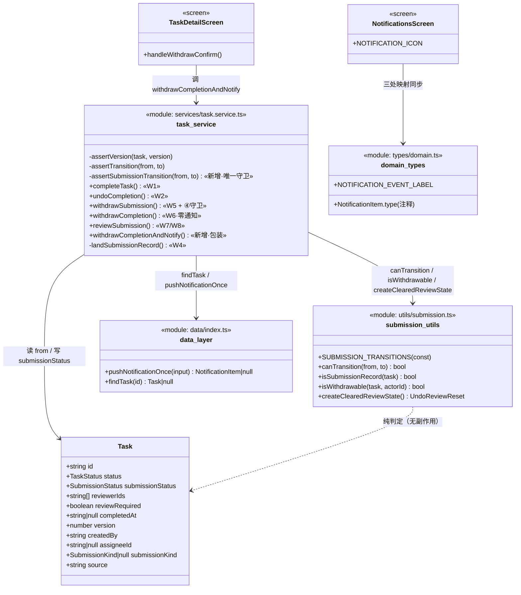
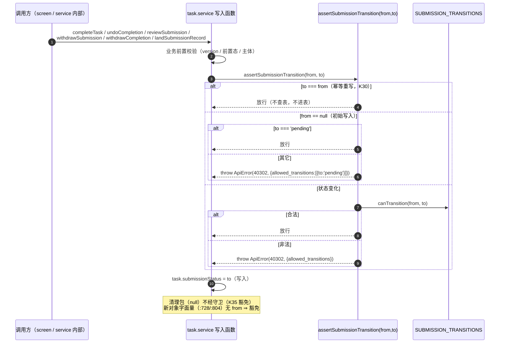
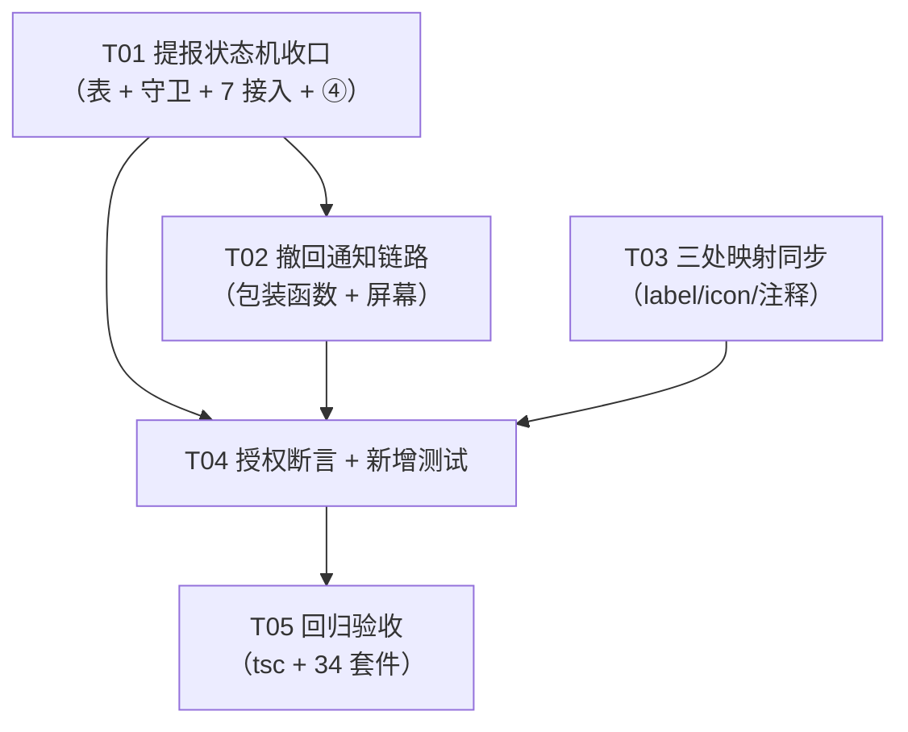

# ARCH（增量 5）— OpenSchedule 移动端：提报 / 审核闭环补完

> 档位：**增量架构 + 任务分解**（只写变更）· 架构师：**高见远（Gao）** · 基线：`PRD-mobile-increment-5.md` **v1.0** · `ARCH-mobile-increment-4.md`（K19~K26）· `ARCH-mobile-increment-3.md`（K13~K18）· `ARCH-mobile-increment-2.md`（K1~K12）
> 交付路径：`apps/mobile` · 硬约束：Expo 57 / RN 0.86.3 / React 19 / TS 6 / React Navigation 7；**零新增依赖**；禁 `reanimated` / `gesture-handler`；禁 `pnpm`（用 `npm` / `npx`）。
> **回归基线（开工前实测复核，本文写作时亲跑）**：`npx tsc --noEmit` ⇒ **exit 0**；`npx jest --config jest.config.js` ⇒ **33 套件 / 586 用例全部通过**（与主理人给定基线**逐字一致**）。
> **范围（用户拍板 = 四件事）**：① 撤回通知（新增）② K15 冲突（维持现状、只写清楚）③ `SUBMISSION_TRANSITIONS` 死表收口为真守卫 ④ `withdrawSubmission` 加守卫。
> **主理人裁定（直接生效）**：(1) **追加授权** `tests/increment4-qa.test.ts:511-521`（与 `tests/submission-flow.test.ts:76` 同向锁定，只改这两处 expect，其余一字不改）；(2) **认可 PM 的包装函数方案 R6-1**（新增 `withdrawCompletionAndNotify`，`withdrawCompletion` 保持零通知，K24 **收敛边界、不废止**）。

---

## 0. TL;DR

本增量共 **4 件产品事**，落到源码为 **3 处新增行为 + 1 处纯注释口径**，其余全部是**声明式映射**与**新增独立测试**：

| # | 行为变更 | 位置 | 性质 |
| --- | --- | --- | --- |
| **B1** | 新增 `withdrawCompletionAndNotify`（撤回**成功后**向撤回**前**全部审核人各派发 1 条 `review.withdrawn`，未读级去重）；**屏幕改调它** | `services/task.service.ts`（新增函数）+ `screens/TaskDetailScreen.tsx:296` | 新增包装入口；`withdrawCompletion` **函数体零改动** |
| **B2** | `withdrawSubmission` 增加 `isSubmissionRecord` 前置守卫（非法主体抛 **40302**，文案 `该入口仅用于撤回新事项提报`） | `services/task.service.ts:911-919` | **纯加固**（唯一调用点数据源已过滤 ⇒ 用户不可达） |
| **B3** | `SUBMISSION_TRANSITIONS` 修正为**实读反推的真实可写入集合**；新增 `assertSubmissionTransition` 并使 `canTransition` 成为 `submissionStatus` 写入的**唯一守卫**（7 处赋值点全接入） | `utils/submission.ts:19-25` + `services/task.service.ts`（新增本地 helper + 7 处接入） | 表修正对运行时**零影响**（原为死表）；守卫接入对既有 7 条链路**零回归**（逐条放行） |
| **B4** | `domain.ts:98` 通知类型注释补成**完整 8 项清单**（单行、保留既有子串） | `types/domain.ts:98` | **纯注释**（零行为变更） |

**声明式新增（无既有行为影响）**：`NOTIFICATION_EVENT_LABEL['review.withdrawn']='撤回提醒'`（`types/domain.ts:125-133`）、`NOTIFICATION_ICON['review.withdrawn']='corner-up-left'`（`screens/NotificationsScreen.tsx:24-32`）。

**关键实读结论（本 ARCH 的裁决依据，行号级证据见 §3）**：

1. 🔴 **【本 ARCH 新发现，主理人 / PM 均未指出】包装函数 `withdrawCompletionAndNotify` 的定义位置是硬约束** —— 全仓有 **2 处源码切片断言**（`increment4-qa.test.ts:551-554`、`increment4-withdraw.test.ts:342-345`）以 `slice(indexOf('export async function withdrawCompletion'), indexOf('export async function reviewSubmission'))` 取「`withdrawCompletion` 函数体」并断言 **`not.toContain('pushNotification')`**。若把包装函数插在 `withdrawCompletion` 与 `reviewSubmission` **之间**，包装函数体会**落入该切片**（含 `pushNotificationOnce`，其**包含子串** `pushNotification`）⇒ **L1 / L2 必然失败**。**⇒ 铁律 K38：包装函数必须定义在 `reviewSubmission` 之后。** 见 §3.1 / §7。
2. ✅ **PM 的双重时序陷阱属实，且我收敛为「同一次清理前快照」的两处落点** —— `reviewerIds`（包装函数内，调用 `withdrawCompletion` 之前）与 `submissionStatus` 的 `from`（`withdrawCompletion` 内，`applyClearedReviewState` **之前**）都必须在清理前取；后者若放在「紧邻赋值」的天然位置（清理**之后**）会读到 `null` ⇒ 守卫误抛 40302。**但 K22（校验在写入之前）要求守卫置于 `applyClearedReviewState` 之前** ⇒ 守卫与赋值之间存在 `applyClearedReviewState` 一行，AC-14 的「紧邻前文」须用**窗口判定**（见 §4.4 / §11-A2）。
3. ✅ **④ 零回归面成立**（实读复核）：`submission-flow.test.ts:240-263` 三条用例的记录均由 `submitItem` 生成（`isSubmissionRecord === true`）⇒ 越过新守卫；`increment4-qa.test.ts:598-605` 只 `toContain('task.createdBy !== actorId')` / `toContain("task.status = 'cancelled'")` ⇒ 新增守卫**不移除**这两行；`seed-submissions.test.ts` **完全不调用** `withdrawSubmission`。
4. ✅ **③ 的授权改动面 = 2 处 expect / 2 个文件**，且**仅** `approved→pending` 一条结论变错：实读证明 `submission-flow.test.ts:73-79` 的其余 6 条非法断言在表修正后**仍全为假**（见 §9 边界清单）。
5. ✅ **`Feather.json` 实有 287 字形，`corner-up-left` 存在**（亲跑 `node` 校验）；`undo` / `redo` / `reply` / `ban` / `arrow-uturn-left` **不存在**。`NOTIFICATION_EVENT_LABEL` **实有 7 项**，`NOTIFICATION_ICON` **实有 7 项**，`domain.ts:98` 注释**实列 5 项**（缺口 2，本次补齐后缺口 0）。
6. ✅ **`apiError` 在 `src/utils/` 内零使用** ⇒ `assertSubmissionTransition`（抛 `ApiError`）应落 **service 层**，镜像既有本地 `assertVersion` / `assertTransition`（`task.service.ts:96-110`），保持 `utils/` 纯净（K33 派生约定）。

**产出规模**：源码 **修改 5 个文件 / 新增 0 个**；测试 **修改 2 个文件（仅授权处）/ 新增 1 个独立文件**；**依赖包零新增**；共享知识 **K27~K38**。

---

## 1. 变更点清单（文件 → 改什么 → 为什么）

| # | 文件（相对 `apps/mobile/`） | 改什么（精确定位） | 为什么 | 零行为变更？ |
| --- | --- | --- | --- | --- |
| **C1** | `src/utils/submission.ts` | `SUBMISSION_TRANSITIONS:19-25`：`approved: []` → `['pending']`；`rejected: ['draft']` → `['draft','pending']`；`withdrawn: ['draft']` → `['draft','pending']`（**表修正**，R6-3） | `M6-P0-06` / R6-3：表必须等于**实读反推的真实可写入集合**（`approved→pending` = `TodayFocusScreen.tsx:264`；`rejected→pending` = `increment2-completion.test.ts:298-305`；`withdrawn→pending` = 撤回后重新完成提报） | **是（对运行时零影响）**：`canTransition` 在 `src/` 内**零运行时调用**（死表）；仅影响 `tests/` 的 2 处断言（见 §9 授权清单） |
| **C2** | `src/services/task.service.ts` | ① 顶部 `@/utils/submission` 导入补 `canTransition` / `SUBMISSION_TRANSITIONS`；`@/types` 导入补 `SubmissionStatus`；② 紧随 `assertTransition:110` 之后新增本地 `assertSubmissionTransition(from, to)`（**唯一守卫**，R6-4 / K30）；③ **7 处赋值点**接入守卫（`:345` `:431` `:850` `:920` `:985` `:1026` `:1057`）；④ `withdrawSubmission` 加 `isSubmissionRecord` 守卫（④ / R6-5）；⑤ 新增 `withdrawCompletionAndNotify`（**必须置于 `reviewSubmission` 之后**，K38） | `M6-P0-07`（守卫收口）/ `M6-P0-05`（④ 守卫）/ `M6-P0-01`（① 包装函数）；三层职责：表（C1）→ 守卫（②③）→ 通知包装（⑤） | **③ 否（新增 1 处行为）**；②③ 对既有 7 链路**零回归**（逐条放行）；① 新增通知行为 |
| **C3** | `src/screens/TaskDetailScreen.tsx` | `handleWithdrawConfirm:296` 由 `taskService.withdrawCompletion(...)` 改调 **`taskService.withdrawCompletionAndNotify(...)`**（签名同形，仅换函数名） | `M6-P0-01` / R6-1 / Q6-18：屏幕是**产品入口**，必须调包装函数（否则 ① 失效）；实读确认该行**无任何断言锁定**（`increment4-qa.test.ts:643` / `increment4-withdraw.test.ts:310` 只切片 `runTransition`，`:296` 在其**之后**） | 否（改调用目标，入参/返回/错误码逐字不变） |
| **C4** | `src/types/domain.ts` | ① `NOTIFICATION_EVENT_LABEL:125-133` 追加 `'review.withdrawn': '撤回提醒'`；② `:98` 注释补成**完整 8 项清单**（单行） | `M6-P0-04`（三处映射同步第 ① 处）+ R6-8（注释补全）；`NOTIFICATION_EVENT_LABEL` 实有 7 项，注释实列 5 项 ⇒ 本次补齐缺口 | ① 否（声明式新增，无既有行为影响）；② **是**（纯注释） |
| **C5** | `src/screens/NotificationsScreen.tsx` | `NOTIFICATION_ICON:24-32` 追加 `'review.withdrawn': 'corner-up-left'` | `M6-P0-04`（三处映射同步第 ② 处）；图标合法性由 `Record<string, keyof typeof Feather.glyphMap>` 强类型 + `tsc` 兜底（实读校验 `corner-up-left` ∈ 287 字形） | 否（声明式新增；未知类型原走 fallback `'bell'`，现新增显式项） |
| **C6** | `tests/submission-flow.test.ts`（**修改，授权**） | `:76` `expect(canTransition('approved','pending')).toBe(false)` → **`.toBe(true)`** | 表修正后该期望值**变错**（R6-6）；主理人裁定 (1) **授权** | 否（测试断言，**逐条 before→after 见 §9**） |
| **C7** | `tests/increment4-qa.test.ts`（**修改，授权**） | `:512-518` 整表 `toEqual` 的 3 个值（`approved` / `rejected` / `withdrawn`）+ `:520` `canTransition('approved','pending')` 的 `.toBe(false)` → **`.toBe(true)`**（共 **2 条 expect**） | 同上（R6-7 + 主理人裁定 (1) **追加授权**）；`:519` `canTransition('pending','withdrawn')` **不动** | 否（测试断言，**逐条 before→after 见 §9**） |
| **C8** | `tests/increment5-closure.test.ts`（**新增**） | ① 撤回+通知链路（AC-01/02/03/04/05）；② ③ 迁移表+守卫（AC-10~AC-14）；③ ④ 守卫（AC-08/09）；④ `withdrawn→pending` 覆盖（AC-15）；⑤ ② 口径锚点（AC-16/17）；⑥ **K38 位置断言**（包装函数不在受保护切片内） | R6-10：新用例一律写**独立新文件**（K11 精神）；既有 33 套件**一字不改**（除 C6/C7 授权处） | 否（新增测试文件） |
| — | `src/types/task.ts`、`src/data/seed.ts`、`src/data/seed-extra.ts`、`src/data/index.ts`、`src/services/index.ts`、`src/utils/focus.ts`、`src/components/*`、`src/navigation/*`、`src/theme/*`、`package.json`、`tsconfig.json`、`jest.config.js` | **零变更** | ① `TASK_TRANSITIONS` / `TASK_TRANSITION_ACTIONS` 禁改（K21 / K25，N5）；② 种子禁改（N6，`seed-integrity` / `seed-submissions` 锁定）；③ `services/index.ts` 无需改（`export * as taskService` 自动带出新函数，**无新类型**）；④ 零新增依赖（N9）；⑤ `utils/focus.ts` 本增量**不触碰**（② 的注释落在 `task.service.ts`） | — |

---

## 2. 实现方案总览

### 2.1 一句话

在**不引入任何新框架、不改任何既有函数行为、除 2 处授权断言外不改任何既有测试**的前提下：**修正一张说谎的死表**（`SUBMISSION_TRANSITIONS`）并让它**成为唯一守卫**（新增 `assertSubmissionTransition` + 7 处接入）；**新增一个包装函数** `withdrawCompletionAndNotify`（迁移 + 通知，`withdrawCompletion` 保持零通知，**K24 收敛不废止**）并让**屏幕唯一调用点改调它**；给 `withdrawSubmission` **补一个前置守卫**；把 ② 的口径冲突**只写清楚**（注释级，零行为变更）。

### 2.2 框架 / 分层选型说明（**本增量不引入任何新框架**）

| 维度 | 选型 | 说明 |
| --- | --- | --- |
| 框架 | **无新增** | 沿用 Expo 57 / RN 0.86.3 / React 19 / TS 6 / React Navigation 7 |
| 状态管理 | **无新增** | 沿用既有 `AppProvider` + `useAsync` / `useAuth`（屏幕仅换一个调用目标） |
| UI 组件 | **无新增** | 复用既有 `BottomSheet` / `Toast`（`TaskDetailScreen` 撤回确认抽屉**已存在**，本次**不改 UI 结构**，只换调用目标） |
| 通知机制 | **无新增** | 复用既有 `pushNotificationOnce`（`data/index.ts:175-188`）与三处映射约定（增量 3 K17） |
| 依赖 | **零新增** | 见 §6（显式声明为空） |
| 分层落点 | 纯判定 → `utils/`（表）；**守卫 → service 本地**（镜像 `assertTransition`）；写入 → `services/`；页面编排 → `screens/` | 与 `ARCH-mobile.md §10` 及增量 2/3/4 完全一致 |

### 2.3 分层落点

| 层 | 落点 | 内容 |
| --- | --- | --- |
| **纯工具层** | `utils/submission.ts` | `SUBMISSION_TRANSITIONS` 修正（**唯一表**；`canTransition` 保持不变，**不新增函数**） |
| **服务层（守卫）** | `services/task.service.ts` | 本地 `assertSubmissionTransition(from, to)`（**唯一守卫入口**，抛 40302）+ 7 处写入接入 + `withdrawSubmission` 主体守卫 |
| **服务层（通知）** | `services/task.service.ts` | `withdrawCompletionAndNotify`（**包装**：快照 → 迁移 → 派发；**置于 `reviewSubmission` 之后**，K38） |
| **类型层** | `types/domain.ts` | `NOTIFICATION_EVENT_LABEL` 新增项 + `:98` 注释补全 |
| **页面层** | `screens/TaskDetailScreen.tsx` | 撤回调用点改调包装函数（1 行） |
| **页面层** | `screens/NotificationsScreen.tsx` | `NOTIFICATION_ICON` 新增项 |
| **测试层** | `tests/increment5-closure.test.ts`（新） | ①③④ 全链路 + ② 锚点 + K38 位置断言 |
| **测试层** | `tests/submission-flow.test.ts` / `tests/increment4-qa.test.ts` | **仅授权 2 处 expect**（§9） |

> **不动的层**：`types/task.ts`、`data/`（含种子）、`theme/`、`components/`、`navigation/`、`services/index.ts`、`services/focus.service.ts`、`utils/focus.ts`、`utils/permission.ts`、`utils/date.ts`。

### 2.4 三条链路的职责边界（本增量核心，固化 K33）

| 函数 | 层级 | 职责 | 是否通知 | 谁可调 |
| --- | --- | --- | --- | --- |
| `withdrawCompletion(taskId, input)` | **纯状态迁移**（既有，**函数体零改动**） | `assertVersion` → `pending` 门禁 → `isWithdrawable` → `done?in_progress` → 清理 + 覆写 `withdrawn` | **零通知**（K24，被 L1~L4 锁定） | **测试**（4 套件直调）/ 包装函数（内部组合）；**屏幕禁止直调** |
| `withdrawCompletionAndNotify(taskId, input)` | **包装（迁移 + 副作用）** | 快照 `reviewerIds` → 调 `withdrawCompletion` → 成功后逐人 `pushNotificationOnce('review.withdrawn')` | 有（**唯一派发点**） | **屏幕唯一产品入口**（`TaskDetailScreen.tsx:296`） |
| `withdrawSubmission(taskId, version, actorId)` | **纯状态迁移**（既有） | `assertVersion` → **`isSubmissionRecord` 守卫（新）** → `createdBy` 主体 → `pending` 门禁 → 归档 `cancelled` | 零通知（既有） | `MySubmissionsScreen.tsx:98` |

> **组合关系**：包装函数 = `withdrawCompletion`（纯迁移）+ 通知副作用。**不是**为绕测试而造的 API（R6-1 论证见 §4.2）。

---

## 3. 现状复核与关键证据（行号级）

### 3.1 🔴 源码切片陷阱（本 ARCH 新发现，决定 K38）

**事实**：全仓有 **2 处**以「函数名切片」取 `withdrawCompletion` 函数体的源码断言：

| # | 位置 | 切片 | 断言 |
| --- | --- | --- | --- |
| **L1** | `tests/increment4-qa.test.ts:551-554`（断言在 `:569-572`） | `taskSrc.slice(indexOf('export async function withdrawCompletion'), indexOf('export async function reviewSubmission'))` | `not.toContain('pushNotification')` / `not.toContain('db.notifications')` |
| **L2** | `tests/increment4-withdraw.test.ts:342-345`（断言在 `:351-354`） | 同上（同一对标记） | 同上 |

**推论**：该切片的**终止标记**是 `'export async function reviewSubmission'`。若把 `withdrawCompletionAndNotify` 插在 `withdrawCompletion` 与 `reviewSubmission` **之间**，则：

- 切片**包含包装函数体**；
- 包装函数体含 `pushNotificationOnce(...)`；
- `'pushNotificationOnce'` **包含子串** `'pushNotification'`（PRD §3.1 已指出）；
- ⇒ `expect(withdrawBody).not.toContain('pushNotification')` **失败**（L1 与 L2 同时失败）。

**⇒ 铁律 K38**：`withdrawCompletionAndNotify` **必须**定义在 `reviewSubmission` **之后**（本 ARCH 裁定：置于 `reviewSubmission` 与 `listScheduledTasks` 之间）。**禁止**插在 `withdrawCompletion` 与 `reviewSubmission` 之间。

> **复核**：实读确认 `reviewSubmission` 在全仓仅作**切片终止标记**出现，**无任何切片以它为起点**（`grep indexOf('export async function reviewSubmission')` 零命中）⇒ 置于其后**不会**落入任何其它切片。同时 `increment4-qa.test.ts:599-601` 的 `withdrawSubmission` 切片（`[withdrawSubmission, 'export interface WithdrawCompletionInput')`）与 `increment3-dedup-notify.test.ts:441-444` 的 `undoCompletion` 切片（`[undoCompletion, '/** 评论列表 */')`）均在文件**更早**位置，**不受影响**。

### 3.2 ② K15 口径归因（维持现状的实读依据）

| 证据 | 行号 | 内容 |
| --- | --- | --- |
| `listTodayDue` 过滤链 | `task.service.ts:174-182` | `dueAt !== null` → `toDateKey===today` → `status !== 'cancelled'` → **`status !== 'done'`（`:178`）** → **`submissionStatus !== 'pending'`（`:179`）** → `!isSubmissionRecord(task)` |
| 关键归因 | `:178` vs `:179` | `:178` 已排除**全部** `done` ⇒ `:179` 的**唯一实际效果** = 排除「**非 `done` 的 `pending`**」= **审核轮回态**。**它不是冗余，是增量 3 消除 `task-014` 重复计数的唯一手段** |
| 种子 `task-014` | `seed.ts:434-457` | `status='in_progress'`（**非 done**）、`submissionStatus='pending'`、`reviewerIds=['user-001']`、`assigneeId='user-002'`（李娜）、`createdBy='user-001'`（`makeTask:183` 默认）、`dueAt=demoDayAt(0,19,0)`（**今天**） |
| 种子 `task-015` | `seed.ts:458-479` | 同上，`assigneeId='user-003'`（王强）、`dueAt=demoDayAt(0,17,0)`（**今天**） |
| 冲突只存在于两函数间 | `listDeadlineApproaching:211-217` | 只排除 `done`/`cancelled` + 提报记录，**不排除 `pending`**（K15 有意差异） |

**⇒ ② 维持现状**：放行审核轮回态会**立即**打破 **6 处**受保护断言（A1 `increment4-qa.test.ts:620-628`；A2/A3/A4 `increment3-dedup-notify.test.ts:172-204`；A5/A6 `increment3-qa.test.ts:121/:194-195`），其中 A4（「今日到期 ∩ 待我审核 交集为空」）即**重复计数回归**。**本增量只补注释**（`M6-P1-02` / AC-17），零行为变更。

### 3.3 ③ 真实可写入集合（反推，逐条实读）

| `from` | 可写 `to` | 实读依据（行号） |
| --- | --- | --- |
| （无 / 初始） | `'pending'` | W1 `completeTask:345`（`from = undefined`，如 `task-004`） |
| `pending` | `'approved'` | W4 `landSubmissionRecord:850`、W7 `reviewSubmission:1026` |
| `pending` | `'rejected'` | W8 `reviewSubmission:1057` |
| `pending` | `'withdrawn'` | W5 `withdrawSubmission:920`、W6 `withdrawCompletion:985` |
| `pending` | `'pending'`（幂等重写） | W1 on `task-014`（`seed.ts:434-457`，`in_progress + pending`） |
| `approved` | `'pending'` | W2 `undoCompletion:431`（`TodayFocusScreen.tsx:264` + 5 个测试调用点） |
| `rejected` | `'pending'` | W1（`increment2-completion.test.ts:298-305`） |
| `withdrawn` | `'pending'` | W1（撤回后重新完成提报） |
| 任意 | `null`（复位） | 清理包（**不经表**，豁免） |
| — | `'draft'` / `'published'` | **全仓 `src/` 内零写入** ⇒ 仅类型预留（`landSubmissionRecord:850` 写的是 `'approved'`） |

### 3.4 ④ `withdrawSubmission` 影响面（实读，零回归证明）

| 断言 | 位置 | 加守卫后 | 结论 |
| --- | --- | --- | --- |
| 非本人撤回 ⇒ 40302 | `submission-flow.test.ts:240-245` | 记录 `isSubmissionRecord===true` ⇒ 越过新守卫 ⇒ 仍 40302 | ✅ 不受影响 |
| 本人撤回成功 ⇒ `withdrawn` + `cancelled` | `:247-255` | 同上 ⇒ 语义不变 | ✅ 不受影响 |
| 非 pending 不可撤回 ⇒ 40302 | `:257-263` | 同上 ⇒ 仍 40302 | ✅ 不受影响 |
| 源码级：体含 `task.createdBy !== actorId` 与 `task.status = 'cancelled'` | `increment4-qa.test.ts:598-605` | 新增守卫**不移除**这两行 | ✅ 不受影响 |
| `seed-submissions.test.ts` | 全文 | **完全不调用** `withdrawSubmission` | ✅ 不受影响 |

---

## 4. 数据结构与接口

### 4.1 `SUBMISSION_TRANSITIONS`（修正后，唯一表）

```ts
// src/utils/submission.ts:19-25（修正）
/** 提报状态机迁移表（PRD §6 / 增量 5 R6-3）：**表即契约**，等于实读反推的真实可写入集合。
 *  'draft' / 'published' 为**类型预留**（运行时零写入）；表中**不含自环**（幂等重写由守卫放行，K30）。 */
export const SUBMISSION_TRANSITIONS = {
  draft: ['pending', 'published'],      // 保持（类型预留）
  pending: ['approved', 'rejected', 'withdrawn'],
  approved: ['pending'],                // 修正：原 [] 与 TodayFocusScreen.tsx:264 矛盾
  rejected: ['draft', 'pending'],       // 修正：原 ['draft'] 缺 pending
  withdrawn: ['draft', 'pending'],      // 修正：原 ['draft'] 缺 pending
} as const
```

> `canTransition(from, to)`（`:83-87`）**保持不变**（**不新增函数**）；守卫逻辑落在 service 层本地 helper。

### 4.2 包装函数 `withdrawCompletionAndNotify`（新增，**置于 `reviewSubmission` 之后**）

```ts
// src/services/task.service.ts（新增；位置：reviewSubmission 之后、listScheduledTasks 之前 —— K38）

/**
 * 撤回「完成提报」并通知审核人（M6-P0-01）：**产品唯一入口**（K33）。
 *
 * 分层（K33）：`withdrawCompletion`（纯状态迁移、**零通知**，K24）→ 本包装（迁移 + 通知副作用）。
 * 时序（K28 / K34，双重快照陷阱）：
 *   ① `reviewerIds` **必须在调用 `withdrawCompletion` 之前**快照 —— 其内部 `applyClearedReviewState`
 *      会把 `reviewerIds` 置 `[]`（`task.service.ts:984`），调用后读取必为空；
 *   ② `submissionStatus` 的 `from` 在 `withdrawCompletion` 内部于清理**之前**快照（见 §4.3 W6）。
 * 派发时机：**仅撤回成功后**（先迁移后派发）⇒ 失败（40302/40901）**零通知、零副作用**（INV-3）。
 * 接收人来源 = `task.reviewerIds`（与 `listPendingReview:190-203` 的可见性判定同源，K18）。
 * 写入器 = `pushNotificationOnce`（未读级去重：`userId`+`type`+`data.taskId`，未读判定 `readAt===null`，K29）。
 */
export async function withdrawCompletionAndNotify(
  taskId: string,
  input: WithdrawCompletionInput,
): Promise<Task> {
  if (USE_MOCK) {
    await simulateLatency()
    const task = findTask(taskId)
    if (!task) throw new ApiError(40401, '任务不存在或不可见')

    // ① 快照：必须在 withdrawCompletion 的清理之前（K28 / K34）
    const reviewerIds = [...(task.reviewerIds ?? [])]

    // ② 先迁移（失败即抛出 ⇒ 零通知、零副作用）
    const updated = await withdrawCompletion(taskId, input)

    // ③ 后派发：撤回前全部审核人各 1 条（未读级去重，K29）
    for (const reviewerId of reviewerIds) {
      pushNotificationOnce({
        userId: reviewerId,
        type: 'review.withdrawn',
        title: '提报已撤回',
        body: `「${updated.title}」的完成提报已被提报人撤回，无需审核`,
        data: { taskId },
      })
    }
    return updated
  }
  // TODO(real-api): POST /tasks/:taskId/submissions/withdraw-completion  body: { version, actorId, reason, notify: true }
  return httpClient.post<Task>(`/tasks/${taskId}/submissions/withdraw-completion`, {
    ...input,
    notify: true,
  })
}
```

> **签名裁定**：复用既有 `WithdrawCompletionInput`（`{ version, actorId, reason? }`），**不新增类型** ⇒ `services/index.ts` **无需改**。AC 中 `withdrawCompletionAndNotify('task-014', { version, actorId:'user-002' })` 逐字段等价。

### 4.3 守卫 `assertSubmissionTransition`（新增本地 helper）+ 7 处接入

```ts
// src/services/task.service.ts（新增；紧随 assertTransition:96-110 之后，镜像其姿势）

/**
 * 提报状态迁移守卫（M6-P0-07 / R6-4 / K30 / K35）：**`submissionStatus` 写入的唯一守卫**。
 * 非法迁移抛 40302（`ERR_SUBMISSION_FORBIDDEN`，`details.allowed_transitions`）。
 *
 * 放行规则：
 * - `to === from`（幂等重写）⇒ 放行（**不是迁移**，不进表）；
 * - `from == null`（初始写入）⇒ **仅放行 `'pending'`**（唯一初始值）；
 * - 其余 ⇒ 查 `SUBMISSION_TRANSITIONS`（表即契约）。
 * 豁免（**不调用本守卫**）：清理包（`submissionStatus: null`，复位 ≠ 迁移）、
 *   新对象字面量（`insertTask:728` / `buildSubmissionRecord:804`，无 `from`）。
 */
function assertSubmissionTransition(from: Task['submissionStatus'], to: SubmissionStatus): void {
  if (to === from) return
  if (from == null) {
    if (to === 'pending') return
    throw new ApiError(ERR_SUBMISSION_FORBIDDEN, '提报状态迁移不被允许', {
      allowed_transitions: [{ to: 'pending' }],
    })
  }
  if (!canTransition(from, to)) {
    const allowed = SUBMISSION_TRANSITIONS[from] ?? []
    throw new ApiError(ERR_SUBMISSION_FORBIDDEN, '提报状态迁移不被允许', {
      allowed_transitions: allowed.map((target) => ({ to: target })),
    })
  }
}
```

**7 处接入（逐条给出「紧邻前文」写法）**：

| # | 行号 | 函数 | 接入写法（守卫置于赋值之前） | `from` 实读 | 结果 |
| --- | --- | --- | --- | --- | --- |
| **W1** | `:345` | `completeTask` | `assertSubmissionTransition(task.submissionStatus, 'pending')` 紧邻其上一行 | `undefined` / `null` / `'rejected'` / `'pending'` / `'withdrawn'` | 全部放行（初始写入 / 幂等 / `rejected→pending` / `withdrawn→pending`） |
| **W2** | `:431` | `undoCompletion` | `if (input.submissionStatus !== null) assertSubmissionTransition(task.submissionStatus, input.submissionStatus)`（**仅 `to !== null`**） | `'approved'` | 放行（`approved→pending`）；`null` 分支**不调用**（复位豁免） |
| **W4** | `:850` | `landSubmissionRecord` | `assertSubmissionTransition(record.submissionStatus, 'approved')` | `'pending'` | 放行 |
| **W5** | `:920` | `withdrawSubmission` | `assertSubmissionTransition(task.submissionStatus, 'withdrawn')` | `'pending'`（`:917` 门禁） | 放行 |
| **W6** | `:985` | `withdrawCompletion` | **先** `const fromSubmissionStatus = task.submissionStatus`（**在 `:984` 清理之前**）→ `assertSubmissionTransition(fromSubmissionStatus, 'withdrawn')`（**在 `applyClearedReviewState` 之前，K22**）→ `applyClearedReviewState(task)` → `task.submissionStatus = 'withdrawn'` | `'pending'`（`:968` 门禁保证） | 放行（`pending→withdrawn`） |
| **W7** | `:1026` | `reviewSubmission`（approve·completion） | `assertSubmissionTransition(task.submissionStatus, 'approved')` | `'pending'` | 放行 |
| **W8** | `:1057` | `reviewSubmission`（reject） | `assertSubmissionTransition(task.submissionStatus, 'rejected')` | `'pending'` | 放行 |

> ⚠️ **W6 的 K22 vs AC-14「紧邻前文」张力**（§11-A2）：守卫**必须**在 `applyClearedReviewState`（写入）之前（K22「校验在写入之前」），故 W6 的守卫与赋值之间隔着 `applyClearedReviewState(task)` 一行。AC-14 的「紧邻前文」用**前 200 字符窗口**判定（见 §4.4），W6 通过。**禁止**为凑字面邻接而把守卫挪到清理之后（会读到 `null` ⇒ 误抛 40302）。

### 4.4 AC-14 源码计数（唯一入口）判定式（写进 `tests/increment5-closure.test.ts`）

```ts
const src = readFileSync(resolve(__dirname, '../src/services/task.service.ts'), 'utf8')
// 赋值语句（排除 `===` / `!==` 比较）：`submissionStatus = <非=字符>`
const assignments = [...src.matchAll(/submissionStatus = [^=]/g)]
expect(assignments).toHaveLength(7)                                  // 7 处赋值语句
for (const m of assignments) {
  const window = src.slice(Math.max(0, m.index! - 200), m.index!)    // 前 200 字符窗口
  expect(window).toContain('assertSubmissionTransition(')            // 紧邻前文含守卫调用
}
// 反向：清理路径（applyClearedReviewState）不含守卫调用
const applyBody = src.slice(
  src.indexOf('function applyClearedReviewState'),
  src.indexOf('/** 我的待办'),
)
expect(applyBody).not.toContain('assertSubmissionTransition(')
```

> **正则已实读校准**：`/submissionStatus = [^=]/g` 在 `task.service.ts` 中**恰好命中 7 次**（7 处赋值）；`:196` 的 `submissionStatus === 'pending'`（比较）与 `:158`/`:179`/`:917`/`:968` 的 `!==` **均不命中**（`===` 后无空格 ⇒ 模式不匹配）。对象字面量 `:728` / `:804` 用 `:` 亦不命中。

### 4.5 类图（依赖关系）



---

## 5. 程序调用流程

### 5.1 时序图 A —— 撤回 + 通知链路（①）

```mermaid
sequenceDiagram
  autonumber
  participant U as 提报人(李娜)
  participant S as TaskDetailScreen
  participant W as taskService.withdrawCompletionAndNotify
  participant C as taskService.withdrawCompletion
  participant DB as db(内存库)

  U->>S: 点「撤回提报」→ 二次确认抽屉 → 确定
  S->>W: withdrawCompletionAndNotify(taskId, {version, actorId})
  W->>DB: findTask(taskId)
  DB-->>W: task
  Note over W: ① 快照 reviewerIds（K28/K34）<br/>const reviewerIds = [...(task.reviewerIds ?? [])]
  W->>C: withdrawCompletion(taskId, input)（内部组合）
  C->>DB: assertVersion(40901) → pending 门禁(40302) → isWithdrawable(40302)
  Note over C: ② 快照 fromSubmissionStatus（K28/K34）<br/>必须在 applyClearedReviewState 之前
  C->>C: assertSubmissionTransition(from,'withdrawn')（K30）
  C->>DB: applyClearedReviewState(task) ⇒ reviewerIds=[]
  C->>DB: task.submissionStatus='withdrawn'; version+=1; pushAudit(...)
  C-->>W: {...task}
  alt 撤回成功
    loop 撤回前每位审核人（reviewerIds 快照）
      W->>DB: pushNotificationOnce({type:'review.withdrawn', data:{taskId}})
      Note over DB: 未读级去重（readAt===null）
    end
    W-->>S: updated task
    S->>U: Toast「已撤回提报」+ detail.refetch()
  else 撤回失败（40302 / 40901）
    C-->>W: throw ApiError
    W-->>S: throw（**零通知 / 零 audit / 零字段变更**）
    S->>U: Toast 错误文案 + detail.refetch()
  end
```

### 5.2 时序图 B —— `submissionStatus` 写入守卫链路（③）



---

## 6. 依赖包列表

**预期「零新增」—— 确认：`依赖包列表 = 空`。**

| 项 | 结论 | 依据 |
| --- | --- | --- |
| 新增运行时依赖 | **无** | 仅用既有模块（`@/services` / `@/utils` / `@/types` / `@/data`）与 JS 内建 |
| 新增开发依赖 | **无** | 测试沿用既有 `jest-expo` + `node:fs` / `node:path`（既有用例已在用） |
| `package.json` | **不动** | 无 `dependencies` / `devDependencies` 变更 |
| 锁文件 | **不动** | 无依赖树变化（`npm`；**不使用 `pnpm`**） |
| 新引入的库 | **无** | 不引入 `lodash` / `date-fns` / 任何状态库 / `reanimated` / `gesture-handler` |

> **验收判据**：`npx tsc --noEmit` **0 error**；全量测试**全绿**；`package.json` **零新增依赖**。

---

## 7. 共享知识 / 铁律（K27 ~ K38）

> **声明**：`ARCH-mobile-increment-2.md` §7 的 **K1~K12**、`ARCH-mobile-increment-3.md` §7 的 **K13~K18**、`ARCH-mobile-increment-4.md` §7 的 **K19~K26** **全部继续有效**，本次**不废止**任何一条。以下 **K27~K32 采纳 `PRD-mobile-increment-5.md` §9 的建议编号并正式化**；**K33~K38 为本次 ARCH 新增**（覆盖主理人点名的 5 项 + 本 ARCH 新发现的 1 项）。**K27 是对 K24 的边界收敛（不废止 K24）。**
>
> **K11 落点规则的现状**：新用例一律写**独立新文件**（增量 3 `M4-P1-01` 取代 K11 落点）；K11 的**实质精神（禁止改动既有套件的任何断言）继续有效**。本增量新用例落在 `tests/increment5-closure.test.ts`。

| # | 规则 | 说明 |
| --- | --- | --- |
| **K27** | **撤回通知的唯一派发点 = `withdrawCompletionAndNotify`**。`withdrawCompletion` **函数体继续零通知**（K24 边界收敛为「**该函数体**」而非「撤回动作」）。 | 禁止在 `withdrawCompletion` 内出现 `pushNotification` / `pushNotificationOnce` / `db.notifications`（`increment4-qa.test.ts:569-572` / `increment4-withdraw.test.ts:351-354` 锁定）。 |
| **K28** | **双重时序陷阱：接收人快照与 `from` 快照都必须在审核态清理之前捕获。** `const reviewerIds = [...(task.reviewerIds ?? [])]`（包装函数内，调 `withdrawCompletion` 之前）与 `submissionStatus` 的 `from`（`withdrawCompletion` 内，`applyClearedReviewState` 之前）**两处都不得在清理之后读取**。 | `applyClearedReviewState`（`task.service.ts:984`）把 `reviewerIds` 置 `[]`、`submissionStatus` 置 `null` ⇒ 清理后读取必然失真（接收人退化为空 / 守卫读到 `null` 误抛 40302）。来源 = `task.reviewerIds`（K18 同源）。 |
| **K29** | **撤回通知的写入器 = `pushNotificationOnce`**（未读级去重：`userId` + `type` + `data.taskId`；未读判定 = **`readAt === null`**）。 | 与增量 3 Q4-2 / Q4-7 一致。**禁止**用 `status === 'sent'` 判未读。 |
| **K30** | **`submissionStatus` 的每一次状态变化都必须经 `assertSubmissionTransition` 放行**（7 处赋值点）；**豁免** = 清理包（`null`）、新对象字面量、`to === from`（幂等重写）。 | `to === from` 放行的**唯一**理由：`task-014`（`in_progress + pending`）+ `completeTask` ⇒ `pending → pending` 可达。**禁止**把自环写进 `SUBMISSION_TRANSITIONS`。 |
| **K31** | **`SUBMISSION_TRANSITIONS` 的修正值即为契约**（R6-3）。任何后续增量若发现新的可达迁移，**必须**同步改表 + 新增守卫接入点 + 补 AC。 | `draft` / `published` 保留为类型预留；`landSubmissionRecord` 写的是 `'approved'`（**不是** `'published'`），勿据表名推断。 |
| **K32** | **`domain.ts:98` 注释 = 通知类型完整清单**（三处映射同步的第 ③ 处）。**必须保持单行**，且**必须保留子串** `task.assigned / mention / deadline_approaching` 与 `review.pending`。 | `increment3-dedup-notify.test.ts:466-473` 的 `find(line => line.includes('task.assigned / mention / deadline_approaching'))` + `toContain('review.pending')` 依赖该形状。 |
| **K33** | **撤回的职责边界与调用约定（本增量核心）**：`withdrawCompletion` = **纯状态迁移、零通知**（K24 收敛）；`withdrawCompletionAndNotify` = **迁移 + 通知副作用**（唯一派发点）；**屏幕唯一产品入口必须调包装函数**（`TaskDetailScreen.tsx:296`），**禁止**屏幕直调 `withdrawCompletion`（否则 ① 失效）。 | 包装函数是**真正的分层组合**，不是为绕测试而造的 API（R6-1）。**禁止**在 `withdrawCompletion` 内加任何通知；**禁止**新增第三个撤回入口。 |
| **K34** | **包装函数的实现姿势 = 「先快照 → 后迁移 → 成功后派发」**：`reviewerIds` 快照**必须**在 `withdrawCompletion` 调用之前；派发**必须**在 `withdrawCompletion` 成功返回之后（先迁移后派发 ⇒ 失败时零通知）。 | 与 K28 同源。**禁止**「先派发后撤回」（失败会产生幽灵通知）。 |
| **K35** | **`assertSubmissionTransition` 是 `submissionStatus` 写入的唯一守卫**，落 **service 层本地**（镜像 `assertVersion` / `assertTransition`；**不落 `utils/`**，因 `src/utils/` 内 `ApiError` **零使用**，须保持 `utils/` 纯净）。**禁止**在 `utils/submission.ts` 内新增抛错函数。 | 守卫 = **状态变化**才查表；`to === from`（幂等）放行；`from == null` 仅放行 `'pending'`；清理包 / 新字面量豁免。**禁止**绕过守卫直接赋值 `submissionStatus`（AC-14 源码计数锁定）。 |
| **K36** | **`domain.ts:98` 注释补全的硬约束**：补成**完整 8 项清单**时**必须保持单行**，且**保留子串** `task.assigned / mention / deadline_approaching` 与 `review.pending`。 | 同 K32；终值见 §4 / AC-07。**禁止**换行 / 改分隔符 / 删既有子串。 |
| **K37** | **授权改动边界（铁律）**：本增量**仅允许**修改锁定迁移表 / `canTransition` 返回值的 **2 处 expect**（`submission-flow.test.ts:76`、`increment4-qa.test.ts:511-521` 内的 2 条）。**除这些之外，任何既有测试断言一字不改**；**禁止**借机放宽其它断言、**禁止**删除断言、**禁止**改测试语义（只把「因表修正而变错」的期望值改为正确值）。 | 每处改动**逐条列出 before→after**（§9）。**未授权**：`it` 标题 / 注释 / 同块内其它 expect（如 `canTransition('pending','withdrawn')`）。 |
| **K38** | 🔴 **包装函数 `withdrawCompletionAndNotify` 的定义位置 = `reviewSubmission` 之后**（本 ARCH 裁定：`reviewSubmission` 与 `listScheduledTasks` 之间）。**禁止**插在 `withdrawCompletion` 与 `reviewSubmission` 之间。 | 2 处源码切片断言（`increment4-qa.test.ts:551-554` / `increment4-withdraw.test.ts:342-345`）以 `[indexOf(withdrawCompletion), indexOf(reviewSubmission))` 取函数体并断言 `not.toContain('pushNotification')`；包装函数体含 `pushNotificationOnce`（**含子串** `pushNotification`）⇒ 插入其间会**同时**打破 L1 / L2。 |

---

## 8. 任务列表（有序，含依赖）

> 共 **5 个任务**；每条给出 编号 / 文件 / 内容 / 依赖 / 验收锚点 / 是否零行为变更。**实现顺序 = T01 → T02 → T03 → T04 → T05**。

### T01 · 提报状态机收口（表修正 + 唯一守卫 + 7 处接入 + ④ 守卫）

- **文件**：`src/utils/submission.ts`（改）、`src/services/task.service.ts`（改）
- **内容**：
  1. `utils/submission.ts`：修正 `SUBMISSION_TRANSITIONS`（3 行值，§4.1）；
  2. `task.service.ts`：导入补 `canTransition` / `SUBMISSION_TRANSITIONS`（`@/utils/submission`）与 `SubmissionStatus`（`@/types`）；紧随 `assertTransition` 之后新增本地 `assertSubmissionTransition`（§4.3）；
  3. 接入 **7 处**赋值点（W1/W2/W4/W5/W6/W7/W8，§4.3 表）；**W6 用清理前快照**（K28/K34）；
  4. `withdrawSubmission` 加 `isSubmissionRecord` 守卫（顺序：404 → 40901 → **40302(新)** → 40302(createdBy) → 40302(pending)），文案 `该入口仅用于撤回新事项提报`。
- **依赖**：无
- **验收锚点**：AC-08 / AC-09（④）；AC-10（表）；AC-11（7 链路零回归）；AC-12（幂等放行）；AC-13（清理包豁免）；AC-14（源码计数）；INV-6 / INV-7 / INV-8。
- **零行为变更？**：**部分** —— 表修正对运行时**零影响**（死表）；7 处守卫接入对既有链路**零回归**（逐条放行）；**新增 1 处行为** = `withdrawSubmission` 对非提报记录抛 40302（**用户不可达**，纯加固）。

### T02 · 撤回通知链路（包装函数 + 屏幕调用点）

- **文件**：`src/services/task.service.ts`（改）、`src/screens/TaskDetailScreen.tsx`（改）
- **内容**：
  1. `task.service.ts`：新增 `withdrawCompletionAndNotify`（§4.2），**位置必须在 `reviewSubmission` 之后**（K38）；
  2. `TaskDetailScreen.tsx:296`：`taskService.withdrawCompletion(...)` → `taskService.withdrawCompletionAndNotify(...)`（仅换函数名，入参不变）。
- **依赖**：T01（包装函数内部组合 `withdrawCompletion`；且 W6 守卫与包装函数同处一文件，需一并落地以避免中间态不一致）
- **验收锚点**：AC-01 / AC-02（接收人来源=撤回前 `reviewerIds`）/ AC-03（失败零通知）/ AC-04（`withdrawCompletion` 零通知不变，L1~L4 原样通过）/ AC-05（未读级去重）；INV-1 / INV-2 / INV-3 / INV-9；**K38 位置断言**。
- **零行为变更？**：**否**（新增通知行为；`withdrawCompletion` 函数体零改动）。

### T03 · 三处通知映射同步

- **文件**：`src/types/domain.ts`（改）、`src/screens/NotificationsScreen.tsx`（改）
- **内容**：
  1. `types/domain.ts:125-133`：`NOTIFICATION_EVENT_LABEL` 追加 `'review.withdrawn': '撤回提醒'`；
  2. `types/domain.ts:98`：注释补成完整 8 项清单（单行，保留子串，K32/K36）；
  3. `NotificationsScreen.tsx:24-32`：`NOTIFICATION_ICON` 追加 `'review.withdrawn': 'corner-up-left'`。
- **依赖**：无（纯声明式 / 注释；可与 T02 并行）
- **验收锚点**：AC-06（三处同步）/ AC-07（注释不破坏既有断言，`increment3-dedup-notify.test.ts:466-473` 原样通过）。
- **零行为变更？**：**是**（注释零行为；两处映射为声明式新增，对既有类型/渲染无行为影响）。

### T04 · 授权断言改动 + 新增独立测试套件

- **文件**：`tests/submission-flow.test.ts`（改，**授权**）、`tests/increment4-qa.test.ts`（改，**授权**）、`tests/increment5-closure.test.ts`（**新增**）
- **内容**：
  1. `submission-flow.test.ts:76`：`.toBe(false)` → `.toBe(true)`（**仅此一处**，§9）；
  2. `increment4-qa.test.ts:512-518` 整表 `toEqual` 的 3 个值 + `:520` `.toBe(false)` → `.toBe(true)`（**共 2 条 expect**，§9）；
  3. 新增 `tests/increment5-closure.test.ts`：AC-01~AC-17 代表性子集 + K38 位置断言 + AC-14 计数（§4.4）。
- **依赖**：T01、T02、T03
- **验收锚点**：§9 授权清单逐条；新文件全绿。
- **零行为变更？**：否（测试改动；产品代码不动）。

### T05 · 回归验收（无源码改动）

- **文件**：无（仅执行验证）
- **内容**：`npx tsc --noEmit`（exit 0）；`npx jest --config jest.config.js`（**34 套件全绿**：33 既有 + 1 新增）；逐条核对 §10 回归矩阵的「需重点复跑」项；确认 §9 授权边界（除 2 处 expect 外既有断言逐字节不变）。
- **依赖**：T01、T02、T03、T04
- **验收锚点**：INV-10（既有 33 套件全绿 + 断言逐字节不变）。
- **零行为变更？**：**是**（纯验证）。

### 任务依赖图



---

## 9. ⚠️ 授权改动清单（**唯一被授权的 2 处 expect**）

> 依据：主理人裁定 (1)【授权范围扩大】+ 硬约束 N10 + R6-6 / R6-7 + 铁律 **K37**。**除下表两处外，既有 33 套件的任何断言一字不改。**

### 9.1 改动 1 —— `tests/submission-flow.test.ts:76`（**1 条 expect**）

**所在块**：`describe('SUBMISSION_TRANSITIONS —— 全组合合法 / 非法')` → `it('非法迁移')`（`:72-80`）

| 行 | before | after |
| --- | --- | --- |
| `:76` | `    expect(canTransition('approved', 'pending')).toBe(false)` | `    expect(canTransition('approved', 'pending')).toBe(true)` |

**为什么该期望值因表修正而变错**：`approved → pending` 是**产品真实可达**的迁移 —— `TodayFocusScreen.tsx:264` 在「撤销审核通过」时写入 `submissionStatus: current.kind === 'approve' ? 'pending' : null`，即把 `approved` 置回 `pending`；5 个测试调用点（`increment2-completion.test.ts:356-361`、`increment2-qa.test.ts:183-188` / `:232-235`、`increment3-qa.test.ts:332-337`、`round2-regression.test.ts:47-53`）均在跑该路径。原表 `approved: []` 与产品行为**相反**，原断言锁定的是一条**错误结论**；表修正后该结论不再成立 ⇒ 期望值必须由 `false` 改为 `true`。

**未改动的邻近断言清单（证明边界）**：
- `:63-69`（合法迁移 7 条：`draft→pending` / `draft→published` / `pending→approved` / `pending→rejected` / `pending→withdrawn` / `rejected→draft` / `withdrawn→draft`）—— **全部不变**（修正后仍为真）。
- `:73` `canTransition('draft','approved')` → `false` —— **不变**（`draft:['pending','published']`）。
- `:74` `canTransition('pending','draft')` → `false` —— **不变**。
- `:75` `canTransition('pending','published')` → `false` —— **不变**。
- `:77` `canTransition('approved','rejected')` → `false` —— **不变**（`approved:['pending']` 不含 `rejected`）。
- `:78` `canTransition('rejected','approved')` → `false` —— **不变**（`rejected:['draft','pending']` 不含 `approved`）。
- `:79` `canTransition('withdrawn','approved')` → `false` —— **不变**。
- `it('非法迁移')` 的**标题**（`:72`）—— **不改**（未授权；见 §11-A3）。

### 9.2 改动 2 —— `tests/increment4-qa.test.ts:511-521`（**2 条 expect**）

**所在块**：`describe('QA · INV-4 / INV-8 · 错误码与提报状态机表')` → `it('INV-8：SUBMISSION_TRANSITIONS 表内容未改（…）')`（`:511-521`）

**expect #1 —— `:512-518` 整表 `toEqual`**

| 行 | before | after |
| --- | --- | --- |
| `:515` | `      approved: [],` | `      approved: ['pending'],` |
| `:516` | `      rejected: ['draft'],` | `      rejected: ['draft', 'pending'],` |
| `:517` | `      withdrawn: ['draft'],` | `      withdrawn: ['draft', 'pending'],` |

> `:513-514`（`draft` / `pending` 两项）**不变**；`:512` / `:518`（`expect(...)` / `})` 行）**不变**。

**expect #2 —— `:520` 单条 `canTransition`**

| 行 | before | after |
| --- | --- | --- |
| `:520` | `    expect(canTransition('approved', 'pending')).toBe(false) // 受保护断言同向` | `    expect(canTransition('approved', 'pending')).toBe(true) // 受保护断言同向` |

**为什么该期望值因表修正而变错**：同上（§9.1）—— 表是**同向双重锁定**（与 `:76` 锁同一条结论）。整表 `toEqual` 的 3 个值直接**抄自旧表**，表修正后 `toEqual` 与真实表不再相等 ⇒ 必须同步为修正后的值。

**未改动的邻近断言清单（证明边界）**：
- `:519` `expect(canTransition('pending', 'withdrawn')).toBe(true)` —— **不变**（`pending` 仍含 `withdrawn`）。
- `:511` `it(...)` 的**标题** —— **不改**（未授权）。
- `:512` / `:518` 的 `expect(...)` / `})` 行 —— **不改**。
- 同文件 `:549-605`（源码级切片）、`:610-638`（AC-14 锚点）、`:643-678`（`runTransition` 切片）等**全部** —— **不改**。

### 9.3 授权边界汇总（K37）

| 允许 | 禁止 |
| --- | --- |
| 仅改 §9.1（1 条）+ §9.2（2 条）共 **3 条 expect 的期望值** | 改 `it` 标题 / 注释 / 其它 expect（含 `:519`） |
| 把「因表修正而变错」的期望值改为**正确值** | 放宽 / 删除 / 改写其它断言；改测试语义 |
| — | 触碰其余 31 个既有套件的**任何**断言 |

---

## 10. 回归矩阵（既有 33 套件逐条判定）

> 判据：实读每个套件的断言内容与调用路径。「需重点复跑」= 覆盖本次触碰的层（提报状态机表 / `submissionStatus` 写入守卫 / 撤回链路 / 通知映射）；「应不受影响」= 改动面与该套件无交集。
> **总览**：**需重点复跑 9 项 / 应不受影响 24 项 / 需改断言 2 项（授权，见 §9）**。

| # | 套件 | 覆盖 | 判定 | 依据（行号） |
| --- | --- | --- | --- | --- |
| 1 | `submission-flow.test.ts` | `SUBMISSION_TRANSITIONS` / `withdrawSubmission` / 通知计数 | **需改断言（授权）** | `:76`（**授权改**）；`:240-263`（④ 守卫路径，**应仍全绿**）；`:334-372`（通知精确计数，**不受影响**） |
| 2 | `increment4-qa.test.ts` | 撤回链路 / 表 / 源码切片 | **需改断言（授权）** | `:511-521`（**授权改 2 条**）；`:551-572`（**K38 依赖**：包装函数须在其后）；`:598-605`（④ 守卫，`toContain` 仍成立） |
| 3 | `increment4-withdraw.test.ts` | `withdrawCompletion` 全链路 + 零通知 | **需重点复跑** | `:238-254`（行为级零通知，**原样通过**）；`:342-354`（**K38 依赖**）；`:309-336`（`runTransition` 切片，**不受影响**） |
| 4 | `increment3-dedup-notify.test.ts` | `listTodayDue` / 通知去重 / 三处映射 | **需重点复跑** | `:172-204`（**② 锚点，应原样通过**）；`:258-267`（K15 锚点）；`:441-447`（`undoCompletion` 切片，W2 改动**不含** `pushNotification`）；`:466-473`（**K32/K36 注释子串**） |
| 5 | `increment3-qa.test.ts` | K15 / `readAt` 去重 / `undoCompletion` 零通知 | **需重点复跑** | `:121` / `:194-195`（**② 锚点**）；`:305-316`（K15）；`:329-345`（`undoCompletion` 零通知） |
| 6 | `increment2-completion.test.ts` | `completeTask` / `reopenTask` / `moveTask` / `undoCompletion` | **需重点复跑** | `:298-305`（**`rejected→pending`**，W1 守卫放行）；`:351-363`（**`approved→pending`**，W2 守卫放行） |
| 7 | `increment2-qa.test.ts` | 守卫时机 / K3 方向性 / INV | **需重点复跑** | `:177-199`（`approved→pending`）；`:224-241`（INV-2）；`:243-252`（`null` 清理豁免，W2 不调用守卫） |
| 8 | `round2-regression.test.ts` | `undoCompletion` 语义 / 竞态 | **需重点复跑** | `:43-60`（**`approved→pending`**，W2 守卫放行）；`:62-69`（不传 `submissionStatus`，W2 不调用守卫） |
| 9 | `services.test.ts` | `listTodayDue` / `completeTask` / `reopenTask` | **需重点复跑** | `:168-180`（`completeTask` 写 `pending`，W1 守卫放行）；`:122-141`（`reopenTask`） |
| 10 | `seed-submissions.test.ts` | task-022/023 种子 + `listPendingReview` | 应不受影响 | **完全不调用** `withdrawSubmission`（实读）；不动种子 |
| 11 | `today-focus-gate.test.tsx` | 徽标 / 头部 N / 权限门禁 | 应不受影响 | `jest.mock('@/services')` 隔离；不触碰 `withdrawCompletion*` |
| 12 | `task-state-machine.test.ts` | 纯 `TASK_TRANSITIONS` 表 | 应不受影响 | 不动 `types/task.ts`（K21 / N5） |
| 13 | `seed-integrity.test.ts` | 直读 `mockTasks` 计数 | 应不受影响 | 不动种子（N6） |
| 14 | `increment3-notify-screen.test.tsx` | 通知列表渲染 | 应不受影响 | 新增 `NOTIFICATION_ICON` 项为**追加**；既有类型渲染不变 |
| 15 | `permission.test.ts` / `permission-hook.test.tsx` | `PERMISSIONS` / `can()` / `useCan` | 应不受影响 | 不动权限；不改 hook 本体 |
| 16 | `screen-gate.test.tsx` | `CreateItemScreen` / `SubmissionScreen` | 应不受影响 | 不含 `TaskDetailScreen` / `NotificationsScreen` |
| 17 | `mention.test.ts` | @提及通知 | 应不受影响 | 不动评论 / 通知写入器 |
| 18 | `attachment.test.ts` / `auth.test.ts` / `calendar-lane.test.ts` / `date.test.ts` / `format.test.ts` / `linking.test.ts` / `schedule.test.ts` | 各自领域 | 应不受影响 | 改动面零交集 |
| 19 | `draft.test.ts` / `draft-persist.test.tsx` / `personal-plan.test.ts` / `project-list-fab.test.tsx` / `useTimer.test.tsx` / `overview.test.ts` / `overview-qa.test.ts` / `increment2-focus-footer.test.tsx` | 各自领域 | 应不受影响 | 改动面零交集 |

**套件 / 用例数预期**：33 套件 → **34 套件**（+ `tests/increment5-closure.test.ts`）；586 用例 → **≥ 586 + 新增用例数**（既有 586 **全绿**，其中 2 处断言按 §9 修正后仍绿）。

---

## 11. 待明确事项（逐条给建议裁定）

| # | 问题 | 建议裁定 | 理由 |
| --- | --- | --- | --- |
| **A1** | 包装函数命名 / 签名？ | **`withdrawCompletionAndNotify(taskId, input: WithdrawCompletionInput)`**（复用既有 input 类型，**不新增类型**） | ① 与 `withdrawCompletion` 签名同形（仅换函数名），屏幕改动最小（1 行）；② 复用 `WithdrawCompletionInput` ⇒ `services/index.ts` 无需改；③ 命名直述「撤回 + 通知」，与 K33 职责边界自证 |
| **A2** | 🔴 **W6 的守卫位置**：`assertSubmissionTransition` 应紧邻赋值（清理**之后**）还是置于 `applyClearedReviewState` **之前**？ | **置于 `applyClearedReviewState` 之前**（用清理前快照 `fromSubmissionStatus`）。AC-14 的「紧邻前文」用**前 200 字符窗口**判定（§4.4），而非严格相邻。 | ① **K22 铁律**「校验一律在写入之前」优先：`applyClearedReviewState` 是写入（改 6 字段）⇒ 守卫必须在其前；② 若守卫置于清理之后，`from` 读到 `null` ⇒ **误抛 40302**，`withdrawCompletion` 整体失效；③ 窗口判定在 W6 处**必然通过**（守卫行距赋值 < 100 字符） |
| **A3** | 授权改动后 `submission-flow.test.ts:72` 的 `it('非法迁移')` 标题与 `:76` 内容不再匹配（一条**合法**迁移落在「非法」块内）—— 是否同步改标题？ | **不改**（登记为已知外观瑕疵） | ① 主理人裁定 (1) **仅授权**「锁定迁移表 / `canTransition` 返回值的 expect」；标题**未授权**；② 改标题属「改测试语义」边界（K37 禁止）；③ 语义零损失（`:76` 改后正确），仅**分组命名**略显别扭 |
| **A4** | 🔴 **包装函数定义位置**？ | **`reviewSubmission` 之后、`listScheduledTasks` 之前**（K38） | 2 处源码切片以 `[withdrawCompletion, reviewSubmission)` 取函数体并断言零 `pushNotification`；包装函数体含 `pushNotificationOnce`（含子串）⇒ 插其间**必然**打破 L1/L2（§3.1） |
| **A5** | `assertSubmissionTransition` 落 `utils/` 还是 service？ | **service 层本地**（镜像 `assertVersion` / `assertTransition`） | ① `src/utils/` 内 `ApiError` **零使用**（实读）⇒ 保持 `utils/` 纯净；② 既有「assert* 守卫」惯例即在 service；③ 表（`utils`）与守卫（`service`）分离，职责清晰（K35） |
| **A6** | 新测试文件数量 / 命名？ | **1 个**：`tests/increment5-closure.test.ts` | 沿用增量 3/4 落点规则（新用例写独立新文件，K11 精神）；R6-10 |
| **A7** | 包装函数是否透传 `reason`？ | **透传**（`WithdrawCompletionInput` 含 `reason?`，直接展开传入 `withdrawCompletion`） | R6-9：`reason` **不进通知正文**，但仍写 `auditFeed`（可追溯性不丢失）；包装函数对 `reason` **无特殊处理** |
| **A8** | ② 的注释落点？ | `listTodayDue` 的 `:168` JSDoc + `:178-179` 行内注释各补一句「`:178` 已排除全部 `done` ⇒ `:179` 唯一作用是排除审核轮回态，是增量 3 消除 `task-014` 重复计数的唯一手段，不可删」 | AC-17 / M6-P1-02；纯注释，`increment4-qa.test.ts:620-628` 仅 `toContain` ⇒ 追加注释不破坏 |

---

## 12. 其它已知限制登记

| # | 限制 | 说明 | 来源 |
| --- | --- | --- | --- |
| **1** | **② 的口径冲突未消除** | 审核轮回态任务（`task-014`，`in_progress + pending`，今日 19:00 到期）**仍不在**「今日到期」，**仍在**「临期预警」。**有意口径，非缺陷**：`listTodayDue` = 「今天到期且**仍需我处理**」；`listDeadlineApproaching` = 纯时间窗视图。任何以「审核轮回态在今日到期消失」为缺陷的判定应被本条驳回 | R6-2 / Q6-9 / §3.2 |
| **2** | **② 若要改变的代价已量化** | 需同时改 **6 处**受保护断言（跨 3 套件），并重开增量 3 的 Q4-4 / K15；A4（「今日到期 ∩ 待我审核 为空」）会**回归失败** = 重复计数回归 | §3.2 |
| **3** | **撤回 → 重新提报 → 再撤回时，第二条撤回通知被去重跳过** | 按 K29 用 `pushNotificationOnce`：第二次撤回时首条 `review.withdrawn` 仍**未读** ⇒ 跳过写入。审核人的**未读提醒未丢失**，但无法从通知区分第几轮撤回。与增量 3 §8-4（Q4-10）同源 | Q6-6 |
| **4** | **撤回后已发出的 `review.pending` 仍不回收** | 沿用增量 3 Q4-3（N8）⇒ 通知列表可能同时存在「待你审核」（旧，未读）与「提报已撤回」（新）两条。点击旧通知后任务详情显示真实状态，**不产生错误决策** | 增量 3 §8-2 |
| **5** | **`review.withdrawn` 无通知偏好开关** | 沿用 PRD-3 §8-7（N7）：`mockNotificationPreferences` 亦不含 `review.result` / `task.completed` / `review.pending`。无实际影响（所有类型恒走 `in_app`，偏好不参与写入判定） | Q6-7 |
| **6** | **`withdrawSubmission` 内联主体判据仍保留（仓内两处主体判定）** | 为不触碰 `increment4-qa.test.ts:598-605` 而保留（N4）；二者对**提报记录**语义等价（ARCH-4 §10-9 / K20） | N4 |
| **7** | 🔴 **包装函数位置是硬约束（K38），且是本增量最易踩的坑** | 若 `withdrawCompletionAndNotify` 被插在 `withdrawCompletion` 与 `reviewSubmission` 之间，L1 / L2 源码切片断言**必然失败**（子串命中）。**必须**置于 `reviewSubmission` 之后 | §3.1 / K38 |
| **8** | **W6 守卫与赋值的字面邻接被 K22 打断** | 守卫置于 `applyClearedReviewState` 之前（K22），故与 `task.submissionStatus = 'withdrawn'` 之间隔一行。AC-14 用**窗口判定**（§4.4）。若未来有人为凑字面邻接把守卫后移，会读到 `null` ⇒ 误抛 40302 | §4.3 / §11-A2 |
| **9** | **`draft` / `published` 是纯类型预留** | 全仓 `src/` 内**零写入** `submissionStatus = 'draft'` / `= 'published'`（`landSubmissionRecord:850` 写 `'approved'`）⇒ 表中这两项**当前不可达**，保留以维持 `SUBMISSION_STATUS_LABEL` 与类型完整 | §3.3 |
| **10** | **`pending → pending` 与 `withdrawn → pending` 此前零测试覆盖** | `M6-P1-01` 补覆盖（AC-12 / AC-15）；补齐后由测试保证可达 | §3.3 |
| **11** | **`listTodayDue` 的 `userId` 参数在 mock 分支仍未生效** | 「今日到期」显示全租户今天到期的任务，而非「我的」（PRD-3 F2 / Q4-14 / `M6-P2-06`） | 增量 3 遗留 |
| **12** | **种子 `notif-002` 的 `type` 仍与语义不符** | `'task.assigned'` 而非 `'review.pending'`（PRD-3 F4 / `M6-P2-04`） | 增量 3 遗留 |
| **13** | **单用户演示 / 内存库刷新复位** | `authService.login` 恒返回演示账号（张伟 = `user-001`）；`task-014` 的 `assigneeId`（李娜 = `user-002`）**不是同一人** ⇒ 演示撤回需先切角色（或先 `completeTask` 造自己的完成提报） | 增量 1~4 遗留 |
| **14** | **撤回对 `blocked` 来源的任务会解除阻塞** | 由 `blocked` 完成的提报撤回后落 `in_progress`（`blocked` 不可从 `done` 到达）⇒ 阻塞标记丢失。**既有行为，非本增量引入** | 增量 4 §9-5 |
| **15** | **① 新增一个公开 service 函数（`withdrawCompletionAndNotify`）** | 为满足 INV-1 而引入的**唯一**新公开 API；代价是「撤回」出现两个入口（底层零通知 + 产品包装）。**必须由屏幕调后者**（K33）。建议在 `withdrawCompletion` 的 doc comment 上显式标注「⚠️ 产品入口请用 `withdrawCompletionAndNotify`」 | R6-1 / Q6-18 |
| **16** | **授权改动后 `it('非法迁移')` 标题与新内容不再匹配** | `submission-flow.test.ts:72` 的标题为「非法迁移」，但 `:76` 现断言一条**合法**迁移。**外观瑕疵，语义零损失**；因标题未获授权而不改（§11-A3） | 主理人裁定 (1) / §11-A3 |

---

## 13. 修订记录

| 版本 | 日期 | 修订内容 |
| --- | --- | --- |
| **v1.0** | 2026-09-27 | 增量 5 架构初版。§0 TL;DR + 4 处行为变更（B1~B4）+ 6 条关键实读结论（含**本 ARCH 新发现的 K38 包装函数位置陷阱**）；§1 变更点 8 项（源码改 5 / 测试改 2 + 新增 1）；§2 实现方案总览（**不引入任何新框架**）+ 三条链路职责边界表（K33）；§3 行号级证据复核（含 §3.1 源码切片陷阱）；§4 数据结构与接口（表修正 + 包装函数 + 守卫 + AC-14 判定式 + 类图）；§5 两张 Mermaid 时序图（撤回+通知 / 写入守卫）；§6 **依赖包列表 = 空**（显式声明）；§7 **共享知识 K27~K38**（K27~K32 采纳 PRD §9 建议并正式化；K33~K38 本次新增；**K24 收敛不废止**）；§8 **5 条有序任务**（T01~T05 + 依赖图，逐条标注是否零行为变更）；§9 **⚠️ 授权改动清单（唯一 3 条 expect，逐条 before→after + 未改动邻近断言清单）**；§10 回归矩阵（33 套件逐条：需重点复跑 9 / 应不受影响 24 / 需改断言 2）；§11 待明确 8 项（均附裁定）；§12 已知限制 16 条。<br>**回归基线（本文写作时实测）**：`npx tsc --noEmit` ⇒ **exit 0**；`npx jest --config jest.config.js` ⇒ **33 套件 / 586 用例全部通过**（与主理人给定基线逐字一致）。<br>**实读复核结论**：确认 PM 的 §3.5 四条纠正（C1~C4）**全部成立**；确认双重时序陷阱属实并收敛为 K28 / K34；**新增发现并固化为 K38**（包装函数必须置于 `reviewSubmission` 之后，否则打破 2 处源码切片断言）—— 此为主理人与 PM **均未指出**的实现级硬约束。<br>**明确不做**：见 PRD §1.4 N1~N12。 |
