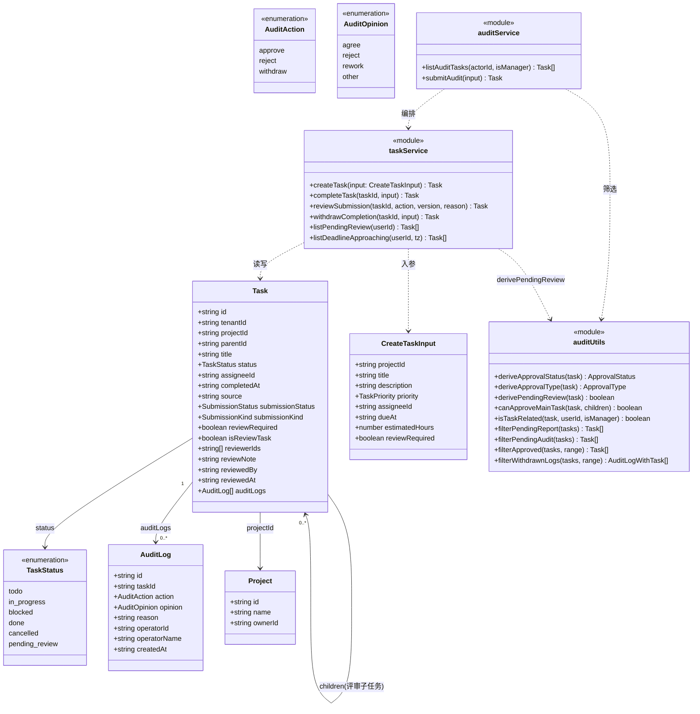
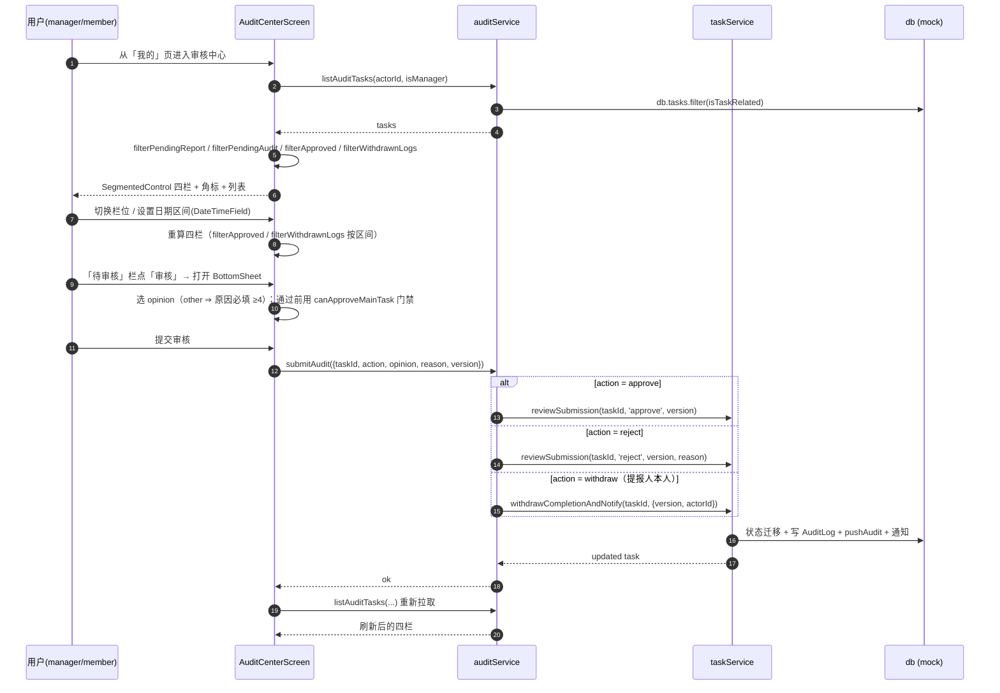
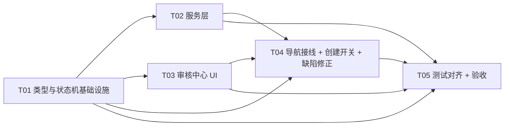

# 架构设计（增量 7）— OpenSchedule 移动端：审核功能对标既有审核实现

> 档位：**增量架构 + 任务分解**（一文档交付）。
> 负责人：高见远（架构师）· 实读基准：`D:\GLMclaw\workspace\openschedule`（本次写作时）
> 上游输入：`PRD-mobile-increment-7-audit-alignment.md`（许清楚，v1.0，541 行，本文的唯一需求依据）
> 对标基准：`apps/web/src/pages/AuditPage.tsx`、`apps/web/src/types/task.ts`、`services/api/prisma/schema.prisma`、`services/api/src/modules/tasks/tasks.service.ts`、`services/api/src/common/constants/task-status.ts`
> **本文含实现方案、文件列表、类图、时序图、任务分解。所有代码事实均给 `文件:行号`，凡不确定一律进 §9。**

---

## 0. 用户已拍板决策（不可更改，本文全程遵守）

| # | 决策 | 本文落地位置 |
| --- | --- | --- |
| D1 | 落点 = `apps/mobile`（不改后端 / web） | 全篇 |
| D2 | 范围 = 提报审核 + 完成评审（其余 `approvalType` 分支不做） | §1.3 / §4 |
| D3 | 「5 类审核标签」框架作废 | 全文零引用 |
| **D4** | **引入存储态 `pending_review`**（对齐 `schema.prisma:190`）；完成提报后任务**不算完成**，审核通过才 `done` | §2 |
| **D5** | 四栏落在**新建独立「审核中心」页**（`AuditCenter` 路由）；`MySubmissionsScreen` / `TodayFocusScreen` 保持不动 | §4 / §5 |
| **D6** | 「待提报」栏**照搬 web 宽口径**（`AuditPage.tsx:107-113`） | §4.1 |

### 0.1 追加拍板（M1 / M2 / M3 —— 均已定案，本版据此修订）

| # | 拍板结论 | 落地位置 |
| --- | --- | --- |
| **M1** | **管理员创建任务时选择「是否需要评审」**；`needsReview` 改为**忠实后端**的严格公式 `task.reviewRequired && !task.isReviewTask`；`completeTask` **不再无条件**写 `reviewRequired=true` / `submissionStatus='pending'`——`reviewRequired !== true` 的任务完成即 `done`，不进评审队列 | §2.4 / §2.6 / §6 |
| **M2** | 主任务审批门禁**落在 UI 层**（`canApproveMainTask` 禁用「通过」按钮），**服务层不新增硬校验** | §2.4.1 |
| **M3** | **新增「待评审」看板列**（`boardColumnOrder` / `BOARD_COLUMNS` 增 `pending_review`，标签「待评审」） | §2.5 / §6 |
| **P1** ✅ **已拍板** | **保留**评审子任务向承接人发 `task.review.pending`（忠实后端 `tasks.service.ts:391-403`） | 代价：约 3~4 条通知计数断言更新；**已知副作用（接受）**：承接人若本身是管理员，会同时收到 `review.pending` 与 `task.review.pending` 两条 | §2.6 分类 P1 / §9 |
| **P2** ✅ **已拍板** | **撤回 / 撤销完成提报后「需要评审」不再成立**（沿用移动端既有清理语义）：`createClearedReviewState()` **保持 6 字段**、继续清 `reviewRequired`；撤回后再完成**直落 `done`** | ⚠️ **已知且有意**：撤回可绕过评审——**是产品决策，不是缺陷**（勿当 bug 去「修」） | §2.6 分类 P2 / §8.3 / §9 |
| **P3** ✅ **已定夺（本版）** | **评审子任务孤儿消除**：`reviewRequired` 被清除（撤回 / 撤销 / 离开完成态 / 重开）时，关闭主任务下**未完成**的评审子任务（`status='cancelled'`）。**Route 2 宽口径**，4 个清除点同点同源；判据 = 「`reviewRequired` 被清除」，**非**「离开 `pending_review`」（驳回须存活） | §2.4.2 / §2.6 分类 R / §9-M11 |
| **P4** ✅ **已定夺（本版）** | **「取消子任务 → 驳回 → 重新提报」耦合缺陷（C + E）+ 组件渲染测试欠账（B）**：C 收紧 `ensureReviewSubtask` 复用过滤（跳过 `cancelled`）；E 让 `canApproveMainTask` 把 `cancelled` 子任务视为不阻塞；**两者必须同修**。B 补 `tests/audit-center-render.test.tsx`（§6-T03 欠账） | §2.4.3 / §2.6 分类 S·T / §9-M12·M13 |

> **M1 附带必改项（本次新发现，已纳入 §2.6）**：`task-state-machine.test.ts` 对 `TASK_TRANSITIONS` 与 `TASK_TRANSITION_ACTIONS` 强制「**双射**」（见 §2.2），引入 `pending_review` 键与 T10 边后必须同步该文件的 2 处断言。
> **M3 附带必改项**：看板列断言 2 处（`services.test.ts:259`、`task-state-machine.test.ts:123`）。

**本次唯一被追加授权的事项**：D4 打破既有 INV-1，**允许修改「引入 `pending_review` 所必需」的既有测试断言**（此前禁止）。逐条清单见 §2.6 / §8，**不做任何超范围改动**。

---

# Part A：系统设计

## 1. 实现方案总览 + 技术选型

### 1.1 核心难点

| 难点 | 说明 | 应对 |
| --- | --- | --- |
| **N1 存储态引入的语义外溢** | `pending_review` 是「已完成但未获批」，它在**每个判断「是否完成」的地方**都要被重新审视（看板列 / 今日聚焦 / 临期预警 / 统计 / `completedAt` 消费方） | §2.5「影响面清单」逐点定处理口径 |
| **N2 INV-1 破坏面收敛** | 既有不变式 `completedAt != null ⟺ status === 'done'`（`increment2-qa.test.ts:23`）被 ≥4 处断言 + 2 处源码保护 | §2.6 精确列表，只改必需项 |
| **N3 评审子任务自动生成 + 复用** | 对齐 `tasks.service.ts:353-385`（承接人 `project.ownerId` 优先、`isReviewTask=true`、驳回后重提复用未完成子任务） | §2.4 / §5 时序图① |
| **N4 四栏信息架构（移动端窄屏）** | web 是四列并排（`AuditPage.tsx:392-507`），移动端必须改纵向 | §4.1：`SegmentedControl` + 角标承载四栏 |
| **N5 审核留痕结构化** | 移动端现只有 `pushAudit` 团队动态（`task.service.ts:147-159`），无结构化审核日志 | §4.3：新增 `AuditLog` 挂 `Task.auditLogs` |
| **N6 无审批端点** | 后端无 approve/reject 端点（`tasks.controller.ts` grep 零命中），web 亦为 mock（`AuditPage.tsx:34-36`） | 落库仍走 mock（`USE_MOCK`），保留 `TODO(real-api)` |
| **N7 完成分流严格化（M1）** | `reviewRequired` 由**创建期**决定；`completeTask` 对免评审任务直落 `done`——创建入口、种子、`completeTask` 三处须同步 | §2.4 / §2.5-13~15 / §8.1.1 |
| **N8 看板新增「待评审」列（M3）** | 看板列常量（`boardColumnOrder` / `BOARD_COLUMNS`）与其 2 条列断言须同步 | §2.5-1 / §2.6 分类 H |

### 1.2 技术选型（沿用既有栈，**零新依赖**）

| 维度 | 选择 | 理由 |
| --- | --- | --- |
| 框架 | **React Native + Expo（沿用）** | 既有基线 |
| 动效 | **RN 内置 `Animated`**（经 `FadeIn` / `PressableScale` / `runLayoutAnimation`） | 硬约束：禁用 `react-native-reanimated` / `react-native-gesture-handler`；既有 `FadeIn.tsx` / `PressableScale.tsx` 已封装 `Animated`，四栏入场与按压反馈直接复用 |
| 导航 | **沿用既有 `@react-navigation` 根共享栈**（`MainRootStack`） | 四栏是「独立页」，与 `TaskDetail` / `MySubmissions` 同级挂在根栈（`stacks.tsx:120-138`），全屏覆盖 TabBar；**不改造既有页**（D5） |
| 四栏承载 | **既有 `SegmentedControl`**（`components/SegmentedControl.tsx`，已支持 `badge` 角标） | 移动端窄屏无法四列并排；语义与 web 四栏一一对应 |
| 审核抽屉 | **既有 `BottomSheet`**（`components/BottomSheet.tsx`） | 与 `TodayFocusScreen.tsx:540-566` 驳回抽屉同构 |
| 输入 | **既有 `TextField`**（`components/TextField.tsx`） | 复用 |
| 日期筛选 | **既有 `DateTimeField`**（`components/DateTimeField.tsx`） | 不新增依赖 |
| 空态 | **既有 `EmptyState`**（`components/StateViews.tsx`） | 复用 `MySubmissionsScreen.tsx:122-130` 用法 |
| 新交互 | **`PressableScale`**（唯一允许的新按压原语） | 硬约束：裸 `<Pressable>` 白名单恰好保持 6 文件，新增裸 `Pressable` 会挂测试 |
| 样式 | **`src/theme/tokens.ts`**（`colors` / `spacing` / `radius` / `shadow` / `motion` / `layout`） | 硬约束：禁止内联魔法数字 |

### 1.3 范围边界（D2）

- **做**：① 提报审核（新事项提报 + 完成提报的通过 / 驳回 / 撤回）；② 完成评审（`pending_review` + 评审子任务闭环 + 主任务审批）。
- **不做**：内容修改 / 删除 / 子任务变更 / 承接人指派 / 调整时间等其余 `approvalType` 分支（web `AuditPage.tsx:254-271` 的 `submitEdit` 明确排除）；SOP 沉淀（移动端无 SOP 库）；`reviewerIds` 语义改写（Q3 定案：暂不改）。

---

## 2. `pending_review` 引入方案（D4 核心）

### 2.1 `TaskStatus` 扩展（`src/types/task.ts`）

```ts
// 现状：五态
export type TaskStatus = 'todo' | 'in_progress' | 'blocked' | 'done' | 'cancelled'
// 改后：六态（对齐 services/api/src/common/constants/task-status.ts:8-16 的 TaskStatus 枚举）
export type TaskStatus = 'todo' | 'in_progress' | 'blocked' | 'done' | 'cancelled' | 'pending_review'
```

> 后端枚举 `PENDING_REVIEW = 'pending_review'`（`task-status.ts:15`），字符串**逐字对齐**。

### 2.2 迁移表（`TASK_TRANSITIONS`）与 UI 动作表（`TASK_TRANSITION_ACTIONS`）如何改

**权威依据**：后端迁移表 `task-status.ts:203-232` 的 T10/T11/T12 三行：

| 后端 | from → to | action | 移动端是否新增边 |
| --- | --- | --- | --- |
| **T10** | `in_progress → pending_review` | `submit_review` | ✅ 新增 |
| **T10** | `blocked → pending_review` | `submit_review` | ✅ 新增 |
| **T11** | `pending_review → done` | `approve` | ✅ 新增 |
| **T12** | `pending_review → in_progress` | `reject` | ✅ 新增 |

`src/types/task.ts:106-112` 改为：

```ts
export const TASK_TRANSITIONS: Record<TaskStatus, TaskStatus[]> = {
  todo: ['in_progress', 'blocked', 'cancelled'],
  in_progress: ['todo', 'done', 'blocked', 'cancelled', 'pending_review'], // 增 pending_review（T10）
  blocked: ['in_progress', 'done', 'cancelled', 'pending_review'],          // 增 pending_review（T10）
  done: ['todo', 'in_progress'],
  cancelled: [],
  pending_review: ['done', 'in_progress'], // 新增键：T11 通过 / T12 驳回（+ 撤回经 withdrawCompletion 落 in_progress）
}
```

`TASK_TRANSITION_ACTIONS`（`src/types/task.ts:125-147`）：`Record<TaskStatus, …>` **必须补 `pending_review` 键**（否则 `tsc --noEmit` 报错）。定案：

```ts
pending_review: [], // 审批走「审核中心」专用入口（不在任务详情页/看板菜单暴露通用迁移）
```

理由：主任务审批必须走 `reviewSubmission`（写 `AuditLog` + 校验评审子任务门禁），**不能**走通用 `moveTask`；置空数组后 `TaskDetailScreen.tsx:140`（`TASK_TRANSITION_ACTIONS[task.status] ?? []`）与 `BoardScreen.tsx:239` 自然渲染「无可执行操作」，**无需改这两个页面的 `runTransition`**（保护 `increment4-qa.test.ts:642-678` / `increment4-withdraw.test.ts:309-336` 的源码切片断言）。

> **⚠️ 双射约束（本次新发现，必须处理）**：`task-state-machine.test.ts` 强制两项不变式：
> ① `Object.keys(TASK_TRANSITIONS)` 必须等于该测试内的 `ALL_STATUSES`（`:75-77`）；
> ② 对每个状态，`TASK_TRANSITIONS[from]` 与 `TASK_TRANSITION_ACTIONS[from]` 的目标**互为双射**（`:81-96`：每个动作目标都是合法迁移 **且** 每条合法迁移都有对应动作）。
>
> 引入 `pending_review` 后：`TASK_TRANSITIONS` 必然多一个键（①破坏），且 `in_progress` / `blocked` 新增 `→ pending_review` 边（②破坏，因为这两个状态的 actions 里没有 `pending_review`）。
>
> **定案**：`TASK_TRANSITIONS` 忠实后端（含 T10/T11/T12 + reopen 边），`TASK_TRANSITION_ACTIONS` **不**暴露 `pending_review`（审批/提报各有专用入口）。二者不再严格双射是**刻意为之**——故 `task-state-machine.test.ts` 必须同步：`:18` `ALL_STATUSES` 增 `'pending_review'`（满足①）；`:89-96` 的「无遗漏」反向断言**限定为「不含 `pending_review` 的迁移」**（满足②的放宽，见 §2.6 分类 G）。这是「引入 `pending_review` 所必需」的最小测试改动，**其余断言逻辑不动**。
>
> **被否决的替代方案**：给 `TASK_TRANSITION_ACTIONS.pending_review` 填真实动作（通过/驳回/重开）以维持双射——但这会让 `TaskDetailScreen` 渲染「通过/驳回」按钮并经 `runTransition → moveTask` **绕过** `reviewSubmission`（无 `AuditLog`、不写 `approved`、跳过门禁），语义错误且违背 D5。故不采纳。

> ⚠️ **注意**：`pending_review` 的自环/`todo` 目标**不加入**（后端 T 表无此边）；`reopenTask`（目标恒 `todo`）在 `pending_review` 上会因 `assertTransition` 抛 40902 —— 这正是「离开 pending_review 只能走通过/驳回/撤回」的正确约束。**但**既有测试 `increment2-completion.test.ts:172-205` 会对 `pending_review` 任务调 `reopenTask`/`moveTask(todo)`，故 **`pending_review` 需可迁往 `todo`**（见 §2.6 说明：为满足「离开完成态」清理路径）。**定案**：`pending_review: ['done', 'in_progress', 'todo']`（`todo` 为「重开」，仅服务既有 reopen 路径；UI 不暴露）。

### 2.3 `completedAt` 语义

| 事件 | `status` | `completedAt` | 依据 |
| --- | --- | --- | --- |
| **完成提报**（`completeTask`，`needsReview === true`） | `pending_review` | **写 `now()`** | 移动端把「成员声明完成」视为完成时刻（准时率数据源，`types/task.ts:40`）；D4 采用 PRD §5.1「方案 A」——完成时写 `completedAt` |
| **免评审完成**（`completeTask`，`needsReview === false`） | `done` | **写 `now()`** | M1：`reviewRequired !== true` 或 `isReviewTask === true` 时**直接完成**（不写提报态、不生成评审子任务） |
| **审批通过**（`reviewSubmission` approve，completion 分支） | `done` | **保持**（不覆写） | PRD §6.3「通过（完成提报）→ `completedAt` 保持」 |
| **审批驳回**（reject，completion 分支） | `in_progress` | **清 `null`** | `task.service.ts:1130-1131` |
| **撤回**（`withdrawCompletion`） | `in_progress` | **清 `null`** | `task.service.ts:1041` |
| 评审子任务完成 | `done` | 写 `now()` | `isReviewTask === true` ⇒ 走 `completeTask` 的 `!needsReview` 分支（防递归） |

> **INV-1 放宽**（唯一的口径变化）：`completedAt != null ⟺ status ∈ {done, pending_review}`。

### 2.4 `completeTask` 分叉（`src/services/task.service.ts:377-420`）—— M1 定案

**判定式（严格忠实后端）**：

```ts
const needsReview = task.reviewRequired === true && task.isReviewTask !== true
```

> **与后端公式逐字对齐**：后端 `needsReview = task.reviewRequired && !task.isReviewTask`（`tasks.service.ts:340`），`reviewRequired` 由**发布者 / 创建者**在创建时决定。M1 拍板：**移动端管理员在创建任务时选择「是否需要评审」**（`CreateTaskInput.reviewRequired`），从而与后端同构——不再用「所有非评审子任务都要评审」的移动端特化（v1 的 `!task.isReviewTask` 已作废）。
>
> **两处必须同步的后端语义**：
> ① `reviewRequired !== true`（含 `undefined` / `false`）的任务完成 → **直接 `done`**，**不**写提报态、**不**生成评审子任务、**不**发 `review.pending`；
> ② `completeTask` **不再**无条件 `task.reviewRequired = true`（删 `task.service.ts:392`）与 `task.submissionStatus = 'pending'`（删 `:391` 的无条件写入）——`submissionStatus='pending'` 只在 `needsReview` 分支写。

**分叉逻辑（伪代码，工程师据此实现）**：

```
completeTask(taskId, input):
  task = findTask(taskId)                      // 活引用
  assertVersion(task, input.version)           // 40901
  needsReview = task.reviewRequired === true && task.isReviewTask !== true   // ← M1 严格公式
  target = needsReview ? 'pending_review' : 'done'
  assertTransition(task.status, target)        // 40902

  task.status = target
  task.completedAt = now()
  task.actualHours = input.actualHours ?? task.actualHours ?? task.estimatedHours ?? null

  if needsReview:
    assertSubmissionTransition(task.submissionStatus, 'pending')
    task.submissionStatus = 'pending'
    // 不再写 task.reviewRequired = true（M1）：该标志已由创建期决定，此处只读
    task.reviewerIds = allManagerIds()         // Q3 定案：保持「全部管理员」
    task.reviewNote = null; task.reviewedBy = null; task.reviewedAt = null
    ensureReviewSubtask(task)                  // ← §2.4.1
    for reviewerId of task.reviewerIds: pushNotificationOnce('review.pending', ...)
  else:
    // 免评审（reviewRequired !== true）或评审子任务自身（isReviewTask === true）：
    // 直接完成——不写提报态、不生成下级评审（防递归）
    (无提报态写入)

  task.version += 1; task.updatedAt = now()
  pushAudit(needsReview ? 'task.submit_review' : 'task.complete', ...)
  return {...task}
```

> **对既有断言的净影响**：因为「完成 → 待审」类既有测试所依赖的种子任务（`task-004/005/006/009`）在**种子层被显式置 `reviewRequired: true`**（§2.5-15），它们的 `completeTask` 仍落 `pending_review`——故 §2.6 分类 B 的 **14 条**断言维持「`done → pending_review`」改法，不额外扩散。若**不**改种子（即让它们保持 `reviewRequired` 缺省 `false`），则这 14 条会退回 `done`，但同时会连带打破 `submissionStatus === 'pending'` / `reviewRequired === true` / `listPendingReview` 等**数十条**断言（`completeAndSnapshot` / `makeCompletedPending` 等公共 helper 首当其冲）——故**不采纳**。详见 §2.6 与 §9-M1。
>
> **UI 落地**：`TaskDetailScreen.tsx:150-152` 已将 `action.to === 'done'` 特判为 `taskService.completeTask(...)`（而非 `moveTask`），故 M1 分叉在 UI 层确实生效（详见 §8.1.1）。
>
> **子任务生命周期**：`completeTask` 在 `needsReview === true` 时生成 / 复用评审子任务（§2.4.1）；其**关闭**（孤儿消除）见 **§2.4.2** —— `completeTask` 本身**不**承担关闭职责（由 4 个 `reviewRequired` 清除点承担）。

#### 2.4.1 评审子任务生成 / 复用（对齐 `tasks.service.ts:353-385`）

```
ensureReviewSubtask(mainTask):
  open = db.tasks.find(t =>
      t.parentId === mainTask.id &&
      t.isReviewTask === true &&
      t.status !== 'done' &&
      t.deletedAt == null)              // 后端 :354-357 复用优先
  if open: return open                  // 「驳回后重提复用未完成评审子任务」
  owner = findProject(mainTask.projectId)?.ownerId ?? mainTask.createdBy ?? currentUserId
  child = insertReviewTask({
      tenantId: mainTask.tenantId,
      projectId: mainTask.projectId,
      parentId: mainTask.id,
      title: `项目评审 — ${mainTask.title}`,   // 逐字对齐（全角破折号 + 空格，:365）
      status: 'todo',
      priority: 'high',                        // :368
      assigneeId: owner,                       // :359 项目负责人优先
      startAt: now(),
      source: 'published',                     // :372
      reviewRequired: false,                   // :373
      isReviewTask: true,                      // :374
      reviewerIds: owner ? [owner] : [],       // :375
      createdBy: currentUserId,
  })
  pushNotificationOnce(owner, 'task.review.pending', ...)   // :391-403
  return child
```

> **注（忠实后端）**：评审子任务初始 `status: 'todo'`（`tasks.service.ts:367`）。因 `TASK_TRANSITIONS.todo` **不含** `'done'`，承接人须先「开始执行」（`todo → in_progress`）再 `completeTask`（§5.1 时序图已体现）。`isReviewTask === true` ⇒ 其完成时 `needsReview = false` ⇒ 直落 `done`（不递归）。

> **门禁（M2 定案 / §5.3）**：主任务在「其评审子任务未 `done`」时**不得**被通过。移动端**在 UI 层**用派生纯函数 `canApproveMainTask` 门禁（审核中心禁用「通过」按钮），**不**在 `reviewSubmission` 内新增硬校验 —— 原因：后端本就无审批端点（§2.2.5），且硬校验会打破 `increment2-completion.test.ts:386-401` 等「先 completeTask 再 approve」的既有用例。**M2 已拍板：服务层不加硬校验**。

#### 2.4.2 评审子任务生命周期 —— 孤儿消除（Route 2 · 数据卫生修复）

> **缺陷（QA 实测复现，team-lead 独立复核）**：`ensureReviewSubtask` **只创建 / 复用、从不关闭**（§2.4.1）；而「撤回 / 撤销完成提报」会经 `createClearedReviewState()` 把 `reviewRequired` 清为 `false`（P2 拍板，§8.3）。二者叠加 ⇒ 若任务在撤回 / 撤销**后再次完成**（`needsReview === false` ⇒ 直落 `done`），第 1 轮生成的评审子任务**永远停在 `todo`** = **孤儿**（承接人待办里出现一条无从评审的幽灵子任务）。
>
> **判据（唯一，务必记牢）**：孤儿产生的**充要条件** = 「**`reviewRequired` 被清除** 且 主任务下存在未完成评审子任务」。**绝不可**用「离开 `pending_review`」当判据 —— **驳回**（`reviewSubmission('reject')`）同样把主任务从 `pending_review` 迁回 `in_progress`，但 `reviewRequired` **保持 `true`**，此时子任务**必须存活**，供「驳回后重新提报」复用（§5.1 分支、`audit-center.test.ts:246-257`）。

**路线定夺：Route 2（宽口径）** —— 在**每一个 `reviewRequired` 清除点**关闭未完成评审子任务。

| 路线 | 落点 | 结论 |
| --- | --- | --- |
| Route 1（窄） | 仅 `completeTask` 的 `else` 分支 | ❌ **不采纳**：只能覆盖「撤回 / 撤销**后再次完成**」这一条路径；若撤回后任务**未再完成**（停在 `in_progress`，或被 `moveTask` / `reopenTask` 迁走），孤儿**依旧存在** —— 同属本缺陷类，未真正消除 |
| **Route 2（宽）** ✅ | `moveTask` / `reopenTask` / `undoCompletion` / `withdrawCompletion` 四处清理点 | ✅ **采纳**：与「`reviewRequired` 清除」这一事实**同点同源**，一次覆盖全部路径；落点均在**既有** `clearReviewOnLeaveDone` / `reviewReset` 分支上（**不新增清理分支**） |

**关闭方式**：`status = 'cancelled'`（移动端 `Task` **无 `deletedAt` 字段**；`TASK_TRANSITIONS.todo` / `.in_progress` 均含 `'cancelled'`，故 `todo` / `in_progress` 态子任务均可合法关闭）。**幂等**：已 `done` / 已 `cancelled` 跳过。**零通知**：仅状态变更，不触碰通知系统（不影响 P1 计数与 2 处零通知切片断言）。

**唯一实现点（文件末尾新函数，沿用 §2.4.1 落位硬约束）**：

```ts
/**
 * 关闭主任务下**未完成**的评审子任务（数据卫生：消除孤儿评审子任务）。
 * 触发口径（唯一）= 主任务「本轮提报」的评审需求被清除（reviewRequired → false），
 *   由 createClearedReviewState() 承载，共 4 个清除点（见下表）。
 * ⚠️ 不得以「离开 pending_review」为判据 —— 驳回同样离开 pending_review，但 reviewRequired 保持 true，子任务须存活。
 * 关闭方式 = status='cancelled'（无 deletedAt；todo / in_progress 均可迁 cancelled）。幂等、零通知。
 * ⚠️ 定义位置 = 文件末尾（同 ensureReviewSubtask）；不得把 'cancelled' / pushNotification
 *    字面量写进 withdrawCompletion / undoCompletion 函数体（保护 4 处源码切片断言）。
 */
function closeOpenReviewSubtasks(mainTask: Task): void {
  for (const child of db.tasks) {
    if (
      child.parentId === mainTask.id &&
      child.isReviewTask === true &&
      child.status !== 'done' &&
      child.status !== 'cancelled'
    ) {
      child.status = 'cancelled'
      child.version += 1
      child.updatedAt = now()
    }
  }
}
```

**四处精确落点（`src/services/task.service.ts`）**：

| # | 函数 | 行 | 改动前 | 改动后 |
| --- | --- | --- | --- | --- |
| 1 | `moveTask` | `:366` | `if (clearReviewOnLeaveDone) applyClearedReviewState(task)` | `if (clearReviewOnLeaveDone) { applyClearedReviewState(task); closeOpenReviewSubtasks(task) }` |
| 2 | `reopenTask` | `:468` | `if (clearReviewOnLeaveDone) applyClearedReviewState(task)` | 同上 |
| 3 | `undoCompletion` | `:515-516` | `const reviewReset = resolveUndoReviewReset(input.submissionStatus)` / `if (reviewReset) Object.assign(task, reviewReset)` | `if (reviewReset) { Object.assign(task, reviewReset); closeOpenReviewSubtasks(task) }` |
| 4 | `withdrawCompletion` | `:1088-1089` | `applyClearedReviewState(task)` / `task.submissionStatus = 'withdrawn'` | 在其后追加一行 `closeOpenReviewSubtasks(task)` |

> **`completeTask` 保持零改动**：Route 2 下，任务进入 `completeTask`（`needsReview === false`）时，其评审子任务**已在上游清除点被关闭** ⇒ `else` 分支不会遇到未完成子任务。故 Route 1 的落点（`else` 分支）在 Route 2 中**冗余**，不写。

**4 处源码切片断言逐一核对（全部不破）**：

| 切片断言 | 位置 | 结论 |
| --- | --- | --- |
| `withdrawCompletion` 体 `not.toContain("'cancelled'")` | `increment4-qa.test.ts:577`、`increment4-withdraw.test.ts:366` | ✅ 落点 4 仅新增**调用** `closeOpenReviewSubtasks(task)`；`'cancelled'` 字面量在**文件末尾** helper 内（切片之外） |
| `withdrawCompletion` 体 `not.toContain('pushNotification' \| 'db.notifications' \| 'reviewRequired: false' \| 'reviewerIds: []' \| 'reviewNote: null')` | `increment4-qa.test.ts:560-573`、`increment4-withdraw.test.ts:352-362` | ✅ 调用语句不含这些字面量 |
| `undoCompletion` 体 `not.toContain('pushNotification' \| 'db.notifications')` | `increment3-dedup-notify.test.ts:446-452` | ✅ 落点 3 仅新增调用语句 |
| `createClearedReviewState` 体 6 字段 + 全仓仅 1 处定义 | `increment4-qa.test.ts:580-598` | ✅ **未触碰** `utils/submission.ts`；helper 位于 `task.service.ts` |

> **⚠️ `submission.ts` 注释同步 —— 正式改动项（不改变任何判据/字段）**：Route 2 的调用点是**既有** `clearReviewOnLeaveDone` / `reviewReset` 分支，属「数据卫生副作用」，**不新增清理条件、不改判据**。为免注释与实现自相矛盾，须同步两处注释（**纯注释改动，零行为变更**）：
>
> | 落点 | 改后原文（追加行） |
> | --- | --- |
> | `submission.ts:187-188`（「禁止为『统一清理口径』而给 `moveTask`/`reopenTask` 增加新清理分支」） | 追加一行：`//          （注：增量 7.1 在既有清理分支上追加的「评审子任务关闭」closeOpenReviewSubtasks 属数据卫生副作用，不改变本判据、不新增清理条件，不违反上述禁令。）` |
> | `submission.ts:200-205`（`shouldClearReviewOnLeaveDone` JSDoc 尾部） | 追加一行：`// ⚠️ 增量 7.1：调用方在清理成立时另需调用 closeOpenReviewSubtasks(task) 关闭未完成评审子任务（数据卫生，ARCH §2.4.2）；该副作用不改变本函数判据。` |

**残余风险（已登记 §9-M11）**：
1. `moveTask(pending_review → done)`（绕过 `reviewSubmission` 的**非 UI 可达**路径，`TASK_TRANSITION_ACTIONS.pending_review = []`）**不**触发关闭（`nextStatus === 'done'` ⇒ `clearReviewOnLeaveDone === false`）⇒ 该异常路径下子任务仍可能留存。**处置**：登记为已知边界（UI 不可达），不在本次范围。
2. Route 2 使「撤回 / 撤销」**新增** `cancelled` 子任务 ⇒ 既有断言 `increment4-qa.test.ts:371`（AC-10「**正式任务**永不被撤回动作写成 cancelled」）需**收窄过滤**（排除 `isReviewTask === true`）—— 见 §2.6 分类 R。

#### 2.4.3 「取消评审子任务 → 驳回 → 重新提报」链（C）与审批门禁（E）—— 耦合可达缺陷（team-lead 自我更正后纳入）

> **编号说明（重要，避免与 §2.6 混淆）**：本节 `C` / `E` 沿用 team-lead 简报中的**缺陷编号**（C = 复用过滤收紧、E = 审批门禁排除 `cancelled`）；与 §2.6 已有的「**分类 C**」（`shouldClearReviewOnLeaveDone` 源码切片）和「**分类 E**」（`completedAt` 文件逐个结论）**完全无关**。本组在 §2.6 统一登记为「**分类 S**」（用例编号 S-1 = 缺陷 C、S-2 = 缺陷 E）。
>
> **可达性（team-lead 已逐步实测，**推翻**其上一封「C 不可达」的判断）**：`src/screens/*.tsx` 与 `src/components/*.tsx` **零处**引用 `isReviewTask` ⇒ 评审子任务在 UI 里就是**普通 `todo` 任务**（出现在待办 / 看板 / 详情页）；而 `TASK_TRANSITION_ACTIONS.todo` 含 `{ to: 'cancelled', label: '取消任务', requireReason: true }` ⇒ 用户**可以取消它**。
>
> **可达链条**：
> 1. `completeTask(task-004)`（`reviewRequired=true`）⇒ 主任务 `pending_review` + 子任务 `todo`；
> 2. 用户**取消该子任务** ⇒ 子任务 `cancelled`；`moveTask(子任务,'cancelled')` 时 `shouldClearReviewOnLeaveDone(子任务,'cancelled') === false`（子任务 `status==='todo'`）⇒ **不**触发 §2.4.2 的关闭；主任务 `reviewRequired` **保持 `true`**；
> 3. 审核人**驳回** ⇒ 主任务回 `in_progress`，**`reviewRequired` 仍为 `true`**（`reviewSubmission` reject 分支不清审核态，`:1176-1181` 已实读确认）；
> 4. 用户**重新提报** ⇒ `needsReview === true` ⇒ `ensureReviewSubtask` 过滤仅 `status !== 'done'` ⇒ **命中已 `cancelled` 的子任务 ⇒ 复用**（**C 缺陷真实发生**）；
> 5. 叠加 **E**：`canApproveMainTask` 的 `.every(child => child.status === 'done')` ⇒ `cancelled !== 'done'` ⇒ **门禁永久 `false` ⇒ 审批死锁**。
>
> **⇒ C 与 E 耦合，必须同修**（单修 C：门禁遇 `cancelled` 仍死锁；单修 E：复用了已取消的子任务，语义脏、评审子任务形同虚设）。同修后步骤 4 **新建**一条干净子任务，门禁正常，链路自洽。

| 编号 | 落点 | 改动前 → 改动后 | 定性 |
| --- | --- | --- | --- |
| **C** | `src/services/task.service.ts:1325`（`ensureReviewSubtask` 复用过滤） | `task.status !== 'done'` → `task.status !== 'done' && task.status !== 'cancelled'` | **真实可达缺陷修复**（路径：取消子任务 → 驳回 → 重新提报）。**非**「防御性硬化」 |
| **E** | `src/utils/audit.ts:112-114`（`canApproveMainTask`） | `.filter((child) => child.parentId === task.id && child.isReviewTask === true)` → 追加 `&& child.status !== 'cancelled'` | **真实可达缺陷修复**：`cancelled` 子任务视为**不阻塞**（「取消任务 = 放弃该评审项」） |

> **既有断言影响 = 0**：C 改后，`audit-center.test.ts:246-256`（驳回后复用）用的是 `todo` 子任务 ⇒ 仍匹配；E 改后，`audit-center.test.ts:104-140`（门禁用例）均不含 `cancelled` ⇒ 不受影响。

> **16 处源码切片核对（C / E 均不撞）**：C 的落点在 `task.service.ts:1325`，位于 `ensureReviewSubtask`（文件末尾，`reviewSubmission` / `withdrawCompletionAndNotify` / `todayAt` **之后**）⇒ 在**全部** task.service.ts 切片（`undoCompletion` 体 → `/** 评论列表 */`、`withdrawCompletion` 体 → `reviewSubmission`、`withdrawSubmission` 体、`listTodayDue` / `listDeadlineApproaching` / `applyClearedReviewState` 体、以及 `increment5-closure.test.ts:312` / `increment5-qa.test.ts:454` 的**全文件** `submissionStatus = ` 计数）**之外**；且 C **不新增** `submissionStatus =` 赋值 ⇒ 计数恒为 7。E 落点在 `src/utils/audit.ts`，**全仓 `tests/` 无任何对该文件的 `readFileSync` + `indexOf` 切片**（已 grep 确认）⇒ 安全。

### 2.5 「`pending_review` 影响面清单」（本次最大架构风险，逐点定口径）

| # | 位置 | 现状判定 | `pending_review` 应如何处理 | 改动 |
| --- | --- | --- | --- | --- |
| 1 | 看板列 `BOARD_COLUMNS`（`types/task.ts:153`）+ `boardColumnOrder`（`theme/index.ts:47`） | 四列 | **M3 定案：新增「待评审」列**——`pending_review` 任务显示在**独立列**（置于 `blocked` 与 `done` 之间），不再隐藏 | **改**：`boardColumnOrder` 增 `'pending_review'`；`BOARD_COLUMNS` 增 `{ status: 'pending_review', label: '待评审' }`；`project.service.ts:111` 经 `getStatusStyle` 自动取 label/color，**无需改代码**（§2.6 分类 H） |
| 2 | 今日到期 `listTodayDue`（`task.service.ts:209-231`） | `status !== 'done'` ∧ `submissionStatus !== 'pending'` | 已由 `submissionStatus !== 'pending'` 排除（`pending_review` 必为 `pending`）⇒ **语义仍正确** | **无**（保护 `increment4-qa.test.ts:620-628`、`increment5-qa.test.ts:576`） |
| 3 | 临期预警 `listDeadlineApproaching`（`task.service.ts:250-267`） | `if (status === 'done' \|\| status === 'cancelled') return false` | `pending_review` 非 done/cancelled ⇒ **会误入临期预警**（与「待我审核」重复计数）⇒ **必须新增排除** | **改**：`\|\| task.status === 'pending_review'` |
| 4 | 我的待办 `listMyTodos`（`task.service.ts:184-200`） | `status !== 'done'` ∧ `submissionStatus !== 'pending'` | 已排除（`pending_review` 必为 `pending`） | 无 |
| 5 | 待我审核 `listPendingReview`（`task.service.ts:234-247`） | `reviewRequired ∧ submissionStatus==='pending' ∧ reviewerIds∋me` | `pending_review` 任务**应继续进待我审核**（正确） | 无 |
| 6 | 准时率（`completedAt`，`types/task.ts:40`） | 完成时写 | `pending_review` 完成时写 `completedAt` ⇒ 准时率基准 = 成员声明完成时刻（不受审批延迟影响） | 无（语义保持） |
| 7 | 项目统计 `project.service.ts:38`（`doneCount`） | 只计 `status==='done'` | `pending_review` **不计入** done ⇒ 审核通过后才进进度 | 无（行为变化需登记，非缺陷） |
| 8 | 状态色 `statusColor`（`theme/index.ts:22`，`Record<TaskStatus,…>`） | 五键 | **必须补 `pending_review` 键**（否则 `tsc` 报错） | **改**：`pending_review: { color: '#C8871B', bg: '#FBF3E2', label: '待评审' }` |
| 9 | 排序权重 `STATUS_WEIGHT`（`task.service.ts:83`，`Record<TaskStatus,…>`） | 五键 | **必须补 `pending_review` 键**（`tsc`） | **改**：`pending_review: 3`（与 done 同段，排在推进态之后） |
| 10 | 任务卡片样式 `TaskCard.tsx:46,82-83` | `done/cancelled` 置灰/删除线 | `pending_review` 保持正常样式（**可选**增强「待评审」角标，本次不做，避免波及 UI 快照测试） | 无 |
| 11 | 承接判定 `TaskDetailScreen.tsx:344`（`canClaim`） | `assigneeId===null ∧ status∉{cancelled,done}` | `pending_review` 必有 assignee ⇒ 实际恒 false；**防御性**补 `status !== 'pending_review'` | **改（防御，可选）** |
| 12 | 审核轮回态 `shouldClearReviewOnLeaveDone`（`utils/submission.ts:199-204`） | 仅 `done → 非 done` 清理 | 「完成态」现含 `pending_review` ⇒ 须扩展覆盖 | **改**（见 §2.6 分类 C） |
| 13 | `createTask` / `insertTask`（`task.service.ts:753-793`，`reviewRequired: false` 在 `:783`） | 恒写 `reviewRequired: false`（`:783`） | **M1：改为读创建入参** | **改**：`CreateTaskInput` 增 `reviewRequired?: boolean`；`insertTask` 写 `reviewRequired: input.reviewRequired ?? false` |
| 14 | `completeTask`（`task.service.ts:377-420`） | 无条件写 `reviewRequired=true`（`:392`）+ `submissionStatus='pending'`（`:391`） | **M1：改为严格分叉**（免评审直落 `done`） | **改**：见 §2.4 |
| 15 | 种子数据（`seed.ts` 23 条 + `seed-extra.ts` 3 条） | `task-004/005/006/009`（进行中/阻塞的正式任务）**未设** `reviewRequired` | **M1 处理口径**：这些任务代表「需评审的正式任务」，**显式置 `reviewRequired: true`**，以保留「完成提报 → 待审」的演示与既有测试语义。**注意**：`task-014` / `task-015` **种子层已具备** `submissionStatus: 'pending'` + `reviewRequired: true`（`seed.ts:451/453`、`:473/475`），**不得改动** | **改**：`seed.ts` 上述 **4 条**（`task-004/005/006/009`）各增 `reviewRequired: true`（`task-012` 从不经 `completeTask`，无需改；`seed-extra.ts` **无**团队任务，零改动） |
| 16 | 评审子任务生命周期（`task.service.ts` 4 个 `reviewRequired` 清除点） | `ensureReviewSubtask` 只创建/复用、**从不关闭** ⇒ 撤回/撤销后再完成 ⇒ **孤儿子任务** | **Route 2（§2.4.2）**：`reviewRequired` 被清除时关闭未完成评审子任务（`status='cancelled'`） | **改**：文件末尾新增 `closeOpenReviewSubtasks()` + 4 处调用（`moveTask:366` / `reopenTask:468` / `undoCompletion:515` / `withdrawCompletion:1088`） |
| 17 | 评审子任务**复用过滤**（`ensureReviewSubtask:1325`）+ 审批门禁（`utils/audit.ts:112-114`） | 复用仅排除 `done`；门禁要求 `.every(child => status === 'done')` | **取消子任务 → 驳回 → 重新提报**链：复用命中 `cancelled` 子任务 + 门禁遇 `cancelled` 永久 `false`（**审批死锁**） | **改（§2.4.3 分类 S）**：复用过滤追加 `&& status !== 'cancelled'`（C）；门禁过滤追加 `&& status !== 'cancelled'`（E） |

> **其余 `completedAt` 消费方核查**（grep 全仓）：`focus.service.ts:322-326,356` 属**个人任务**（`PersonalTask`，独立集合，永不 `pending_review`）⇒ 不受影响；`seed.ts` / `seed-extra.ts` 为种子数据（`done` 任务已写 `completedAt`，符合放宽后的 INV-1）。

### 2.6 对既有状态机断言的影响清单（**唯一被授权的断言改动**）

> **授权范围**：仅「引入 `pending_review` 所必需」。每行给出：文件 : 行 → 原断言 → 为什么必须改 → 改成什么。

#### 分类 A：INV-1 放宽（4 处）

| 文件:行 | 原断言 | 为什么必须改 | 改成 |
| --- | --- | --- | --- |
| `tests/increment2-qa.test.ts:24-25` | `expect(task.completedAt !== null).toBe(task.status === 'done')` | `pending_review` 任务 `completedAt != null` 但 `status !== 'done'` ⇒ 恒失败 | `expect(task.completedAt !== null).toBe(task.status === 'done' \|\| task.status === 'pending_review')` |
| `tests/increment4-qa.test.ts:61-63` | `(task.completedAt != null) !== (task.status === 'done')` | 同上（全量遍历；判据在 `:62`） | `(task.completedAt != null) !== (task.status === 'done' \|\| task.status === 'pending_review')` |
| `tests/increment5-qa.test.ts:665-669`（INV-5） | `(task.completedAt != null) !== (task.status === 'done')` | 同上 | 同上（放宽为二态集合） |
| `tests/increment2-completion.test.ts:265` | `expect(done.completedAt !== null).toBe(done.status === 'done')` | `done` 为 `completeTask` 结果 ⇒ 现为 `pending_review` + `completedAt` 非空 | 放宽为 `… === (done.status === 'done' \|\| done.status === 'pending_review')` |

#### 分类 B：`completeTask` 结果状态 `done → pending_review`（**14 处**；原列 16 条中 2 条经复核**更正为「不改」**）

> 根因单一：`completeTask` 对 **`needsReview === true`**（即 `reviewRequired === true ∧ !isReviewTask`）的任务由 `done` 改判为 `pending_review`。**`moveTask` 迁往 `done` 的行为不变**（`increment2-qa.test.ts:102` 明示「入队只由 `completeTask` 触发」），故 **`moveTask`→`done` 的断言全部保持**。
>
> **M1 前提（关键）**：本类有效 14 条全部作用于种子任务 `task-004`（含 `increment3` 两套的 `DUE_TASK_ID='task-004'`）/ `task-005` / `task-006` / `task-009` / `task-014` / `task-015`。前四者在**种子层被显式置 `reviewRequired: true`**（§2.5-15），故 `completeTask` 仍落 `pending_review`——本类改法**不因 M1 而变**。若种子**不**改，则这 14 条应退回**保持 `done`**，但同时 `submissionStatus === 'pending'` / `reviewRequired === true` / `listPendingReview` 等**数十条**断言将连带失败（`completeAndSnapshot` / `makeCompletedPending` 公共 helper 首当其冲）——故**不采纳该分支**（详见 §9-M1）。

| 文件:行 | 原断言 | 改成 |
| --- | --- | --- |
| `increment2-completion.test.ts:253` | `expect(done.status).toBe('done')` | `.toBe('pending_review')` |
| ~~`increment2-qa.test.ts:157`~~ **⚠️ 更正：不改** | ~~`expect(again.status).toBe('done')`~~ | **保持 `.toBe('done')`** —— AC-06「撤销后再完成」：`undoCompletion` 经 `createClearedReviewState` 清 `reviewRequired` ⇒ 第二次完成 `needsReview === false`。真正需改的是同用例 `:158-160`（见**分类 P2**） |
| `increment2-qa.test.ts:318` | `expect(after.status).toBe('done')`（completeTask 后） | `.toBe('pending_review')` |
| `increment2-qa.test.ts:342` | `expect(after.status).toBe('done')`（completeTask 后） | `.toBe('pending_review')` |
| `increment3-dedup-notify.test.ts:228` | `expect(done.status).toBe('done')` | `.toBe('pending_review')` |
| `increment3-qa.test.ts:192` | `expect(done.status).toBe('done')` | `.toBe('pending_review')` |
| `increment4-qa.test.ts:244` | `expect(done.status).toBe('done')` | `.toBe('pending_review')` |
| `increment4-qa.test.ts:531` | `expect(done.status).toBe('done')`（blocked→完成提报） | `.toBe('pending_review')` |
| `increment4-withdraw.test.ts:139` | `expect(done.status).toBe('done')` | `.toBe('pending_review')` |
| `increment4-withdraw.test.ts:167` | `expect(after.status).toBe('done')`（completeTask 后） | `.toBe('pending_review')` |
| `increment5-closure.test.ts:224` | `expect(done.status).toBe('done')` | `.toBe('pending_review')` |
| `increment5-closure.test.ts:282` | `expect(done.status).toBe('done')` | `.toBe('pending_review')` |
| ~~`increment5-closure.test.ts:383`~~ **⚠️ 更正：不改** | ~~`expect(redo.status).toBe('done')`~~ | **保持 `.toBe('done')`** —— AC-15「撤回后重新完成提报」：`withdrawCompletionAndNotify` 已清标志 ⇒ 再完成直落 `done`。真正需改的是 `:382`、`:384-386`（见**分类 P2**） |
| `increment5-qa.test.ts:311` | `expect(done.status).toBe('done')` | `.toBe('pending_review')` |
| `increment5-qa.test.ts:375` | `expect(done.status).toBe('done')` | `.toBe('pending_review')` |
| `services.test.ts:126` | `expect(done.status).toBe('done')`（completeTask） | `.toBe('pending_review')` |

> **注意区分**：同文件中 `expect(approved.status).toBe('done')`（approve 结果）**保持**（`increment2-completion.test.ts:357,394,437`、`increment4-withdraw.test.ts:195,203`、`increment5-qa.test.ts:356`、`round2-regression.test.ts:48`、`increment5-closure.test.ts:230` 等）；`moveTask`→`done` 的断言**保持**（`increment2-qa.test.ts:100`、`increment2-completion.test.ts:214`、`services.test.ts:97`、`increment4-qa.test.ts:295` 等）。

#### 分类 C：源码切片 / 判据行断言（4 处）

| 文件:行 | 原断言 | 为什么必须改 | 改成 |
| --- | --- | --- | --- |
| `increment4-qa.test.ts:614-618` | `submissionSrc` 含 `"return task.status === 'done' && nextStatus !== 'done' && task.submissionStatus === 'pending'"` | `shouldClearReviewOnLeaveDone` 须覆盖 `pending_review`（离开完成态清理，§2.5-12） | 断言新判据串：`"(task.status === 'done' \|\| task.status === 'pending_review') && nextStatus !== 'done' && nextStatus !== 'pending_review' && task.submissionStatus === 'pending'"` |
| `increment4-qa.test.ts:630-637` | `listDeadlineApproaching` 体含 `"if (task.status === 'done' \|\| task.status === 'cancelled') return false"` | 新增 `pending_review` 排除（§2.5-3） | 断言新串：`"if (task.status === 'done' \|\| task.status === 'cancelled' \|\| task.status === 'pending_review') return false"` |
| `increment5-qa.test.ts:585-587` | 同上（`listDeadlineApproaching` 串） | 同上 | 同上 |
| `increment5-closure.test.ts:426-428` | 同上（`listDeadlineApproaching` 串） | 同上 | 同上 |

> **⚠️ 必须同步改源码注释（否则代码与注释自相矛盾）**：改 `shouldClearReviewOnLeaveDone` 判据（`src/utils/submission.ts:199-204`）时，同文件两处注释须一并改写为「**完成态 = `{done, pending_review}`**」：
> - `:185-187`（原文「⚠️ 禁止为『统一清理口径』而修改下述判据，或给 `moveTask` / `reopenTask` 增加新清理分支」）——改写后**保留**「不得给 `moveTask` / `reopenTask` 新增清理分支」这条约束（`moveTask` 已由本函数单一入口覆盖，新增分支反而会破坏 `increment2-qa` 的窄口径保护）。
> - `:191-198`（JSDoc 逐条列 `① task.status === 'done'`）——`①` 改为 `task.status === 'done' \|\| task.status === 'pending_review'`，其余两条（`② nextStatus !== 'done'`、`③ submissionStatus === 'pending'`）保持不变。
>
> **验收锚（必要性）**：`increment4-qa.test.ts:684-699` —— `completeTask('task-004')`（`:686`）→ `moveTask('task-004', { status: 'in_progress' })`（`:689`）断言 `submissionStatus === null` / `reviewRequired === false` / `reviewerIds === []`（`:694-699`）。旧判据（`status === 'done'`）下此时 `status` 已是 `pending_review` ⇒ **必挂**。这是本改动「所必需」的硬证据。
>
> **验收锚（正确性）**：`increment2-qa.test.ts:42-43` 是该函数的直接单测，新判据下两条须**原样通过**（`{status:'done', submissionStatus:'pending'}, 'todo'` → `true`；`{status:'todo', submissionStatus:'pending'}, 'todo'` → `false`）——**不得修改**这两条。

#### 分类 D：**2 处源码不变式**（非测试断言，但属 INV-1 保护点，必须同步改）

| 文件:行 | 现状 | 改成 |
| --- | --- | --- |
| `src/services/task.service.ts:1038-1042`（`withdrawCompletion`） | `if (task.status === 'done') { assertTransition('done','in_progress'); task.status='in_progress'; task.completedAt = null }` + 注释 `INV-1：completedAt != null ⟺ status === 'done'` | `if (task.status === 'done' \|\| task.status === 'pending_review') { assertTransition(task.status,'in_progress'); task.status='in_progress'; task.completedAt = null }`；注释改为放宽版 INV-1。**不得**出现 `reviewRequired: false` / `reviewerIds: []` / `reviewNote: null` / `'cancelled'` / `pushNotification`（保护 `increment4-qa.test.ts:556-576`、`increment4-withdraw.test.ts:340-368`） |
| `src/services/task.service.ts:1130-1131`（`reviewSubmission` reject） | `if (resolveApproveBranch(task) === 'completion') task.completedAt = null` + 注释 `INV-1` | 逻辑不变（reject 目标恒 `in_progress`，清 `completedAt` 正确）；**仅更新注释**为放宽版 INV-1 |

#### 分类 E：**逐个 `completedAt` 文件结论**（11 个文件，团队要求逐条判断）

| 文件 | 是否受影响 | 结论 |
| --- | --- | --- |
| `increment2-completion.test.ts` | **是** | 改 `:253`（分类 B）、`:265`（分类 A）；其余 `completedAt` 断言（`:183,201,229,254,327,331,368,395,399,406,412,416`）**保持**（approve→done / reject→in_progress / 撤回→null 语义未变） |
| `increment2-focus-footer.test.tsx` | **否** | `:56,72,88` 为**自建 fixture**（组件测试），不依赖 `completeTask`；fixture 已满足放宽后 INV-1，无需改 |
| `increment2-qa.test.ts` | **是** | 改 `:24-25`（分类 A）、`:157,318,342`（分类 B）；`:100-101`（moveTask→done）、`:206-221`（expectInv1 放宽后恒成立）、`:275-277`（reject）**保持** |
| `increment4-qa.test.ts` | **是** | 改 `:61-63`（分类 A）、`:244,531`（分类 B）、`:614-618,630-637`（分类 C）；`:420-444`（INV-1 全量遍历，放宽后成立）、`:526-543`（blocked→完成提报→撤回）**保持逻辑**（仅 `:531` 状态改） |
| `increment4-withdraw.test.ts` | **是** | 改 `:139,167`（分类 B）；`:148,151`、`:195,203`（approve→done）、`:224,233`（种子 done）**保持** |
| `increment5-qa.test.ts` | **是** | 改 `:311,375`（分类 B）、`:665-669`（分类 A）、`:585-587`（分类 C）；`:356`（approve→done）**保持** |
| `personal-plan.test.ts` | **否** | `:57,89,94,108` 全部为**个人任务**（`PersonalTask`，`focus.service.ts:349-356`），永不 `pending_review`，零影响 |
| `round2-regression.test.ts` | **否** | `:21`（`task-007` 种子 done）、`:27,40,59`（undo 后 null）、`:48`（approve→done）**全部保持** |
| `services.test.ts` | **是** | 改 `:126`（分类 B）；`:97`（moveTask→done）、`:103,141`（reopen 清空）、`:174`（approve→done）、`:270`（统计，仅种子）**保持** |
| `submission-flow.test.ts` | **否** | `:272-273`（approve→done + `completedAt` 非空）**保持**（approve 仍写/保持 `completedAt`） |
| `today-focus-gate.test.tsx` | **否** | `:51` 为**自建 fixture**（组件测试），不依赖 `completeTask`，无需改 |

#### 分类 F：**额外受影响文件（无 `completedAt`，但含 `completeTask`→`done` 断言）**

| 文件:行 | 结论 |
| --- | --- |
| `increment3-dedup-notify.test.ts:228` | 改（分类 B） |
| `increment3-qa.test.ts:192` | 改（分类 B）；`:164,165,331`（种子 done）保持 |
| `increment5-closure.test.ts:224,282,383` | 改（分类 B）；`:418,426-428`（源码串）见分类 C |

#### 分类 G：状态机常量 / 双射（**本次新发现**，2 处）

> 根因：`task-state-machine.test.ts` 强制「`Object.keys(TASK_TRANSITIONS) === ALL_STATUSES`」+「`TASK_TRANSITIONS` 与 `TASK_TRANSITION_ACTIONS` 目标互为双射」。引入 `pending_review` 键与 T10 边后二者必破（详见 §2.2）。

| 文件:行 | 原断言 | 为什么必须改 | 改成 |
| --- | --- | --- | --- |
| `task-state-machine.test.ts:18` | `ALL_STATUSES = ['todo','in_progress','blocked','done','cancelled']` | `Object.keys(TASK_TRANSITIONS)` 现为 6 键 ⇒ `:75-77` 恒失败 | 增 `'pending_review'`（`ALL_STATUSES` 补第 6 项） |
| `task-state-machine.test.ts:89-96` | 「每条合法迁移都有对应可点动作（无遗漏）」对全部状态双向检查 | `pending_review` 及其相关边**刻意不暴露**通用 UI 动作（审批/提报走专用入口，§2.2）⇒ 反向断言对 `pending_review` 不成立 | 反向「无遗漏」断言**限定为「不含 `pending_review` 的迁移」**（`from !== 'pending_review'` 且 `to !== 'pending_review'`）；正向「动作目标 ⊆ 合法迁移」断言保持不变 |

#### 分类 H：M3 新增「待评审」看板列（2 处）

| 文件:行 | 原断言 | 为什么必须改 | 改成 |
| --- | --- | --- | --- |
| `services.test.ts:259` | `columns.map(c => c.status)` → `['todo','in_progress','blocked','done']` | `boardColumnOrder` 增 `pending_review` ⇒ 列数变 5 | `['todo','in_progress','blocked','pending_review','done']` |
| `task-state-machine.test.ts:123` | `BOARD_COLUMNS.map(c => c.status)` → `['todo','in_progress','blocked','done']` | `BOARD_COLUMNS` 增 `pending_review` | `['todo','in_progress','blocked','pending_review','done']` |

> **同文件交叉核对**：`services.test.ts:260-263`（`total === 非 cancelled 任务数`）与 `submission-flow.test.ts:309-310`（提报记录不上看板）**保持通过**——种子无 `pending_review` 任务，新增列初始为空，且提报记录被 `isSubmissionRecord` 过滤。

#### 分类 P2：撤回 / 撤销后再完成 ⇒ 直落 `done`（**5 处**，P2 拍板）

> 根因：`createClearedReviewState()` **保持**清 `reviewRequired = false`（P2 拍板）⇒ 撤回 / 撤销后任务**再次完成**时 `needsReview === false` ⇒ **直落 `done`**（不再进评审队列）。下列断言原为「再完成 → 重新入队 / `pending_review`」，现改为「→ `done` / 不入队」。

| 文件:行 | 用例 | 改动 |
| --- | --- | --- |
| `increment2-qa.test.ts:158-160` | AC-06 撤销后再完成 | `again.status='done'`（原「重新入队」假设作废）、`submissionStatus=null`、`reviewRequired=false` |
| `increment2-completion.test.ts:346-348` | 撤销后再完成 | `again.status='done'`、`submissionStatus=null`、`reviewRequired=false` |
| `increment3-dedup-notify.test.ts:413-416` | AC-07 撤销后重提 | 第二次完成**不派发**新 `review.pending`（`pendingNotifs(ME)` 仍 1 条且已读） |
| `increment5-closure.test.ts:382`（及 `:384-386`） | AC-15 撤回后重新完成 | `redo.status='done'`、`submissionStatus` 保持 `'withdrawn'`、`reviewRequired=false`、不入队 |
| `increment5-qa.test.ts:222-235` | AC-05a 未读级去重 | 撤回后需**显式**恢复 `reviewRequired=true`（`:224`）才能复现「重新提报」路径 |

#### 分类 P1：评审子任务通知 `task.review.pending` ⇒ 计数 +1（**3 处**，P1 拍板）

> 根因：`completeTask` 生成评审子任务后向承接人发 1 条 `task.review.pending`（忠实后端 `tasks.service.ts:391-403`）⇒ 相关**通知计数 / 未读数**断言各 +1。**已知副作用（接受）**：承接人若本身是管理员，会同时收到 `review.pending` + `task.review.pending`。

| 文件:行 | 改动 |
| --- | --- |
| `increment3-dedup-notify.test.ts:340` | AC-05 通知总数：`before + allManagerIds().length` → **`+ 1`** |
| `increment3-dedup-notify.test.ts:380` | AC-12 未读：`unreadBefore + 1` → **`+ 2`**（4 → 6） |
| `increment3-qa.test.ts:421` | AC-12 未读：**`4 → 6`** |

#### 分类 R：评审子任务孤儿消除（Route 2，**1 处既有 + 6 处新增**）

> 根因：见 §2.4.2。撤回 / 撤销 / 离开完成态 / 重开时，若 `reviewRequired` 被清除，则关闭主任务下未完成评审子任务（`status='cancelled'`）。

| 类型 | 文件:行 | 改动 |
| --- | --- | --- |
| **既有断言（1 处，需改）** | `tests/increment4-qa.test.ts:371` | AC-10 全量断言的过滤条件收窄为「排除评审子任务」：`db.tasks.filter((task) => task.status === 'cancelled' && task.isReviewTask !== true)`。**理由**：该用例断言的是「**正式任务**永不被撤回动作写成 cancelled」（INV-5）；评审子任务非正式任务，其关闭是 §2.4.2 的**有意**行为（若不收窄，`completeTask('task-004')`→`withdrawCompletion` 新增的 cancelled 子任务会使 `cancelledAfter !== cancelledBefore` ⇒ 必挂） |
| **新增用例（6 处）** | `tests/audit-center.test.ts`（新增 describe「评审子任务生命周期 —— 孤儿消除」） | **R-1** 撤回路径：`completeTask(需评审)` → `withdrawCompletion` ⇒ 子任务 `status === 'cancelled'`、无残留未完成子任务；**R-2** 撤销路径：`completeTask` → `undoCompletion(submissionStatus:null)` ⇒ 子任务 `cancelled`；**R-3** `moveTask` 离开完成态（`pending_review → in_progress`）⇒ 子任务 `cancelled`；**R-4** `reopenTask` ⇒ 子任务 `cancelled`；**R-5** **反向断言**：驳回后子任务**必须存活**（`status !== 'cancelled'`）且再次 `completeTask` **复用**（同 id、计数 1）；**R-6** **审核轮回态守门**：`completeTask` → `undoCompletion({ status:'in_progress', submissionStatus:'pending' })` ⇒ `resolveUndoReviewReset('pending')` 返回 `null` ⇒ **不清理** ⇒ 子任务**存活**（`status !== 'cancelled'`） |

> **R-5 / R-6 是本组的关键护栏**：
> - **R-5** 把「驳回 ≠ 清除评审需求」钉进用例，防止有人把关闭判据误写成「离开 `pending_review`」（那会让驳回路径子任务被误关，破坏 §5.1「驳回后重新提报复用」）。
> - **R-6** 是**陷阱 2 的唯一守门断言**（`submission.ts:196-205` 明文警告审核轮回态「审核人必须仍能看到任务，否则从待审队列静默消失」，K3 反向缺陷）：若实现者把关闭写成**无条件**（不绑 `if (reviewReset)`），**只有 R-6 能拦住**。
> - R-1~R-4 与 R-5 / R-6 **互为反向**，缺一不可。

#### 分类 S：「取消评审子任务 → 驳回 → 重新提报」链（C + E，**0 处既有 + 2 处新增**）

> 根因 / 可达性 / 耦合性：见 §2.4.3。**C** = 复用过滤收紧（跳过 `cancelled`）；**E** = 门禁排除 `cancelled`（不阻塞）。**既有断言改动 0 处**。

| 类型 | 文件:行 | 改动 |
| --- | --- | --- |
| 源码（C） | `src/services/task.service.ts:1325` | `ensureReviewSubtask` 复用过滤：`task.status !== 'done'` → `task.status !== 'done' && task.status !== 'cancelled'` |
| 源码（E） | `src/utils/audit.ts:112-114` | `canApproveMainTask` 过滤追加 `&& child.status !== 'cancelled'` |
| **新增用例（2 处）** | `tests/audit-center.test.ts` | **S-1（C）**：预置一条 `cancelled` 评审子任务 ⇒ 再次 `completeTask`（`reviewRequired=true`）⇒ 断言**新建**（`isReviewTask` 子任务计数 2、新 id ≠ 旧 id、新子任务 `status === 'todo'`），**非**复用 cancelled 那条；**S-2（E）**：主任务下同时存在一条 `cancelled` 子任务 + 一条 `done` 子任务 ⇒ `canApproveMainTask === true`（改前为 `false`） |

#### 分类 T：`AuditCenterScreen` 组件级渲染测试（B —— 补 §6-T03 欠账，**0 处既有 + 4 处新增 + 1 新文件**）

> §6-T03 原文验收标准写「组件测试通过」，但此前**无对应文件**（欠账）。本轮补上 `tests/audit-center-render.test.tsx`。

| 类型 | 文件 | 说明 |
| --- | --- | --- |
| **新增文件（1）** | `tests/audit-center-render.test.tsx` | 范式 = `react-test-renderer` + `act` + `jest.mock`（仓库**无** `@testing-library/react-native`），照抄 `tests/project-list-fab.test.tsx` / `tests/bugfix-root-stack-back.test.tsx` |
| **新增用例（4）** | 同上 | **T-1** 四栏标题与顺序（待提报 / 待审核 / 审核通过 / 撤回审核）；**T-2** **权限门禁**：非 manager（`useCan('review:view_pending') === false`）⇒ 无「审核」动作 / 不渲染审批入口；**T-3** **空态**（`EMPTY_TEXT` 文案随栏位）；**T-4** **门禁联动**：子任务未 `done` ⇒ 「通过」禁用 + 显示「评审子任务尚未完成，暂不可通过」（对应 E） |

> **统计（增量 7.1 修复后；以 `DELIVERY-mobile-increment-7-audit-alignment.md` 逐条清单为准）**：需修改的既有测试断言/常量 **35 条** = A4 + **B14** + C4 + G2 + H2 + **P2-5** + **P1-3** + **R1**（`increment4-qa.test.ts:371` 收窄）；源码不变式 **2 处**（D），合计 **37 个改动点**；另**新增用例 12 条**（R-1~R-6 共 6 + 分类 S 共 2 + 分类 T 共 4）、**新增文件 1 个**（`tests/audit-center-render.test.tsx`）。**其余套件保持原样**。验收基线：**40 套件 / 771 用例全绿 + `tsc --noEmit` 零错误**。
>
> 涉及文件共 **12 个**：`increment2-qa` / `increment2-completion` / `increment3-dedup-notify` / `increment3-qa` / `increment4-qa` / `increment4-withdraw` / `increment5-qa` / `increment5-closure` / `services` / `task-state-machine` / 源码 `task.service.ts` / `utils/submission.ts`。（7.1 另涉源码 `utils/audit.ts`（E）与新增测试 `audit-center-render.test.tsx`（B）—— 前者零既有断言、后者为新文件。）
>
> **勘误记录**：初版误将 `increment2-qa.test.ts:157`、`increment5-closure.test.ts:383` 列为「改 `done → pending_review`」——经复核**二者均不改**（撤回/撤销后 `reviewRequired` 已被清，再次完成直落 `done`）。故分类 B 由 **16 → 14**，并新增 **P2 组 5 条**、**P1 组 3 条**。
>
> **7.1 增补（本版）**：新增 §2.4.2（孤儿消除 Route 2）+ 分类 R（R-1~R-6）；新增 §2.4.3 + 分类 S（C 复用过滤 + E 门禁排除 `cancelled`，team-lead **自我更正**后确认为**真实可达耦合缺陷**）；新增分类 T（B：`AuditCenterScreen` 组件渲染测试，补 §6-T03 欠账）。既有断言由 **34 → 35 条**（+ `increment4-qa.test.ts:371` 收窄过滤）；**新增用例 12 条** + **新增文件 1 个**。验收基线 **39/759 → 40/771**。

---

## 3. 文件列表（相对 `apps/mobile/`，标注 新增 / 修改）

| 文件 | 类型 | 职责 |
| --- | --- | --- |
| `src/types/task.ts` | **修改** | `TaskStatus` 增 `pending_review`；`TASK_TRANSITIONS` / `TASK_TRANSITION_ACTIONS` 增键与边；`BOARD_COLUMNS` 增 `pending_review` 列（M3）；`CreateTaskInput` 增 `reviewRequired?: boolean`（M1）；新增 `AuditAction` / `AuditOpinion` / `AuditLog` 类型；`Task` 增 `auditLogs?: AuditLog[]` |
| `src/types/navigation.ts` | **修改** | `MainRootStackParamList` 增 `AuditCenter: undefined` |
| `src/theme/index.ts` | **修改** | `statusColor` 增 `pending_review` 键；`boardColumnOrder` 增 `'pending_review'`（M3） |
| `src/data/seed.ts` | **修改** | `task-004/005/006/009` 各增 `reviewRequired: true`（M1 口径，§2.5-15）；`task-014` / `task-015` 已有该标志（`seed.ts:453/475`），**不得改动** |
| `src/utils/audit.ts` | **新增（7）/ 修改（7.1）** | 审核域**派生纯函数** + 四栏筛选 + `OPINION_OPTIONS` / `OPINION_META` / `APPROVAL_STATUS_LABEL`；**7.1（E）**：`canApproveMainTask` 过滤追加 `&& child.status !== 'cancelled'`（§2.4.3） |
| `src/utils/submission.ts` | **修改** | `shouldClearReviewOnLeaveDone` 扩展覆盖 `pending_review`（**唯一改动**，其余保持）；**7.1**：同步 2 处注释（`closeOpenReviewSubtasks` 数据卫生，§2.4.2，**纯注释**） |
| `src/services/task.service.ts` | **修改** | `completeTask` 分叉 + 评审子任务生成/复用；`reviewSubmission` 写 `AuditLog`；`withdrawCompletion` 覆盖 `pending_review`；`listDeadlineApproaching` 排除 `pending_review`；`STATUS_WEIGHT` 补键；**7.1**：文件末尾新增 `closeOpenReviewSubtasks()` + 4 处调用（R，§2.4.2）；`ensureReviewSubtask:1325` 复用过滤追加 `&& status !== 'cancelled'`（C，§2.4.3） |
| `src/services/audit.service.ts` | **新增** | `listAuditTasks(actorId, isManager)`（相关任务口径）+ `submitAudit(input)`（编排 approve/reject/withdraw + 写 `AuditLog` + `pushAudit`） |
| `src/screens/AuditCenterScreen.tsx` | **新增** | 审核中心四栏页（`SegmentedControl` + 四栏列表 + 审核抽屉 + 日期筛选） |
| `src/components/AuditLogItem.tsx` | **新增** | 「撤回审核」栏日志条目卡片（任务标题 + 意见标签 + 动作标签 + 操作人 + 时间） |
| `src/components/index.ts` | **修改** | 导出 `AuditLogItem` |
| `src/navigation/stacks.tsx` | **修改** | 根栈注册 `AuditCenter` → `AuditCenterScreen` |
| `src/screens/ProfileScreen.tsx` | **修改** | 「我的」页增「审核中心」入口（仅 `review:view_pending` 可见） |
| `src/screens/TodayFocusScreen.tsx` | **修改** | 修正 B1（`:563` 阈值 `< 2` → `< REASON_MIN_LENGTH`）+ B2（`:283-302` 补 `catch`） |
| `src/screens/TaskDetailScreen.tsx` | **修改（可选）** | `:344` `canClaim` 防御性排除 `pending_review` |
| `src/screens/CreateItemScreen.tsx` | **修改** | 增「需要评审」开关（仅 manager 且 `kind === 'task'` 时渲染）；`handleSubmit` 的 `createTask(...)` 透传 `reviewRequired`（M1）。开关用**本地 `useState`** 承载，**不**并入 `ItemFormValue`（避免波及 `ItemForm.tsx` / `draft.ts` / `SubmissionScreen.tsx`） |
| `tests/audit-center.test.ts` | **新增** | 派生函数 + 四栏筛选 + 评审子任务闭环（含**孤儿消除 R-1~R-6** + **S-1/S-2**）+ 审核日志 的独立套件 |
| `tests/audit-center-render.test.tsx` | **新增（7.1）** | `AuditCenterScreen` 组件级渲染测试（T-1~T-4，补 §6-T03 欠账，§2.4.3 分类 T） |
| `tests/increment2-qa.test.ts` 等 10 个既有套件 | **修改** | §2.6 分类 A/B/C/G/H/**P1/P2/R** 的断言（共 **35** 条）；含 `task-state-machine.test.ts` |

---

## 4. 数据结构与接口

### 4.1 类图（数据模型 + 服务）



### 4.2 派生纯函数签名（`src/utils/audit.ts`）

> **设计原则**（对齐 PRD §5.4）：**纯函数、不落库、不改写既有字段** ⇒ 对既有 38 套件零回归。

```ts
/** web 语义的审核状态（types/task.ts:172 四值，逐字对齐） */
export type ApprovalStatus = 'none' | 'pending' | 'approved' | 'rejected'
/** D2 范围仅两类（types/task.ts:169 的子集） */
export type ApprovalType = 'proposal' | 'completion' | null

/**
 * 审核状态（映射移动端字段 → web 四值）：
 *  - isReviewTask === true            → 'none'（评审子任务本身不走提报审核）
 *  - submissionStatus === 'pending'   → 'pending'
 *  - submissionStatus === 'approved'  → 'approved'
 *  - submissionStatus === 'rejected'  → 'rejected'
 *  - 其余（null/undefined/draft/withdrawn）→ 'none'
 */
export function deriveApprovalStatus(
  task: Pick<Task, 'submissionStatus' | 'isReviewTask'>,
): ApprovalStatus

/**
 * 待审事项类型（仅 D2 两类）：
 *  - source==='submission' && submissionKind!=null → 'proposal'（新事项提报）
 *  - 其余（含完成提报）                            → 'completion'
 */
export function deriveApprovalType(
  task: Pick<Task, 'source' | 'submissionKind'>,
): ApprovalType

/**
 * 是否处于「待评审」语义（用于展示与门禁）：
 *  reviewRequired === true && isReviewTask !== true && submissionStatus === 'pending'
 */
export function derivePendingReview(
  task: Pick<Task, 'reviewRequired' | 'isReviewTask' | 'submissionStatus'>,
): boolean

/**
 * 主任务是否可被审批通过（§5.3 门禁）：
 *  其全部评审子任务均已 done（无评审子任务时为 true）。
 *  @param children 主任务的子任务集合（调用方从 db.tasks 过滤 parentId===task.id && isReviewTask）
 */
export function canApproveMainTask(
  task: Pick<Task, 'id'>,
  children: Pick<Task, 'parentId' | 'isReviewTask' | 'status'>[],
): boolean

/** 相关任务口径（对齐 AuditPage.tsx:65-70；移动端无 participants 字段） */
export function isTaskRelated(
  task: Pick<Task, 'assigneeId' | 'createdBy'>,
  userId: string,
  isManager: boolean,
): boolean

/** 四栏筛选（见 §4.4） */
export function filterPendingReport(tasks: Task[]): Task[]
export function filterPendingAudit(tasks: Task[]): Task[]
export function filterApproved(tasks: Task[], range: DateRange | null): Task[]
export function filterWithdrawnLogs(
  tasks: Task[],
  range: DateRange | null,
): (AuditLog & { task: Task })[]
```

### 4.3 `AuditLog` 在移动端的承载

**定案**：挂 `Task.auditLogs: AuditLog[]`（对齐 web `types/task.ts:377`，四栏「撤回审核」栏可直接消费）。

| 字段 | 类型 | 说明 | 写入点 |
| --- | --- | --- | --- |
| `id` | `string` | `nextId('audit')` | 三个动作 |
| `taskId` | `string` | 所属任务 | 同上 |
| `action` | `'approve'\|'reject'\|'withdraw'` | **驱动状态** | 同上 |
| `opinion` | `'agree'\|'reject'\|'rework'\|'other'` | **仅留痕**（不影响状态，对齐 `AuditPage.tsx:153-162`） | 同上 |
| `reason` | `string` | 原因 / 备注（`other` 时必填 ≥4 字） | 同上 |
| `operatorId` | `string` | **真实操作人**（修正 B3：`task.service.ts:1087` 现取 `reviewerIds[0]`） | 同上 |
| `operatorName` | `string` | `findUser(operatorId)?.displayName` | 同上 |
| `createdAt` | `string` | ISO8601 UTC | 同上 |

- **`OPINION_OPTIONS` / `OPINION_META`**（逐字对齐 `AuditPage.tsx:50-62`）：`agree→colors.success`、`reject→colors.danger`、`rework→colors.warning`、`other→colors.text.secondary`（**无需新增 token**，`tokens.ts:51-55,38` 已具备）。
- **与 `pushAudit` 的关系**：**两者并存、职责分离**（PRD §7.3）。审核动作**同时**产出结构化 `AuditLog`（挂 `Task.auditLogs`）与 `pushAudit` 团队动态；**不得**用 `AuditLog` 替换 `pushAudit`（会打破既有通知/动态断言）。

### 4.4 四栏筛选函数（对齐 `AuditPage.tsx:107-143`）

| 栏位 | 入选条件（移动端字段） | 排序 | 角标 |
| --- | --- | --- | --- |
| **待提报** | `!isReviewTask` ∧ `status ∉ {done, cancelled}` ∧ `deriveApprovalStatus(task) !== 'pending'`（**D6 宽口径**：已通过但未完成的任务同现两栏） | `dueAt` 升序 → `createdAt` 升序 | 条数 |
| **待审核** | `deriveApprovalStatus(task) === 'pending'`（即 `submissionStatus === 'pending'`） | `updatedAt` 降序 | 条数 |
| **审核通过** | `submissionStatus === 'approved'`，受**日期区间**筛选（取最后一条 `action==='approve'` 的 `createdAt`） | `updatedAt` 降序 | 条数 |
| **撤回审核** | **日志流**：遍历相关任务的 `auditLogs`，取 `action !== 'approve'`（`reject` 或 `withdraw`），受日期区间筛选 | `createdAt` 降序 | 条数 |

- **相关任务口径**：`isTaskRelated`（管理=全部；成员=`assigneeId===me || createdBy===me`；移动端 `Task` **无 `participants` 字段**，故省略该分支）。
- **角色判定**：复用 `useCan('review:view_pending')`（`utils/permission.ts:24,45`，仅 `manager`），**不引入** web 的 `workspace_role` 本地开关。
- **「撤回审核」栏性质**：**日志流**（一条日志一个条目），非任务流；同一任务可产生多条（对齐 `AuditPage.tsx:476-503`）。

### 4.5 审核动作与状态影响（对齐实读 `AuditPage.tsx:146-252`）

| 动作 | 角色 | 状态影响（移动端字段） | 服务调用 |
| --- | --- | --- | --- |
| **通过 approve** | manager | `submissionStatus='approved'`；completion 分支 → `status='done'`（`completedAt` 保持）；proposal 分支 → 走既有 `landSubmissionRecord` 落地 | `reviewSubmission(id,'approve',v)` |
| **驳回 reject** | manager | `submissionStatus='rejected'`；completion → `status='in_progress'` + `completedAt=null`；proposal → 归档 `cancelled` | `reviewSubmission(id,'reject',v,reason)` |
| **撤回 withdraw** | **提报人本人** | `submissionStatus='withdrawn'`；completion → `status='in_progress'` + 清 `completedAt` | `withdrawCompletionAndNotify`（新事项走 `withdrawSubmission`） |

- **审核意见 `opinion` 不影响任何状态**（仅写 `AuditLog`）；状态只由 `action` 驱动（`AuditPage.tsx:153-162`）。
- **`other` 必填原因、其余可选**（`AuditPage.tsx:532-544`）；原因最小长度统一 `REASON_MIN_LENGTH = 4`（修正 B1）。
- **移动端无 hover** → 卡片内直接展示原因摘要（`numberOfLines={2}`）+ 点击展开（对齐 web 悬停意图 `AuditPage.tsx:481`）。

---

## 5. 程序调用流程（时序图）

### 5.1 时序图 ①：完成提报 → `pending_review` → 评审子任务 → 审批

```mermaid
sequenceDiagram
    autonumber
    participant Member as 成员(assignee)
    participant Screen as TaskDetail/TodayFocus
    participant TaskSvc as taskService
    participant DB as db (mock)
    participant Owner as 项目负责人(承接人)

    Member->>Screen: 点击「完成提报」
    Screen->>TaskSvc: completeTask(taskId, {version, actualHours})
    TaskSvc->>DB: findTask + assertVersion(40901)
    TaskSvc->>TaskSvc: needsReview = task.reviewRequired && !task.isReviewTask
    alt needsReview = true（需评审的正式任务）
        TaskSvc->>TaskSvc: assertTransition(status → 'pending_review')
        TaskSvc->>DB: status='pending_review'; completedAt=now;<br/>submissionStatus='pending'; reviewerIds=allManagerIds()（不再写 reviewRequired）
        TaskSvc->>DB: findFirst(parentId=task.id ∧ isReviewTask ∧ status≠done)
        alt 无未完成评审子任务
            TaskSvc->>DB: create 评审子任务(title='项目评审 — {title}', assigneeId=project.ownerId??createdBy, priority='high', source='published', reviewRequired=false, isReviewTask=true, reviewerIds=[承接人])
            TaskSvc->>DB: pushNotificationOnce(承接人, 'task.review.pending')
        else 命中（驳回后重提）
            TaskSvc->>TaskSvc: 复用，跳过创建
        end
        TaskSvc->>DB: pushAudit('task.submit_review')
        TaskSvc->>DB: for r of reviewerIds: pushNotificationOnce('review.pending')
    else needsReview = false（reviewRequired !== true，或 isReviewTask）
        TaskSvc->>TaskSvc: assertTransition(status → 'done')
        TaskSvc->>DB: status='done'; completedAt=now()（不写提报态、不生成下级评审）
    end
    TaskSvc-->>Screen: 更新后的 task

    Note over Owner: 承接人在「待办」看到评审子任务（初始 status='todo'）
    Owner->>TaskSvc: moveTask(评审子任务id, 'in_progress')（todo → in_progress）
    Owner->>TaskSvc: completeTask(评审子任务id)
    TaskSvc->>DB: 评审子任务 status='done'（isReviewTask=true ⇒ needsReview=false）
    Note over Owner: 评审子任务已完成 → 主任务满足门禁
    Owner->>TaskSvc: reviewSubmission(主任务id, 'approve', version, opinion, reason)
    TaskSvc->>DB: assertSubmissionTransition('pending'→'approved'); submissionStatus='approved'; status='done'（completedAt 保持）
    TaskSvc->>DB: task.auditLogs += {action:'approve', opinion, reason, operatorId, operatorName, createdAt}
    TaskSvc->>DB: pushNotification(提报人, 'review.result')
    TaskSvc-->>Owner: 主任务 done
```

**分支：驳回**：`reviewSubmission(主任务,'reject',v,reason)` → `submissionStatus='rejected'`、`status='in_progress'`、`completedAt=null`、`reviewNote=reason` + `AuditLog{action:'reject'}`。**驳回后重新提报** → `completeTask` 再次调用 → `needsReview=true` → 复用未完成评审子任务（**不重复创建**）。

### 5.2 时序图 ②：四栏审核中心主流程



---

## 6. 任务列表（有序 · 含依赖 · 按实现顺序，可直接派给工程师）

> **硬约束遵守**：≤5 个任务；每个任务 ≥3 个相关文件；按功能/层次分组（非单文件拆分）；T01 = 基础设施；依赖尽量收敛到「仅依赖 T01」。

### T01 — 类型与状态机基础设施（P0，无依赖）

**Source Files**（5）：`src/types/task.ts`、`src/types/navigation.ts`、`src/theme/index.ts`、`src/utils/audit.ts`（新增）、`src/utils/submission.ts`

**内容**：
1. `TaskStatus` 增 `'pending_review'`；`TASK_TRANSITIONS` / `TASK_TRANSITION_ACTIONS` 按 §2.2 增键与边；`BOARD_COLUMNS` 增 `{ status: 'pending_review', label: '待评审' }`（**M3**）；`CreateTaskInput` 增 `reviewRequired?: boolean`（**M1**）；`Task` 增 `auditLogs?: AuditLog[]`。
2. 新增 `AuditAction` / `AuditOpinion` / `AuditLog` 类型（§4.3）。
3. 新增 `src/utils/audit.ts`：`deriveApprovalStatus` / `deriveApprovalType` / `derivePendingReview` / `canApproveMainTask` / `isTaskRelated` / 四栏筛选 / `OPINION_OPTIONS` / `OPINION_META` / `APPROVAL_STATUS_LABEL`（§4.2）。
4. `theme/index.ts` `statusColor` 增 `pending_review` 键（§2.5-8）；`boardColumnOrder` 增 `'pending_review'`（**M3**，§2.5-1）。
5. `utils/submission.ts` 扩展 `shouldClearReviewOnLeaveDone` 覆盖 `pending_review`（§2.6 分类 C）。
6. `navigation.ts` 增 `AuditCenter: undefined`。

**验收**：`tsc --noEmit` 零错误（`Record<TaskStatus,…>` 全覆盖）；新增 `tests/audit-center.test.ts` 的纯函数用例全绿。

### T02 — 服务层：`pending_review` 落地 + 评审子任务 + 审核留痕（P0，依赖 T01）

**Source Files**（3）：`src/services/task.service.ts`、`src/services/audit.service.ts`（新增）、`src/data/index.ts`（如需 `allManagerIds` / `findProject` 复用或小工具）

**内容**：
1. **M1**：`createTask` / `insertTask` 写 `reviewRequired: input.reviewRequired ?? false`（不再恒 `false`）；`completeTask` 采用**严格公式** `task.reviewRequired === true && task.isReviewTask !== true` 分叉（§2.4），**删除**无条件 `reviewRequired = true`（`:392`）/ `submissionStatus = 'pending'`（`:391`）写入 + `ensureReviewSubtask`（§2.4.1，承接人 `project.ownerId` 优先、复用未完成子任务、`pushNotificationOnce`）。
2. `reviewSubmission` approve/reject 分支写 `AuditLog`；修正 B3（`operatorId` = 真实操作人，替换 `task.service.ts:1087` 的 `reviewerIds[0]`）。
3. `withdrawCompletion` 覆盖 `pending_review`（§2.6 分类 D，**严守** `increment4-qa.test.ts:556-576` / `increment4-withdraw.test.ts:340-368` 的禁串约束）；`reviewSubmission` reject 注释更新。
4. `listDeadlineApproaching` 增 `pending_review` 排除（§2.5-3）；`STATUS_WEIGHT` 补键。
5. 新增 `audit.service.ts`：`listAuditTasks` + `submitAudit`（§5.2）。
6. **新增函数一律追加到 `task.service.ts` 末尾**（不得插在 `withdrawCompletion` 与 `reviewSubmission` 之间 —— 保护源码切片断言 `increment4-qa.test.ts:551-554`、`increment4-withdraw.test.ts:342-345`；不得置于 `reviewSubmission` 之前 —— 保护 `increment5-closure.test.ts:12` K38）。
7. **孤儿消除（Route 2，§2.4.2）**：文件末尾新增 `closeOpenReviewSubtasks(mainTask)`（置未完成评审子任务 `status='cancelled'`，幂等、零通知）；在 `moveTask:366` / `reopenTask:468` / `undoCompletion:515-516` / `withdrawCompletion:1088` 四处**既有清理分支**上各追加一次调用。**`completeTask` 不改**。**严守**：`'cancelled'` / `pushNotification` 字面量**不得**进入 `withdrawCompletion` / `undoCompletion` 函数体（保护 4 处源码切片断言，见 §2.4.2）。
8. **取消子任务链（C，§2.4.3）**：`ensureReviewSubtask:1325` 复用过滤收紧为 `task.status !== 'done' && task.status !== 'cancelled'`（跳过已取消子任务，避免「取消 → 驳回 → 重新提报」复用脏子任务）。落点在文件末尾函数内，**不撞任何源码切片**。
9. **注释同步（§2.4.2）**：`utils/submission.ts:187-188` / `:200-205` 各追加 1 行说明 `closeOpenReviewSubtasks` 属数据卫生副作用（**纯注释，零行为**）。

**验收**：服务层全链路用例（含评审子任务生成/复用、**孤儿消除 R-1~R-6**、**取消链 S-1/S-2**、审核日志、`pending_review` 迁移）全绿。

### T03 — 审核中心 UI（P0，依赖 T01）

**Source Files**（3）：`src/screens/AuditCenterScreen.tsx`（新增）、`src/components/AuditLogItem.tsx`（新增）、`src/components/index.ts`

**内容**：
1. `AuditCenterScreen`：`ScreenHeader` + `SegmentedControl`（四栏 + 角标）+ 四栏列表（`Card` / `TaskCard`）+ 空态（`EmptyState`）+ 日期区间（`DateTimeField`）+ 审核 `BottomSheet`（动作单选 + 意见四选 + 原因，`other` 必填）。
2. 角色门禁：`useCan('review:view_pending')`；无权限时**不渲染**通过/驳回动作（对齐 `TodayFocusScreen.tsx:331-333` 防御写法）。
3. `AuditLogItem`：日志流条目（任务标题 + 意见标签 + 动作标签 + 操作人 + 时间），点击进任务详情。
4. 样式数值**只取 `tokens.ts`**；新交互一律 `PressableScale`；**不得新增裸 `<Pressable>`**。

**验收**：`AuditCenterScreen` 可渲染四栏；`tsc` 零错误。
> **⚠️ 欠账补录（7.1 分类 T / B）**：本节原文「组件测试通过」此前**无对应文件**（欠账）。7.1 补 `tests/audit-center-render.test.tsx`（T-1 四栏标题顺序 / T-2 权限门禁 / T-3 空态 / T-4 门禁联动），范式照抄 `project-list-fab.test.tsx`。**该文件属 T03 验收，须随 7.1 一并交付。**

### T04 — 导航接线 + 入口 + 创建表单评审开关 + 既有缺陷修正（P0，依赖 T01、T02、T03）

**Source Files**（5）：`src/navigation/stacks.tsx`、`src/screens/ProfileScreen.tsx`、`src/screens/TodayFocusScreen.tsx`、`src/screens/TaskDetailScreen.tsx`、`src/screens/CreateItemScreen.tsx`

**内容**：
1. `stacks.tsx` 根栈注册 `AuditCenter`。
2. `ProfileScreen.tsx` 增「审核中心」入口（仅 `review:view_pending` 可见）。
3. **M1**：`CreateItemScreen.tsx` 增「需要评审」开关——仅 `manager` 且 `kind === 'task'` 时渲染；用**本地 `useState`**（**不**并入 `ItemFormValue`，避免波及 `ItemForm.tsx` / `draft.ts` / `SubmissionScreen.tsx`）；`handleSubmit` 的 `createTask(...)` 透传 `reviewRequired`。
4. `TodayFocusScreen.tsx`：**B1** `:563` `< 2` → `< REASON_MIN_LENGTH`；**B2** `:283-302` 补 `catch`（失败提示 + 刷新）。
5. `TaskDetailScreen.tsx`：`canClaim` 防御性排除 `pending_review`（**不得**改动 `runTransition` 的 done 分支 —— 保护 `increment4-qa.test.ts:642-678`、`increment4-withdraw.test.ts:309-336`）。

**验收**：可从「我的」页进入审核中心；manager 创建任务可勾选「需要评审」并落库；B1/B2 修正生效（输入 2~3 字不可提交；驳回失败有提示）。

### T05 — 测试对齐 + 新增验收套件（P0，依赖 T01、T02、T03、T04）

**Source Files**（≥3）：`tests/audit-center.test.ts`（新增）+ `tests/audit-center-render.test.tsx`（新增，分类 T）+ 按 §2.6 修改 **10 个**既有套件（`increment2-qa` / `increment2-completion` / `increment3-dedup-notify` / `increment3-qa` / `increment4-qa` / `increment4-withdraw` / `increment5-qa` / `increment5-closure` / `services` / **`task-state-machine`**）

**内容**：
1. 按 §2.6 分类 A/B/C/G/H/**P1/P2/R** 修改 **35 条**断言/常量（**逐条对照，不多不少**）；源码不变式 2 处（分类 D）。
2. 新增 `tests/audit-center.test.ts`：派生函数全分支 + 四栏筛选（含 D6 宽口径、日志流倒序）+ 评审子任务生成/复用 + **孤儿消除 R-1~R-6** + **取消链 S-1/S-2** + 审核日志 + `canApproveMainTask` 门禁。
3. **M1 新路径覆盖**：`createTask({ reviewRequired: false })` → `completeTask` ⇒ 断言落 **`done`** 且**不写** `submissionStatus` / **不**生成评审子任务 / **不**发 `review.pending`（与 `reviewRequired: true` 分支对照）。
4. **M3 覆盖**：`listBoardColumns` 含 `pending_review` 列且 `pending_review` 任务入该列。
5. **孤儿消除覆盖（R-1~R-6，§2.4.2）**：撤回 / 撤销 / `moveTask` 离开完成态 / `reopenTask` 四条路径各断言子任务 `cancelled`；**反向断言** R-5（驳回后存活 + 复用）、R-6（审核轮回态存活）。
6. **取消链覆盖（S-1/S-2，§2.4.3）**：S-1 预置 `cancelled` 子任务 ⇒ 再完成**新建**而非复用；S-2 `cancelled + done` 子任务 ⇒ 门禁 `true`。
7. **组件渲染覆盖（T-1~T-4，§2.4.3 分类 T）**：`tests/audit-center-render.test.tsx`。
8. 全量回归：`npm test`（**40 套件 / 771 用例**）全绿；`tsc --noEmit` 零错误。

**验收**：全绿基线成立（**40 套件 / 771 用例**，零错误）。

### 6.1 任务依赖图



---

## 7. 依赖包列表

**无新增依赖**（`apps/mobile/package.json` 零改动）。

- 四栏 / 审核抽屉 / 日期筛选 / 空态 均由既有组件实现：`SegmentedControl` / `BottomSheet` / `PressableScale` / `Card` / `TaskCard` / `Tag` / `Button` / `TextField` / `DateTimeField` / `EmptyState` / `FadeIn` / `UndoToast`。
- **禁用** `react-native-reanimated` / `react-native-gesture-handler`（硬约束）—— 动效只用 RN 内置 `Animated`（经 `FadeIn.tsx` / `PressableScale.tsx` 封装）。

---

## 8. 共享知识 / 跨文件约定

### 8.1 `pending_review` 的双重语义（跨文件铁律）

| 场景 | 必须当作「**未完成**」 | 必须当作「**已提交待审**」 |
| --- | --- | --- |
| 判定位置 | 看板（**M3：独立「待评审」列**，**不进** done 列）、项目统计 `doneCount`、任务卡片「已完成」样式 | `listPendingReview`（进待我审核）、审核中心「待审核」栏、`submissionStatus==='pending'` 相关门禁 |
| 具体规则 | `status === 'done'` 的判定**一律不得**改成包含 `pending_review`（否则「完成」被提前认定） | `submissionStatus === 'pending'` 判定**保持**（`pending_review` 必为 `pending`） |
| 特例 | `listDeadlineApproaching` **显式排除** `pending_review`（§2.5-3） | `completedAt` 在 `pending_review` 时**已写**（准时率基准，§2.3） |

### 8.1.1 完成分流的单一判据（M1 跨文件铁律）

- **唯一判据**：`needsReview = task.reviewRequired === true && task.isReviewTask !== true`（严格后端公式）。**任何**「完成任务」的代码路径都以此为准。
- **`reviewRequired !== true` 的任务完成 ⇒ 直接 `status = 'done'`**：**不写** `submissionStatus`、**不写** `reviewerIds`、**不生成**评审子任务、**不发** `review.pending` —— **不进评审队列**。
- `reviewRequired === true` 且非评审子任务 ⇒ `pending_review` + `submissionStatus = 'pending'`（进入「待我审核」）。
- **`completeTask` 只读 `reviewRequired`，绝不改写它**（M1 已删除无条件 `reviewRequired = true`）。
- `createTask` 是 `reviewRequired` 的**唯一写入点**（`input.reviewRequired ?? false` 兜底）；`CreateItemScreen` 的「需要评审」开关是其在 UI 上的唯一入口。
- **UI 生效证据**：`TaskDetailScreen.tsx:150-152` 的 `runTransition` **已经**把 `action.to === 'done'` 特判为 `taskService.completeTask(...)`（**而非** `moveTask`）——即「完成」这条路本来就只走 `completeTask`，故 M1 分叉在 UI 层确实生效。
- **为何 `TASK_TRANSITION_ACTIONS.pending_review = []` 不会让用户「卡住无法完成」**：置空只隐藏「**离开该态**」的通用动作（通过/驳回/撤回走审核中心专用入口，§2.2）；**进入**该态的「完成」按钮走 `completeTask`（上一条），与 `TASK_TRANSITION_ACTIONS` 无关。

### 8.2 不变式（改动后仍须成立）

- **INV-1（放宽）**：`completedAt != null ⟺ status ∈ {done, pending_review}`。
- **INV-2**：`submissionStatus === 'pending' ⇒ reviewRequired === true 且 reviewerIds 非空`（保持）。
- **INV-3**：`submissionStatus ∈ {null, approved, rejected} ⇒ 不在 listPendingReview`（保持）。
- **INV-11**：提报记录不进正式列表，仅进「待我审核」（保持）。

### 8.3 唯一构造点 / 单一事实来源（禁止另写第二份）

- 审核态清理字段包**唯一构造点** = `createClearedReviewState()`（`utils/submission.ts:149-158`）；`withdrawCompletion` 必须复用 `applyClearedReviewState()`。
- 评审子任务**关闭唯一实现点** = `closeOpenReviewSubtasks()`（`task.service.ts` 文件末尾，§2.4.2）；**禁止**在 `withdrawCompletion` / `undoCompletion` / `moveTask` / `reopenTask` 体内另写第二份关闭逻辑（且 `'cancelled'` 字面量不得进入前两者函数体 —— 保护源码切片断言）。
- 撤回主体**唯一事实来源** = `isWithdrawable()`（`utils/submission.ts:110-118`）。
- **审批门禁唯一事实来源** = `canApproveMainTask()`（`utils/audit.ts:108-115`）；**7.1（E）**：其过滤须排除 `status === 'cancelled'` 的子任务（取消 = 放弃该评审项，不阻塞；§2.4.3）。评审子任务**复用过滤**唯一实现点 = `ensureReviewSubtask()`（`task.service.ts:1321-1328`）；**7.1（C）**：过滤须排除 `cancelled`。
- `submissionStatus` 写入**唯一守卫** = `assertSubmissionTransition()`（`task.service.ts:130-144`）。
- **`createClearedReviewState()` 的 `reviewRequired: false` 是「有意保留」**（**P2 拍板**），与 M1 的「创建期属性」并存。移动端 `reviewRequired` 语义 = **「本轮提报是否需要评审」**（可被撤回 / 撤销清除），**不是**后端的持久策略位。⇒ 撤回 / 撤销后再完成**直落 `done`**（**已知且有意**，勿当 bug 去「修」，否则破坏既有断言）。
- **不得修改**：`SUBMISSION_TRANSITIONS`（`utils/submission.ts:27-33`）、`withdrawCompletion` 函数体零通知、`reviewSubmission` / `withdrawCompletion` 定义顺序。

### 8.4 `reviewerIds` 语义（Q3 定案：暂不改）

- 主任务 `reviewerIds` **保持** `allManagerIds()`（`task.service.ts:393`）—— 改动会波及 `listPendingReview` 可见性与 ≥4 套件大量断言。
- **仅新增**「评审子任务承接人」独立字段 = 评审子任务的 `assigneeId`（= `project.ownerId ?? createdBy ?? user.userId`，对齐 `tasks.service.ts:359`），**不复用** `reviewerIds`。

### 8.5 硬约束速查（违反即返工）

| 约束 | 要点 |
| --- | --- |
| 零新依赖 | §7 |
| 禁用 reanimated / gesture-handler | 只用内置 `Animated` |
| 样式只取 tokens | 禁止内联魔法数字 |
| 裸 `<Pressable>` 白名单恰好 6 文件 | `BottomSheet.tsx` / `Button.tsx` / `Card.tsx` / `ScreenHeader.tsx` / `SegmentedControl.tsx` / `SwipeableRow.tsx`；新交互一律 `PressableScale` |
| 断言改动仅限 §2.6 | 共 **35 条**（A4 + B14 + C4 + G2 + H2 + P2-5 + P1-3 + **R1**）+ 2 处源码不变式（D）；另新增用例 **12 条**（R-1~R-6 + S-1/S-2 + T-1~T-4）+ 新增文件 **1 个**（`audit-center-render.test.tsx`） |
| 基线 | **40 套件 / 771 用例**全绿 + `tsc --noEmit` 零错误 |

---

## 9. 待明确事项

| # | 事项 | 本文默认处理 | 影响 |
| --- | --- | --- | --- |
| **M1** ✅ **已拍板** | `needsReview` 判定式 | **忠实后端**：`task.reviewRequired === true && task.isReviewTask !== true`；`reviewRequired` 由**管理员创建任务时**选择（`CreateTaskInput.reviewRequired`）；`completeTask` **删除**无条件 `reviewRequired=true` / `submissionStatus='pending'` 写入；种子 `task-004/005/006/009` 显式置 `reviewRequired: true` 以保留既有「完成提报」测试语义 | §2.4 / §2.5-13~15 / §8.1.1 |
| **M2** ✅ **已拍板** | 审批门禁落点 | **UI 层门禁**（`canApproveMainTask` 禁用「通过」），**服务层不加硬校验** | §2.4.1 |
| **M3** ✅ **已拍板** | `pending_review` 看板可见性 | **新增「待评审」列**（`boardColumnOrder` / `BOARD_COLUMNS` 增 `pending_review`，置于 `blocked` 与 `done` 之间） | §2.5-1 / §2.6 分类 H |
| **P1** ✅ **已拍板** | 评审子任务通知 | **保留**向承接人发 `task.review.pending`（忠实后端 `tasks.service.ts:391-403`）⇒ 通知计数 / 未读断言 +1（3 处）。**已知副作用（接受）**：承接人若本身是管理员，会同时收到 `review.pending` + `task.review.pending` | §2.6 分类 P1 |
| **P2** ✅ **已拍板** | 撤回 / 撤销后再完成 | **`createClearedReviewState()` 保持清 `reviewRequired`**（移动端语义 = 「**本轮提报是否需要评审**」，非持久策略位）⇒ 撤回/撤销后再完成**直落 `done`**。⚠️ **已知且有意，不是缺陷** —— 勿当 bug 去「修」 | §2.6 分类 P2 / §8.3 |
| **M4** | `pending_review` 任务的**卡片样式**（`TaskCard.tsx:46`） | 保持正常样式（不置灰/不加删除线） | 可选增强「待评审」角标（会新增 UI 断言） |
| **M5** | 审核日志挂载位置 | **挂 `Task.auditLogs`**（PRD §9-Q8 建议值） | 会扩展 `Task` DTO 面；`seed-integrity` 套件需确认对新增可选字段无影响 |
| **M6** | `project.service.ts:38` `doneCount` 是否计入 `pending_review` | **不计入**（审核通过后才进进度） | 若要求「声明完成即计进度」，需改统计口径 |
| **M7** | 真实 API 契约（后端无 approve/reject 端点） | 本次仅 mock + 保留 `TODO(real-api)`（PRD §9-Q6） | 联调排期，不影响本次开发 |
| **M8** | 「退回重改」`opinion==='rework'` 是否驱动状态 | **仅留痕**（对齐 web，仅 `action` 驱动，PRD §9-Q9） | 若要求 rework 自动等同 reject，需额外规则 |
| **M9** | `reviewNote` 是否覆盖「评审驳回」语义 | **扩展为两类共用**（评审驳回写主任务 `reviewNote`，PRD §9-Q10） | 展示文案，影响小 |
| **M10** | 日期筛选交互（移动端无 hover / 无区间选择器） | 用两个 `DateTimeField`（起 / 止） | 若需预设（今天 / 近 7 天），属增强 |
| **M11** ✅ **已定夺** | **评审子任务孤儿消除（数据卫生缺陷，QA 实测）** | **Route 2（宽口径）**：在 4 个 `reviewRequired` 清除点（`moveTask` / `reopenTask` / `undoCompletion` / `withdrawCompletion`）经文件末尾新函数 `closeOpenReviewSubtasks(mainTask)` 把未完成子任务置 `status='cancelled'`（幂等、零通知）。**判据 = 「`reviewRequired` 被清除」**，**绝不可**用「离开 `pending_review`」（驳回同样离开该态，子任务须存活供复用）。**不**用 Route 1（仅 `completeTask` else 分支）——它只覆盖「撤回后再次完成」一条路径 | §2.4.2 / §2.6 分类 R |
| **M12** ✅ **已定夺（本版）** | **「取消评审子任务 → 驳回 → 重新提报」链（C）+ 审批门禁（E）** —— **真实可达的耦合缺陷**（team-lead 自我更正：上一封「C 不可达」判断有误） | **C**：`ensureReviewSubtask:1325` 复用过滤收紧（跳过 `cancelled`）；**E**：`canApproveMainTask`（`audit.ts:112-114`）过滤排除 `cancelled`（视为不阻塞）。**两者必须同修**（单修 C ⇒ 门禁遇 `cancelled` 死锁；单修 E ⇒ 复用脏子任务） | §2.4.3 / §2.6 分类 S |
| **M13** ✅ **已定夺（本版）** | **`AuditCenterScreen` 组件级渲染测试（B，补 §6-T03 欠账）** | 新增 `tests/audit-center-render.test.tsx`（`react-test-renderer` + `act` + `jest.mock`，照抄 `project-list-fab.test.tsx`）：T-1 四栏标题顺序 / T-2 权限门禁 / T-3 空态 / T-4 门禁联动。此前 §6-T03 验收写「组件测试通过」但**无对应文件** | §6-T03 / §2.6 分类 T |

---

## 附录 A：本次实读证据索引

| 文件 | 关键行号 | 用途 |
| --- | --- | --- |
| `apps/web/src/pages/AuditPage.tsx` | `:50-62` 意见四选项与配色 · `:65-70` 相关性判定 · `:107-143` 四栏筛选 · `:146-252` submitAudit · `:392-507` 四栏渲染 · `:532-544` other 必填 | 基准 A（交互/信息架构） |
| `apps/web/src/types/task.ts` | `:5-6` TaskStatus · `:169` ApprovalType · `:172-179` ApprovalStatus · `:223-235` AuditLog · `:377` auditLogs | 基准 A 契约 |
| `services/api/prisma/schema.prisma` | `:190` status · `:196-202` source/submissionStatus/reviewNote/reviewRequired/isReviewTask/reviewerIds | 基准 B |
| `services/api/src/common/constants/task-status.ts` | `:8-16` TaskStatus 枚举 · `:203-232` T10/T11/T12 | 迁移表权威 |
| `services/api/src/modules/tasks/tasks.service.ts` | `:84` 列表过滤 · `:151-184` 分流/落库 · `:332-405` complete（`:340` needsReview、`:354-357` 复用、`:359-375` 子任务字段、`:391-403` 通知） | 完成评审权威 |
| `apps/mobile/src/types/task.ts` | `:6` TaskStatus · `:13-15` Submission* · `:54-67` Phase4 字段 · `:106-147` 迁移表 · `:150` REASON_MIN_LENGTH | 移动端现状 |
| `apps/mobile/src/utils/submission.ts` | `:27-33` 迁移表 · `:110-118` isWithdrawable · `:149-158` createClearedReviewState · `:199-204` shouldClearReviewOnLeaveDone | 移动端现状 |
| `apps/mobile/src/services/task.service.ts` | `:184-200` listMyTodos · `:209-231` listTodayDue · `:234-247` listPendingReview · `:250-267` listDeadlineApproaching · `:377-420` completeTask · `:1018-1066` withdrawCompletion · `:1076-1149` reviewSubmission · `:1169-1201` withdrawCompletionAndNotify | 移动端现状与改动点 |
| `apps/mobile/src/screens/TodayFocusScreen.tsx` | `:283-302` handleRejectConfirm（缺 catch） · `:539-566` 驳回抽屉（`:563` 阈值 `< 2`） | B1/B2 缺陷 |
| `apps/mobile/src/theme/tokens.ts` / `theme/index.ts` | `:15-58` colors · `:22-28` statusColor | 样式约束 |
| `apps/mobile/src/navigation/stacks.tsx` | `:120-138` 根共享栈 | 路由落点 |
| `apps/mobile/tests/` | §2.6 逐条列出 | 受保护 / 需改断言 |
