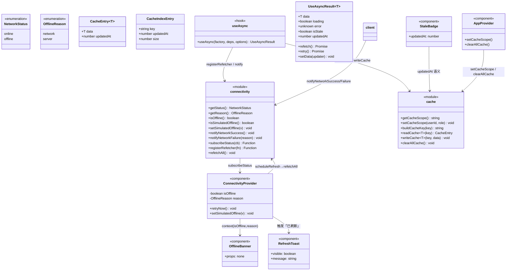
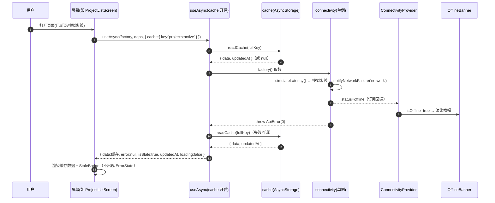
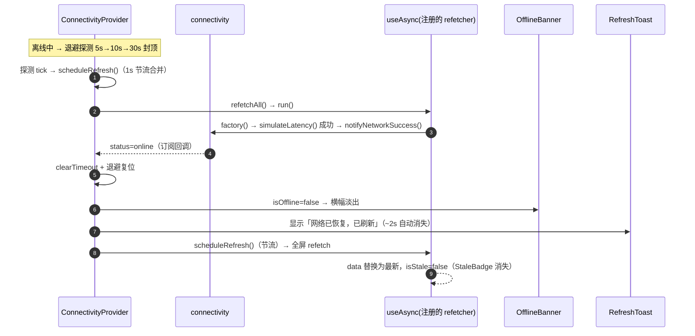
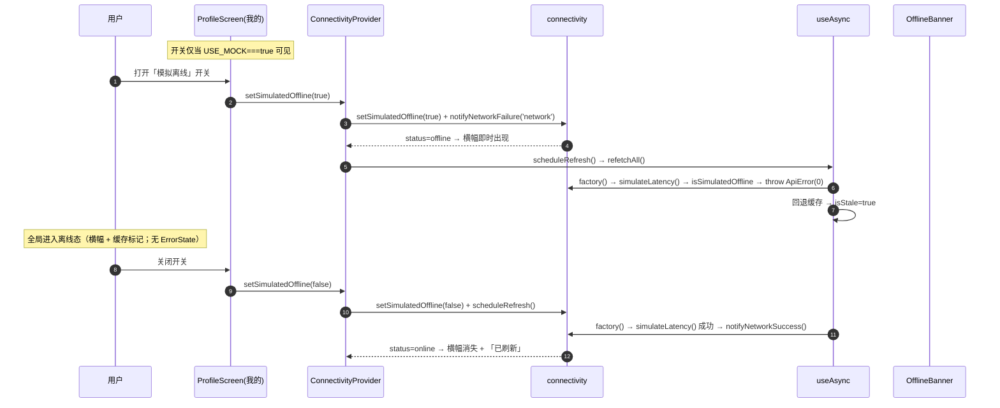
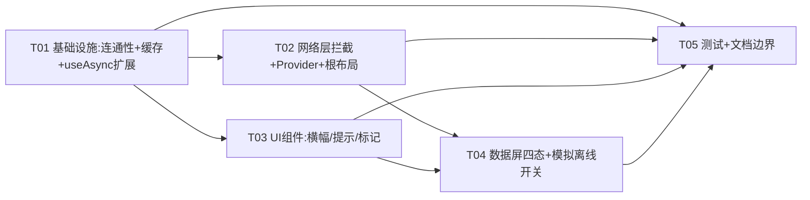

# 架构设计（增量 8）— OpenSchedule 移动端：全局离线态与错误态统一处理

> 档位：**增量架构 + 任务分解**（一文档交付，颗粒度对齐 `ARCH-mobile-increment-7-audit-alignment.md`）。
> 负责人：高见远（架构师）· 实读基准：`D:\GLMclaw\workspace\openschedule`（本次写作时）
> 上游输入：`PRD-mobile-increment-8-offline.md`（许清楚，v1.0，338 行，本文唯一需求依据）· `ARCH-mobile.md` §10（`:561-575`，状态管理边界）· `PRD-mobile.md:103`（`M-P1-06`）
> **本文含实现方案、文件列表、类图、时序图、任务分解。所有代码事实均给 `文件:行号`，凡不确定一律进 §9。**
> **硬约束**：① 零新增 npm 依赖 ② 禁用 `react-native-reanimated` / `react-native-gesture-handler` ③ 样式数值只取 `src/theme/tokens.ts` ④ 最小变更 ⑤ **本阶段只产出文档，不写业务代码** ⑥ 验收可验证（模拟离线开关在 mock 构建下可见可用）。

---

## 0. 主理人已拍板决策（不可更改，本文全程遵守）

| # | 拍板结论 | 本文落地位置 |
| --- | --- | --- |
| **Q1** | 连通性**只能被动推断**（零依赖，不得引入 `netinfo` / `expo-network`）；恢复靠三条主动路径：①用户重试 ②`AppState` 回前台 ③退避探测 5s→10s→30s | §2.1 / §2.4 / §5 |
| **Q2** | **提供「模拟离线」开关**（验收前提）；**可见条件 = `USE_MOCK === true`**（不用 `__DEV__` 作唯一门槛，因验收跑生产 web 包 `__DEV__===false`）；落点「我的」页 | §2.5 / §6-T04 |
| **Q3** | **不设硬 TTL**；改为展示相对更新时间 + 容量上限 + LRU 淘汰 | §2.3 / §4.1 |
| **Q4** | 缓存 key 含 **`userId` + `role`**；`signOut` 清空缓存 | §2.3 / §4.1 / §8 |
| **Q5** | 离线横幅**全局唯一**（挂根布局）、默认不可关闭、恢复后自动消失 | §2.6 / §6-T03 |
| **Q7** | 连通性状态**不进 `AppProvider`**，新增独立 `ConnectivityProvider`；**必须显式更新 `ARCH-mobile.md:568` 边界表述** | §2.7 / §6-T05 |
| **Q8** | 新增轻提示组件**复用 `UndoToast` 样式手法**，**不改 `UndoToast` 本体** | §6-T03 |
| **Q9** | 缓存预渲染（SWR）本次**不做**，列 P2 | §1.3 |
| **Q10** | 横幅文案区分「无网络」（`code===0`）与「服务暂时不可用」（其余） | §2.6 / §4.2 |
| **Q11** | 离线写操作**不排队补传**，明确提示 + 回滚 | §2.8 |
| **Q12** | 恢复后刷新 **1s 节流合并** | §2.4 |

### 0.1 架构师裁决（本版新增定案，见 §2.3 详述）

| # | 裁决 | 结论 |
| --- | --- | --- |
| **A1（=Q6）** | **缓存层落点**：新增 `useCachedAsync` wrapper **还是** 在 `useAsync` 上加可选 `cacheKey` | **裁决：扩展 `useAsync`**（新增**可选** `options.cache`，默认 `undefined` ⇒ 既有全部调用点**行为逐字节不变**）。理由见 §2.3：① 单一真相源（缓存读写必须复用 `useAsync` 既有竞态/卸载保护）② **零回归的关键证据**：12 个组件测试 `jest.mock('@/hooks')` 并显式提供 `useAsync`，若改名 wrapper 会让这 12 个 mock 缺函数而**整批崩溃**；扩展保名 ⇒ mock 零改动。**此裁决放宽 PRD §8-N4 字面措辞，请 team-lead 确认（见 §9-M1）。** |
| **A2** | **降级（回退缓存）的判据** | **`ApiError.code === 0`（网络层）或 `500 ≤ code < 600`（HTTP 5xx 服务端异常）** ⇒ 回退缓存；其余（4xx 业务错误）**不降级**，走整屏 `ErrorState`。⚠️ **上界必须收敛到 599**：本仓后端**业务错误码为 5 位数**（40301 越权 / 40901 乐观锁 / 40902 非法迁移），数值上天然 `>= 500`；若仅用 `code >= 500` 会把它们误判为「可降级」→ 反而显示陈旧缓存，与 A2 目标「避免 403/40902 显示陈旧数据」相悖。比 PRD Q10 的「所有错误都降级」更严格、更正确。见 §9-M2。 |
| **A3** | **「相对更新时间」刷新机制** | `StaleBadge` 挂载期间起 **60s 定时器**重算（仅可见时运行，卸载清理；零依赖）。见 §2.3。 |
| **A4** | **缓存上限 / 淘汰** | 条目上限 **50**、总体积上限 **512KB**；超限按**最近写入时间**淘汰（LRU 近似）。默认建议，可调。见 §4.1。 |

---

# Part A：系统设计

## 1. 实现方案总览 + 技术选型

### 1.1 核心难点

| 难点 | 说明 | 应对 |
| --- | --- | --- |
| **N1 零依赖下无系统级网络事件** | `netinfo` / `expo-network` 均未装且禁装（`package.json:5-22`），`AppState` 是唯一可用的 RN 核心信号（F13） | §2.1：连通性**被动推断**（以最近一次请求结果为准）+ 三条主动恢复路径 |
| **N2 mock 模式下 `ApiError(0)` 永不触发** | 各 service 首行 `if (USE_MOCK)` 短路，不走 `client.ts:126`（F12）⇒ 默认配置下「断网」**无法自然复现** | §2.2：**单点拦截** `simulateLatency()`（60 处 mock 调用点**首先 await** 它）+ §2.5「模拟离线」开关 |
| **N3 全局唯一横幅 vs 逐屏状态** | 离线是**设备态**（横幅唯一），但「有缓存 / 无缓存」是**逐屏**判定 | §2.6：横幅挂根布局读全局连通性；缓存标记 `StaleBadge` 由各屏按 `isStale` 局部渲染 |
| **N4 缓存读写与竞态** | `useAsync` 已有 `requestId` / `mounted` 保护（`useAsync.ts:86-118`）；缓存读写若另起一套易生竞态 | §2.3：缓存读写**内联进 `run()`**，复用同一 `requestId`/`mounted` 守卫（这是裁决 A1 选「扩展」而非「wrapper」的核心理由） |
| **N5 恢复后自动刷新且不闪 loading** | `useAsync.refetch` 无条件 `setRawLoading(true)`（`:89`），直接调用会让「缓存屏」闪骨架屏 | §2.3：`loading` 收窄为 `loading && 无可展示数据`；恢复刷新走 `registerRefetcher` 注册的 `run` |
| **N6 角色切换缓存串数据** | 角色切换会改变可见数据（`PRD-mobile.md:91`），且各屏 `deps` 普遍不含 `role` | §2.3：缓存 key 含 `role`；`useAsync` 将**缓存 scope** 追加进 effect 依赖 ⇒ 角色/用户变化自动重取 |
| **N7 测试 mock 面** | 12 个组件测试 `jest.mock('@/hooks')` 显式提供 `useAsync`（实读） | 裁决 A1：保名扩展 ⇒ 12 个 mock **零改动** |

### 1.2 技术选型（沿用既有栈，**零新依赖**）

| 维度 | 选择 | 理由 |
| --- | --- | --- |
| 框架 | **React Native + Expo（沿用）** | 既有基线 |
| 连通性 | **自建被动推断模块** `src/services/connectivity.ts`（模块级单例 + 订阅） | 零依赖；不引 `netinfo` / `expo-network` |
| 回前台信号 | **RN 核心 `AppState`**（`react-native` 内置，当前未使用 F13） | 零依赖，唯一可用的系统级「回前台」事件 |
| 退避探测 | **`setTimeout` 自调度**（5s→10s→30s 封顶） | 零依赖 |
| 缓存 | **`@react-native-async-storage/async-storage`**（`package.json:7`，已装） | 复用既有依赖；与 `PREFERENCE_KEYS` / `DRAFT_KEYS` 命名一致（`config.ts:20-34`） |
| 缓存写入时机 | `useAsync.run()` 成功分支内 fire-and-forget | 与竞态守卫同源（N4） |
| 异步三态 | **扩展既有 `useAsync`**（可选 `cache`）+ 既有 `StateViews` | 单一真相源（A1）；不改三态组件结构（N6 硬约束） |
| 横幅 / 提示动效 | **RN 内置 `Animated`**（经 `FadeIn.tsx` / `UndoToast.tsx` 手法） | 硬约束：禁 `reanimated` / `gesture-handler` |
| 「模拟离线」开关 | **RN 核心 `Switch`**（已在 `NotificationSettingsScreen.tsx:7` / `CreateItemScreen.tsx:9` 使用） | 零依赖；沿用既有 token 配色手法 |
| 样式 | **`src/theme/tokens.ts`**（离线用 `warning` / `warningFaint`，**不用** `danger`） | 硬约束：禁止内联魔法数字 |
| 新交互 | **`PressableScale`**（唯一允许的新按压原语；裸 `<Pressable>` 白名单**不得扩大**） | 硬约束 |

### 1.3 范围边界

- **做**：全局离线横幅 + 逐屏缓存降级 + 手动重试 + 恢复自动刷新（+「已刷新」提示）+ 缓存隔离/清理/上限 + 「模拟离线」开关 + 离线写操作明确拒绝。
- **不做**：缓存预渲染 SWR（Q9 / `M-P1-06-12`）· 硬 TTL / 强制过期拦截（Q3 / `M-P1-06-13` 部分）· 离线写排队补传（Q11 / §8-N1）· 系统级网络监听（§8-N8）· 改后端 / web / Prisma（§8-N9）· 改 `ErrorState`/`EmptyState`/`LoadingView` 结构与既有样式（§8-N6）· 改 `UndoToast` 本体（Q8）· 改既有测试断言（§8-N5）· 任何 git 操作（§8-N11）。

---

## 2. 关键机制设计

### 2.1 连通性被动推断（Q1）

**结论**：新建 `src/services/connectivity.ts`，一个**模块级单例状态机**（不进 React、不进 `AppProvider`）。它只回答一个问题：**「最近一次真实请求的结果是否表明网络可用」**。

```ts
export type NetworkStatus = 'online' | 'offline'
export type OfflineReason = 'network' | 'server'   // Q10 文案分支依据
```

- **离线信号**：`notifyNetworkFailure(reason)`（由网络层在请求失败时调用）。
- **在线信号**：`notifyNetworkSuccess()`（由网络层在请求成功时调用）。
- **恢复判据**（对齐 PRD §6-D3.1）：**一次请求不再失败**（即 `notifyNetworkSuccess()`）即判定恢复。
- **三条恢复路径**（§2.4 由 Provider 编排）：①用户重试 ②`AppState` 回前台 ③退避探测。
- **订阅**：`subscribeStatus(cb)` 供 `ConnectivityProvider` 桥接到 React 状态。

> **为何不进 `AppProvider`（Q7）**：`ARCH-mobile.md:568` 的「不做全局缓存」针对的是**服务端数据**；连通性是**设备态**（类似信号格），既不是服务端数据、也不参与乐观更新/会话，故独立成模块 + 独立 Provider，语义更清晰、耦合更低。**该边界已同步写入 `ARCH-mobile.md:568`（见 §2.7）。**

### 2.2 单点离线拦截（采纳 team-lead 已验证方案）

**结论**：**采纳** team-lead 的「`simulateLatency()` 单点拦截」方案，并补充真实模式的 `request()` 上报。这是 N2（mock 下无法复现断网）的**唯一低成本解法**。

**事实依据（本次复核）**：`simulateLatency()`（`client.ts:80-88`）被全仓 **60 处** mock 调用点以 `if (USE_MOCK) { await simulateLatency(); ... }` 形式**首先 await**（实读分布：`task.service.ts` 28 · `focus.service.ts` 20 · `project.service.ts` 6 · `auth.service.ts` 3 · `audit.service.ts` 3）。

**改造**（仅改 `client.ts` 两处，**不动 60 处调用点**）：

```ts
// simulateLatency()：mock 分支的统一入口
export function simulateLatency(): Promise<void> {
  if (isSimulatedOffline()) {                 // 来自 services/connectivity.ts
    notifyNetworkFailure('network')           // 上报离线（读 + 写都覆盖）
    return Promise.reject(new ApiError(0, '网络连接失败，请检查网络后重试'))
  }
  notifyNetworkSuccess()                      // 正常 mock：上报在线
  const span = MOCK_LATENCY.max - MOCK_LATENCY.min
  return delay(MOCK_LATENCY.min + Math.floor(Math.random() * span))
}

// request()：真实模式（USE_MOCK=false）的上报
//   成功（:157-158）→ notifyNetworkSuccess()
//   fetch catch（:124-127）→ notifyNetworkFailure('network')
//   仅 HTTP 5xx（:143-148，response.status>=500）→ notifyNetworkFailure('server')；4xx 不上报
//   HTTP 200 业务错误（:152-155，code!=0）→ 不上报（非网络问题）
```

**收益**：一处生效、**读写全覆盖**（读失败→降级缓存；写失败→既有回滚 + 提示），**60 处调用点零改动**。真实模式经 `request()` 上报，两条路径统一汇入 `connectivity`。

> **不采用**「在 16 屏/hook 层拦截」的替代方案：hook 层无法覆盖**写操作**（写不走 `useAsync`），且需改动更多文件，违背最小变更。

### 2.3 缓存层与四态升级（Q6 裁决 = A1）

#### 2.3.1 裁决：**扩展 `useAsync`（不新增 wrapper）**

**结论**：`useAsync(factory, deps, options)` 的 `options` 增加**可选**字段 `cache?: { key: string }`。默认 `undefined` ⇒ 新增代码路径**整段跳过**，既有全部调用点返回对象除**多出两个字段**外**逐字节不变**。

**三条理由**：

1. **单一真相源（技术正确性）**：缓存**读**（失败时回退）与**写**（成功时落盘）必须与 `run()` 内既有的 `requestId` / `mountedRef` 竞态守卫（`useAsync.ts:86-118`）**同源**，否则 wrapper 需**重造**一套竞态保护，并在 `setData`（乐观更新）与「成功取数」之间难以区分（wrapper 只能靠 `prevLoading` 启发式），引入边界 bug。
2. **零回归（决定性证据）**：实读 **12 个**组件测试 `jest.mock('@/hooks')` 并**显式提供 `useAsync` 返回对象**（`project-list-fab.test.tsx:36-46`、`board-search.test.tsx:52+`、`draft-persist.test.tsx:33-43`、`screen-gate` / `today-focus-gate` / `today-focus-review-actions` / `my-submissions-rework` / `no-nested-buttons` / `increment2-focus-footer` / `increment3-notify-screen` / `bugfix-root-stack-back` / `audit-center-render`）。若改名为 `useCachedAsync`，这 12 个 mock **缺该函数 ⇒ 渲染即崩溃**，需改 12 个测试文件（与 §8-N5 精神冲突）。**保名扩展 ⇒ mock 零改动**：mock 返回对象无 `isStale`（`undefined` → falsy）⇒ 屏幕新增的缓存分支**不渲染** ⇒ 既有断言**零变化**。
3. **对 N4 的处置**：PRD §8-N4 禁「修改 `useAsync` 既有签名与行为」。本裁决新增的是**可选字段**（默认关闭），既有 21 处调用点**行为不变**；且相较 wrapper，扩展方案**更符合 N4 的意图**（零回归）。⇒ 判定 **N4 的意图被满足，仅字面措辞需放宽**。**请 team-lead 确认此读法（§9-M1）。**

#### 2.3.2 `useAsync` 扩展后的契约

```ts
export interface UseAsyncOptions<T> {
  immediate?: boolean
  initialData?: T | null
  /** 新增（可选）：开启后启用「断网回退缓存 + 成功落盘」；不传 = 与现状完全一致 */
  cache?: { key: string }        // key 为「域内 key」（如 'projects:active'），完整 key 由 hook 拼 scope
}

export interface UseAsyncResult<T> {
  data: T | null
  loading: boolean
  error: unknown
  isStale: boolean               // 新增：当前展示的是「因取数失败而回退的缓存」
  updatedAt: number | null       // 新增：缓存数据写入时刻（epoch ms），仅 isStale 时有值
  refetch: () => Promise<void>
  retry: () => Promise<void>
  setData: (updater: T | null | ((prev: T | null) => T | null)) => void
}
```

**内部行为（`cache` 开启时）**：

| 时机 | 行为 |
| --- | --- |
| `run()` **成功** | `setData(result)` 后 `void writeCache(fullKey, result)`（fire-and-forget，失败静默）；记录 `lastSuccessAt = Date.now()` |
| `run()` **失败**且 `isDegradableError(err)`（`code===0` \|\| `500≤code<600`） | `await readCache(fullKey)`；命中则置内部缓存态；`isStale = true` |
| `run()` 失败但**不可降级**（4xx） | 照常 `setError(err)`，**不**回退缓存 |
| **返回值收窄** | `data = freshData ?? cachedData`；`error` 对外 **`isStale ? null : rawError`**（⇒ 屏幕既有 `error ? ErrorState` 分支**无需改结构**）；`loading = rawLoading && data == null`（⇒ 恢复刷新**不闪骨架屏**） |
| **effect 依赖** | `cache` 开启时，把**缓存 scope**（`userId:role`）追加进 effect 依赖 ⇒ 角色/用户变化**自动重取**（N6） |

> **关键收益**：屏幕的 **3 分支结构 `loading ? LoadingView : error ? ErrorState : …` 保持不变**（hook 已把「有缓存」情形吸收为「成功 + isStale」）。屏幕改造量 = ① 传 `cache.key` ② 在数据分支叠加 `<StaleBadge/>` ③ 给 `ErrorState` 传离线文案。**「四态」由 hook 内部达成，屏幕侧仍是三分支**（最小侵入，对齐 §5.5）。

#### 2.3.3 缓存 scope 机制（隔离 + 角色切换）

- `services/cache.ts` 维护模块级 `currentScope`（默认 `'anon:manager'`）。
- `AppProvider` 在**登录 / 角色切换**时调用 `setCacheScope(user?.id, role)`；`signOut` 调用 `clearAllCache()`（Q4）。
- `useAsync` 内 `fullKey = 'os.cache.' + scope + '.' + key`；`scope` 参与 effect 依赖 ⇒ 角色切换触发重取（N6）。

#### 2.3.4 16 屏升级为「四态」的改造量与取舍

- **改造量**（每屏 3 处，机械式）：① `useAsync(factory, deps)` → `useAsync(factory, deps, { cache: { key: '<域内 key>' } })`；② 数据分支顶部加 `{data.isStale ? <StaleBadge updatedAt={data.updatedAt}/> : null}`；③ `ErrorState` 加 `message={isNetworkError(data.error) ? NETWORK_OFFLINE_MESSAGE : undefined}`。
- **逐屏取舍**（`cache` 可选 ⇒ 可不开启，零行为变化）：**开启**数据屏（工作台 / 今日聚焦 / 看板 / 项目列表 / 任务详情 / 日历 / 个人计划 / 通知列表 / 我的提报 / 审核中心 / 通知设置 / 提报）；**可不开**纯展示屏（关于 / 我的）。
- **实读校正**：PRD 称「16 屏 / 39 处调用点」，本次 `grep 'useAsync<'` 实读为 **15 个屏文件 / 约 21 处调用点**（差异见 §9-M3）。**设计为逐调用点可选开启 ⇒ 精确条数不影响方案**；工程师以 `grep -rn 'useAsync<' src/screens` 实测为准。

### 2.4 恢复自动刷新 + 节流（Q12）

**编排全部落在 `ConnectivityProvider`**（不进 `AppProvider`，Q7）：

| 机制 | 实现 |
| --- | --- |
| **刷新注册表** | `services/connectivity.ts` 提供 `registerRefetcher(fn)` / `refetchAll()`；`useAsync`（**cache 开启时**）在挂载期 `registerRefetcher(run)`，卸载注销 |
| **节流合并（Q12）** | Provider 的 `scheduleRefresh()` 用 **1s 尾沿节流**合并多次触发；窗口内多次恢复/回前台只刷一次 |
| **路径①用户重试** | 横幅「重试」→ `retryNow()` → `scheduleRefresh()` |
| **路径②回前台** | `AppState.addEventListener('change', s => s==='active' && isOffline() && scheduleRefresh())` |
| **路径③退避探测** | 离线期间 `setTimeout` 自调度 **5s → 10s → 30s → 30s…**；每次 tick `scheduleRefresh()`；转在线即 `clearTimeout` + 退避复位 |
| **「已刷新」提示** | 状态 `offline → online` 转变时，Provider 触发一次 `RefreshToast`（~2s 自动消失，无操作按钮，Q8） |

> **为何注册表放模块级而非 context**：`useAsync` 是纯逻辑 hook，避免依赖 React context（否则 `useAsync` 被用在 Provider 外即抛错）；模块级注册表让 `useAsync` 与 Provider 解耦，测试友好。

### 2.5 「模拟离线」开关（Q2，验收前提）

- **落点**：`ProfileScreen`（「我的」页）设置区新增一条 `SettingSwitchRow`，**可见条件 = `USE_MOCK === true`**（团队已拍板，不用 `__DEV__`）。
- **交互**：`Switch`（RN 核心，token 配色）→ `useConnectivity().setSimulatedOffline(v)`。
  - 打开：模块置位 + **立即** `notifyNetworkFailure('network')`（横幅即时出现）+ `scheduleRefresh()`（各屏尝试取数 → 失败 → 回退缓存）。
  - 关闭：模块复位 + `scheduleRefresh()`（各屏重取 → `simulateLatency()` 成功 → `notifyNetworkSuccess()` → 转在线 → 横幅消失 + 「已刷新」）。
- **持久性**：**仅会话内**（不落 AsyncStorage；刷新页面即复位为在线），避免污染演示状态。

### 2.6 全局离线横幅（Q5 / Q10）

- **挂载点**：`App.tsx` 的 `styles.root` 内、`<RootNavigator />` 之上（`App.tsx:15-29`），**全局唯一**，`isOffline` 为假时渲染 `null`。
- **文案（Q10）**：主文案 = `reason==='network' ? '当前无网络连接' : '服务暂时不可用'`；副文案「正在显示上次缓存内容」；右侧「重试」文字按钮（`PressableScale`）→ `retryNow()`。
- **配色**：底色 `colors.warningFaint`、文字 `colors.warning`、圆角 `radius.card`、**无阴影**（离线是降级而非错误，不用 `danger`）。
- **动效**：进出用 `Animated` 淡出（`motion.duration.fast`，复用 `UndoToast` 手法）；**不改 `UndoToast` 本体**。
- **已知小瑕疵**：横幅自带 `paddingTop: insets.top` 且为根布局首个子元素；带刘海的原生设备上，屏幕自身的 `insets.top` 会与之叠加产生**双间距**（Web 验收 `insets.top===0` 不受影响）。见 §9-M4。

### 2.7 边界更新（Q7）：`ARCH-mobile.md:568`

将 `ARCH-mobile.md:568`「状态管理边界」一行**追加**：

> 「；**连通性（在线/离线）为设备态，不属服务端数据**，由独立 `ConnectivityProvider` 承载，不进入本 Provider（增量 8）」

**本次已同步落地该行编辑**（纯文档，非业务代码），保持基线文档与实现一致。

### 2.8 离线写操作（Q11）

写操作（承接 / 流转 / 计时 / 评论 / 提报）在 `simulateLatency()` 拦截下会**直接抛 `ApiError(0)`**（§2.2），从而：
- 既有乐观更新链路（`AppProvider.pushOptimistic` → 失败 `rollbackOptimistic`）**自动回滚**；
- 既有失败提示（`getErrorMessage`）**自动出现**。

**本次仅需**：确认写路径的失败提示文案可读（如需可统一为「当前无网络连接，请稍后重试」），**不新增排队/补传**（Q11）。**无需新增代码**——这是 §2.2 单点拦截的自然收益。

---

## 3. 文件列表（相对 `apps/mobile/`，标注 新增 / 修改）

### 3.1 新增文件

| 文件 | 职责 |
| --- | --- |
| `src/services/connectivity.ts` | **连通性单例**：`NetworkStatus` / `OfflineReason`、`isOffline` / `isSimulatedOffline`、`setSimulatedOffline`、`notifyNetworkSuccess` / `notifyNetworkFailure`、`subscribeStatus`、`registerRefetcher` / `refetchAll` |
| `src/services/cache.ts` | **缓存层**：`buildCacheKey` / `getCacheScope` / `setCacheScope` / `readCache` / `writeCache` / `clearAllCache`；索引 + 上限 + 淘汰；`os.cache.` 前缀 |
| `src/store/ConnectivityProvider.tsx` | **独立 Provider**：桥接 `connectivity` 单例到 React 状态；`AppState` 回前台、退避探测、`scheduleRefresh`（1s 节流）、「已刷新」提示编排；`useConnectivity()` |
| `src/components/OfflineBanner.tsx` | **全局离线横幅**（Q5/Q10）：warning 系、`Feather wifi-off`、副文案、`重试`（`PressableScale`） |
| `src/components/RefreshToast.tsx` | **「已刷新」轻提示**（Q8）：复用 `UndoToast` 定位/动画手法，**无操作按钮**，~2s 自动消失 |
| `src/components/StaleBadge.tsx` | **缓存标记**：`Tag('缓存', tone='warning')` + `caption`「上次更新 {相对时间}」；含 60s 刷新定时器（A3） |
| `tests/offline-cache.test.ts` | **新增**：`cache` 层（读写/索引/淘汰/清空/scope）+ `connectivity` 纯逻辑 单测 |
| `tests/offline-hook.test.tsx` | **新增**：`useAsync` 缓存分支（成功落盘 / 失败回退 / 不降级 / isStale / loading 收窄 / scope 依赖） |
| `tests/offline-banner.test.tsx` | **新增**：`OfflineBanner` / `RefreshToast` / `StaleBadge` 组件级渲染 + 模拟离线开关生效（照抄 `project-list-fab.test.tsx` 范式） |

### 3.2 修改文件

| 文件 | 类型 | 职责（改动点） |
| --- | --- | --- |
| `src/hooks/useAsync.ts` | **修改** | 新增**可选** `options.cache`；返回值新增 `isStale` / `updatedAt`；`run()` 内接入缓存读写（复用既有竞态守卫）；`loading` 收窄；`cache` 开启时 effect 依赖追加 scope（A1，§2.3） |
| `src/services/client.ts` | **修改** | `simulateLatency()` 内检查模拟离线（抛 `ApiError(0)` + 上报）；`request()` 成功/失败上报（§2.2） |
| `src/services/config.ts` | **修改** | 新增 `CACHE_KEYS`（`os.cache.` 前缀）与 `CACHE_LIMITS`（50 条 / 512KB），对齐 `PREFERENCE_KEYS` / `DRAFT_KEYS` 命名（`config.ts:20-34`） |
| `src/types/api.ts` | **修改** | 新增 `isNetworkError` / `isDegradableError` 判据 + `NETWORK_OFFLINE_MESSAGE` 常量（对齐 `getErrorMessage`，`api.ts:55-59`） |
| `src/utils/date.ts` | **修改** | 新增 `formatRelativeTime(value, now?)`（「刚刚 / X 分钟前 / X 小时前 / X 天前」；零依赖，对齐既有 `Intl` 风格） |
| `src/components/Tag.tsx` | **修改** | `TagProps.tone` 增加 `'warning'`（`warningFaint` 底 + `warning` 字，**additive**，既有用法零影响） |
| `src/components/index.ts` | **修改** | 导出 `OfflineBanner` / `RefreshToast` / `StaleBadge`（及其 Props） |
| `src/store/AppProvider.tsx` | **修改** | 登录/角色变更时 `setCacheScope(user?.id, role)`；`signOut` 增 `clearAllCache()`（Q4；落点在 `signOut:229-247`） |
| `App.tsx` | **修改** | 挂 `ConnectivityProvider` + `<OfflineBanner/>` + `<RefreshToast/>`（`App.tsx:15-29`） |
| `src/screens/ProfileScreen.tsx` | **修改** | 设置区新增「模拟离线」`SettingSwitchRow`（**仅 `USE_MOCK===true` 可见**，Q2）；本地 `SettingRow` 增可选 `trailing` |
| `src/screens/*.tsx`（数据屏，约 12 个） | **修改** | 三分支升级为「hook 内四态」：传 `cache.key` + 叠加 `StaleBadge` + `ErrorState` 离线文案（§2.3.4） |
| `docs/mobile-app/ARCH-mobile.md` | **修改** | §10 `:568` 追加连通性=设备态的边界表述（§2.7，**本次已落地**） |

> **测试文件零改动**（裁决 A1 的关键收益）：12 个组件测试的 `jest.mock('@/hooks')` 因 `useAsync` **保名**而无需修改；mock 返回对象缺 `isStale` ⇒ 新增分支不渲染 ⇒ 既有断言零变化。

---

## 4. 数据结构与接口

### 4.1 类图（连通性 + 缓存 + 扩展 hook + 新组件）



### 4.2 关键 TS 接口签名

```ts
// ── src/services/connectivity.ts ───────────────────────────────
export type NetworkStatus = 'online' | 'offline'
export type OfflineReason = 'network' | 'server'

export function getStatus(): NetworkStatus
export function getReason(): OfflineReason
export function isOffline(): boolean
export function isSimulatedOffline(): boolean
export function setSimulatedOffline(value: boolean): void
export function notifyNetworkSuccess(): void
export function notifyNetworkFailure(reason: OfflineReason): void
export function subscribeStatus(listener: (status: NetworkStatus, reason: OfflineReason) => void): () => void
export function registerRefetcher(refetch: () => void): () => void
export function refetchAll(): void

// ── src/services/cache.ts ──────────────────────────────────────
export interface CacheEntry<T> { data: T; updatedAt: number }
export function getCacheScope(): string                    // `${userId}:${role}`，默认 'anon:manager'
export function setCacheScope(userId: string | null, role: string): void
export function buildCacheKey(key: string): string          // `os.cache.${scope}.${key}`
export function readCache<T>(key: string): Promise<CacheEntry<T> | null>
export function writeCache<T>(key: string, data: T): Promise<void>
export function clearAllCache(): Promise<void>              // 遍历索引 removeItem（见 §9-M5）

// ── src/types/api.ts（新增判据） ────────────────────────────────
export const NETWORK_OFFLINE_MESSAGE = '当前无网络连接，请检查网络后重试'
export function isNetworkError(error: unknown): boolean     // ApiError.code === 0
export function isDegradableError(error: unknown): boolean  // code === 0 || (500 ≤ code < 600)

// ── src/utils/date.ts（新增） ──────────────────────────────────
export function formatRelativeTime(value: string | number | Date, now?: number): string
// '刚刚' | 'X 分钟前' | 'X 小时前' | 'X 天前'

// ── src/hooks/useAsync.ts（扩展） ──────────────────────────────
export interface UseAsyncOptions<T> {
  immediate?: boolean
  initialData?: T | null
  cache?: { key: string }        // 新增，可选
}
export interface UseAsyncResult<T> {
  data: T | null
  loading: boolean
  error: unknown
  isStale: boolean               // 新增
  updatedAt: number | null       // 新增
  refetch: () => Promise<void>
  retry: () => Promise<void>
  setData: (updater: T | null | ((prev: T | null) => T | null)) => void
}

// ── src/store/ConnectivityProvider.tsx ─────────────────────────
export interface ConnectivityContextValue {
  isOffline: boolean
  reason: OfflineReason
  retryNow: () => void
  setSimulatedOffline: (value: boolean) => void
}
export function useConnectivity(): ConnectivityContextValue

// ── src/components/StaleBadge.tsx ──────────────────────────────
export interface StaleBadgeProps { updatedAt: number }       // epoch ms

// ── src/components/RefreshToast.tsx ────────────────────────────
export interface RefreshToastProps { visible: boolean; message?: string; durationMs?: number }
```

---

## 5. 程序调用流程（时序图）

### 5.1 时序图 ①：断网命中缓存（降级可用）



### 5.2 时序图 ②：恢复后自动刷新（含退避探测 + 节流 + 「已刷新」）



### 5.3 时序图 ③：模拟离线开关生效（验收路径）



---

## 6. 任务列表（有序 · 含依赖 · 按实现顺序，可直接派给工程师）

> **硬约束遵守**：≤5 个任务；每任务 ≥3 个相关文件；按功能/层次分组；**T01 = 基础设施**；依赖尽量收敛到「仅依赖 T01」。

### T01 — 基础设施：连通性单例 + 缓存层 + `useAsync` 扩展 + 类型/工具（P0，无依赖）

**Source Files（6）**：`src/services/connectivity.ts`（新增）、`src/services/cache.ts`（新增）、`src/services/config.ts`、`src/types/api.ts`、`src/utils/date.ts`、`src/hooks/useAsync.ts`

**内容**：
1. **`connectivity.ts`**（§2.1 / §4.2）：状态机 + 模拟离线标志 + `subscribeStatus` + `registerRefetcher` / `refetchAll`。**无 React 依赖**。
2. **`cache.ts`**（§2.3.3 / §4.2）：`os.cache.<scope>.<key>` 读写；**索引式**管理（条目上限 50 / 总体积 512KB / 按最近写入淘汰）；`clearAllCache()` **必须走索引 `removeItem` 逐键删除**（**不得依赖 `getAllKeys`** —— 测试替身 `tests/setup.ts:8-25` 未实现它，见 §9-M5）。
3. **`useAsync.ts`**（§2.3.2）：新增**可选** `options.cache`；返回值新增 `isStale` / `updatedAt`；`run()` 成功分支 `writeCache`（复用既有 `requestId`/`mounted` 守卫，`:86-118`）；失败且 `isDegradableError` 时 `readCache` 回退；`loading = rawLoading && data==null`；`cache` 开启时 effect 依赖追加 scope。**默认不传 `cache` 的调用点行为必须逐字节不变**。
4. **`config.ts`**：新增 `CACHE_KEYS`（前缀 `os.cache.`）与 `CACHE_LIMITS`。
5. **`types/api.ts`**：`isNetworkError` / `isDegradableError` / `NETWORK_OFFLINE_MESSAGE`。
6. **`utils/date.ts`**：`formatRelativeTime`。

**验收**：`tsc --noEmit` 零错误；`tests/offline-cache.test.ts`（T05 交付）纯逻辑用例全绿；既有 44 套件**零回归**（`useAsync` 默认路径不变）。

### T02 — 网络层拦截 + 全局 Provider + 根布局装配（P0，依赖 T01）

**Source Files（4）**：`src/services/client.ts`、`src/store/ConnectivityProvider.tsx`（新增）、`App.tsx`、`src/store/AppProvider.tsx`

**内容**：
1. **`client.ts`**（§2.2）：`simulateLatency()` 内 `isSimulatedOffline()` → `notifyNetworkFailure('network')` + `throw ApiError(0, '网络连接失败，请检查网络后重试')`；否则 `notifyNetworkSuccess()`。`request()`：成功 `notifyNetworkSuccess()`；`fetch` catch（`:124-127`）`notifyNetworkFailure('network')`；**仅 HTTP 5xx**（`:143-148`，`response.status >= 500`）`notifyNetworkFailure('server')`，**4xx 业务错误不上报**；HTTP 200 业务错误（`:152-155`）**不上报**。**60 处 mock 调用点零改动**。
2. **`ConnectivityProvider.tsx`**（§2.4）：桥接 `connectivity` 单例；`AppState` 回前台重试；退避探测 5s→10s→30s；`scheduleRefresh()` **1s 节流**；`offline→online` 转变触发 `RefreshToast`；导出 `useConnectivity()`。
3. **`App.tsx`**（§2.6）：`<ConnectivityProvider>` 包住 `<View style={styles.root}>`；`styles.root` 内、`<RootNavigator/>` 之上加 `<OfflineBanner/>`；同级加 `<RefreshToast/>`。
4. **`AppProvider.tsx`**（§2.3.3 / Q4）：登录成功 / 角色变更时 `setCacheScope(user?.id, role)`；`signOut`（`:229-247`）增 `await clearAllCache()`。

**验收**：模拟离线开启后任意取数抛 `ApiError(0)`；`signOut` 后 `os.cache.*` 键被清空；`App.tsx` 装配后 `tsc` 零错误。

### T03 — UI 组件：OfflineBanner + RefreshToast + StaleBadge + Tag tone（P0，依赖 T01）

**Source Files（5）**：`src/components/OfflineBanner.tsx`（新增）、`src/components/RefreshToast.tsx`（新增）、`src/components/StaleBadge.tsx`（新增）、`src/components/Tag.tsx`、`src/components/index.ts`

**内容**：
1. **`OfflineBanner`**（§2.6）：读 `useConnectivity()`；`isOffline` 为假渲染 `null`；warning 系配色 + `Feather wifi-off` + 主/副文案（Q10 区分 `network`/`server`）+ 「重试」（`PressableScale`）→ `retryNow()`；`Animated` 淡入淡出。
2. **`RefreshToast`**（§2.4 / Q8）：**复用 `UndoToast` 定位与动画手法**（底部浮层、`motion` token），**无操作按钮**，~2s 自动消失；**不改 `UndoToast.tsx`**。
3. **`StaleBadge`**（§2.3）：`Tag('缓存', tone='warning')` + `caption`「上次更新 {formatRelativeTime(updatedAt)}」；**60s 定时器**仅挂载期运行（A3）。
4. **`Tag.tsx`**：`tone` 增 `'warning'`（`warningFaint` 底 + `warning` 字；**additive**）。
5. **`index.ts`**：导出三组件与 Props。

**验收**：三组件可独立渲染；样式数值只取 tokens；新交互一律 `PressableScale`（**不新增裸 `<Pressable>`**）。

### T04 — 数据屏四态升级 + 「模拟离线」开关（P0，依赖 T01、T02、T03）

**Source Files（≥3）**：约 12 个数据屏（`WorkspaceScreen` / `TodayFocusScreen` / `BoardScreen` / `ProjectListScreen` / `TaskDetailScreen` / `CalendarScreen` / `PersonalPlanScreen` / `NotificationsScreen` / `MySubmissionsScreen` / `SubmissionScreen` / `AuditCenterScreen` / `NotificationSettingsScreen`）+ `src/screens/ProfileScreen.tsx`

**内容**：
1. **数据屏**（§2.3.4，逐屏 3 处机械改动）：① 传 `cache: { key: '<域内 key>' }`；② 数据分支顶部加 `{data.isStale ? <StaleBadge updatedAt={data.updatedAt}/> : null}`；③ `ErrorState` 加 `message={isNetworkError(data.error) ? NETWORK_OFFLINE_MESSAGE : undefined}`。**不改变三分支结构**；**不开启缓存的屏保持零行为变化**。
2. **`ProfileScreen.tsx`**（§2.5 / Q2）：设置区新增「模拟离线」`SettingSwitchRow`，**可见条件 `USE_MOCK === true`**；`Switch`（RN 核心，token 配色，照抄 `NotificationSettingsScreen.tsx:105-114`）；本地 `SettingRow` 增可选 `trailing`。

**验收**：模拟离线开启 → 有缓存屏显示缓存 + 横幅 + 标记、**不出现 `ErrorState`**；无缓存屏显示 `ErrorState`（文案「当前无网络连接，请检查网络后重试」）+ 横幅；关闭开关 → 自动刷新 + 横幅消失 + 「已刷新」。

### T05 — 测试对齐 + 新增验收套件 + 文档边界更新（P0，依赖 T01–T04）

**Source Files（≥4）**：`tests/offline-cache.test.ts`（新增）、`tests/offline-hook.test.tsx`（新增）、`tests/offline-banner.test.tsx`（新增）、`docs/mobile-app/ARCH-mobile.md`

**内容**：
1. **`offline-cache.test.ts`**：`cache` 读写 / 索引 / 上限淘汰 / `clearAllCache` / `scope` 隔离；`connectivity` 状态机 / 订阅 / 模拟离线 / `refetchAll`。
2. **`offline-hook.test.tsx`**：`useAsync` 缓存分支（成功落盘 / `code===0` 回退 / 4xx 不降级 / `isStale`+`updatedAt` / `loading` 收窄不闪 / scope 变化触发重取 / 默认不传 `cache` 时行为不变）。
3. **`offline-banner.test.tsx`**：`OfflineBanner`（network vs server 文案 + 重试回调）/ `RefreshToast` / `StaleBadge`（相对时间 + 在线不渲染）；模拟离线开关生效（`USE_MOCK` 门禁）。范式照抄 `project-list-fab.test.tsx`（`react-test-renderer` + `act` + `jest.mock`）。
4. **`ARCH-mobile.md`** §10 `:568` 边界表述更新（§2.7，**已在本文交付时落地**）。
5. **全量回归**：`npx jest --config jest.config.js` **全绿**（既有 44 套件**零改动、零回归** + 新增 3 套件）；`tsc --noEmit` 零错误。

**验收**：全量套件全绿；`tsc` 零错误；`ARCH-mobile.md:568` 已含连通性边界表述。

### 6.1 任务依赖图



---

## 7. 依赖包列表

**无新增依赖**（`apps/mobile/package.json` 零改动）。

- 缓存：`@react-native-async-storage/async-storage`（`package.json:7`，已装）。
- 回前台信号：`AppState`（`react-native` 核心）。
- 开关：`Switch`（`react-native` 核心，已在 `NotificationSettingsScreen.tsx:7` 使用）。
- 动效：RN 内置 `Animated`（经 `FadeIn.tsx` / `UndoToast.tsx` 手法）。
- **禁用**：`@react-native-community/netinfo` / `expo-network`（连通性）/ `react-native-reanimated` / `react-native-gesture-handler` / `swr` / `react-query`。

---

## 8. 共享知识 / 跨文件约定

### 8.1 连通性判据（跨文件铁律）

- **离线信号** = 一次请求抛 `ApiError(code===0)`（网络层）或 `500 ≤ code < 600`（HTTP 5xx 服务端异常）；**唯一上报入口** = `client.ts` 的 `simulateLatency()`（mock）与 `request()`（真实）。**上界必须限 599 —— 本仓业务错误码为 5 位数（40301/40901/40902），数值上天然 `>= 500`，不限上界会误降级。**
- **恢复判据** = 一次请求 `notifyNetworkSuccess()`（即不再失败）。
- **横幅文案**（Q10）：`reason==='network'` → 「当前无网络连接」；`reason==='server'` → 「服务暂时不可用」。
- **连通性是设备态，不属服务端数据** ⇒ 不进 `AppProvider`（Q7），由 `ConnectivityProvider` 承载。

### 8.2 缓存 key 规范与隔离

- **完整 key** = `os.cache.<userId>:<role>.<域内 key>`；`scope = userId:role` 由 `AppProvider` 注入（`setCacheScope`）。
- **域内 key 命名**：`<域>:<变体>`（如 `projects:active` / `tasks:detail:<taskId>` / `focus:today`）。
- **隔离**：key 含 `userId` + `role` ⇒ 角色切换天然不串数据；`signOut` → `clearAllCache()`。
- **落盘时机**：仅「成功取数」；**乐观更新 `setData` 不落盘**（避免缓存未确认数据）。

### 8.3 错误码语义（`types/api.ts`）

| 判据 | 含义 | 处置 |
| --- | --- | --- |
| `code === 0` | 网络层失败（离线信号） | 上报离线；**可降级**（回退缓存） |
| `500 ≤ code < 600` | HTTP 5xx 服务端异常 | 上报 `server`；**可降级**（上界须限 599：本仓业务错误码为 5 位数） |
| 其余（4xx） | 业务错误（越权 / 非法迁移 / 乐观锁） | **不降级**，整屏 `ErrorState` |
| 40101 | access 过期 | 走既有 `unauthorizedHandler`（`client.ts:139-141`），本次不改 |

### 8.4 命名约定

- 组件文件 `PascalCase.tsx`：`OfflineBanner` / `RefreshToast` / `StaleBadge`。
- 模块函数：`isOffline` / `isSimulatedOffline` / `notifyNetworkSuccess` / `notifyNetworkFailure` / `registerRefetcher` / `refetchAll`。
- hook 返回值新增字段：`isStale` / `updatedAt`。
- 常量：`NETWORK_OFFLINE_MESSAGE` / `CACHE_KEYS` / `CACHE_LIMITS`。

### 8.5 样式与硬约束速查

| 约束 | 要点 |
| --- | --- |
| 零新依赖 | §7 |
| 禁 reanimated / gesture-handler | 只用内置 `Animated` |
| 样式只取 tokens | 离线用 `warning` / `warningFaint`，**不用** `danger`；禁内联魔法数字 |
| 裸 `<Pressable>` 白名单不扩大 | 新交互一律 `PressableScale` |
| 三态组件不改结构 | `ErrorState` / `EmptyState` / `LoadingView` 仅传 `message` |
| `useAsync` 默认路径不变 | 不传 `cache` 的调用点行为逐字节不变（A1） |
| 60 处 mock 调用点不动 | 只改 `simulateLatency()` / `request()`（§2.2） |
| 测试 mock 零改动 | 12 个组件测试因 `useAsync` 保名而无需改 |

---

## 9. 待明确事项

| # | 事项 | 本文默认处理 | 影响 / 请 team-lead 确认 |
| --- | --- | --- | --- |
| **M1** | **Q6 裁决触及 PRD §8-N4 字面措辞** | 裁决 A1：**扩展 `useAsync`**（可选 `cache`，默认关闭）。理由：① 单一真相源 ② **改名 wrapper 会让 12 个 `@/hooks` mock 崩溃**（零回归的关键）。判定 N4 的**意图**（零回归）被满足，仅**字面**「不修改签名」需放宽 | **请确认此读法**。若 team-lead 坚持 wrapper，则须接受「改 12 个测试 mock」的成本 |
| **M2** | **降级判据比 PRD Q10 更严格** | 仅 `code===0` 或 `500≤code<600`（HTTP 5xx）降级；4xx 不降级（避免 403/40902 显示陈旧数据）。**上界必须限 599 —— 本仓业务错误码为 5 位数（40301/40901/40902），数值上天然 `>= 500`** | 如需完全对齐 PRD「所有错误都降级」，放宽 `isDegradableError` 即可 |
| **M3** | **PRD 称 16 屏 / 39 处，实读 15 屏 / 约 21 处 `useAsync<`** | 以实读为准；设计为**逐调用点可选开启**，精确条数不影响方案 | 工程师以 `grep -rn 'useAsync<' src/screens` 实测确定改造清单 |
| **M4** | **横幅顶部安全区双间距**（带刘海原生设备） | 横幅自带 `insets.top` 且为根布局首子元素；原生刘海机上屏幕自身 `insets.top` 会叠加 → 双间距。**Web 验收 `insets.top===0` 不受影响** | 可接受 cosmetic；如需消除，改为 `position:'absolute'` 覆盖 + 根容器动态顶距 |
| **M5** | **`AsyncStorage` 测试替身缺 `getAllKeys` / `multiRemove`** | `clearAllCache()` 走**索引逐键 `removeItem`**（`tests/setup.ts:8-25` 仅实现 `getItem`/`setItem`/`removeItem`/`clear`） | 已在设计层规避；若改用 `getAllKeys` 则须改 `setup.ts` |
| **M6** | **缓存上限取值**（50 条 / 512KB） | 默认建议，`CACHE_LIMITS` 可调 | 可按实测调整 |
| **M7** | **相对时间刷新间隔**（60s） | `StaleBadge` 挂载期 60s 定时器（A3） | 粒度足够；如需秒级可下调 |
| **M8** | **真实后端无网络层信号（仅 `USE_MOCK=false` 时才有）** | 联调时验证 `request()` 的 `notifyNetworkFailure('network')` | 不影响 mock 验收 |
| **M9** | **「模拟离线」开关持久性** | **仅会话内**（不落盘，刷新即复位） | 避免污染演示状态；如需持久可加 `PREFERENCE_KEYS` |

---

## 附录 A：本次实读证据索引

| 文件 | 关键行号 | 用途 |
| --- | --- | --- |
| `docs/mobile-app/PRD-mobile-increment-8-offline.md` | §4 / §5 / §6-D1~D5 / §7-Q1~Q12 / §8-N1~N11 | 需求依据 |
| `docs/mobile-app/ARCH-mobile.md` | `:561-575`（§10）· `:568`（状态管理边界，本次更新）· `:570`（三态统一）· `:589`（R7） | 架构约束 |
| `apps/mobile/src/hooks/useAsync.ts` | `:15-29`（返回值）· `:86-118`（run / 竞态守卫）· `:150-151`（refetch≡retry） | A1 扩展落点 |
| `apps/mobile/src/services/client.ts` | `:80-88`（simulateLatency）· `:103-160`（request）· `:124-127`（网络异常→ApiError(0)）· `:143-155`（非2xx / 业务错误） | §2.2 拦截点 |
| `apps/mobile/src/services/config.ts` | `:9-12`（USE_MOCK）· `:20-34`（PREFERENCE_KEYS/DRAFT_KEYS 命名） | §2.5 开关门禁 / §4.1 缓存 key |
| `apps/mobile/src/store/AppProvider.tsx` | `:1-3`（职责边界）· `:229-247`（signOut）· `:250-255`（setRole） | §2.3.3 / Q4 |
| `apps/mobile/App.tsx` | `:15-29`（根布局） | §2.6 挂载点 |
| `apps/mobile/src/screens/ProfileScreen.tsx` | `:142-220`（设置区）· `:269-321`（SettingRow） | §2.5 开关落点 |
| `apps/mobile/src/screens/ProjectListScreen.tsx` | `:87-97`（三分支同构） | §2.3.4 升级范式 |
| `apps/mobile/src/screens/NotificationSettingsScreen.tsx` | `:7` / `:105-114`（Switch + token 配色） | §2.5 Switch 手法 |
| `apps/mobile/src/components/UndoToast.tsx` | `:27-132`（底部浮层 + 动画） | Q8 复用手法 |
| `apps/mobile/src/components/StateViews.tsx` | `:27` / `:62` / `:88-109`（三态，ErrorState 已支持 message） | 复用，不改结构 |
| `apps/mobile/src/components/Tag.tsx` | `:9-15`（TagProps.tone） | §4.1 增 warning tone |
| `apps/mobile/src/theme/tokens.ts` | `:36-38`（faint 浅底）· `:57-61`（success/warning/danger） | 配色 |
| `apps/mobile/src/types/api.ts` | `:26-36`（ApiError）· `:55-59`（getErrorMessage）· `:61-80`（isNetworkError / isDegradableError / NETWORK_OFFLINE_MESSAGE） | §4.2 判据 |
| `apps/mobile/tests/setup.ts` | `:8-25`（AsyncStorage 替身，无 getAllKeys） | §9-M5 |
| `apps/mobile/tests/project-list-fab.test.tsx` | `:36-46`（mock `@/hooks` 提供 useAsync） | A1 零回归证据 |
| `apps/mobile/package.json` | `:5-22`（依赖，零新增） | §7 |
