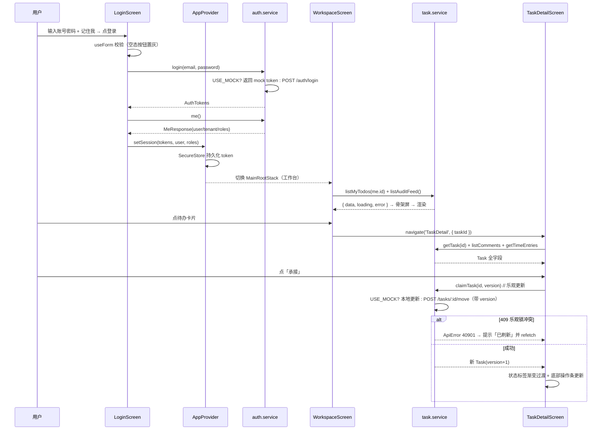
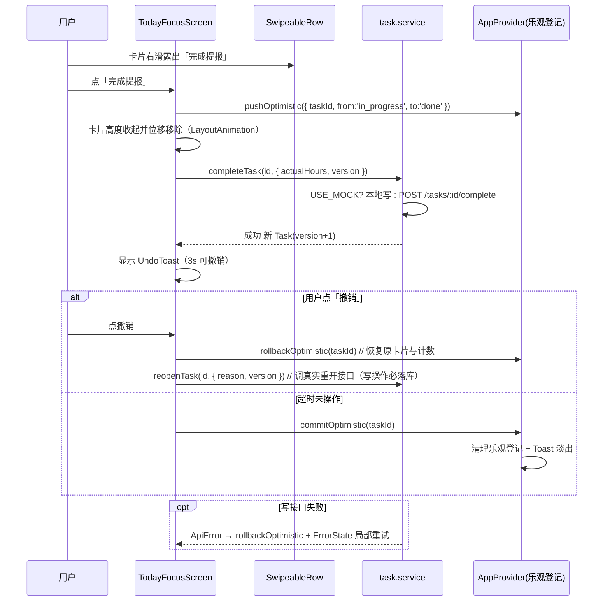

# ARCH — OpenSchedule 移动端 App（架构设计 + 设计系统 + 任务分解）

> 档位：架构设计文档 v1.0 · 架构师：高见远 · 上游：`PRD-mobile.md`（已验收）· 交付路径：`apps/mobile`
> 工程决策来源：主理人齐活林已拍板（见本文件 §1 / §9 约束），不可更改。

---

## 1. 技术选型与理由

| 维度 | 选型 | 一句话理由 | 备选与否决原因 |
| --- | --- | --- | --- |
| 框架 | **React Native + Expo SDK 53 + TypeScript** | 双端统一工程 + Expo Go 扫码即跑 + `expo export --platform web` 静态导出 | 裸 RN CLI：构建/签名成本高，首版无需；Flutter：与现有 TS 生态割裂 |
| 导航 | **React Navigation 7**（`native` + `native-stack` + `bottom-tabs`） | 显式声明、类型安全、Web 导出稳定、无文件路由约定风险 | Expo Router：文件路由约定 + web 导出对深层动态路由不稳，风险高 |
| 状态管理 | **React Context + hooks（不引入 Zustand）** | 全局态仅「会话 / 角色 / 偏好」三项，跨页共享面窄；服务端数据由 `useAsync` 局部持有，无需全局 store | Zustand：为 3 个字段引入依赖不划算；Redux：过重 |
| 数据请求 | **自研 `useAsync` hook + service 层**（不引入 TanStack Query） | 读多写少、页面少，`{loading,error,data,refetch}` 三态足够；零额外依赖 | TanStack Query：Web 端在用，但移动端缓存诉求低，引入成本 > 收益 |
| 动效 | **RN 内置 `Animated` / `LayoutAnimation` / `PanResponder`** | 零原生依赖、Web 兼容；覆盖 8px 位移淡入、0.97 按压、右滑、抽屉 | react-native-reanimated：babel 插件 + Web 兼容有风险，主理人已否决 |
| 图标 | **`@expo/vector-icons`（Feather 线性风）** | SDK 内置、无额外依赖、线性风格契合商务风 | 自绘 SVG：成本高；第三方图标库：增加依赖 |
| 本地存储 | **`@react-native-async-storage/async-storage`（偏好） + `expo-secure-store`（token）** | Expo 官方兼容；token 入 Keychain/Keystore 更安全 | MMKV：原生依赖，Web 不兼容，否决 |
| 表单 | **受控组件 + 自研 `useForm` 校验** | 仅登录 1 个表单，无需表单库 | react-hook-form / formik：为 1 个表单引入依赖过重 |
| 生物识别 | **`expo-local-authentication`（Web 端动态隔离）** | SDK 内置；M-P0-02 需要，且可回落到密码 | 自研原生模块：成本高 |

**结论**：全部选型零自研原生模块，依赖全部走 `expo install` 兼容矩阵，`expo export --platform web` 风险可控。

---

## 2. 工程结构与文件清单

```
apps/mobile/
├── package.json                      # 依赖与 scripts（§9）
├── app.json                          # Expo 配置：name/slug/scheme/deep-link/icon
├── babel.config.js                   # babel-preset-expo + module-resolver(@/ 别名)
├── tsconfig.json                     # strict + paths(@/*)
├── eas.json                          # EAS Build 预留 profile（首版不构建）
├── App.tsx                           # 根组件：SafeArea + AppProvider + RootNavigator
├── .gitignore                        # node_modules/.expo/dist
└── src/
    ├── theme/
    │   ├── tokens.ts                 # 设计 token 唯一来源（色彩/字号/间距/圆角/阴影/动效）
    │   └── index.ts                  # 主题聚合导出 + 任务状态/优先级配色映射
    ├── types/
    │   ├── index.ts                  # 类型桶文件（统一 re-export）
    │   ├── user.ts                   # User/AuthTokens/MeResponse/TenantSummary
    │   ├── task.ts                   # Task/TaskStatus/TaskComment/Attachment/状态机常量
    │   ├── project.ts                # Project/ProjectStatus
    │   ├── domain.ts                 # TimeEntry/PersonalTask/AiProposal/NotificationItem/NotificationPreference/TaskDependency/AuditFeed
    │   └── api.ts                    # ApiResponse<T>/Paginated<T>/ApiError
    ├── data/                         # 本地 mock（自 Web 端移植裁剪，不 import Web 文件）
    │   ├── seed.ts                   # users/projects/tasks/comments 种子（时间随演示日滚动）
    │   ├── seed-extra.ts             # timeEntries/personalTasks/aiProposals/notifications/auditFeed
    │   └── index.ts                  # mock 数据聚合 + 查询辅助
    ├── services/
    │   ├── config.ts                 # USE_MOCK / API_BASE / TOKEN_KEYS（对齐 Web config.ts）
    │   ├── client.ts                 # fetch 封装：ApiResponse 解包/错误/401 刷新位/延迟模拟
    │   ├── auth.service.ts           # login/me/logout/生物识别会话（写接口留真实 API 位）
    │   ├── task.service.ts           # 任务列表/详情/状态迁移/评论/计时/依赖
    │   ├── project.service.ts        # 项目列表/看板列
    │   ├── focus.service.ts          # 今日聚焦聚合/AI 提议/通知/通知偏好/个人任务
    │   └── index.ts                  # service 桶文件
    ├── store/
    │   └── AppProvider.tsx           # 全局态：session/role/preferences + 乐观更新登记
    ├── hooks/
    │   ├── useAsync.ts               # 统一三态：{data,loading,error,refetch,retry}
    │   ├── useAuth.ts                # 会话读写（登录/登出/角色切换）
    │   ├── useTimer.ts               # 计时器：start/pause/stop + 累计秒 + 持久化恢复
    │   ├── useSwipeAction.ts         # PanResponder 右滑露出操作
    │   └── index.ts                  # hooks 桶文件
    ├── components/
    │   ├── index.ts                  # 组件桶文件
    │   ├── Button.tsx                # 主/次/危险按钮 + loading 内嵌细环
    │   ├── Card.tsx                  # 双层卡片容器（白底 + 1px 描边 + 低阴影）
    │   ├── TextField.tsx             # 输入框：focus 墨蓝描边 + 上浮标签 + 错误红字
    │   ├── Tag.tsx                   # 状态/优先级/标签胶囊（淡底深字）
    │   ├── Avatar.tsx                # 头像（首字母兜底 + 可选品牌环）
    │   ├── SegmentedControl.tsx      # 分段控件（横向滑动指示器）
    │   ├── ProgressBar.tsx           # 线性进度条（项目进度）
    │   ├── Skeleton.tsx              # 骨架块（shimmer 1200ms 循环）
    │   ├── StateViews.tsx            # LoadingView/EmptyState/ErrorState 三态统一样式
    │   ├── ScreenHeader.tsx          # 页头（标题 + 返回 + 右侧动作）
    │   ├── SwipeableRow.tsx          # 可右滑行容器（包 TaskCard）
    │   ├── BottomSheet.tsx           # 底部抽屉（spring 弹入 + 遮罩）
    │   ├── UndoToast.tsx             # 撤销 Toast（乐观更新回滚）
    │   ├── TaskCard.tsx              # 任务卡片（优先级色条 + 截止 + 状态标签）
    │   ├── ProjectCard.tsx           # 项目卡片（进度条 + 任务数 + 截止）
    │   ├── TimelineBlock.tsx         # 时间容器任务块（按状态着色 + 空闲带）
    │   └── CommentItem.tsx           # 评论条目（作者/内容/@提及/决策标记）
    ├── navigation/
    │   ├── RootNavigator.tsx         # 根导航：未登录 AuthStack / 已登录 MainRootStack
    │   ├── MainTabs.tsx              # 5 Tab 底栏（工作台/今日/项目/时间/我的）
    │   ├── stacks.tsx                # 各 Tab 的 native-stack 定义 + TaskDetail 共享注册
    │   └── linking.ts                # 深链配置（openschedule://task/:taskId 等）
    └── screens/
        ├── LoginScreen.tsx           # ① 登录（密码 + 记住我 + 生物识别）
        ├── WorkspaceScreen.tsx       # ② 工作台（问候/快捷入口/待办/动态/临期预警）
        ├── TodayFocusScreen.tsx      # ③ 今日聚焦（三分组 + 右滑快操作 + AI 提议）
        ├── ProjectListScreen.tsx     # ④ 项目看板-列表
        ├── BoardScreen.tsx           # ④ 项目看板-看板列视图
        ├── TaskDetailScreen.tsx      # ⑤ 任务详情（状态/计时/评论/附件/依赖抽屉）
        ├── CalendarScreen.tsx        # ⑥ 时间容器（日/周 + 时间轴 + 空闲带）
        ├── ProfileScreen.tsx         # ⑦ 我的（信息/角色切换/设置/退出）
        ├── NotificationsScreen.tsx   # 通知列表（P1）
        ├── NotificationSettingsScreen.tsx # 通知偏好（P1）
        └── AboutScreen.tsx           # 关于
```

**文件总数**：源文件 **46** 个（`src/**` 41 + 根 `App.tsx` + 4 个工程配置文件；另 `eas.json`/`.gitignore` 不计入源码）。

---

## 3. 设计系统规范（工程师照此实现）

> **主题分层（增量 10 · 深色模式）**：色彩 token 双套化，`theme/tokens.ts` 导出
> `lightColors`（= 改造前 `colors` 全部值，逐字节冻结）、`type ThemeColors = typeof lightColors`、
> `darkColors: ThemeColors`，并保留兼容导出 `export const colors = lightColors`（L2：仅供测试 / 未迁移引用 / 默认参数兜底，**业务源码不再引用**）。
> 语义色（任务状态 / 优先级）拆到 `theme/semantic.ts`，导出 `lightStatusColor` / `darkStatusColor` /
> `lightPriorityColor` / `darkPriorityColor` 及取色函数（`getStatusStyle` / `getPriorityColor` 1 参默认浅色；
> `getStatusStyleFor` / `getPriorityColorFor` 带 map 入参供运行时使用）。下表「浅色」列 = `lightColors`（既有值，不得改动），
> 「深色」列 = `darkColors`（新增，取自增量 10 附录 A）。运行时由 `useTheme()` 下发生效色表。

### 3.1 色彩 Token（`theme/tokens.ts` → `lightColors` / `darkColors`）

| Token | 浅色（`lightColors` = `colors`） | 深色（`darkColors`） | 用途 |
| --- | --- | --- | --- |
| `bg.base` | `#F7F8FA` | `#0F1626` | 页面底色（浅：浅灰 / 深：深墨蓝近黑，非纯黑） |
| `bg.baseWarm` | `#FBFAF7` | `#141A26` | 象牙白底（登录/我的可用；深色略暖略浅一档） |
| `bg.surface` | `#FFFFFF` | `#1A2333` | 卡片、抽屉、输入框（深色比 base 亮一档） |
| `bg.subtle` | `#F1F3F7` | `#141C2B` | 骨架屏、内嵌区、按压缩进 |
| `primary` | `#1B2A4A` | `#3E6FD9` | 主按钮、标题、选中态（深色为单值双角色：填充 + tint） |
| `primarySoft` | `#2E4470` | `#6E93E0` | 次级强调、进行中状态 |
| `primaryFaint` | `#EAEEF5` | `#1E2A44` | 主色淡底（Chip/标签底色；深色为低明度同色相容器，语义反转） |
| `successFaint` | `#E9F6F0` | `#13291F` | 成功/通过的浅底（柔和按钮、状态底色；深色为深绿底） |
| `dangerFaint` | `#FBEDED` | `#2C1A1C` | 错误/驳回的浅底（柔和按钮、状态底色；深色为深红底） |
| `warningFaint` | `#FAF4EA` | `#2B2313` | 警告/退回重改的浅底（柔和按钮、状态底色；深色为深琥珀底） |
| `text.primary` | `#1A1D24` | `#E8EAF0` | 正文（深色近白，非纯白） |
| `text.secondary` | `#6B7280` | `#A6ADBB` | 辅助信息 |
| `text.tertiary` | `#9AA1AE` | `#7A8291` | 占位、禁用、已取消（深色最弱一级） |
| `text.inverse` | `#FFFFFF` | `#FFFFFF` | 深底上的文字（深色不变） |
| `border` | `#ECEEF2` | `rgba(255,255,255,0.08)` | 分割线、卡片描边（1px；深色为低对比白描边 8%） |
| `borderStrong` | `#DDE1E8` | `rgba(255,255,255,0.14)` | 输入框默认描边（深色 14%） |
| `overlay` | `rgba(27,42,74,0.45)` | `rgba(0,0,0,0.60)` | 抽屉遮罩（深色更深） |
| `success` | `#2F9E6E` | `#3DBE8B` | 完成/通过（深色提亮） |
| `warning` | `#C8871B` | `#E0A33A` | 阻塞/临期（深色提亮） |
| `danger` | `#C24A4A` | `#E36B6B` | 错误/驳回/退出（深色提亮） |
| `brandGradient` | `['#1B2A4A', '#2E4470']` | `['#24406E', '#3A5DA0']` | **仅**品牌区（登录头/头像环）线性渐变（深色提亮一档，非霓虹） |

**任务状态色映射**（`theme/semantic.ts` → `lightStatusColor` / `darkStatusColor`，标签用「淡底 + 深字」）：

| status | 浅色主色 | 浅色淡底 | 深色主色 | 深色淡底 | 文案 |
| --- | --- | --- | --- | --- | --- |
| `todo` | `#6B7280` | `#F1F3F7` | `#A6ADBB` | `#1E2634` | 待办 |
| `in_progress` | `#2E4470` | `#EAEEF5` | `#6E93E0` | `#1B2740` | 进行中 |
| `blocked` | `#C8871B` | `#FBF3E2` | `#E0A33A` | `#2B2313` | 已阻塞 |
| `done` | `#2F9E6E` | `#E7F5EE` | `#3DBE8B` | `#13291F` | 已完成 |
| `cancelled` | `#9AA1AE` | `#F1F3F7` | `#7A8291` | `#1E2634` | 已取消 |
| `pending_review` | `#C8871B` | `#FBF3E2` | `#E0A33A` | `#2B2313` | 待评审 |

**优先级色映射**（`theme/semantic.ts` → `lightPriorityColor` / `darkPriorityColor`，用于卡片左侧 3px 色条）：

| priority | 浅色 | 深色 |
| --- | --- | --- |
| `urgent` | `#C24A4A` | `#E36B6B` |
| `high` | `#C8871B` | `#E0A33A` |
| `medium` | `#2E4470` | `#6E93E0` |
| `low` | `#9AA1AE` | `#8A93A3` |

> **对比度验收口径（D6）**：WCAG 对比度阈值（正文 ≥4.5:1、大字 ≥3:1）**仅对深色方案（`darkColors`）验收**；
> 浅色方案为既有实现，其已知偏差（如 `text.tertiary` / `success` / `warning` 在浅底上的对比度不足）登记为既有问题、
> 本期不修复（见增量 10 §9-M1 / 附录 B）。

### 3.2 字号与字重层级（`typography`）

| Token | size | weight | letterSpacing | lineHeight | 用途 |
| --- | --- | --- | --- | --- | --- |
| `display` | 22 | `700` | `-0.2` | 30 | 页面主标题 |
| `title` | 17 | `600` | `-0.1` | 24 | 卡片/区块标题 |
| `body` | 15 | `400` | `0` | 22 | 正文 |
| `caption` | 13 | `400` | `0` | 18 | 辅助信息 |
| `label` | 12 | `600` | `0.4` | 16 | 标签/分组小标题 |
| `mono` | 17 | `600` | `0` | 24 | 计时/工时（`fontVariant: tabular-nums`） |

字体族：`Platform.select({ ios: 'System', android: 'sans-serif', default: 'System' })`。

### 3.3 间距栅格（`spacing`，4pt 基准）

`xxs 4` · `xs 8` · `sm 12` · `md 16` · `lg 20`（**页面左右留白**） · `xl 24` · `xxl 32` · `xxxl 40`。
节奏约定：卡片内 `md(16)`；卡片之间 `sm(12)`；区块之间 `xl(24)`；页面左右 `lg(20)`；页面顶部（含安全区）`xl(24)`。

### 3.4 圆角（`radius`）

`sm 8`（小控件/图标底） · `control 12`（按钮/输入框/分段） · `card 16`（卡片/抽屉内容） · `sheet 20`（抽屉顶部圆角） · `pill 999`（标签/胶囊/Chip）。

### 3.5 阴影 / 层级（`shadow`，iOS `shadow*` + Android `elevation`）

| Token | shadowColor | opacity | radius | offset | elevation | 用途 |
| --- | --- | --- | --- | --- | --- | --- |
| `card` | `#1B2A4A` | `0.06` | 8 | `{0,2}` | 2 | 普通卡片 |
| `raised` | `#1B2A4A` | `0.10` | 16 | `{0,-4}` | 8 | 底部操作条/抽屉 |
| `floating` | `#1B2A4A` | `0.16` | 20 | `{0,6}` | 10 | 浮动按钮 FAB |

> 卡片统一叠加 **1px `border` 描边**，形成「描边 + 低阴影」双层，避免阴影发脏。

### 3.6 动效（`motion`）

| Token | 值 | 说明 |
| --- | --- | --- |
| `duration.instant` | `100ms` | 颜色/透明度瞬变 |
| `duration.fast` | `150ms` | 按压反馈（scale 0.97） |
| `duration.base` | `220ms` | 列表入场、状态标签过渡 |
| `duration.slow` | `320ms` | 抽屉/页面切换 |
| `stagger` | `40ms` × 最多 6 项 | 列表入场错峰 |
| `easing.standard` | `Easing.bezier(0.2, 0, 0, 1)` | 统一缓动 |
| `easing.decelerate` | `Easing.out(Easing.cubic)` | 入场减速 |
| `spring.sheet` | `{ damping: 22, stiffness: 220, mass: 1 }` | 抽屉弹入 |
| `enterOffset` | `8px`（opacity 0→1 + translateY 8→0） | 列表入场 |
| `skeletonShimmer` | `1200ms` 循环 | 骨架屏 |
| `shake` | 2 次 × `120ms` | 登录错误抖动 |

### 3.7 「高级商务感」实现手法清单（≥8 条，硬性）

1. **卡片双层**：白底 + `1px #ECEEF2` 描边 + `shadow.card`，禁用重阴影与纯阴影无描边。
2. **标题字距**：`display/title` 字距 `-0.2/-0.1`，字重 600–700；正文 15/400，靠字重+字号拉层级，不靠颜色。
3. **强调色面积 ≤10%**：`primary` 仅用于主按钮、选中态、状态点；其余一律中性灰，克制即高级。
4. **留白节奏**：卡片内 16 / 卡片间 12 / 区块间 24 / 页面左右 20；**用留白分组，而非分割线**。
5. **分割线克制**：`border` 1px 仅用于列表内条目之间；卡片之间与区块之间不加线。
6. **渐变仅限品牌区**：`brandGradient` 只用于登录头部与头像环；正文/卡片禁用渐变。
7. **圆角统一**：卡片 16 / 控件 12 / 标签 999，禁止出现其它圆角值（混用即廉价感）。
8. **图标线性单色**：Feather 线性图标，尺寸 20/24，颜色随所在文字层级，禁止多色图标。
9. **数字等宽**：计时/工时用 `mono` + `tabular-nums`，防止跳动，体现精确感。
10. **状态标签淡底深字**：8% 淡底 + 同色系深字，替代高饱和实底，降低视觉噪音。
11. **动效克制**：时长 150–320ms、位移 ≤8px、缓动统一 `bezier(0.2,0,0,1)`，**不弹跳、不旋转**。
12. **对齐栅格**：所有左边缘对齐页面 `lg(20)`；卡片内元素对齐 `md(16)`；视觉基线一致。

---

## 4. 数据模型与 TypeScript 类型（与 Prisma / Web 端字段对齐）

```ts
// types/api.ts —— 统一响应包装（对齐 Web 端约定）
export interface ApiResponse<T> { code: number; data: T; message: string }
export interface Paginated<T> { items: T[]; total: number; page: number; pageSize: number }
export interface ApiError { code: number; message: string; details?: unknown } // 40901 乐观锁 / 40902 非法迁移

// types/user.ts
export type UserStatus = 'active' | 'disabled'
export interface User {
  id: string; email: string; displayName: string; avatarUrl: string | null
  locale: string; timezone: string; status: UserStatus; phone?: string; bio?: string; motto?: string
  createdAt: string; updatedAt: string            // ISO8601 UTC
}
export interface AuthTokens { accessToken: string; refreshToken: string }
export interface TenantSummary { id: string; name: string; plan: 'free'|'pro'|'enterprise'; status: 'active'|'suspended' }
export interface MeResponse { user: User; tenant: TenantSummary | null; roles: string[] }
export type AppRole = 'manager' | 'member'        // 移动端演示角色（Q2 默认纯前端切换）

// types/task.ts（对齐 Prisma tasks 表 + Web 端 task.ts）
export type TaskStatus = 'todo' | 'in_progress' | 'blocked' | 'done' | 'cancelled'
export type TaskPriority = 'urgent' | 'high' | 'medium' | 'low'
export interface Task {
  id: string; tenantId: string; projectId: string | null; parentId: string | null
  title: string; description: string | null
  status: TaskStatus; priority: TaskPriority; assigneeId: string | null
  startAt?: string | null; dueAt: string | null; endAt?: string | null
  estimatedHours: number | null; actualHours: number | null
  completedAt: string | null; startedAt: string | null
  createdBy: string; tags: string[]; sortOrder: number
  workflowColumnId: string | null; isAiGenerated: boolean; version: number  // 乐观锁
  // Phase 4 提报/评审扩展（可选）
  source?: 'published' | 'submission'; submissionStatus?: 'pending'|'approved'|'rejected' | null
  submissionNote?: string | null; reviewNote?: string | null
  reviewRequired?: boolean; isReviewTask?: boolean; reviewerIds?: string[]
  createdAt: string; updatedAt: string
}
export interface TaskComment {
  id: string; tenantId: string; taskId: string; authorId: string | null; parentId: string | null
  content: string; mentions: unknown; isDecision: boolean; createdAt: string; updatedAt: string
}
export interface Attachment {
  id: string; tenantId: string; resourceType: 'task'|'comment'|'project'; resourceId: string
  objectKey: string; fileName: string; mimeType: string; sizeBytes: number; uploaderId: string; createdAt: string
}
export const TASK_TRANSITIONS: Record<TaskStatus, TaskStatus[]> = {   // 前端预渲染按钮，后端为权威
  todo: ['in_progress','blocked','cancelled'],
  in_progress: ['todo','done','blocked','cancelled'],
  blocked: ['in_progress','done','cancelled'],
  done: ['todo','in_progress'],
  cancelled: [],
}

// types/project.ts
export type ProjectStatus = 'active' | 'archived' | 'completed'
export interface Project {
  id: string; tenantId: string; name: string; description: string | null
  ownerId: string | null; status: ProjectStatus; deadline: string | null
  workflowId: string | null; createdBy: string; createdAt: string; updatedAt: string
}

// types/domain.ts
export interface TimeEntry {
  id: string; tenantId: string; taskId: string; userId: string
  startedAt: string; endedAt: string | null; durationSeconds: number | null; note: string | null
}
export interface PersonalTask {
  id: string; tenantId: string; userId: string; parentId: string | null
  title: string; description: string | null; status: TaskStatus; priority: TaskPriority
  startAt: string | null; endAt: string | null; dueAt: string | null
  estimatedHours: number | null; actualHours: number | null; completedAt: string | null
  tags: string[]; sortOrder: number; linkedTaskId: string | null; createdAt: string; updatedAt: string
}
export interface AiProposal {
  id: string; tenantId: string
  type: 'decompose'|'evaluate'|'emergency'|'execute'|'weekly_report'
  status: 'pending'|'approved'|'rejected'|'applied'|'expired'
  payload: { version: number; summary: string; tasks: { title: string; description: string; estimatedHours: number; priority: string }[]; warnings: string[] }
  diffSummary: { add: string[]; update: { taskIdx: number; changedFields: string[] }[]; remove: string[] } | null
  proposerId: string | null; approverId: string | null; approvedAt: string | null
  rejectReason: string | null; source: string
  relatedProjectId: string | null; relatedTaskId: string | null; expiresAt: string | null
  createdAt: string; updatedAt: string
}
export interface NotificationItem {
  id: string; tenantId: string; userId: string; type: string   // task.assigned/mention/deadline_approaching/ai.proposal
  title: string; body: string | null; data: { taskId?: string } | null
  channel: 'in_app'|'email'|'push'|'im'; status: 'pending'|'sent'|'failed'|'read'
  readAt: string | null; createdAt: string
}
export interface NotificationPreference {
  id: string; tenantId: string; userId: string; eventType: string
  channels: { email: boolean; push: boolean; im: boolean }
  quietHours: { days: number[]; start: string; end: string }[] | null; createdAt: string; updatedAt: string
}
export interface TaskDependency {
  id: string; tenantId: string; projectId: string | null
  prevTaskId: string; nextTaskId: string; type: 'FS'|'SS'|'FF'|'SF'
  lagDays: number; isShared: boolean; createdAt: string
  prevTask?: { id: string; title: string; status: string }; nextTask?: { id: string; title: string; status: string }
}
export interface AuditFeedItem {   // 工作台团队动态（由 audit_logs 只读聚合）
  id: string; action: string; actorId: string; actorName: string
  resourceType: string; resourceId: string | null; summary: string; createdAt: string
}
```

---

## 5. 导航架构

```
RootNavigator (NavigationContainer + linking)
├── [未登录] AuthStack (native-stack)
│   └── Login
└── [已登录] MainRootStack (native-stack)          ← 共享 Stack 层（覆盖 TabBar，实现「跨 Tab 共享任务详情」）
    ├── Tabs (bottom-tabs, 5 Tab，各 Tab 内嵌独立 native-stack 保留栈状态)
    │   ├── Workspace → WorkspaceStack: Workspace
    │   ├── Today     → TodayStack:     TodayFocus
    │   ├── Project   → ProjectStack:   ProjectList → Board
    │   ├── Time      → TimeStack:      Calendar
    │   └── Me        → MeStack:        Profile → NotificationSettings → About
    ├── TaskDetail                                  ← 任意 Tab / 通知深链 push 到此层（全局共享）
    ├── Notifications
    └── AiProposalSheet (presentation: 'transparentModal')
```

**路由参数类型**：

```ts
// navigation/types（并入 types/index.ts）
export type MainRootStackParamList = {
  Tabs: undefined
  TaskDetail: { taskId: string; from?: 'workspace'|'today'|'board'|'time'|'notification' }
  Notifications: undefined
  AiProposalSheet: { proposalId: string }
}
export type TabParamList = { Workspace: undefined; Today: undefined; Project: undefined; Time: undefined; Me: undefined }
export type WorkspaceStackParamList = { Workspace: undefined }
export type TodayStackParamList = { TodayFocus: undefined }
export type ProjectStackParamList = { ProjectList: undefined; Board: { projectId: string } }
export type TimeStackParamList = { Calendar: undefined }
export type MeStackParamList = { Profile: undefined; NotificationSettings: undefined; About: undefined }
export type AuthStackParamList = { Login: undefined }
declare global { namespace ReactNavigation { interface RootParamList extends MainRootStackParamList {} } }
```

- **共享栈实现**：`TaskDetail` 注册在 `MainRootStack`（Tab 之上），从任意 Tab 调用 `navigation.navigate('TaskDetail', { taskId })` 即全屏覆盖 TabBar；避免在每个 Tab 栈重复注册导致的多实例。
- **Tab 状态保留**：每个 Tab 内 `native-stack` 独立，切换 Tab 保留各自栈。
- **深链约定**：`app.json` 设 `scheme: "openschedule"`；`linking.config`：

```ts
export const linking = {
  prefixes: ['openschedule://', 'https://app.openschedule.dev'],
  config: {
    screens: {
      Tabs: { screens: { Workspace: 'workspace', Today: 'today',
        Project: { screens: { ProjectList: 'projects', Board: 'projects/:projectId' } },
        Time: 'time', Me: 'me' } },
      TaskDetail: 'task/:taskId',          // 通知 data.taskId → openschedule://task/<id>
      Notifications: 'notifications',
    },
  },
}
```

---

## 6. 组件清单

```ts
// 接口名 = 组件名；对应文件路径见 §2 目录树
interface ButtonProps { variant?: 'primary'|'secondary'|'danger'|'ghost'; size?: 'md'|'lg';
  label: string; onPress: () => void; loading?: boolean; disabled?: boolean; icon?: IconName; fullWidth?: boolean }
interface CardProps { children: ReactNode; onPress?: () => void; padded?: boolean; style?: StyleProp<ViewStyle> }
interface TextFieldProps { label: string; value: string; onChangeText: (v: string) => void; error?: string | null;
  secureTextEntry?: boolean; keyboardType?: KeyboardTypeOptions; autoFocus?: boolean; editable?: boolean }
interface TagProps { text: string; tone?: 'status'|'priority'|'neutral'; status?: TaskStatus; priority?: TaskPriority }
interface AvatarProps { name: string; uri?: string | null; size?: 32|40|56; ring?: boolean }
interface SegmentedControlProps<T extends string> { options: { value: T; label: string; badge?: number }[];
  value: T; onChange: (v: T) => void }
interface ProgressBarProps { value: number /*0..1*/; height?: number; tone?: 'primary'|'success' }
interface SkeletonProps { width?: number|`${number}%`; height?: number; radius?: number; style?: StyleProp<ViewStyle> }
interface LoadingViewProps { variant?: 'spinner'|'skeleton' }
interface EmptyStateProps { icon?: IconName; title: string; description?: string; actionLabel?: string; onAction?: () => void }
interface ErrorStateProps { message?: string; onRetry: () => void }
interface ScreenHeaderProps { title: string; subtitle?: string; onBack?: () => void; right?: ReactNode; large?: boolean }
interface SwipeAction { key: string; label: string; tone: 'primary'|'success'|'danger'|'warning'; onPress: () => void }
interface SwipeableRowProps { actions: SwipeAction[]; children: ReactNode; onActionDone?: (key: string) => void }
interface BottomSheetProps { visible: boolean; onClose: () => void; title?: string; children: ReactNode; heightRatio?: number }
interface UndoToastProps { visible: boolean; message: string; onUndo: () => void; durationMs?: number }
interface TaskCardProps { task: Task; assignee?: User | null; onPress: () => void;
  showProject?: boolean; compact?: boolean; right?: ReactNode }
interface ProjectCardProps { project: Project; progress: number; taskCount: number; owner?: User | null; onPress: () => void }
interface TimelineBlockProps { title: string; status: TaskStatus; topRatio: number; heightRatio: number;
  onPress: () => void; onLongPress?: () => void }
interface CommentItemProps { comment: TaskComment; author?: User | null; isMine: boolean }
```

| 组件 | 职责 | 被使用页面 |
| --- | --- | --- |
| Button | 统一按钮与 loading 态 | 全部 |
| Card | 双层卡片容器 | 工作台/今日/看板/详情/时间/我的 |
| TextField | 登录/评论输入 | 登录、任务详情、通知偏好 |
| Tag | 状态/优先级/标签 | 工作台/今日/看板/详情/时间 |
| Avatar | 用户头像 | 工作台/详情/我的/评论 |
| SegmentedControl | 分组/视图切换 | 今日/时间/我的/项目 |
| ProgressBar | 项目进度 | 项目列表/看板 |
| Skeleton | 骨架屏 | 全部（加载态） |
| StateViews | 空/错误/加载三态 | 全部 |
| ScreenHeader | 页头 | 全部二级页 |
| SwipeableRow | 右滑快操作 | 今日聚焦、工作台待办 |
| BottomSheet | 抽屉（依赖/退出确认） | 任务详情、我的、AI 提议 |
| UndoToast | 撤销 Toast | 今日聚焦、看板 |
| TaskCard | 任务卡片 | 工作台/今日/看板 |
| ProjectCard | 项目卡片 | 项目列表 |
| TimelineBlock | 时间轴任务块 | 时间容器 |
| CommentItem | 评论条目 | 任务详情 |

---

## 7. 程序调用流程

### 链路 ① 登录 → 工作台 → 任务详情 → 承接



### 链路 ② 今日聚焦右滑「完成提报」→ 乐观更新 → 撤销



---

## 8. 任务列表（给工程师的施工图）

> 分组：**主题/基础 → 数据层 → 通用组件 → 页面 → 导航装配 → 收尾**；同一模块文件归入同一任务，可批量编写。

### 施工图（按阶段分组）

| 阶段 | # | 任务名 | 产出文件（相对 `apps/mobile/`） | 依赖 | 验收标准 |
| --- | --- | --- | --- | --- | --- |
| **A 主题/基础** | **T01** | 工程基础设施 + 设计 token + 类型定义 | `package.json`、`app.json`、`babel.config.js`、`tsconfig.json`、`eas.json`、`.gitignore`、`App.tsx`、`src/theme/tokens.ts`、`src/theme/index.ts`、`src/types/index.ts`、`src/types/user.ts`、`src/types/task.ts`、`src/types/project.ts`、`src/types/domain.ts`、`src/types/api.ts` | — | `npx tsc --noEmit` 通过；token 值与本文件 §3 逐项一致；`@/` 别名在 babel+tsconfig 生效 |
| **B 数据层** | **T02** | Mock 数据移植（自 Web 端裁剪） | `src/data/seed.ts`、`src/data/seed-extra.ts`、`src/data/index.ts` | T01 | 用户/项目/任务/评论/工时/AI 提议/通知种子齐全，时间随演示日滚动；字段与 Prisma 对齐；**不 import Web 端文件** |
| **B 数据层** | **T03** | 服务层（USE_MOCK 开关 + 真实 API 位） | `src/services/config.ts`、`src/services/client.ts`、`src/services/auth.service.ts`、`src/services/task.service.ts`、`src/services/project.service.ts`、`src/services/focus.service.ts`、`src/services/index.ts` | T01, T02 | 每个 service 有 `USE_MOCK` 分支与 `// TODO(real-api)` 调用位；`client.ts` 统一解包 `ApiResponse`、抛 `ApiError`（含 40901/40902） |
| **C 通用组件** | **T04** | 全局状态与 hooks | `src/store/AppProvider.tsx`、`src/hooks/useAsync.ts`、`src/hooks/useAuth.ts`、`src/hooks/useTimer.ts`、`src/hooks/useSwipeAction.ts`、`src/hooks/index.ts` | T01, T03 | `AppProvider` 提供 session/role/preferences + 乐观更新登记；`useAsync` 返回三态+retry；`useTimer` 退出重进保持计时 |
| **C 通用组件** | **T05** | UI 原语组件库 | `src/components/Button.tsx`、`Card.tsx`、`TextField.tsx`、`Tag.tsx`、`Avatar.tsx`、`SegmentedControl.tsx`、`ProgressBar.tsx`、`Skeleton.tsx`、`StateViews.tsx`、`ScreenHeader.tsx`、`index.ts` | T01 | 组件 props 与本文件 §6 一致；样式全部取自 token；含空/错误/加载三态统一实现 |
| **C 通用组件** | **T06** | 业务组件 | `src/components/SwipeableRow.tsx`、`BottomSheet.tsx`、`UndoToast.tsx`、`TaskCard.tsx`、`ProjectCard.tsx`、`TimelineBlock.tsx`、`CommentItem.tsx` | T04, T05 | 右滑露出操作（PanResponder）；抽屉 spring 弹入；卡片含优先级色条与状态标签 |
| **D 页面** | **T07** | 登录 + 工作台 + 我的 | `src/screens/LoginScreen.tsx`、`WorkspaceScreen.tsx`、`ProfileScreen.tsx` | T04, T05, T06 | 登录→工作台闭环；待办≤5 条 + 动态分页 + 临期预警卡；我的支持角色切换与退出二次确认 |
| **D 页面** | **T08** | 今日聚焦 + 任务详情 | `src/screens/TodayFocusScreen.tsx`、`TaskDetailScreen.tsx` | T04, T05, T06 | 三分组正确归类；右滑快操作 + 撤销；详情状态机按钮按 `TASK_TRANSITIONS` 启用/置灰；计时/评论/AI 提议/依赖抽屉可用 |
| **D 页面** | **T09** | 项目看板 + 时间容器 | `src/screens/ProjectListScreen.tsx`、`BoardScreen.tsx`、`CalendarScreen.tsx`、`NotificationsScreen.tsx`、`NotificationSettingsScreen.tsx`、`AboutScreen.tsx` | T04, T05, T06 | 看板列横向滚动 + 卡片状态流转（带 version）；时间轴 08:00–20:00 + 空闲带 + done 灰显删除线；通知列表深链到任务 |
| **E 导航装配** | **T10** | 导航装配 + 深链 | `src/navigation/RootNavigator.tsx`、`MainTabs.tsx`、`stacks.tsx`、`linking.ts` | T07, T08, T09 | 5 Tab 切换保留栈状态；`TaskDetail` 为根级共享页；`openschedule://task/:id` 深链直达详情 |
| **F 收尾** | **T11** | Web 导出验证 + 类型/构建收尾 | `package.json`(scripts 微调)、`App.tsx`(web 适配)、README 片段（可选） | T10 | `npx expo export --platform web` 成功产出 `dist/`；`npx tsc --noEmit` 零错误；Expo Go 扫码冷启动可交互 ≤2s |

---

## 9. 依赖包清单

| 包 | 建议版本 | 来源 | 用途 |
| --- | --- | --- | --- |
| `expo` / `expo-status-bar` / `expo-linking` / `expo-secure-store` / `expo-local-authentication` | `~53.0.0` | SDK 内置 | 运行时 / 状态栏 / 深链 / token 安全存储 / 生物识别（Web 端动态隔离） |
| `react-native-safe-area-context` / `react-native-screens` / `@expo/vector-icons` | SDK | SDK 内置 | 安全区 / native-stack 底层 / Feather 线性图标 |
| `@react-native-async-storage/async-storage` | SDK | SDK 内置（`expo install`） | 偏好持久化 |
| `@react-navigation/native` / `native-stack` / `bottom-tabs` | `^7.0.0` | 第三方（Expo 兼容） | 导航容器 / 栈导航 / 底部 Tab |
| `react` / `react-native` | `18.3.1` / `0.76.x` | SDK 锁定 | UI 库 / 原生渲染 |
| `react-native-web` / `react-dom` | `~0.19` / `18.3.1` | Web 导出 | `--platform web` 渲染与挂载 |
| `typescript` / `@types/react` | `~5.3` / `~18.3` | dev | 类型检查 |
| `babel-plugin-module-resolver` | `^5.0` | dev | `@/` 别名（纯 JS，Web 安全） |

> **不引入**：`react-native-reanimated`、`react-native-gesture-handler`、`react-native-mmkv`、`zustand`、`@tanstack/react-query`（理由见 §1）。

**`package.json` scripts 建议**：

```json
{
  "scripts": {
    "start": "expo start",
    "android": "expo start --android",
    "ios": "expo start --ios",
    "web": "expo start --web",
    "typecheck": "tsc --noEmit",
    "export:web": "expo export --platform web",
    "lint": "expo lint"
  }
}
```

---

## 10. 共享知识（跨文件约定）

| 项 | 约定 |
| --- | --- |
| **命名** | 组件文件 `PascalCase.tsx`；hook `useXxx.ts`；service `xxx.service.ts`；类型/字段 `camelCase`（与 Prisma 列 `snake_case` 经 DTO 映射对齐） |
| **导入别名** | **使用 `@/` → `src/`**（tsconfig `paths` + babel `module-resolver`）；跨目录一律走别名，同目录可用相对路径。若 babel 插件异常，降级为相对路径 |
| **样式组织** | `StyleSheet.create` + 从 `theme/tokens.ts` 取 token；**禁止内联魔法数字**；动态样式用 `[styles.a, { ... }]` 数组；颜色/间距/圆角/阴影必须引用 token |
| **状态管理边界** | 全局态（`AppProvider`）**仅** session / role / preferences / 乐观登记；服务端数据由各页 `useAsync` 局部持有，**不做全局缓存**。**连通性（在线/离线）为设备态，不属服务端数据**，由独立 `ConnectivityProvider` 承载，不进入本 Provider（增量 8） |
| **主题边界（增量 10）** | **主题（浅色 / 深色 / 跟随系统）为设备外观态**，由独立 `ThemeProvider` 承载，**不进入 `AppProvider`**。主题 hooks 的**唯一入口是 `@/store/ThemeProvider`**（`useTheme` / `useThemeColors` / `useThemedStyles`）；`@/hooks` 桶**不再导出**主题 hooks（因既有测试对该桶做工厂式 mock）。色值一律经 `useThemedStyles(makeStyles)` 取运行时色表，**禁止在 `StyleSheet.create` 顶层直接引用静态 `colors`**（静态 `colors = lightColors` 仅保留给测试与默认参数兜底）。`useTheme()` 在无 Provider 时**回退浅色**而非抛错 |
| **附件取图边界（增量 11）** | **拍照 / 相册 / 选文件是设备能力态**，全部关进适配层 `src/services/platform/attachmentPicker.ts` + `attachmentPicker.web.ts`（对齐 `biometrics(.web).ts` 范式）。**业务层（屏幕 / 组件）零 `expo-image-picker` / `expo-document-picker` import**，只依赖适配层的 `pickFile(source, options)` / `isSourceSupported(source)`。⚠️ **jest 下 `.web.ts` 不生效**（`haste.defaultPlatform='ios'`）⇒ 测试隔离靠 **mock 适配层或原生包**，不是靠 `.web.ts`。适配层异常时返回 `{ cancelled:false, file:null }`（**既非取消、也无文件**）⇒ **UI 必须把该态当失败处理**，不能静默无动作。`tenantId` 一律取 `task.tenantId`，**禁用 `useAuth().user.tenantId`**（移动端 `User` 无该字段） |
| **Mock ↔ 真实切换点** | 统一在 `services/config.ts` 的 `USE_MOCK`（`process.env.EXPO_PUBLIC_USE_MOCK !== 'false'`）；每个 service 首行 `if (USE_MOCK) {...}` 分支；写接口必须保留 `// TODO(real-api): POST /tasks/:id/...` 真实调用位 |
| **错误/空/加载三态** | 一律用 `StateViews`（`LoadingView`/`EmptyState`/`ErrorState`），统一内边距 `xl(24)`、文案 `caption`、错误必带「重试」；列表用 `Skeleton` 替代转圈 |
| **时间处理** | 存储/传输 ISO8601 UTC，渲染按 `user.timezone` 换算（`utils/date.ts`，用 `Intl`，不引 dayjs 插件）；禁止本地时区裸渲染 |
| **乐观锁** | 所有状态/排序写操作必带 `version`；40901 冲突 → 提示「已刷新」并 `refetch`；非法迁移 40902 用 `allowed_transitions` 校正按钮 |
| **乐观更新** | 仅「今日聚焦右滑」与「看板状态流转」使用；必须登记到 `AppProvider` 以支持撤销；写操作失败一律回滚 + 局部重试 |
| **图标** | 统一 `@expo/vector-icons/Feather`，尺寸 20/24，颜色随文字层级 |
| **文案与注释** | 全部中文；代码标识符英文；每个文件顶部写「职责」注释块（对齐 Web 端风格） |

---

## 11. 风险与待明确事项

| # | 风险 | 触发条件 | 兜底方案（降级为 Y） |
| --- | --- | --- | --- |
| R1 | **`expo export --platform web` 失败** | 某依赖（如 `expo-local-authentication`、`react-native-screens`）在 Web 打包报错 | ① 该依赖在 Web 端用 `Platform.OS === 'web'` 分支 + `require` 动态隔离；② 仍失败则 **降级：Web 导出仅作评审预览，改用 `expo start --web`（Metro Web）本地预览 + 录屏/截图交付**；③ 最坏移除 Web 导出，仅交付 Expo Go 可跑工程 |
| R2 | **React Navigation 7 与 SDK/RN 版本不兼容** | 安装后启动报版本冲突 | 锁定 `expo install` 解析出的兼容版本；仍冲突则降级为 **React Navigation 6**（API 基本兼容，迁移成本低） |
| R3 | **右滑手势与列表滚动冲突 / 体验差** | PanResponder 与 ScrollView 抢占手势 | 降级为 **长按卡片弹出操作菜单（BottomSheet/ActionSheet）**，保留同一套操作动作 |
| R4 | **生物识别在 Expo Go 受限 / 真机权限** | `expo-local-authentication` 在 Expo Go 行为受限 | 降级为**仅密码登录**（对应 PRD Q1 默认方案），生物识别作为可开关的增强项 |
| R5 | **无真实后端（首版零后端依赖）** | 写接口无服务端 | 全部走 mock 成功路径，但**写接口必须保留真实调用位与 `version` 字段**；接后端时仅切 `USE_MOCK=false`，不改页面 |
| R6 | **时区渲染不一致** | 设备时区 ≠ `user.timezone` | `utils/date.ts` 统一 UTC→`user.timezone` 换算；若 `Intl` 在部分 Android 异常，兜底固定按 `Asia/Shanghai` 渲染 |
| R7 | **待明确（继承 PRD Q1–Q5）** | SSO / 真实 RBAC / 拖拽必需性 / 真推送 / 离线写入 | 均按默认方案开工（密码登录、前端演示角色、菜单切换、站内+轮询、仅读缓存），不阻塞首版；Q6 已由主理人拍板为「不上架」 |
| R8 | **附件取图能力缺失 / 权限被拒（增量 11，对 R1/R4 的补充）** | ① `expo-image-picker` / `expo-document-picker` 在 Web 打包报错（同 R1 类别）；② 用户拒绝相机 / 相册权限；③ Web 无「拍照」能力 | ① 同 R1：能力关在 `.web.ts` 适配层内，Web 打包不进原生权限路径；仍失败则降级为**仅「选择文件」单一入口**。② 权限被拒时 `canAskAgain===true` 给「重试」、否则给「去系统设置」（`Linking.openSettings()`）；**抽屉照常可用**，不阻塞其它入口。③ Web 上 `isSourceSupported('camera')===false` ⇒ **不渲染**「拍照」入口（不是禁用置灰） |
