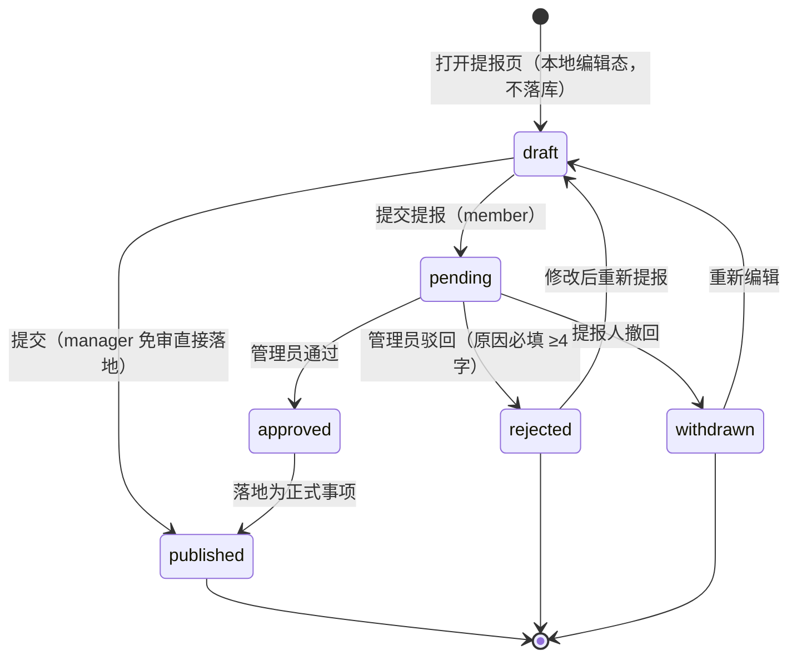

# PRD（增量 1）— OpenSchedule 移动端：事项提报 / 创建 / 个人计划 / 待审详情入口

> 档位：**增量 PRD**（仅描述变更，首版见 `PRD-mobile.md`，架构约束见 `ARCH-mobile.md`） · 版本 v1.2 · 负责人：许清楚（PM）
> 上游：首版 7 页已交付（14 套件 / 237 用例全绿，`tsc` 0 error，Web 导出可跑）。本文件**只写本次新增/变更部分**。

---

## 1. 变更概述

**一句话**：补齐移动端「**提报—审核—落地**」与「**个人计划**」两条缺失闭环，并为「待我审核」卡片补上显式「查看详情」入口。

| 用户原始诉求 | 本质缺口（基于现状调查） | 本次对策 |
| --- | --- | --- |
| ① 事项提报（普通人员） | 无提报入口、无提报数据模型落地路径 | 新增提报页 + `submitItem`，生成 `source='submission'` 的待审记录 |
| ② 事项创建（管理员） | `task/project.service` **均无 create**，UI 无任何创建入口 | 新增创建页 + `createTask` / `createProject`，manager 免审直接落地 |
| ③ 个人计划安排 | `listPersonalTasks` **已存在但零页面调用**，无 CRUD、无排期 | 新增独立个人计划页（列表 + 排期）+ 个人任务 CRUD |
| ④ 待审卡片「查看详情」 | 卡片**已可点可跳**（`onPress→openTask`），仅缺**显式按钮/箭头提示** | 仅在 `review` 分组卡片加「查看详情」按钮，其余不改 |

**共性缺口**：全仓**无任何权限门禁**。本次抽出统一权限工具 `can('action')`，沿用 `manager` / `member` 演示角色做**纯前端门禁**（零后端改动）。

---

## 2. 变更范围界定

### 2.1 本次做

| # | 内容 |
| --- | --- |
| S1 | 权限工具 `src/utils/permission.ts`（`can()` + `useCan()`），接入全部新入口可见性控制 |
| S2 | 提报页 `SubmissionScreen`（member 发起新事项申请；manager 免审直接落地） |
| S3 | 创建页 `CreateItemScreen`（manager 直接创建项目 / 任务） |
| S4 | 待我审核 Tab 支持**审核新事项提报**（通过 → 落地；驳回 → 回流原因） |
| S5 | 个人计划页 `PersonalPlanScreen`（列表 + CRUD + 标记完成）+ 排期视图（日/周，可排时段） |
| S6 | 待我审核卡片新增显式「查看详情」按钮 |
| S7 | 复用型选择控件 `PickerSheet`（补齐「只有 TextField」的表单短板） |
| S8 | 排期视图**长按拖拽改期**（主交互，`PanResponder` + RN 内置 `Animated`）——用户选择「个人计划 + 排期视图」档时已明确要求「能把个人任务拖到具体时段做排期」 |

### 2.2 本次不做（明确排除）

| # | 不做 | 理由 |
| --- | --- | --- |
| N1 | **任务详情页的审批操作区**（通过/驳回） | 用户已拍板：审批仍只在列表右滑，详情页不加操作区（`TASK_TRANSITION_ACTIONS` 不动） |
| N2 | **「完成任务 → 自动进入待审核」链路** | 见 §2.3 |
| N3 | 真实 RBAC / 后端权限校验 | 用户已拍板：前端门禁 + 演示角色，零后端改动 |
| N4 | 提报附件上传、多级会签审批 | 超出 4 项诉求 |
| N5 | 新增底部 Tab | 个人计划走二级入口，保持现有 5 Tab 结构 |

> **关于原「排期视图拖拽」条目**：该条**已从「不做」移除并升入 §2.1 S8 / §5 `M2-P1-04`（P1，本次范围）**。用户在选定「个人计划 + 排期视图」档位时，是在**知情「需要自建拖拽交互」**的前提下做的选择，故拖拽为**必交付项**，不作为 P2 降级。手势冲突通过 §7.2.1 的受控滚动方案解决，**无需牺牲拖拽**。

### 2.3 专项判断：`completeTask` → 待审核 断链**不在本次范围**（结论：排除）

**理由（4 条）**：

1. **语义不同**：用户已拍板「提报」= **提报新事项申请**；而 `completeTask` 断链属于「**完成提报**」（成员做完任务→送审）。二者是**两条独立闭环**，本次只做前者。
2. **不影响闭环完整性**：「待我审核」页面的真实数据由本次 **S4（新事项提报）** 供给（`listPendingReview` 筛选条件 `reviewRequired && submissionStatus==='pending' && reviewerIds.includes(me)` 天然覆盖新提报记录），**无需改动 `completeTask`** 即可让审核页跑起来。
3. **改动风险 > 收益**：`completeTask` 已被首版 237 用例覆盖，且牵动「今日聚焦右滑完成 → 乐观更新 → 撤销」链路；本次无验收需求驱动，不应动。
4. **建议**：作为**独立增量（increment-2）**处理，届时只需在 `completeTask` 末尾补写 `submissionStatus='pending' / reviewRequired / reviewerIds`。

> ⚠️ **已知限制（须向用户明示）**：本次不接通断链 ⇒「待我审核」列表中的**「完成提报」类条目仍只来自种子数据**（`seed.ts:427-431,449-453`），新增条目均来自**新事项提报**。二者通过 `Task.source` 区分展示。

---

## 3. 角色与权限矩阵（本次核心设计物）

**角色**：`AppRole = 'manager' | 'member'`（沿用 `src/types/user.ts:54`，来源 `preferences.role`，默认 `manager`）。
**落地方式**：`can(role, action)` 纯函数 + `useCan()` hook（读 `AppProvider.role`）。**无权限的入口直接隐藏**（不置灰，避免误导）。

| 操作（action key） | manager | member | 说明 |
| --- | --- | --- | --- |
| 创建项目 / 任务 `project:create` / `task:create` | ✅ | ❌ | member 无入口，只能走提报 |
| 提报事项 `submission:create` | ✅ **免审直接落地** | ✅ 进待审核 | 同一页面，行为按角色分叉 |
| 审核提报 `submission:review` | ✅ | ❌ | 决定待我审核 Tab 是否可见 |
| 撤回提报 `submission:withdraw` | ✅（本人提报） | ✅（本人提报） | 仅 `pending` 可撤回 |
| 编辑 / 删除事项 `item:edit` / `item:delete` | ✅ | ❌ | member 仅可编辑/删除**自己的个人任务**（`personal:*`），团队事项一律不可改 |
| 查看待审核 `review:view_pending` | ✅ | ❌ | 无权限时 Tab 隐藏；默认落在「今日到期」 |
| 个人计划 CRUD `personal:*` | ✅（本人） | ✅（本人） | 仅作用于 `userId === me` |

**门禁实现约定**：`submission:review` 与 `review:view_pending` 同源；`item:edit/item:delete` 对 member 的例外仅限个人任务（由 `personal:*` 覆盖），团队事项一律不可改。

---

## 4. 用户故事

| 编号 | 角色 | 故事 | 验收标准 |
| --- | --- | --- | --- |
| US2-01 | member | 我想提报一个新项目/任务申请，以便不依赖管理员即可发起事项 | 提报页可提交；生成 `source='submission'`、`submissionStatus='pending'`、`reviewerIds` 含全部 manager 的记录；Toast「已提交，等待审核」 |
| US2-02 | member | 我想查看自己提报的审批进度并在待审前撤回，以便修正后重报 | 「我的提报」按状态展示（待审核/已通过/已驳回/已撤回）；驳回显示 `reviewNote`；仅 `pending` 可撤回，撤回后置 `withdrawn` 并移出待审列表 |
| US2-03 | member | 我想管理我的个人计划，以便安排自己的时间 | 个人计划页可按「今天/本周/以后」分组；支持新建/编辑/删除/标记完成；标记完成有 UndoToast |
| US2-04 | member | 我想把个人任务排到具体时段，以便看清一天的安排 | 排期视图支持日/周切换；**长按拖拽**任务块到目标时段改期（主交互，见 §7.2.1），**点块 → `PickerSheet`** 改期为保底；改后时间轴位置同步更新 |
| US2-05 | manager | 我想直接创建项目/任务，以便快速搭建事项 | 创建页提交后**立即落地**（`source='published'`），无需审核；项目出现在项目列表，任务出现在看板 |
| US2-06 | manager | 我想在待我审核里通过/驳回提报，以便控制事项准入 | 通过 → 提报落地为正式事项；驳回 → 必填原因（≥4 字），原因回流提报人 |
| US2-07 | manager | 我想在待审卡片上一键查看详情，以便审核前核对完整信息 | `review` 分组卡片显示显式「查看详情」按钮，点击跳 `TaskDetail`（`from='today'`） |
| US2-08 | manager | 我想在提报页免审直接落地，以便复用同一入口 | 同一提报页，manager 提交后直接落地为正式事项，无待审中间态 |

---

## 5. 需求池

| 编号 | 级别 | 需求描述 | 验收标准 |
| --- | --- | --- | --- |
| **M2-P0-01** | P0 | 权限工具 `can()` + `useCan()`，接入全部新入口可见性 | `can('task:create')` 在 member 下返回 `false`；member 看不到创建/审核入口；`tsc` 0 error |
| **M2-P0-02** | P0 | 复用型选择控件 `PickerSheet`（BottomSheet + 选项列表 + 勾选态） | 可承载优先级/类型/日期/时间/项目/负责人；无新增依赖；样式全取自 token |
| **M2-P0-03** | P0 | 提报事项（member）：提报页 + `submitItem` | 提交生成 `pending` 提报记录；`reviewerIds` 非空；返回后列表刷新 |
| **M2-P0-04** | P0 | 创建事项（manager）：创建页 + `createTask`/`createProject` | 提交后立即落地并可被列表/看板查到；`createdBy=me` |
| **M2-P0-05** | P0 | 审核提报与落地（manager）：`reviewSubmission` 扩展 | 通过 → 提报落地为正式事项（`source='published'`）；驳回 → `reviewNote` 必填且回流 |
| **M2-P0-06** | P0 | 个人计划页：列表（今天/本周/以后）+ 新建/编辑/删除/标记完成 | `listPersonalTasks` 被页面调用；CRUD 后视图即时更新；三态齐全 |
| **M2-P0-07** | P0 | 待我审核卡片新增显式「查看详情」按钮 | `review` 分组卡片出现按钮；点击跳详情；其余两分组不变 |
| **M2-P1-01** | P1 | 个人计划**排期视图**（日/周 + 点块改期保底） | 复用 `TimelineBlock`；点块 → `PickerSheet` 选时段 → `schedulePersonalTask` 落库；改后时间轴位置即时重排 |
| **M2-P1-02** | P1 | 「我的提报」列表（状态查看 + 撤回） | 四种状态正确展示；`pending` 可撤回；驳回显示原因 |
| **M2-P1-03** | P1 | 提报/审核结果站内通知 | 复用 `notifications`；通过/驳回写入 `review.result` 类型通知 |
| **M2-P1-04** | P1 | 排期视图**长按拖拽改期**（主交互） | 见下方「拖拽改期验收标准」（AC1–AC10 全通过） |
| **M2-P2-02** | P2 | 提报草稿本地保存 | `draft` 态可持久化到 AsyncStorage，重进可恢复 |

**拖拽改期验收标准（`M2-P1-04`）**：

| # | 验收标准 |
| --- | --- |
| AC1 | **长按抬起**：个人任务块长按 **300ms** 进入「拖拽态」（块 `scale→1.05` + 阴影加重 + 时间轴显示对齐参考线）；长按期间不触发点击/编辑 |
| AC2 | **跟手吸附**：块随手指垂直移动，吸附到 **30 分钟**粒度（08:00–20:00 共 24 格）；块高（时长）保持恒定 |
| AC3 | **落库**：松手调用 `schedulePersonalTask(id, { startAt, endAt })`；成功后时间轴 `LayoutAnimation` 重排到新位置 |
| AC4 | **失败回滚**：落库失败 → 块动画回原位 + Toast「改期失败，请重试」，不产生脏数据 |
| AC5 | **手势隔离**：拖拽态下父级 `ScrollView` 受控 `scrollEnabled=false`；非拖拽态垂直滚动照常 |
| AC6 | **取消**：拖拽中移出时间轴范围或上滑取消 → 块归位且不落库 |
| AC7 | **边界钳制**：拖到 08:00 之前钳制为 08:00 起（保持时长）；拖到 20:00 之后使块底 ≤ 20:00（`startAt ≤ 20:00 − duration`） |
| AC8 | **只读团队块**：`kind='task'` 块**不可拖拽**（长按无反应，仅点击进详情） |
| AC9 | **可发现性/无障碍保底**：点击块 → `PickerSheet` 改期路径**始终可用**（与拖拽并存） |
| AC10 | **零新依赖**：仅用 RN 内置 `Animated` / `PanResponder` / `LayoutAnimation`；`package.json` 不新增 `react-native-reanimated` / `react-native-gesture-handler`；`tsc` 0 error |

---

## 6. 提报状态机



**迁移条件表**：

| 迁移 | 触发者 | 前置条件 | 副作用 |
| --- | --- | --- | --- |
| `draft → pending` | member | 必填校验通过 | 创建 `Task`（`source='submission'`、`submissionKind`、`submissionStatus='pending'`、`reviewRequired=true`、`reviewerIds=[所有 manager]`、`status='todo'`） |
| `draft → published` | manager | 校验通过 | 直接创建正式 `Project`/`Task`，**不产生 pending 记录** |
| `pending → approved` | manager | `version` 校验通过 | 置 `submissionStatus='approved'`、`reviewedBy/At`；落地（见 §8） |
| `pending → rejected` | manager | 原因 ≥4 字 | 置 `submissionStatus='rejected'`、`reviewNote`；提报人可见 |
| `pending → withdrawn` | 提报人 | 本人 + `pending` | 置 `submissionStatus='withdrawn'`，移出待审列表 |

> **注**：`draft` 为**本地编辑态**，不写入 `db`（M2-P2-02 才做持久化）；故 `db.tasks` 中实际只存在 `pending / approved / rejected / withdrawn` 四种 `submissionStatus`。

## 7. UI 设计说明

> **表单控件前提**：现有表单组件**只有 `TextField`**，无任何 Picker/Select/DatePicker。本次**新增 `PickerSheet`**（基于既有 `BottomSheet` + 列表行 + 勾选态）作为**统一选择控件**，覆盖：优先级、类型、日期、时间、项目、负责人。**不引入任何新依赖。**

### 7.1 提报页 `SubmissionScreen` + 创建页 `CreateItemScreen`（新增，根栈）

两页共用同一表单骨架（**同一份表单组件，按角色/场景分叉**），差异见「差异」列。

| 项 | 描述 | 差异（提报 / 创建） |
| --- | --- | --- |
| 入口 | 工作台快捷入口、项目列表 FAB | 提报：`submission:create`；创建：**仅** `project:create`/`task:create`；无权限深链进入 → `ErrorState`「无权限」+ 返回 |
| 结构（自上而下） | ① `ScreenHeader`；② 类型 `SegmentedControl`（项目 / 任务）；③ 标题 `TextField`；④ 描述 `TextField`(multiline)；⑤ 优先级 `PickerSheet`；⑥ 仅「任务」类型：目标项目 `PickerSheet`；⑦ 截止时间 `DateTimeField`（→`PickerSheet`）；⑧ 预估工时 `TextField`(数字)；⑨ 说明 `TextField`；⑩ 底部固定主按钮 | 提报页按钮：member=「提交提报」/ manager=「直接创建」；创建页按钮：「创建」，且「项目」类型字段为「项目名称/描述/负责人(`PickerSheet`)/截止时间」 |
| 控件形态 | `SegmentedControl`(2 项) / `PickerSheet`(优先级 4 项、项目列表、日期 14 天快捷、时间 08:00–20:00 每 30 分钟) / `TextField`(文本、数字) | 一致 |
| 状态 / 交互 | 空态：表单即空态；加载态：按钮内嵌细环 + 表单锁定；错误态：字段级红字 + 顶部轻提示，**不清空已填内容**；类型切换表单区交叉淡入重排；提交成功 Toast → `goBack()` 并刷新来源页 | 提报页 manager 分支提示「将直接创建，无需审核」 |

### 7.2 个人计划页 `PersonalPlanScreen`（新增，根栈）

| 项 | 描述 |
| --- | --- |
| 入口 | 「我的」设置条目、工作台快捷入口（两角色均可） |
| 结构 | `ScreenHeader`「个人计划」+ 顶部 `SegmentedControl`（**列表 / 排期**）+ 底部 FAB「新建个人任务」；控件用 `SegmentedControl`、`Card`、`TimelineBlock`、`PickerSheet`、`BottomSheet`（新建/编辑表单）、`Button`(FAB) |
| **列表视图** | 按「**今天 / 本周 / 以后**」三段分组（组标题 `label` 字重）；组内为个人任务卡片（复用 `TaskCard` 形态：优先级色条 + 时间 + 状态标签）；卡片右侧 `…` → 编辑/删除；点状态点 → 标记完成 |
| **排期视图** | 顶部 `SegmentedControl`（日 / 周）+ 日期导航（复用 `CalendarScreen` 形态）；08:00–20:00 时间轴 + `TimelineBlock`（`kind='personal'` 用主色描边区分团队任务）；**长按拖拽改期（主交互）** + **点块 → `PickerSheet` 选时段（保底）**，两者并存 → `schedulePersonalTask`（完整设计见 §7.2.1） |
| 状态 / 交互 | 空态：`EmptyState`「今天还没有个人安排」+「新建」；加载态：`Skeleton` 卡片；错误态：`ErrorState` + 重试；新建/编辑走 `BottomSheet` 表单（标题 + 优先级 + 起止时间）；标记完成 → 卡片淡出 + `UndoToast`；删除 → 二次确认抽屉；排期改时段后时间轴 `LayoutAnimation` 重排 |

#### 7.2.1 排期视图拖拽交互设计（`M2-P1-04`，主交互）

> **技术约束（必须遵守）**：本项目**禁止引入 `react-native-reanimated` / `react-native-gesture-handler`**，只能用 **RN 内置 `Animated` / `PanResponder` / `LayoutAnimation`**。手势起点用 `Pressable` 的 `onLongPress`，拖动位移用 `PanResponder` 驱动 `Animated.Value`；`src/components/SwipeableRow.tsx` + `src/hooks/useSwipeAction.ts` 已有 `PanResponder` 的**现成用法可直接参考**。请架构师勿误引入上述第三方依赖。

| 环节 | 设计 |
| --- | --- |
| **手势起点** | **长按 300ms**（`onLongPress`）抬起任务块 → 进入「拖拽态」：块 `scale→1.05`（`Animated.spring`）+ 阴影加重（`elevation`/`shadowOpacity` 提升）+ 时间轴出现**对齐参考线**（当前吸附到的 30 分钟格） |
| **拖动过程** | 块随手指**垂直**移动（仅取 `gestureState.dy`，忽略横向），实时换算为分钟偏移并**吸附到 30 分钟粒度**；块高（时长）恒定不变 |
| **放置（落库）** | 松手（`onPanResponderRelease`）→ 计算目标 `startAt`（保持 `endAt−startAt` 时长）→ 调 `schedulePersonalTask(id, { startAt, endAt })`；成功后 `LayoutAnimation` 重排时间轴 |
| **失败回滚** | 落库失败 → 块 `Animated` 回原位 + Toast「改期失败，请重试」；不写脏数据 |
| **手势冲突处理** | **拖拽态下父级 `ScrollView` 必须禁用滚动**：用受控 `scrollEnabled`（`const [dragging,setDragging]=useState(false)` → `<ScrollView scrollEnabled={!dragging}>`），进入拖拽态置 `true`、结束置 `false`；非拖拽态垂直滚动照常（团队/个人块混排列表可正常滚动） |
| **取消** | 拖拽中**移出时间轴范围**或**上滑** → 取消，块归位且**不落库** |
| **边界钳制** | 拖到 **08:00 之前** → 钳制为 08:00 起（时长保持）；拖到 **20:00 之后** → 使块底 ≤ 20:00（即 `startAt ≤ 20:00 − duration`） |
| **与团队任务块关系** | **只有个人任务（`kind='personal'`）可拖**；团队任务（`kind='task'`）**不可拖拽（只读）**——长按无拖拽响应，仅点击进详情 |
| **与点击改期的关系** | **并存**：拖拽是主交互；点击块 → `PickerSheet` 选时段为**可发现性兜底 + 无障碍兜底**（长按手势不可发现/不可用时仍可改期） |

### 7.3 待我审核卡片改动（`TodayFocusScreen`，变更）

| 项 | 描述 |
| --- | --- |
| 现状 | 三个 Tab **共用同一段 JSX**，卡片**已可点可跳**（`onPress={() => openTask(task.id)}`），仅缺**显式按钮** |
| 改动 | 仅在 `tab === 'review'` 时，通过 `TaskCard` 的 `right?: ReactNode` 插槽注入「**查看详情**」按钮（`Button variant='ghost' size='md'`，文案「查看详情」+ `chevron-right` 图标）；点击 → `openTask(task.id)`（`from='today'`），按压 scale 0.97 |
| 不改 | ① 右滑「通过/驳回」保留；② 详情页**不加**审批操作区（N1）；③ `due`/`approaching` 两分组卡片不变 |

---

## 8. 数据契约

### 8.1 类型变更（`src/types/task.ts`）

```ts
/** 提报状态（扩展：新增 draft / withdrawn） */
export type SubmissionStatus = 'draft' | 'pending' | 'approved' | 'rejected' | 'withdrawn'
/** 提报类型：新建项目 / 新建任务 */
export type SubmissionKind = 'project' | 'task'

export interface Task {
  // …既有字段不变…
  source?: 'published' | 'submission'
  submissionStatus?: SubmissionStatus | null   // 由 'pending'|'approved'|'rejected' 扩展
  submissionKind?: SubmissionKind | null        // 新增：提报类型
  submissionNote?: string | null
  reviewNote?: string | null
  reviewRequired?: boolean
  isReviewTask?: boolean
  reviewerIds?: string[]
  reviewedBy?: string | null                    // 新增：实际审核人
  reviewedAt?: string | null                    // 新增：审核时间
}
```

> 复用既有字段承载提报载荷，**不新增 payload 结构**：`title`=事项名、`description`、`priority`、`estimatedHours`、`dueAt`=拟截止、`projectId`=目标项目（`kind='task'`）、`assigneeId`=拟负责人（`kind='project'`）。

### 8.2 权限工具（`src/utils/permission.ts`，新增）

```ts
import type { AppRole } from '@/types'

export type PermissionAction =
  | 'project:create' | 'task:create'
  | 'submission:create' | 'submission:review' | 'submission:withdraw'
  | 'item:edit' | 'item:delete' | 'review:view_pending'

/** 权限映射（与 §3 矩阵一一对应，此处不再重复展开） */
export const PERMISSIONS: Record<PermissionAction, AppRole[]>
export function can(role: AppRole, action: PermissionAction): boolean
/** 读 AppProvider.role 的便捷 hook */
export function useCan(): (action: PermissionAction) => boolean
```

### 8.3 Service 方法签名

```ts
// ── task.service.ts（新增） ─────────────────────────────
export interface SubmitItemInput {
  kind: SubmissionKind; title: string; description?: string; priority?: TaskPriority
  projectId?: string | null        // kind='task' 时目标项目
  dueAt?: string | null; estimatedHours?: number | null
  ownerId?: string | null          // kind='project' 时拟负责人
  note?: string                    // 提报说明
}
/** 提报事项：member 生成 pending 记录；manager 直接落地 */
export async function submitItem(input: SubmitItemInput, actorId: string): Promise<Task>
export async function listMySubmissions(userId: string): Promise<Task>            // 我的提报（按状态倒序）
export async function withdrawSubmission(taskId: string, version: number, actorId: string): Promise<Task>  // 仅 pending，本人

export interface CreateTaskInput {
  projectId: string | null; title: string; description?: string
  priority?: TaskPriority; assigneeId?: string | null
  dueAt?: string | null; estimatedHours?: number | null
}
export async function createTask(input: CreateTaskInput, actorId: string): Promise<Task>   // manager 直接创建

// reviewSubmission 行为扩展（签名不变）：approve 分支按 task.source / task.submissionKind 分叉
//   source='submission' & kind='project' → 落地 Project（提报记录置 approved）
//   source='submission' & kind='task'    → 落地 Task（source='published', status='todo'）
//   其余（完成提报）                      → status='done'（保持现有行为，不动）

// ── project.service.ts（新增） ──────────────────────────
export interface CreateProjectInput { name: string; description?: string; ownerId?: string | null; deadline?: string | null }
export async function createProject(input: CreateProjectInput, actorId: string): Promise<Project>

// ── focus.service.ts（新增，个人计划） ──────────────────
export interface UpdatePersonalTaskInput {
  title?: string; description?: string; priority?: TaskPriority
  startAt?: string | null; endAt?: string | null; status?: TaskStatus
}
export async function updatePersonalTask(id: string, input: UpdatePersonalTaskInput): Promise<PersonalTask>
export async function deletePersonalTask(id: string): Promise<void>
export async function completePersonalTask(id: string): Promise<PersonalTask>
export interface SchedulePersonalTaskInput { startAt: string; endAt: string }   // 排期：把个人任务排到具体时段
/** 排期改期：拖拽（M2-P1-04）与点击 PickerSheet（M2-P1-01）复用同一签名，无需额外入参 */
export async function schedulePersonalTask(id: string, input: SchedulePersonalTaskInput): Promise<PersonalTask>
```

> **`schedulePersonalTask` 契约确认**：已在本次数据契约中（`focus.service.ts` 新增写方法）。拖拽与点击改期**共用同一签名**——入参仅 `{ startAt, endAt }`，拖拽侧由前端把手势位移换算为吸附后的 `startAt`（时长保持）即可，**无需新增入参**；`PersonalTask` 无 `version`，故失败回滚由前端承担（块归位 + Toast）。
>
> 全部新增写方法遵循既有约定：`USE_MOCK` 分支 + 末尾 `// TODO(real-api): <METHOD> <path>`；`PersonalTask` **无 `version`**，个人计划不做乐观锁。

### 8.4 导航与文件变更

```ts
// types/navigation.ts（MainRootStackParamList 追加）
Submission: { kind?: SubmissionKind } | undefined
CreateItem: { kind?: SubmissionKind; projectId?: string } | undefined
PersonalPlan: undefined
MySubmissions: undefined          // P1

// navigation/linking.ts（追加）
Submission: 'submit'
CreateItem: 'create'
PersonalPlan: 'personal-plan'
```

**文件变更** · 新增：`utils/permission.ts`、`components/PickerSheet.tsx`、`components/DateTimeField.tsx`、`screens/SubmissionScreen.tsx`、`screens/CreateItemScreen.tsx`、`screens/PersonalPlanScreen.tsx`、`screens/MySubmissionsScreen.tsx`(P1)；变更：`types/task.ts`、`types/navigation.ts`、`services/{task,project,focus}.service.ts`、`navigation/{stacks.tsx,linking.ts}`、`components/index.ts`、`screens/TodayFocusScreen.tsx`、`data/seed.ts`（补 manager 用户 + 提报种子）。

## 9. 待确认问题

### 9.1 已裁定（主理人裁定，直接生效，不再列为待确认）

| # | 问题 | 裁定 |
| --- | --- | --- |
| Q2-1 | 「完成任务 → 自动进入待审核」是否确认**不在本次**？ | **确认不在本次范围**（理由见 §2.3）。用户选的是「**提报新事项申请**」，不是「两者都要」。<br>⚠️ **已知限制（须向用户明示）**：待审列表中的「**完成提报**」类条目**仍只来自种子数据**（`seed.ts:427-431,449-453`）；新增条目均来自**新事项提报**。二者以 `Task.source` 区分展示。 |
| Q2-2 | 提报「项目类」通过后是否自动创建首个任务？ | **仅创建空项目**，不自动创建首个任务 |
| Q2-3 | 提报记录审核通过后，保留归档还是删除？ | **保留归档**（`source='submission'` + `approved`，不在正式列表展示） |
| Q2-4 | 审核人（`reviewerIds`）如何确定？ | **取当前租户全部 manager 用户**；需在 `seed.ts` 补一个 manager 用户 |
| Q2-5 | member 是否可编辑/删除自己提报的 `pending` 事项？ | **只能撤回，不能编辑** |
| Q2-6 | 个人计划页入口：二级入口 vs 新增第 6 个 Tab？ | **二级入口**（「我的」+ 工作台），不动 5 Tab 结构 |
| Q2-7 | 排期视图与现有「时间容器 `CalendarScreen`」是否合并？ | **独立页面**（个人计划页内），不改动已验收的 `CalendarScreen` |
| Q2-8 | 日期/时间用 `PickerSheet` 快捷列表替代原生 DatePicker？ | **接受** `PickerSheet` 快捷列表（无新依赖） |

### 9.2 仍需用户拍板的问题

**无**。上述 8 项均已裁定并写入本文档；另有范围偏差（排期拖拽曾被错误降级为 P2）已按用户原始选择修正为 **P1（本次范围）**，详见 §2.1 S8 / §5 `M2-P1-04` / §7.2.1。

---

## 10. 修订记录

| 版本 | 日期 | 修订内容 | 原因 |
| --- | --- | --- | --- |
| v1.1 | — | 初版增量 PRD | — |
| **v1.2** | 本次 | ① §2.1 新增 S8「排期视图长按拖拽改期」；② §2.2 删除原 N5「拖拽降级」条目（N6→N5）；③ §5 拖拽升入 **P1**（新增 `M2-P1-04` + AC1–AC10），删除原 `M2-P2-01`；④ §7.2 补拖拽交互完整设计（新增 §7.2.1）+ 明确「禁止 `reanimated`/`gesture-handler`」技术约束；⑤ §8.3 确认 `schedulePersonalTask` 契约（拖拽与点击复用同一签名，无需额外入参）；⑥ §9 8 项待确认改写为「已裁定」表格 | **主理人指出：排期拖拽被错误降级**。用户在选定「个人计划 + 排期视图」档位时，是在**知情「需要自建拖拽交互」**的前提下做的选择，将其降为 P2 等于未交付用户所要求的功能。本次修正为 **P1 必交付**，并以受控 `scrollEnabled` 解决 R3 手势冲突，而非牺牲拖拽。 |
