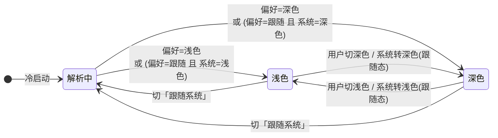

# 增量 PRD（增量 10）— OpenSchedule 移动端：深色模式（跟随系统 + 手动覆盖）

> 档位：**简单 PRD**（不含竞品 / 市场分析；用户未要求完整档）。
> 负责人：许清楚（PM）· 版本 **v1.0** · 实读基准：`D:\GLMclaw\workspace\openschedule`（本次写作时）
> 上游基线：`PRD-mobile.md`（**本需求来源：§3 需求池 `M-P2-01`（P2）**，`:110`）· `ARCH-mobile.md` §3（设计 token 体系）· 参照范例：`PRD-mobile-increment-8-offline.md`（结构与颗粒度）
> **本文只描述需求，不含任何 TS / JSX 代码，不写实现方案代码块。** 文中出现的字段名 / 组件名仅作**行内标注**，用于对齐既有实现语义，不代表实现。
> 凡引用代码事实均给 `文件:行号`；不确定处一律进入 §7「待确认问题」，**不臆造项目里不存在的能力**。

---

## 1. 需求背景与目标

### 1.1 需求原话（未做删改）

> **`M-P2-01` ｜ 深色模式跟随系统 ｜ 验收要点：设计 token 双套生效**（`PRD-mobile.md:110`）

**释义**：移动端引入**深色配色**，默认**跟随系统外观**；`src/theme/tokens.ts` 的色彩 token 需要**双套（浅 / 深）生效**，而不是把颜色写死一套。

### 1.2 本次范围声明（含用户已拍板的两次扩权）

> ⚠️ **范围相对原文已扩权（用户已拍板，不再推翻）**：原 `M-P2-01` 仅要求「**跟随系统**」，本次在原文基础上**追加「手动覆盖」**——即「跟随系统 / 强制浅色 / 强制深色」三态。这是**产品范围的主动扩张**，请主理人与用户知悉：交付面因此从「一套跟随逻辑」变为「三态 + 持久化 + 全屏适配」。

| 项 | 声明 |
| --- | --- |
| 交付物 | **仅本 PRD 文档**（产品目标 + 用户故事 + 需求池 + UI 状态矩阵 + 关键产品决策 + 待确认问题） |
| **不做** | 不写任何实现代码（无 TS / JSX / 伪代码）；**不改动任何源码或测试**；**不执行任何 git 操作**；不改后端 / `apps/web` / Prisma |
| 唯一需求来源 | `PRD-mobile.md:110`（`M-P2-01`） |
| 既定前提 1（用户拍板） | **模式范围 = 跟随系统 + 手动覆盖**：默认跟随系统；「我的」页提供 **浅色 / 深色 / 跟随系统** 三态开关，并**持久化**（AsyncStorage） |
| 既定前提 2（用户拍板） | **配色方向 = 商务风深色版**：沿用移动端现有设计语言（深墨蓝 `#1B2A4A` 系）做深色化 —— 深底 + 浅色文字 + 同色系强调。**明确不采用** `apps/web` 那套「固定深色 + 赛博风」（`#0e121c` 底 + 霓虹绿 `#00e5a0`），因为那是**另一套设计语言** |
| 允许的表达形式 | Mermaid 图、表格、ASCII 草图、字段名行内标注、文案示例 |
| 结论依据 | 全部锚定实读事实（`文件:行号`） |
| 进入开发的前置 | 主理人 / 用户对 §7 待确认问题拍板（**尤其 Q1 / Q2 / Q4 / Q7**）后方可进入架构与开发 |
| 硬约束（违反即返工） | **零新增 npm 依赖**（`useColorScheme` 为 `react-native` 自带，无需新依赖）· 禁用 `react-native-reanimated` / `react-native-gesture-handler`（仅 RN 内置 `Animated`）· 样式数值**只取** `src/theme/tokens.ts`，禁止内联魔法数字 · 裸 `<Pressable>` 白名单**必须恰好 6 个文件** · `tsc --noEmit` 零错误 · 最小变更原则 · 不修改既有测试断言 |

### 1.3 为什么本次走标准 SOP（PRD → 架构 → 开发 → QA）

本需求**不是**一个页面级的局部改动，而是**横切全仓的样式基建改造**：

- **改动面极大且机械**：`src/` 内 **46 个文件、558 处 `colors.` 引用**（§2-F3），且**全部是模块级 `StyleSheet.create({...})` 静态引用**——`colors` 是**模块加载期求值的静态常量**（`tokens.ts:15-64`）。
- **要让配色运行时可变，必须先把「静态常量」改造成「运行时可变」**——这是本次**最大风险点**，会同时波及 16 个屏、30 个组件、导航层与 5 个直接引用 `colors.` 的测试套件（§2-F11）。
- **触碰设计系统**：涉及 20+ 色彩 token 的**语义重映射**、状态标签 / 优先级色 / 品牌渐变 / 阴影体系在深色下的重新表达——需要架构先定「运行时主题层」的落点与改造策略，再评估最小侵入路径。
- 因此必须**先产品定义（本文）→ 再架构定方案 → 再开发 → 再 QA 全量回归**，不能边写边改。

### 1.4 产品目标（可衡量）

**一句话定位**：让 OpenSchedule 移动端在**夜间 / 系统深色**下从「刺眼白屏」变成「**商务风深色**」——默认跟随系统，用户可在「我的」页三态覆盖并持久化，**全屏无一处漏白**。

| # | 目标（可衡量） | 衡量指标 |
| --- | --- | --- |
| G1 | 默认跟随系统，无需设置即生效 | 系统切深色时，App 在**不重启、不重载**的情况下 ≤ 1s 内整体变深色；冷启动即按系统外观渲染 |
| G2 | 用户可三态覆盖且选择被记住 | 「我的」页可切「浅色 / 深色 / 跟随系统」；切换**即时生效**；**杀进程重开后保持**上次选择 |
| G3 | 全屏深色无遗漏、可读性达标 | 46 个 `src/` 文件（含 16 屏 + 30 组件 + 导航 + 状态栏）**无一处残留浅色底 / 深色字**；正文与背景对比度 **≥ 4.5:1** |

**解决的痛点**：

| 痛点 | 现状 | 目标态 |
| --- | --- | --- |
| 夜间使用刺眼 | 全仓零深色能力（§2-F9），系统深色下仍强制白底（`app.json:9` 写死 `light`） | 默认跟随系统，夜间自动深色 |
| 系统深色「失效」 | `app.json` 写死 `userInterfaceStyle: "light"`，原生层直接压制系统深色 | 改为 `automatic`，系统级生效 |
| 用户偏好无处表达 | 无任何主题开关 | 「我的」页三态开关 + 持久化 |
| 深色改造易漏白 | 颜色为静态常量、散落 558 处 | 收敛到运行时主题层，全屏统一 |

---

## 2. 现状事实（本次实读，构成需求前提）

> 编号 **F1–F19**；每条标注 `文件:行号`。凡与主理人侦察结论不一致处，均以本次实读为准并**显式标注差异**。

| # | 事实 | 证据 |
| --- | --- | --- |
| **F1** | **主题 token 为模块级静态常量**：`src/theme/tokens.ts`（**241 行**）导出 `colors`，含 `bg.{base,baseWarm,surface,subtle}`、`primary`/`primarySoft`/`primaryFaint`、`successFaint`/`dangerFaint`/`warningFaint`、`text.{primary,secondary,tertiary,inverse}`、`border`/`borderStrong`/`overlay`、`success`/`warning`/`danger`、`brandGradient`；另导出 `typography`/`spacing`/`radius`/`shadow`/`motion`/`layout` | `tokens.ts:15-64`（colors）、`:67-90`（typography）、`:93-103`（spacing）、`:110-121`（radius）、`:124-157`（shadow）、`:160-207`（motion）、`:210-227`（layout） |
| **F2** | **聚合层另含硬编码语义色**：`src/theme/index.ts`（**58 行**）聚合导出，并额外提供 `statusColor`（**6 个任务状态**，每项含 `color`+`bg`+`label`）与 `priorityColor`（**4 档优先级**），均为**硬编码十六进制** | `index.ts:8`（聚合导出）、`:22-29`（statusColor）、`:32-37`（priorityColor）、`:51-58`（getStatusStyle / getPriorityColor） |
| **F3** | **改动面（本次实读复核）**：`src/` 内 **558 处** `colors.` 引用，分布在 **46 个文件**；**全部是模块级 `StyleSheet.create({...})` 静态引用** ⇒ 配色要在运行时切换，必须让样式从「静态常量」变为「运行时可变」。**这是本次最大风险点** | 本次实读 `grep -ro "colors\." src \| wc -l` = **558**；`grep -rl "colors\." src \| wc -l` = **46** |
| **F3-note** | ⚠️ **与主理人侦察数据的差异（如实标注，不臆造）**：主理人记「**54 个文件**」，本次实读为 **`src/` 46 个文件**。差异源于**统计口径**——若把 `tests/`（5 个）与 `App.tsx`（1 个）一并计入，含 `colors.` 的文件为 **51**；若统计「引用 `colors` 一词（任意形式）」的 `src/` 文件则为 **49**。**引用处数（558）完全一致**。请架构以 **46 个 `src/` 文件 / 558 处**为改造基线 | 同上 |
| **F4** | `src/` 目录文件数（本次实读）：components **30** / screens **16** / hooks **8** / navigation **4** / services **11** / store **2** / theme **2** / utils **13** / data **3** / types **8**（`src/` 下 `.ts/.tsx` 合计 **100**）。⚠️ **主理人复核更正**：`src/services` 顶层实为 **11 个 `.ts` 文件** + `services/platform/` 子目录 **4 个文件** = 递归 **15**，与主理人原值一致；本行初稿记「12」系把 `platform` **目录**误计为 1 个文件（已在主理人复核时修正） | 本次实读 `find src/services -maxdepth 1 -name '*.ts*' \| wc -l` = 11；`find src/services -name '*.ts*' \| wc -l` = 15；`ls src/services` |
| **F5** | **`app.json` 写死浅色**：`"userInterfaceStyle": "light"`（`:9`）、`backgroundColor: "#F7F8FA"`（`:10`）、splash `backgroundColor: "#F7F8FA"`（`:14`）⇒ **系统级深色在原生层不会生效**，需改 `automatic` | `app.json:9`、`:10`、`:11-15` |
| **F6** | **根组件状态栏写死深色字**：`App.tsx:21` `<StatusBar style="dark" />`（`expo-status-bar`），需随主题切换；根容器底色 `colors.bg.base`（`App.tsx:34`） | `App.tsx:6`（import）、`:21`、`:32-35` |
| **F7** | **偏好持久化机制已成熟可复用**：`AppProvider` 定义 `AppPreferences`（`role`/`rememberMe`/`biometricEnabled`/`lastEmail`）+ `DEFAULT_PREFERENCES`；`persistPreferences()` 写 AsyncStorage；冷启动 `bootstrap()` 恢复偏好 | `AppProvider.tsx:39-48`（接口）、`:51-56`（默认值）、`:143-190`（bootstrap）、`:193-202`（persistPreferences）、`:249-263`（setRole / setBiometricEnabled 同构写法） |
| **F8** | **偏好 key 定义处**：`src/services/config.ts` 的 `PREFERENCE_KEYS`（`os.remember_me` / `os.role` / `os.last_email`）。⚠️ **细节**：整个 `AppPreferences` JSON 实际是**整体序列化后存于 `os.remember_me` 这一个 key 下**，`os.role` 仅作冗余单值 | `config.ts:20-28`；`AppProvider.tsx:148`（读 `PREFERENCE_KEYS.rememberMe`）、`:196`（写同一 key） |
| **F9** | **全仓零主题切换机制**：`src/` 检索 `useColorScheme` / `Appearance` / `prefers-color-scheme` / `darkMode` **零命中** | 本次实读 grep（`src/`）**No matches found** |
| **F10** | **Web 端已是「固定深色 + 赛博风」**：`apps/web/src/main.tsx` 用 AntD `theme.darkAlgorithm` + `colorBgBase: '#0e121c'` + `colorPrimary: '#00e5a0'`（霓虹绿）⇒ 固定深色、**非跟随系统**，且配色与移动端**完全不同**，**不可照搬**（已由用户拍板） | `apps/web/src/main.tsx:43-57` |
| **F11** | **测试基线**：`tests/` 共 **52 个条目**，其中 **50 个测试套件**（`*.test.ts(x)`）；基线全绿（主理人实测 50 套件 / 884 用例）。**5 个测试文件直接引用 `colors.`** ⇒ 改 token 结构可能影响它们 | 本次实读 `ls tests \| wc -l` = 52；`tests/*.test.ts(x)` = 50；引用文件：`tests/audit-center-render.test.tsx`(10)、`increment-ui-polish.test.tsx`(5)、`overview.test.ts`(2)、`increment-card-lift.test.tsx`(1)、`my-submissions-rework.test.tsx`(12) |
| **F12** | **硬约束（项目铁律）**：零新增 npm 依赖 · 禁用 `reanimated` / `gesture-handler` · 样式数值只取 `tokens.ts` · 裸 `<Pressable>` 白名单恰好 6 文件 · `tsc --noEmit` 零错误 · 最小变更 | 项目约定（见 §1.2 硬约束行） |
| **F13** | **裸 `<Pressable>` 白名单实测吻合**：`src/` 内 `<Pressable` 命中 **7 个文件**，其中 `PressableScale.tsx` 为封装器**本身**，其余恰为白名单 **6 个**（`BottomSheet` / `Button` / `Card` / `ScreenHeader` / `SegmentedControl` / `SwipeableRow`） | 本次实读 `grep -rln "<Pressable\b" src` |
| **F14** | **品牌渐变的默认值在模块加载期固化**：`BrandGradient.tsx` 以 `import { colors as themeColors }` 作**默认 prop 值** `gradient = themeColors.brandGradient` ⇒ 深色下若沿用同色渐变需改默认值来源；该组件被 `LoginScreen` 复用 | `BrandGradient.tsx:7`、`:70`；`LoginScreen.tsx:17`、`:101-116` |
| **F15** | **导航层颜色静态取用**：TabBar 的 `tabBarActiveTintColor`/`tabBarInactiveTintColor`/`tabBarStyle.backgroundColor` 在 `screenOptions` 内静态取 `colors.*` ⇒ 运行时切换需让 `screenOptions` 依赖主题 | `MainTabs.tsx:45-58`、`:93` |
| **F16** | **关键组件配色取用点（抽样）**：`Skeleton.tsx:65` shimmer 底色 = `colors.bg.subtle`；`BottomSheet.tsx:125` 遮罩 = `colors.overlay`；`LoginScreen` 品牌区 `:101-116` + `text.inverse` 用法 `:268`/`:274`/`:277`；`SegmentedControl` 轨道 `colors.bg.subtle`、指示器 `colors.bg.surface`（`SegmentedControl.tsx:113,126`） | 见各文件行号 |
| **F17** | **增量 8 已落地（深色适配须覆盖这些新增件）**：`App.tsx` 已挂 `ConnectivityProvider`（`:19`）与 `OfflineBanner`（`:22`）；新增 `OfflineBanner.tsx`、`StaleBadge.tsx`、`RefreshToast.tsx`、`store/ConnectivityProvider.tsx` | `App.tsx:9`、`:12`、`:19`、`:22`；`components/OfflineBanner.tsx`、`components/StaleBadge.tsx`、`components/RefreshToast.tsx` |
| **F18** | **三态开关可直接复用 `SegmentedControl`**：该组件为泛型 `SegmentedControlOption<T extends string>`，支持任意字符串枚举值；已在「我的」页用于**角色切换**（二态） | `SegmentedControl.tsx:10-22`（泛型选项）、`:30-34`；`ProfileScreen.tsx:132`（角色切换复用） |
| **F19** | **「我的」页设置卡片结构**：设置卡片内含「通知偏好 / 个人计划 / 我的提报 / 审核中心 / **模拟离线（Switch，受 `USE_MOCK` 门禁，仅 mock 构建可见）** / 时区 / 关于」等 `SettingRow`；`SettingRow` 支持 `trailing` 自定义行尾元素 | `ProfileScreen.tsx:145-215`（设置卡片）、`:182-201`（模拟离线 Switch）、`:269-321`（SettingRow 定义） |

> **由 F1/F3/F14/F15 推导出的关键前提（必须写入验收口径）**：当前颜色是**模块加载期静态常量**，且散落在 **46 个文件 / 558 处** 的 `StyleSheet.create` 里。**「运行时切换主题」在现有架构下不可直接实现**——必须先由架构确定「静态常量 → 运行时可变」的改造策略（§6-D2 / §7-Q2），否则三态开关切了也**不会重绘**。

---

## 3. 用户故事

| 编号 | 角色 | 故事 | 覆盖验收点 | 优先级 |
| --- | --- | --- | --- | --- |
| US-10-01 | 全部用户 | 作为夜间使用者，我希望**手机切到深色时 App 自动变深色**，以便不必手动设置 | 跟随系统 | P0 |
| US-10-02 | 全部用户 | 作为白天使用者，我希望**在系统深色时仍强制用浅色**，以便满足个人习惯 | 手动强制浅色 | P0 |
| US-10-03 | 全部用户 | 作为夜间使用者，我希望**在系统浅色时强制用深色**，以便提前进入护眼模式 | 手动强制深色 | P0 |
| US-10-04 | 全部用户 | 作为用户，我希望**杀进程重开后仍保持我上次选的主题**，以便不用每次重设 | 持久化 | P0 |
| US-10-05 | 全部用户 | 作为用户，我希望**随时切回「跟随系统」**，以便把决定权交还系统 | 切回跟随 | P0 |
| US-10-06 | 全部用户 | 作为用户，我希望**深色下正文清晰不刺眼、无漏白**，以便长时间阅读 | 可读性 / 全屏适配 | P0 |
| US-10-07 | 全部用户 | 作为用户，我希望**切换主题时不闪屏、不重载、不丢当前页面**，以便操作连贯 | 切换体验 | P1 |

---

## 4. 需求池

> 分级口径：**P0 = 本次必做的最小闭环** = 「**三态 + 持久化 + 全屏适配**」（对应 `M-P2-01` 验收要点「设计 token 双套生效」的完整交付）；P1 = 显著提升体验、不阻塞闭环；P2 = 增强项。
> 编号沿用主 PRD 前缀：`M-P2-01-xx`。

### P0（Must have — 本次必做的最小闭环）

| 编号 | 需求描述 | 验收要点 |
| --- | --- | --- |
| **M-P2-01-01** | **三态偏好模型**：定义「跟随系统 / 浅色 / 深色」三态枚举与默认值（默认**跟随系统**） | 三态枚举齐备；默认值 = 跟随系统；无系统偏好时可回退浅色（见 §6-D9） |
| **M-P2-01-02** | **偏好持久化**：主题选择写入 AsyncStorage，冷启动恢复；沿用既有 `PREFERENCE_KEYS` 命名与 `AppProvider` 偏好模式 | 选「深色」→ 杀进程重开 → 仍为深色；键名符合 `os.*` 约定（见 §7-Q2） |
| **M-P2-01-03** | **运行时主题层**：由「系统外观 + 用户覆盖」解析出**当前生效方案**（浅 / 深），并让**颜色在运行时可变**（不再是模块加载期静态常量） | 切换后样式能真正重绘（非仅写状态）；改造策略由架构定（§6-D2） |
| **M-P2-01-04** | **双套 token（深色化）**：20+ 色彩 token + `statusColor`(6) + `priorityColor`(4) 全部产出**深色语义**；色相沿用深墨蓝系（§6-D1） | 「设计 token 双套生效」——浅 / 深各一套；无内联魔法色值 |
| **M-P2-01-05** | **全屏适配（核心工作量）**：`src/` 内 **46 个文件 / 558 处 `colors.`** 全部改为按当前主题取值；覆盖 **16 屏 + 30 组件 + 导航层 + 状态栏** | 深色下**无一处漏白 / 深字压深底**；浅色外观与改造前**视觉零回归** |
| **M-P2-01-06** | **系统跟随生效**：`app.json` 改 `userInterfaceStyle: "automatic"`；用 `useColorScheme`（RN 自带，零依赖）监听系统外观变化，**无需重启即自动切换** | 系统切深色 → App ≤1s 自动变深色；切回浅色同理 |
| **M-P2-01-07** | **状态栏与系统 UI 适配**：`App.tsx` 的 `<StatusBar style>` 随主题切换（浅色 → `dark` 字，深色 → `light` 字）；`app.json` 的 `backgroundColor` / splash 底色在深色下不自相矛盾 | 深色下状态栏文字为浅色、可读；冷启动首屏不出现「白闪」 |
| **M-P2-01-08** | **「我的」页三态开关**：新增「外观」区块，用 `SegmentedControl` 提供「浅色 / 深色 / 跟随系统」三态，**即时生效** | 三态可切换且即时生效；当前值高亮正确；与既有「角色切换」交互一致 |
| **M-P2-01-09** | **可读性底线**：正文与背景对比度 **≥ 4.5:1**；次要文字最低 **≥ 3:1**；状态标签文字对底色 **≥ 4.5:1** | 深色下全部正文达 AA 级；见 §6-D6 |

### P1（Should have）

| 编号 | 需求描述 | 验收要点 |
| --- | --- | --- |
| **M-P2-01-10** | **骨架屏 / 加载态深色适配**：`Skeleton` shimmer 底色与高光在深色下不刺眼 | 深色下骨架屏可见且不闪白 |
| **M-P2-01-11** | **浮层类组件深色精修**：`BottomSheet` 遮罩、`UndoToast`、`RefreshToast`、`StaleBadge`、`OfflineBanner` 在深色下的层次与对比 | 深色下浮层与背景可辨、遮罩足够深 |
| **M-P2-01-12** | **品牌渐变区深色方案**：登录头 / 头像环的 `brandGradient` 在深色下的表达（见 §6-D1 / §7-Q6） | 深色下品牌区仍具辨识度、不与深底融为一体 |
| **M-P2-01-13** | **切换过渡动画**：主题切换时颜色 100ms 淡变（复用 `motion.duration.instant`），**不做整屏转场** | 切换无闪屏、无整页淡入淡出 |
| **M-P2-01-14** | **对比度自检**：以自动化测试校验「关键 token 对」的对比度是否达标 | 新增对比度测试；token 改动可回归 |

### P2（Nice to have）

| 编号 | 需求描述 | 验收要点 |
| --- | --- | --- |
| **M-P2-01-15** | **定时切换**：按日落 / 固定时段自动在浅 / 深间切换 | 时段可配；与「跟随系统」互斥关系明确 |
| **M-P2-01-16** | **深色下的图片 / 头像亮度微调**：深色底上降低图片眩光 | 可选开关 |
| **M-P2-01-17** | **`apps/mobile` 的 Web 输出（expo web）同步深色** | 与原生表现一致 |

---

## 5. UI 状态矩阵（浅色 / 深色 × 页面 / 组件）

> 约束：**不引入新组件库**；样式数值全部取自 `src/theme/tokens.ts`；**深色方案 = 商务风**（深墨蓝系），**不采用** Web 端 `#0e121c` + 霓虹绿。下表「深色（目标）」列给出**语义方向**，具体色值由架构师确定（§7-Q1）。

### 5.1 全局 token 语义映射（浅色现状 → 深色目标语义）

| token（现状值） | 语义角色 | 深色目标语义（方向） |
| --- | --- | --- |
| `bg.base` `#F7F8FA` | 页面底 | **深墨蓝基底的近黑**（**非纯黑** `#000`——纯黑会加剧 OLED 拖影与眩光，且丢商务气质）；建议由 `primary` 加深而来 |
| `bg.baseWarm` `#FBFAF7` | 登录 / 我的可用底 | 与 `bg.base` 同族、**略暖或略浅一档** |
| `bg.surface` `#FFFFFF` | 卡片 / 抽屉 / 输入框 | **比 `bg.base` 亮一档的深面**（深色下用**明度差**表达层级，因阴影不可见，见 §6-D7） |
| `bg.subtle` `#F1F3F7` | 骨架屏 / 内嵌区 / 按压缩进 | 介于 `base` 与 `surface` 之间，作为 shimmer 底色（深色下**低明度**而非浅灰） |
| `primary` `#1B2A4A` | 主按钮 / 标题 / 选中态 | ⚠️ **角色拆分（关键）**：① 作**标题 / 正文强调**时 → 改用浅色 `text.primary`；② 作**主按钮填充**时 → 用**提亮的中蓝**（保留色相、提升明度），保证其上的 `text.inverse` 仍 **≥4.5:1**；③ 作**选中 tint**（Tab / 分段）→ 同色相提亮 accent |
| `primarySoft` `#2E4470` | 次级强调 / 进行中 | 提亮一档的同色相蓝 |
| `primaryFaint` `#EAEEF5` | Chip / 标签淡底 | **反转为「深底上的低明度同色相容器」**（深墨蓝 12% 级），而非浅底 |
| `successFaint` `#E9F6F0` / `dangerFaint` `#FBEDED` / `warningFaint` `#FAF4EA` | 状态柔和底 | 同色相**低明度底**（深绿 / 深红 / 深琥珀底）+ 提亮主色文字 |
| `text.primary` `#1A1D24` | 正文 | **近白**（非纯白，避免眩光），如 `#E8EAF0` 级 |
| `text.secondary` `#6B7280` | 辅助信息 | 中灰提亮一档 |
| `text.tertiary` `#9AA1AE` | 占位 / 禁用 / 已取消 | 保持「最弱一级」，与 `secondary` 拉开层级 |
| `text.inverse` `#FFFFFF` | 深底上的文字 | 语义为「深底上的字」→ **基本不变**；须复核「深色下主按钮填充」上仍用它 |
| `border` `#ECEEF2` / `borderStrong` `#DDE1E8` | 分割线 / 输入框描边 | 深色下改为**低对比白描边**（白 8% / 14% alpha 级），而非浅灰 |
| `overlay` `rgba(27,42,74,0.45)` | 抽屉遮罩 | 深色下**更深 / 更不透明**（如黑 60% 级）以维持浮层层次 |
| `success` `#2F9E6E` / `warning` `#C8871B` / `danger` `#C24A4A` | 语义主色 | 各自**提亮**以在深底上达标（≥4.5:1 用于文字时） |
| `brandGradient` `['#1B2A4A','#2E4470']` | 仅品牌区渐变 | ⚠️ 深色下沿用原渐变会**与深底融为一体**；建议**提亮一档**保持辨识度（§6-D1 / §7-Q6） |
| `statusColor`（6 状态，`color`+`bg`） | 任务状态标签 | `color` 提亮；`bg` 换**低明度同色相底** |
| `priorityColor`（4 档） | 卡片左侧 3px 色条 | 4 色**统一提亮**，保证深底上可辨 |
| `shadow.*` | 卡片 / 浮层阴影 | 深色下阴影**基本不可见** → 层级改由 `bg.surface` 明度差 + `border` 表达（§6-D7） |

### 5.2 页面 / 组件 × 主题 矩阵

| 对象 | 浅色（现状） | 深色（目标） |
| --- | --- | --- |
| **页面底（16 屏）** | `bg.base` / `bg.baseWarm` 浅灰 | 深墨蓝近黑；`ProfileScreen` 等 `baseWarm` 用暖深色 |
| **卡片 `Card`** | `bg.surface` 白 + `shadow.card` | 深面（比底色亮一档）+ 细描边替代阴影 |
| **文字层级** | 深字为主（`text.primary` 近黑） | 浅字为主（近白 / 中灰 / 弱灰三级） |
| **分割线** | `border` 浅灰 1px | 低对比白描边（8% alpha 级） |
| **输入框 `TextField`** | `bg.surface` 白底 + `border` | 深面底 + 低对比白描边；聚焦态用提亮 `primary` |
| **按钮 `Button`** | `primary` 深墨蓝填充 + 白字；`secondary` / `danger` 变体 | `primary` 变体**提亮**后仍保证白字达标；`secondary`/`danger` 同规则重映射 |
| **状态标签 `Tag`/`statusColor`** | 8% 淡底 + 同色深字 | 低明度同色相底 + 提亮文字（≥4.5:1） |
| **优先级色条 `priorityColor`** | 4 色（红 / 琥珀 / 蓝 / 灰） | 4 色统一提亮 |
| **骨架屏 `Skeleton`** | `bg.subtle` shimmer | 低明度底 + 低对比高光 |
| **抽屉 `BottomSheet` 遮罩** | `overlay` 深墨蓝 45% | 更深遮罩（黑 60% 级） |
| **底部 Sheet 内容面** | `bg.surface` 白 | 深面（`radius.sheet` 顶部圆角保持） |
| **离线横幅 `OfflineBanner`** | `warningFaint` 底 + `warning` 字 | 低明度琥珀底 + 提亮琥珀字；「重试」胶囊底改深面 |
| **Toast `UndoToast` / `RefreshToast`** | 深底浮层 + 浅字（`text.inverse`） | 复核：深色下浮层需与背景拉开（更深或加描边） |
| **缓存标记 `StaleBadge`** | `Tag('缓存')` + `text.secondary` 文案 | 同规则深色化 |
| **品牌渐变区 `BrandGradient`/登录头** | `brandGradient` 深墨蓝渐变 + 白字 | 提亮渐变或加描边（§7-Q6） |
| **TabBar `MainTabs`** | `bg.surface` 底 + `primary` 选中 / `text.tertiary` 未选 | 深面底 + 提亮 accent 选中；`screenOptions` 需随主题 |
| **状态栏 `StatusBar`** | `style="dark"`（深字） | `style="light"`（浅字）；随主题切换 |
| **分段控件 `SegmentedControl`** | `bg.subtle` 轨道 + `bg.surface` 指示器 | 深轨道 + 深面指示器（指示器仍靠明度差浮起） |
| **头像 `Avatar` / 品牌环** | 品牌渐变环 + 白字 | 提亮环 + 浅字 |
| **未登录 `LoginScreen`** | `bg.baseWarm` + 品牌渐变头 | 需同样支持深色（见 §7-Q7） |

### 5.3 「外观」区块草图（「我的」页，新增）

```
┌────────────────────────────────────────────────┐
│  我的                                    大标题 │
│  身份、偏好与退出                                │
│  ┌──────────────────────────────────────────┐  │
│  │ ( 头像 )  张明                             │  │
│  │           zhang@team.com · 星辰科技 · PRO  │  │
│  └──────────────────────────────────────────┘  │
│                                                 │
│  角色切换                                        │
│  ┌──────────────┬──────────────┐               │
│  │   管理者      │    成员       │               │
│  └──────────────┴──────────────┘               │
│                                                 │
│  外观                                    ← 新增 │
│  ┌────────┬────────┬──────────────┐            │
│  │  浅色   │  深色   │  跟随系统     │  ← SegmentedControl 三态 │
│  └────────┴────────┴──────────────┘            │
│                                                 │
│  设置                                            │
│  ┌──────────────────────────────────────────┐  │
│  │ 🔔 通知偏好                     已开启 2 › │  │
│  │ 📅 个人计划                            › │  │
│  │ ✈ 我的提报                             › │  │
│  │ 📋 审核中心                            › │  │
│  │ 📶 模拟离线                     [ Switch ] │  │ ← 仅 mock 构建可见（dev 开关）
│  │ 🌐 时区                    Asia/Shanghai   │  │
│  │ ℹ 关于 OpenSchedule              v1.0.0 › │  │
│  └──────────────────────────────────────────┘  │
└────────────────────────────────────────────────┘
```

### 5.4 主题状态机（Mermaid）



- 「解析中」= 偏好 + 系统外观 **合成生效方案** 的判定；**仅「跟随系统」态**才响应系统变化事件。
- 三态为**全局唯一**（设备级偏好），落点与 `AppProvider` 偏好同源（§7-Q2）。

---

## 6. 关键产品决策（明确表态 + 理由 + 备选被否原因）

> 以下 D1–D9 是本次需求的**产品骨架**。每条给出**明确表态**；主理人 / 用户若否决，请按 §7 逐条拍板。

### D1｜深色 token 的语义映射方向（对应「特别需要产品判断」第 1 问）

**表态**：采用 **「商务风深色」= 深墨蓝基底的近黑底 + 浅色文字 + 同色系提亮强调**；具体色值由架构师确定，但**语义方向**如下：

1. **底色不取纯黑**：`bg.base` 用**深墨蓝基底的近黑**（由 `primary #1B2A4A` 加深派生），保留商务气质，同时规避 OLED 纯黑拖影与高对比眩光。
2. **层级用明度差而非阴影**：深色下 `bg.surface` **比 `bg.base` 亮一档**，靠明度差表达卡片「浮起」（见 D7）。
3. **`primary` 必须拆分角色（本决策最关键）**：`#1B2A4A` 在深底上**几乎不可见**，故：
   - 作**标题 / 强调文字**时 → 改用 `text.primary`（浅色）；
   - 作**主按钮填充**时 → 用**提亮的中蓝**（同色相、提明度），**硬约束：其上 `text.inverse` 白字对比度 ≥ 4.5:1**；
   - 作**选中 tint**（Tab / 分段控件）时 → 同色相提亮 accent。
4. **`Faint` 系语义反转**：`primaryFaint` / `successFaint` / `dangerFaint` / `warningFaint` 在深色下**不再是浅底**，而是**深底上的低明度同色相容器**（约 12% 明度），配提亮主色文字。
5. **语义色统一提亮**：`success` / `warning` / `danger` 在深底上需提亮以满足对比度（D6）。
6. **`brandGradient` 需提亮或加描边**：沿用原深墨蓝渐变会与深底融为一体，失去品牌区辨识度；建议提亮一档（仍属「深色商务」，**不是** Web 的赛博霓虹）。
7. **`statusColor`(6) / `priorityColor`(4)** 同步双套化：`color` 提亮、`bg` 换低明度同色相底。

- **理由**：既满足「跟随系统」的功能要求，又保持移动端**既有设计语言**的一致性（用户已拍板不引入 Web 赛博风）。
- **备选被否**：① **直接套用 Web 的 `#0e121c` + `#00e5a0`** —— 用户已明确否决（另一套设计语言，割裂移动端品牌感）；② **`primary` 原值不变、仅换底色** —— 深底上主按钮/选中态几乎不可见，功能不成立；③ **纯黑底 `#000`** —— 眩光与拖影问题，且丢商务气质。

### D2｜「静态 token → 运行时主题」的改造策略（最大风险点）

**表态**：**必须引入一个运行时主题层**，让颜色由「模块加载期静态常量」变为「运行时按当前方案取值」；**具体技术方案（如 `useTheme` hook + 样式工厂 / `useMemo` 生成 styles）由架构师决定**，本 PRD 只锁定产品级约束：

- 改造**不得**改变浅色外观（浅色视觉零回归）；
- 改造**不得**修改既有测试断言（F11 的 5 个套件须继续通过）；
- 全仓 **46 文件 / 558 处** 引用需**收敛到统一取值入口**，禁止逐个内联色值（违反「样式只取 tokens」铁律）；
- 允许的折中：若一次性全量迁移风险过高，架构可设计**兼容层**让旧写法暂可用，但**P0 完成时不得残留浅色硬编码**。

- **理由**：这是「三态开关能否真正生效」的前提；不解决它，UI 切了也不重绘。
- **备选被否**：① **仅改 `tokens.ts` 导出两套常量、不改引用点** —— 静态引用不会重绘，功能不成立；② **整屏 `key` 重挂载（remount）强制刷新** —— 会丢页面状态、产生闪屏，违背 US-10-07；③ **每屏各自 `useColorScheme`** —— 与「用户手动覆盖」冲突且散乱，无法全局一致。

### D3｜手动覆盖开关放在哪（对应「特别需要产品判断」第 2 问）

**表态**：放在「我的」页**新增的「外观」区块**，用 **`SegmentedControl` 三态**（浅色 / 深色 / 跟随系统），**位置在「角色切换」之下、「设置」卡片之上**；**不**与「模拟离线」Switch 相邻。

- **理由 1（形态）**：三态**不适合** Switch（二态控件），而 `SegmentedControl` 已存在且为泛型、支持任意字符串枚举（F18），与「角色切换」交互一致，**零新增组件**。
- **理由 2（性质分离）**：`模拟离线` 是 **`USE_MOCK` 门禁的 dev-only 开关**（F19），主题是**面向所有用户的正式功能**；两者混在一张设置卡片里会造成「主题也是调试功能」的误读。
- **理由 3（可发现性）**：「我的 → 外观」是移动端主题设置的**惯例位置**，用户心智成本最低。
- **备选被否**：① **与「模拟离线」同排** —— dev 开关与正式功能混淆，且 Switch 表达不了三态；② **放进「设置」卡片作为一行** —— 三态控件塞进单行 `SettingRow` 空间不足、命中率低；③ **顶部下拉快捷入口** —— 增加导航复杂度，超出最小闭环。

### D4｜持久化落点

**表态**：主题偏好**并入既有 `AppPreferences` 机制**（`AppProvider` + `PREFERENCE_KEYS` 模式，F7/F8），新增一个 `os.*` 主题键（键名由架构定，建议 `os.theme_mode`，取值 `system`/`light`/`dark`）。

- **理由**：复用已验证的持久化 / 冷启动恢复链路（`bootstrap` / `persistPreferences`），**最小变更**、零新增依赖。
- **备选被否**：**新造独立存储 key 体系** —— 重复造轮子，且与既有偏好分散、易不一致。
- ⚠️ 注意 F8 细节：现有实现把**整个偏好 JSON 存于 `os.remember_me`**，新增主题字段应遵循同一序列化方式（或由架构决定是否单独建键）——列 §7-Q2。

### D5｜切换时的体验（对应「特别需要产品判断」第 3 问）

**表态**：

1. **不重载页面、不重启**：切换**即时生效**，当前所在页面 / 滚动位置 / 表单状态**全部保留**。
2. **不做整屏转场动画**：仅做**颜色 100ms 淡变**（复用 `motion.duration.instant`，`tokens.ts:164`），避免闪屏。
3. **系统跟随态**下，系统外观变化（用户在系统设置里切深色）**实时响应**，无需重启。
4. **无 loading / 无遮罩**：切换是纯样式变更，不出现任何加载态。

- **理由**：主题切换是**高频、轻量**操作，任何重载 / 转场都会破坏连贯性（US-10-07）。
- **备选被否**：① **重载 App 或 remount 整棵树** —— 丢状态、闪屏；② **整页淡入淡出（340ms）** —— 夜间切主题时明显闪烁，体感差。

### D6｜深色下的可读性底线（对应「特别需要产品判断」第 4 问）

**表态**：**写入验收标准**（`M-P2-01-09`）：

| 对象 | 对比度要求 | 依据 |
| --- | --- | --- |
| 正文（`typography.body`）与背景 | **≥ 4.5:1** | WCAG 2.1 AA 正文标准 |
| 标题 / 大字号（≥18pt 或 14pt 粗体） | ≥ 3:1 | WCAG AA 大字号 |
| 次要文字（`caption` / `label`） | 目标 ≥ 4.5:1，**最低 ≥ 3:1** | 兼顾层级与可读 |
| 状态标签文字 / 底色 | ≥ 4.5:1 | 标签信息需精确可读 |
| 主按钮白字 / 填充色 | ≥ 4.5:1 | 关键操作可读 |

- **理由**：深色模式最大风险是「对比不足导致可读性下降」，必须**量化**才可验收；且应提供**自动化对比度自检**（`M-P2-01-14`）防回归。
- **备选被否**：**只凭肉眼验收** —— 主观、不可回归、易在后续迭代中劣化。

### D7｜深色下的「阴影」如何处理

**表态**：深色下 `shadow.*` **基本不可见**，层级改用 **`bg.surface` 明度差 + `border` 细描边** 表达；阴影 token 本身**不删除**（浅色仍用），仅在深色方案中弱化 / 停用。

- **理由**：深色底上投影几乎不可感知，强行加深会形成脏污感；明度差是深色 UI 表达层级的通用手法。
- **备选被否**：**给深色卡片加大阴影** —— 视觉脏、且与商务风不符。

### D8｜状态标签 / 优先级色条的深色适配

**表态**：`statusColor`(6) 与 `priorityColor`(4) 必须**双套化**（不能只改 `colors`）；标签 = 低明度同色相底 + 提亮文字；优先级色条 4 色统一提亮以保证深底可辨。

- **理由**：这两组是**硬编码在 `theme/index.ts` 的独立色表**（F2），不随 `colors` 变化，**极易在深色改造中被遗漏**，导致「标签仍用浅底深字」的漏白。
- **备选被否**：**只改 `colors`、不动 `statusColor`/`priorityColor`** —— 必然漏白。

### D9｜默认值与回退

**表态**：默认 = **跟随系统**；当系统外观**不可得**（如部分 Web / 测试环境）时，**回退浅色**（保持现状，零回归）。

- **理由**：符合 `M-P2-01` 原文「跟随系统」；回退浅色保证改造前行为不变，降低回归风险。
- **备选被否**：**默认深色** —— 与原文不符，且会让白天用户突然变暗。

---

## 7. 待确认问题（每条给默认建议）

> **Q1 / Q2 / Q4 / Q7 建议在进入架构前拍板**；标注「架构」的由架构师决定，「产品」的需主理人 / 用户拍板。

| # | 问题 | 建议默认值 | 拍板方 | 影响面 |
| --- | --- | --- | --- | --- |
| **Q1** | **深色底方向**：深墨蓝近黑 vs 中性近黑？`primary` 提亮到什么明度？ | **深墨蓝基底近黑**（由 `#1B2A4A` 加深派生）；`primary` 提亮至「其上白字 ≥4.5:1」的最低明度 | 产品 + 架构 | 全套深色观感与品牌一致性；**不拍板无法出深色稿** |
| **Q2** | **主题状态落点**：并入 `AppProvider` 偏好，还是新建 `ThemeProvider`？键名与序列化方式（沿用 `os.remember_me` 整体 JSON，还是新增 `os.theme_mode`）？ | **并入既有偏好机制**，新增 `os.theme_mode`（`system`/`light`/`dark`）；是否独立 Provider 由架构定 | 架构 | 影响 `AppProvider` 边界与持久化实现 |
| **Q3** | **改造策略**：46 文件 / 558 处**一次性全量迁移**，还是提供**兼容层**逐步迁移？ | 允许架构设计兼容层，但 **P0 完成时不得残留浅色硬编码** | 架构 | 决定工作量与回归风险 |
| **Q4** | **切换是否要过渡动画**？ | **仅颜色 100ms 淡变**，不做整屏转场（D5） | 产品 | 体验与实现复杂度 |
| **Q5** | **对比度验收是否自动化测试**？ | **要**（`M-P2-01-14`），至少覆盖关键 token 对 | 架构 + QA | 防回归；测试增量 |
| **Q6** | **品牌渐变深色方案**：提亮一档 vs 保留原渐变加描边？ | **提亮一档**（保持深色商务，非赛博） | 产品 | 登录头 / 头像环观感 |
| **Q7** | **未登录态（`LoginScreen`）是否也支持深色？** 主题开关在「我的」页（需登录），但登录页也可能在系统深色下被看到 | **支持**：登录页同样跟随系统（未登录时按系统外观，无手动覆盖） | 产品 | 登录页改造范围；冷启动首屏观感 |
| **Q8** | **原生 splash / 启动底色**：`app.json` 的 splash `backgroundColor` 是**构建期固定**的，无法运行时切换 | 至少把 `userInterfaceStyle` 改 `automatic`；若需深色 splash，评估 `expo-splash-screen` 的深色变体（**仍零新增依赖**前提下） | 架构 | 冷启动首屏是否「白闪」 |
| **Q9** | **状态栏适配**：`App.tsx` 的 `<StatusBar style>` 需随主题切换 | 浅色 → `dark` 字；深色 → `light` 字（`App.tsx:21`） | 架构 | 状态栏可读性 |
| **Q10** | **5 个引用 `colors.` 的测试套件**（F11）是否需更新？硬约束「不修改既有断言」 | **不改断言**；由架构保证 token 结构兼容（如保留 `colors` 的浅色默认导出） | 架构 | 测试回归面 |
| **Q11** | **`apps/mobile` 的 Web 输出（expo web）**是否纳入本次深色范围？ | **纳入 P2**（`M-P2-01-17`），本次以原生为主 | 产品 | 范围边界 |
| **Q12** | **深色下的图片 / 头像眩光**是否处理？ | **本次不做**，列 P2（`M-P2-01-16`） | 产品 | 范围边界 |
| **Q13** | **「跟随系统」态下系统切换的响应延迟目标**？ | **≤ 1s**（复用 `useColorScheme` 事件，实时） | 架构 | 验收指标 |
| **Q14** | **三态切换是否需要二次确认 / 提示**？ | **不需要**（即时生效、可随时切回，符合轻量预期） | 产品 | 交互细节 |

---

## 8. 明确不做什么（范围外清单）

| # | 不做 | 理由 |
| --- | --- | --- |
| N1 | **采用 `apps/web` 的「固定深色 + 赛博风」配色**（`#0e121c` 底 + 霓虹绿 `#00e5a0`） | 用户已拍板：那是另一套设计语言，会割裂移动端品牌感（`apps/web/src/main.tsx:43-57`） |
| N2 | **高对比度无障碍模式 / 色盲友好模式** | 超出 `M-P2-01` 范围；列未来增量 |
| N3 | **主题色自定义 / 多套主题（换肤）** | 超出范围；本次仅「浅 / 深 / 跟随」三态 |
| N4 | **引入任何新 npm 依赖**（主题库 / 配色库等） | 硬约束；`useColorScheme` 为 RN 自带，无需新依赖 |
| N5 | **使用 `react-native-reanimated` / `react-native-gesture-handler`** | 硬约束；仅 RN 内置 `Animated` |
| N6 | **修改既有测试断言** | 硬约束；改造须兼容既有 token 用法（Q10） |
| N7 | **重载 App / remount 整棵树来实现切换** | 会丢页面状态、产生闪屏，违背 US-10-07（D2 备选已否） |
| N8 | **改动后端 / `apps/web` / Prisma** | 落点约束；本需求纯 `apps/mobile` 前端 |
| N9 | **跟随系统的「定时切换」（日落 / 固定时段）** | 列 P2（`M-P2-01-15`）；本次以系统 + 手动为准 |
| N10 | **图片 / 头像的深色眩光处理** | 列 P2（`M-P2-01-16`） |
| N11 | **执行任何 git 操作** | 硬约束 |
| N12 | **改动 `apps/mobile` 之外的任何包** | 最小变更原则 |

---

## 附录 A：证据索引（本次实读）

| 文件 | 关键行号 | 用途 |
| --- | --- | --- |
| `docs/mobile-app/PRD-mobile.md` | `:110`（`M-P2-01` 需求来源） | 需求来源 |
| `apps/mobile/src/theme/tokens.ts` | `:15-64`（colors）、`:67-90`（typography）、`:110-121`（radius）、`:124-157`（shadow）、`:160-207`（motion）、`:210-227`（layout） | 现状 F1 / 双套 token 改造对象 |
| `apps/mobile/src/theme/index.ts` | `:8`（聚合）、`:22-29`（statusColor）、`:32-37`（priorityColor） | 现状 F2 / D8 遗漏风险 |
| `apps/mobile/app.json` | `:9`（userInterfaceStyle）、`:10`（backgroundColor）、`:11-15`（splash） | 现状 F5 / Q8 |
| `apps/mobile/App.tsx` | `:6`、`:21`（StatusBar style="dark"）、`:19`（ConnectivityProvider）、`:22`（OfflineBanner）、`:32-35`（root bg） | 现状 F6 / F17 / Q9 |
| `apps/mobile/src/store/AppProvider.tsx` | `:39-48`（AppPreferences）、`:51-56`（默认值）、`:143-190`（bootstrap）、`:193-202`（persistPreferences）、`:229-247`（signOut）、`:249-263`（setRole 同构） | 现状 F7 / D4 / Q2 |
| `apps/mobile/src/services/config.ts` | `:20-28`（PREFERENCE_KEYS）、`:36-50`（CACHE_KEYS / CACHE_LIMITS） | 现状 F8 / D4 |
| `apps/mobile/src/screens/ProfileScreen.tsx` | `:132`（SegmentedControl 复用）、`:145-215`（设置卡片）、`:182-201`（模拟离线 Switch）、`:269-321`（SettingRow） | 现状 F18 / F19 / D3 |
| `apps/mobile/src/components/SegmentedControl.tsx` | `:10-22`（泛型选项）、`:30-34`、`:113`/`:126`（轨道 / 指示器配色） | 复用载体 F18 / §5.3 |
| `apps/mobile/src/components/BrandGradient.tsx` | `:7`（`colors as themeColors`）、`:70`（默认 prop） | 现状 F14 / D1-6 / Q6 |
| `apps/mobile/src/navigation/MainTabs.tsx` | `:45-58`（tabBar 配色）、`:93` | 现状 F15 / §5.2 |
| `apps/mobile/src/components/OfflineBanner.tsx` | `:47`（文案分支）、`:74-105`（配色 `warningFaint`/`warning`） | 现状 F17 / §5.2 |
| `apps/mobile/src/components/StaleBadge.tsx` · `Skeleton.tsx:65` · `BottomSheet.tsx:125` | 配色取用点 | 现状 F16 / §5.2 |
| `apps/mobile/src/screens/LoginScreen.tsx` | `:17`、`:101-116`（品牌渐变）、`:268`/`:274`/`:277`（`text.inverse`） | 现状 F14 / Q7 |
| `apps/web/src/main.tsx` | `:43-57`（darkAlgorithm + `#0e121c` + `#00e5a0`） | 现状 F10 / N1（明确不照搬） |
| `apps/mobile/tests/` | 52 条目 / 50 套件；`audit-center-render` / `increment-ui-polish` / `overview` / `increment-card-lift` / `my-submissions-rework` 引用 `colors.` | 现状 F11 / Q10 |

---

## 附录 B：本次需求的一句话总结（供主理人快速拍板）

> 给移动端加**深色模式**：**默认跟随系统**，「我的」页新增「外观」区块用 **`SegmentedControl` 三态**（浅色 / 深色 / 跟随系统）**持久化**覆盖；配色走**商务风深色**（深墨蓝系，**不用** Web 的赛博霓虹）。**真正的工作量与风险在改造**：`src/` 内 **46 文件 / 558 处 `colors.`** 目前全是**静态常量引用**，必须由架构先定「**运行时主题层**」策略（D2）——否则开关切了也不重绘。深色下 **`primary` 深墨蓝几乎不可见，须拆分角色**（文字用浅色、按钮填充提亮、选中 tint 提亮），`Faint` 系反转为低明度同色相底，`statusColor`/`priorityColor` 两张**独立色表易被遗漏**（D8）。正文对比度 **≥4.5:1** 写入验收（D6）。
> **须拍板 4 件事**：**Q1** 深色底方向与 `primary` 明度（产品）、**Q2** 主题状态落点与键名（架构）、**Q4** 是否要过渡动画（产品）、**Q7** 未登录页是否同样支持深色（产品）。
