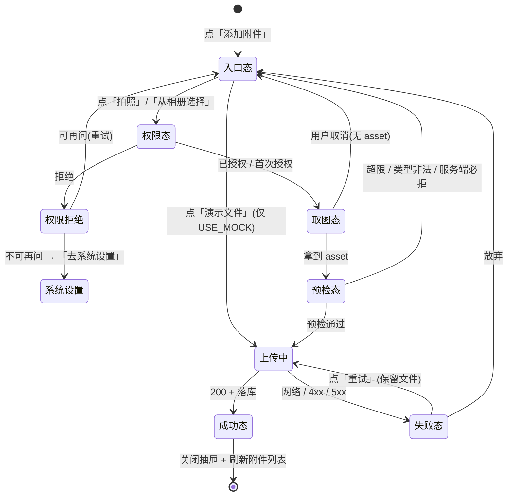

# 增量 PRD（增量 11）— OpenSchedule 移动端：任务附件拍照直传（M-P2-03）

> 档位：**简单 PRD**（不含竞品 / 市场分析；用户未要求完整档）。
> 负责人：许清楚（PM）· 版本 **v1.0** · 实读基准：`D:\GLMclaw\workspace\openschedule`（本次写作时）
> 上游基线：`PRD-mobile.md`（**本需求来源：§3 需求池 `M-P2-03`（P2）**，`:112`）· `ARCH-mobile.md` §11（风险与降级：R1 / R4）· 参照范例：`PRD-mobile-increment-10-darkmode.md`（结构与颗粒度）
> **本文只描述需求，不含任何 TS / JSX 代码，不写实现方案代码块。** 文中出现的字段名 / 组件名 / 包名仅作**行内标注**，用于对齐既有实现语义与依赖边界，不代表实现。
> 凡引用代码事实均给 `文件:行号`；不确定处一律进入 §7「待确认问题」，**不臆造项目里不存在的能力**。

---

## 1. 需求背景与目标

### 1.1 需求原话（未做删改）

> **`M-P2-03` ｜ 任务附件拍照直传 ｜ 验收要点：调用相机权限**（`PRD-mobile.md:112`）

**释义**：任务详情页的附件能力，需要支持**用设备相机拍照（或从相册选图）直接作为附件上传**；验收要点落在「**真的调用了系统相机权限**」，而不是"在假文件列表里挑一个"。

### 1.2 本次范围声明（含用户已拍板的**破例授权**）

> ⚠️ **本增量破例一次（用户已明确同意，不再推翻）**：本项目此前每个增量都严守「**零新增 npm 依赖**」（该铁律在 `ARCH-mobile-increment-1.md:4`、`ARCH-mobile-increment-2.md:4`、`ARCH-mobile-increment-10-darkmode.md:7` 等逐份重申）。**本增量经用户拍板允许新增依赖，但边界收窄为：只允许 expo 官方包，且取最少。** 这是一次**范围与工程约束的主动破例**，请主理人与用户知悉：交付面因此从「纯 JS 逻辑改动」变为「**引入原生模块 + 权限声明 + 打包面变化**」。

| 项 | 声明 |
| --- | --- |
| 交付物 | **仅本 PRD 文档**（产品目标 + 用户故事 + 需求池 + UI 状态矩阵 + 关键产品决策 + 待确认问题） |
| **不做** | 不写任何实现代码（无 TS / JSX / 伪代码）；**不改动任何源码或测试**；**不执行任何 git 操作**；不改后端 / `apps/web` / Prisma |
| 唯一需求来源 | `PRD-mobile.md:112`（`M-P2-03`） |
| 既定前提 1（用户拍板） | **允许新增 expo 官方依赖，取最少**；本 PRD 建议**只新增 1 个包 `expo-image-picker`**（论证见 §6-D1） |
| 既定前提 2（用户拍板） | **不做视频录制**（`mediaTypes` 只取图片；config plugin 关闭麦克风权限） |
| 允许的表达形式 | Mermaid 图、表格、ASCII 草图、字段名 / 包名行内标注、文案示例 |
| 结论依据 | 全部锚定实读事实（`文件:行号`）与官方文档（`expo-image-picker`） |
| 进入开发的前置 | 主理人 / 用户对 §7 待确认问题拍板（**尤其 Q1 / Q7 / Q11 / Q13**）后方可进入架构与开发 |
| 硬约束（违反即返工） | ① 新增依赖**仅限 expo 官方包**，且需逐包论证必要性 ② **禁用** `react-native-reanimated` / `react-native-gesture-handler` ③ 样式数值**只取** `src/theme/tokens.ts` ④ 组件样式沿用增量 10 **样式工厂范式**（`const makeStyles = (colors: ThemeColors) => StyleSheet.create({...})` + `useThemedStyles(makeStyles)`，**工厂参数名必须叫 `colors`**）⑤ 裸 `<Pressable>` 白名单**必须恰好 6 个文件**，其它一律用 `PressableScale` ⑥ **不修改任何既有测试文件与其断言** ⑦ 新增 UI **必须同时适配浅色与深色** ⑧ `tsc --noEmit` 零错误 ⑨ 最小变更原则 |

### 1.3 为什么本次走标准 SOP（PRD → 架构 → 开发 → QA）

本需求**不是**一个纯 UI 改动，而是**一次跨边界的能力引入**：

- **它是本项目第一次引入原生能力与系统权限**：相机 / 相册权限的申请、拒绝、降级在 **iOS / Android / Web 三端语义完全不同**（§2-F14 / §2-F15），需要产品先定义"拒绝之后用户看到什么、还能做什么"。
- **它撞上了一个真实的契约不一致**：移动端白名单（宽松）与服务端白名单（精确枚举）**口径不同**，导致 **iPhone 相机直出的 HEIC 走主路径必然失败**（§2-F8 / §2-F9 / §6-D2）——这是**必须先由产品裁决**的问题，不是实现细节。
- **它触碰测试与打包的既有隔离范式**：jest 只解析 native 文件、`.web.ts` 在测试里不生效（§2-F18），Web 导出是本仓常态验收手段（§2-F19），依赖引入方式直接决定回归面。
- 因此必须**先产品定义（本文）→ 再架构定方案 → 再开发 → 再 QA 全量回归**。

### 1.4 产品目标（可衡量）

**一句话定位**：把任务详情页的「添加附件」从**挑假文件**变成**真的能拍照 / 选图并上传**——**默认构建（`USE_MOCK=true`）下全流程可演示，真实构建（`USE_MOCK=false`）下走真实 multipart 上传**，并且**权限被拒、格式不被接受、体积超限**这三类失败都有明确的中文出路。

| # | 目标（可衡量） | 衡量指标 |
| --- | --- | --- |
| G1 | 真能拍照 / 选图 | 抽屉内「拍照」能调起系统相机并回传图片；「从相册选择」能调起系统相册；**验收要点「调用相机权限」= 系统级权限弹窗真的出现** |
| G2 | 真的能传上去 | 默认构建下上传成功后附件列表出现新条目（`fileName` / `sizeBytes` 与所选一致）；真实构建下走 `POST /api/v1/attachments`（multipart，`resource_type=task` + `resource_id`）并落库 |
| G3 | 失败路径都有中文出路 | **权限拒绝** → 可去系统设置；**类型不被接受**（HEIC / `text/*`）→ 上传前就提示且给出替代做法；**体积超限** → 中文提示 + 可重试。三类失败**均不得出现"点了没反应"或静默失败** |

**解决的痛点**：

| 痛点 | 现状 | 目标态 |
| --- | --- | --- |
| 「添加附件」是假的 | 候选文件来自硬编码 `MOCK_UPLOAD_FILES`（§2-F1），无任何拍照 / 选图能力 | 拍照 / 相册真实取图 |
| 「上传」是假的 | `uploadAttachment` 仅 mock 模拟进度（§2-F2），真实分支只有一句 TODO | 真实 multipart 分支到位（`USE_MOCK` 门禁切换） |
| 附件校验与服务端口径不一致 | 移动端收 `image/*` + `text/*`，服务端只收 4 种图片且不收 `text/*`（§2-F8 / §2-F9） | 上传前按服务端口径预检，给出明确提示 |
| 主路径（iPhone 拍照）会失败 | iOS 默认 HEIC，服务端拒收（§2-F9），当前无任何提示 | 明确提示 + 可执行的替代做法（§6-D2） |

---

## 2. 现状事实（本次实读，构成需求前提）

> 编号 **F1–F21**；每条标注 `文件:行号`。凡与主理人侦察结论不一致处，均以本次实读为准并**显式标注差异**。

| # | 事实 | 证据 |
| --- | --- | --- |
| **F1** | **「添加附件」候选文件是硬编码假数据**：`MOCK_UPLOAD_FILES: AttachmentFileMeta[]` 含 **6 条**——`评审结论.pdf`(1.24MB) / `首页草图.png`(820KB) / `会议纪要.docx`(96KB) / `原始素材.zip`(18.5MB) / `超清录屏.mov`(`video/quicktime`, 32MB) / `安装包.exe`(`application/x-msdownload`, 2MB)。后两条分别覆盖**超限**与**非法类型**演示分支 | `TaskDetailScreen.tsx:67-78` |
| **F1-note** | ⚠️ **与主理人侦察数据的差异（如实标注）**：主理人记 `MOCK_UPLOAD_FILES`「`:67-70`，**仅 2 个**假文件」；本次实读为 **6 条（`:67-78`）**。以实读为准。**该差异影响 D10 的结论**（删掉它会丢两种校验分支的可演示性） | 同上 |
| **F2** | **上传服务仅 mock**：`uploadAttachment(taskId, input, uploaderId, onProgress)` 在 `USE_MOCK` 分支做本地校验 → 模拟分片进度（`[0.25,0.5,0.75,0.95]` 各 `delay(80)`）→ 组装 `Attachment` 落内存库 → `onProgress(1)`；真实分支**只有一句 TODO 注释 + 一个 `httpClient.post`** | `task.service.ts:666-704`（签名 `:666-671`、mock `:672-700`、分片 `:679-683`、`objectKey` `:690`、TODO `:702`、真实分支 `:703`） |
| **F3** | **真实分支的 TODO 与真实 API 契约不一致（本增量第二个真问题）**：TODO 写 `POST /attachments（multipart/form-data: taskId + file）`（`:702`），而真实 API 要的是**表单字段 `resource_type`(task) + `resource_id`(UUID)**，**没有 `taskId` 字段** | `task.service.ts:702` ↔ `dto/upload-attachment.dto.ts:14-22` |
| **F4** | **附件列表的真实端点也与 TODO 不一致**：`listAttachments` 的 TODO 写 `GET /tasks/:taskId/attachments`（`:654`），真实端点是 `GET /api/v1/attachments?resource_type=&resource_id=` | `task.service.ts:648-656` ↔ `attachments.controller.ts:34-43` |
| **F5** | **移动端 httpClient 只支持 JSON，不支持 multipart**：`request()` 在 `body !== undefined` 时**强制** `Content-Type: application/json`（`:110`）并对 body 做 `JSON.stringify`（`:121`）；成功时返回 `envelope.data`（`:159`）⇒ **真实上传必须新增一条 multipart 请求路径**，不能复用 `httpClient.post` | `client.ts:103-160`（`:110`、`:121`、`:159`） |
| **F6** | **移动端附件校验（宽松口径）**：`ATTACHMENT_MAX_SIZE_BYTES = 20MB`（`:8`）；MIME **精确值** `application/pdf` / `application/zip`（`:14`）；MIME **前缀** `image/` / `text/` / `application/vnd.openxmlformats-officedocument.`（`:17-21`）；`validateAttachment` 返回可直接展示的中文提示（`:48-67`）；`sanitizeFileName` 去路径分隔符与空白（`:70-72`）；`mockAttachmentUrl` 造假 URL（`:75-77`） | `utils/attachment.ts:8`、`:14`、`:17-21`、`:48-67`、`:70-72`、`:75-77` |
| **F7** | **移动端 `Attachment` 类型比服务端响应多两个字段**：类型要求 `tenantId` 与 `uploaderId`（`:113-125`），而服务端上传响应为 `{id, resourceType, resourceId, objectKey, fileName, mimeType, sizeBytes, createdAt}`——**不含** `tenantId` / `uploaderId`。Web 端 `Attachment` 类型（`attachmentApi.ts:16-25`）与之吻合（无这两字段） | `types/task.ts:113-125` ↔ `attachments.service.ts:80-90` ↔ `apps/web/src/api/attachmentApi.ts:16-25` |
| **F8** | **服务端白名单（精确枚举，权威口径）**：图片**只收** `image/jpeg` / `image/png` / `image/gif` / `image/webp`；另有 pdf / msword / docx / ms-excel / xlsx / ms-powerpoint / pptx / zip / x-zip-compressed / 7z。**完全不收 `text/*`**，**完全不收任何 `video/*`**。上限同为 20MB | `attachment-policy.ts:1`（20MB）、`:3-9`（白名单）、`:11-16`（校验函数） |
| **F9** | **契约不一致的后果（本增量最尖锐风险）**：iPhone 相机默认直出 **HEIC**（`image/heic`）⇒ **通过移动端校验（命中 `image/` 前缀），却被服务端拒收**；`text/*` 同理（移动端放行、服务端拒收）。即：**iPhone 用户走"拍照直传"主路径会必然失败** | `utils/attachment.ts:17-21` ↔ `attachment-policy.ts:3-9` |
| **F10** | **服务端附件模块是真实实现**：`POST /api/v1/attachments`（`FileInterceptor('file')`，multer 限 `20MB + 1MB` 余量，service 精确校验）；`GET /api/v1/attachments/:id`（返回**临时签名 URL**，`expiresIn = 300` 秒）；`GET /api/v1/attachments?resource_type=&resource_id=`（列表，`X-Total-Count`）。响应信封为 `{ data, meta }` | `attachments.controller.ts:17-25`、`:28-31`、`:34-43`；`attachments.service.ts:39`（校验）、`:48`（`buildObjectKey`）、`:80-90`（上传返回）、`:102-103`（`expiresIn=300`）、`:112-124`（下载返回）、`:141`（列表返回） |
| **F11** | **服务端 `resource_id` 必须是 UUID**（`@IsUUID()`），`resource_type` 必须是 `task`/`comment`/`project` 枚举 | `dto/upload-attachment.dto.ts:16-21`、`:26-30` |
| **F12** | **Web 端已有完整参考实现**：`uploadAttachment(file: File, resourceType, resourceId)` 组 `FormData`（`file` + `resource_type` + `resource_id`）→ `POST /attachments`；`getAttachment(id)` → `GET /attachments/:id` 取 `downloadUrl` | `apps/web/src/api/attachmentApi.ts:34-47`、`:50-54` |
| **F13** | **`USE_MOCK` 默认 `true`**：`process.env.EXPO_PUBLIC_USE_MOCK !== 'false'` ⇒ 未显式设环境变量时**恒走 mock**；既有服务模式统一为 `if (USE_MOCK) { await simulateLatency(); … }` + 真实分支 + `// TODO(real-api)` | `config.ts:12`；模式样例：`task.service.ts:601`、`:650`、`:672`、`:708`、`:718` |
| **F14** | **全仓**零**拍照 / 选图 / 文件选择能力**：`src/` 内检索 `expo-image-picker` / `expo-camera` / `expo-document-picker` **零命中**；`package.json` 依赖共 14 项（`@expo/vector-icons`、`async-storage`、`@react-navigation/*`×3、`expo`、`expo-linking`、`expo-local-authentication`、`expo-secure-store`、`expo-status-bar`、`react`、`react-dom`、`react-native`、`safe-area-context`、`screens`、`react-native-web`），**`node_modules` 下亦无 `expo-image-picker` / `expo-camera`**（本次实测） | 本次实读 grep + `ls node_modules/expo-image-picker`（NOT INSTALLED）+ `package.json:5-22` |
| **F15** | **`app.json` 无任何相机 / 相册权限声明**：`ios.infoPlist` 仅一条 `NSFaceIDUsageDescription`（`:18-20`）；`plugins` 只有 `expo-secure-store` 与 `expo-local-authentication`（`:30-38`）；**无 `expo-image-picker` 插件配置**。`userInterfaceStyle` 已是 `automatic`（增量 10 成果，`:9`） | `app.json:9`、`:18-20`、`:30-38` |
| **F16** | **「添加附件」入口与上传抽屉现状**：附件区块头部右侧为 `PressableScale`（`accessibilityLabel="添加附件"`，`onPress={handleOpenUpload}`）；抽屉 `title="添加附件"`、`heightRatio={0.62}`；提示文案明写「**演示环境为 mock 文件选择器**」；错误位 `uploadError`；上传中显示 `上传中… N%` + `ProgressBar`；**上传中禁止关闭抽屉**；候选行由 `MOCK_UPLOAD_FILES.map` 渲染 | `TaskDetailScreen.tsx:644-655`（入口）、`:234-239`（`handleOpenUpload`）、`:241-264`（`handlePickAttachment`）、`:799-852`（抽屉：`:802-806` 禁关闭、`:810-812` 提示、`:813-818` 错误、`:819-825` 进度、`:828-849` 候选列表） |
| **F17** | **附件预览现状**：预览抽屉展示 `fileName` / `mimeType` / `sizeBytes` / `createdAt`，唯一动作是「用系统应用打开」——Web 端 `Linking.openURL(mockAttachmentUrl(...))`，**native 端仅设一句「演示环境：已请求系统应用打开（mock）」提示**（假 URL 无真实下载） | `TaskDetailScreen.tsx:266-284`、`:854-896` |
| **F18** | **原生能力隔离范式已存在且被注释显式声明**：`src/services/platform/biometrics.ts`（native，`import * as LocalAuthentication from 'expo-local-authentication'`）与 `biometrics.web.ts`（**明写「本文件不 import expo-local-authentication，保证 Web 打包安全」**）。但 **jest 不解析 `.web.ts`**：`jest-expo` 默认预设继承 RN 的 `haste.defaultPlatform = 'ios'`，`platforms = ['android','ios','native']` ⇒ 测试里**只会加载 native 版**。因此既有测试对原生模块一律**显式 mock**（`tests/auth.test.ts:5`、`tests/useTimer.test.tsx:5` mock `expo-local-authentication`） | `biometrics.ts:1-5`、`biometrics.web.ts:1-5`；`node_modules/@react-native/jest-preset/jest-preset.js:16-19`；`tests/auth.test.ts:5`、`tests/useTimer.test.tsx:5` |
| **F19** | **没有任何既有测试 render / import `TaskDetailScreen`**：`increment4-qa.test.ts:651-652` 与 `increment4-withdraw.test.ts:310` 是**读源码文本**做断言（`readFileSync('../src/screens/TaskDetailScreen.tsx')` + 对 `runTransition` 片段 `toContain`）；`linking.test.ts` 只 import `@/navigation/linking`，而 `linking.ts:28-29` **仅 import 类型**（`import type { LinkingOptions }` / `import type { MainRootStackParamList }`）⇒ 屏幕组件在测试中**从不被 require** | `tests/increment4-qa.test.ts:651-694`、`tests/increment4-withdraw.test.ts:308-334`、`tests/linking.test.ts:30`、`navigation/linking.ts:28-29` |
| **F20** | **既有附件测试断言（不可修改，构成本次硬边界）**：① `isAllowedMimeType('text/plain') === true`、`isAllowedMimeType('text/csv') === true`（⇒ **移动端白名单不许删 `text/` 前缀**）；② `image/jpeg|png|gif|webp` 均 `true`；③ `video/mp4` / `application/x-msdownload` 为 `false`；④ mock 上传的进度回调**长度 ≥4、单调不减、末值为 1**；⑤ 超限 / 非法类型 / 空文件名抛 `ERR_INVALID_ATTACHMENT(42201)` 且不落库 | `tests/attachment.test.ts:45-55`、`:114-129`、`:150-157`、`:159-173`、`:75-95`、`:138-148` |
| **F21** | **`tsc --noEmit` 会类型检查 `tests/`**：`tsconfig.json` 的 `include` 为 `**/*.ts` / `**/*.tsx`（`:11-14`），`exclude` 仅 `node_modules` / `dist`（`:15-18`）⇒ **若给 `AttachmentFileMeta` 增加必填字段，既有测试的 3 字段字面量会直接让 `tsc` 失败** | `tsconfig.json:11-18`；既有测试调用形态 `tests/attachment.test.ts:22-26`、`:61-66` |

> **由 F18/F19/F20/F21 推导出的四条工程前提（必须写入架构约束）**：
> 1. **测试隔离不能指望 `.web.ts`**——jest 只解析 native 版（F18），所以「把 picker 藏进 `.web.ts` 以求测试安全」是**错的**；正确姿势是**藏进适配层 + 新增测试 mock 适配层**。
> 2. **既有测试不会被原生模块拖垮**，因为屏幕组件在测试中从不被 require（F19）——但这条**只在"不经由任何被测试 require 的模块链"成立**，架构须复核新增 import 的依赖链。
> 3. **移动端白名单的"宽松"部分（`text/*`）不许收紧**（F20），所以 F9 的契约不一致**不能靠"移动端收紧"单独解决**。
> 4. **新增文件来源字段必须是可选的**，否则 `tsc` 挂（F21）。

---

## 3. 用户故事

| 编号 | 角色 | 故事 | 覆盖验收点 | 优先级 |
| --- | --- | --- | --- | --- |
| US-11-01 | 现场执行者 | 作为在工地 / 客户现场的人，我希望**直接拍照当附件**，以便不必先存相册再回来挑文件 | 拍照直传 | P0 |
| US-11-02 | 全部用户 | 作为用户，我希望**从相册挑一张已有的图**，以便复用已拍的现场照 | 相册选图 | P0 |
| US-11-03 | 全部用户 | 作为用户，我希望**系统问我"是否允许使用相机"时我能理解为什么**，以便安心授权 | 权限文案与时机 | P0 |
| US-11-04 | 全部用户 | 作为**手滑拒绝**了权限的用户，我希望**有办法再去开启**，而不是永远用不了这个功能 | 拒绝后降级与引导 | P0 |
| US-11-05 | iPhone 用户 | 作为 iPhone 用户，我希望**拍照后如果格式不被支持，能立刻知道该怎么办**，而不是上传到一半失败 | HEIC 提示与出路 | P0 |
| US-11-06 | 全部用户 | 作为弱网下的用户，我希望**上传失败后能一键重试**，不必重拍 | 失败重试 | P0 |
| US-11-07 | 全部用户 | 作为用户，我希望**拍的大图别因为超过 20MB 就白拍**，要么自动压、要么提前告诉我 | 压缩与超限提示 | P0 |
| US-11-08 | 全部用户 | 作为用户，我希望**上传过程有反馈**（在传 / 传完了 / 传失败了），以便知道要不要等 | 进度与状态 | P0 |
| US-11-09 | 全部用户 | 作为夜间使用者，我希望**新增的抽屉在深色下也正常**，不刺眼、不漏白 | 深浅双适配 | P0 |
| US-11-10 | Web 用户 | 作为 Web 端用户，我希望**不要看到一个点了没反应的「拍照」按钮** | Web 降级 | P1 |
| US-11-11 | 全部用户 | 作为用户，我希望**上传成功后能点开附件看一眼**，以便确认传对了 | 真实预览 | P1 |

---

## 4. 需求池

> 分级口径：**P0 = 本次必做的最小闭环** = 「**能拍照 / 能选图 / 能传上去 / 三类失败都有出路**」（对应 `M-P2-03` 验收要点「调用相机权限」的完整交付）；P1 = 显著提升体验、不阻塞闭环；P2 = 增强项。
> 编号沿用主 PRD 前缀：`M-P2-03-xx`。

### P0（Must have — 本次必做的最小闭环）

| 编号 | 需求描述 | 验收要点 |
| --- | --- | --- |
| **M-P2-03-01** | **依赖引入（仅 1 个包）**：新增 `expo-image-picker`（expo 官方），版本由 `npx expo install` 解析到与 SDK 57 匹配的官方版本（**不手写版本号**）；**不引入 `expo-camera`**（论证见 §6-D1） | `package.json` 依赖**净增 1 项**；无第三方非 expo 包；无 `reanimated` / `gesture-handler` |
| **M-P2-03-02** | **原生权限声明**：`app.json` 加 `expo-image-picker` config plugin，配置**相机**与**相册**用途文案（中文、面向用户可读），并**显式关闭麦克风权限**（不做录像） | iOS 出现 `NSCameraUsageDescription` / `NSPhotoLibraryUsageDescription`；**不出现** `NSMicrophoneUsageDescription` / Android `RECORD_AUDIO` |
| **M-P2-03-03** | **取图适配层**：把 picker 关进 `src/services/platform/` 适配层（native / web 双实现，照 `biometrics.ts` / `biometrics.web.ts` 范式），**业务层只依赖适配层**，不直接 import `expo-image-picker` | 屏幕文件内**零** `expo-image-picker` import；适配层暴露「拍照 / 选图 / 能力探测」三个能力 |
| **M-P2-03-04** | **三入口抽屉**：「添加附件」抽屉改为动作区——**拍照** / **从相册选择** / **演示文件（仅 `USE_MOCK` 可见）** | 三个入口各自可用；`USE_MOCK=false` 时「演示文件」入口**不渲染** |
| **M-P2-03-05** | **权限申请与降级**：**点按入口时才申请**（不在抽屉打开时预申请）；拒绝后给出中文说明；**不可再问（`canAskAgain === false`）时提供「去系统设置」**（`Linking.openSettings()`，RN 内置零依赖） | 三端行为符合 §6-D4；拒绝路径**不出现死路** |
| **M-P2-03-06** | **本地校验与超限提示**：用 picker 返回的 `fileSize` 复用 `validateAttachment` 做大小 / 类型预检，超限或类型非法时给中文提示且**不发起上传** | 超限提示含「最大 20MB」与当前体积；非法类型提示含具体 MIME |
| **M-P2-03-07** | **服务端口径预检（新增一层，不改既有函数）**：对「本地放行但服务端必拒」的类型（HEIC / HEIF、任意 `text/*`）**在上传前拦截**并给出**可执行的替代做法** | 见 §6-D2；HEIC 与 `text/*` 各有一条明确中文出路 |
| **M-P2-03-08** | **真实 multipart 上传分支**：`uploadAttachment` 保持 `if (USE_MOCK) { … } else { …真实 multipart… }` 双分支；真实分支走 `POST /api/v1/attachments`，表单字段为 **`file` + `resource_type=task` + `resource_id`**（**以 API 为准，不沿用旧 TODO 的 `taskId`**） | `USE_MOCK=false` 时可上传成功；响应映射补齐 `tenantId` / `uploaderId`（见 §6-D6） |
| **M-P2-03-09** | **进度与失败重试**：真实分支**不伪造百分比**（`fetch` 无上传进度）；失败时保留已选文件并提供**「重试」**；上传中禁止关闭抽屉（保留既有行为） | 真实分支为不确定态；mock 分支保持既有百分比（既有测试断言不变）；重试无需重拍 |
| **M-P2-03-10** | **文件名与 `objectKey` 规则**：`fileName` 优先取 picker 的 `asset.fileName`，为空时按 `IMG_YYYYMMDD_HHmmss.<ext>` 生成；`objectKey` 复用 `sanitizeFileName`（mock 分支）/ 以服务端返回为准（真实分支） | 生成名不含中文以外的非法字符、不含空格与路径分隔符；可读可排序 |
| **M-P2-03-11** | **压缩**：取图时显式设置压缩参数（建议 `quality: 0.7`）+ 仅图片 + 不做视频 | 相机原图（常 >20MB）多数情况能落到 20MB 内；未达标时走 M-P2-03-06 提示 |
| **M-P2-03-12** | **深色适配 + 样式约束**：新增 UI 走样式工厂（`makeStyles(colors)` + `useThemedStyles`），交互元素用 `PressableScale`（不新增裸 `<Pressable>`） | 裸 `<Pressable>` 文件数**仍恰好 6**；浅 / 深两套下无漏白、无对比不足 |
| **M-P2-03-13** | **测试隔离与回归**：新增测试**必须 mock 适配层**；**不改任何既有测试文件与断言**；全量 `jest` 与 `tsc --noEmit` 全绿 | 既有 50 套件用例数不减少；`package.json` 依赖净增 1 项 |

### P1（Should have）

| 编号 | 需求描述 | 验收要点 |
| --- | --- | --- |
| **M-P2-03-14** | **附件真实预览**：预览抽屉接 `GET /api/v1/attachments/:id` 取临时签名 URL（5 分钟时效），过期自动重取 | Web 端可直接打开；native 端至少能展示真实下载地址或明确「暂不支持应用内打开」 |
| **M-P2-03-15** | **上传前缩略图**：选中后在抽屉内显示图片预览 + 文件名 / 体积，确认后再传 | 用户能在上传前发现"选错图" |
| **M-P2-03-16** | **多图选择**：一次选多张（注意 iOS 上与 `allowsEditing` 互斥） | 多选顺序稳定；逐个上传或批量上传策略明确 |
| **M-P2-03-17** | **Web 端拍照能力探测**：仅在浏览器支持时显示「拍照」，否则隐藏（避免"点了没反应"） | Web 端行为符合 §6-D5 |

### P2（Nice to have）

| 编号 | 需求描述 | 验收要点 |
| --- | --- | --- |
| **M-P2-03-18** | **任意类型文件选择**（PDF / Office / ZIP）：需 `expo-document-picker`（**又一次破例**） | 另行拍板 |
| **M-P2-03-19** | **图片编辑**（裁剪 / 旋转）：开启 `allowsEditing` | 另行拍板 |
| **M-P2-03-20** | **HEIC 客户端转码**：需 `expo-image-manipulator`（**又一次破例**） | 另行拍板（代价见 §6-D2） |
| **M-P2-03-21** | **上传队列 / 断点续传 / 离线待传** | 与增量 8 离线能力联动，另行拍板 |

---

## 5. UI 状态矩阵

> 约束：**不引入新组件库**；样式数值全部取自 `src/theme/tokens.ts`；新增 UI **浅 / 深双套自检**；交互元素一律 `PressableScale`。

### 5.1 「添加附件」抽屉状态机（Mermaid）



- **Web 差异（关键）**：Web 上「权限态」**不存在**（权限请求在 Web 是 no-op）；且 Web **不返回 `cancelled` 事件** ⇒ **不能用 `canceled` 判断"用户取消"**，只能用「`assets` 为空」判断并回落「入口态」（§6-D4 / §6-D5）。
- **不可达态**：`USE_MOCK=false` 时「演示文件」入口不存在 ⇒ 该路径不可达。

### 5.2 平台 × 能力矩阵（三端差异，必须显式处理）

| 能力 | iOS | Android | Web |
| --- | --- | --- | --- |
| 「拍照」入口 | ✅ 调起系统相机（需 `NSCameraUsageDescription`） | ✅ 调起系统相机（Manifest 自动加 `CAMERA`） | ⚠️ **不承诺**（`capture` 属性在桌面浏览器普遍被忽略）⇒ **UI 上不显示该入口** |
| 「从相册选择」入口 | ✅（需 `NSPhotoLibraryUsageDescription`） | ✅（Android 13+ 走系统 Photo Picker，无需存储权限） | ✅ 等价于「选择图片」（`<input>`） |
| 权限 API | 真实弹窗，`canAskAgain` 有效 | 真实弹窗，`canAskAgain` 有效 | **no-op**（`requestCameraPermissionsAsync` / `requestMediaLibraryPermissionsAsync` 在 Web 不做任何事） |
| 用户取消信号 | `canceled: true` | `canceled: true` | **不返回 `cancelled`** ⇒ 只能用 `assets` 空判断 |
| 上传文件对象 | 临时文件 `uri`（缓存目录） | 临时文件 `uri` | **`asset.file`（Web 专有 `File`）**，用于组 `FormData` |
| 压缩可靠性 | ⚠️ `.png` / `.bmp` 会**忽略** `quality` | 基本生效 | 不适用（原文件直传） |
| 默认产出格式 | ⚠️ **HEIC 风险最高**（相机默认 HEIC，服务端拒收） | JPEG 为主 | 取决于用户所选文件 |

### 5.3 「添加附件」抽屉草图（改版后）

```
┌────────────────────────────────────────────────┐
│  添加附件                                   ✕  │
│  ┌──────────────────────────────────────────┐  │
│  │  📷  拍照                                │  │ ← 点按才申请相机权限
│  │      用相机拍一张，直接作为附件上传        │  │
│  ├──────────────────────────────────────────┤  │
│  │  🖼  从相册选择                          │  │ ← 点按才申请相册权限
│  │      选一张已有的图片                      │  │
│  ├──────────────────────────────────────────┤  │
│  │  📄  演示文件（仅 mock 构建可见）         │  │ ← USE_MOCK 门禁
│  │      评审结论.pdf · 1.2 MB                │  │
│  │      首页草图.png · 800 KB                │  │
│  │      原始素材.zip · 17.6 MB               │  │
│  │      超清录屏.mov · 30.5 MB  ⚠ 超限       │  │
│  │      安装包.exe  ⚠ 类型不支持             │  │
│  └──────────────────────────────────────────┘  │
│  单文件 ≤20MB，仅支持图片 / PDF / 文本 /        │
│  Office 文档 / ZIP                              │
└────────────────────────────────────────────────┘

── 权限被拒（不可再问）────────────────────────────
┌────────────────────────────────────────────────┐
│  ⚠  相机权限已被关闭                            │
│     需要在系统设置中开启「相机」权限后才能拍照。  │
│     ┌────────────────────────────┐             │
│     │      去系统设置             │             │
│     └────────────────────────────┘             │
└────────────────────────────────────────────────┘

── 上传中（真实分支：不确定态，不伪造百分比）────────
┌────────────────────────────────────────────────┐
│  上传中…  IMG_20261006_153012.jpg               │
│  ████████████████████████████████████░░░░       │ ← 不确定态
│  （请勿关闭，上传完成后自动刷新列表）            │
└────────────────────────────────────────────────┘

── 失败态（可重试，无需重拍）──────────────────────
┌────────────────────────────────────────────────┐
│  ⚠  网络连接失败，请检查网络后重试               │
│     IMG_20261006_153012.jpg · 2.4 MB            │
│     ┌──────────┐  ┌──────────┐                 │
│     │  重试     │  │  取消     │                 │
│     └──────────┘  └──────────┘                 │
└────────────────────────────────────────────────┘

── 预检拦截：HEIC（iPhone 主路径的出路）─────────────
┌────────────────────────────────────────────────┐
│  ⚠  暂不支持 iPhone 的 HEIC 格式                │
│     请在「设置 → 相机 → 格式」选择「兼容性最佳」 │
│     后重拍；或在相册中「拷贝为 JPEG」后重选。     │
└────────────────────────────────────────────────┘
```

### 5.4 状态 × 主题（浅 / 深）矩阵

| 对象 | 浅色（目标） | 深色（目标） |
| --- | --- | --- |
| 抽屉内容面 | `bg.surface`（白） | `bg.surface`（深面，比 `bg.base` 亮一档） |
| 动作行（拍照 / 相册 / 演示文件） | `bg.surface` + `border` 分割线；按下叠 `bg.subtle` | 同构；按下叠 `bg.subtle`（深色低明度） |
| 动作图标 | `colors.primary` | `colors.primary`（深色下已提亮） |
| 动作标题 / 副标题 | `text.primary` / `text.secondary` | 同 token（深色下为浅字 / 中灰） |
| 超限 / 类型非法标记 | `colors.warning` / `colors.danger` | 同 token（深色下已提亮） |
| 权限拒绝说明 | `colors.warning` 图标 + `text.secondary` 文案 | 同 token |
| 「去系统设置」按钮 | `Button`（复用，主/次变体） | 同构（深色下填充色已提亮，白字仍达标） |
| 进度条 | `ProgressBar`（`primary`） | 同 token（深色下提亮） |
| 失败提示 | `colors.danger` 图标 + `text.secondary` | 同 token |
| 上传中遮罩 / 禁关闭 | 不新增遮罩（沿用抽屉既有遮罩 `overlay`） | 深色 `overlay` 已加深（黑 60%） |

---

## 6. 关键产品决策（明确表态 + 理由 + 备选被否原因）

> 以下 D1–D14 是本次需求的**产品骨架**。每条给出**明确表态**；主理人 / 用户若否决，请按 §7 逐条拍板。

### D1｜依赖取舍：只加 `expo-image-picker`，**不加** `expo-camera`（对应破例边界）

**表态**：

| 包 | 加不加 | 它带来什么 | 不用它会失去什么 |
| --- | --- | --- | --- |
| `expo-image-picker`（expo 官方） | **加（唯一新增）** | ① `launchCameraAsync()` 调起**系统相机 UI** 并回传图片；② `launchImageLibraryAsync()` 调起系统相册；③ 权限 API（`requestCameraPermissionsAsync` / `requestMediaLibraryPermissionsAsync` / 对应 hooks）；④ **同时覆盖 Web**（官方声明 platforms = android / ios / web / expo-go）；⑤ Web 上回传 `asset.file`（`File` 对象，可直接组 `FormData`） | **会失去"拍照"与"选图"两个能力本身**——RN 核心**没有任何**选图 / 拍照 API，当前 `MOCK_UPLOAD_FILES` 是硬编码假数据（F1），不引包等于不交付 `M-P2-03` |
| `expo-camera` | **不加** | 应用内**自绘取景器**（`CameraView`）、实时帧处理、条码扫描、连拍、自定义快门 UI | 只会失去「应用内自绘相机界面」——**本需求零命中**（我们要的是"调起相机权限并拿到一张照片"，系统相机 UI 已足够） |

- **理由**：破例边界是「expo 官方 + 取最少」。`expo-image-picker` 一个包同时覆盖**拍照 + 相册 + 权限 + Web**，是能覆盖 `M-P2-03` 验收要点「调用相机权限」的**最小包**；`expo-camera` 在此基础上**只增加**（自绘取景器）、**不减少**任何本需求的缺口。
- **代价（必须写进架构）**：`expo-image-picker` 的 config plugin **默认会声明麦克风用途文案并加 Android `RECORD_AUDIO`**（为录像服务）。本增量不做录像 ⇒ **必须显式关闭麦克风权限**，否则会出现「上传附件却索要麦克风权限」的隐私观感问题（也是审核风险）。
- **备选被否**：① `expo-camera`（超需，多一份权限声明 + 多一个 Web 打包面 + 多一份 mock 面）；② `react-native-image-picker`（**第三方，非 expo 官方**，越界）；③ 纯 `<input type="file">`（Web 可用、**native 完全不可用**，且无法调相机）；④ 不新增依赖、继续 mock（等于不交付 `M-P2-03`）。

### D2｜契约不一致裁决：HEIC 与 `text/*`（**本增量第一决策**）

**问题复述**（F8 / F9）：移动端白名单收**任意 `image/*`** 与**任意 `text/*`**（`utils/attachment.ts:17-21`）；服务端是**精确枚举**，图片只收 `jpeg/png/gif/webp`，**完全不收 `text/*`**（`attachment-policy.ts:3-9`）⇒ **iPhone 相机直出的 HEIC 会通过移动端校验却被服务端拒收**。

**表态（推荐：②为主 + ④兜底，①③不采用）**：

1. **统一口径 = 以服务端为权威**：移动端新增一层「**服务端可接收性预检**」（**新增导出，不改既有 `validateAttachment` / `isAllowedMimeType`**——它们被既有测试锁定，见 F20），对「本地放行、服务端必拒」的类型**在上传前拦截**。
2. **HEIC / HEIF**：
   - **取图阶段**：显式传压缩参数（`quality < 1`）**尝试触发重新编码**为 JPEG；
   - **兜底拦截**：若结果仍为 HEIC/HEIF（**同时看 `mimeType` 与 `fileName` 扩展名**），上传前拦截并提示：「暂不支持 iPhone 的 HEIC 格式 —— 请在『设置 → 相机 → 格式』选『兼容性最佳』后重拍，或在相册中『拷贝为 JPEG』后重选」；
   - **长期解（不在本增量）**：**推后端放宽白名单收 `image/heic` / `image/heif`（或服务端转码）**，作为 iPhone 主路径的正式解 —— 属**跨包改动**，须**另立后端工单**（见 N6）。
3. **`text/*`**：**不放宽 API、也不收紧移动端**（收紧会直接打破既有断言 `isAllowedMimeType('text/plain') === true`，F20）⇒ 采取**「服务端预检 + 明确提示」**：本地通过但服务端必拒时，提示「文本类附件暂不支持上传（服务端仅收图片 / PDF / Office / ZIP）」。
4. **客户端转码（HEIC→JPEG）不作为 P0**，理由见下。

**理由（关键风险证据）**：

- **主路径必然失败**：iPhone 相机默认 HEIC，服务端不收 ⇒ 若不处理，「拍照直传」这个需求的**头号用户群（iPhone）会 100% 失败**。这不是"边角格式问题"。
- **"按 `mimeType` 判断"不可靠**：`expo-image-picker` 官方文档指出 **SDK 54 起默认 `allowsEditing: false` 会直接返回原始资源（含 HEIC / AVIF），跳过压缩**；而社区已知问题（expo/expo **#35714**）明确记录：**返回的 `mimeType` / `fileName` 可能被标成 JPEG，而文件字节实际仍是 HEIC**。⇒ 任何"只看 `mimeType` 就放行"的方案都会**漏判**，必须**同时看扩展名**，并接受**残余漏判风险**（该风险只能由后端放宽或服务端转码彻底消除）。
- **客户端转码的代价（为何不作为 P0）**：
  1. **又一个新的破例依赖**：RN 核心无转码 API，Expo 生态解法是 `expo-image-manipulator`（expo 官方，但**是第 2 个新包**）或自写原生模块（**严重违反最小变更**）；
  2. **性能与稳定性**：全尺寸解码 + 重编码（iPhone 原图常 4000×3000）在低端机上有内存峰值与卡顿风险，可能 OOM；
  3. **信息损失**：EXIF（拍摄时间、GPS）与色深可能丢失 —— 而"现场照片"恰恰是**最需要保留拍摄时间与地点**的场景；
  4. **口径再分叉**：转码后的体积 / 格式与服务端校验口径又要重新对齐，增加新的不一致面。
  ⇒ **结论：若主理人要求"iPhone 拍照必须成功"，正确解法是"推后端放宽"，而不是"客户端转码"。**
- **备选被否**：
  - ① **收紧移动端白名单**：能解决 HEIC，但**解决不了 `text/*`**（收紧会破既有断言，F20），且会把「本地能选、上传才失败」变成「本地就选不了」——**对 HEIC 是改善，对 `text/*` 是硬冲突**，故只能**部分**采用（落在 D2-1 的"新增预检层"里，不动既有函数）。
  - ② **放宽 API 白名单**：**方向正确**，但属**跨包改动**，超出"纯 `apps/mobile`"边界 ⇒ 作为**长期解 + 另立工单**，不在本增量实现。
  - ③ **客户端 HEIC→JPEG 转码**：代价如上，**不作为 P0**。
  - ④ **仅提示用户换格式**：**可作为兜底但不可作为唯一手段**——若只有提示，iPhone 主路径等于"默认失败 + 让用户改系统设置"，产品体验差；故与 ② 组合使用。
  - ⑤ **静默失败 / 上传后才发现**：不可接受（违背 G3）。

### D3｜入口形态（对应 Q1）

**表态**：抽屉改为**三入口动作区**：

| 入口 | 语义 | `USE_MOCK=true` | `USE_MOCK=false` | Web |
| --- | --- | --- | --- | --- |
| **拍照** | 调起系统相机 | ✅ | ✅ | ❌ **不显示**（D5） |
| **从相册选择** | 调起系统相册（**仅图片**） | ✅ | ✅ | ✅（等价「选择图片」） |
| **演示文件** | 复用 `MOCK_UPLOAD_FILES` 六条 | ✅ 显示 | ❌ **不渲染**（D10） | ✅ 显示 |

- **⚠️ 必须说清的一个限制**：`expo-image-picker` **只能选图片**（`mediaTypes` 取图片）。**native 上"选择任意文件"（PDF / Office / ZIP）需要另一个包 `expo-document-picker`**（**又一次破例**）。因此本增量的**真实取图范围 = 图片**；非图片类型在 native 上**只有 mock 演示入口**。若主理人要求"native 也能选 PDF"，须**追加破例**（见 §7-Q1 / N3）。
- **理由**：`M-P2-03` 原文只要求"拍照直传"；破例应取最少；把破例从"拍照"扩大成"通用文件选择器"是**范围扩张**，应由用户显式拍板。
- **备选被否**：① **只做拍照**（丢掉"从相册选"这一最低成本且高频的入口，而它**零额外依赖**，不划算）；② **三入口 + 任意文件选择**（需第 2 个新包，越界）；③ **把 mock 候选文件藏在二级页面**（增加层级，且掩盖了演示能力）。

### D4｜权限：申请时机与拒绝降级（对应 Q2）

**表态**：

1. **时机 = 点按入口时才申请**（`requestCameraPermissionsAsync()` / `requestMediaLibraryPermissionsAsync()`）。**不在抽屉打开时预申请**——避免"一打开就要权限"的骚扰式体验，也避免用户还没决定用哪个入口就被迫回答。
2. **拒绝且可再问**（`granted === false && canAskAgain === true`）：抽屉内显示中文说明 + **允许原地重试**。
3. **拒绝且不可再问**（`canAskAgain === false`）：显示说明 + **「去系统设置」按钮**（`Linking.openSettings()`，**RN 内置零依赖**，`Linking.d.ts:48` 确认可用）。这是**唯一能真正解除阻塞**的路径，必须有。
4. **Web 端跳过整个权限环节**：官方文档明确 `requestCameraPermissionsAsync()` / `requestMediaLibraryPermissionsAsync()` **在 Web 上不做任何事** ⇒ Web 直接调起文件选择。
5. **iOS**：相机需 `NSCameraUsageDescription`、相册需 `NSPhotoLibraryUsageDescription`（由 config plugin 写入，`app.json` 现有 `ios.infoPlist` 仅一条 FaceID 文案，F15）。**只读相册**（`writeOnly: false`），**不申请写入权限**（我们只读图、不存回相册）。
6. **Android**：`expo-image-picker` 的 Manifest 自动加 `CAMERA` 与存储读权限；Android 13+ 相册走系统 Photo Picker。

- **理由**：点按即申请是移动端惯例；`openSettings` 是拒绝后**唯一有效**的降级；Web 的 no-op 是官方行为，必须显式分支而非"祈祷它能用"。
- **备选被否**：① **抽屉打开即申请**（骚扰 + 用户可能只是想看演示文件）；② **只提示不给设置入口**（用户被判"死刑"，US-11-04 不满足）；③ **自己写权限说明弹窗再申请**（多一层自定义 UI，无收益）。

### D5｜Web 端行为（对应 Q3）

**表态**：**Web 端不做「拍照」语义承诺**：

1. Web 端**不显示**「拍照」入口，只保留「选择图片」+「演示文件」；
2. 理由：`expo-image-picker` 在 Web 内部使用 `input` 元素（官方文档提到 `cameraType` 在 Web 的默认值），但**未对 `type=file` / `capture` 的行为做任何承诺**；且 `capture` 属性在**桌面浏览器普遍被忽略**、在移动浏览器才可能唤起相机 ⇒ 行为**不可保证**。把不确定的能力**从 UI 上摘掉**，优于"点了没反应"（US-11-10）。
3. Web 端**必须处理"没有 `cancelled` 事件"**：浏览器因平台限制**不返回 `cancelled`**（官方文档）⇒ 判空必须走 `assets` 为空，否则会卡在"取图态"。
4. Web 端上传必须用 **`asset.file`（Web 专有 `File` 对象）** 组 `FormData`，不能用 `uri`。

- **备选被否**：① **Web 也显示「拍照」**（大概率无反应，违背 US-11-10）；② **Web 端直接砍掉整个附件上传**（Web 端附件能力是既有能力，砍掉是回归）；③ **Web 端自研 `<input capture>`**（越界、且仍不可保证）。

### D6｜上传：真实 multipart 还是继续 mock（对应 Q4）

**表态**：

1. **沿用本仓既有双分支模式**：`uploadAttachment` 内部 `if (USE_MOCK) { …既有 mock 行为保持不变… } else { …真实 multipart… }`；`USE_MOCK` 默认 `true`（F13）⇒ **本次交付在默认构建下仍是 mock 行为**，真实分支**代码到位但默认不激活**。
2. **真实分支必须新增 multipart 请求能力**：现有 `request()` **只支持 JSON**（F5：强制 `Content-Type: application/json` + `JSON.stringify`）⇒ 不能复用 `httpClient.post`，须新增一条 multipart 路径（`FormData` + **不设** `Content-Type`，由运行时自动带 boundary）。
3. **表单字段以 API 为准**：`file` + `resource_type='task'` + `resource_id=<taskId>`（F11）。**明确不沿用旧 TODO 的 `taskId` 字段**（F3 是错的）。
4. **响应字段差异需补齐**：API 返回不含 `tenantId` / `uploaderId`（F7），而移动端 `Attachment` 类型要求二者 ⇒ 真实分支需在客户端补齐（`tenantId` 取当前用户租户、`uploaderId` 取当前用户 id），或由架构决定调整类型（**不得破坏既有测试**，F20）。
5. **`resource_id` 是 UUID**（F11）：真实模式下 `taskId` 必须是后端 UUID；mock 的 `task-001` 形态**不是 UUID**，两套数据**不可混用**（默认 mock 下无影响，但联调时要注意）。
6. **列表端点也须校正**：`listAttachments` 的真实分支应走 `GET /attachments?resource_type=task&resource_id=`，**不沿用** `GET /tasks/:taskId/attachments` 的旧 TODO（F4）。

- **理由**：① 与既有服务模式一致（最小变更、可切）；② **默认 mock** 保证无后端环境下 UI 与流程仍可验收（本仓一贯做法，F13）；③ 真实分支代码到位后，后端就绪时只需设 `EXPO_PUBLIC_USE_MOCK=false` 即可切换，无需改页面。
- **备选被否**：① **只做 mock**（不交付真实能力，`M-P2-03` 只完成一半）；② **只做真实分支、删掉 mock**（默认构建下附件上传直接不可用，且会打破既有测试的 mock 断言，F20）；③ **真实分支复用 `httpClient.post` 传 base64**（体积膨胀 33%、且服务端要的是 multipart 文件，契约不符）。

### D7｜上传进度与失败重试（对应 Q5）

**表态**：

1. **真实分支不伪造百分比**：`fetch` **没有上传进度事件**（只有 `XMLHttpRequest.upload.onprogress` 才有），RN 的 `fetch` 亦无 ⇒ 真实分支呈现**不确定态**（如「上传中…」+ 不确定进度条 / 无百分比），**严禁**用定时器假装百分比。
2. **保留既有 `onProgress` 契约**：真实分支在开始时 `onProgress(0)`、成功后 `onProgress(1)`；**百分比动画仅在 mock 分支呈现**（既有测试断言 mock 分支「长度 ≥4 / 单调不减 / 末值 1」，**不可改**，F20）。
3. **失败**：沿用现有 `uploadError` 呈现位（F16），**新增「重试」按钮**，**保留上次已选 / 已拍的文件**（重试不需要重拍）；「取消」回到入口态。
4. **上传中禁止关闭抽屉**：**保留既有行为**（F16 已实现），避免上传中途丢上下文。
5. **成功**：关闭抽屉 + 刷新附件列表（沿用现有 `detail.refetch()` 姿势）。

- **理由**：伪造进度是"骗用户"，且会在失败时造成「进度到 90% 却报错」的更差体验；重试是"拍照直传"最高频的失败恢复动作（弱网 / 格式 / 权限），且**保留文件**能显著降低用户挫败感。
- **备选被否**：① **用定时器伪造真实分支百分比**（欺骗 + 与失败态自相矛盾）；② **失败后清空重来**（要求用户重拍，不可接受）；③ **换用 XHR 拿进度**（需替换既有 client 体系，改动面远超最小变更，且 RN 的 XHR 行为与 fetch 亦有差异）。

### D8｜临时文件与命名（对应 Q6）

**表态**：

1. **`fileName`**：优先取 picker 返回的 `asset.fileName`；**为空或不可用时**（官方文档明确 `fileName` 可能为 `null`）按 **`IMG_YYYYMMDD_HHmmss.<ext>`** 生成（时间取**设备本地时间**，`ext` 由 `mimeType` 推导，缺省 `jpg`）。**不含中文以外的非法字符、不含空格、不含路径分隔符**。
2. **`objectKey`**：
   - **mock 分支**：复用既有 `sanitizeFileName`（F6）拼 `<tenantId>/<taskId>/<sanitized>`（与现实现同构，F2 的 `:690`）；
   - **真实分支**：**以服务端返回的 `objectKey` 为准**（服务端由 `S3Service.buildObjectKey` 生成，F10 的 `:48`），客户端**不自行拼**（避免双份实现口径分叉）。
3. **临时文件**：picker 返回的是**应用缓存目录下的临时文件**（`asset.uri`）。**不写入相册**（不申请 `writeOnly` 权限）；上传成功后**不主动删除**——主动删除需要 `expo-file-system`（**又一个新依赖**）⇒ **不做**，交由系统在缓存压力下回收。

- **理由**：命名可读、可排序、可追溯（`IMG_YYYYMMDD_HHmmss` 天然按时间排序）；`objectKey` 以服务端为权威；不引额外包。
- **备选被否**：① **直接用 `uri` 的末段当文件名**（Android `content://` 形态下末段是随机串，不可读）；② **用 `Date.now()` 毫秒当名**（不可读、无扩展名）；③ **引 `expo-file-system` 做清理 / 改名**（越界）。

### D9｜大小与压缩（对应 Q7）

**表态**：

1. **必须压缩**：相机原图常 >20MB，而 20MB 是**双端一致**的硬上限（F6 / F8）⇒ 取图时显式传 **`quality: 0.7`**（**非默认 1.0**）+ `mediaTypes: 'images'`。
2. **压缩不可靠，必须保留超限兜底**：官方文档明确 **iOS 上选中 `.png` / `.bmp` 时 `quality` 被忽略**，且 SDK 54+ 默认**跳过压缩返回原始资源**（D2 已引）⇒ 用 picker 返回的 **`fileSize`** 先做本地校验（复用 `validateAttachment`，F6），超限时给中文提示（既有文案已含「最大 20MB，当前 X」）+ **引导重拍 / 在相册裁剪后重选**。
3. **`fileSize` 可能为 0 / 缺失**：兜底按「跳过大小预判」处理，让服务端拒收并回传中文错误（`client.ts:143-149` 已把服务端 `message` 归一化为 `ApiError`，F5）。
4. **`allowsEditing` 由架构定**（见 §7-Q7）：开启可让用户裁剪，且**在 iOS 上会触发转码（对 HEIC 有利）**——这是一个**可用的对冲手段**，但会引入编辑 UI 与 `quality` 叠加的复杂语义。
5. **20MB 上限本次不改**（改上限要动后端，N6）。

- **理由**：压缩是"让主路径能过"的必要手段；但"压缩一定达标"是**错误假设**，兜底提示路径必须保留，否则用户会遇到"拍完才发现传不上去且不知道为什么"。
- **备选被否**：① **不压缩、靠提示**（相机原图必然超限，等于默认失败）；② **自己算尺寸重采样**（需转码依赖，D2 已否）；③ **把上限从 20MB 放宽**（跨包改动，且 Web 端与服务端需同步，N6）。

### D10｜与既有 mock 的关系（对应 Q8）

**表态**：**`MOCK_UPLOAD_FILES` 保留**，但**只在 `USE_MOCK === true` 时渲染**（作为「演示文件」入口），**不删除**。

- **理由**：
  1. 它是本仓"**无后端也能走通全流程**"的关键（`USE_MOCK` 默认 `true`，F13），也是 QA 现有验收手法的基础；
  2. 它覆盖了**超限（32MB `.mov`）**与**非法类型（`.exe`）**两条校验分支（F1）——**删掉会丢失这两条分支的可演示性**，直接削弱回归能力；
  3. 真实分支下渲染它会把"假文件"往真后端传 ⇒ **必须门禁**。
- **注意（与主理人侦察的差异）**：主理人记「仅 2 个假文件（`:67-70`）」，实读为 **6 条（`:67-78`）**（F1-note）——**差异恰好影响本条结论**，故以实读为准。
- **备选被否**：① **直接删除**（丢演示能力与两条校验分支）；② **始终保留**（真实模式下会往真后端传假文件）；③ **改成"从相册选择"的别名**（会丢掉"非图片类型也能演示"的价值）。

### D11｜测试与 Web 打包隔离（对应 Q9）——**工程可执行结论**

**表态（本增量工程上最容易踩坑的一条）**：

1. **必须把 picker 关进适配层**：`src/services/platform/attachmentPicker.ts`（native）+ `attachmentPicker.web.ts`（web），**照抄 `biometrics.ts` / `biometrics.web.ts` 既有范式**（F18）；**业务层（屏幕）只 import 适配层**。
2. **测试隔离的正确姿势 = mock 适配层，而不是指望 `.web.ts`**：`jest-expo` 默认预设继承 RN 的 **`haste.defaultPlatform = 'ios'`**、`platforms = ['android','ios','native']`（F18）⇒ **jest 永远只解析 `.ts`，`.web.ts` 在测试里完全不生效**。所以"把原生模块放进 `.web.ts` 以求测试安全"是**错误心智模型**。
3. **既有测试的回归风险 = 零（本次实读确认）**：**没有任何既有测试 render 或 import `TaskDetailScreen`**（F19：两个套件是**读源码文本**断言，`linking.test.ts` 只经 `navigation/linking.ts` 且**仅 import 类型**）⇒ 在屏幕里新增 `expo-image-picker` 的 import **不会被既有测试 require**，**不会因缺原生模块而崩**。
4. **新增测试若 render 该屏，必须 `jest.mock('@/services/platform/attachmentPicker')`**（与 `auth.test.ts:5` / `useTimer.test.tsx:5` mock `expo-local-authentication` 同姿势，F18）。
5. **`expo export --platform web` 不会因缺原生实现而失败**：`expo-image-picker` **官方声明支持 `web`**（platforms: android / ios / web / expo-go）⇒ Web 导出**有真实实现可走**；但仍建议保留 `.web.ts` 以便"Web 端只暴露选图能力"（D5）。
6. **⚠️ 一条必须复核的既有约束**：`increment4-qa.test.ts:651-694` 与 `increment4-withdraw.test.ts:308-334` 对 `TaskDetailScreen.tsx` 的**源码文本**做断言（切片 `runTransition` 函数体，检查 `moveTask` / `reopenTask` / `status: 'in_progress'` / `reason.trim() || '重开任务'`）。⇒ **新增代码不得破坏这两段文本**（例如不要把 `runTransition` 与 `handleClaim` 之间的内容改写到断言切片失败的程度）。这是"**最小变更**"的具体落点。
7. **`tsc --noEmit` 覆盖 `tests/`**（F21）⇒ **`AttachmentFileMeta` 的新增字段必须是可选的**（否则既有测试的 3 字段字面量直接类型报错）。

- **理由**：这是本仓已验证的隔离范式（`biometrics.web.ts:2` 明写"保证 Web 打包安全"），而 jest 的平台解析事实（`defaultPlatform: 'ios'`）决定了 `.web.ts` **在测试里不生效**——两条都必须写进架构约束，否则会踩"以为 `.web.ts` 会保护测试"的坑。
- **备选被否**：① **屏幕内直接 import `expo-image-picker`**（可行但把 Web 打包面与 mock 面暴露在业务层，隔离性差）；② **只在 `.web.ts` 里放 stub、native 直接 import**（**测试里 stub 不生效**，一旦有测试 render 该屏就崩）；③ **在 `tests/setup.ts` 里全局 mock**（**`tests/setup.ts` 是既有测试文件，不得修改**，F20 边界）。

### D12｜附件预览是否接真实下载端点（对应 Q10）

**表态**：**本次不接**（保持 `mockAttachmentUrl` 占位），列 **P1**（`M-P2-03-14`）。

- **理由**：
  1. `GET /attachments/:id` 返回的是 **5 分钟时效的预签名 URL**（F10 的 `expiresIn = 300`）⇒ 需要"每次打开预览都重新请求 + 处理过期重取"，是一个**独立的交互闭环**；
  2. native 端"用系统应用打开"目前**本身还是占位**（F17 只设一句提示），真实落地还要 `expo-file-system` / `expo-sharing`（**又一次破例**）⇒ 超出"取最少依赖"的边界；
  3. `M-P2-03` 的验收要点是「**调用相机权限**」，不是"预览"。
- **但 P0 必须做到**：拍照上传成功后，**附件列表项显示真实 `fileName` / `sizeBytes`**（来自上传响应），不得继续显示假数据。
- **备选被否**：① **P0 就接真实下载**（引入 `expo-file-system` / `expo-sharing` 破例 + 时效处理，超范围）；② **保持 mock URL 且不显示新上传的附件**（用户会认为"白传了"，不可接受）。

### D13｜深色模式与样式约束（增量 10 已交付，必须继承）

**表态**：新增 UI **全部**走增量 10 的样式工厂范式（`const makeStyles = (colors: ThemeColors) => StyleSheet.create({...})` + 组件内 `useThemedStyles(makeStyles)`，**工厂参数名必须叫 `colors`**）；交互元素一律 `PressableScale`（**裸 `<Pressable>` 白名单仍恰好 6 个文件**）；样式数值只取 `tokens.ts`；**浅 / 深两套下逐一自检**（§5.4）。

- **理由**：深色模式已交付并成为项目硬约束；新增 UI 若不双套化会直接造成"深色下漏白"，属于回归。
- **备选被否**：**沿用浅色硬编码**（回归，违反硬约束）。

### D14｜不做视频录制

**表态**：**不做**。`mediaTypes` 只取图片；config plugin **关闭麦克风权限**。

- **理由（硬事实级）**：服务端白名单**完全不收任何 `video/*`**（F8）⇒ **录了也传不上去**；且视频体积远超 20MB 上限，必然被拒。做它等于"制造一个必然失败的入口"。
- **备选被否**：**做录像**（无出路 + 多一份麦克风权限，纯负收益）。

---

## 7. 待确认问题（每条给默认建议）

> **Q1 / Q7 / Q11 / Q13 建议在进入架构前拍板**；标注「架构」的由架构师决定，「产品」的需主理人 / 用户拍板。

| # | 问题 | 建议默认值 | 拍板方 | 影响面 |
| --- | --- | --- | --- | --- |
| **Q1** | **入口形态**：三入口（拍照 / 相册 / 演示文件）是否可接受？**native 上"选择任意文件（PDF/Office/ZIP）"本次不做**是否可接受（它需要第 2 个新包 `expo-document-picker`）？ | **接受三入口**；**任意文件选择本次不做**（列 P2 / N3） | 产品 | 决定破例包数（1 vs 2）与需求覆盖面 |
| **Q2** | **权限时机**：点按即申请（推荐）还是抽屉打开即申请？拒绝后是否提供「去系统设置」？ | **点按即申请**；**提供 `Linking.openSettings()`** | 产品 | 交互与拒绝路径完整性 |
| **Q3** | **Web 端降级**：Web 不显示「拍照」、只保留「选择图片」是否可接受？ | **可接受**（D5） | 产品 | Web 端 UX 与"点了没反应"风险 |
| **Q4** | **上传分支**：真实 multipart + `USE_MOCK` 双分支（默认仍 mock）是否可接受？ | **可接受**（D6，与既有模式一致） | 架构 + 产品 | 交付口径（默认构建是 mock 行为） |
| **Q5** | **进度与重试**：真实分支**不伪造百分比**（不确定态）+ 失败可重试（保留文件）是否可接受？ | **可接受**（D7） | 产品 | 真实分支的体验预期 |
| **Q6** | **命名规则**：`IMG_YYYYMMDD_HHmmss.<ext>` 作为 `fileName` 兜底是否可接受？`objectKey` 真实分支以服务端为准？ | **可接受**（D8） | 产品 | 附件名可读性 / 排序 |
| **Q7** | **压缩参数**：`quality: 0.7` 是否合适？**是否开启 `allowsEditing`**（开启可裁剪，且 **iOS 上会触发转码 ⇒ 对 HEIC 有利**，但引入编辑 UI 与语义复杂度）？ | `quality: 0.7`；**`allowsEditing` 建议先关**，作为 HEIC 的备选对冲手段（需真机验证） | 产品 + 架构 | 上传成功率（尤其 HEIC）与交互复杂度 |
| **Q8** | **`MOCK_UPLOAD_FILES` 去留**：保留但 `USE_MOCK` 门禁（推荐）？ | **保留 + 门禁**（D10） | 产品 | 演示能力与校验分支覆盖 |
| **Q9** | **测试与打包隔离**：适配层（native/web）+ 新增测试 mock 适配层 + 不修改任何既有测试文件（含 `tests/setup.ts`）？ | **按 D11 执行** | 架构 | 回归面与 Web 导出可行性 |
| **Q10** | **预览**：本次不接真实下载端点、只保证"上传成功后列表显示真实 `fileName`/`sizeBytes`"，是否可接受？ | **可接受**（D12，真实预览列 P1） | 产品 | 交付范围 |
| **Q11** | **🔴 HEIC 最终口径（最关键）**：① 推后端放宽白名单收 `image/heic`/`image/heif`（另立工单）② 客户端转码（需 `expo-image-manipulator`，第 2 个破例包）③ 仅提示用户改系统相机格式 ④ 组合（推荐：①长期 + ③兜底，②不做）。**若只做 ③，则 iPhone 拍照主路径默认失败**——是否接受？ | **④ 组合：长期推后端放宽 + 本次"预检 + 明确提示"兜底；不做客户端转码** | **产品 + 用户** | 决定 `M-P2-03` 对 iPhone 用户是否算"真交付" |
| **Q12** | **`Attachment` 类型差异**：真实响应不含 `tenantId` / `uploaderId`（F7）⇒ 客户端补齐（推荐）还是调整类型？ | **客户端补齐**（不改类型，避免影响既有测试） | 架构 | 类型兼容与测试回归面 |
| **Q13** | **真实分支是否本增量验收**：`USE_MOCK=false` 时**是否有可联调的后端环境**？若无，真实分支是否接受"代码到位、本次不验收"？ | **若无环境则接受"代码到位、不验收"**，但须**明确记录为已知限制** | 产品 + 主理人 | 交付可信度与验收口径 |
| **Q14** | **20MB 上限**：拍照场景是否放宽（如 50MB）？ | **本次不改**（改上限需动后端与 Web，N6） | 产品 | 服务端与 Web 端一致性 |
| **Q15** | **多图选择**：是否本次就要（`allowsMultipleSelection`）？注意 **iOS 上与 `allowsEditing` 互斥**（官方文档） | **本次不做**，列 P1（`M-P2-03-16`） | 产品 | 范围边界 |
| **Q16** | **上传成功后的附件排序**：新附件置顶还是按 `createdAt` 排序？ | **按 `createdAt` 倒序置顶**（与"刚传的能立刻看到"一致） | 产品 | 列表观感 |
| **Q17** | **抽屉高度**：既有 `heightRatio = 0.62`（F16）在三入口 + 演示文件列表下是否够用？ | 保持 `0.62`，若演示文件可见则沿用内部 `ScrollView` | 架构 | 布局 |

---

## 8. 明确不做什么（范围外清单）

| # | 不做 | 理由 |
| --- | --- | --- |
| N1 | **视频录制** | 服务端白名单**完全不收 `video/*`**（F8），录了也传不上去；且必然超 20MB（D14） |
| N2 | **引入 `expo-camera`** | 只增加"应用内自绘取景器"，本需求零命中；多一份权限 / 打包 / mock 面（D1） |
| N3 | **引入 `expo-document-picker`（任意类型文件选择）** | 第 2 个破例包，超出"取最少"边界；`M-P2-03` 未要求（D3 / §7-Q1） |
| N4 | **客户端 HEIC→JPEG 转码（`expo-image-manipulator`）** | 又一个新的破例包；性能 / OOM 风险；丢 EXIF（现场照最需要拍摄时间与地点）；口径再分叉（D2） |
| N5 | **`expo-file-system` / `expo-sharing`（真实预览下载落地、临时文件清理）** | 又两个破例包；超出 `M-P2-03` 验收要点（D8 / D12） |
| N6 | **修改后端白名单 / 上传上限 / 服务端转码** | 跨包改动，超出"纯 `apps/mobile`"边界；HEIC 放宽须**另立后端工单**（D2 / §7-Q11 / Q14） |
| N7 | **修改任何既有测试文件与其断言（含 `tests/setup.ts`）** | 硬约束（F20 逐条列出被锁定的断言） |
| N8 | **引入 `react-native-reanimated` / `react-native-gesture-handler`** | 硬约束 |
| N9 | **伪造真实分支的上传百分比** | 欺骗用户，且与失败态自相矛盾（D7） |
| N10 | **附件替换 / 云端删除 / 版本管理** | `M-P2-03` 未要求；服务端亦无对应端点 |
| N11 | **上传断点续传 / 离线待传队列** | 与增量 8 离线能力联动的独立课题，列 P2（`M-P2-03-21`） |
| N12 | **申请相册写入权限（`writeOnly: true`）** | 我们只读图，不写回相册（D4 / D8） |
| N13 | **改动 `apps/web` / Prisma / 其它包** | 最小变更原则（`apps/web` 的 `attachmentApi.ts` 仅作**只读参考**，F12） |
| N14 | **执行任何 git 操作** | 硬约束 |
| N15 | **改写 `TaskDetailScreen.tsx` 中被源码文本断言覆盖的片段** | `increment4-qa.test.ts:651-694` / `increment4-withdraw.test.ts:308-334` 对 `runTransition` 函数体做文本断言（D11-6） |
| N16 | **把新增字段设为 `AttachmentFileMeta` 的必填项** | `tsc --noEmit` 覆盖 `tests/`，会让既有测试的 3 字段字面量类型报错（F21 / D11-7） |

---

## 附录 A：证据索引（本次实读）

| 文件 | 关键行号 | 用途 |
| --- | --- | --- |
| `docs/mobile-app/PRD-mobile.md` | `:112`（`M-P2-03` 需求来源）、`:88`（`M-P0-12` 附件既有需求）、`:237-240`（任务详情区块与交互） | 需求来源 |
| `apps/mobile/src/screens/TaskDetailScreen.tsx` | `:67-78`（`MOCK_UPLOAD_FILES` 6 条）、`:234-239`（`handleOpenUpload`）、`:241-264`（`handlePickAttachment`）、`:266-284`（预览与 `mockAttachmentUrl` 用法）、`:644-655`（「添加附件」入口）、`:799-852`（上传抽屉）、`:854-896`（预览抽屉）、`:972`（`makeStyles(colors: ThemeColors)` 范式起点） | 现状 F1 / F16 / F17 / F20 |
| `apps/mobile/src/services/task.service.ts` | `:648-656`（`listAttachments` + 旧 TODO `:654`）、`:658-659`（`UploadAttachmentInput = AttachmentFileMeta`）、`:666-704`（`uploadAttachment`：mock `:672-700`、`objectKey` `:690`、旧 TODO `:702`、真实分支 `:703`） | 现状 F2 / F3 / F4 |
| `apps/mobile/src/utils/attachment.ts` | `:8`（20MB）、`:14`（精确 MIME）、`:17-21`（前缀 MIME）、`:48-67`（`validateAttachment`）、`:70-72`（`sanitizeFileName`）、`:75-77`（`mockAttachmentUrl`） | 现状 F6 / 契约不一致 F9 |
| `apps/mobile/src/types/task.ts` | `:113-125`（`Attachment` 含 `tenantId`/`uploaderId`） | 现状 F7 |
| `apps/mobile/src/services/client.ts` | `:103-160`（`request`：仅 JSON `:110`/`:121`、解包 `:159`）、`:163-174`（`httpClient`） | 现状 F5 |
| `apps/mobile/src/services/config.ts` | `:12`（`USE_MOCK` 默认 true）、`:6`（`API_BASE = /api/v1`） | 现状 F13 |
| `apps/mobile/src/services/platform/biometrics.ts` · `biometrics.web.ts` | `:1-5`（适配层范式 + Web 打包安全注释） | 现状 F18 / D11 |
| `apps/mobile/package.json` | `:5-22`（依赖 14 项，无 image-picker / camera）、`:32-40`（scripts 含 `export:web`） | 现状 F14 / F19 |
| `apps/mobile/app.json` | `:9`（`userInterfaceStyle: automatic`）、`:18-20`（仅 FaceID 文案）、`:30-38`（plugins） | 现状 F15 |
| `apps/mobile/jest.config.js` | `:1-13`（`preset: jest-expo`、`setupFilesAfterEnv: tests/setup.ts`） | 现状 F18 |
| `apps/mobile/tsconfig.json` | `:11-18`（`include: **/*.ts(x)` ⇒ 覆盖 tests；`exclude: node_modules/dist`） | 现状 F21 |
| `node_modules/@react-native/jest-preset/jest-preset.js` | `:16-19`（`haste.defaultPlatform='ios'`、`platforms=['android','ios','native']`） | 现状 F18（`.web.ts` 在测试中不生效） |
| `apps/mobile/tests/attachment.test.ts` | `:45-55`、`:114-129`（`text/plain`/`text/csv` 必须为 true）、`:75-95`、`:138-148`（42201 断言）、`:150-157`、`:159-173`（mock 进度断言） | 现状 F20（不可修改） |
| `apps/mobile/tests/increment4-qa.test.ts` · `increment4-withdraw.test.ts` | `:651-694` / `:308-334`（对 `TaskDetailScreen.tsx` 的**源码文本**断言） | 现状 F19 / N15 |
| `apps/mobile/tests/linking.test.ts` · `src/navigation/linking.ts` | `linking.test.ts:30`；`linking.ts:27-30`（**仅 import 类型**） | 现状 F19 |
| `apps/mobile/tests/auth.test.ts` · `useTimer.test.tsx` | `auth.test.ts:5`、`useTimer.test.tsx:5`（显式 mock 原生 expo 模块） | 现状 F18 / D11-4 |
| `services/api/src/modules/attachments/attachment-policy.ts` | `:1`（20MB）、`:3-9`（精确白名单，**无 `text/*`、无 `video/*`**）、`:11-16` | 现状 F8 / F9 |
| `services/api/src/modules/attachments/attachments.controller.ts` | `:17-25`（POST）、`:28-31`（GET `:id`）、`:34-43`（列表） | 现状 F10 |
| `services/api/src/modules/attachments/dto/upload-attachment.dto.ts` | `:14-22`（`resource_type` 枚举 + `resource_id` `@IsUUID()`）、`:24-31`（列表 DTO） | 现状 F11 |
| `services/api/src/modules/attachments/attachments.service.ts` | `:39`（校验）、`:48`（`buildObjectKey`）、`:80-90`（上传返回字段）、`:102-103`（`expiresIn=300`）、`:112-124`（下载返回）、`:141`（列表返回） | 现状 F7 / F10 |
| `apps/web/src/api/attachmentApi.ts` | `:16-25`（`Attachment` 无 `tenantId`/`uploaderId`）、`:34-47`（multipart 参考实现）、`:50-54`（`getAttachment`） | 现状 F7 / F12（**只读参考**） |
| `apps/mobile/src/components/BottomSheet.tsx` · `ProgressBar.tsx` · `PressableScale.tsx` | `BottomSheet:23-29`（`visible`/`onClose`/`title`/`heightRatio`）、`ProgressBar:10-15`（`value`/`height`/`tone`）、`PressableScale:26-30`（`scale`/`pressedBg`） | 复用载体 |
| `apps/mobile/src/theme/tokens.ts` · `src/store/ThemeProvider.tsx` | `tokens.ts:19-68`（浅色 token）、`:158-168`（spacing）、`:175-186`（radius）、`:275-292`（layout）；`ThemeProvider.tsx:45-51`、`:71`、`:147-148`、`:152`、`:164-165`（`useTheme` / `useThemedStyles`） | 样式与主题约束 D13 |
| `node_modules/react-native/Libraries/Linking/Linking.d.ts` | `:48`（`openSettings(): Promise<void>`） | D4（零依赖降级路径） |
| 官方文档 `docs.expo.dev/versions/latest/sdk/imagepicker` | 平台支持（android/ios/web/expo-go）、SDK 54+ 默认返回原始资源（含 HEIC/AVIF）、`quality` 在 iOS 对 `.png`/`.bmp` 被忽略、`asset` 字段（`uri`/`fileName` 可空/`mimeType` 可空/`fileSize`/`file` 仅 Web）、权限 API 在 Web 为 no-op、Web 不返回 `cancelled`、config plugin 的 `cameraPermission`/`photosPermission`/`microphonePermission`、Android 自动加 `CAMERA`/存储权限 | D1 / D2 / D4 / D5 / D8 / D9 |
| 社区问题 `github.com/expo/expo/issues/35714` | `mimeType`/`fileName` 被标为 JPEG 而**字节实为 HEIC**（`preferredAssetRepresentationMode: Current`） | D2（"按 mimeType 判断不可靠"的证据） |

---

## 附录 B：本次需求的一句话总结（供主理人快速拍板）

> 把任务详情页的「添加附件」从**挑假文件**变成**真的能拍照 / 选图并上传**：抽屉给 **拍照 / 从相册选择 / 演示文件（仅 mock）** 三个入口，**点按才申请权限**，拒绝且不可再问时给 **「去系统设置」**；上传沿用本仓 **`USE_MOCK` 双分支**（默认仍 mock，真实分支走 `POST /api/v1/attachments` 的 multipart，字段 **`resource_type=task` + `resource_id`**，**不是**旧 TODO 写的 `taskId`）。**依赖只加 1 个包 `expo-image-picker`**（同时覆盖拍照 + 相册 + 权限 + Web），**不加 `expo-camera`**，并**关掉它默认带的麦克风权限**。
> **本增量最尖锐的问题是契约不一致**：移动端收 `image/*` + `text/*`，服务端只收 4 种图片且不收 `text/*` ⇒ **iPhone 相机直出的 HEIC 走主路径必然失败**（且社区已知 `mimeType` 可能被错标成 JPEG，所以"按 MIME 判断"不可靠）。**建议：长期推后端放宽收 HEIC（另立工单）+ 本次做"上传前预检 + 明确提示改系统相机格式"兜底；不做客户端转码**（要再加一个破例包，且丢 EXIF、有 OOM 风险）。
> **工程上最容易踩的坑**：`jest-expo` 的 `defaultPlatform` 是 `ios` ⇒ **`.web.ts` 在测试里完全不生效**，隔离必须靠"**适配层 + 新增测试 mock 适配层**"（照 `biometrics.ts` / `biometrics.web.ts` 范式）；好消息是**没有任何既有测试 render `TaskDetailScreen`**（两个套件是读源码文本），所以新增 import 不会拖垮既有 50 个套件——但**不得改写被文本断言的 `runTransition` 片段**，且**新增字段必须是可选的**（`tsc` 覆盖 `tests/`）。
> **须拍板 4 件事**：**Q1** 入口形态与"native 不选任意文件"（产品）、**Q7** 压缩参数与是否开 `allowsEditing`（产品 + 架构）、**Q11** 🔴 HEIC 最终口径（产品 + 用户，决定 iPhone 用户是否算"真交付"）、**Q13** 真实分支本次是否验收（产品 + 主理人）。
