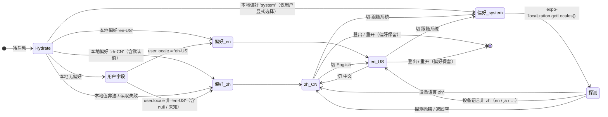

# 增量 PRD（增量 12）— OpenSchedule 移动端：多语言（中 / 英）

> 档位：**简单 PRD**（不含竞品 / 市场分析；用户未要求完整档）。
> 负责人：许清楚（PM）· 版本 **v2.0** · 实读基准：`D:\GLMclaw\workspace\openschedule`（本次写作时）
> **v2.0 修订记录（用户已拍板，本版据此重写）**：**① Q2 改判 → 语言三态**（中文 / English / **跟随系统**），**用户已授权破例引入 `expo-localization`**（**本增量唯一新增依赖**），第三态**提为 P0**；**② Q3 改判 → 全量交付**：本期范围由「L0–L4」扩为 **「L0–L7 全覆盖」**，原 P1 的 `-16`/`-17`/`-18`/`-19` 与 P2 的 `-20` **全部提级进本期**（**取代 v1.0 的 Q4「服务层提示不进 P0」**）；**③ Q5 维持默认 `zh-CN`**；**④ Q1 维持核心 8 屏选型**。**唯一延后层 = L8（日期 / 复数 / 本地化深化）**。
> 上游基线：`PRD-mobile.md`（**本需求来源：§4 需求池 `M-P2-05`（P2）**，`:116`）· `ARCH-mobile-increment-10-darkmode.md`（**同为「全局横切能力」，架构组织方式最可类比**）· 参照范例：`PRD-mobile-increment-10-darkmode.md`（结构与颗粒度）· `PRD-mobile-increment-11-attachment-capture.md`
> **本文只描述需求，不含任何 TS / JSX 代码，不写实现方案代码块。** 文中出现的字段名 / 组件名 / 目录名仅作**行内标注**，用于对齐既有实现语义，不代表实现。
> 凡引用代码事实均给 `文件:行号`；不确定处一律进入 §7「待确认问题」，**不臆造项目里不存在的能力**。

---

## 1. 需求背景与目标

### 1.1 需求原话（未做删改）

> **`M-P2-05` ｜ 多语言（中/英） ｜ 验收要点：复用 `user.locale`**（`PRD-mobile.md:116`）

**释义**：移动端引入**中 / 英双语**，语言可切换；`user.locale` 字段要**真正被消费**（而不是继续当一个只写不读的字段）。

### 1.2 本次范围声明（含**分期策略**——本增量最重要的边界）

> ⚠️ **本增量是本仓第一次做「文案层」横切改造**，触及面比增量 10（深色模式）更"碎"：**深色只改颜色取值点，i18n 要改每一条用户可见字符串**。实读统计（§2-F3）：`src/` 内 **1208 处**含中文字面量的行，分布在 **87 个文件**（`src/` 共 107 个 `.ts/.tsx`）；其中 **16/16 个屏**、**18/30 个组件**、以及服务层 / 工具层大量用户可见提示。
>
> **v2.0 的范围裁决（用户已拍板）**：**本期 = 「L0–L7 全覆盖」**（即 1208 处文案中**除 L8 之外的全部**）。这**推翻了 v1.0 的"分期到 L0–L4"建议**——用户明确选择"一次做完"。**风险与护栏**：全量交付把回归风险推到了最高，因此本增量**把"既有 55 套件 + ≈216 处中文断言 + 全仓静态红线"当成交付的强制护栏**（§6-D11/D14），并新增「**zh 零回归冻结守卫**」（`M-P2-05-19`）。**唯一延后层 = L8**（日期 / 复数 / 后端文案 / RTL），理由是它是**风险最高、收益最低**的一块（§6-D8，F18/F19）。

| 层 | 内容 | 本期 | 后续 |
| --- | --- | --- | --- |
| **L0 基础设施** | 语言类型 / 字典 / `t()` 纯函数 / Provider / hook / 持久化 / 兜底 + **设备语言探测适配层** | ✅ **P0** | — |
| **L1 语言切换入口** | 「我的」页「语言」区块（**三态**：中文 / English / **跟随系统**，与「外观」同构并列） | ✅ **P0** | — |
| **L2 导航层** | 底部 5 Tab 标题 + 各 Stack 屏标题 | ✅ **P0** | — |
| **L3 通用组件层** | 无业务语义的通用组件（按钮 / 卡片 / 输入框 / 空态 / 骨架 / 标签 / 头像…）+ 全局提示层（离线横幅 / 缓存标记 / 两种 Toast） | ✅ **P0** | — |
| **L4 核心屏** | **8 屏**：登录 / 工作台 / 今日聚焦 / 项目列表 / 看板 / 任务详情 / 我的 / 关于 | ✅ **P0** | — |
| **L5 其余屏** | **8 屏**：日历 / 个人计划 / 通知列表 / 通知设置 / 我的提报 / 审核中心 / 提报页 / 新建事项 | ✅ **P0**（**v2.0 提级**） | — |
| **L6 业务组件** | 带业务语义的组件（任务卡 / 项目卡 / 表单 / 评论项 / 审计项 / 概览块 / 时间轴 / 日期字段 / 选择抽屉 / 附件抽屉…） | ✅ **P0**（**v2.0 提级**） | — |
| **L7 服务层 / 工具层提示** | `ApiError` 文案 / HTTP 兜底文案 / 提报与附件校验提示 / 权限提示 / mock 通知与审计文案（约 437 处） | ✅ **P0**（**v2.0 提级**） | — |
| **L8 本地化深化** | 日期 / 星期 / 相对时间 / 字节 / 工时的 **en 分支**；复数规则；后端文案本地化；RTL；第三语言 | ❌ | **P2** |

**本期交付一句话**：**「L0–L7 全覆盖」——i18n 基础设施（含设备语言探测）+ 三态语言切换 + 导航层 + 通用组件层 + 全部 16 屏 + 全部业务组件 + 服务层与工具层用户可见提示，全部双语。** 唯一残留中文 = **日期 / 相对时间 / 字节 / 工时的格式**（L8，`M-P2-05-21`）+ **mock 种子业务数据**（N12，刻意不译）+ **服务端返回文案**（N7，跨包）。⇒ **"英文模式下仍会有少量中文"是本期显式允许的残留状态**，且必须在「语言」区块给出可见说明（§6-D13）。

| 项 | 声明 |
| --- | --- |
| 交付物 | **仅本 PRD 文档**（产品目标 + 用户故事 + 需求池 + UI/交互设计 + 验收标准 + 关键产品决策 + 待确认问题） |
| **不做** | 不写任何实现代码（无 TS / JSX / 伪代码）；**不改动任何源码或测试**；**不执行任何 git 操作**；不改后端 / `apps/web` / Prisma |
| 唯一需求来源 | `PRD-mobile.md:116`（`M-P2-05`） |
| 既定前提 1（用户拍板） | **i18n 运行时零第三方库** ⇒ 必须**轻量自研**（**不得**引入 `i18n-js` / `react-i18next` / `i18next` / `@formatjs/*` / `@lingui/*`）。**⚠️ v2.0 修订：允许新增 `expo-localization` 一个包**（**唯一破例点**，用户已授权，仅用于「跟随系统」的设备语言探测，**不属于 i18n 库**） |
| 既定前提 2（用户拍板） | **复用既有 `user.locale: string` 字段**（`types/user.ts:14`） |
| 既定前提 3（用户拍板） | 语言切换入口放「我的」页，与既有**「外观」（主题三态）区块同构并列** |
| 既定前提 4（用户拍板） | 语言偏好需**持久化**（沿用 `PREFERENCE_KEYS` 模式，增量 10 的 `os.theme_mode` 为范例） |
| 既定前提 5（用户拍板） | 需处理**无 Provider 兜底** + **「新全局 hook 不得走 `@/hooks` 桶」**（与增量 10 主题架构同理） |
| **既定前提 6（v2.0 新增）** | **语言为三态**：**中文 / English / 跟随系统**；第三态由**用户显式选择**才生效，**默认偏好 = `zh-CN`（不是 `system`）**——这是"既有 216 处中文断言不会随机变红"的**前提**（§6-D14） |
| 允许的表达形式 | Mermaid 图、表格、ASCII 草图、字段名 / 键名行内标注、**中英对照文案示例** |
| 结论依据 | 全部锚定实读事实（`文件:行号`） |
| 进入开发的前置 | **Q1 / Q2 / Q3 / Q5 已于 v2.0 拍板**（见文首修订记录）⇒ **本文可直接进入架构阶段**；其余 Q4 / Q6–Q18 按 §7 建议值执行 |
| 硬约束（违反即返工） | ① **依赖：仅允许新增 `expo-localization` 一个包**（i18n 运行时必须自研；**不得**新增任何 i18n 库） ② 复用 `user.locale` ③ 语言入口与「外观」同构并列 ④ 偏好持久化 ⑤ 无 Provider 兜底 + 新全局 hook **不得**走 `@/hooks` 桶 ⑥ **禁用** `react-native-reanimated` / `react-native-gesture-handler` ⑦ 样式数值**只取** `src/theme/tokens.ts` ⑧ 组件样式沿用**样式工厂范式**（`makeStyles(colors: ThemeColors)` + `useThemedStyles`，**参数名必须叫 `colors`**）⑨ 裸 `<Pressable>` 白名单**必须恰好 6 个文件** ⑩ **不修改任何既有测试文件与其断言** ⑪ 新增 UI **必须同时适配浅色与深色** ⑫ `tsc --noEmit` 零错误 ⑬ 最小变更原则 ⑭ **默认语言必须 `zh-CN`**，且 **zh 输出逐字节不变**（回归可行性的充要条件） ⑮ 任何**显式设为 `'system'`** 的新增测试**必须 mock `expo-localization`**（设备语言确定化，防随机变红） |

### 1.3 为什么本次走标准 SOP（PRD → 架构 → 开发 → QA）

本需求与增量 10（深色模式）**同类**——都是「**横切全仓的能力改造**」，但 i18n 的粒度更细、更容易漏：

- **改动面极大且"碎"**：`src/` 内 **1208 处**中文字面量分布在 **87 个文件**（§2-F3），且**每一处都是一个独立的改造点**——不像深色可以靠"样式工厂 + 取色入口"统一收敛。
- **它是"每一条用户可见字符串"的改造**：`src/` 内 **16/16 个屏**、**18/30 个组件**都含中文字面量（§2-F3），另有**服务层与工具层的用户可见提示**（`ApiError` 文案、HTTP 兜底文案、校验提示…）——**漏一处就是一处中文残留**。
- **它会撞上三类"既有测试锁定"的硬边界**（本次实读发现，详见 §2-F8/F9/F10）：
  1. **≈216 处断言直接钉住中文输出**（31 个测试文件）⇒ **默认语言与 zh 输出必须逐字节不变**；
  2. **`theme-contrast.test.ts` 对 `lightStatusColor` 做深比较**（含中文 `label`）⇒ **不能把中文标签从数据结构里拆掉**；
  3. **`increment-ui-polish.test.tsx` 对 `MainTabs.tsx` 源码做文本断言**（要求源码里继续出现 5 个中文 Tab 名）⇒ **不能"抽出即删"**。
- **它还会撞上全仓静态红线审计**：`walk(src)` 扫描**全部 `.ts/.tsx`**（§2-F11）⇒ 新增的 i18n 文件本身也要满足"无 `reanimated` 字样 / 无硬编码 `borderRadius` / 不含 `<Pressable `"。
- **v2.0 把标准拉得更高**：本期定为 **L0–L7 全量**（§1.2）且新增**三态**（引入 `expo-localization`）⇒ **回归面从"核心 8 屏"扩到"全部 16 屏 + 全部组件 + 服务层 / 工具层提示"**，并让一个**跨平台原生模块**（设备语言探测）进入测试与 Web 产物。
- 因此必须**先产品定义（本文）→ 再架构定方案 → 再开发 → 再 QA 全量回归**，不能边写边改；且**架构阶段必须先给出"全量迁移的机械可验证清单"**（逐文件 → 逐字符串 → 对应键），否则 1208 处文案靠人工必漏。

### 1.4 产品目标（可衡量）

**一句话定位**：让 OpenSchedule 移动端**能在「中文 / English / 跟随系统」三态之间切换**——**默认中文**（**与改造前逐字一致、零回归**），「我的」页可一键切英文并**持久化**，**全量界面（16 屏 + 组件 + 服务层提示）英文可读**，且**无 Provider / 无偏好 / 非法值 / 设备语言探测失败时一律安全回退中文**。

| # | 目标（可衡量） | 衡量指标 |
| --- | --- | --- |
| G1 | 默认可回归 | 全新安装（清缓存）后语言 = **中文**（**默认偏好是 `zh-CN`，不是 `system`**）；**全部既有 55 个测试套件在默认语言下全绿、用例数不减少**；中文下与改造前**逐字一致** |
| G2 | 可切换、三态、被记住 | 「我的 → 语言」可在**中文 / English / 跟随系统**三态间切换，**当前页即时生效、不重载、不丢状态**；**杀进程重开保持**上次选择；选「跟随系统」后**设备语言为中文 → 中文，否则 → 英文** |
| G3 | 全量英文可读（含报错） | **全部 16 屏 + 业务组件 + 通用组件 + 全局提示层 + 服务层 / 工具层提示**在英文下**无中文残留**（除日期格式 / mock 演示数据 / 服务端返回文案）；英文文案**无溢出 / 无截断 / 术语统一**（§6-D12 术语表） |

**解决的痛点**：

| 痛点 | 现状 | 目标态 |
| --- | --- | --- |
| 全仓只有中文 | `src/` 内 **1208 处**中文字面量、**87 个文件**（§2-F3） | 全量可切英文（除 L8） |
| `user.locale` 是"死字段" | **只写不读**：`src/` 内 `.locale` **零命中**（仅 seed 写入 4 处 + 类型声明 1 处；`localeCompare` 为同名干扰）（§2-F4） | `user.locale` 成为首次登录的语言 seed |
| 无任何 i18n 机制 | `i18n` / `translat*` 在 `src/` 内**零命中**（`translateX/Y` 为动画同名干扰）（§2-F5） | 轻量自研 i18n 运行时 |
| 状态标签文案重复 4 处 | 状态中文词在 `semantic.ts` 的**浅色集 + 深色集**、`BOARD_COLUMNS`、`TASK_TRANSITION_ACTIONS` **各写一遍**（§2-F6） | zh 单一事实来源派生，消灭漂移 |
| 无法跟随设备语言 | 无任何设备语言探测能力（`expo-localization` **未安装**，§2-F21） | 「跟随系统」第三态：设备中文 → 中文，其余 → 英文 |
| 英文界面仍会蹦中文报错 | 服务层 / 工具层提示约 437 处全中文（§2-F3/F7） | **本期纳入**（L7 提级），英文界面下报错也走英文（**服务端返回文案除外**，N7） |
| 残留中文无可见边界 | 不适用（当前全中文） | 残留仅剩**日期格式 / mock 演示数据 / 服务端文案**，且**在「语言」区块下明示**（§6-D13） |

---

## 2. 现状事实（本次实读，构成需求前提）

> 编号 **F1–F21**；每条标注 `文件:行号`。

| # | 事实 | 证据 |
| --- | --- | --- |
| **F1** | **需求出处**：`M-P2-05`「多语言（中/英）｜验收要点：**复用 `user.locale`**」（P2 档） | `docs/mobile-app/PRD-mobile.md:116` |
| **F2** | **`user.locale` 字段已存在**：`locale: string`，注释「**中 / 英双语预留**」 | `apps/mobile/src/types/user.ts:14`（字段）、`:13`（注释） |
| **F3** | **改动面（本次实读）**：`src/` 共 **107** 个 `.ts/.tsx`，其中 **87 个**含中文字面量，**1208 处**（含中文字面量的行）。按目录：**screens 329 / services 266 / data 180 / utils 171 / components 104 / types 57 / theme 33 / store 30 / navigation 24 / hooks 14**。按文件覆盖：**screens 16/16**、**components 18/30**。⚠️ `data` 的 180 处是 **mock 种子内容（任务标题 / 评论正文等演示数据）**，**不是 UI 文案**，**不纳入 i18n 范围**（§8-N12） | 本次实读：`Get-ChildItem src -Recurse -Include *.ts,*.tsx` 计数 + 正则 `['"`][^'"`\n]*[\u4e00-\u9fff]` 逐目录统计 |
| **F4** | **`user.locale` 目前是"只写不读"的死字段**：`src/` 内检索 `\.locale\b` **零命中**（只有 `String.prototype.localeCompare` 的同名干扰）；唯一写入点是 mock 种子 4 处，**全部为 `'zh-CN'`**（4 个演示用户） | 本次实读 grep `\.locale\b`（`src/`）**No matches**；`src/data/seed.ts:66`、`:80`、`:93`、`:105`（`locale: 'zh-CN'`） |
| **F5** | **全仓零 i18n 机制**：`src/` 内检索 `i18n` / `translat` / `zh-CN` / `en-US` **零业务命中**（`translateX` / `translateY` 为 RN 动画同名干扰；`en-US` 仅出现在 `utils/date.ts` 的 `Intl` 构造参数中，见 F14） | 本次实读 grep（`src/`） |
| **F6** | **状态中文词重复 4 处（漂移风险）**：① `lightStatusColor` 6 项 `label`；② `darkStatusColor` 6 项 `label`（**同一批中文再写一遍**）；③ `BOARD_COLUMNS` 5 项 `label`；④ `TASK_TRANSITION_ACTIONS` 的 8 个动作 `label` | `theme/semantic.ts:26-32`（浅色）、`:36-42`（深色）、`types/task.ts:189-195`（`BOARD_COLUMNS`）、`types/task.ts:159-176`（动作 label） |
| **F7** | **其它集中式中文词表**（可一次性收敛的"字典化"天然入口）：`TAB_LABEL`(5) · `ROLE_LABEL`(2) · `PROJECT_STATUS_LABEL` + `PROJECT_STATUS_TEXT`（**同义两张表**）· `SUBMISSION_STATUS_LABEL`(6) · `SUBMISSION_KIND_LABEL` · `AI_PROPOSAL_TYPE_LABEL` · `NOTIFICATION_EVENT_LABEL` · `DEPENDENCY_TYPE_LABEL` · `HTTP_DEFAULT_MESSAGE`(9 条 HTTP 兜底) · `PROJECT_FILTER_OPTIONS` · `PRIORITY_OPTIONS` · `KIND_OPTIONS` · `CHANNELS` · `TAB_OPTIONS` / `EMPTY_TEXT`（今日聚焦）· `BASE_QUICK_ENTRIES`（工作台）· `PICK_ENTRIES` / `PERMISSION_MESSAGE`（附件抽屉） | `navigation/MainTabs.tsx:33-39`；`types/user.ts:57-60`；`types/project.ts:26`；`services/project.service.ts:177`；`utils/submission.ts:42`、`:51`；`types/domain.ts:84`、`:125`、`:154`；`services/client.ts:26-36`；`services/project.service.ts:129`；`components/ItemForm.tsx:65`、`:73`；`screens/NotificationSettingsScreen.tsx:26`；`screens/TodayFocusScreen.tsx:69`、`:76`；`screens/WorkspaceScreen.tsx:63`；`components/AttachmentUploadSheet.tsx:58`、`:65` |
| **F8** | **🔴 硬边界 1：≈216 处断言直接钉住中文输出**（分布在 **31 个测试文件**），且**既有测试文件与断言不得修改**。抽样：`offline-banner.test.tsx:196` 断言渲染文本含 `'分钟前'`；`:208`/`:225` 断言 `'模拟离线'` 出现 / 不出现；`my-submissions-rework.test.tsx:136` 用 `STATUS_LABELS = ['草稿','待审核','已通过','已驳回','已撤回','退回重改']` 做渲染文本匹配；`today-focus-gate.test.tsx:265` 断言 `'共 0 项待处理'`；`workspace-summary-card.test.tsx:123` 断言 `'完成数（项）'`；`screen-gate.test.tsx:83` 断言 `'无权限：当前角色不能创建事项'` | 本次实读 grep `(toBe|toContain|toEqual)\(\s*['"]…[\u4e00-\u9fff]`（`tests/`）= **31 文件 / ≈216 处**；上列各行号 |
| **F9** | **🔴 硬边界 2：`lightStatusColor` 被"深比较冻结"（含中文 `label`）**：`expect(lightStatusColor).toEqual(frozen)`，`frozen` 的每一项都是 `{ color, bg, label: '待办' \| '进行中' \| '已阻塞' \| '已完成' \| '已取消' \| '待评审' }`。同文件还用 `expect(colors).toBe(lightColors)` 锁住对象**同一性**；另有 6 项"状态标签对比度"断言直接读 `darkStatusColor[status].color/.bg` | `tests/theme-contrast.test.ts:245-255`（深比较）、`:267-270`（同一性）、`:189-202`（对比度）；`tests/theme-runtime.test.tsx:101`、`:123`、`:155`、`:382`（`statusColor` **同一性**断言） |
| **F10** | **🔴 硬边界 3：`MainTabs.tsx` 的 5 个中文 Tab 名被"源码文本"断言**：`for (const label of ['工作台','今日','项目','时间','我的']) expect(tabs).toContain(label)` ⇒ **该文件源码必须继续出现这 5 个中文字面串**。同文件还锁定 `'工作台'` 等以外的字面串（`colors.primaryFaint` / `backgroundColor: colors.bg.surface` / `borderTopWidth: 0` / `animation: 'shift'`） | `tests/increment-ui-polish.test.tsx:358-365`（Tab 名）、`:344-347`、`:354-356`、`:367-370`、`:381-400`（其余字面串） |
| **F11** | **全仓静态红线审计会扫描"每一个新增的 `.ts/.tsx`"**：`walk()` **只收 `.ts/.tsx`**（不收 `.json`），并对**全部文件**断言 4 条红线——① 不得出现 `react-native-(reanimated\|gesture-handler)`（**含注释**）；② 不得出现 `borderRadius:\s*<数字>`；③ 不含 `<Pressable ` 的文件集合**必须恰好等于** 6 文件白名单（`PressableScale.tsx` 排除）；④ 不得残留 `pressedBg={colors.bg.surface}`。**同一组审计在 `increment-card-lift.test.tsx` 内重复一遍** | `tests/increment-ui-polish.test.tsx:29-36`（`walk` 实现）、`:406-457`（4 条红线）；`tests/increment-card-lift.test.tsx:274-313`（同组） |
| **F12** | **被"源码文本"扫描的源文件清单（本次实读汇总，共 11 个）**：`navigation/stacks.tsx`、`navigation/MainTabs.tsx`、`components/Card.tsx`、`components/TaskCard.tsx`、`components/ProjectCard.tsx`、`services/task.service.ts`、`screens/NotificationsScreen.tsx`、`types/domain.ts`、`screens/TaskDetailScreen.tsx`、`utils/submission.ts`，**外加全量 `src/`** | `increment-ui-polish.test.tsx:341,342,407`；`increment-card-lift.test.tsx:95,136,137,274`；`increment3-dedup-notify.test.ts:445,464,472`；`increment4-qa.test.ts:556,557,618,619,652`；`increment4-withdraw.test.ts:310,341`；`increment5-closure.test.ts:41,176,181`；`increment5-qa.test.ts:49-53`；`linking.test.ts:274` |
| **F13** | **新全局 hook 不得走 `@/hooks` 桶（铁律，有实测根因）**：`src/hooks/index.ts` 是桶文件；**14 个既有测试**对 `@/hooks` 做**工厂式 `jest.mock`**（工厂内只提供 `useAuth` / `useAsync` 等），从桶里取"工厂没提供的 hook"会得到 `undefined`，**且只在运行时炸**。⇒ 增量 10 的主题 hooks 因此**只从 `@/store/ThemeProvider` 导出**，桶内**不**再导出 | `src/hooks/index.ts:1-20`；本次实读 `jest.mock('@/hooks'` = **14 个 `.tsx`**；`docs/mobile-app/ARCH-mobile-increment-10-darkmode.md:822-823`（实测 `TypeError: (0, _hooks.useTheme) is not a function`） |
| **F14** | **`AppProvider` 也被工厂式 mock（11 个测试）**：`jest.mock('@/store/AppProvider', () => ({ useAppContext: () => ({ role: mockRole }) }))` 之类的**部分对象**——若 i18n 从 `AppProvider` 取语言，测试里会取到 `undefined`。另：`AppPreferences` 仅含 `role` / `rememberMe` / `biometricEnabled` / `lastEmail`，**不含 locale**；`ThemeProvider` 位于 `AppProvider` **之外**（`SafeAreaProvider > ThemeProvider > AppProvider > ConnectivityProvider > AppContent`） | 本次实读 `jest.mock('@/store/AppProvider'` = **11 个 `.tsx`**；`src/store/AppProvider.tsx:39-48`（接口）、`:51-56`（默认值）；`App.tsx:20-29`（装配顺序）；`src/store/ThemeProvider.tsx:14`（边界声明） |
| **F15** | **无 Provider 必须"回退"而非"抛错"（L1，实测根因）**：`ThemeProvider` 用 `FALLBACK_THEME`（恒浅色）+ `useContext(...) ?? FALLBACK` ⇒ 未包裹 Provider 的渲染套件不崩。实测背景：**31 个测试文件**做渲染断言、**全部不包裹任何 Provider** | `src/store/ThemeProvider.tsx:71-79`（`FALLBACK_THEME`）、`:147-148`（`?? FALLBACK`）；`docs/mobile-app/ARCH-mobile-increment-10-darkmode.md:236`、`:823`（"14 个不包 Provider 的套件直接崩，实测 8 failed"） |
| **F16** | **持久化范式已成熟可复用**：`PREFERENCE_KEYS` 为独立单值键集合（`os.remember_me` / `os.role` / `os.last_email` / **`os.theme_mode`**）；增量 10 的 `ThemeProvider` 用 `AsyncStorage.getItem(PREFERENCE_KEYS.themeMode)` 冷启动 hydrate（`isReady`）+ `setMode` 即时 `setState` 后异步落盘（**失败静默**）+ `normalizeMode()` 非法值回退 | `src/services/config.ts:20-30`（`PREFERENCE_KEYS`）；`src/store/ThemeProvider.tsx:81-84`（`normalizeMode`）、`:92-113`（hydrate）、`:116-123`（`setMode`）、`:57`/`:77`（`isReady`） |
| **F17** | **「外观」区块是"同构并列"的现成模板**：`ProfileScreen` 在「角色切换」之下、「设置」卡片之上，用 `SegmentedControl` 渲染三态（`APPEARANCE_OPTIONS` = 浅色 / 深色 / 跟随系统），`onChange={(next) => void setMode(next)}`，**即时生效、无二次确认**；`SegmentedControl` 是**泛型**组件，支持任意字符串枚举 | `screens/ProfileScreen.tsx:36-41`（`APPEARANCE_OPTIONS`）、`:152-162`（「外观」区块）、`:135-150`（「角色切换」，同构参照）；`components/SegmentedControl.tsx`（泛型选项） |
| **F18** | **日期 / 相对时间 / 工时的中文输出被"逐字锁定"**：`formatDate` → `9月12日`；`formatDateFull` → `2026年9月12日`；`formatWeekday` → `周五`（`WEEKDAY_LABELS`）；`formatRelativeTime`（两处实现）→ `刚刚` / `N 分钟前` / `N 小时前` / `昨天 HH:mm` / `N 天前`；`formatHoursLong` → `4 小时`。测试逐字断言：`format.test.ts:38`、`:117`、`:121`、`:125`、`:129`、`:133`、`:137`（含正则 `^\d{1,2}月\d{1,2}日$`）。⚠️ **`formatRelativeTime` 有两份实现**（`utils/date.ts:230-243` 与 `utils/format.ts:47-68`），**`StaleBadge` 用前者、其余 5 处用后者** | `utils/date.ts:12`（`WEEKDAY_LABELS`）、`:126-129`、`:132-135`、`:149-152`、`:230-243`；`utils/format.ts:17-21`、`:47-68`；`tests/format.test.ts:36-42`、`:104-139`；`components/StaleBadge.tsx:13`、`:39`（用 `@/utils/date`）；`components/CommentItem.tsx:10`、`components/AuditLogItem.tsx:14`、`screens/MySubmissionsScreen.tsx:37`、`screens/NotificationsScreen.tsx:25`、`screens/WorkspaceScreen.tsx:33`（用 `@/utils/format`） |
| **F19** | **`utils/date.ts` 的 `'en-US'` 是"取数用的"，不是"显示用的"**：`Intl.DateTimeFormat('en-US', {...})` 只用于 `formatToParts()` 提取数字分量，并靠 `WEEKDAY_SHORT_INDEX`（`Sun..Sat`）把英文星期缩写映射回 0..6。⇒ **把 `'en-US'` 直接换成用户语言会打断星期解析**（`WEEKDAY_SHORT_INDEX` 只有英文键），是本次**最容易被误改的一处** | `utils/date.ts:14-22`（`WEEKDAY_SHORT_INDEX`）、`:25`（`formatterCache` 按 timezone 缓存，**不含 locale**）、`:32`、`:42-52`（构造）、`:71-90`（`getZonedParts` + `WEEKDAY_SHORT_INDEX[weekdayRaw] ?? 0`） |
| **F20** | **测试基线**：`tests/` 内 **55 个测试套件**（`*.test.ts(x)`，另有 `setup.ts` / `react-test-renderer.d.ts`）；`jest.config.js` 用 `preset: 'jest-expo'` + `@/` 别名 + `setupFilesAfterEnv: tests/setup.ts`；`tsconfig.json` 的 `include` 为 `**/*.ts(x)` ⇒ **`tsc --noEmit` 会类型检查 `tests/`** | 本次实读 `Glob tests/*.test.ts*` = **55**；`jest.config.js:6-13`；`tsconfig.json:11-18` |
| **F21** | **🔵 v2.0 破例点：`expo-localization` 当前未安装**（`package.json` 的 `dependencies` 共 **19** 项，其中 Expo 包 8 个：`expo` / `expo-document-picker` / `expo-image-picker` / `expo-linking` / `expo-local-authentication` / `expo-secure-store` / `expo-status-bar` + 未含 `expo-localization`）。**用户已授权本期新增 `expo-localization` 作为唯一新增依赖**。⇒ 关键推论：① 全仓"零依赖"审计**并不禁止新增依赖**（`increment-ui-polish.test.tsx:418-424` 只断言"**不得含 `reanimated` / `gesture-handler`**"，**不是**"依赖数不变"）；② **测试里 mock Expo 模块有成熟先例**（`tests/auth.test.ts:5`、`tests/useTimer.test.tsx:5` 已 `jest.mock('expo-local-authentication', …)`；`tests/attachment-picker.test.ts:19,26` 已 mock `expo-image-picker` / `expo-document-picker`）⇒ 新增 `jest.mock('expo-localization', …)` 是**既有范式**，非新发明；③ `expo-localization` **支持 web**（走 `navigator.language`），故 Web 产物天然可用（§7-Q18） | 本次实读 `apps/mobile/package.json:5-23`（依赖清单）；`tests/increment-ui-polish.test.tsx:418-424`；`tests/auth.test.ts:5`、`tests/useTimer.test.tsx:5`、`tests/attachment-picker.test.ts:19,26` |

> **由 F8/F9/F10/F19/F21 推导出的五条硬前提（必须写入架构约束）**：
> 1. **默认语言必须是中文，且 zh 输出必须逐字节不变**——否则 F8 的 ≈216 处断言 + F9 的深比较会大面积变红。
> 2. **`StatusStyle.label` 不许删、不许改值**（F9 深比较）⇒ i18n 必须**旁挂**而不是"重构掉既有中文常量"。
> 3. **被源码文本断言的文件（F12 的 11 个）不许"抽出即删"**——字面串要留在原文件里（F10 是最典型的例子）。
> 4. **`utils/date.ts` 的 `'en-US'` 与 `formatterCache` 不许被"顺手本地化"**（F19）——显示层本地化必须另走一条路。
> 5. **v2.0 新增：「跟随系统」只能由用户显式选择才生效，默认偏好必须是 `zh-CN`**（F21）——否则"设备语言 = en"的 CI / 沙箱会让 216 处中文断言**随机变红**；且设备语言探测必须**收敛到单一适配层**、**仅在需要时求值**，避免 55 个套件在 import 期就加载原生模块（§6-D14）。

---

## 3. 用户故事

| 编号 | 角色 | 故事 | 覆盖验收点 | 优先级 |
| --- | --- | --- | --- | --- |
| US-12-01 | 中文用户（默认） | 作为中文用户，我希望**什么都不设置就是中文**，以便零学习成本 | 默认中文 / 零回归 | P0 |
| US-12-02 | 英文用户 | 作为英文用户，我希望**在「我的」页一键切到 English**，以便看懂界面 | 切换入口 | P0 |
| US-12-03 | 英文用户 | 作为英文用户，我希望**切换后当前页立刻变英文**（不重启、不丢当前操作），以便不中断手头的事 | 即时生效 | P0 |
| US-12-04 | 英文用户 | 作为英文用户，我希望**杀进程重开后仍是 English**，以便不用每次重设 | 持久化 | P0 |
| US-12-05 | 英文用户 | 作为英文用户，我希望**导航与按钮也是英文**（不只正文），以便整体可读 | 导航层 + 通用组件层 | P0 |
| US-12-06 | 英文用户 | 作为英文用户，我希望**英文文案不要被截断、术语前后一致**，以便看懂且不觉得粗糙 | 布局与术语 | P0 |
| US-12-07 | 全部用户 | 作为用户，我希望**语言选择不会被登录 / 登出冲掉**，以便保持我的偏好 | 优先级规则 | P0 |
| US-12-08 | 全部用户 | 作为用户，我希望**切错语言时能切回来**（语言名用自身语言书写），以便不迷路 | 入口形态 | P0 |
| US-12-09 | 全部用户 | 作为用户，我希望**知道还有哪些内容不是英文**（日期格式 / 演示数据 / 服务端提示），以便理解残留中文不是故障 | 已知限制提示 | P0 |
| US-12-10 | 夜间使用者 | 作为夜间使用者，我希望**英文界面在深色下同样正常**，以便夜间使用 | 深浅双适配 | P0 |
| **US-12-13** | **海外 / 非中文系统用户** | 作为手机系统语言是英文的用户，我希望**选一次「跟随系统」就让 App 跟着我的系统语言走**，以便不用手动设、换手机也自动对 | **三态（跟随系统）** | **P0**（v2.0） |
| US-12-14 | 中文系统用户 | 作为手机系统语言是中文的用户，我希望**选「跟随系统」后 App 就是中文**，以便与系统一致 | 三态（跟随系统） | P0（v2.0） |
| US-12-15 | 全部用户 | 作为用户，我希望**系统语言探测失败或设备语言不认识时 App 不崩、不空白**，以便始终可用 | 兜底 | P0（v2.0） |
| US-12-16 | 英文用户 | 作为英文用户，我希望**全部 16 屏、所有组件、以及通知 / 报错提示都是英文**，以便不出现"英文界面里蹦出中文" | **全量（L0–L7）** | **P0**（v2.0 提级，原 US-12-12） |
| US-12-11 | 英文用户 | 作为英文用户，我希望**日期与相对时间也是英文**（如 `Sep 12` / `5 min ago`），以便完全可读 | 本地化深化（L8） | **P2**（v2.0 降级） |

---

## 4. 需求池

> 分级口径（**v2.0 已按用户拍板重写**）：**P0 = 本期必做的完整闭环 = 「L0–L7 全覆盖 + 三态」**（即 §1.2 的 **L0–L7**；**原 P1 的 `-16`/`-17`/`-18`/`-19` 与原 P2 的 `-20` 已全部提级**）；**P1 = 唯一保留的增强项**（`-19`，zh 零回归守卫完整版；P0 已有抽样版 `-15`）；**P2 = L8 本地化深化**（`-21`…`-26`）。
> 编号沿用主 PRD 前缀：`M-P2-05-xx`。**`-27` 为 v2.0 新增条目**（三态与测试稳定性保障）。

### P0（Must have — 本期 = L0–L7 完整闭环 + 三态）

> **v2.0 提级标记**：`-16` / `-17` / `-18` 由原 P1 提级；`-20` 由原 P2 提级；`-27` 为新增。

| 编号 | 需求描述 | 验收要点 |
| --- | --- | --- |
| **M-P2-05-01** | **语言模型与字典**：定义**两个类型**——**解析后的语言** `Locale = 'zh-CN' \| 'en-US'` 与**偏好值** `LocalePreference = 'zh-CN' \| 'en-US' \| 'system'`（**v2.0 新增第三态**）；建立 zh / en **两份字典**，键用点分命名空间（如 `nav.tab.workspace` / `taskStatus.todo` / `common.retry`）；**zh 与 en 键集合必须完全一致** | 键集合一致性有自动测试；无空值；zh 词条与被替换的既有字面串**逐字相同**；`'system'` 只存在于**偏好层**，**不得**流入字典查找 |
| **M-P2-05-02** | **`t()` 纯函数**：`translate(locale, key, params?)`，零 React 依赖、可单测；支持 `{name}` 极简插值；**缺失键回退 zh → 回退 key 本身**（不抛错） | 纯函数单测覆盖：命中 / 插值 / 缺键回退 / 非法 locale |
| **M-P2-05-03** | **i18n 运行时 Provider**：新建独立 Provider（**不并入 `AppProvider`**），下发 `locale`（**已解析**）/ `preference` / `setPreference` / `t` / `isReady`；**无 Provider 时必须回退 zh-CN 兜底，绝不 `throw`** | 未包裹 Provider 直接渲染屏幕 / 组件时 `t()` 返回中文且不报错（F15 前提） |
| **M-P2-05-04** | **偏好持久化**：新增独立单值键（建议 `os.locale`），冷启动 hydrate + 切换即时生效 + 异步落盘（失败静默）+ **非法值回退 `zh-CN`**。**v2.0：合法值扩为三态**（`'zh-CN'` / `'en-US'` / `'system'`） | 切 English → 杀进程重开 → 仍 English；写入非法值 → 回退中文（照 `os.theme_mode` 范式）；**写入 `'system'` → 重开后仍 `'system'`** |
| **M-P2-05-05** | **全局 hook 唯一入口**：i18n hooks（`useI18n` / `useT`）**只从 Provider 模块导出**，**不得**经 `@/hooks` 桶再导出（使误用变编译期 TS 报错） | `src/hooks/index.ts` **零新增导出**；14 个 mock `@/hooks` 的既有套件不受影响 |
| **M-P2-05-06** | **复用 `user.locale`（优先级规则）**：**本地持久化偏好 > `user.locale`**；`user.locale` 仅作「本地无偏好时的初始默认值」（首次登录 seed）。**登出不清除语言偏好** | 本地无偏好 + `user.locale='zh-CN'` ⇒ 中文；`='en-US'` ⇒ 英文；本地已有偏好时**不被覆盖**；登出再登录语言不变 |
| **M-P2-05-07** | **语言切换入口（v2.0：三态）**：「我的」页新增**「语言」区块**，`SegmentedControl` **三态**（**中文 / English / 跟随系统**；**中文 / English 两个语言名用自身语言书写**，第三态标签随界面语言），位置**紧邻「外观」区块之下**，与「外观」（同为三态）**同构并列**，**切换即时生效、无二次确认** | 与「外观」区块结构对称（**同为 3 段**）；切换后当前页立即变化；当前值高亮正确 |
| **M-P2-05-08** | **导航层双语**：底部 5 个 Tab 标题 + 各 Stack 屏标题随语言切换（**须在渲染期求值，不能是模块级常量**）。⚠️ **`MainTabs.tsx` 源码必须继续出现 5 个中文 Tab 字面串**（F10） | 切英文后 Tab 与页头均为英文；`increment-ui-polish.test.tsx:358-365` 仍绿 |
| **M-P2-05-09** | **通用组件层双语**：无业务语义的通用组件（按钮 / 卡片 / 屏头 / 分段控件 / 输入框 / 空态 / 错误态 / 加载态 / 骨架 / 进度条 / 标签 / 头像 / 抽屉）与**全局提示层**（离线横幅 / 缓存标记 / 撤销 Toast / 刷新 Toast）文案双语化。**v2.0：验收面由"核心 8 屏"扩到"全量 16 屏"** | **全量 16 屏内**无中文残留（除专有名词与用户数据） |
| **M-P2-05-10** | **核心 8 屏双语**：登录 / 工作台 / 今日聚焦 / 项目列表 / 看板 / 任务详情 / 我的 / 关于 | 逐屏走查：中文模式与改造前**逐字一致**；英文模式**无中文残留**、无溢出 |
| **M-P2-05-11** | **状态与枚举词表双语且消灭重复**：`taskStatus`(6) / `taskPriority`(4) / `boardColumn`(5) / `taskAction`(8) / `role`(2) / `projectStatus` / `submissionStatus`(6) / `submissionKind` / `dependencyType` / `notificationEvent` / `aiProposalType` 全部双语。**zh 词条必须与既有常量同源派生**（避免 4 处漂移，F6）。⚠️ **不得删除或改动 `StatusStyle.label`**（F9 深比较冻结） | `theme-contrast.test.ts:245-255` 仍绿；中文模式下状态标签文案与改造前一致；无第二份中文状态词表 |
| **M-P2-05-12** | **布局与术语**：英文文案**不溢出 / 不截断**（重点：TabBar 5 个标签、**`SegmentedControl` 三态**、按钮、状态标签、抽屉标题）；英文术语按 §6-D12 术语表**统一** | 320pt 窄屏 + 浅 / 深两套下走查通过；术语表逐条对齐；**三态控件在 320pt 下不挤压** |
| **M-P2-05-13** | **残留中文的可见边界（v2.0 收窄）**：在「语言」区块下方（或「关于」页）明示**残留范围**——「**日期格式 / 演示数据 / 服务端提示仍为中文**」 | 用户不会把残留中文误判为故障（US-12-09）；提示**随语言切换** |
| **M-P2-05-14** | **零回归与工程门槛**：**不修改任何既有测试文件与断言**；既有 **55 套件全绿、用例数不减**；`tsc --noEmit` 零错误；**依赖仅新增 `expo-localization` 一个包**（**不得**含 `reanimated` / `gesture-handler`）；F11 的 4 条静态红线仍绿 | 全量 `jest` + `tsc` 通过；`package.json` 的 `dependencies` 从 19 → **20**（仅多 `expo-localization`）；裸 `<Pressable>` 仍恰好 6 文件 |
| **M-P2-05-15** | **新增测试**：① i18n 纯函数单测（键一致性 / 插值 / 缺键 / 非法 locale）；② Provider 测试（切换 / 持久化 / hydrate / **无 Provider 兜底** / 非法值回退 / **三态解析**），范式照 `theme-runtime.test.tsx`；③ 「**zh 零回归守卫**」：抽样断言 zh 输出等于冻结字面量 | 新增测试文件；既有测试零改动 |
| **M-P2-05-16** | **其余 8 屏双语**（**v2.0 由 P1 提级**）：日历 / 个人计划 / 通知列表 / 通知设置 / 我的提报 / 审核中心 / 提报页 / 新建事项 | 全屏无中文残留 |
| **M-P2-05-17** | **业务组件双语**（**v2.0 由 P1 提级**）：任务卡 / 项目卡 / 表单 / 评论项 / 审计项 / 概览块 / 时间轴 / 时间块 / 日期字段 / 选择抽屉 / 附件抽屉 / 品牌渐变等 | 组件级走查通过 |
| **M-P2-05-18** | **服务层 / 工具层用户可见提示双语**（**v2.0 由 P1 提级，取代 v1.0 的 Q4「不进 P0」**）：`ApiError` 文案、`HTTP_DEFAULT_MESSAGE`(9)、提报校验提示、附件校验与服务端预检提示、权限提示、mock 通知与审计文案（约 437 处） | 英文界面下**不再蹦出中文报错**（US-12-16）；**服务端返回文案除外**（N7，登记为已知限制） |
| **M-P2-05-20** | **「跟随系统」第三态 + 设备语言探测适配层**（**v2.0 由 P2 提级；唯一破例依赖**）：新增 **`expo-localization`**；探测**收敛到单一适配层**，**仅在偏好 = `'system'` 时求值**；设备语言 `zh*` → `zh-CN`，**其余一切 → `en-US`**；**探测失败 / 返回空 / 抛错 → `zh-CN` 兜底**；**支持 Web**（`navigator.language`）；**最低求值时机 = 冷启动 hydrate + 从后台返回**（不做运行时语言变更监听） | 选「跟随系统」后：设备中文 → 中文；设备英文 / 其它 → 英文；探测抛错 → 中文且不崩；**默认偏好不触发任何探测**（`M-P2-05-27`） |
| **M-P2-05-27** | **🔵 v2.0 新增：三态与测试稳定性保障**（**本增量最关键的工程约束**）：① **默认偏好必须 = `'zh-CN'`（不是 `'system'`）** ⇒ 既有 ≈216 处中文断言默认走中文、**不会随机变红**；② **任何显式设为 `'system'` 的新增测试必须 `jest.mock('expo-localization', …)` 固定设备语言**（照 `tests/auth.test.ts:5` 的既有范式）；③ **既有 55 套件不得新增任何 mock**（默认路径**不触碰原生模块**）；④ 探测适配层必须在**默认路径上零副作用**（不 import 即不执行） | 全量 `jest` 在**不设任何语言环境变量**的沙箱里稳定全绿（**连续 3 次跑结果一致**）；新增测试中凡出现 `'system'` 处均有 `expo-localization` mock |

### P1（Should have）

> **v2.0：原 5 条已全部提级进 P0**，本档仅保留 1 条增强项。

| 编号 | 需求描述 | 验收要点 |
| --- | --- | --- |
| **M-P2-05-19** | **zh 零回归自动化守卫（完整版）**：对**全部** zh 词条做冻结快照断言（P0 的 `-15` 只做抽样） | 任何 zh 文案被误改即红 |

### P2（Nice to have — 即 L8 本地化深化）

| 编号 | 需求描述 | 验收要点 |
| --- | --- | --- |
| **M-P2-05-21** | **日期 / 星期 / 相对时间 / 字节 / 工时的 en 分支**（`Sep 12` / `Fri` / `5 min ago` / `1.2 MB` / `4 hrs`），**zh 输出逐字不变**（F18） | 见 §6-D8；**不得**改动 `utils/date.ts` 的 `'en-US'` 取数逻辑（F19） |
| **M-P2-05-22** | **复数规则**：en 的 `1 item` / `2 items`（本期用中性措辞规避） | 见 §6-D10 |
| **M-P2-05-23** | **第三种语言**（日语等）与**语言包懒加载** | 本期仅中 / 英 |
| **M-P2-05-24** | **RTL（从右到左）支持** | 需 `I18nManager` + 全量样式改造，独立增量 |
| **M-P2-05-25** | **后端返回文案的本地化**（`Accept-Language`） | 跨包，另立工单（§8-N7） |
| **M-P2-05-26** | **`app.json` 的应用名 / 启动页多语言** | 构建期配置，独立课题 |

---

## 5. UI / 交互设计（语言切换入口与形态）

> 约束：**不引入新组件**；样式数值全部取自 `src/theme/tokens.ts`；沿用**样式工厂范式**（`makeStyles(colors)`）；交互元素用 `PressableScale`（裸 `<Pressable>` 白名单仍恰好 6 文件）。

### 5.1 语言切换入口：「我的」页新增「语言」区块（与「外观」同构并列）

**位置**：`角色切换` → **`外观`** → **`语言`（新增）** → `设置` 卡片。

```
┌────────────────────────────────────────────────┐
│  我的                                    大标题 │
│  身份、偏好与退出                                │
│  ┌──────────────────────────────────────────┐  │
│  │ ( 头像 )  张明                             │  │
│  │           zhang@team.com · 星辰科技 · PRO  │  │
│  └──────────────────────────────────────────┘  │
│                                                 │
│  角色切换                                        │
│  ┌──────────────┬──────────────┐               │
│  │   管理者      │    成员       │               │
│  └──────────────┴──────────────┘               │
│                                                 │
│  外观                                            │
│  ┌────────┬────────┬──────────────┐            │
│  │  浅色   │  深色   │  跟随系统     │            │
│  └────────┴────────┴──────────────┘            │
│                                                 │
│  语言                                    ← 新增 │
│  ┌────────┬────────────┬──────────────┐        │
│  │  中文   │  English   │  跟随系统     │  ← SegmentedControl 三态
│  └────────┴────────────┴──────────────┘        │
│  日期格式、演示数据与服务端提示仍为中文    ← 残留范围说明
│                                                 │
│  设置                                            │
│  ┌──────────────────────────────────────────┐  │
│  │ 🔔 通知偏好                     已开启 2 › │  │
│  │ 📅 个人计划                            › │  │
│  └──────────────────────────────────────────┘  │
└────────────────────────────────────────────────┘
```

**切到 English 后（同一区块）**：

```
│  Language                                       │
│  ┌────────┬────────────┬──────────────┐        │
│  │  中文   │  English   │    System     │  ← 语言名用「自身语言」书写；第三态随界面语言
│  └────────┴────────────┴──────────────┘        │
│  Dates, demo data and server messages remain in Chinese. │
```

**四条形态约束**：

1. **两个语言名用自身语言书写**（`中文` / `English`，**不随界面语言变化**）——这是 i18n 惯例：用户切到看不懂的语言后仍能找到切回来的入口（US-12-08）。**第三态不是语言名而是功能项**（`跟随系统` / `System`），故**随界面语言变化**。
2. **三态 `SegmentedControl`，不用 `SettingRow` 行内展开**——与「外观」**完全同构**（两处都是 **3 段**：`浅色/深色/跟随系统` ↔ `中文/English/跟随系统`），且与增量 10 D3 的理由一致（多态控件塞进单行 `SettingRow` 命中率低、不对称）。⚠️ **`SegmentedControl` 是既有泛型组件**（`SegmentedControlOption<T extends string>`）⇒ **零新增组件**；三态下需复核 **320pt 窄屏不挤压**（§5.3 / `M-P2-05-12`）。
3. **无二次确认**——即时生效、可随时切回（与「外观」一致，增量 10 Q14 同款裁决）。
4. **切「跟随系统」即时生效**（**不等下次冷启动**）：选中的瞬间立即按当前设备语言解析并刷新文案（`M-P2-05-20`）。

### 5.2 语言解析状态机（Mermaid，**v2.0：含三态**）



- **`Hydrate` 是唯一的"不确定态"**：`isReady === false` 期间按**中文**渲染（避免闪变），与增量 10 的 `isReady` 语义一致（F16）。
- **🔴 测试稳定性的关键**：**默认分支走 `偏好_zh`（`'zh-CN'`），而不是 `偏好_system`** ⇒ **默认路径永不触碰 `expo-localization`**，既有 ≈216 处中文断言在任意设备语言 / 任意 CI 沙箱下都**稳定为中文**（`M-P2-05-27`）。
- **`偏好_system` 是唯一的"设备相关分支"**，且**只能由用户显式选择进入**；进入后：**设备语言 `zh*` → `zh-CN`，其余一切 → `en-US`，探测异常 → `zh-CN`**（三级兜底，永不崩、永不空白）。
- **登出不清除语言偏好**（与 `biometricEnabled` 不同）——见 §6-D4。
- **`'system'` 只存在于偏好层**，解析后一律落到 `Locale = 'zh-CN' \| 'en-US'`（字典查找永远只认这两个值，`M-P2-05-01`）。

### 5.3 语言 × 主题（浅 / 深）矩阵

> 语言**不改变任何配色**；但**改变文案长度**，因此需要"文案长度 × 主题"的联合走查。

| 对象 | 浅色 | 深色 | 英文文案长度风险 |
| --- | --- | --- | --- |
| 语言区块标题 / 说明 | `text.primary` / `text.secondary` | 同 token（深色下为浅字 / 中灰） | 低 |
| `SegmentedControl` **三态**（语言） | 轨道 `bg.subtle` + 指示器 `bg.surface` | 深轨道 + 深面指示器 | **中高**：**三段**（`中文 / English / 跟随系统` ↔ `中文 / English / System`）比「外观」三段更长，**须验证 320pt 下不挤压** |
| 底部 TabBar 5 标签 | `bg.surface` + `primary` / `text.tertiary` | 深面底 + 提亮 accent | **高**：`工作台/今日/项目/时间/我的`（2 字）→ `Workspace/Today/Projects/Time/Me`（最长 9 字符）⇒ **易截断 / 挤压** |
| 页头标题（`ScreenHeader`） | `text.primary` | 同 token | 中 |
| 按钮文字 | `primary` 填充 + `text.inverse` | 深色已提亮填充 | **中**：`确认` → `Confirm` 等变长，**须验证不换行 / 不溢出** |
| 状态标签 | 低明度同色相底 + 提亮文字 | 同 | **中**：`待评审` → `Pending review`（**含空格，最长项**） |
| 抽屉标题 / 空态 / 错误态 | `bg.surface` + `text.*` | 同 | 中 |
| 全局提示（离线横幅 / Toast） | `warningFaint` / 深底浮层 | 同 | 中：整句变长，**须验证不截断** |

### 5.4 语言切换的交互时序（用户视角）

**① 切到具体语言（中文 / English）**：

```
用户点 English
   ↓（同步）
setState 即时生效：当前页所有文案立即变英文（无 loading / 无遮罩 / 无重载）
   ↓（异步，失败静默）
AsyncStorage 落盘（写入 'en-US'）
   ↓
当前页面 / 滚动位置 / 表单已填内容 / 抽屉开合状态 —— 全部保留
```

**② 切到「跟随系统」（v2.0 新增）**：

```
用户点 跟随系统
   ↓（同步）
setState：偏好 = 'system'
   ↓（同步，一次）
设备语言探测：expo-localization.getLocales()
   ├─ 设备语言 zh*      → 界面变中文
   ├─ 设备语言 非 zh     → 界面变英文
   └─ 探测抛错 / 返回空  → 界面变中文（兜底，不崩）
   ↓（异步，失败静默）
AsyncStorage 落盘（写入 'system'）
   ↓
当前页面 / 滚动位置 / 表单已填内容 / 抽屉开合状态 —— 全部保留
```

- **不重载、不重启、不 remount 整棵树**（与增量 10 D5 同款裁决）。
- **不做整屏转场动画**（仅文案变更，无视觉动效需求）。
- **不弹确认框**。
- **探测是同步的一次调用**，**不监听运行时语言变更**（最低要求：冷启动 hydrate + 从后台返回时重新求值）；探测**不在默认路径上执行**（`M-P2-05-27`）。

---

## 6. 关键产品决策（明确表态 + 理由 + 备选被否原因）

> 以下 D1–D14 是本次需求的**产品骨架**。每条给出**明确表态**；主理人 / 用户若否决，请按 §7 逐条拍板。
> **v2.0 受影响的决策**：**D1**（依赖边界改写：i18n 运行时仍自研，**唯一破例 = `expo-localization`**）、**D3**（默认语言维持 `zh-CN`，但需处理三态与测试稳定性）、**D13**（残留范围由"部分页面"收窄为"日期 / 演示数据 / 服务端提示"）、**新增 D14**（三态与测试稳定性）。

### D1｜i18n 的形态：轻量自研（**i18n 运行时零第三方库；唯一破例 = `expo-localization`**）

**表态**：**自研最小 i18n**，落点为**新目录**（建议 `src/i18n/`）+ **新 Provider**（建议 `src/store/I18nProvider.tsx`）；**唯一允许新增的依赖 = `expo-localization`**（仅用于「跟随系统」的设备语言探测，**不是 i18n 库**）：

| 部件 | 职责 | 是否依赖 React |
| --- | --- | --- |
| 语言类型 | **解析后** `Locale = 'zh-CN' \| 'en-US'` + **偏好** `LocalePreference = Locale \| 'system'` | 否 |
| 字典 | zh / en 两份，**点分命名空间**，**键集合必须一致** | 否 |
| `translate(locale, key, params?)` | **纯函数**：取词 + `{name}` 插值 + **缺键回退（zh → key 本身）** | 否（**可单测**） |
| **设备语言探测适配层**（v2.0） | **唯一**封装 `expo-localization` 的模块；`resolveSystemLocale()` → `'zh-CN' \| 'en-US'`；**仅在偏好 = `'system'` 时被调用** | 否（**可单测**） |
| Provider | hydrate / persist / 三态解析 / 下发 `locale` / `preference` / `setPreference` / `t` / `isReady` | 是 |
| hooks（`useI18n` / `useT`） | 从 **Provider 模块**导出 | 是 |

- **理由**：① **i18n 运行时**必须自研（成熟库 `i18next` 等的体积与配置面远超收益；本需求只需"两语言 + 极简插值"）；② **`expo-localization` 是"系统能力访问"而非"i18n 框架"**——自研设备语言探测既无必要（`navigator.language` / `NSLocale` / `Locale` 三端差异大）也不可靠，**用户已授权破例**；③ **纯函数与 React 解耦**，使字典 / 取词 / 探测逻辑可零成本单测（对齐本仓 `utils/` 的既有风格）；④ **键用 TS 联合类型约束**，漏键变**编译期错误**（比运行时回退更早暴露）。
- **备选被否**：① `react-i18next` / `i18next` / `i18n-js`（**i18n 库**，违反"运行时零库"）；② **把文案直接内联在组件里三元切换**（`locale === 'en' ? 'A' : 'B'`）——**不可维护**：1208 处文案会散成 1208 个三元表达式，且**无法做键一致性校验**；③ **只做"英文字符串替换表"而不做键抽象**（无法处理插值、无法校验缺键）；④ **自研设备语言探测**（三端 API 差异大、不可靠，**得不偿失**）。

### D2｜语言状态落点：**独立 Provider + 独立持久化键**，不并入 `AppProvider`（对应 §1.2 既定前提 3/4/5）

**表态**：新建 **独立 i18n Provider**（不并入 `AppProvider`），持久化用**独立单值键**（建议 `os.locale`，镜像增量 10 的 `os.theme_mode`）。

- **理由（四条，全部有实测依据）**：
  1. **`AppProvider` 被工厂式 mock（11 个测试）**（F14）——mock 只返回 `{ role }` 之类的部分对象；若 i18n 从 `AppProvider` 取语言，测试里取到 `undefined`，`t()` 直接崩。
  2. **无 Provider 必须能兜底（31 个渲染套件不包任何 Provider）**（F15）——若语言状态寄居在 `AppProvider`，则"不包 Provider 也要能渲染"就要求 `AppProvider` 也被包进每一个套件，**改动面爆炸**；独立 Provider + 兜底则**零改动**。
  3. **i18n 必须早于登录生效**（登录页要能显示英文），而 `AppProvider` 内部依赖登录态；`ThemeProvider` 已被置于 `AppProvider` **之外**（F14）正是同一考量。
  4. **登出不应清语言**——`AppProvider.signOut` 会重置会话与缓存（`AppProvider.tsx:229-247`），把语言放进去会与"登出保留偏好"的意图纠缠。
- **备选被否**：① **并入 `AppProvider.preferences`**（mock 面 + 无 Provider 兜底两个问题同时踩中）；② **不建 Provider，直接模块级可变变量 + 手动订阅**（无法驱动重渲染，切换不生效）；③ **每屏各自读 `user.locale`**（散乱、且未登录时无值）。

### D3｜默认语言与兜底：**一律 `zh-CN`**（本增量最关键的一条；**v2.0：与三态并存**）

**表态**：**默认偏好 = `'zh-CN'`（不是 `'system'`）**。以下情况**全部回退 `zh-CN`**：① 无 Provider；② 本地无偏好且 `user.locale` 非 `en-US`（含 `null` / `''` / 未知值）；③ 本地读到非法值；④ 字典缺键；⑤ **v2.0 新增：偏好 = `'system'` 但设备语言探测抛错 / 返回空**。

- **理由（硬证据）**：既有测试**把中文输出钉死了 ≈216 处 / 31 个文件**（F8），且 `lightStatusColor` 的**中文 label 被深比较冻结**（F9）、`MainTabs.tsx` 的**中文 Tab 名被源码文本断言**（F10）。⇒ **默认若不是中文，整套测试大面积变红**；**zh 输出若不逐字节不变，同样变红**。因此"默认中文 + zh 逐字节不变"**不是偏好选择，而是回归可行性的充要条件**。
- **🔴 v2.0 的关键补充（三态与"默认中文"如何共存）**：
  1. **三态 ≠ 默认跟随设备**——**「跟随系统」是用户显式选择的第三态**；**默认偏好仍是 `zh-CN`**。⇒ **默认路径永不调用 `expo-localization`**，既有 216 处中文断言在任何设备语言 / 任何 CI 沙箱下都**稳定为中文**，不会随机变红（`M-P2-05-27`）。
  2. **只有显式设 `'system'` 的测试才与设备语言相关** ⇒ 这类测试**必须 `jest.mock('expo-localization')`** 固定设备语言（照 `tests/auth.test.ts:5` 的既有范式，F21）。
  3. **探测层三级兜底**（设备 `zh*` → 中文；其余 → 英文；异常 → 中文）⇒ **"跟随系统"也不会崩**。
- 附带收益：全新安装用户**零变化**，天然满足 G1「零回归」。
- **备选被否**：① **默认 `en-US`**（大面积测试红 + 中文用户首次体验倒退）；② **默认 `'system'`（即默认跟随设备语言）**——**设备语言为英文的测试 / CI / 沙箱会让 zh 断言随机变红，是不可接受的测试不稳定源**（**v2.0 只把"跟随系统"作为用户显式可选项，而非默认值**）；③ **无偏好时按 `user.locale` 直取、取不到就报错**（未登录 / 字段缺失时崩）。

### D4｜`user.locale` 与本地偏好的优先级

**表态**：**本地持久化偏好 > `user.locale`**；`user.locale` **仅作「本地无偏好时的初始默认值」**（首次登录 seed）。**登出不清除语言偏好。**

- **理由**：① 用户**显式选择**不应被服务端 profile 静默覆盖——否则"切英文 → 重新登录 → 被打回中文"（US-12-07 直接不成立）；② 现状 `user.locale` 是**只写不读的死字段**（F4），`M-P2-05` 要求"复用"它，最自然的语义就是**把它接成"初始 seed"**；③ 4 个 mock 用户全为 `'zh-CN'`（F4）⇒ 复用它在默认路径上**不改变任何行为**，零回归风险。
- **备选被否**：① **`user.locale` 覆盖本地偏好**（用户选择被吞，体验不成立）；② **完全不读 `user.locale`**（违背 `M-P2-05` 验收要点「复用 `user.locale`」）；③ **把语言回写到服务端 profile**（需要后端写接口，跨包，§8-N7）。

### D5｜`StatusStyle.label` 的处理（**关键**：不能拆、不能改）

**表态**：**保留 `StatusStyle.label` 字段与其 6 个中文值**（`lightStatusColor` / `darkStatusColor` 结构与取值**一律不动**）；**新增** i18n 的 `taskStatus.*` 词条，其中 **zh 词条直接从 `lightStatusColor[status].label` 派生**（单一事实来源，**零漂移**），en 词条独立；**组件渲染改走 `t('taskStatus.<status>')`**，不再直接读 `status.label`。

- **理由**：`theme-contrast.test.ts:245-255` 用 `expect(lightStatusColor).toEqual(frozen)` **深比较**（`frozen` 含 `label: '待办'` 等 6 项），且 `:267-270` 锁 `colors === lightColors` 的**对象同一性**（F9）⇒ **删字段 / 改值 / 改结构都会红**。因此 i18n 必须**旁挂**，不能"顺手重构掉既有中文常量"。
- **附带收益**：一次性消灭 F6 的"**4 处中文状态词**"漂移风险（`semantic.ts` 浅色集 + 深色集 + `BOARD_COLUMNS` + 动作 label）——zh 只保留一份**权威来源**，其余改为派生。
- **备选被否**：① **把 `label` 从 `StatusStyle` 拆掉、改为 `t()` 取值**（**直接打破深比较**，硬约束禁止）；② **新增 `lightStatusColorEn` / `darkStatusColorEn`**（把"颜色 × 语言"做成 **2×2 组合爆炸**，且颜色表与语言表耦合，后续每加一种语言就要复制一遍色表——**明确否决**）；③ **只在渲染处内联三元切换状态词**（无法键校验，且重复 F6 的漂移）。

### D6｜被"源码文本断言"的文件：**字面串留在原文件**（**关键工程约束**）

**表态**：F12 列出的 **11 个被源码文本扫描的文件**，**不得"抽出即删"**——中文（及被断言的字面串）必须**继续出现在原文件中**。最典型：

| 文件 | 被断言的原文 | 处理方式 |
| --- | --- | --- |
| `navigation/MainTabs.tsx` | **5 个中文 Tab 名** `'工作台' / '今日' / '项目' / '时间' / '我的'`（F10） | **zh 词表留在该文件**（作为 zh 的权威来源），en 词表另置语言包；组件内按当前语言选表 |
| `navigation/MainTabs.tsx` | `colors.primaryFaint` / `backgroundColor: colors.bg.surface` / `borderTopWidth: 0` / `animation: 'shift'` | 改造时**不得改动这些字面串** |
| `components/Card.tsx` | `backgroundColor: colors.bg.surface`（源码扫描） | 同上 |
| `screens/TaskDetailScreen.tsx` | `runTransition` 函数体片段（`taskService.moveTask` / `reopenTask` / `status: 'in_progress'` / `reason.trim() \|\| '重开任务'`） | **不改写该片段**；该屏的 i18n 改造集中在文案处 |
| `services/task.service.ts` · `utils/submission.ts` · `types/domain.ts` · `screens/NotificationsScreen.tsx` | 各自的字面串（如 `'重开任务'` 默认原因、通知标题模板） | 改造时保留被断言字面串 |

- **理由**：这些断言**不可修改**（硬约束），且**"抽出即删"是最自然的 i18n 重构手法**——如果不显式禁止，实施时**必然踩中**。
- **备选被否**：① **把中文全部搬进语言包、原文件只留键**（会让 F10 等断言变红）；② **给被断言文件加"豁免"**（做不到：断言在测试里，不可改）。

### D7｜新增 i18n 文件必须满足"全仓静态红线"（F11）

**表态**：i18n 语言包与运行时文件（若为 `.ts/.tsx`）**必须**满足 F11 的 4 条红线：

1. **不得出现** `react-native-reanimated` / `react-native-gesture-handler` 字样——**包括注释与文档串**；
2. **不得出现** `borderRadius: <数字>`（要引用 `radius.*` token）；
3. **不得出现** `<Pressable ` 字面（否则会打破"恰好 6 文件"白名单）；
4. **不得残留** `pressedBg={colors.bg.surface}`。

- **理由**：`walk()` 扫描**全部 `.ts/.tsx`**（F11），新增文件自动进入扫描面；上述 4 条对**业务代码**是合理红线，但对**新增的语言包/注释**是**隐形陷阱**（例如在语言包注释里写"不使用 reanimated"就会让审计变红）。
- **技术选择**：语言包**建议用 `.ts`**（而非 `.json`）——`.json` 虽不在 `walk` 范围内，但需要额外 TS 配置支持，且**失去键的编译期类型约束**（D1 的核心收益）。
- **备选被否**：**用 `.json` 语言包以规避红线扫描**（规避的是"审计"，但代价是失去类型安全——**治标不治本**，且违背"红线应被满足而非绕过"的原则）。

### D8｜日期 / 相对时间的本地化：**本期不做**，列 P2；且**绝不动 `utils/date.ts` 的取数逻辑**

**表态**：本期（**L0–L7**，即 §1.2 本期全部范围）**不改造** `formatDate` / `formatDateFull` / `formatWeekday` / `formatRelativeTime` / `formatBytes` / `formatHoursLong` 的输出格式，列 **P2**（`M-P2-05-21`）。若后续实施：

1. **zh 输出必须逐字节不变**（F18：`format.test.ts` 逐字断言 `刚刚` / `5 分钟前` / `2 小时前` / `3 天前` / `^\d{1,2}月\d{1,2}日$` / `4 小时`）；
2. **绝对不得把 `utils/date.ts` 的 `'en-US'` 换成用户语言**（F19：它是**取数用**的，`WEEKDAY_SHORT_INDEX` 只认 `Sun..Sat`，换掉会**打断星期解析**）；显示层本地化必须**另走一条路**；
3. **必须处理"两份 `formatRelativeTime`"**（F18：`utils/date.ts` 与 `utils/format.ts` 各一份，`StaleBadge` 用前者、其余 5 处用后者）——否则会出现"同一个 App 里两套相对时间文案"。
4. ⚠️ **`'分钟前'` 被渲染断言锁定**（`offline-banner.test.tsx:196`）⇒ 英文模式下 `StaleBadge` 的相对时间也会变，需同步确认该断言在**默认中文**下仍绿（默认中文 ⇒ 绿）。

- **理由**：日期本地化会**同时**触碰 F18（逐字锁定）与 F19（取数逻辑陷阱），是本次**风险最高、收益最低**的一块；而本期（L0–L7）的核心价值是"界面可读"，日期格式（`9月12日`）在英文界面里**不影响理解**，优先级低于正文与按钮文案。⇒ **这是本期唯一被延后的层（L8）**，且**必须在「语言」区块把它列为残留中文的一部分**（D13）。
- **备选被否**：① **本期就做日期本地化**（风险高、收益低，且会牵动 3 个测试文件，**会拖垮"全量 L0–L7"的交付**）；② **直接把 `'en-US'` 改成 `locale`**（**会打断星期解析**，是明确的 bug）；③ **为 en 单独复制一份 `date.ts`**（两份实现必然漂移）。

### D9｜切换体验：即时生效、不重载、不丢状态、不弹确认

**表态**：

1. **即时生效**：切换后**当前页立即变英文**，**不重载页面、不重启、不 remount 整棵树**；
2. **不丢状态**：当前页面 / 滚动位置 / 表单已填内容 / 抽屉开合状态**全部保留**；
3. **无 loading / 无遮罩 / 无转场动画**（纯文案变更）；
4. **无二次确认**（与增量 10「外观」同款）；
5. **导航标题需在渲染期求值**（`Tab.Screen options.title` / Stack `options` 目前读模块级常量，必须改为读当前语言）——这是与增量 10 `screenOptions` **同一类改造点**；
6. **v2.0：切「跟随系统」时即时探测并即时生效**（不等下次冷启动）；探测**只在这一次调用**，不监听运行时语言变更。

- **理由**：语言切换是**低频但要求"立刻见效"**的操作；任何重载/转场都会让用户怀疑"是不是没切成功"。
- **备选被否**：① **重载 App / remount**（丢状态、闪屏）；② **弹确认框**（多一步无收益）；③ **做整屏淡入淡出**（夜间明显闪烁）。

### D10｜`t()` 的键空间与插值（本期能力边界）

**表态**：

1. **键 = 点分命名空间**，按**领域**而非"文件"组织（如 `nav.tab.*` / `taskStatus.*` / `profile.language.*` / `common.*`），便于跨屏复用与键一致性校验；
2. **插值 = 极简 `{name}` 占位替换**（如 `共 {count} 项待处理` / `{count} items pending`）；
3. **本期不做复数规则**：en 的 `1 item` / `2 items` 用**中性措辞规避**（如 `Pending: {count}` / `{count} pending`），**复数列 P2**（`M-P2-05-22`）；
4. **不做 ICU MessageFormat / 不做性别 / 不做语序引擎**；
5. **缺键回退**：`en` 缺 → 回退 `zh` → 回退**键名本身**（**绝不抛错、绝不渲染空白**）；
6. **`t` 引用稳定**（memo 化），避免每次渲染重建函数导致子组件无谓重渲染（与 `useThemedStyles` 的 memo 语义同款考量）。

- **理由**：本需求只需"两语言 + 计数插值"；引入 ICU/复数引擎需要新依赖（违反零依赖）或自研复杂度（收益极低）。**"缺键不崩"**是硬要求——否则任何一处漏键都会让用户看到空白或白屏。
- **备选被否**：① **ICU MessageFormat**（需依赖）；② **自研复数引擎**（en 只有单/复两形，用中性措辞即可规避，**投入产出不成立**）；③ **缺键时抛错**（生产环境直接崩，不可接受）；④ **缺键渲染键名但不在开发期告警**（漏键会静默累积——**建议开发构建下 console 告警**，零依赖）。

### D11｜测试与回归策略

**表态**：

1. **不修改任何既有测试文件与断言**（硬约束）；**既有 55 套件在默认中文下必须全绿、用例数不减**；
2. **既有测试零改动的成立条件**（**v2.0：四条，缺一不可**）：① 默认语言 = 中文（D3）；② **zh 输出逐字节不变**（D3/D5）；③ **无 Provider 时回退中文而非抛错**（D2/F15）；④ **v2.0：默认偏好 = `'zh-CN'`（不是 `'system'`）** ⇒ **默认路径不 import / 不调用 `expo-localization`**，既有 55 套件**不需要新增任何 mock**，也不受设备语言影响（D3/D14/`M-P2-05-27`）。⇒ **这四点同时是"回归可行性"的充要条件**；
3. **新增测试**（新文件，不改既有）：
   - **i18n 纯函数单测**：zh/en **键集合完全一致**、无空值、插值、缺键回退、非法 locale 回退；
   - **设备语言探测适配层单测**（v2.0）：**mock `expo-localization`** 后覆盖 `zh*` → `zh-CN`、`en*` / 其它 → `en-US`、**抛错 / 空数组 → `zh-CN`**；
   - **Provider 测试**（范式照 `theme-runtime.test.tsx`）：默认中文 / 切换即时生效 / 持久化键与取值 / hydrate / **非法值回退** / **无 Provider 兜底** / **v2.0：三态解析**（`'zh-CN'` / `'en-US'` / `'system'` → 设备语言两分支 + 探测异常分支）；
   - ⚠️ **凡显式设置 `'system'` 的用例，必须 `jest.mock('expo-localization', …)`**（F21 的既有范式：`tests/auth.test.ts:5`）⇒ **设备语言确定化**；
   - **「zh 零回归守卫」**：抽样断言 zh 输出等于冻结字面量（P0 = `M-P2-05-15`）；**完整版列 P1**（`M-P2-05-19`）；
4. **i18n hooks 从 Provider 模块导入**（不走 `@/hooks` 桶，F13）⇒ 既有 14 个 mock `@/hooks` 的套件**无需任何改动**；
5. **`tsc --noEmit` 覆盖 `tests/`**（F20）⇒ 字典键类型若做成联合类型，**新增/改名键会立刻暴露编译错误**（这是 D1 的收益，也是"键完整性"的静态保障）。

- **理由**：本仓的回归基线（55 套件 + 静态红线审计）是**最可靠的护栏**；i18n 的改造面太大，**必须让既有测试原封不动地成为"中文零回归"的验证器**，而不是去改它们。
- **备选被否**：① **把既有中文断言改成"键断言"**（**违反硬约束**）；② **给既有测试包一层 Provider**（需改 31 个测试文件，**违反硬约束**）；③ **靠人工走查代替测试**（1208 处文案，人工必漏）。

### D12｜英文文案质量：**人工校对 + 术语表**（不机翻）

**表态**：英文文案**人工撰写并校对**，并按**统一术语表**（下表为**建议口径**，请用户确认）：

| 中文 | English | 备注 |
| --- | --- | --- |
| 工作台 / 今日 / 项目 / 时间 / 我的 | Workspace / Today / Projects / Time / Me | Tab 名，**须最短化**（TabBar 宽度受限） |
| 任务 | Task | |
| 项目 | Project | |
| 提报 / 提交提报 | Submission / Submit | 与「审核」配对 |
| 审核 / 审核中心 | Review / Review Center | |
| 待办 / 进行中 / 已阻塞 / 待评审 / 已完成 / 已取消 | To do / In progress / Blocked / Pending review / Done / Cancelled | **`Pending review` 最长，须验证标签不换行** |
| 紧急 / 高 / 中 / 低 | Urgent / High / Medium / Low | |
| 截止 / 临期 | Due / Due soon | |
| 工时 | Hours | `formatHours` 的 `h` 后缀保持 |
| 负责人 / 标签 / 描述 | Assignee / Tags / Description | |
| 附件 / 添加附件 | Attachment / Add attachment | |
| 评论 / 提及 | Comment / Mention | |
| 通知偏好 | Notification preferences | |
| 外观 / 语言 | Appearance / Language | 两个偏好区块标题 |
| 浅色 / 深色 / 跟随系统（外观） | Light / Dark / System | |
| 跟随系统（**语言第三态**） | System | **与「外观」的第三态同名，保持一致** |
| 中文 / English | 中文 / English | **语言名用自身语言书写，不翻译**（第三态 `System` 随界面语言） |
| 残留提示（「语言」区块下） | Dates, demo data and server messages remain in Chinese. | **v2.0 收窄后的措辞**（原「部分页面仍在补充英文文案」） |
| 管理员 / 成员（演示角色） | Manager / Member | 与既有 `ROLE_LABEL` 对齐 |

- **理由**：术语不统一会让英文界面"**看得懂但不像产品**"（例如同屏出现 `Task` / `Item` / `Todo` 指同一物）；`Pending review` 这类**多词状态标签**还会**触发截断**（§5.3），必须**在术语阶段就考虑长度**。
- **备选被否**：① **机翻**（术语必乱、语气不统一）；② **不做术语表**（逐屏各写各的，必然漂移）；③ **英文全部大写缩写**（`TODO / WIP` 对非技术用户不友好）。

### D13｜残留中文是否可接受：**可接受，但残留范围已收窄为"非 UI 文案"，且必须有可见边界**（**v2.0 重写**）

**表态**：**允许**本期交付后存在**少量**残留中文，但**残留范围被严格限定为三类**（**均非"页面文案"**）：

| 残留类型 | 具体 | 为什么本期不译 |
| --- | --- | --- |
| **日期 / 相对时间 / 字节 / 工时格式** | `9月12日` / `周五` / `5 分钟前` / `1.2 MB` / `4 小时` | L8，风险最高收益最低（D8，F18/F19） |
| **mock 演示业务数据** | 任务标题 / 评论正文等 seed 内容（`data/` 180 处） | 是"业务数据"而非"UI 文案"，翻译会让演示语义失真（N12） |
| **服务端返回文案** | `ApiError.message` 等由 `services/api` 返回 | 跨包（N7），需 `Accept-Language`，另立工单 |

约束：① **本期范围（L0–L7）内的屏 / 组件必须 100% 双语**（**不得半屏中英混排**）；② 在「语言」区块下方（或「关于」页）**明示残留范围**（「**日期格式、演示数据与服务端提示仍为中文**」）；③ 该提示**随语言切换**。

- **理由**：`src/` 内 1208 处文案 / 87 个文件（F3）。**v2.0 已把 UI 文案全部纳入本期**（L0–L7），因此**残留不再是"页面级"而是"格式级 / 数据级 / 跨包级"**——这正是"全量交付"带来的**质变**。而"**可见边界**"仍是**产品责任**：让用户理解现状，而不是以为功能坏了。
- **备选被否**：① **本期连日期格式一起做**（触碰 F18/F19，风险最高，会拖垮全量交付，D8）；② **翻译 mock 演示数据**（会让 `seed-integrity` 类测试与"演示数据"语义失真，N12）；③ **不做任何提示**（用户看到残留中文会判定为 bug）。

### D14｜🔵 v2.0 新增：三态的实现边界与**测试稳定性保障**（本增量最关键的新增约束）

**表态**：三态（中文 / English / 跟随系统）**可以做**，但必须同时满足下面**四条硬约束**，否则会引入"**测试随机变红**"这一严重问题：

| # | 约束 | 理由 |
| --- | --- | --- |
| 1 | **默认偏好 = `'zh-CN'`，不是 `'system'`** | 既有 ≈216 处中文断言（F8）默认走中文 ⇒ **不受设备语言影响**。若默认跟随系统，**设备语言为 en 的 CI / 沙箱会让断言随机变红** |
| 2 | **设备语言探测收敛到单一适配层，且仅在偏好 = `'system'` 时求值** | 默认路径**不 import / 不调用** `expo-localization` ⇒ 既有 55 套件**零新增 mock**、零原生模块副作用（F21） |
| 3 | **任何显式设 `'system'` 的新增测试必须 `jest.mock('expo-localization', …)`** | 把"设备语言"这个**环境变量**变成**测试内的确定值**（范式：`tests/auth.test.ts:5`，F21） |
| 4 | **探测三级兜底**：设备 `zh*` → `zh-CN`；其余一切 → `en-US`；**抛错 / 返回空 → `zh-CN`** | "跟随系统"也**永不崩、永不空白**（US-12-15） |

- **理由**：用户已拍板要三态，且已授权 `expo-localization`。但**三态的最大风险不是功能，而是"测试不稳定"**——`getLocales()` 的返回值**取决于运行环境**；一旦它进入默认路径，55 个套件的稳定性就不再由代码决定，而由**跑测试的机器**决定。⇒ 因此"**默认 zh-CN + 探测只在显式 `'system'` 时执行**"**不是实现细节，而是产品级约束**。
- **附带要求**：`expo-localization` 的 **config plugin（`supportedLocales`）为可选**；若启用需改 `app.json` 的 `plugins` 字段（**注意：这不是 N19 禁止的"应用名 / 启动页多语言"**）⇒ 是否启用交由**架构**决定（§7-Q19）。
- **备选被否**：① **默认跟随系统**（引入测试不稳定源，见约束 1）；② **把探测放在 Provider 顶层 import 期执行**（55 个套件都会加载原生模块，且**默认语言不再确定**）；③ **用 `Intl.DateTimeFormat().resolvedOptions().locale` 代替 `expo-localization`**（`Intl` 在 Hermes / RN 上**不保证带 locale 数据**，结果不可靠——**明确否决**）。

---

## 7. 待确认问题（每条给默认建议）

> **v2.0：Q1 / Q2 / Q3 / Q5 已由用户拍板**（结论见文首修订记录，下表保留原文并标注**已决**）；**Q4 因 Q3 改判而失效**（服务层文案**已进本期**）。**架构阶段需确认的仅剩 Q6 / Q9–Q12 / Q15–Q19**。
> 标注「架构」的由架构师决定，「产品」的需主理人 / 用户拍板。

| # | 问题 | 建议默认值 | 拍板方 | 影响面 |
| --- | --- | --- | --- | --- |
| **Q1** | ✅ **已决**：**本期范围边界**：核心 8 屏 = **登录 / 工作台 / 今日聚焦 / 项目列表 / 看板 / 任务详情 / 我的 / 关于**，是否认可？ | **已拍板：认可**（核心 8 屏维持；**且范围已扩为 L0–L7 全量**，见 Q3） | ~~产品 + 用户~~ | — |
| **Q2** | ✅ **已决（改判）**：**是否需要「跟随系统语言」第三态**？需 `expo-localization`（破例依赖） | **已拍板：要做**——三态（中文 / English / 跟随系统），`expo-localization` 为**唯一破例依赖**，第三态**提为 P0**（`M-P2-05-20`）；**默认偏好仍为 `'zh-CN'`**（D14，测试稳定性保障） | ~~产品 + 用户~~ | 依赖破例边界 + 测试稳定性 |
| **Q3** | ✅ **已决（改判）**：**残留中文是否可接受**？ | **已拍板：接受，但采"全量"策略**——本期交付 **L0–L7 全覆盖**，残留**仅限**日期格式 / mock 演示数据 / 服务端文案（D13）；**须加可见提示** | ~~产品~~ | 交付范围与用户预期管理 |
| **Q4** | ⚠️ **已失效（被 Q3 取代）**：服务层 / 工具层文案（约 437 处）**是否进 P0**？ | **已纳入本期**（`M-P2-05-18` **提级进 P0**）——原"不进 P0、列 P1"的裁决**被 Q3 的"全量"决策取代** | ~~产品~~ | — |
| **Q5** | ✅ **已决**：**默认语言**：确认 `zh-CN`（**不可改为 en / 不可跟随设备**）？ | **已拍板：确认 `zh-CN`**（D3/D14，回归可行性的充要条件）；**「跟随系统」仅作为用户显式第三态，不是默认值** | ~~产品 + 架构~~ | 全量测试是否可绿 |
| **Q6** | **语言偏好键名**：`os.locale`？取值 `'zh-CN'` / `'en-US'` / **`'system'`**？ | `os.locale`，**三态取值**（镜像 `os.theme_mode`） | 架构 | 持久化实现 |
| **Q7** | **`user.locale` 与本地偏好的优先级**：本地优先（推荐）还是服务端优先？ | **本地优先**，`user.locale` 仅作首次 seed（D4） | 产品 | 用户体验与 `M-P2-05` 验收口径 |
| **Q8** | **登出是否清除语言偏好**？ | **不清除**（与 `biometricEnabled` 不同） | 产品 | 体验一致性 |
| **Q9** | **`StatusStyle.label` 是否保持不动**（仅旁挂 i18n）？ | **保持不动**（F9 深比较冻结，D5） | 架构 | `theme-contrast` 是否可绿 |
| **Q10** | **`MainTabs.tsx` 等 11 个"源码文本被断言"的文件**，zh 字面串**留在原文件**（推荐）还是搬进语言包？ | **留在原文件**（D6，否则断言必红） | 架构 | 既有 55 套件是否可绿 |
| **Q11** | **语言包用 `.ts` 还是 `.json`**？（`.json` 可绕过 F11 红线扫描，但失去键的编译期类型约束） | **用 `.ts`**（并**满足** 4 条红线，而非绕过）（D7） | 架构 | 类型安全 vs 审计规避 |
| **Q12** | **本期是否做日期 / 相对时间本地化**？ | **不做**，列 P2（`M-P2-05-21`）；且**不得动 `utils/date.ts` 的 `'en-US'`**（D8/F19） | 产品 + 架构 | 风险最高的模块 |
| **Q13** | **复数规则**：本期是否要 `1 item` / `2 items`？ | **不做**，用中性措辞规避（D10） | 产品 | 文案写法 |
| **Q14** | **英文文案是否人工校对**？术语表（D12）是否照准？ | **人工校对 + 照准术语表** | 产品 | 英文界面的专业度 |
| **Q15** | **语言切换入口形态**：`SegmentedControl` **三态**（推荐）还是 `SettingRow` 行内展开？语言名是否用自身语言书写？ | **`SegmentedControl` 三态 + 两个语言名用自身语言书写**（D9 / §5.1；第三态 `System` 随界面语言） | 产品 | 交互一致性 |
| **Q16** | **`t()` 缺键行为**：回退 zh → 回退键名，且**开发构建下是否 console 告警**？ | **回退 + 开发构建告警**（零依赖） | 架构 | 漏键的可发现性 |
| **Q17** | **是否需要「zh 零回归守卫」测试**（抽样 / 全量冻结 zh 词条）？ | **要**（**P0 抽样** `M-P2-05-15`、**P1 全量** `-19`） | 架构 + QA | 防后续误改中文 |
| **Q18** | **`apps/mobile` 的 Web 产物**是否纳入本期语言范围？ | **纳入**（同一套 JS 运行时，天然一致；`expo-localization` **支持 web**（`navigator.language`），F21；需验证三态 `SegmentedControl` 在 Web 的交互） | 架构 | Web 验收面 |
| **Q19** | 🔵 **v2.0 新增：是否启用 `expo-localization` 的 config plugin（`supportedLocales`）**？（会改 `app.json` 的 `plugins` 字段——**注意这不是 N19 禁止的"应用名 / 启动页多语言"**） | **建议不启用**（本期只需"能读到设备语言"，`supportedLocales` 主要用于 iOS 的 `CFBundleLocalizations` 收窄；**不启用可把改动面压到最小**） | **架构** | `app.json` 改动面 / iOS 行为 |
| **Q20** | 🔵 **v2.0 新增：残留提示的措辞**（「日期格式、演示数据与服务端提示仍为中文」是否照准）？ | **照准**（D13 / D12 术语表） | 产品 | 用户预期管理 |

---

## 8. 明确不做什么（范围外清单）

| # | 不做 | 理由 |
| --- | --- | --- |
| N1 | **引入 `i18n-js` / `react-i18next` / `i18next` / `@formatjs/*` / `@lingui/*` 等 **i18n 运行时库**** | **i18n 运行时零第三方库**（硬约束）；自研最小实现即可覆盖需求（D1）。**唯一允许新增的依赖是 `expo-localization`，它不是 i18n 库而是"系统能力访问"** |
| N2 | **把「跟随系统」设为默认语言**（即**默认跟随设备语言**） | 会让**设备语言为 en 的 CI / 沙箱**使 ≈216 处中文断言**随机变红**（D3/D14）。**「跟随系统」只作为用户显式第三态存在**（`M-P2-05-20`/`-27`） |
| N3 | **ICU MessageFormat / 复数规则 / 性别 / 语序引擎** | 本期用中性措辞规避；引入需依赖或高复杂度（D10） |
| N4 | **第三种语言（日语等）与语言包懒加载** | `M-P2-05` 只要求中 / 英（§1.1） |
| N5 | **RTL（从右到左）布局支持** | 需 `I18nManager` + 全量样式改造，属独立增量（`M-P2-05-24`） |
| N6 | **改造日期 / 星期 / 相对时间 / 字节 / 工时的输出格式** | 触碰 F18（逐字锁定）与 F19（取数逻辑陷阱），风险最高收益最低（D8） |
| N7 | **后端返回文案的本地化（`Accept-Language`）/ 把语言回写服务端 profile** | 跨包改动（`services/api`），须另立工单；**本期** `ApiError.message` 来自服务端，**英文界面下仍可能显示中文报错**——**登记为已知限制**（§6-D13 残留类型三） |
| N8 | **修改任何既有测试文件与其断言（含 `tests/setup.ts`）** | 硬约束（F8/F9/F10 逐条列出被锁定的断言） |
| N9 | **给既有 31 个渲染套件补包 Provider** | 硬约束 + 改动面爆炸；正确做法是"无 Provider 兜底中文"（D2/D11） |
| N10 | **引入 `react-native-reanimated` / `react-native-gesture-handler`** | 硬约束；且 F11 会在**全仓文本扫描**中直接变红（含注释） |
| N11 | **语言切换时重载 App / remount 整棵树** | 丢页面状态、闪屏（D9 备选已否） |
| N12 | **翻译 mock 种子数据（`data/` 的 180 处演示内容）** | 那是**演示业务数据**（任务标题 / 评论正文），不是 UI 文案；翻译它会让 `seed-integrity` 等测试与"演示数据"语义失真（F3） |
| N13 | **把 `StatusStyle.label` 从数据结构中移除** | F9 深比较冻结，移除即红（D5） |
| N14 | **把被源码文本断言的文件的 zh 字面串"抽出即删"** | F10/F12 会直接变红（D6） |
| N15 | **把 `utils/date.ts` 的 `'en-US'` 换成用户语言** | 会打断 `WEEKDAY_SHORT_INDEX` 的星期解析（F19） |
| N16 | **用 `.json` 语言包绕过全仓静态红线扫描** | 规避审计而非满足审计，且失去键的编译期类型约束（D7） |
| N17 | **改动 `apps/web` / `services/api` / Prisma** | 最小变更原则（`apps/web` 仅作**只读参考**） |
| N18 | **执行任何 git 操作** | 硬约束 |
| N19 | **改 `app.json` 的应用名 / 启动页多语言** | 构建期配置，独立课题（`M-P2-05-26`）。**注意：这不禁止启用 `expo-localization` 的 config plugin（`plugins` 字段）**——后者见 §7-Q19（建议不启用） |
| N20 | 🔵 **用 `Intl.DateTimeFormat().resolvedOptions().locale` 代替 `expo-localization` 做设备语言探测** | `Intl` 在 Hermes / RN 上**不保证带 locale 数据**，结果不可靠（D14 备选已否）；且会**绕过**用户已授权的唯一破例点 |

---

## 附录 A：验收标准（Acceptance Criteria，供 QA 直接引用）

| # | 验收项 | 判定方式 |
| --- | --- | --- |
| **AC-01** | **默认中文**：清缓存 / 全新安装后语言 = 中文，**且默认偏好 = `'zh-CN'`（不是 `'system'`）** | 冷启动走查 + Provider 单测（无偏好 ⇒ zh-CN）；**且在任意设备语言下结果相同** |
| **AC-02** | **中文零回归（全量）**：**全部 16 屏 + 业务组件 + 服务层提示**在中文下与改造前**逐字一致** | 既有 55 套件全绿（≈216 处中文断言即验证器）+ 人工抽查；`git diff` 对既有测试文件为空 |
| **AC-03** | **切换即时生效**：切 English 后**当前页立即变英文**，无 loading / 无遮罩 / 无重载 | 走查：Tab 标签、页头、按钮、状态标签、提示语同步切换 |
| **AC-04** | **不丢状态**：切换时当前滚动位置 / 表单已填内容 / 抽屉开合**保留** | 走查（在提报页填写中切换语言） |
| **AC-05** | **持久化**：切 English → 杀进程重开 → 仍 English | 走查 + Provider 单测（写入 `os.locale`） |
| **AC-06** | **无 Provider 兜底**：未包裹 Provider 渲染屏幕 / 组件时 `t()` 返回中文且**不抛错** | 新增 Provider 单测（照 `theme-runtime.test.tsx` 的"无 Provider"用例） |
| **AC-07** | **非法值回退**：`os.locale` 写入非法值 ⇒ 回退中文 | Provider 单测 |
| **AC-08** | **复用 `user.locale`**：本地无偏好 + `user.locale='en-US'` ⇒ 英文；`='zh-CN'` ⇒ 中文 | Provider 单测（注入 mock user） |
| **AC-09** | **优先级**：本地已有偏好时**不被 `user.locale` 覆盖**；登出再登录语言不变 | Provider 单测 + 走查 |
| **AC-10** | **键完整性**：zh / en 键集合**完全一致**、无空值；**`'system'` 不流入字典查找** | 新增纯函数单测 |
| **AC-11** | **插值与缺键**：`{name}` 插值正确；缺键回退 zh → 键名，**不抛错、不空白** | 新增纯函数单测 |
| **AC-12** | **导航层双语**：5 个 Tab + 各 Stack 屏标题随语言切换 | 走查；且 `increment-ui-polish.test.tsx:358-365` 仍绿 |
| **AC-13** | **全量无中文残留**（英文模式下）：**全部 16 屏 + 业务组件 + 通用组件 + 全局提示层 + 服务层 / 工具层提示**；**例外仅三类**——日期 / 相对时间格式、mock 演示数据、服务端返回文案（D13） | 逐屏走查（**16 屏** × 浅/深 2 套）+ 文案扫描（对 `src/` 中文残留做白名单核对） |
| **AC-14** | **无溢出 / 无截断**：TabBar 5 标签、**三态 `SegmentedControl`**、按钮、状态标签、抽屉标题在 **320pt 窄屏**下不截断关键信息 | 走查（浅/深 × 中/英 = 4 组合） |
| **AC-15** | **术语一致**：按 §6-D12 术语表逐条对齐（含 `跟随系统` ↔ `System`） | 文案评审 |
| **AC-16** | **深浅双适配**：语言切换**不改变任何配色**；英文下浅/深两套均正常 | 走查 + 既有 `theme-contrast.test.ts` 仍绿 |
| **AC-17** | **残留边界可见**：「语言」区块下方有残留提示（「**日期格式、演示数据与服务端提示仍为中文**」），且随语言切换 | 走查 |
| **AC-18** | **依赖仅新增 `expo-localization`**：`dependencies` **19 → 20**（且**不含** `reanimated` / `gesture-handler`）；**i18n 运行时零第三方库** | `package.json` 人工核对 + `increment-ui-polish.test.tsx:418-424` 仍绿 |
| **AC-19** | **静态红线仍绿**：无 `reanimated`/`gesture-handler` 字样、无硬编码 `borderRadius`、`<Pressable` **恰好 6 文件**、无 `pressedBg={colors.bg.surface}` 残留 | 既有 2 组全仓审计测试 |
| **AC-20** | **工程门槛**：`npx jest` 全绿（**55 套件、用例数不减**）；`tsc --noEmit` 零错误 | CI 命令 |
| **AC-21** | **`src/hooks/index.ts` 零新增导出**（i18n hooks 只从 Provider 模块导出） | 源码核对 + `tsc`（误用应为编译错误） |
| **AC-22** | **既有测试文件零改动** | `git diff --stat tests/` 为空（仅新增测试文件） |
| **AC-23** | 🔵 **三态可切**：「我的 → 语言」三段 `SegmentedControl`（中文 / English / 跟随系统）可切，**切「跟随系统」即时生效**（不等冷启动） | 走查（三态各切一次）+ Provider 单测 |
| **AC-24** | 🔵 **设备语言解析**：偏好 = `'system'` 时，**mock `expo-localization`** 后——设备 `zh*` ⇒ 中文；设备 `en*` / 其它（如 `ja`）⇒ 英文 | 探测适配层单测 + Provider 三态单测 |
| **AC-25** | 🔵 **探测兜底**：`getLocales()` **抛错 / 返回空数组** ⇒ 回退中文，**不崩、不空白** | 探测适配层单测（mock 抛错 / 空数组） |
| **AC-26** | 🔵 **测试稳定性（本增量最关键）**：**默认偏好 = `'zh-CN'` ⇒ 默认路径不触碰 `expo-localization`**；凡显式设 `'system'` 的新增测试**均已 mock `expo-localization`**；**在任意设备语言 / 无语言环境变量的沙箱中，全量 `jest` 连续 3 次结果一致** | 全量 `jest` 连跑 3 次 + 源码检索（`'system'` 出现处必有对应 mock） |
| **AC-27** | 🔵 **三态持久化**：切「跟随系统」→ 杀进程重开 ⇒ 仍为「跟随系统」（写入 `os.locale = 'system'`） | 走查 + Provider 单测 |
| **AC-28** | 🔵 **服务层提示英文**（原 P1 的 `M-P2-05-18`）：英文界面下**客户端侧**校验 / 权限 / HTTP 兜底 / mock 通知提示**不再为中文** | 走查（触发附件校验失败、无权限、离线等）+ 服务层单测 |
| **AC-29** | 🔵 **三态控件不挤压**：`SegmentedControl` 三段在 **320pt** 下**不截断、不换行** | 走查（浅/深 × 中/英 = 4 组合） |

---

## 附录 B：证据索引（本次实读）

| 文件 | 关键行号 | 用途 |
| --- | --- | --- |
| `docs/mobile-app/PRD-mobile.md` | `:116`（`M-P2-05` 需求来源） | 需求来源 |
| `apps/mobile/src/types/user.ts` | `:13-14`（`locale` 字段 + 「中/英双语预留」注释）、`:57-60`（`ROLE_LABEL`） | 现状 F2 / F7 |
| `apps/mobile/src/data/seed.ts` | `:66`、`:80`、`:93`、`:105`（4 个用户 `locale: 'zh-CN'`） | 现状 F4 |
| `apps/mobile/src/theme/semantic.ts` | `:15-22`（`StatusStyle` 含 `label`）、`:25-32`（浅色 6 项中文）、`:35-42`（深色 6 项中文）、`:64-84`（取色函数） | 现状 F6 / D5 |
| `apps/mobile/src/theme/tokens.ts` · `src/theme/index.ts` | `tokens.ts:19-68`（浅色 token）、`:74-123`（深色 token）、`:158-186`（spacing/radius）、`:275-292`（layout）；`index.ts`（聚合 + 兼容导出） | 样式与主题约束 |
| `apps/mobile/src/store/ThemeProvider.tsx` | `:14`（Provider 边界）、`:38-60`（上下文）、`:71-79`（`FALLBACK_THEME`）、`:81-84`（`normalizeMode`）、`:92-113`（hydrate）、`:116-123`（`setMode`）、`:147-148`（`?? FALLBACK`）、`:152`、`:164-167`（`useThemedStyles`） | 现状 F15 / F16 / D2（**i18n Provider 的范式来源**） |
| `apps/mobile/src/services/config.ts` | `:20-30`（`PREFERENCE_KEYS`，含 `themeMode: 'os.theme_mode'`） | 现状 F16 / §7-Q6 |
| `apps/mobile/src/store/AppProvider.tsx` | `:39-48`（`AppPreferences` 无 locale）、`:51-56`（默认值）、`:229-247`（`signOut` 保留偏好）、`:249-255`（`setRole` 同构） | 现状 F14 / D2 / D4 |
| `apps/mobile/App.tsx` | `:20-29`（`SafeAreaProvider > ThemeProvider > AppProvider > ConnectivityProvider > AppContent`） | 现状 F14 |
| `apps/mobile/src/hooks/index.ts` | `:1-20`（桶文件，**不含**主题 hooks） | 现状 F13（hook 唯一入口铁律） |
| `apps/mobile/src/screens/ProfileScreen.tsx` | `:30-34`（`ROLE_OPTIONS`）、`:36-41`（`APPEARANCE_OPTIONS`）、`:135-150`（「角色切换」）、`:152-162`（**「外观」区块 = 语言区块的同构模板**）、`:164-230`（设置卡片） | 现状 F17 / §5.1 |
| `apps/mobile/src/components/SegmentedControl.tsx` | 泛型选项（`SegmentedControlOption<T extends string>`） | 复用载体（零新增组件） |
| `apps/mobile/src/navigation/MainTabs.tsx` | `:24-30`（`TAB_ICON`）、`:33-39`（`TAB_LABEL` **5 个中文 Tab 名**）、`:43-73`（`screenOptions`）、`:75-83`（`Tab.Screen options.title`） | 现状 F7 / F10 / D6 / D9 |
| `apps/mobile/src/navigation/stacks.tsx` | 屏标题与转场 options（被源码文本扫描） | 现状 F12 |
| `apps/mobile/src/utils/date.ts` | `:12`（`WEEKDAY_LABELS` 中文星期）、`:14-22`（`WEEKDAY_SHORT_INDEX` 英文键）、`:25`（`formatterCache` **仅按 timezone**）、`:32`、`:42-52`（`Intl.DateTimeFormat('en-US')` **取数用**）、`:126-129`、`:132-135`、`:149-152`、`:230-243` | 现状 F18 / F19 / D8（**最易误改处**） |
| `apps/mobile/src/utils/format.ts` | `:7`（`EMPTY_PLACEHOLDER`）、`:10-21`（`formatHours` / `formatHoursLong`）、`:47-68`（**第二份** `formatRelativeTime`）、`:71-76`（`formatBytes`）、`:85-91`（`initialsOf` 已双语） | 现状 F18 |
| `apps/mobile/src/utils/submission.ts` | `:42`（`SUBMISSION_STATUS_LABEL`）、`:51`（`SUBMISSION_KIND_LABEL`） | 现状 F7 |
| `apps/mobile/src/types/task.ts` | `:159-176`（`TASK_TRANSITION_ACTIONS` 8 个中文 label）、`:189-195`（`BOARD_COLUMNS` 5 个中文 label） | 现状 F6 / F7 |
| `apps/mobile/src/types/project.ts` · `src/services/project.service.ts` | `types/project.ts:26`（`PROJECT_STATUS_LABEL`）；`project.service.ts:129`（`PROJECT_FILTER_OPTIONS`）、`:177`（`PROJECT_STATUS_TEXT`，**与前者同义重复**） | 现状 F7 |
| `apps/mobile/src/types/domain.ts` | `:84`（`AI_PROPOSAL_TYPE_LABEL`）、`:125`（`NOTIFICATION_EVENT_LABEL`）、`:154`（`DEPENDENCY_TYPE_LABEL`） | 现状 F7 |
| `apps/mobile/src/services/client.ts` | `:26-36`（`HTTP_DEFAULT_MESSAGE` 9 条中文兜底） | 现状 F7 / §7-Q4 |
| `apps/mobile/src/screens/TodayFocusScreen.tsx` · `WorkspaceScreen.tsx` · `NotificationSettingsScreen.tsx` · `components/ItemForm.tsx` · `components/AttachmentUploadSheet.tsx` | `TodayFocusScreen:69`（`TAB_OPTIONS`）、`:76`（`EMPTY_TEXT`）；`WorkspaceScreen:63`（`BASE_QUICK_ENTRIES`）；`NotificationSettingsScreen:26`（`CHANNELS`）；`ItemForm:65`（`PRIORITY_OPTIONS`）、`:73`（`KIND_OPTIONS`）；`AttachmentUploadSheet:58`（`PICK_ENTRIES`）、`:65`（`PERMISSION_MESSAGE`） | 现状 F7 |
| `apps/mobile/tests/theme-contrast.test.ts` | `:245-255`（**`lightStatusColor` 深比较含中文 label**）、`:267-270`（`colors === lightColors` 同一性）、`:189-202`（状态标签对比度） | 现状 F9（**硬边界**） |
| `apps/mobile/tests/theme-runtime.test.tsx` | `:90-101`、`:123`、`:155`、`:382`（`statusColor` **同一性**断言）；整体（**新增 Provider 测试的范式来源**） | 现状 F9 / D11 |
| `apps/mobile/tests/increment-ui-polish.test.tsx` | `:29-36`（`walk` 只收 `.ts/.tsx`）、`:341-342`（读 `stacks.tsx` / `MainTabs.tsx` 源码）、`:358-365`（**5 个中文 Tab 名源码断言**）、`:367-400`（其余字面串）、`:406-457`（**4 条全仓静态红线**） | 现状 F10 / F11（**硬边界**） |
| `apps/mobile/tests/increment-card-lift.test.tsx` | `:24-36`（`readSrc` / `walk`）、`:95`、`:132`（`Card.tsx` 字面串）、`:136-137`（`TaskCard`/`ProjectCard` 反向断言）、`:274-313`（同组 4 条红线） | 现状 F11 / F12 |
| `apps/mobile/tests/offline-banner.test.tsx` | `:130-132`、`:150-151`、`:172`、`:194-196`（**断言 `'分钟前'` / `'上次更新'`**）、`:208`、`:225`（`'模拟离线'`） | 现状 F8 / F18（**硬边界**） |
| `apps/mobile/tests/my-submissions-rework.test.tsx` | `:136`（`STATUS_LABELS` **6 个中文状态词**做渲染匹配）、`:186-187`、`:211-212`、`:264`、`:285` | 现状 F8（**硬边界**） |
| `apps/mobile/tests/today-focus-gate.test.tsx` | `:242-301`、`:391-411`、`:441-490`（大量中文渲染断言，含 `'共 0 项待处理'` / `'待我审核'`） | 现状 F8 |
| `apps/mobile/tests/board-search.test.tsx` | `:258`（`label === '待办'`）、`:283-352`（中文渲染断言，含 `not.toContain('待办')`） | 现状 F8 |
| `apps/mobile/tests/screen-gate.test.tsx` · `project-list-fab.test.tsx` · `workspace-summary-card.test.tsx` · `draft-persist.test.tsx` | `screen-gate:83,93-95,104-115`；`project-list-fab:125-134`；`workspace-summary-card:122-137`；`draft-persist:96-128` | 现状 F8 |
| `apps/mobile/tests/format.test.ts` | `:36-42`（`4 小时`）、`:104-139`（`刚刚` / `5 分钟前` / `2 小时前` / `昨天 HH:mm` / `3 天前` / `^\d{1,2}月\d{1,2}日$`） | 现状 F18（**逐字锁定**） |
| `apps/mobile/tests/increment3-dedup-notify.test.ts` · `increment5-closure.test.ts` · `increment5-qa.test.ts` · `increment4-qa.test.ts` · `increment4-withdraw.test.ts` | 源码文本扫描 + 中文通知文案断言（`:445,464,472` / `:41,176,181` / `:49-53` / `:556-557,618-619,652` / `:310,341`） | 现状 F8 / F12 |
| `apps/mobile/jest.config.js` · `tsconfig.json` | `jest.config.js:6-13`（`jest-expo` + 别名 + setup）；`tsconfig.json:11-18`（`include: **/*.ts(x)` ⇒ 覆盖 tests） | 现状 F20 |
| `apps/mobile/src/hooks/index.ts` + 14 个 `jest.mock('@/hooks'` 套件 + 11 个 `jest.mock('@/store/AppProvider'` 套件 | 本次实读计数 | 现状 F13 / F14（**hook 与 Provider 落点的决定性证据**） |
| `apps/mobile/package.json` | `:5-23`（`dependencies` 共 **19** 项；**无 `expo-localization`**）；`:25-33`（devDependencies 8 项） | **现状 F21**（v2.0 破例点） |
| `apps/mobile/tests/auth.test.ts` · `tests/useTimer.test.tsx` · `tests/attachment-picker.test.ts` | `auth.test.ts:5`、`useTimer.test.tsx:5`（`jest.mock('expo-local-authentication', …)`）；`attachment-picker.test.ts:19,26`（`jest.mock('expo-image-picker' / 'expo-document-picker', …)`） | **现状 F21**（**"新增 `jest.mock('expo-localization')`"是既有范式**，D14 约束 3） |
| `docs/mobile-app/ARCH-mobile-increment-10-darkmode.md` | `:31`（状态落点决策）、`:226-234`（唯一入口铁律）、`:236-248`（无 Provider 回退）、`:822-823`（**实测根因**：桶被 mock ⇒ `undefined` 只在运行时炸；不包 Provider ⇒ 8 failed） | 现状 F13 / F15（**架构先例**） |

---

## 附录 C：本次需求的一句话总结（供主理人 / 架构快速对齐，**v2.0**）

> 给移动端加**「中文 / English / 跟随系统」三态多语言**：**i18n 运行时轻量自研**（零第三方库）+ **唯一新增依赖 `expo-localization`**（仅用于设备语言探测）—— 新目录放 zh/en 字典 + `translate()` 纯函数 + **设备语言探测适配层**，新建**独立 Provider**（**不并入 `AppProvider`**）下发 `locale` / `preference` / `setPreference` / `t`，用**独立键 `os.locale`** 持久化；「我的」页在「**外观**」之下新增「**语言**」区块，`SegmentedControl` **三态**（**中文 / English / 跟随系统**；两个语言名用自身语言书写），**即时生效、不重载、不弹确认**。`user.locale` 只作「**本地无偏好时的初始 seed**」，**本地偏好优先**，**登出不清语言**。
> **本增量最关键的一条：默认偏好必须是 `'zh-CN'`（不是 `'system'`），且 zh 输出必须逐字节不变**——因为既有测试**把中文钉死了 ≈216 处 / 31 个文件**，`lightStatusColor` 的**中文 label 被深比较冻结**，`MainTabs.tsx` 的 **5 个中文 Tab 名被源码文本断言**。**「跟随系统」是"用户显式第三态"而非默认值** ⇒ **默认路径永不触碰 `expo-localization`**，因此**不会因设备语言（CI / 沙箱）而随机变红**；凡显式设 `'system'` 的测试**必须 mock `expo-localization`**（既有范式：`tests/auth.test.ts:5`）。**这四条同时是"既有 55 套件零改动仍全绿"的充要条件。**
> **三个最容易踩的坑**：① **无 Provider 必须回退中文而非抛错**（31 个渲染套件不包 Provider；`@/hooks` 被 14 个测试工厂式 mock、`@/store/AppProvider` 被 11 个 mock ⇒ 新 hook 只能从 Provider 模块导出）；② **`utils/date.ts` 的 `'en-US'` 是"取数用"的**（`WEEKDAY_SHORT_INDEX` 只认英文键），**顺手本地化会打断星期解析**——所以**日期本地化本期不做**（列 P2）；③ **设备语言探测不能进默认路径**（否则 55 套件的稳定性不再由代码决定，而由"跑测试的机器"决定）。
> **本期范围（v2.0 = 全量）**：**P0 = L0–L7 全覆盖**——i18n 基础设施 + **三态**语言切换 + 导航层 + 通用组件层 + **全部 16 屏** + **全部业务组件** + **服务层 / 工具层提示**（约 437 处）；**P1 = 仅 1 条**（zh 零回归守卫完整版 `-19`）；**P2 = L8**（日期 / 相对时间 / 字节 / 工时格式、复数、后端文案、RTL、第三语言）。**残留中文仅三类**：日期格式、mock 演示数据、服务端返回文案——**须加可见提示**。
> **Q1 / Q2 / Q3 / Q5 已拍板**：核心 8 屏 ✅、**三态 ✅（+ 破例 `expo-localization`）**、**全量 ✅**、**默认 `zh-CN` ✅**。**进入架构前仅剩架构类问题**：Q6（键名与三态取值）、Q9（`StatusStyle.label` 不动）、Q10（源码断言文件字面串留原文件）、Q11（语言包用 `.ts`）、Q12（日期本地化不做）、Q19（是否启用 `expo-localization` 的 config plugin，**建议不启用**）。
