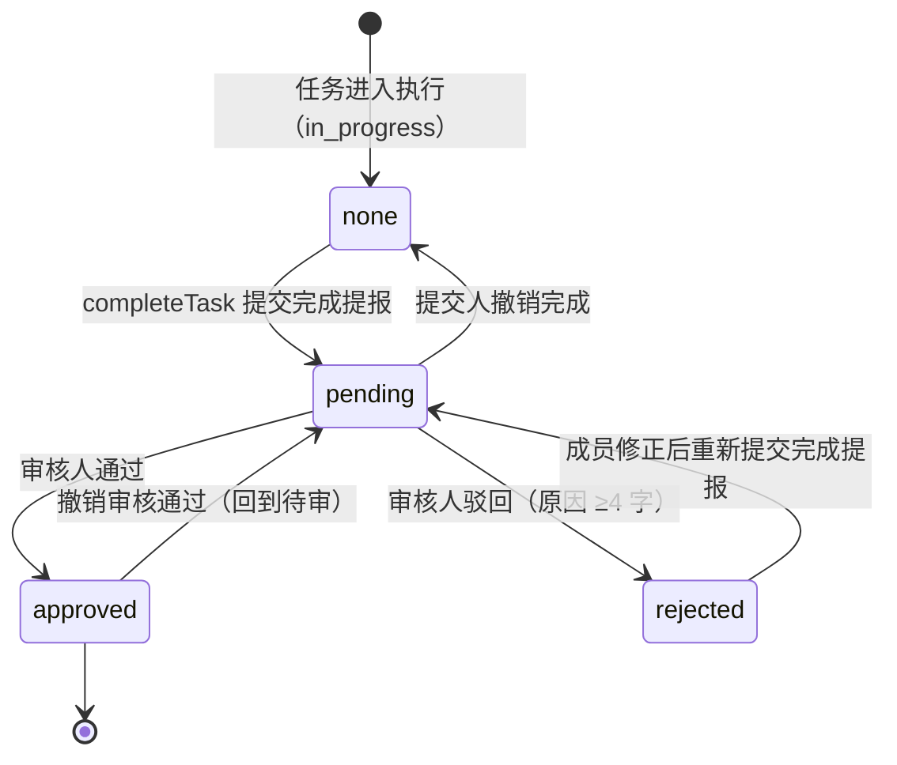

# PRD（增量 2）— OpenSchedule 移动端：接通 `completeTask` → 待审核 断链

> 档位：**增量 PRD（简单 PRD 档位，不含竞品 / 市场分析）** · 版本 v1.2 · 负责人：许清楚（PM）
> 基线：`PRD-mobile.md`（首版）· `PRD-mobile-increment-1.md` v1.2 · `ARCH-mobile-increment-1.md` v1.0 · `DELIVERY-mobile-increment-1.md`
> **本文件只写增量部分，不重写增量 1 的任何内容。** 未在本文件出现的条款一律沿用增量 1。

---

## 1. 背景与范围

### 1.1 一句话

把「**成员完成任务（`completeTask`）→ 进入「待我审核」→ 审核人通过 / 驳回**」这条断链接通，形成与增量 1「**新事项提报 → 审核 → 落地**」**对称的第二条审核闭环**。

### 1.2 现状定位（为什么这是一条「断链」）

| 环节 | 现状 | 证据 |
| --- | --- | --- |
| 提交侧 | `completeTask` 只写 `status='done'` / `completedAt` / `actualHours` / `version` / `updatedAt` + `pushAudit`，**不写任何提报态字段** | `apps/mobile/src/services/task.service.ts:315-338` |
| 队列侧 | `listPendingReview(userId)` 的筛选条件是 `reviewRequired===true && submissionStatus==='pending' && reviewerIds.includes(userId)` | `apps/mobile/src/services/task.service.ts:175-188` |
| 结论 | 提交侧不写这三个字段 ⇒ **成员完成的任何任务都永远不会进入待审队列**；队列中的「完成提报」条目**只能来自种子数据**（`task-014` / `task-015`） | 增量 1 PRD §2.3 / DELIVERY §八-4 |
| 审核侧 | `reviewSubmission` 的 `'completion'` 分支**已完整存在**（approve → `approved` + `done` + `completedAt` + 通知；reject → `rejected` + `in_progress` + `reviewNote` + 通知） | `apps/mobile/src/services/task.service.ts:902-949` |

> **本次只需补齐「提交侧」**，审核侧与 UI 侧**已具备**（`TodayFocusScreen` 的 `review` 分组右滑「通过 / 驳回」已可用，见 `:314-319`）。这是本次改动量小、收益明确的根本原因。

### 1.3 本次做（S 清单）

| # | 内容 | 对应风险点 |
| --- | --- | --- |
| **S1** | `completeTask` 末尾写入提报态三字段：`submissionStatus='pending'` / `reviewRequired=true` / `reviewerIds=allManagerIds()`；并复位 `reviewNote=null`（避免展示上一轮驳回原因） | R6、R8 |
| **S2** | 「撤销完成」同步回滚提报态：任务必须**完全移出**待审队列（三字段 + `completedAt` 同时复位） | R1 |
| **S3** | 「完成提报被驳回」清空 `completedAt`，使 `completedAt != null ⟺ status === 'done'` 成为硬不变式 | R2 |
| **S4** | 「待我审核」列表按 `resolveApproveBranch(task)` 分叉展示「完成待审」与「提报待审」两类条目 | R3 |
| **S5** | 回归红线保持：`services.test.ts:168-184` 与撤销链路全部用例继续全绿 | R5 |
| **S6** | `reviewerIds` 统一取 `allManagerIds()`，业务代码**禁止**硬编码 id 数组 | R6 |

### 1.4 本次不做（明确排除）

| # | 不做 | 依据 |
| --- | --- | --- |
| **N1** | **多用户登录分叉**（`authService.login` 按邮箱返回不同用户） | 用户已拍板排除；沿用增量 1 DELIVERY §八-2「单用户演示」 |
| **N2** | **测试盲区补齐**（手势层 / 组件交互层自动化） | 用户已拍板排除；沿用增量 1 DELIVERY §八-1 |
| **N3** | **ARCH / QA 文档的 URL 方案对齐** | 用户已拍板排除 |
| **N4** | 详情页审批操作区（增量 1 N1）· 真实 RBAC（N3）· 附件与多级会签（N4）· 新增底部 Tab（N5） | 增量 1 §2.2 全部继续有效 |
| **N5** | **「今日到期 / 待我审核」双计去重** | 见 §2-R4 与 §8-2：**仅明示为已知限制，本次不处理** |
| **N6** | **向审核人推送「待你审核」通知** | 见 §2-R7 与 §4 `M3-P2-01`：**P2，本次不交付** |

> ⚠️ **范围铁律**：本增量**只**接通 `completeTask` → 待审核 断链。任何「顺手优化」（分组口径、通知、撤回入口、权限分叉）都不在本次范围内。

### 1.5 术语与判定函数（本次唯一新增的语义约定）

| 术语 | 定义 | 判定方式 |
| --- | --- | --- |
| **完成提报** | 成员做完任务并送审（交付 → 验收），由 `completeTask` 触发 | `resolveApproveBranch(task) === 'completion'` |
| **新事项提报** | 增量 1 的「申请 → 立项」，由 `submitItem` 触发 | `resolveApproveBranch(task) !== 'completion'`（即 `'task'` / `'project'`） |

> **硬约定**：二者**共用** `Task.submissionStatus` 字段，但**取值子集不同**，且**必须用 `resolveApproveBranch` 判定，禁止用 `Task.source` 判定**。
> 原因：本次 `completeTask` **不修改 `Task.source`**（保持原值，通常为 `'published'`），故会出现 `source !== 'submission'` 但 `submissionStatus === 'pending'` 的新组合（详见 §8-5）。`resolveApproveBranch` 的兜底分支 `'completion'` 天然覆盖该组合，无需改 `source`，也避免触碰 `isSubmissionRecord` 的隐式约束。

---

## 2. 现状与差距（覆盖 R1–R8 全部 8 个风险点）

> 说明：每条给出「现状行为 → 期望行为 → 差距 → 本次处置结论」。**结论即交付要求**，逐条可测（AC 见 §6）。

| # | 现状行为 | 期望行为 | 差距 | 本次处置结论 |
| --- | --- | --- | --- | --- |
| **R1** | `completeTask` 不写提报态（本增量前无此问题）；一旦 S1 落地，`TodayFocusScreen.handleUndo` 撤销「完成」时传 `submissionStatus: undefined`（即**不回滚提报态**，`:250`） | 撤销「完成」后，任务**完全退出待审队列**，恢复到提交前的语义 | 只回滚 `status`/`completedAt`，`submissionStatus`/`reviewRequired`/`reviewerIds` 三字段残留 ⇒ 任务**永久滞留审核队列**（僵尸条目） | ✅ **已裁定（主理人）：必须同步回滚，且必须可测**。回滚语义：`submissionStatus → null`、`reviewRequired → false`、`reviewerIds → []`、`completedAt → null`、`status → 原状态`；`reviewNote` 一并清空。AC-05 / AC-06 |
| **R2** | `reviewSubmission` reject 分支置 `submissionStatus='rejected'` + `status='in_progress'` + `reviewNote`，**未清空 `completedAt`**（`:931-949`） | 驳回后任务回到进行中，`completedAt` 必须为 `null` | `status='in_progress'` 与 `completedAt != null` **语义矛盾**；且会污染「完成时间」类统计口径 | ✅ **PM 裁定：必须清空**（仅 `'completion'` 分支）。据此确立硬不变式：**`completedAt != null ⟺ status === 'done'`**。AC-04 |
| **R3** | 「待我审核」分组卡片为**单一形态**（增量 1 只服务「新事项提报」） | 同页容纳两类条目且**可区分**：完成提报（交付验收）vs 新事项提报（申请立项） | 两类条目的状态标签 / 副文案 / 语义完全不同，混排会误导审核人；且完成提报的 `status` 可能是 `'done'`（本次新增）或 `'in_progress'`（种子 task-014/015） | ✅ **PM 裁定：必须按 `resolveApproveBranch` 分叉**（分叉依据**不用 `source`**，理由见 §1.5）。分叉表见 §5.5。AC-09 |
| **R4** | `listTodayDue` 只排除 `cancelled`（`:160-168`）⇒ 已完成待审任务**同时**出现在「今日到期」与「待我审核」；头部 `visibleTotal = due + approaching + review`（`TodayFocusScreen.tsx:138`）⇒ **重复计数** | 同一任务在头部汇总中只计一次 | 这是**既存问题**（种子 `task-014` 因 `dueAt=今日` 且 `status='in_progress'`，已同时出现在两个分组）；本增量接通后会**放大**该问题（每完成一条任务就多一条重复） | ⚠️ **PM 裁定：本次不处理，仅明示为已知限制**（§8-2）。理由：① 属既存问题，非本次引入；② 修正需改 `listTodayDue` 过滤条件与 `visibleTotal` 口径，会触碰 `today-focus-gate.test.tsx:205/219`（断言「共 0 项 / 共 1 项待处理」）等既有断言，风险 > 收益；③ 违反 §1.4 范围铁律。**后续增量建议**见 §8-2 |
| **R5** | 增量 1 交付后 25 套件 / 383 用例全绿 | 本增量交付后**仍全绿**，且 `tsc` 0 error | `completeTask` 与 `undoCompletion` 被多处用例覆盖；新增字段可能破坏全字段快照式断言 | ✅ **PM 裁定：红线不可破**。已扫描的回归清单见 §6 AC-07 / AC-08 与 §6.3 |
| **R6** | 增量 1 已建 `allManagerIds()`：返回当前租户全部 manager 用户 id（`DEMO_MANAGER_IDS = [user-001 张伟, user-004 陈明]`），为 `reviewerIds` 的既定来源（增量 1 Q2-4 已裁定） | `completeTask` 的 `reviewerIds` 与 `allManagerIds()` **完全一致** | 无功能差距，但存在**实现走偏风险**（在 service 里手写 id 数组） | ✅ **PM 裁定：统一 `allManagerIds()`，业务代码禁止硬编码 id 数组**。AC-10 |
| **R7** | 增量 1 已做「审核结果回流提报人」（`review.result` 站内通知，approve / reject 各一条） | —— | 缺少「提交后通知审核人（待你审核）」 | ⚠️ **PM 裁定：P2，本次不交付**（登记为 `M3-P2-01`）。理由：① 审核结果闭环已可用，审核人有「待我审核」分组徽标作为入口；② 演示环境唯一可登录账号张伟**既是提交人又是审核人**，通知会发给自己，演示价值低且有误导；③ 需新增通知类型并处理去重（同一任务重复提交），成本 > 收益。**如用户要求提前，须拍板**（§7.2-Q2） |
| **R8** | 增量 1 裁定：manager 提报**新事项**免审（直接创建） | 完成提报**不因提交人是 manager 而免审** | 若沿用「manager 免审」，则演示账号张伟（user-001，既是 manager 又是唯一可登录账号）完成任务后**不会进入审核队列** ⇒ 该功能在演示环境**完全不可验证** | ✅ **已裁定（主理人）：`completeTask` 一律写 `submissionStatus='pending'` / `reviewRequired=true` / `reviewerIds=allManagerIds()`，不因提交人是 manager 而免审**。理由：① 完成提报语义是「交付 → 验收」，提交人身份不改变「需要被验收」；② 与增量 1 Q2-4「`reviewerIds` 取全部 manager」一致；③ 若对 manager 免审则功能不可验证。**副作用明示见 §8-1（张伟自审）**。AC-11 |

### 2.1 本次核实中额外发现的两处事实（主理人清单未列，影响实现）

| # | 发现 | 影响 | 处置 |
| --- | --- | --- | --- |
| **F1** | 种子 `task-014` / `task-015` 的 `status` 是 **`'in_progress'`**（不是 `'done'`），`source='submission'` 且**无** `submissionKind`（`seed.ts:439 / 463`） | 接通后，「待我审核」分组内 `status` 将有 **3 种取值**（`done` / `in_progress` / `todo`），**不能**用 `status` 作为分叉依据 | 分叉一律走 `resolveApproveBranch`（§5.5） |
| **F2** | `SUBMISSION_TRANSITIONS.approved = []`（终态），但「撤销审核通过」会把 `submissionStatus` 由 `approved` 直接置回 `'pending'`（`undoCompletion` 不经 `canTransition` 校验） | 迁移表与实际路径**不一致**：`approved → pending` 事实上合法但未被表覆盖 | 本次**只做文档层面承认**（§5.4），不改 `SUBMISSION_TRANSITIONS`（该表只服务「新事项提报」）。列为 §8-4 |

---

## 3. 用户故事

| 编号 | 角色 | 故事 | 验收标准 |
| --- | --- | --- | --- |
| **US3-01** | member | 我在今日聚焦右滑「完成」后，希望任务自动进入「待我审核」由管理人员验收，以便交付有人确认、责任有留痕 | 完成任务后 `status='done'` + `submissionStatus='pending'` + `reviewRequired=true` + `reviewerIds` 含全部 manager；manager 的「待我审核」分组**立刻出现**该条目（AC-01 / AC-02） |
| **US3-02** | manager | 我希望在「待我审核」里一眼分清「**完成提报**（等验收）」与「**新事项提报**（等立项）」，以便用正确的心智做决策 | 两类条目状态标签与副文案可区分（「完成待审」vs「提报待审·新任务/新项目」）；两类均可右滑「通过 / 驳回」，通过/驳回后的落库结果符合各自语义（AC-09 / AC-03 / AC-04） |
| **US3-03** | member | 我误点了「完成」或任务还没做完，希望点「撤销」就能让它**彻底退出**审核队列，以便不让审核人看到半成品 | 撤销后 `submissionStatus` 复位、`reviewRequired=false`、`reviewerIds=[]`、`completedAt=null`、`status` 回原值；`listPendingReview(reviewerId)` **不含**该任务（AC-05） |
| **US3-04** | member | 我的完成提报被驳回后，希望任务回到「进行中」且**不再显示为已完成**，以便我修正后重新提交 | 驳回后 `status='in_progress'`、`completedAt===null`、`reviewNote` 为驳回原因；我再次「完成」可重新进入待审（AC-04 / AC-06） |

---

## 4. 需求池

> 编号前缀 `M3-`（首版 = `M-`，增量 1 = `M2-`）。共 **6 条**：P0 × 4、P1 × 1、P2 × 1。

| 编号 | 需求描述 | 优先级 | 验收标准 |
| --- | --- | --- | --- |
| **M3-P0-01** | `completeTask` 写入提报态：`submissionStatus='pending'`、`reviewRequired=true`、`reviewerIds=allManagerIds()`；同时复位 `reviewNote=null`（避免展示上一轮驳回原因）、`reviewedBy/reviewedAt=null`；**不修改 `source`** | **P0** | 调用后 `status='done'`、`completedAt` 非空、`submissionStatus='pending'`、`reviewRequired===true`、`reviewerIds` 集合等于 `allManagerIds()` 且非空、`reviewNote===null`；`listPendingReview(任一 manager)` 含该任务（AC-01 / AC-02 / AC-10） |
| **M3-P0-02** | 撤销「完成」同步回滚提报态：`submissionStatus → null`、`reviewRequired → false`、`reviewerIds → []`、`completedAt → null`、`reviewNote → null`、`status → 原状态` | **P0** | 撤销后**五字段**同时复位；`listPendingReview(reviewerId)` **不含**该任务；撤销后可**再次完成**并重新进入队列（AC-05 / AC-06） |
| **M3-P0-03** | 「完成提报」被驳回时清空 `completedAt`（仅 `resolveApproveBranch === 'completion'` 分支；`'task'` / `'project'` 分支行为不变） | **P0** | 驳回后 `submissionStatus='rejected'`、`status='in_progress'`、`completedAt===null`、`reviewNote` 为原因、通知正文含原因（AC-04） |
| **M3-P0-04** | 「待我审核」列表按 `resolveApproveBranch(task)` 分叉展示：完成提报显示「完成待审」+ 提交人（`assigneeId`）；新事项提报显示「提报待审·新任务 / 新项目」+ 提报人（`createdBy`）；**分叉依据不得使用 `task.source`** | **P0** | 同屏同时存在两类条目时均正确渲染；`resolveApproveBranch(task-014)==='completion'`；完成提报条目标签为「完成待审」；新事项提报条目标签含「新任务」/「新项目」；两类条目右滑动作均正常且不报错（AC-09） |
| **M3-P1-01** | 完成提报卡片补充**视觉区分**（状态标签配色 / 副文案第二行显示「提交于 {completedAt}」），提升审核人识别效率 | **P1** | 完成提报卡片与提报类卡片在**颜色 + 文案**两个维度可区分；样式全部取自 `theme/tokens.ts`，无内联魔法数字；`tsc` 0 error（AC-09 附加项） |
| **M3-P2-01** | 提交完成提报后向全部审核人写入「待你审核」站内通知（新通知类型，如 `review.pending`） | **P2（本次不交付，仅登记）** | 若后续交付：提交后每位 `reviewerIds` 成员各收到 1 条通知；同一任务重复提交不产生重复未读通知；点击通知深链到 `TaskDetail` |

---

## 5. 状态机与交互

### 5.1 双轨状态模型（本次核心概念）

`Task` 上并存**两条正交的状态轨**，本增量只改**轨道 B 的写入与回滚**，不动轨道 A 的既有迁移规则：

| 轨道 | 字段 | 取值 | 本次是否变更 |
| --- | --- | --- | --- |
| **A · 执行状态** | `status` | `todo` → `in_progress` → `done`（另有 `blocked` / `cancelled`） | ❌ 不变（沿用 `assertTransition`） |
| **B · 验收状态** | `submissionStatus` | `null`（未提交）→ `pending` → `approved` \| `rejected` | ✅ **本次接通写入与回滚** |

**硬不变式（本次确立，可测）**：

| # | 不变式 |
| --- | --- |
| INV-1 | `completedAt != null ⟺ status === 'done'` |
| INV-2 | `submissionStatus === 'pending'` ⇒ `reviewRequired === true` 且 `reviewerIds` 非空 |
| INV-3 | `submissionStatus` 为 `null` / `'approved'` / `'rejected'` ⇒ 任务**不在**「待我审核」队列（`listPendingReview` 不含） |

### 5.2 完成提报状态机（轨道 B：`submissionStatus`）

> **本图只描述轨道 B（`submissionStatus`）**，且**不含** `draft` / `withdrawn` / `published` 三个取值 —— 这三个属于「新事项提报」，见增量 1 §6。
> `none` 表示 `submissionStatus` 为 `null`（无提报态）。

### 5.3 迁移条件表（完成提报）

| 迁移 | 触发者 | 触发动作 | 前置条件 | 副作用（含轨道 A） |
| --- | --- | --- | --- | --- |
| `none → pending` | 成员 | `completeTask` | `assertVersion` 通过；`assertTransition(status,'done')` 通过 | `status='done'`、`completedAt=now()`、`actualHours` 落库、`submissionStatus='pending'`、`reviewRequired=true`、`reviewerIds=allManagerIds()`、`reviewNote=null`、`reviewedBy/At=null`、`version+1`、`pushAudit` |
| `pending → approved` | 审核人 | `reviewSubmission(id,'approve')` | `assertVersion` 通过；`resolveApproveBranch==='completion'` | `submissionStatus='approved'`、`status='done'`、`completedAt=now()`、`reviewNote=null`、通知提报人（`review.result`） |
| `pending → rejected` | 审核人 | `reviewSubmission(id,'reject',reason)` | 原因去空白后 **≥4 字** | `submissionStatus='rejected'`、`status='in_progress'`、**`completedAt=null`（本次新增）**、`reviewNote=reason`、通知提报人（正文含原因） |
| `pending → none` | 提交人 | 撤销「完成」（`undoCompletion`） | 撤销窗口内 / 显式撤销 | `status=原状态`、`completedAt=null`、`submissionStatus=null`、`reviewRequired=false`、`reviewerIds=[]`、`reviewNote=null` |
| `rejected → pending` | 成员 | 再次 `completeTask` | 同 `none → pending` | 同 `none → pending`（幂等，可重复） |
| `approved → pending` | 审核人 | 撤销「审核通过」（`undoCompletion`） | 撤销窗口内 | `status='in_progress'`、`completedAt=null`、`submissionStatus='pending'`（重新待审）、`reviewRequired`/`reviewerIds` **保持**（见 §5.4 注） |

> ⚠️ **本次不新增「撤回完成提报」路径**：`withdrawSubmission` **禁止**用于完成提报 —— 其实现会把 `status` 置 `'cancelled'`（`task.service.ts:870-871`），对一条**正式任务**而言是错误语义（任务被「取消」而非「回到未提交」）。完成提报的唯一退出路径是**撤销完成**。列为 §8-3 已知限制。

### 5.4 与增量 1 §6 提报状态机的**互不冲突**论证

| 维度 | 增量 1 §6（新事项提报） | 增量 2 §5.2（完成提报） | 是否冲突 |
| --- | --- | --- | --- |
| 状态取值 | `draft` / `pending` / `approved` / `rejected` / `withdrawn`（+ 落地终态 `published`） | `none`（`null`） / `pending` / `approved` / `rejected` | ❌ 不冲突：完成提报的取值是增量 1 的**真子集**（去掉 `draft`/`withdrawn`/`published`，增加 `null`） |
| 承载字段 | `Task.submissionStatus` | `Task.submissionStatus` | ⚠️ 共用字段，**由 `resolveApproveBranch` 区分语义**（§1.5） |
| 起始态 | `draft`（本地编辑态，不落库） | `none`（任务已在执行中，无草稿） | ❌ 不冲突 |
| 落地行为 | `approved` → 落地为**正式新事项** | `approved` → **无新实体**，仅验收通过（`status='done'`） | ❌ 不冲突：`reviewSubmission` 已按分支隔离（`'project'`/`'task'` vs `'completion'`） |
| 撤回 | `pending → withdrawn`（提报人撤回，记录归档 `cancelled`） | **无撤回**，走 `pending → none`（撤销完成，任务回执行态） | ❌ 不冲突：两条路径作用于**不同对象**（提报记录 vs 正式任务） |
| 迁移表 | `SUBMISSION_TRANSITIONS` | 由 §5.3 表格描述 | ⚠️ 见 F2：`approved → pending`（撤销通过）未被 `SUBMISSION_TRANSITIONS` 覆盖 |

> **F2 处置**：`SUBMISSION_TRANSITIONS` 仅约束「新事项提报」，本次**不改该表**；但需在 §5 明确「完成提报的迁移由 `completeTask` / `reviewSubmission` / `undoCompletion` 三条路径驱动」，并在 §8-4 记录该表未覆盖 `approved → pending`。
>
> **§5.3 最后一行注**：撤销「审核通过」时**不得**复位 `reviewRequired` / `reviewerIds` —— 因为任务**重新回到待审**，`reviewerIds` 必须保留（否则审核人再也看不到它）。这与撤销「完成」的回滚语义（三字段全复位）**方向相反**，是实现时最容易写错的一处，故单列。

### 5.5 「待我审核」列表分叉设计（`TodayFocusScreen` · `review` 分组）

| 条目来源 | `resolveApproveBranch` | 提交时的 `status` | 提交人字段 | 状态标签 | 副文案 | 右滑操作 |
| --- | --- | --- | --- | --- | --- | --- |
| 完成提报（**本次新增**，来自 `completeTask`） | `'completion'` | `'done'` | `assigneeId`（完成人） | **完成待审** | 「{提交人} 提交了完成提报」 | 通过 / 驳回 |
| 完成提报（既有种子 `task-014`/`task-015`，见 F1） | `'completion'` | `'in_progress'` | `assigneeId` | **完成待审** | 同上 | 通过 / 驳回 |
| 新任务提报（增量 1） | `'task'` | `'todo'` | `createdBy`（提报人） | **提报待审 · 新任务** | 「{提报人} 提报了新任务」 | 通过 / 驳回 |
| 新项目提报（增量 1） | `'project'` | `'todo'` | `createdBy` | **提报待审 · 新项目** | 「{提报人} 提报了新项目」 | 通过 / 驳回 |

**不变项（沿用增量 1，不得改动）**：① 右滑「通过 / 驳回」保留；② `review` 分组卡片保留增量 1 的「查看详情」按钮（`M2-P0-07`）；③ 详情页**不加**审批操作区（增量 1 N1）；④ `due` / `approaching` 两分组卡片不变。

---

## 6. 验收标准（AC）

### 6.1 功能验收（Given / When / Then）

| # | 关联 | Given | When | Then |
| --- | --- | --- | --- | --- |
| **AC-01** | R6 / R8 / S1 | 一条 `status='in_progress'` 的正式任务（`source` 保持原值） | 调用 `completeTask(id, { version })` | `status==='done'`；`completedAt` 非空；`submissionStatus==='pending'`；`reviewRequired===true`；`reviewerIds` **集合等于** `allManagerIds()` 且非空；`reviewNote===null`；`version` 递增 1；写入 `task.complete` 审计 |
| **AC-02** | R8 | 上一步完成后的任务；审核人 = `allManagerIds()` 中任一成员 | 调用 `listPendingReview(reviewerId)` | 返回列表**包含**该任务 id（「完成提报」进入待审队列） |
| **AC-03** | 审核通过 | 一条 `resolveApproveBranch==='completion'` 且 `submissionStatus==='pending'` 的任务 | 调用 `reviewSubmission(id, 'approve', version)` | `submissionStatus==='approved'`；`status==='done'`；`completedAt` 非空；`reviewNote===null`；提报人收到 1 条 `review.result` 通知 |
| **AC-04** | **R2** | 同上，任务当前 `completedAt` 非空 | 调用 `reviewSubmission(id, 'reject', version, '说明不充分')` | `submissionStatus==='rejected'`；`status==='in_progress'`；**`completedAt===null`**；`reviewNote==='说明不充分'`；通知正文包含该原因 |
| **AC-05** | **R1（核心）** | 一条已完成待审的任务（`submissionStatus==='pending'`、`reviewRequired===true`、`reviewerIds` 非空、`completedAt` 非空） | 调用 `undoCompletion(id, { status: 原状态, submissionStatus: null, version })` | **五字段同时复位**：`submissionStatus===null`、`reviewRequired===false`、`reviewerIds` 为空数组、`completedAt===null`、`reviewNote===null`；`status===原状态`；且 `listPendingReview(reviewerId)` **不含**该任务 id（不残留僵尸条目） |
| **AC-06** | R1 反向 / 幂等 | 上一步撤销后的任务 | 再次调用 `completeTask(id, { version })` | 能**再次**成功进入待审队列（`submissionStatus==='pending'`、`listPendingReview` 含该 id），无「已存在待审记录」类错误 |
| **AC-07** | **R5 回归红线** | 种子数据（`resetDatabase()` 后） | ① `reviewSubmission('task-014','approve',v)` ② `reviewSubmission('task-015','reject',v,'说明不充分')` | ① `status==='done'` ② `status==='in_progress'` 且 `reviewNote==='说明不充分'` —— **与 `tests/services.test.ts:168-184` 逐条一致，该套件必须全绿** |
| **AC-08** | **R5 回归链路** | 今日聚焦「今日到期」分组中的一条任务 | 右滑「完成」→ 观察乐观更新 → 点击「撤销」 | 卡片乐观移除后可撤销；撤销后任务回到原状态与**原分组**；`undoCompletion` 断言（`tests/round2-regression.test.ts:19-69`）全绿；`catch` 路径（陈旧 `version` → 40901）仍可达（`:73-85`） |
| **AC-09** | **R3** | 「待我审核」列表中**同时存在**完成提报与新事项提报两类条目 | 打开该分组 | 两类条目均正常渲染（无崩溃、无空白）；完成提报显示「完成待审」、新事项提报显示含「新任务」/「新项目」的标签；两类条目右滑均出现「通过 / 驳回」；`resolveApproveBranch(task-014)==='completion'` |
| **AC-10** | **R6** | 全量源码 | 检索 service 层 | `completeTask` 的 `reviewerIds` 取自 `allManagerIds()`；**无**硬编码 id 数组（如 `['user-001', ...]`）出现在业务代码；`reviewerIds` 与 `allManagerIds()` 深度一致（集合比较，顺序无关） |
| **AC-11** | **R8（已裁定）** | 角色 = manager（演示账号张伟，user-001） | 张伟完成任务 | 同样写入 `submissionStatus='pending'` / `reviewRequired=true` / `reviewerIds=allManagerIds()`；张伟的「待我审核」分组**出现**该任务（**不自审豁免**） |
| **AC-12** | 工程门槛 | 全量代码 | 执行 `npx tsc --noEmit` 与 `npx jest --config jest.config.js` | `tsc` **0 error**（strict）；全量测试套件**全绿**（基线 25 套件 / 383 用例，不得减少）；`package.json` **零新增依赖** |

### 6.2 INV 不变式验收（可作为单测断言点）

| # | 不变式 | 断言方式 |
| --- | --- | --- |
| INV-1 | `completedAt != null ⟺ status === 'done'` | 在 AC-01 / AC-04 / AC-05 / AC-06 四条路径后分别断言该等价关系成立 |
| INV-2 | `submissionStatus==='pending'` ⇒ `reviewRequired===true` 且 `reviewerIds.length > 0` | AC-01 / AC-02 / AC-06 / AC-11 后断言 |
| INV-3 | `submissionStatus ∈ {null,'approved','rejected'}` ⇒ 不在待审队列 | AC-05 / AC-07 后断言 `listPendingReview` 不含该 id |

### 6.3 R5 回归清单（工程师实现前**必须**逐项扫描 + 实现后逐项复跑）

| 文件 : 位置 | 断言内容 | 本次影响 | 结论 |
| --- | --- | --- | --- |
| `tests/services.test.ts:168-184` | `task-014` approve → `status='done'`；`task-015` reject → `status='in_progress'` + `reviewNote` | **红线**（仅单字段断言，未断言 `completedAt`） | ✅ 必须全绿；AC-04 清空 `completedAt` **不破坏**该红线 |
| `tests/services.test.ts:122-135` | `completeTask('task-004')` → `status` / `actualHours` / `completedAt` | 新增字段为**附加**，断言为单字段 | ✅ 不破坏 |
| `tests/round2-regression.test.ts:19-31` | 撤销「完成」回 `in_progress`，`completedAt===null` | 不传 `submissionStatus` ⇒ 三字段不动 | ✅ 不破坏 |
| `tests/round2-regression.test.ts:33-41` | 撤销「完成」回 `todo` | 同上 | ✅ 不破坏 |
| `tests/round2-regression.test.ts:43-60` | 撤销「审核通过」→ `submissionStatus='pending'` + `completedAt===null` | 传 `submissionStatus:'pending'` ⇒ **不得**复位 `reviewRequired`/`reviewerIds`（§5.3 注） | ✅ 不破坏，但**实现时必须遵守 §5.3 注**，否则该任务会从待审队列消失 |
| `tests/round2-regression.test.ts:62-69` | 「不传 `submissionStatus` 时保持原值不动」 | 断言仍绿；但其**标题所述产品语义**（「撤销完成不影响提报态」）已被 R1 取代 | ⚠️ **断言不变**；建议改名为「不传 `submissionStatus` 时 service 保持原值（调用方须显式传 `null` 才能回滚）」，以免误导后续维护 |
| `tests/round2-regression.test.ts:73-85` | 陈旧 `version` → 40901；非法目标状态 → 40902 | 不受影响 | ✅ 必须全绿 |
| `tests/today-focus-gate.test.tsx:205/219` | `共 0 项 / 共 1 项待处理`（`visibleTotal` 口径） | **R4 不处理** ⇒ 该断言不受影响 | ✅ 必须全绿（这也是 R4 本次不动的理由之一） |
| `tests/seed-integrity.test.ts` | 种子完整性 | 本次**不改种子** | ✅ 必须全绿 |

> **附加扫描要求**：实现前先检索是否存在对 `completeTask` / `undoCompletion` **返回值做全字段快照**（`toEqual({...全部字段})`）的断言。本 PRD 编写期已抽查 `tests/services.test.ts` 与 `tests/round2-regression.test.ts`，**未发现**此类断言；如全量检索后发现，须先同步更新该断言再改源码。

---

## 7. 待确认问题

### 7.1 已裁定（直接生效，不再列为待确认）

| # | 问题 | 裁定 | 裁定人 |
| --- | --- | --- | --- |
| **Q3-1** | **R8**：提交人本人是 manager 时，完成提报是否免审？ | **不免审**。`completeTask` 一律写 `submissionStatus='pending'` / `reviewRequired=true` / `reviewerIds=allManagerIds()`。理由：① 完成提报语义是「交付 → 验收」，提交人身份不改变「需要被验收」；② 与增量 1 Q2-4 一致；③ 若对 manager 免审，演示账号张伟完成后不入队 ⇒ 功能不可验证。副作用见 §8-1 | **主理人** |
| **Q3-2** | **R1**：撤销「完成」是否必须同步回滚提报态？ | **必须回滚，且必须可测**。三字段 + `completedAt` + `reviewNote` 同时复位，`status` 回原值；断言点见 AC-05 / AC-06 | **主理人** |
| **Q3-3** | **R2**：完成提报被驳回后 `completedAt` 是否清空？ | **清空**。据此确立硬不变式 `completedAt != null ⟺ status === 'done'`（INV-1）。仅作用于 `'completion'` 分支，`'task'`/`'project'` 分支行为不变 | PM（许清楚） |
| **Q3-4** | **R3**：审核页两类条目是否需要分叉展示？ | **需要分叉**，分叉依据统一为 `resolveApproveBranch(task)`，**禁止**用 `task.source`（因 `completeTask` 不改 `source`，且种子 task-014/015 的 `status` 为 `in_progress`，`status` 亦不可作为依据）。分叉表见 §5.5 | PM（许清楚） |
| **Q3-5** | **R4**：今日到期 / 待我审核 双计，本次是否一并处理？ | **本次不处理，仅明示为已知限制**（§8-2）。理由：既存问题（非本次引入）、修正会触碰 `today-focus-gate.test.tsx` 既有断言、且违反 §1.4 范围铁律 | PM（许清楚） |
| **Q3-6** | **R6**：`reviewerIds` 来源？ | **统一 `allManagerIds()`**，业务代码禁止硬编码 id 数组 | PM（许清楚，与增量 1 Q2-4 一致） |
| **Q3-7** | **R7**：提交后是否通知审核人？ | **P2，本次不交付**（登记为 `M3-P2-01`）。理由见 §2-R7 | PM（许清楚） |
| **Q3-8** | `completeTask` 是否改写 `Task.source`？ | **不改写**（保持原值）。`resolveApproveBranch` 的兜底分支 `'completion'` 天然覆盖；改 `source` 会引入 `isSubmissionRecord` 的隐式约束风险。副作用见 §8-5 | PM（许清楚） |
| **Q3-9** | 撤销「审核通过」时是否复位 `reviewRequired` / `reviewerIds`？ | **不复位**（任务重新回到待审，必须保留审核人）。与撤销「完成」的回滚语义**方向相反**，见 §5.3 注 | PM（许清楚） |
| **Q3-10** | 完成提报是否提供「撤回」入口？ | **不提供**。`withdrawSubmission` 会把 `status` 置 `'cancelled'`，对正式任务语义错误；唯一退出路径是「撤销完成」。见 §5.3 注与 §8-3 | PM（许清楚） |

### 7.2 仍需用户拍板的问题

| # | 问题 | 影响 | 我的建议（默认值） |
| --- | --- | --- | --- |
| **Q3-11** | 完成提报是否需要一个**显式的「撤回」入口**（区别于「撤销完成」）？例如成员在任务详情页看到「待审核」时可点「撤回」退回进行中。 | 影响是否新增一个 UI 入口 + 一条 service 路径（不得复用 `withdrawSubmission`） | **本次不做**（§1.4 范围铁律）。理由：完成提报的退出已由「撤销完成」覆盖；新增入口属范围扩张。**若用户要求纳入本次，需拍板**，届时需新增独立路径（不得复用 `withdrawSubmission`） |
| **Q3-12** | 「待你审核」站内通知（`M3-P2-01`）是否**提前到本次**交付？ | 影响是否新增通知类型 + 去重逻辑 | **不提前**（P2）。理由见 §2-R7：审核结果闭环已可用、演示环境会「通知自己」、需处理重复提交去重。**若用户认为审核时效优先，需拍板** |

---

## 8. 已知限制

| # | 限制 | 说明 | 来源 |
| --- | --- | --- | --- |
| **1** | **演示环境「自审」** | 演示账号张伟（user-001）**既是 manager 又是唯一可登录账号**。按 Q3-1 裁定，张伟完成任务后会进入**自己的**「待我审核」队列 ⇒ 演示中会出现「自己审自己」。**真实 RBAC 下应由他人审核**（`reviewerIds` 含 user-004 陈明，即体现该设计意图）。此为演示数据限制，非功能缺陷 | R8 / Q3-1 |
| **2** | **「今日到期 / 待我审核」重复计数（双计 / 三计）** | `listTodayDue` 仅排除 `cancelled`（`task.service.ts:167-183`），故「已完成待审」的任务**同时**出现在「今日到期」与「待我审核」两个分组；头部汇总 `visibleTotal = due + approaching + review`（`TodayFocusScreen.tsx:140`）会**重复计数**。这是**既存问题**（种子 `task-014` 已如此），本增量接通后会**放大**（每完成一条任务即多一条重复）。**本次不处理**（Q3-5）。 **后续增量建议（v1.1 经实测复核后修订）**： ① **过滤条件路线**：`listTodayDue` 与 `listDeadlineApproaching` **均**增加 `submissionStatus !== 'pending'` 排除条件（`listPendingReview` 的成员必然满足 `submissionStatus === 'pending'`，故此举可彻底切断这两个分组与「待我审核」的重叠）；同时 `listTodayDue` 还应排除 `status === 'done'`，使其口径与 `listDeadlineApproaching` 一致（「今日到期」不应显示已完成任务）。⚠️ 原文只提「在 `listTodayDue` 加 `submissionStatus !== 'pending'`」**不足以**消除全部重复：种子 `task-014` / `task-015` 为 `in_progress` + `submissionStatus='pending'`、`dueAt` 为当日 17:00 / 19:00，多数时段同时落在「临期预警」的 24h 窗口内，实际会被计 **3 次**（今日到期 + 临期预警 + 待我审核），而非 2 次。 ② **汇总去重路线**：在 `visibleTotal` 处按 task id 去重 —— 一次性覆盖三组间全部重叠，且不依赖各分组过滤条件的正确性，**更稳（推荐）**。 **勘误（v1.1，经增量 3 实测复核）**：原文「两者均需同步更新 `today-focus-gate.test.tsx:205/219` 的断言」**不成立**。该文件的聚焦数据**全部来自 `jest.mock` 替身**（`@/hooks` 的 `useAsync` 返回 `mockFocus`，`:97-104`；`@/services` 亦整体替身化，`:107-120`），`beforeEach`（`:170-175`）清空三分组，**不含种子数据**；`reviewTask`（`id='task-901'`，`:36-71`）只出现在 `mockFocus.pendingReview` **一个**分组，无可去重项 ⇒ `:205` / `:219` 两条断言的期望值**仍为 `共 0 项` / `共 1 项`**，本次修正、以及上述两条建议未来落地时**均不需要改动该测试文件** | R4 / Q3-5 |
| **3** | **完成提报无「撤回」路径** | `withdrawSubmission` **禁止**用于完成提报（其实现会把 `status` 置 `'cancelled'`，对正式任务语义错误）。成员的唯一退出路径是「撤销完成」（`undoCompletion`），依赖 UndoToast 窗口或显式撤销入口。若用户需要「已过撤销窗口后仍能撤回」，须走 Q3-11 | F（本次核实）/ Q3-10 |
| **4** | **`SUBMISSION_TRANSITIONS` 未覆盖 `approved → pending`** | 该迁移表（`utils/submission.ts:12-18`）将 `approved` 定义为终态（`[]`），但「撤销审核通过」事实上会把 `submissionStatus` 由 `approved` 置回 `'pending'`（`undoCompletion` 不经 `canTransition` 校验）。本次**只做文档层面承认**（§5.4），不改该表 —— 该表只服务「新事项提报」。后续如需统一，建议为完成提报单列 `COMPLETION_TRANSITIONS` | F2 |
| **5** | **新增状态组合 `source !== 'submission'` 且 `submissionStatus === 'pending'`** | 按 Q3-8，`completeTask` 不改 `source`（通常保持 `'published'`），故产生此新组合。**必须用 `resolveApproveBranch` 判定完成提报，禁止用 `source`**。`isSubmissionRecord(task)` 对该组合仍返回 `false` ⇒ 任务**正常保留在正式列表**（这是期望行为，也是 §8-2 双计的前提） | Q3-8 |
| **6** | **单用户演示 / 内存库刷新复位** | `authService.login` 恒返回演示账号（`buildUser` 未按邮箱分叉）；mock 数据在内存中，整页刷新即回到种子状态。故端到端验证必须在**单会话内用应用内导航**完成。沿用增量 1 DELIVERY §八-2 / §八-3，本次不处理（§1.4 N1） | 增量 1 遗留 |
| **7** | **拖拽手势层无自动化测试** | 沿用增量 1 DELIVERY §八-1；本次不处理（§1.4 N2） | 增量 1 遗留 |
| **8** | **多余构建产物待清理** | 沿用增量 1 DELIVERY §八-5（`apps/mobile/dist` / `dist-v2` / `dist-v3` 需手动清理）。本次不处理 | 增量 1 遗留 |

---

## 9. 修订记录

| 版本 | 日期 | 修订内容 | 原因 |
| --- | --- | --- | --- |
| **v1.0** | 2026-09-27 | 初版增量 2 PRD：接通 `completeTask` → 待审核 断链。§2 覆盖 R1–R8 全部 8 个风险点（含主理人已裁定的 R1 / R8）；§3 四条用户故事；§4 需求池 6 条（P0×4 / P1×1 / P2×1）；§5 双轨状态模型 + 完成提报状态机（Mermaid）+ 与增量 1 §6 的互不冲突论证 + 审核页分叉表；§6 12 条 Given/When/Then AC（含 R1 撤销回滚 AC-05/AC-06 与 R5 回归 AC-07/AC-08）+ 3 条 INV 不变式 + 9 项回归清单；§7 已裁定 10 项 / 待拍板 2 项；§8 已知限制 8 条 | 用户拍板：仅接通断链，不扩张范围 |
| **v1.1** | 2026-09-27 | **按实测勘误 §8-2**：`today-focus-gate.test.tsx` 断言**不受影响** —— 该文件聚焦数据全部来自 `jest.mock` 替身、`beforeEach` 清空三分组、不含种子数据，`:205` / `:219` 期望值仍为 `共 0 项` / `共 1 项`，**无需改动**。同步修正 §8-2「后续增量建议」：原「仅改 `listTodayDue` 加 `submissionStatus !== 'pending'`」不足以消除全部重复，须 `listTodayDue` + `listDeadlineApproaching` **同排除** `submissionStatus === 'pending'`（并推荐 `visibleTotal` 按 task id 去重）。本次**不改动任何源码 / 测试文件** | 增量 3 实测复核发现 §8-2 事实错误，需就地勘误（错误已传播至增量 2 架构文档与交付总结，主理人已完成其交付文档勘误） |
| **v1.2** | 2026-09-27 | **版本与引用同步（纯文档层，源码 / 测试零改动）**：① **头部版本号**由 v1.0 同步至 §9 最新（即本行 v1.2），消除「头部 v1.0 / §9 已 v1.1」的漂移；② **§8-2 行号引用按当前代码更正** —— `task.service.ts:160-168` → **`:167-183`**（`listTodayDue` 实际位置）、`TodayFocusScreen.tsx:138` → **`:140`**（`visibleTotal` 实际位置）；③ **§8-2 条目标题**由「双计」更正为「**重复计数（双计 / 三计）**」，与正文已更正的「实为三计」一致。 | 上一轮修正 §8-2 时受「不得改动其它内容」约束而未处理的三处遗留（版本号漂移 / 行号漂移 / 标题与正文不一致），本轮授权一并处理 |
