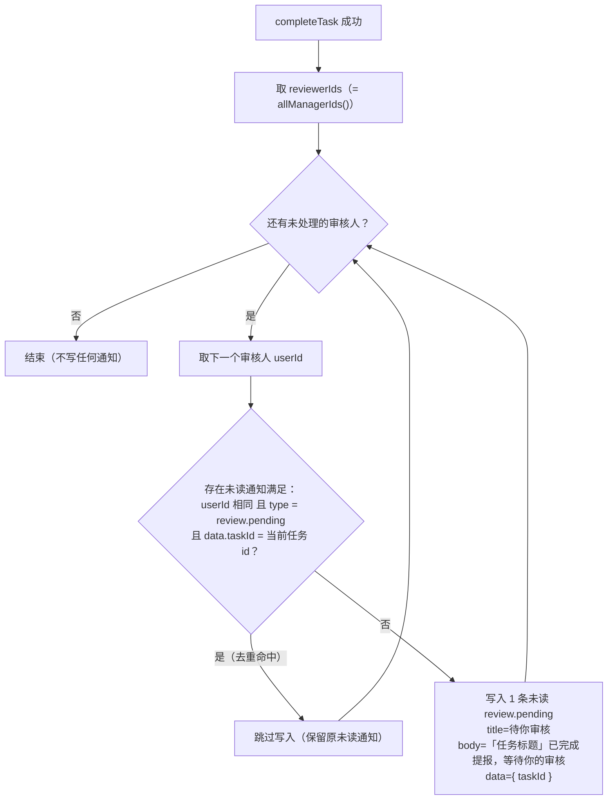
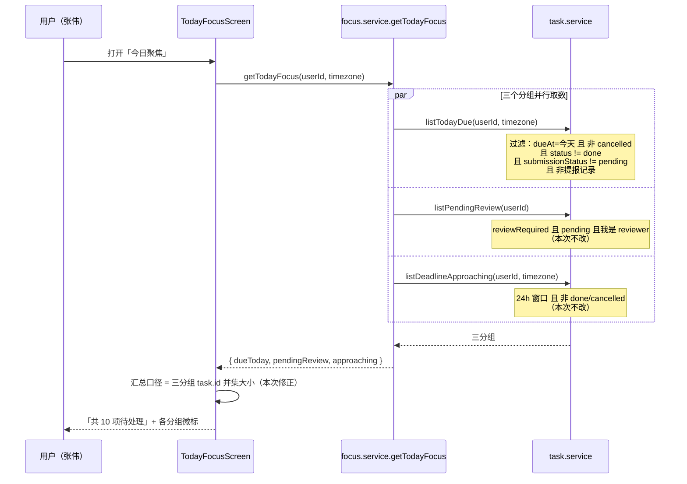

# PRD（增量 3）— OpenSchedule 移动端：双计去重 + 「待你审核」站内通知

> 档位：**增量 PRD（简单 PRD 档位，不含竞品 / 市场分析）** · 版本 v1.2 · 负责人：许清楚（PM）
> 基线：`PRD-mobile.md`（首版）· `PRD-mobile-increment-1.md` v1.2 · `PRD-mobile-increment-2.md` v1.0 · `ARCH-mobile-increment-2.md` v1.4 · `DELIVERY-mobile-increment-2.md`
> **本文件只写增量部分，不重写增量 1 / 增量 2 的任何内容。** 未在本文件出现的条款一律沿用增量 1 / 增量 2。

---

## 1. 背景与范围

### 1.1 一句话（两项，用户已拍板）

| # | 内容 | 一句话 |
| --- | --- | --- |
| **① 双计去重** | 修掉「今日到期 / 待我审核」的**重复计数**；并让**已完成待审**的任务离开「今日到期」 | 同一件事不再被数两次，用户看到的「共 N 项待处理」是真实待办数 |
| **② 「待你审核」站内通知** | 成员提交完成提报后，向审核人写入站内通知（原 `M3-P2-01`） | 审核人不必靠「刷列表」发现新提报，通知中心会主动告知并可一键跳转 |

### 1.2 现状定位（为什么是这两项）

| 项 | 现状 | 证据 |
| --- | --- | --- |
| ① | `listTodayDue` 只排除 `cancelled`，**不排除 `done`、也不排除待审中的任务** ⇒ 一条任务可同时出现在「今日到期」与「待我审核」；头部 `visibleTotal` 是三个分组长度的**简单相加** ⇒ 重复计数 | `apps/mobile/src/services/task.service.ts:167-183`；`apps/mobile/src/screens/TodayFocusScreen.tsx:140` |
| ① | 对照：`listDeadlineApproaching` **已**排除 `done` / `cancelled`（口径不一致） | `apps/mobile/src/services/task.service.ts:202-219` |
| ② | 增量 2 已接通「完成提报 → 待我审核」，但**提交侧不发通知**；`review.result`（审核结果回流提报人）已在 3 处写入 | `apps/mobile/src/services/task.service.ts:946 / 958 / 979` |
| ② | 通知列表页**已支持**按 `data.taskId` 深链到任务详情 ⇒ 本次**零改动复用** | `apps/mobile/src/screens/NotificationsScreen.tsx:62-63` |

> 这两项正是 `DELIVERY-mobile-increment-2.md` §十一-4「增量 3 候选」的第 ① / ② 条，也是 `PRD-mobile-increment-2.md` §8-2（双计已知限制）与 §4 `M3-P2-01` 的正式回收。

### 1.3 本次做（S 清单）

| # | 内容 | 对应问题 |
| --- | --- | --- |
| **S1** | `listTodayDue` 增加两个排除条件：`status !== 'done'`、`submissionStatus !== 'pending'`（语义：**待审中的任务不属于「今日到期」**） | R-A1 / R-A2 |
| **S2** | `visibleTotal` 由「三分组长度相加」改为「三分组按 `task.id` 取**并集**后计数」 | R-A2 |
| **S3** | `completeTask` 末尾向**全部 `reviewerIds`**（不排除操作人本人）写入 `review.pending` 站内通知，`data = { taskId }` | R-A6 / R-A7 |
| **S4** | 新增通知去重写入器 `pushNotificationOnce`：同一 `userId + type + taskId` 已存在**未读**通知时跳过写入 | R-A5 / R-A8 |
| **S5** | 通知类型 `review.pending` 的三处映射同步：文案标签、图标、`NotificationItem.type` 注释登记 | R-A9 |
| **S6** | 回归红线保持：既有断言**零改动**（含 `today-focus-gate.test.tsx:205/219`），`tsc` 0 error，全量测试全绿 | R-A3 |

### 1.4 本次不做（明确排除）

| # | 不做 | 依据 |
| --- | --- | --- |
| **N1** | **完成提报的「撤回」入口**（原 `Q3-11`） | 用户已拍板排除；`DELIVERY-mobile-increment-2.md` §六-4 已裁定「不做」 |
| **N2** | **收口非 `done` 的既存 `pending` 缺口**（种子 `task-014` / `task-015` 经 `moveTask` 后仍留在待审队列） | 用户已拍板排除；沿用 `ARCH-mobile-increment-2.md` §9.2-P6 |
| **N3** | **详情页状态标签与列表分叉文案统一**（`ARCH` §9.2-P4） | 用户已拍板排除 |
| **N4** | **任何重构**（含 `listPendingReview` 抽取、`SUBMISSION_TRANSITIONS` 补表、service 层口径统一 P5） | 用户已拍板排除 |
| **N5** | 「今日到期」与「临期预警」的**列表内容**互斥（二者定义上是包含关系，本次只修头部汇总口径） | 见 §5.1 互斥性说明与 §8-3 |
| **N6** | 新增底部 Tab · 真实 RBAC · 附件与多级会签 · 详情页审批操作区 · 测试盲区补齐（手势层） | 增量 1 §2.2 / 增量 2 §1.4 全部继续有效 |

> ⚠️ **范围铁律**：本增量**只**做上述两项。任何「顺手优化」（通知偏好补种子、种子 `notif-002` 类型纠正、「今日到期」加 `assigneeId` 过滤）一律不做，登记为 §8 已知限制或 §7 待拍板。

### 1.5 术语与判定口径

| 术语 | 定义 | 判定方式 |
| --- | --- | --- |
| **今日到期** | `dueAt` 落在目标时区**今天**、且**仍需处理**（未完成、未取消、非待审中、非提报记录）的任务 | `listTodayDue(userId, timezone)`。⚠️ **限定（v1.1 补正）**：mock 分支**未使用 `userId`**（`:171-181` 的过滤条件不含 `assigneeId`）⇒ 当前实为**全租户**口径（「全租户今天到期的任务」），**不是**「我负责的」；见 §8-6 / F2 / Q4-14 |
| **待审中** | 任务已提交、等待审核人处理 | `submissionStatus === 'pending'`（**不**用 `status` 判定，理由见 §2.2-F1） |
| **已完成待审** | 成员刚完成、尚未被审核的完成提报 | `status === 'done'` **且** `submissionStatus === 'pending'` |
| **分组互斥** | 同一任务不同时出现在「今日到期」与「待我审核」 | `listTodayDue ∩ listPendingReview = ∅`（INV-5） |
| **汇总口径** | 头部「共 N 项待处理」的 N | 三分组按 `task.id` 去重后的**并集大小**（INV-7） |
| **通知去重键** | 判定「是否已有同类未读通知」的三元组 | `userId` + `type` + `data.taskId`（Q4-2 已裁定） |

---

## 2. 现状与差距（覆盖 R-A1 ~ R-A9 全部 9 个问题）

> 每条给出「现状行为 → 期望行为 → 差距 → 本次处置结论」。**结论即交付要求**，逐条可测（AC 见 §6）。

| # | 现状行为 | 期望行为 | 差距 | 本次处置结论 |
| --- | --- | --- | --- | --- |
| **R-A1** | `listTodayDue` 只排除 `cancelled`（`:175`）⇒ `done` 任务与待审任务**都留在**「今日到期」 | 「今日到期」= 今天到期**且仍需处理**的事 | ① 已完成的任务仍显示为「今日到期」（语义错误）；② 待审中的任务同时出现在两个分组（重复计数） | ✅ **PM 裁定：采用选项 (b)「排除所有 `done`」，并追加「排除待审中（`submissionStatus === 'pending'`）」**。理由：① (b) 与 `listMyTodos`（`:155`）、`listDeadlineApproaching`（`:209`）口径一致；② **单靠 (b) 修不掉本次的双计** —— 种子 `task-014` / `task-015` 是 `in_progress` + `pending`（实测见 §2.1），必须由「排除待审中」覆盖；③ 选项 (a)（仅排除「已完成且待审」）**完全修不掉双计**，直接否否决。**对现有列表的具体影响见 §2.1-表 4** |
| **R-A2** | 重复计数的两个来源：**列表内容重叠**（service 层）+ **头部汇总相加**（UI 层） | 列表不重叠 **且** 汇总不重复 | 只修一层都不完整：只修 service ⇒ 头部仍把「今日到期 ∩ 临期预警」重复计入；只修 UI ⇒ 任务仍同时出现在两个分组，用户仍困惑 | ✅ **PM 裁定：两层都修（S1 + S2）**。理由：① 用户诉求原文是「修掉重复计数」**且**「让已完成待审的任务离开今日到期」—— 前半句要求 service 层，后半句要求 service 层，头部数字则要求 UI 层；② 只修 UI 层**违反用户原话**（任务仍会同时出现在两个分组）；③ UI 层按 id 取并集是**唯一**能让「共 N 项待处理」这句话为真的口径，且**不改动任何列表内容**、零回归风险 |
| **R-A3** | `today-focus-gate.test.tsx:205` 断言「共 0 项待处理」、`:219` 断言「共 1 项待处理」（均基于 `visibleTotal`） | —— | —— | ✅ **PM 裁定（经实测核实，纠正主理人前提）：这两条断言本次「不需修改」，期望值仍为 `0` 与 `1`。** 推导见 §2.3。主理人「本次必然触碰」的前提来自增量 2 §8-2 的一句**未经验证的推测**（「两者均需同步更新该断言」），本次已实测证伪 |
| **R-A4** | `listTodayDue` 的调用方 | —— | —— | ✅ **已盘点（实测检索）**：生产调用方**唯一** = `focus.service.ts:72`（`getTodayFocus` 内），经 `TodayFocusScreen.tsx:104` 渲染；测试调用方 2 处 = `services.test.ts:34`、`submission-flow.test.ts:297`。**均不受破坏**（推导见 §2.4） |
| **R-A5** | 无去重能力：`pushNotification`（`data/index.ts:145`）是**无条件追加** | 同一任务重复提交不产生重复**未读**通知 | 若直接在 `completeTask` 内调用 `pushNotification`，则「完成 → 撤销 → 再完成」会刷屏 | ✅ **PM 裁定：新增 `pushNotificationOnce`（方案 ③）**，落点在 `src/data/index.ts`（与 `pushNotification` 同模块）。**不选 ①**（在 `completeTask` 内先查再写）：业务层直连通知表、不可复用、`completeTask` 职责膨胀。**不选 ②**（给 `pushNotification` 加可选 `dedupeKey`）：`pushNotification` 是 3 处既有调用点（`:946/:958/:979`）共用的稳定契约，把「去重」这一**业务策略**下沉进通用写入器会造成隐性耦合（未来调用方传了 key 却期望另一种语义）。方案 ③ 的通用写入器**零改动**，去重规则集中一处、可独立单测 |
| **R-A6** | `review.result` 的文案风格：标题为 4–5 字结论（「提报已通过」/「提报已驳回」），`data` 恒为 `{ taskId }` | 同一风格 | —— | ✅ **PM 裁定**：`type = 'review.pending'`；`title = 「待你审核」`；`body = 「{任务标题}」已完成提报，等待你的审核`；`data = { taskId }`（**不新增字段**，因深链只认 `taskId`）。理由：① 标题为**状态**（待你审核），正文补**对象 + 动作**，与 `review.result` 的「状态标题 + 对象正文」结构对称；② 不带提交人姓名 —— 提交人身份由任务详情承载，通知正文保持单句可读 |
| **R-A7** | 通知列表页**已**按 `data.taskId` 深链 | 点击通知 → 任务详情 | **无差距** | ✅ **已核实：已支持，本次零改动，直接复用。** `NotificationsScreen.tsx:62-63`：取 `notification.data?.taskId` 后 `navigation.navigate('TaskDetail', { taskId, from: 'notification' })`；`:55-58` 同时把未读置为已读；`:149` 渲染「· 点击查看任务」提示。**故「点击无反应」的功能残缺不存在**，无需纳入本次 |
| **R-A8** | —— | 驳回后成员重新完成，审核人应被再次提醒 | 去重与「重新提交」的交互 | ✅ **PM 裁定：按 Q4-2 已裁定口径执行，不额外强制通知。** 即：若该审核人对该任务的 `review.pending` **仍为未读** ⇒ 跳过（审核人**手上仍有未读提醒，未丢失**）；若**已读** ⇒ 产生新的一条。**注意一个反直觉点**：审核人**可能从未点开通知**就已在「待我审核」分组完成驳回（右滑驳回不经过通知列表）⇒ 此时旧通知仍为未读 ⇒ 重新提交**不产生新通知**。该行为登记为 §8-4 已知限制（未读提醒未丢失，但「一条未读通知可能代表两轮提报」） |
| **R-A9** | 既有映射：`NOTIFICATION_EVENT_LABEL`（`domain.ts:125-132`）与 `NOTIFICATION_ICON`（`NotificationsScreen.tsx:24-31`） | 新类型可读、可识别 | 缺映射会**降级**（不是报错，见 §2.2-F3） | ✅ **PM 裁定**：字面量 `'review.pending'`；中文标签 `'待审核提醒'`（对齐既有「临期提醒」命名式样）；图标 `'inbox'`（已实测存在于 Feather glyphMap；语义为「待处理队列」，与 `review.result` 的 `award` 明确区分）。**同时**同步 `domain.ts:98` 的类型注释登记 |

### 2.1 双计的真实数字推导（本次核心证据）

> 实测方式：临时探针脚本调用 `resetDatabase()` + `focusService.getTodayFocus('user-001', 'Asia/Shanghai')`，取三分组 task id 求交并集（探针已删除，未改动任何源码）。**运行时刻：2026-09-27 18:12（Asia/Shanghai）**。

**表 1 · 修复前（实测）**

| 分组 | 数量 | 任务 id |
| --- | --- | --- |
| 今日到期 | **7** | `task-001` `task-004` `task-005` `task-014` `task-015` `task-016` `task-017` |
| 待我审核 | **4** | `task-014` `task-015` `task-019` `task-020` |
| 临期预警 | **6** | `task-001` `task-004` `task-005` `task-014` `task-017` `task-018` |
| **朴素相加（现状头部口径）** | **17** | —— |
| **唯一任务数（并集）** | **10** | `task-001` `task-004` `task-005` `task-014` `task-015` `task-016` `task-017` `task-018` `task-019` `task-020` |

**表 2 · 重复计数的三对重叠（修复前）**

| 重叠对 | 交集 | 个数 |
| --- | --- | --- |
| 今日到期 ∩ 待我审核 | `task-014` `task-015` | **2** |
| 今日到期 ∩ 临期预警 | `task-001` `task-004` `task-005` `task-014` `task-017` | **5** |
| 待我审核 ∩ 临期预警 | `task-014` | **1** |

> 校验：`7 + 4 + 6 − 2 − 5 − 1 + 1（三元交集 task-014）= 10` ✅

**表 3 · 与增量 2 交付基线的对照（回答「当前 18 项 vs 唯一 N 项」）**

| 口径 | 今日到期 | 待我审核 | 临期预警 | 朴素相加 | **唯一任务数** |
| --- | --- | --- | --- | --- | --- |
| 增量 2 交付态（`DELIVERY` §7.5，约 17:2x 实测） | 7 | 4 | **7** | **18** | **10** |
| 本次复核（18:12 实测） | 7 | 4 | **6** | **17** | **10** |
| **本次修复后（两层都修）** | **5** | 4 | 6 | 15 | **10** |

> **两点必须明示**：
> ① 「临期预警」是 **24 小时滑动窗口**（`listDeadlineApproaching`，`:206-212`），其数量随**当前时刻**漂移 ⇒ 朴素相加的 `18` 与 `17` 都是**同一批数据在不同时刻**的结果（差异仅在 `task-015` / `task-016` 的窗口归属，二者始终在并集内）；**唯一任务数在两个时刻均为 10**。
> ② **本次修复后朴素相加仍为 15 > 10**，因为「今日到期 ∩ 临期预警」的 5 个重叠（`task-014` 被移出后为 4 个）属于 **N5 明确不做**的范畴。这 5 项的重复**只体现在头部数字上**，由 S2 的并集口径消除；**列表内容保持不变**。

**表 4 · R-A1 结论对「今日到期」列表的具体影响（修复前 7 → 修复后 5）**

| 任务 | 标题 | `status` | `submissionStatus` | 是否在「待我审核」 | 修复后是否仍在「今日到期」 | 说明 |
| --- | --- | --- | --- | --- | --- | --- |
| `task-001` | 需求文档评审 | `todo` | 无 | ❌ | ✅ 保留 | —— |
| `task-004` | 首页原型设计 | `in_progress` | 无 | ❌ | ✅ 保留 | —— |
| `task-005` | 组件库搭建 | `in_progress` | 无 | ❌ | ✅ 保留 | —— |
| `task-014` | 完成提报：首页原型评审 | `in_progress` | **`pending`** | ✅ | ❌ **消失** | 由「排除待审中」命中；仍保留在「待我审核」 |
| `task-015` | 完成提报：组件库文档 | `in_progress` | **`pending`** | ✅ | ❌ **消失** | 同上 |
| `task-016` | 本周复盘会材料 | `todo` | 无 | ❌ | ✅ 保留 | 不受影响 |
| `task-017` | 官网改版验收清单 | `todo` | 无 | ❌ | ✅ 保留 | —— |

> **关键结论**：**本次「今日到期」只消失 2 条 —— `task-014` 与 `task-015`**，且二者**完整保留在「待我审核」**（信息未丢失，只是不再重复出现）。
> **补充结论（反直觉，必须写进实现说明）**：种子数据中**没有任何**「`dueAt` 为今天 且 `status === 'done'`」的任务 ⇒ **单靠「排除 `done`」在当前种子数据上零影响**。本次之所以必须同时写入「排除待审中」，正是由 `task-014` / `task-015`（`in_progress` + `pending`）逼出来的。

### 2.2 本次核实中额外发现的事实（主理人清单未列，影响实现）

| # | 发现 | 影响 | 处置 |
| --- | --- | --- | --- |
| **F1** | **`listTodayDue` 与 `listPendingReview` 的重叠集合与 `done` 无关** —— 种子中重叠的 `task-014` / `task-015` 是 `in_progress` + `pending` | 若实现者只按主理人字面「排除 `done`」施工，**双计一条都修不掉**（回归测试仍会红） | 判定口径统一为 `submissionStatus === 'pending'`（§1.5）；**禁止**用 `status` 判定「待审中」 |
| **F2** | **`listTodayDue` 的 `userId` 参数在 mock 分支完全未被使用**（`:171-178` 的过滤条件不含 `assigneeId`） | 「今日到期」展示的是**全租户**今天到期的任务，而非「我的」 | 本次**不改**（超出范围）；登记为 §8-6，并列入 §7 待拍板 Q4-6 |
| **F3** | **用户所述「新增通知类型必须同步改三处」的第 1 处（`NotificationType` 联合类型）在当前代码中不存在** —— `NotificationItem.type` 是 `string`（`domain.ts:99`），仅 `:98` 有一行注释枚举示例 | 实现者会去找一个不存在的类型；且「缺映射 ⇒ 渲染异常或类型报错」**被高估**：图标缺失会 fallback 到 `'bell'`（`NotificationsScreen.tsx:123`）、标签缺失会 fallback 到原始英文 key（`NotificationSettingsScreen.tsx:89`），即**降级显示而非报错** | **修正为 3 处同步点**：① `NOTIFICATION_EVENT_LABEL`（`domain.ts:131` 附近）；② `NOTIFICATION_ICON`（`NotificationsScreen.tsx:30` 附近）；③ `domain.ts:98` 的**类型注释登记**（使该注释成为事实上的类型登记处）。AC-08 按此三条验收 |
| **F4** | **种子 `notif-002` 语义上就是「待你审核」，但 `type` 写成了 `'task.assigned'`**（标题「李娜提交了「首页原型设计」完成提报」、正文「待你评审确认。」、`data.taskId = 'task-014'`、未读） | ① 它与本次新建的 `review.pending` **不互相去重**（类型不同）⇒ 同一任务可能出现两条语义重复的未读通知；② 反过来说，它**不会**导致新通知被误去重 | 本次**不改种子**（范围铁律）；登记为 §8-5 与 §7 待拍板 Q4-5 |
| **F5** | **通知偏好表（`mockNotificationPreferences`）不含 `review.result`，也不含 `task.completed`** | 说明「通知类型」**不要求**在偏好页登记；新类型只影响通知列表页的渲染 | 本次**不补偏好种子**（与 `review.result` 现状保持一致）；登记为 §8 已知限制 |

### 2.3 R-A3 推导：`today-focus-gate.test.tsx:205/219` 的期望值

**结论：两条断言的期望值均**不需修改**，仍为「共 0 项待处理」与「共 1 项待处理」。**

推导（基于实测读取该文件）：

| 位置 | 用例构造 | `visibleTotal` 推导（修复后口径 = 并集大小） | 期望值 | 是否需改 |
| --- | --- | --- | --- | --- |
| `:198-207`（`:205` 断言） | `mockRole='member'`；`dueToday=[]`、`pendingReview=[reviewTask]`、`approaching=[]`；member 不计入 `review` | `\|∅ ∪ ∅\| = 0`（`review` 被角色门禁排除，与去重无关） | `共 0 项待处理` | ❌ **不改** |
| `:211-225`（`:219` 断言） | `mockRole='manager'`；`dueToday=[]`、`pendingReview=[reviewTask]`、`approaching=[]` | `\|{task-901}\| = 1`（三个分组**无 id 重叠**，去重不改变结果） | `共 1 项待处理` | ❌ **不改** |

**为什么主理人「必然触碰」的前提不成立**：

1. 这两条用例的聚焦数据**全部来自 `jest.mock` 的替身**（`:107-120`），`beforeEach` 把三个分组重置为空（`:170-175`），**不含任何种子数据**，因此与 `listTodayDue` 的过滤条件变更**完全解耦**。
2. `reviewTask`（`:36-71`）的 `id = 'task-901'`，**只出现在 `pendingReview` 一个分组**，不存在可去重的重叠。
3. 该前提的原始出处是 `PRD-mobile-increment-2.md` §8-2 末句「两者均需同步更新 `today-focus-gate.test.tsx:205/219` 的断言」—— 这是一句**写在已知限制里的推测**，增量 2 因未处理双计而**从未验证**。本次实测证伪。

**本次对测试的处置**：既有断言**零改动**（红线）；本次两条改动（S1 / S2）与去重（S4）的验证一律写入**新增独立测试文件**（M4-P1-01），避免污染既有 28 个套件。

### 2.4 R-A4 推导：`listTodayDue` 调用方盘点与波及面

| # | 调用点 | 性质 | 本次波及 | 结论 |
| --- | --- | --- | --- | --- |
| 1 | `src/services/focus.service.ts:72`（`getTodayFocus` 内，与 `listPendingReview` / `listDeadlineApproaching` 并行） | **唯一生产调用方** | 「今日到期」列表内容 + 头部 `visibleTotal` 同时变化 | ✅ 期望行为 |
| 2 | `src/screens/TodayFocusScreen.tsx:104` → `focusService.getTodayFocus` | 间接消费方（页面只调 `getTodayFocus`，**不直接调** `listTodayDue`） | 仅经由 #1 受影响 | ✅ 无需改页面取数逻辑 |
| 3 | `tests/services.test.ts:34`（断言「今日到期任务 `dueAt` 落在今天、非 `cancelled`、`length > 0`」） | 测试 | 排除条件**加强**，被断言的性质仍成立；修复后剩余 5 条 ⇒ `length > 0` 仍成立 | ✅ **不破坏** |
| 4 | `tests/submission-flow.test.ts:297`（断言新提报记录**不**出现在「今日到期」） | 测试 | 该记录 `submissionStatus='pending'`，**新增条件与原 `isSubmissionRecord` 守卫同向** | ✅ **不破坏** |

> **未发现**其它调用点（`grep -rn "listTodayDue" src tests` 全量检索，仅上述 4 处）。「今日到期」的内容也**不**出现在工作台 / 看板 / 时间容器（它们分别走 `listMyTodos` / `listBoardColumns` / `listScheduledTasks`）。

---

## 3. 用户故事

| 编号 | 角色 | 故事 | 验收标准 |
| --- | --- | --- | --- |
| **US4-01** | member | 我完成任务后，希望审核人能**主动收到提醒**，以便我的交付不被漏掉、不被无限期搁置 | `completeTask` 后每位 `reviewerIds` 各收到 1 条未读 `review.pending` 通知；通知出现在审核人的通知列表顶部（AC-05 / AC-12） |
| **US4-02** | manager | 我希望在通知中心**点一下就直达任务详情**，以便立刻判断该通过还是驳回，而不是先去列表里翻找 | 点击该通知后：未读被清除 + 跳转 `TaskDetail` 并携带 `taskId`；列表项显示「· 点击查看任务」（AC-09） |
| **US4-03** | 任意用户 | 我打开今日聚焦时，希望「共 N 项待处理」是**真实待办数**，不要同一件事被数两次，否则我会怀疑这个数字到底能不能信 | 头部 N = 三分组按 `task.id` 去重后的并集大小；种子数据下实测为 **10**（修复前为 17 / 18）（AC-02 / AC-03） |
| **US4-04** | 任意用户 | 我希望一条任务**要么在「今日到期」要么在「待我审核」**，不要两个分组都出现，否则我会重复处理同一件事 | 「今日到期」与「待我审核」交集恒为空；已完成待审的任务**离开**「今日到期」（AC-01 / AC-03 / AC-04） |
| **US4-05** | manager | 我希望**重复提交不要刷屏** —— 同一条任务被反复完成/撤销时，不要在我通知列表里堆出一串同义提醒 | 存在未读同类通知时跳过写入；已被读取后再次提交才产生新的一条（AC-06 / AC-07） |

---

## 4. 需求池

> 编号前缀 `M4-`（首版 = `M-`，增量 1 = `M2-`，增量 2 = `M3-`）。共 **8 条**：P0 × 5、P1 × 1、P2 × 2。

| 编号 | 需求描述 | 优先级 | 验收标准 |
| --- | --- | --- | --- |
| **M4-P0-01** | **双计修正 · 列表层**：`listTodayDue` 增加两个排除条件 —— `status !== 'done'` 与 `submissionStatus !== 'pending'`（后者语义：待审中的任务不属于「今日到期」）；其余条件（`dueAt` 为今天、非 `cancelled`、非提报记录）保持不变 | **P0** | 种子数据下「今日到期」为 **5** 条，且**不含** `task-014` / `task-015`；`listTodayDue ∩ listPendingReview = ∅`；`task-014` / `task-015` **仍在**「待我审核」（AC-01 / AC-03 / AC-04 / INV-5 / INV-6） |
| **M4-P0-02** | **双计修正 · 汇总层**：头部「共 N 项待处理」的 N 由「三分组长度相加」改为「三分组按 `task.id` 取并集后计数」；member 角色仍不计入「待我审核」分组 | **P0** | 种子数据 + manager 角色下 N = **10**（修复前 17）；任一任务对 N 的贡献恒为 **1**；member 角色下 N 仍排除 review 分组（AC-02 / AC-10 / INV-7） |
| **M4-P0-03** | **「待你审核」通知写入**：`completeTask` 末尾向**全部 `reviewerIds`** 各写入 1 条 `review.pending` 站内通知（`data = { taskId }`）；**不排除操作人本人**（Q4-1 已裁定） | **P0** | 张伟（`user-001`）完成 `task-004` 后，通知库新增 **2** 条 `review.pending`（`userId` = `user-001` / `user-004`，即 `allManagerIds()`），`readAt` 均为 `null`，`data.taskId = 'task-004'`；张伟的通知列表未读数 **+1**（AC-05 / AC-12） |
| **M4-P0-04** | **通知去重**：新增 `pushNotificationOnce`（落点 `src/data/index.ts`，与 `pushNotification` 同模块）—— 当同一 `userId` + 同一 `type` + 同一 `data.taskId` 已存在**未读**通知时**跳过写入**；已被读取则正常写入新通知 | **P0** | 「完成 → 撤销 → 再完成」后 `review.pending` 总数**不增加**；「完成 → 审核人读取 → 撤销 → 再完成」后**增加 1 条**；通用 `pushNotification` 及其 3 处既有调用点**零改动**（AC-06 / AC-07） |
| **M4-P0-05** | **通知类型映射同步（3 处）**：① `NOTIFICATION_EVENT_LABEL` 增 `'review.pending': '待审核提醒'`；② `NOTIFICATION_ICON` 增 `'review.pending': 'inbox'`；③ `domain.ts` 的 `NotificationItem.type` 注释登记该类型 | **P0** | 三处均存在且取值正确；通知列表页该条目渲染 `inbox` 图标（**非** fallback 的 `bell`）；`tsc` 0 error（AC-08） |
| **M4-P1-01** | **新增独立测试文件**锁定本次两条改动（S1 / S2 / S3 / S4），**禁止修改任何既有套件的断言**（含 `today-focus-gate.test.tsx:205/219`、`services.test.ts`、`submission-flow.test.ts`、`round2-regression.test.ts`、`increment2-*.test.ts`） | **P1** | 新文件覆盖：`listTodayDue` 两条排除条件 + 交集为空 + 汇总并集口径 + 通知写入条数与字段 + 未读去重 + 已读后可再通知；全量套件全绿且**既有断言零改动**（AC-10 / AC-11） |
| **M4-P2-01** | 通知偏好页为 `review.pending` 登记默认渠道配置（种子层） | **P2（本次不登记交付）** | 若后续交付：偏好页出现「待审核提醒」一行。**本次不做**：现状 `review.result` / `task.completed` 同样未登记（F5），单独补一条会造成口径不一致 |
| **M4-P2-02** | 纠正种子 `notif-002` 的 `type`（`'task.assigned'` → `'review.pending'`），使演示数据与真实通知类型一致 | **P2（本次不登记交付）** | 若后续交付：`notif-002` 与新通知同类型 ⇒ 参与去重。**本次不做**：改种子会触碰 `seed-integrity.test.ts`，属范围扩张（F4 / §7-Q4-5） |

---

## 5. 交互与状态

### 5.1 分组归属规则表（双计修正后 · 含互斥性说明）

> 判定前提：当前用户 = `user-001`（张伟，manager），时区 `Asia/Shanghai`；「今日到期」= `dueAt` 落在目标时区今天；「临期预警」= `dueAt` 落在 `[now − 1h, now + 24h]`；「待我审核」= 我属于 `reviewerIds`。

| # | 任务状态组合（`dueAt` = 今天） | 今日到期 | 待我审核 | 临期预警 | 种子实例 | 说明 |
| --- | --- | --- | --- | --- | --- | --- |
| 1 | `todo` + 无提报态 | ✅ | ❌ | ✅（若在 24h 窗口内） | `task-001` `task-016` `task-017` | 正常待办 |
| 2 | `in_progress` + 无提报态 | ✅ | ❌ | ✅ | `task-004` `task-005` | 正常在办 |
| 3 | `in_progress` + `submissionStatus='pending'` + 我是 reviewer | ❌（**本次修正**） | ✅ | ✅ | `task-014` `task-015` | **本次互斥核心**：由「排除待审中」命中 |
| 4 | `done` + `submissionStatus='pending'`（成员刚完成） | ❌（**本次修正**） | ✅ | ❌（`done` 已被 `listDeadlineApproaching` 排除） | 无（需操作产生） | 本次「已完成待审离开今日到期」的目标场景 |
| 5 | `done` + `submissionStatus ∈ {null, approved, rejected}` | ❌（**本次修正**） | ❌ | ❌ | `task-007` `task-008`（非今日到期） | 已完成、无需处理 |
| 6 | `cancelled` | ❌ | ❌ | ❌ | `task-010` | 既有行为不变 |
| 7 | `blocked` + `dueAt` 今天 | ✅ | ❌ | ✅ | 无（`task-009` 为 3 天后） | 既有行为不变（`blocked` 仍需处理） |
| 8 | `dueAt` 非今天 + `pending` + 我是 reviewer | ❌ | ✅ | ❌ | `task-019` `task-020` | 待审但不属今天 |
| 9 | `dueAt` 明天（24h 内）+ 无提报态 + 未完成 | ❌ | ❌ | ✅ | `task-018` | 临期预警独有 |
| 10 | 提报记录（`source='submission'` + `submissionKind` 非空） | ❌ | ❌ | ❌ | `task-019`~`023` | 既有 `isSubmissionRecord` 守卫不变 |

**互斥性说明（必须逐条理解）**：

| # | 互斥关系 | 修正后 | 依据 |
| --- | --- | --- | --- |
| **MUT-1** | 「今日到期」× 「待我审核」 | ✅ **硬互斥**（交集恒为空） | 规则 3 / 4 由 M4-P0-01 保证；表 1 修正后交集为 `∅` |
| **MUT-2** | 「今日到期」× 「临期预警」 | ⚠️ **允许重叠**（定义上是包含关系：今天到期且未完成的，必然落在未来 24h 内） | **N5 明确不做**；其重复只体现在头部数字上，由 M4-P0-02 的并集口径消除 |
| **MUT-3** | 「待我审核」× 「临期预警」 | ⚠️ **允许重叠**（`task-014` 同时属于两者） | 同上，由并集口径消除 |
| **MUT-4** | 头部汇总对**任一任务**的计数 | ✅ **恒为 1**（无论该任务出现在几个分组） | M4-P0-02 / INV-7 |

> ⚠️ **实现红线**：**不得**为了满足 MUT-2 / MUT-3 去修改「今日到期」或「临期预警」的**列表内容**（那会改变两个分组各自的语义与可见内容，属范围扩张）。列表内容只在 MUT-1 上做互斥。

### 5.2 通知生命周期

| 阶段 | 触发 | 行为 | 结果 |
| --- | --- | --- | --- |
| **产生** | `completeTask` 成功（`version` 校验 + 迁移校验通过） | 对 `reviewerIds` **逐个**调用去重写入器 | 每位审核人各得 1 条未读 `review.pending`（含操作人本人，Q4-1 已裁定） |
| **去重** | 同上（写入前判定） | 命中「同 `userId` + 同 `type` + 同 `data.taskId` + `readAt === null`」⇒ 跳过写入 | **不新增**通知；已有未读提醒保持不变（审核人不会漏提醒） |
| **读取** | 审核人在通知列表页点击该条目 | ① `markNotificationRead` 置 `readAt` / `status='read'`；② 按 `data.taskId` 跳转 `TaskDetail` | 未读数 −1；进入任务详情（复用既有实现，零改动） |
| **读取（批量）** | 审核人点「全部已读」 | `markAllNotificationsRead` | 全部置读；此后重新提交会再次产生新通知 |
| **撤销完成后处置** | 提交人点「撤销完成」 | **通知不撤回、不修改**（Q4-3 已裁定） | 通知保留原 `readAt`；**可能出现「任务已不在待审队列，但通知仍在」的过期通知**（§8-2） |
| **驳回后重新提交** | 成员修正后再次 `completeTask` | 走「去重」判定 | 旧通知**已读** ⇒ 新增 1 条未读；旧通知**未读** ⇒ 跳过（§8-4） |
| **审核结果回流** | 审核人通过 / 驳回 | 既有 `review.result` 通知（3 处调用点）**完全不变** | 提报人收到结果通知；本次**不改动**该链路 |

### 5.3 通知写入判定（去重逻辑）

### 5.4 双计修正后的取数链路（时序）

### 5.5 不变项（沿用增量 1 / 2，不得改动）

| # | 不变项 |
| --- | --- |
| 1 | 三分组名称、顺序、`SegmentedControl` 交互与徽标位置不变 |
| 2 | 「待我审核」的权限门禁（`review:view_pending`）与角色切换兜底不变 |
| 3 | 「待我审核」右滑「通过 / 驳回」、驳回原因 ≥4 字校验、「查看详情」入口不变 |
| 4 | `completeTask` 写入的提报态六字段、`undoCompletion` 三态契约、`reviewSubmission` 两分支行为**全部不变** |
| 5 | `review.result` 通知（3 处调用点）与「全部已读」「点击深链」行为不变 |
| 6 | 通知列表的排序（`createdAt` 倒序）、未读样式、空态文案不变 |
| 7 | 零新增依赖；`package.json` 不动 |

---

## 6. 验收标准（AC）

### 6.1 功能验收（Given / When / Then）

| # | 关联 | Given | When | Then |
| --- | --- | --- | --- | --- |
| **AC-01** | R-A1 / M4-P0-01 | `resetDatabase()` 后的种子数据 | 调用 `listTodayDue('user-001', 'Asia/Shanghai')` | 返回 **5** 条，且**不含**任何 `status === 'done'` 或 `submissionStatus === 'pending'` 的任务；具体为 `task-001` / `task-004` / `task-005` / `task-016` / `task-017`。**该值（5）不随运行时刻变化** —— `listTodayDue` 的判据是「`dueAt` 的**日历日**（`toDateKey`，`task.service.ts:171-175`）等于运行当日」，属**日期级**比较、**与「临期预警」的 24h 滑动窗口无关**（这 5 条的 `dueAt` 均为 `demoDayAt(0, …)`，同一自然日内恒落在「今天」）⇒ **无需像 AC-02 那样限定运行时刻** |
| **AC-02** | R-A2 / M4-P0-02 | 同上种子数据；角色 = manager | 打开「今日聚焦」 | 头部「共 **10** 项待处理」；分组徽标为 今日到期 **5** / 待我审核 **4** / 临期预警 6（「临期预警」随当前时刻在 6–7 间漂移，属既有行为）。⚠️ **本判据的 `10`（连同「临期预警」徽标）是时刻相关值，不是恒定值**：`task-018`（`dueAt = demoDayAt(1,12,0)`，即**次日 12:00**）**仅当运行时刻 ≥ 当日 12:00** 才落入「now − 1h ~ now + 24h」窗口 ⇒ **`10` 是「当日 12:00 之后」的取值；当日 08:00 复跑时 `task-018` 漂出窗口，并集为 `9`**（QA 报告 §8.6 实证）。故本判据须在**当日同一时刻**复跑（详见 §8-10） |
| **AC-03** | R-A1 / R-A2 | 同上种子数据 | 分别取 `listTodayDue` 与 `listPendingReview` 的 id 集合 | 交集为**空集**（INV-5）；`task-014` / `task-015` **只在** `listPendingReview` 中 |
| **AC-04** | 已完成待审离开今日到期 | 一条 `status='in_progress'` 且 `dueAt` 为今天的任务（如 `task-004`，标题「首页原型设计」）——**不可**取 `todo` 任务（如 `task-001`），原因见本表下方「AC-04 产品语义说明」 | 调用 `completeTask(id, { version })` 后再调 `listTodayDue` | 该任务**不再出现**在「今日到期」（`status='done'` + `submissionStatus='pending'` 双重命中排除条件）；同时**出现**在 `listPendingReview('user-001')` |
| **AC-05** | R-A6 / M4-P0-03 | 种子数据；操作人 = `user-001`（张伟，同时也是 manager）；`allManagerIds()` 取**当前 manager 全集**（与 `task.reviewerIds` 同源，**不硬编码**） | 调用 `completeTask('task-004', { version })` | 通知库新增 **= `allManagerIds().length` 条** `type='review.pending'` 的通知，且其 `userId` 集合 **=== `task.reviewerIds`**（**不硬编码条数与具体 userId**）；每条均 `readAt === null`、`channel === 'in_app'`、`status === 'sent'`、`data.taskId === 'task-004'`；`title === '待你审核'`；`body` 含任务标题与「已完成提报」；`user-001` 的通知列表未读数 **+1** |
| **AC-06** | R-A5 / Q4-2 / M4-P0-04 | 上一步完成后的未读通知（`readAt === null`） | 依次调用 `undoCompletion`（清理审核态）→ `completeTask`（再次提交） | `review.pending` 通知总数**仍为 2**（**不新增**）；原通知的 `id` / `createdAt` / `readAt` **均未变化** |
| **AC-07** | R-A5 / Q4-2 / M4-P0-04 | 同上，但先调用 `markNotificationRead` 把 `user-001` 的那条置为已读 | 依次调用 `undoCompletion` → `completeTask` | `user-001` 新增 **1 条**新的未读 `review.pending`（`id` 不同、`readAt === null`）；`user-004` 因仍为未读而**不新增** |
| **AC-08** | R-A9 / F3 / M4-P0-05 | 全量源码 | 检索三处映射 | ① `NOTIFICATION_EVENT_LABEL['review.pending'] === '待审核提醒'`；② `NOTIFICATION_ICON['review.pending'] === 'inbox'`（且 `'inbox'` 为合法 Feather 图标名，**非** fallback `'bell'`）；③ `NotificationItem.type` 注释中已登记 `review.pending` |
| **AC-09** | R-A7 / 复用 | 通知列表中存在一条 `review.pending` 未读通知 | 点击该条目 | ① 调用 `markNotificationRead`（未读数 −1）；② 以 `{ taskId, from: 'notification' }` 跳转 `TaskDetail`；③ 列表项 meta 显示「· 点击查看任务」。**本次零改动**（既有实现已满足） |
| **AC-10** | R-A3 / R-A5 / M4-P1-01 | 既有测试套件（28 套件 / 445 用例） | 执行 `npx jest --config jest.config.js` | **全绿**；其中 `today-focus-gate.test.tsx:205` 仍断言「共 0 项待处理」、`:219` 仍断言「共 1 项待处理」，**这两条断言一字未改**；`services.test.ts` / `submission-flow.test.ts` / `round2-regression.test.ts` / `increment2-completion.test.ts` / `increment2-qa.test.ts` 断言**零改动** |
| **AC-11** | 工程门槛 | 全量代码 | 执行 `npx tsc --noEmit` 与全量测试 | `tsc` **0 error**（strict）；用例数**不少于** 445（新增用例写在独立新文件）；`package.json` **零新增依赖** |
| **AC-12** | Q4-1（已裁定） | 操作人 = 张伟（`user-001`），其本身也是 `reviewerIds` 成员 | 张伟完成任务后打开自己的通知列表 | **能看到**自己触发的「待你审核」通知（**不自审豁免**）；未读数由 4 → **5**。副作用见 §8-1 |

> **AC-04 产品语义说明（v1.1 更正 · 事实性错误修正）**：**待办（`todo`）状态的任务不可直接完成，须先承接（`claimTask`）**；这是既有状态机约束，本增量不改变它。
> 依据（实读复核）：① `src/types/task.ts:107` 的 `TASK_TRANSITIONS.todo = ['in_progress','blocked','cancelled']` ⇒ **`todo → done` 不是合法迁移**；② `completeTask`（`task.service.ts:332`）的第二道守卫即 `assertTransition(task.status,'done')`（`task.service.ts:338`）⇒ 对 `todo` 任务**第一步就抛 40902**；③ 种子 `task-001` 的 `status` 确为 `'todo'`（`data/seed.ts:206`）。UI 侧同样如此：`TodayFocusScreen.buildActions` 对 `todo` 任务给出的是「**承接**」（`TodayFocusScreen.tsx:340-341` → `claimTask`，见 `task.service.ts:272`），仅 `in_progress` / `blocked` 才给「完成」（`:343`），与状态机一致。**故 AC-04 的 Given 必须取 `in_progress` 的种子任务 `task-004`**（`status='in_progress'`、`dueAt` 为今天、标题「首页原型设计」，`data/seed.ts:253-260`）。
> **为什么这条说明重要**：「今日到期」列表里**本就存在不能直接完成的条目** —— `task-001` / `task-016` / `task-017` 均为 `todo`（见 §5.1 规则 1），它们需先「承接」再「完成」。读者若把 `todo` 条目当作可直接 `completeTask`，会误判该分组语义。

### 6.2 INV 不变式验收（可作为单测断言点）

| # | 不变式 | 断言方式 |
| --- | --- | --- |
| **INV-5** | `listTodayDue ∩ listPendingReview = ∅`（MUT-1 硬互斥） | 种子数据 + 「完成任务」后 + 「撤销完成」后，三种状态各断言一次 |
| **INV-6** | `submissionStatus === 'pending'` ⇒ 任务不在 `listTodayDue` | 对 `task-014` / `task-015` 与「刚完成的 `task-004`」分别断言 |
| **INV-7** | 头部汇总 N = 三分组 `task.id` 并集大小（每个唯一任务计 1） | 构造「一条任务同时属于两个分组」的数据，断言 N 只 +1 |
| **INV-8** | `status === 'done'` ⇒ 任务不在 `listTodayDue` | 对 `task-007` / `task-008`（`done`）断言；并对 `task-004` 完成前后各断言一次 |
| **INV-9** | 同一 `userId` + `type` + `data.taskId` 的**未读** `review.pending` 通知**至多 1 条** | 反复「完成 → 撤销 → 完成」N 次后断言该三元组的未读条数 ≤ 1 |

### 6.3 回归清单（实现前必须逐项扫描 + 实现后逐项复跑）

| # | 文件 : 位置 | 断言内容 | 本次影响 | 结论 |
| --- | --- | --- | --- | --- |
| 1 | `tests/today-focus-gate.test.tsx:205` | 「共 0 项待处理」 | mock 数据三分组全空且 member 不计入 review ⇒ 并集仍为 0 | ✅ **断言不改，必须全绿**（推导见 §2.3） |
| 2 | `tests/today-focus-gate.test.tsx:219` | 「共 1 项待处理」 | mock 数据仅 `pendingReview` 有 1 条且 id 唯一 ⇒ 并集仍为 1 | ✅ **断言不改，必须全绿** |
| 3 | `tests/services.test.ts:32-45` | `listTodayDue` 的 `dueAt` 在今天 / 非 `cancelled` / `length > 0` | 排除条件加强，被断言性质仍成立；剩余 5 条 ⇒ `length > 0` 成立 | ✅ 不破坏 |
| 4 | `tests/services.test.ts:187-198` | `getTodayFocus` 三分组归类（仅断言 `pendingReview` 性质） | `listPendingReview` 本次**未改** | ✅ 不破坏 |
| 5 | `tests/submission-flow.test.ts:297` | 新提报记录不出现在「今日到期」 | 新记录 `submissionStatus='pending'` ⇒ 与新增条件同向 | ✅ 不破坏 |
| 6 | `tests/seed-integrity.test.ts:118-119` | 种子中今天到期的任务数 > 0（直接读 `mockTasks`，不经 service） | 本次**不改种子** | ✅ 不破坏 |
| 7 | `tests/round2-regression.test.ts:19-85` | 撤销链路 5 组断言（含陈旧 `version` → 40901、非法状态 → 40902） | 本次**不改** `undoCompletion` 契约（仅新增通知调用，不改变其返回值字段） | ✅ 不破坏 |
| 8 | `tests/increment2-completion.test.ts:434-441` | `task-014` approve → `done`；`task-015` reject → `in_progress` + `reviewNote` | 本次**不改** `reviewSubmission` | ✅ 不破坏 |
| 9 | `tests/increment2-qa.test.ts:107-116` | 种子 `task-014` 经 `moveTask` 迁往 `todo` 后**保持** `pending` 且在待审队列（P6 已知缺口） | 该用例断言的是 `listPendingReview`，本次**未改**；且 `task-014` 迁往 `todo` 后**不在**今日到期 | ✅ 不破坏（**N2 明确不收口该缺口**） |
| 10 | `tests/increment2-focus-footer.test.tsx` | `due` / `approaching` 不传 `footer`；两类审核条目同屏可区分 | 本次**不改** `TaskCard` / `footer` | ✅ 不破坏 |

> **附加扫描要求**：实现前先全量检索是否存在对 `listTodayDue` / `getTodayFocus` 返回值做**全字段快照**（`toEqual({...全部字段})`）或对**分组长度做精确断言**的用例。本次编写期已检索 `grep -rn "listTodayDue\|dueToday\|visibleTotal" src tests`，**未发现**长度精确断言（仅 `services.test.ts` 的 `length > 0`）；如实现前复查发现新增，须先同步更新该断言再改源码。

---

## 7. 待确认问题

### 7.1 已裁定（直接生效，不再列为待确认）

| # | 问题 | 裁定 | 裁定人 |
| --- | --- | --- | --- |
| **Q4-1** | 通知是否排除操作人本人？ | **不排除** —— 通知**全部** `reviewerIds`。理由：① 与增量 2 Q3-1（R8）一致；② 演示账号张伟既是操作人又是审核人，若排除本人则演示环境**收不到任何通知、功能不可验证**。副作用见 §8-1 | **主理人** |
| **Q4-2** | 通知去重口径？ | 按原 `M3-P2-01`：**同一 `taskId` + 同一通知类型**已存在**未读**通知时才跳过；旧通知**已读**则重新提交**再产生一条** | **主理人** |
| **Q4-3** | 撤销完成后是否撤回已发出的通知？ | **不撤回**（保持最小改动）。副作用见 §8-2 | **主理人** |
| **Q4-4** | **R-A1**：「今日到期」是否应包含 `done` 任务？ | **不包含** —— 采用选项 (b)「排除所有 `done`」**并追加**「排除待审中」。选项 (a) 被否决（修不掉双计） | PM（许清楚） |
| **Q4-5** | **R-A2**：去重修在哪一层？ | **两层都修**（列表内容 + 汇总口径）。只修 UI 层会留下「任务同现两个分组」的困惑 | PM（许清楚） |
| **Q4-6** | **R-A3**：`today-focus-gate.test.tsx:205/219` 应改成什么？ | **不改**，期望值仍为 `0` / `1`。主理人「必然触碰」的前提经实测证伪 | PM（许清楚，实测核实） |
| **Q4-7** | **R-A5**：去重逻辑放哪里？ | **新增 `pushNotificationOnce`**（方案 ③），落点 `src/data/index.ts`；不选 ①（业务层直连通知表）/ ②（污染通用写入契约） | PM（许清楚） |
| **Q4-8** | **R-A6**：通知文案？ | `type='review.pending'`；`title='待你审核'`；`body='「{任务标题}」已完成提报，等待你的审核'`；`data={ taskId }`（不新增字段） | PM（许清楚） |
| **Q4-9** | **R-A7**：点击通知能否深链？ | **已支持，本次零改动复用**（`NotificationsScreen.tsx:62-63`） | PM（许清楚，实测核实） |
| **Q4-10** | **R-A8**：驳回后重新完成是否再次通知？ | 按 Q4-2：**取决于旧通知是否已读**；未读则跳过（提醒未丢失）。副作用见 §8-4 | PM（许清楚） |
| **Q4-11** | **R-A9**：`review.pending` 的命名 / 标签 / 图标？ | 字面量 `'review.pending'`；标签 `'待审核提醒'`；图标 `'inbox'`（已实测存在于 Feather glyphMap） | PM（许清楚） |

### 7.2 仍需用户拍板的问题

| # | 问题 | 影响 | 我的建议（默认值） |
| --- | --- | --- | --- |
| **Q4-12** | 「今日到期」与「临期预警」的**列表内容**是否也要互斥？（当前一条今天到期的任务会同时出现在两个分组，实测重叠 5 条） | 若要做，需改变其中一个分组的**可见内容**（例如「临期预警」排除今天到期的任务），会触碰 `services.test.ts:47-56` 与页面分组语义 | **本次不做**（N5）。其重复**只体现在头部数字**上，已由 M4-P0-02 的并集口径消除；列表内容保持不变。**若用户认为「同一任务出现在两个 Tab」仍不可接受，需拍板**，届时须明确「临期预警」是否改为「明天到期」 |
| **Q4-13** | 种子 `notif-002` 的 `type` 是否纠正为 `review.pending`？（它语义上就是「待你审核」，但类型写成 `'task.assigned'`） | 若不改，演示中会出现「同一任务两条语义重复的未读通知」且二者不互相去重（F4） | **本次不改**（范围铁律，且改种子会触碰 `seed-integrity.test.ts`）。登记为 §8-5 / M4-P2-02。**若用户希望演示数据更干净，需拍板** |
| **Q4-14** | 「今日到期」是否应只显示**我负责的**任务？（实测 `listTodayDue` 的 `userId` 参数在 mock 分支**未被使用**，当前显示全租户今天到期的任务） | 若要做，属**既有行为变更**（会减少可见任务），且需同步 `// TODO(real-api)` 的 query 口径 | **本次不做**（F2 / 范围铁律）。登记为 §8-6。**若用户认为「今日到期」应等同于「我的今日待办」，需拍板** |

---

## 8. 已知限制

| # | 限制 | 说明 | 来源 |
| --- | --- | --- | --- |
| **1** | **演示环境「通知自己」** | 演示账号张伟（`user-001`）既是操作人又是审核人。按 Q4-1 不排除本人 ⇒ 张伟完成任务后会**收到自己触发的**「待你审核」通知，未读数 4 → 5。真实 RBAC 下该通知应由 `user-004`（陈明）接收。**演示数据限制，非功能缺陷** | Q4-1 |
| **2** | **撤销完成后通知不撤回** | 按 Q4-3，`undoCompletion` 不回滚已发出的 `review.pending` ⇒ 可能出现「任务已不在待审队列，但通知仍显示待你审核」的**过期通知**。影响面：仅通知列表的文案时效性，点击后任务详情显示真实状态，不产生错误决策 | Q4-3 |
| **3** | **「今日到期」与「临期预警」的列表内容仍重叠** | 二者定义上是包含关系（今天到期且未完成的必然落在未来 24h 内），实测重叠 5 条（`task-001` `task-004` `task-005` `task-014` `task-017`）。本次**只修头部汇总口径**（并集去重），**列表内容不变**。见 MUT-2 / Q4-12 | N5 / F1 |
| **4** | **驳回后重新提交可能不产生新通知** | 按 Q4-2，若旧 `review.pending` 仍为**未读**（审核人可能直接在「待我审核」右滑驳回、从未点开通知），则重新提交**跳过写入** ⇒ 一条未读通知可能代表**两轮**提报。**审核人的未读提醒未丢失**，但正文中的提报轮次信息会滞后 | Q4-2 / R-A8 |
| **5** | **种子 `notif-002` 的类型与实际语义不符** | 该通知（标题「李娜提交了「首页原型设计」完成提报」、正文「待你评审确认。」、`data.taskId='task-014'`、未读）的 `type` 为 `'task.assigned'` 而非 `'review.pending'`。本次**不改种子** ⇒ ① 演示中同一任务可能有两条语义重复的未读通知；② 二者类型不同，**不互相去重**。见 F4 / M4-P2-02 / Q4-13 | F4 |
| **6** | **「今日到期」不过滤 `assigneeId`** | `listTodayDue(userId, timezone)` 的 `userId` 在 mock 分支未被使用 ⇒ 显示**全租户**今天到期的任务，而非「我的」。属接通前既存行为，本次不改（F2 / Q4-14） | F2 |
| **7** | **通知偏好页不登记新类型** | `mockNotificationPreferences` 不含 `review.result` / `task.completed`，故本次也**不为 `review.pending` 补偏好项**（保持口径一致）。后果：该类型无独立的渠道开关（现状所有类型均走 `in_app` 写入，无实际影响） | F5 / M4-P2-01 |
| **8** | **单用户演示 / 内存库刷新复位** | `authService.login` 恒返回演示账号（`buildUser` 未按邮箱分叉）；mock 数据在内存中，整页刷新即回到种子状态 ⇒ **「他人收到通知」在演示环境无法验证**（`user-004` 无法登录）；端到端验证必须在**单会话内用应用内导航**完成 | 增量 1 / 2 遗留 |
| **9** | **非 `done` 的既存 `pending` 缺口不修** | 种子 `task-014` / `task-015`（`in_progress` + `pending`，非由 `done` 迁出）在详情页「退回待办」后仍留在待审队列。本次**明确不收口**（N2）。注意：本次的「排除待审中」只影响它们**是否出现在「今日到期」**，不影响其在待审队列的存留 | 增量 2 §十-2 / N2 |
| **10** | **数量口径随当前时刻漂移** | 「临期预警」是 24 小时滑动窗口 ⇒ 其数量（本次实测 6，交付态 7）随运行时刻变化；「唯一任务数 10」在本批种子数据下稳定，但 AC-02 的 `10` 需以「当日同一时刻」复跑为准 | 本次实测 |
| **11** | **完成提报无「撤回」路径** · **`SUBMISSION_TRANSITIONS` 未覆盖 `approved → pending`** · **拖拽手势层无自动化测试** · **多余构建产物待清理** | 沿用增量 2 §十-4/5/7/9，本次均不处理 | 增量 2 遗留 |
| **12** | **「今日到期」与「临期预警」的待审口径不一致（本次新增差异）** | `listTodayDue` 本次新增「排除待审中（`submissionStatus === 'pending'`）」（`task.service.ts:178`），而 `listDeadlineApproaching` **不排除**（`task.service.ts:210-216`，仅排除 `done` / `cancelled`）—— **有意为之**，属本次**新增的口径差异**。后果：种子 `task-014` / `task-015` 修复后**不再出现在「今日到期」**，就「今日到期 / 临期预警」这一对分组而言**只留在「临期预警」**（二者同时仍在「待我审核」，见 AC-03）。**登记为已知限制，避免后续被误判为缺陷** | 本次（增量 3）S1 新增 |
| **13** | **既有测试注释文案陈旧（不改）** | `tests/today-focus-gate.test.tsx:205` 的注释「`visibleTotal 排除 review（due+approaching=0）`」在**并集口径**下措辞略旧（现口径为「三分组并集」，而非「排除 review」），但**断言值正确**（`共 0 项待处理` 仍成立）且属 **AC-10 受保护断言** ⇒ **本次一字不改**，仅登记供后续增量清理 | QA 报告 §10-问题 4 |
| **14** | **`domain.ts` 的类型注释登记表不完整** | `src/types/domain.ts:98` 的 `NotificationItem.type` 注释（事实上的类型登记处）本次**只追加了 `review.pending`**，仍缺 `task.completed` / `review.result`（既有类型从未登记）。按范围铁律**本次不补齐** ⇒ 该注释**不是**完整类型清单，勿据其判断类型全集 | QA 报告 §10-问题 5 / ARCH §9-6 |

---

## 9. 修订记录

| 版本 | 日期 | 修订内容 | 原因 |
| --- | --- | --- | --- |
| **v1.0** | 2026-09-27 | 初版增量 3 PRD：双计去重 + 「待你审核」站内通知。§2 覆盖 R-A1~R-A9 全部 9 个问题，含**双计真实数字推导**（实测：修复前 7/4/6 → 朴素相加 17、唯一并集 **10**；修复后 5/4/6 → 汇总 **10**）与 5 项核实新发现（F1~F5，其中 F1 纠正「单靠排除 `done` 修不掉双计」、F3 纠正「三处同步点」的实际构成、R-A3 实测证伪「必然触碰 `today-focus-gate.test.tsx:205/219`」的前提）；§3 五条用户故事；§4 需求池 8 条（P0×5 / P1×1 / P2×2）；§5 分组归属规则表（10 行状态组合 + MUT-1~4 互斥性说明）+ 通知生命周期 + 2 张 Mermaid（去重判定 / 取数链路）；§6 12 条 Given/When/Then AC + 5 条 INV + 10 项回归清单；§7 已裁定 11 项 / 待拍板 3 项；§8 已知限制 11 条 | 用户拍板：仅双计去重 + 「待你审核」通知两项，不得增删 |
| **v1.1** | 2026-09-27 | **按实读复核更正事实性错误 + 口径补正（源码 / 测试零改动）**： ① **AC-04 前提更正（事实性错误）** —— 原文「一条 `status='todo'` 且 `dueAt` 为今天的任务（如 `task-001`）→ 调用 `completeTask`」**物理不可行**：`TASK_TRANSITIONS.todo = ['in_progress','blocked','cancelled']`（`src/types/task.ts:107`）⇒ `todo → done` 非法，`completeTask` 第二道守卫 `assertTransition(task.status,'done')`（`task.service.ts:338`）直接抛 **40902**，且种子 `task-001` 确为 `todo`（`seed.ts:206`）。**全文更正为 `task-004`**（`in_progress` + `dueAt` 今天 + 标题「首页原型设计」），并在 §6.1 补「**待办（`todo`）状态的任务不可直接完成，须先承接（`claimTask`）**」产品语义说明。涉及：§4 **M4-P0-03**、§6.1 **AC-04** / **AC-05**、§6.2 **INV-6** / **INV-8**（AC 语义全部保留）。 ② **§8 补第 12 条已知限制** —— `listTodayDue` 本次排除待审中（`:178`）而 `listDeadlineApproaching` **不排除**（`:210-216`），属本次**新增的口径差异**（有意为之）⇒ 种子 `task-014` / `task-015` 修复后只留在「临期预警」，登记以避免后续被误判为缺陷。 ③ **AC-05 去硬编码** —— 「恰好 2 条」改为「**= `allManagerIds().length` 条**，且 `userId` 集合 **=== `task.reviewerIds`**」（原写法依赖 `allManagerIds().length === 2`，后续新增 manager 即失效）。 ④ **§1.5 术语表补限定** —— 新增「今日到期」术语行并注明：`listTodayDue` 的 `userId` 在 mock 分支**未被使用** ⇒ 当前为**全租户**口径，非「我负责的」。 | 工程师实测证伪 AC-04 前提（`todo → done` 非合法迁移），PM 亲自实读 `TASK_TRANSITIONS` / `completeTask` 守卫 / `task-001` 与 `task-004` 种子定义复核**成立**；另按用户要求补正 3 处口径（§8 限制 / AC-05 条数 / §1.5 术语限定） |
| **v1.2** | 2026-09-27 | **按 QA 报告（增量 3 第 1 轮）§10 的 P3 建议做纯文档补正（源码 / 测试 / ARCH / QA 报告零改动，AC 判定语义零变更）**： ① **§6.1 AC-02 判据行补时刻限定** —— 显式注明头部 `10` 是**时刻相关值**：`task-018`（`dueAt = demoDayAt(1,12,0)`）**仅当运行时刻 ≥ 当日 12:00** 才落入 24h 滑窗 ⇒ **`10` 为「当日 12:00 之后」的取值；当日 08:00 复跑为 `9`**（`task-018` 漂出窗口）。 ② **§6.1 AC-01 补「不随运行时刻变化」说明** —— 实读 `listTodayDue`（`task.service.ts:171-175`）确认其判据为「`dueAt` 的**日历日**（`toDateKey`）等于运行当日」，属**日期级**比较、**与 24h 滑动窗口无关** ⇒ 种子下恒为 **5**（`task-001`/`004`/`005`/`016`/`017` 的 `dueAt` 均为 `demoDayAt(0, …)`）。 ③ **§8 补第 13 / 14 条已知限制** —— 登记 QA §10-问题 4（`today-focus-gate.test.tsx:205` 注释文案陈旧，不改）与问题 5（`src/types/domain.ts:98` 类型注释登记表缺 `task.completed` / `review.result`，不补齐）。 | QA 报告 `QA-mobile-increment-3.md` §10-问题 3/4/5（均 P3）：AC-02 表格判据行未显式限定运行时刻，读者直看表格会误以为 `10` 恒定；另两条为「不改但需登记」的观察项 |
