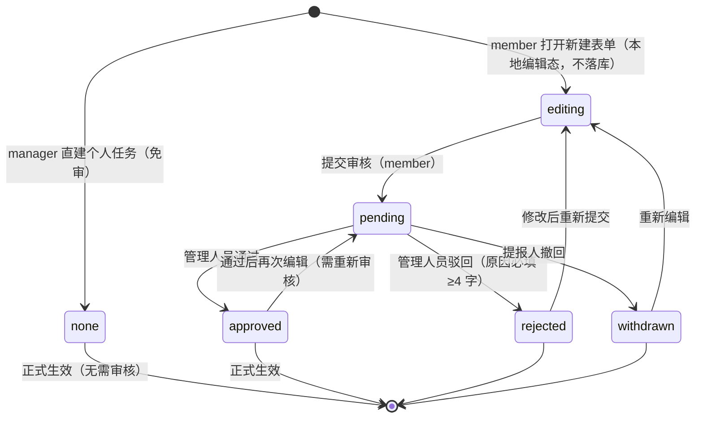
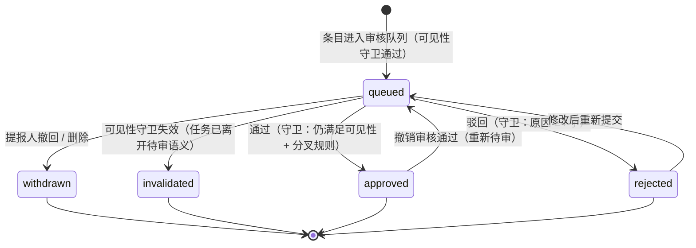

# 需求框架（增量 6 · 阶段一）— OpenSchedule 移动端：个人任务审核链路 + 今日聚焦「待我审核」重构

> 档位：**功能框架方案**（**只出框架，不写实现代码**）· 版本 **v1.1**（v1.0 由 PM 许清楚撰写；v1.1 为交付后引用复核修订）· 负责人：许清楚（PM）· **v1.2（增量 7 立项日）仅补「审核标签框架作废（D3）」标注，正文原文一字未删** —— 详见下方 ⚠️ 作废声明与 §10 修订记录
> 上游基线：`PRD-mobile.md`（首版 7 页）· `PRD-mobile-increment-1.md` v1.2（事项提报 / 个人计划 / 待审详情入口）· `PRD-mobile-increment-2.md` v1.2（完成提报断链）· `PRD-mobile-increment-3.md`（双计去重 + 待审通知）· `PRD-mobile-increment-4.md`（提报状态机收口）· `PRD-mobile-increment-5.md` v1.0（撤回通知 + 迁移表 + `withdrawSubmission` 守卫）
> **本文件只描述「功能框架 + 状态流转 + 界面结构 + 待确认问题」，不含任何 TS/JSX 代码。** 图中与表中出现的字段名仅作**行内标注**（如 `submissionStatus`），用于对齐既有数据语义，不代表实现。
> 行号引用基准：`d:\GLMclaw\workspace\openschedule\apps\mobile`（实读于本次写作时）。

---

> # ⚠️ 作废声明（决议 D3 · 增量 7）
>
> **本文 §1.3 与 §4.3 的「审核标签（`reviewTag`）」「业务标签 → 审核标签映射」框架已整体作废。**
>
> - **作废对象**：~~`reviewTag` 的 5 个封闭取值 `verification`（验收）/ `delivery`（交付）/ `routine`（例行）/ `learning`（个人成长）/ `initiation`（立项）~~，以及「由业务标签映射推导审核标签、以标签驱动审核动作矩阵」的**全部设计**（含 §1.2 的「标签矩阵」交付项、§2.3 的「按标签的审核规则」、§4.1.3 的标签排序/筛选、§4.4.1 的标签筛选 chips、§4.4.2 的标签 chip 与按标签分叉按钮、§4.3(c) 覆盖度自查、Q6-3、Q6-15、N4/N6、§9-S1 及其前置条件、§6.1-6.4 中的标签相关条目）。
> - **作废理由**：项目全链路（`apps/web` / `services/api` / `prisma/schema.prisma`）**不存在**「标签驱动审核」概念 —— `Task.tags` 仅为自由文本数组（`schema.prisma:208`；web `types/task.ts:136`），与审核**零耦合**。
> - **决议来源**：增量 7 立项时用户拍板（决策 **D3**，不可更改）。**作废日期**：增量 7 立项日（同 D3 决议日）。
> - **替代方案（对标项目既有实现）**：
>   - `PRD-mobile-increment-7-audit-alignment.md` §1.2（D3 决策）· §4.1（四栏信息架构）· §4.2（审核意见四选项）
>   - `ARCH-mobile-increment-7-audit-alignment.md` §4.2（`ApprovalStatus` 4 值 `none/pending/approved/rejected`）· §4.3（`AuditOpinion` 4 值 `agree/reject/rework/other` + `AuditLog` 承载）
>   - 即：审核动作由 **`ApprovalStatus` 4 值 + `AuditOpinion` 4 值**驱动，**不再存在任何「标签」维度**。
> - **保留方式**：本文原始设计文字**一字未删**，仅就地加作废标注，作为**历史留痕**。阅读 §1.3 / §4.3 及所有标签相关条目时，请以本声明为准。
> - **范围提醒（避免误读）**：本次作废**仅限「审核标签」框架**。本文 §3（个人任务审核链路）**不在**增量 7 的范围（D2 排除），其结论**未**被作废，仍待独立裁决。

---

## 1. 文档头

### 1.1 需求原话复述（逐条覆盖，未做删改）

> **一、普通人员新建个人任务流程**
> - 普通人员在时间容器中新建个人任务并提交后，任务状态为「待审核」，不直接在视图中生效。
> - 需经管理人员审核通过后，任务才正式生效并展示在对应视图中。
> - 请明确说明：审核前任务在视图中的展示状态、审核通过/驳回后状态如何变化、驳回时是否需填写原因。
>
> **二、管理人员【今日聚焦】-「待我审核」模块重构**
> - 当前「待我审核」逻辑混乱，需重新梳理整体信息结构与审核流程。
> - 关于「开始计时」功能：请评估其意义，若无实际价值则建议删除，并说明理由。
> - 需按不同「任务标签」区分审核动作，即不同标签的任务对应不同的审核规则与操作。
> - 本阶段先产出审核功能框架（含状态流转、不同标签的审核动作差异、界面结构），待我确认后再进入开发。

### 1.2 本阶段范围声明

| 项 | 声明 |
| --- | --- |
| 交付物 | **仅本框架文档**（需求框架 + 状态机 + ~~标签矩阵~~ ❌ **已作废（D3）** + 界面结构 + 待确认问题） |
| **不做** | **不写任何实现代码**（无 TS / JSX / 接口定义代码块 / 伪代码）；**不改动任何源码或既有文档**；**不执行任何 git 操作** |
| 允许的表达形式 | Mermaid 图、表格、字段名行内标注、文案示例 |
| 结论依据 | 全部结论**锚定实读事实**（标注 `文件:行号`）；**不臆造代码中不存在的能力**；不确定处一律写成「待确认问题」（§7） |
| 进入开发的前置 | 用户对 §7 待确认问题拍板（尤其 Q6-1 / Q6-4 / Q6-5 / Q6-8）后，方可进入架构与开发 |

### 1.3 术语对照表（**沿用既有术语，不另造词**）

| 术语 | 落点 / 判定 | 说明（沿用来源） |
| --- | --- | --- |
| **时间容器** | 底部 Tab「时间」= `CalendarScreen` | 日/周视图，08:00–20:00 时间轴 + 空闲带（`focus.service.ts:24-26`） |
| **今日聚焦** | 底部 Tab「今日」= `TodayFocusScreen` | 三分组：今日到期 / 待我审核 / 临期预警（`TodayFocusScreen.tsx:56-61`） |
| **个人计划** | `PersonalPlanScreen` | 列表 + 排期两视图（增量 1 §7.2） |
| **事项提报** | `SubmissionScreen` | member 提报新任务/新项目，待审（增量 1） |
| **我的提报** | `MySubmissionsScreen` | 提报进度查看 + 撤回（增量 1 §7.3） |
| **个人任务** | `db.personalTasks` / `PersonalTask` | **独立集合**，非团队任务；`userId` 为属主（`types/domain.ts:20-43`） |
| **团队任务** | `db.tasks` / `Task` | 含正式任务 + 提报记录（`source` 区分） |
| **提报记录** | `isSubmissionRecord(task) === true` | `source==='submission'` **且** `submissionKind != null`（`utils/submission.ts:71-76`） |
| **完成提报** | `resolveApproveBranch(task) === 'completion'` | 成员完成团队任务后送审（增量 2 §1.5） |
| **新事项提报** | `resolveApproveBranch ∈ {'task','project'}` | 申请立项 / 申请新任务（增量 1 §6） |
| **审核轮回态** | 非 `done` 且 `submissionStatus === 'pending'` | **合法态**，由「撤销审核通过」产生（增量 5 §1.7 / `utils/submission.ts:173-187`） |
| **审核条目**（本框架新增统一称谓） | 待我审核队列中的一条待办 | 可能是团队任务 / 提报记录 / **个人任务**（本框架新增第三类来源） |
| **审核标签**（本框架新增） | ~~决定「审核动作与规则」的封闭取值~~ ❌ **已作废（D3）** | ~~由业务标签映射而来，见 §4.3~~ ⇒ 替代方案：`PRD-mobile-increment-7-audit-alignment.md` §1.2 D3 / §4.2（审核意见四选项） |
| **业务标签** | `Task.tags` / `PersonalTask.tags` 的原始字符串 | 现有 20 + 3 个种子取值，仅展示用（事实 4） |

---

## 2. 现状诊断：为什么现在的审核体系算「混乱」

> 本节写给**非技术读者**，用一页讲清根因。技术证据见括号内引用。

### 2.1 一句话根因

**「待我审核」这一列，既不是「谁该审」，也不是「审什么」，而只是「谁碰巧被写进了 `reviewerIds` 且状态字段碰巧是 `pending`」——它既不校验任务真的到了「待验收」状态，也不区分不同事项该用什么审核动作，还把所有审核人写成了同一批人。**

### 2.2 五个让人「看不懂」的现象

| # | 现象（非技术描述） | 根因（技术） |
| --- | --- | --- |
| 1 | **队列里的任务，不一定是「真的做完了、等你验收」** | 取数只看 `reviewRequired + submissionStatus==='pending' + reviewerIds` **三条**，**完全不看任务执行状态 `status`**（`task.service.ts:234-243`）。任何残留 `pending` 的任务（`done` / `in_progress` / `blocked` / 已退回 `todo`）都会出现在队列里 |
| 2 | **点「通过」，可能把一条其实还在做的任务直接标成「已完成」** | 通过时**无条件**把 `status` 置为 `done`（`task.service.ts:1090-1106`）。叠加现象 1 与现象 3，语义上会出现「还在进行中的任务被验收为已完成」 |
| 3 | **任务明明改了状态，却一直赖在审核队列里不走** | 「清理审核态」的口径很窄：只有**从 `done` 迁出**时才清理（`shouldClearReviewOnLeaveDone`，`utils/submission.ts:199-204`）。其它状态变化（如 `in_progress → todo`）不清理 ⇒ 僵尸条目长期滞留 |
| 4 | **通知会「打架」** | 通知是**只增不减**：撤回、撤销完成、驳回后重提都不回收已发出的「待你审核」通知；去重键不含「已读」级 ⇒ 「撤回→重提→再撤回」时第二条撤回通知被静默吞掉（增量 3 §8 / 增量 5 §7-3、§7-4）。审核人可能同时看到「待你审核」和「提报已撤回」两条互相矛盾的通知 |
| 5 | **「谁审的」「该不该他审」说不清，入口也只有一个** | ① 审核人身份不精确：`reviewedBy` 取 `reviewerIds[0]` 而不是真正点击的人（`task.service.ts:1087`）；② `reviewerIds` 恒等于全部 manager（`allManagerIds()`），**不排除提报人本人** ⇒ 演示环境会「自己审自己」；③ 角色只有 manager/member 两级且是纯前端开关；④ **审核只能从今日聚焦右滑**，任务详情页刻意不设审批区（增量 1 N1）⇒ 能力极难被发现 |

### 2.3 一句话结论

> 用户说的「逻辑混乱」，本质是**三个维度被压成了一个维度**：
> **「审什么」（结构性分叉）**、**~~「该怎么审」（按标签的审核规则）~~ ❌ 已作废（D3）**、**「谁来审」（审核人指派）**——
> 现在全部由「一个 `reviewerIds` 字段 + 一个 `pending` 状态」隐式承载。
> 本框架的核心工作，就是把这三条**重新拆开并显式定义**。

---

## 3. 需求一：个人任务审核链路（全新设计）

> **前提事实（必须正视）**：个人任务当前**完全没有审核流程**——`PersonalTask`（`types/domain.ts:20-43`）**没有任何审核字段**，`createPersonalTask` 落库即 `status:'todo'` 且**立刻生效**（`focus.service.ts:258-291`），完成即置 `done`、无提报态、无审核人（`focus.service.ts:350-363`）。
> **⇒ 需求一不是「修改」现有能力，而是为个人任务**从零引入**一条审核链路。**

### 3.1 角色与触发点

| 项 | 设计 |
| --- | --- |
| 触发角色 | **普通人员（member）** |
| 主触发点 | **时间容器（`CalendarScreen`）** 的 FAB「新建个人任务」与空态按钮（`CalendarScreen.tsx:516-524`，`handleCreate` `:245-266`） |
| 次触发点（保持） | 个人计划页（`PersonalPlanScreen`）FAB（`:857-865`）——两者现共用 `focusService.createPersonalTask`，本框架**要求两条入口行为一致**（都进入待审） |
| 管理人员（manager）行为 | **免审直接生效**（对齐增量 1 的「manager 免审直接落地」原则，`PRD-mobile-increment-1.md` §3）；manager 自建个人任务不产生待审条目 |
| 审核人 | 默认 `allManagerIds()`（与既有 `reviewerIds` 同源）；**是否按属主指定审核人**见 §7-Q6-2 |
| 生效判定 | `reviewStatus === 'approved'` 才计入「正式视图」（时间容器正式块 / 个人计划列表正式项） |

### 3.2 字段设计：复用既有语义，但**独立集合**

| 方案 | 内容 | 结论 |
| --- | --- | --- |
| A. 把个人任务并入 `db.tasks` | 复用 `Task` 全部字段与状态机 | ❌ **否决**：会污染任务状态机、看板、审计、`listTodayDue` 等口径，且违反 INV-11（提报记录 / 非正式对象不入正式列表）与多套受保护断言 |
| B. 在 `PersonalTask` 上**新增审核态字段**（沿用与 `Task` **同名同义**的取值） | 保持独立集合，只借用语义与取值子集 | ✅ **推荐**（见下） |

**推荐方案 B 的字段清单**（均为 `PersonalTask` 新增，**语义与 `Task` 对齐**）：

| 字段 | 取值 | 语义（对齐 `Task`） |
| --- | --- | --- |
| `reviewStatus` | `null` \| `'pending'` \| `'approved'` \| `'rejected'` \| `'withdrawn'` | 个人任务的「提报态」；`null` = 从未提交审核（manager 直建 / 历史种子） |
| `reviewRequired` | `boolean` | 是否需要审核（member 提交 = `true`；manager 直建 = `false`） |
| `reviewerIds` | `string[]` | 审核人（默认 `allManagerIds()`） |
| `reviewNote` | `string \| null` | 驳回原因（回流给提报人） |
| `reviewedBy` | `string \| null` | **实际**审核人（修复缺陷 5 的身份不精确问题，见 §5） |
| `reviewedAt` | `string \| null` | 审核时间 |
| `submittedAt` | `string \| null` | 提交审核时间（用于排序与「超时未审」） |

> **为什么复用同名同义而不另造一套？** ① 审核动作、状态流转、驳回原因规则、通知类型（`review.result` / `review.pending` / `review.withdrawn`）可**全部复用**，避免两套心智；② `SubmissionStatus` 已定义为 `'draft'|'pending'|'approved'|'rejected'|'withdrawn'`（`types/task.ts`），个人任务取其中**真子集**（无 `draft`，本地编辑态不入库），与增量 2 对完成提报的做法**完全同构**（增量 2 §5.4）。
> **为什么必须独立集合？** `PersonalTask` **无 `version`**（不做乐观锁，增量 1 §8.3），且不进 `db.tasks` ⇒ 审核队列需**聚合两个来源**（§4.1）。这是本框架对既有架构的**最小侵入**。

### 3.3 状态流转

#### 3.3.1 状态机（Mermaid `stateDiagram-v2`）

> 说明：`none` = `reviewStatus` 为 `null`（manager 直建 / 历史种子数据）。`editing` 为**本地编辑态**，不写入 `db`（与增量 1 §6 的 `draft` 同构，故不入库）。

#### 3.3.2 状态 × 字段变化表（**回答用户三问的核心表**）

| 状态（`reviewStatus`） | `status` | `reviewRequired` | `reviewerIds` | `reviewNote` | `reviewedBy/At` | **在时间容器可见性** | 谁可操作 |
| --- | --- | --- | --- | --- | --- | --- | --- |
| `null`（manager 直建） | `todo` | `false` | `[]` | `null` | `null` | **正式块**（实心，正常占用空闲带） | 属主（编辑/删除/完成） |
| `pending`（待审核） | `todo` | `true` | 非空 | `null` | `null` | **幽灵块**（虚线 + 半透明 + 「待审核」角标），**仅属主可见**；**计入属主空闲带占用** | 属主（撤回）、审核人（通过/驳回） |
| `approved`（已通过） | `todo` | `false` | 保留（审计用） | `null` | 非空 | **正式块**（实心） | 属主（编辑/删除/完成） |
| `rejected`（已驳回） | `todo` | `false` | 保留 | **驳回原因** | 非空 | **幽灵块**（虚线 + 红色「已驳回」角标 + 原因摘要），**仅属主可见**；**不计入空闲带占用** | 属主（修改后重提 / 删除） |
| `withdrawn`（已撤回） | `todo` | `false` | `[]` | `null` | `null` | **不可见**（等同于未创建） | 属主（重新编辑 / 删除） |

> **关键设计**：`pending` **计入**空闲带占用（保守，避免属主把两条任务排在同一时段）；`rejected` **不计入**（已失效，允许属主在同一时段重排新任务）。

### 3.4 明确回答用户三问

#### ① 审核前任务在视图中的展示状态 → **选定「仅本人可见的幽灵块」**

| 备选方案 | 取舍 | 结论 |
| --- | --- | --- |
| **完全隐藏** | 优点：最贴合「不生效」字面语义；缺点：用户提交后**看不到任何反馈**，会怀疑「是不是没保存成功」并重复提交；也无法撤回 | ❌ 否决 |
| **以虚线/半透明幽灵块展示 + 标注待审核** | 优点：即时反馈 + 状态透明 + 可撤回；缺点：需要在时间容器增加一个「待审核」渲染分支 | ✅ **推荐** |
| 仅本人可见、他人不可见 | —— | ✅ **本框架采用**：个人任务本就按 `userId` 过滤（`buildCalendarDay` 中 `personalBlocks` 过滤 `task.userId === userId`，`focus.service.ts:469-471`）⇒ **他人天然不可见**，无需额外逻辑 |

**推荐方案（幽灵块）的四条约束**：
1. **视觉**：虚线描边 + 50% 透明度 + 右上角「待审核」角标（复用既有状态色槽，**不新增 token**）。
2. **占用口径**：`pending` 幽灵块**计入属主空闲带占用**（避免同一时段重复排期）；**不计入任何统计口径**（如「本周完成数」）。
3. **不可交互**：幽灵块**不可拖拽改期**（拖拽改期仍是 `PersonalPlanScreen` 排期视图的能力，增量 1 §7.2.1）；点击打开「待审核详情抽屉」，提供「撤回」。
4. **仅本人可见**：`buildCalendarDay` 对**非属主**不返回该块（现有 `userId` 过滤已保证）；团队任务视图（他人）**永远看不到**该幽灵块。

> ⚠️ 此为**待确认项**：若用户坚持「严格不生效 = 完全隐藏」，则退化为「完全隐藏 + 提交后 Toast + 「我的提报」页可见」，代价是反馈变弱。见 §7-Q6-1。

#### ② 审核通过 / 驳回后状态如何变化

| 事件 | `reviewStatus` | `status` | 视图变化 | 通知 |
| --- | --- | --- | --- | --- |
| **通过** | `pending → approved` | 保持 `todo` | 幽灵块 → **正式块**（实心）；`reviewRequired→false` | 向属主发 `review.result`「个人安排已通过」 |
| **驳回** | `pending → rejected` | 保持 `todo` | 幽灵块 → **红色「已驳回」幽灵块**（仅属主可见，含原因摘要）；`reviewRequired→false` | 向属主发 `review.result`「个人安排被驳回：{原因}」 |
| **撤回** | `pending → withdrawn` | 保持 `todo` | 幽灵块**消失** | 向原审核人发 `review.withdrawn`（复用增量 5 类型） |
| **驳回后重提** | `rejected → pending` | 保持 `todo` | 红色幽灵块 → **待审核幽灵块**；`reviewNote→null` | 向审核人发 `review.pending` |

#### ③ 驳回是否需填原因 → **必须填，且最小长度统一为 ≥4 字**

| 项 | 结论 | 依据 |
| --- | --- | --- |
| 是否必填 | **必填**（与团队任务一致） | 现有 `reviewSubmission` reject 分支已强制（`task.service.ts:1121-1124`） |
| 最小长度 | **≥4 字（去空白后）**，即 `REASON_MIN_LENGTH = 4`（`types/task.ts:150`） | **统一口径**：团队任务 / 新事项提报 / 个人任务**三者共用同一阈值**，不新增常量 |
| ⚠️ **现存缺陷（必须一并修）** | UI 驳回按钮阈值是 **< 2 字**（`TodayFocusScreen.tsx:563`），服务要求 **≥4 字**（`utils/submission.ts:127-129`）⇒ **2~3 字会被服务拒绝**；且 `handleRejectConfirm` **没有 catch 分支**（`:283-302`），错误会以未捕获异常形式丢失，用户看不到任何提示 | **本框架纳入**：① UI 阈值改为 **< 4**；② 抽屉内实时提示「还需 N 字」；③ 补错误捕获与文案。**修复后三处阈值单一来源 = `REASON_MIN_LENGTH`** |

### 3.5 边界与异常

| # | 场景 | 设计结论 |
| --- | --- | --- |
| E1 | **重复提交**（同一幽灵块多次点提交） | 以 `reviewStatus === 'pending'` 为幂等门禁：已是 `pending` 则**不再产生第二条待审条目**，仅提示「已在审核中」 |
| E2 | **审核中修改** | `pending` 期间**禁止直接编辑**（避免「审核人看到的内容 ≠ 最终生效内容」）；如需修改，须**先撤回**（`withdrawn`）再改 |
| E3 | **审核中删除** | 允许属主删除 ⇒ 同步把该条目移出审核队列（等价于隐式撤回），并向审核人发 `review.withdrawn` |
| E4 | **审核人 = 提报人**（manager 提报 + 自己是审核人） | **manager 免审** ⇒ 个人任务场景下 manager 不产生待审条目，故**天然规避**自审。若属主是 member 而 `reviewerIds` 含其本人（异常配置），**审核队列应排除「提报人本人」**（修复缺陷 5 的自审问题，见 §5） |
| E5 | **超时未审** | 一期**不做**自动通过 / 自动升级；仅提供「已等待 N 天」提示与排序靠前。登记为 §8 范围外 |
| E6 | **撤销提报** | 复用增量 5 的 `review.withdrawn` 通知语义；**唯一退出路径 = 撤回**（不允许把个人任务置 `cancelled`） |
| E7 | **审核通过后再次编辑** | **需要重新审核** ⇒ `approved → pending`（表中已含）。理由：审核通过的是「这一个安排」，内容变了就不应继续沿用旧结论。**与「完成提报」的 `approved → pending` 迁移同构**（增量 5 R6-3 已承认该迁移合法） |
| E8 | **幽灵块与团队任务时间冲突** | 一期**不做冲突校验**（与现状一致，时间容器本身不做冲突检测）；仅以幽灵块视觉提示 |

### 3.6 与现有团队任务审核的关系

| 维度 | 团队任务（既有） | 个人任务（本框架） | 是否共用 |
| --- | --- | --- | --- |
| 承载集合 | `db.tasks` | `db.personalTasks` | ❌ 独立集合 |
| 审核态字段 | `submissionStatus` 等 6 字段 | `reviewStatus` 等 7 字段（**同名同义**，多一个 `submittedAt`） | ✅ 语义共用、取值子集共用 |
| 分叉判定 | `resolveApproveBranch(task)` | **无需分叉**（个人任务只有一种审核语义） | ❌ 个人任务不进 `resolveApproveBranch` |
| 乐观锁 | `assertVersion`（有 `version`） | **无乐观锁**（`PersonalTask` 无 `version`，增量 1 §8.3） | ❌ 个人任务不做版本校验 |
| 审核动作 | 通过 / 驳回 | 通过 / 驳回（+ 撤回） | ✅ 复用 |
| 驳回原因 | ≥4 字 | ≥4 字 | ✅ 复用 `REASON_MIN_LENGTH` |
| 通知类型 | `review.result` / `review.pending` / `review.withdrawn` | 同三类 | ✅ 复用 |
| 队列来源 | `listPendingReview`（`task.service.ts:234-243`） | **新增**：队列需**聚合两源**（§4.1） | ⚠️ 需扩展取数 |

**结论**：**复用同一套审核态「语义与取值」，但保持「独立集合 + 独立字段实例 + 队列聚合」**。这是唯一能同时满足「复用心智」与「不污染既有任务状态机 / 受保护断言」的方案。

---

## 4. 需求二：今日聚焦「待我审核」重构

### 4.1 信息架构：从「三分叉」到「双轴模型」

#### 4.1.1 现状 → 目标

| 维度 | 现状 | 目标 |
| --- | --- | --- |
| 一级分组 | 三分叉 `completion` / `project` / `task`（`resolveReviewItemView`，`utils/submission.ts:222-243`） | **四组**：待验收 / 待立项 / 待确认（个人安排）/ AI 提议（**独立**） |
| 队列来源 | **仅** `db.tasks`（`listPendingReview`） | **聚合两源**：`db.tasks` ∪ `db.personalTasks` |
| 状态校验 | **无**（不看 `status`） | **审核可见性守卫**（见 §4.2）+ 条目上**展示执行状态** |
| 动作差异 | 两类（通过 / 驳回），与标签无关 | ~~**标签驱动的动作矩阵**（§4.3）~~ ❌ **已作废（D3）** |
| AI 提议 | **混在同一 Tab**（`TodayFocusScreen.tsx:390-448`） | **移出**，独立入口（§4.4） |
| 排序 | `sortTasks`（状态权重 → 优先级 → 截止） | **组内**：~~审核标签优先级~~ ❌ **已作废（D3）** → 提交时间 → 优先级 → 截止 |

#### 4.1.2 双轴模型（本框架核心概念）

> **审核条目 = 结构性分叉（决定「审什么」）× ~~审核标签（决定「怎么审」）~~ ❌ 已作废（D3）**

| 轴 | 取值 | 由什么决定 | 是否可配置 |
| --- | --- | --- | --- |
| **轴 1 · 结构性分叉**（`branch`） | `completion`（完成验收）/ `project`（新项目立项）/ `task`（新任务立项）/ `personal`（个人安排确认） | **由数据本身决定**（`resolveApproveBranch` + 集合来源） | ❌ 不可配置 |
| **轴 2 · ~~审核标签（`reviewTag`）~~** ❌ **已作废（D3）** | ~~见 §4.3（5 类）~~ | ~~**由业务标签映射而来**~~ | ~~✅ 可配置（映射表）~~ |

#### 4.1.3 分组与排序规则（重构后）

| 分组（一级） | 含哪些条目 | 组内排序 |
| --- | --- | --- |
| **待验收** | `branch === 'completion'`（团队任务完成提报） | ~~审核标签优先级（`验收` > `交付`）~~ ❌ **已作废（D3）** → 提交时间（早者优先）→ 任务优先级 → 截止时间 |
| **待立项** | `branch ∈ {'project','task'}`（新事项提报） | 提交时间 → 优先级 → 截止时间 |
| **待确认** | `branch === 'personal'`（个人安排） | ~~审核标签（`学习`/`例会` 等轻量类优先批量）~~ ❌ **已作废（D3）** → 提交时间 → 截止时间 |
| **AI 提议**（**移出待我审核**） | AI 提议卡片 | 独立入口（§4.4） |

**筛选**：分组内提供~~**审核标签 chips 筛选**（默认「全部」）~~ ❌ **已作废（D3）**。
**排序**：统一「~~先标签优先级~~ ❌ **已作废（D3）**、再时间」；~~轻量类（`routine` / `learning`）**排在同组末尾**~~ ❌ **已作废（D3）**，便于批量处理。

### 4.2 状态流转：审核动作状态机

#### 4.2.1 审核动作状态机（Mermaid）

#### 4.2.2 「approve 不再无条件置 done」的守卫条件

> **关键澄清（必须纠正一个流行误解）**：现有「approve 无条件置 `done`」（`task.service.ts:1090-1106`）**在唯一的真实路径上其实是正确的**——因为 `completion` 分叉的任务一旦进入队列，其 `status` **要么是 `done`，要么是「审核轮回态」`in_progress + pending`**（`shouldClearReviewOnLeaveDone` 已在「离开 `done`」时清理，`utils/submission.ts:199-204`）。**「`todo + pending`」在 `completion` 分叉上结构上不可达**。
> **⇒ 因此「收紧守卫」的收益有限，而代价是打破受保护断言 `tests/services.test.ts:168-184`（`task-014` = `in_progress + pending`，approve ⇒ `done`）。**

**本框架给出的守卫设计（分层，尽量不破坏既有断言）**：

| 层级 | 守卫 | 是否本次引入 | 是否破坏既有断言 |
| --- | --- | --- | --- |
| **G1 · 真守卫（既有）** | `assertSubmissionTransition`（`pending → approved`）+ `assertVersion` | 已有 | — |
| **G2 · 分叉守卫（既有）** | `resolveApproveBranch` 决定落地方式 | 已有 | — |
| **G3 · 可见性守卫（新增，建议）** | 操作前校验「该条目**仍满足审核可见性**」：`reviewRequired===true` **且** `reviewStatus/submissionStatus==='pending'` **且** `reviewerIds.includes(actorId)`；不满足 ⇒ 拒绝并提示「该条目状态已变化，已为你刷新」 | ✅ **建议本次引入** | ❌ 不破坏（这是**新增**前置校验，既有合法路径全部满足） |
| **G4 · 语义守卫（新增，需授权）** | `completion` 分叉 approve 时，若 `status !== 'done'` ⇒ **不置 `done`**，仅置 `approved` 并保留当前 `status`，UI 提示「已验收提报，任务执行状态未变更」 | ⚠️ **需用户拍板** | ✅ **会破坏** `tests/services.test.ts:168-184` + 增量 5 K26 的 6 处受保护断言 |
| **G5 · 主体守卫（新增，建议）** | 审核人 **不得是提报人本人**（`actorId !== submitterId`）；`reviewedBy` 记录**真实操作人** `actorId`（修复缺陷 5） | ✅ **建议本次引入** | ❌ 不破坏（现有 `reviewedBy` 取 `reviewerIds[0]` 无断言锁定该取值来源；需新增 `actorId` 入参 ⇒ **签名变更**，见 §6） |

> **G4 的推荐结论**：**本次不引入**（登记为待授权项，§7-Q6-8）。理由：① 它保护的是**结构上不可达**的场景；② 引入它必然打破 6 处受保护断言（增量 5 §7-2 已量化代价）；③ 真正需要的是 **G3 可见性守卫**（防 stale 操作）+ **G5 主体守卫**（修身份不精确），这两者零回归。
> 若用户坚持「approve 绝不无条件置 done」，则 G4 为**破坏性变更**，需同时授权修改 `services.test.ts:168-184` 与增量 5 K26。

### 4.3 标签 × 审核动作矩阵（**本需求重点**）

> ## ❌ 本节（§4.3）已整体作废 —— 决议 D3
>
> ~~本节全部内容（`reviewTag` 5 类封闭取值、业务标签 → 审核标签映射表、标签 → 审核动作矩阵、覆盖度自查）~~ **自增量 7 起整体废弃，不得实现、不得引用。**
>
> - **作废理由**：项目全链路（`apps/web` / `services/api` / `prisma/schema.prisma`）**不存在**「标签驱动审核」概念 —— `Task.tags` 仅为自由文本数组（`schema.prisma:208`；web `types/task.ts:136`），与审核**零耦合**。
> - **决议来源**：增量 7 立项时用户拍板（决策 **D3**）。**作废日期** = D3 决议日。
> - **替代方案**：`PRD-mobile-increment-7-audit-alignment.md` §1.2（D3）/ §4.2（审核意见四选项）；`ARCH-mobile-increment-7-audit-alignment.md` §4.2（`ApprovalStatus` 4 值 `none/pending/approved/rejected`）/ §4.3（`AuditOpinion` 4 值 `agree/reject/rework/other` + `AuditLog` 承载）。
> - **下方原文一字未删，仅就地加作废标注，作历史留痕。**

#### (a) ~~标签体系方案~~ ❌ **已作废（D3）**

| 项 | 设计 |
| --- | --- |
| **分类维度** | **两级**：① ~~**审核标签**（`reviewTag`，5 个**封闭**取值，决定审核动作与规则）~~ ❌ **已作废（D3）**；② **业务标签**（`tags`，保留现有自由字符串，仅展示与筛选）**（此项不受 D3 影响，仍有效）** |
| **取值（~~审核标签，5 个~~ ❌ **已作废（D3）**）** | ~~`verification`（验收）/ `delivery`（交付）/ `routine`（例行）/ `learning`（个人成长）/ `initiation`（立项）~~ **5 类取值整体废弃** |
| **归纳来源** | ~~由 20 个团队种子标签 + 3 个个人种子标签**映射**而来（映射表见下）~~ ❌ **已作废（D3）** |
| **单选 / 多选** | ~~**审核标签：单选**（一条条目**只能属于一个审核通道**，保证动作集唯一、无歧义）~~ ❌ **已作废（D3）**；**业务标签：多选**（沿用 `tags: string[]`） |
| **由谁设置** | ~~① 团队任务：由**创建人 / 负责人**在创建或提报时选择；② 个人任务：由**提报人（member）**在新建时选择；③ 未选时**按默认映射**推导（见下）~~ ❌ **已作废（D3）** |
| **能否自定义** | ~~**一期不可自定义审核标签**（固定 5 类，保证动作矩阵收敛）~~ ❌ **已作废（D3）**；**业务标签**沿用现有自由值，~~二期再评估开放自定义审核标签（§8 范围外）~~ ❌ **已作废（D3）** |

~~**审核标签 ← 业务标签 映射表（建议默认值）**~~：❌ **已作废（D3）—— 下表整体作废**

| ~~审核标签（`reviewTag`）~~ ❌ **已作废（D3）** | ~~语义~~ | ~~映射自（种子业务标签）~~ | ~~默认推导规则~~ |
| --- | --- | --- | --- |
| `verification` **验收** | 需核对产出物，强验收 | `验收`、`评审` | 命中即归此类 |
| `delivery` **交付** | 常规推进类 | `需求`、`设计`、`原型`、`前端`、`基建`、`架构`、`接入`、`运维`、`工具`、`数据`、`文档`、`性能`、`埋点`、`看板`、`AI`、`调研` | **兜底类**（未命中其它类时） |
| `routine` **例行** | 低风险、可批量 | `例会`、`周报`、`复盘` | 命中即归此类 |
| `learning` **个人成长** | 个人类、轻量 | `学习` | 命中即归此类 |
| `initiation` **立项** | 通过即落地 | `提报`（**或**由 `submissionKind` 直接判定，**不依赖标签**） | `branch ∈ {'project','task'}` ⇒ 强制 `initiation` |

> **重要说明**：`initiation` 的判定**优先看结构性分叉**（`branch`），而非标签——因为立项语义由 `submissionKind` 决定（增量 1 §6）。`提报` 这个业务标签只是**线索**。~~同理，`branch === 'personal'` 的个人安排条目，其 `reviewTag` **只能**取 `learning` / `routine` / `delivery`（**不允许** `initiation` / `verification`）。~~ ❌ **本段整体已作废（D3）**（其中「立项语义由 `submissionKind` 决定」这一**分叉判定**仍有效，但不再与任何标签挂钩）

#### (b) ~~标签 → 审核动作矩阵~~ ❌ **已作废（D3）**

| ~~审核标签~~ ❌ **已作废（D3）** | ~~适用分叉~~ | ~~审核规则~~ | ~~通过后效果~~ | ~~驳回后效果~~ | ~~是否需填原因~~ | ~~支持批量~~ |
| --- | --- | --- | --- | --- | --- | --- |
| **`verification` 验收** | `completion` | **强验收**：通过前**必须**填写「验收意见」（≥4 字，作为 `reviewNote` 留档） | 团队任务：`approved` + `status='done'`（保持现状）；个人任务：`approved` → 正式块 | `rejected`；团队任务 `status='in_progress'` + 清 `completedAt`；个人任务保持 `todo` | **必填（≥4 字）** | ❌ |
| **`delivery` 交付** | `completion` / `personal` | 常规：一键通过；驳回必填原因 | 同上 | 同上 | **驳回必填（≥4 字）** | ❌ |
| **`routine` 例行** | `completion` / `personal` | 轻量：**可批量通过**；驳回必填原因 | 同上 | 同上 | **驳回必填（≥4 字）** | ✅ **支持批量通过** |
| **`learning` 个人成长** | `personal` | 轻量：**可批量通过**；驳回必填原因 | 个人任务 `approved` → 正式块 | 个人任务保持 `todo`，`rejected` | **驳回必填（≥4 字）** | ✅ **支持批量通过** |
| **`initiation` 立项** | `project` / `task` | 立项：通过 = **落地为正式事项**（`landSubmissionRecord`） | `project` → 建正式 Project；`task` → 建正式 Task（`source='published'`）；提报记录归档 `cancelled` | 提报记录 `cancelled`（归档），原因回流提报人 | **必填（≥4 字）** | ❌ |

#### (c) ~~覆盖度自查（对照用户要求）~~ ❌ **已作废（D3）**（下表依赖已作废的标签矩阵；其中「个人任务 / 新项目提报 / 新任务提报 / 完成提报」的**覆盖诉求**本身仍有效，但落点不再是标签）

| 用户要求覆盖 | 是否覆盖 | 落点 |
| --- | --- | --- |
| 常规任务 | ✅ | `delivery` / `verification` × `completion` |
| **个人任务** | ✅ | `branch === 'personal'`（`learning` / `routine` / `delivery`） |
| 新项目提报 | ✅ | `initiation` × `project` |
| 新任务提报 | ✅ | `initiation` × `task` |
| 完成提报 | ✅ | `completion` × (`verification` / `delivery` / `routine`) |
| ~~从 23 个种子标签归纳的类别~~ | ~~✅~~ ❌ **已作废（D3）** | ~~`verification`(2) / `delivery`(16) / `routine`(3) / `learning`(1) / `initiation`(1 线索)~~ |

### 4.4 界面结构

#### 4.4.1 「待我审核」列表页结构（重构后）

| 区块（自上而下） | 内容 | 说明 |
| --- | --- | --- |
| ① 头部 | 日期 + 「待我审核」标题 + **汇总数**（**按条目 id 并集去重**，保留现状口径 `utils/focus.ts:38-50`） | 汇总口径不变，避免触碰受保护断言 |
| ② 分组 Tab（分段控件） | **待验收 / 待立项 / 待确认**（3 组，每组徽标 = 该组长度） | 权限不足（非 manager）时整组**隐藏**（沿用「隐藏而非置灰」） |
| ③ ~~标签筛选 chips~~ ❌ **已作废（D3）** | ~~「全部 / 验收 / 交付 / 例行 / 个人成长」（组内适用项）~~ | ~~单选~~ |
| ④ 条目卡片列表 | 见 4.4.2 信息层级 | 支持右滑快操作 + 卡片内显式按钮 |
| ⑤ 批量操作条 | ~~仅在 `routine` / `learning` 筛选下出现「批量通过」~~ ❌ **已作废（D3）** | ~~多选 → 批量通过（逐条走同一守卫）~~ |
| ⑥ 底部安全区 | — | — |

#### 4.4.2 条目卡片信息层级（3 行）

| 行 | 内容 | 示例 |
| --- | --- | --- |
| 第 1 行（主信息） | 标题 + ~~**审核标签 chip**（决定动作）~~ ❌ **已作废（D3）** | ~~「Q4 验收评审」`验收`~~ |
| 第 2 行（来源与提交） | **分叉标签** + 提交人 + 提交时间 | 「完成待审 · 李娜 提交于 09-27 14:30」/「个人安排 · 张伟 提交于 09-27 09:00」 |
| 第 3 行（状态与操作） | **当前执行状态**（`todo`/`in_progress`/`done`）+ 优先级色条 + 截止 + 操作按钮 | 「进行中 · 高 · 今日 18:00」→「通过」「驳回」「查看详情」 |
| 幽灵态提示（仅个人安排） | 若条目为个人安排，副行提示「该安排尚未生效，通过后进入时间容器」 | — |

~~**操作按钮（按 `reviewTag` 分叉）**~~：❌ **已作废（D3）—— 下表整体作废**（替代方案：按钮不再按标签分叉，审核意见改由 `AuditOpinion` 4 值承载，见 `ARCH-mobile-increment-7-audit-alignment.md` §4.3）

| ~~审核标签~~ ❌ **已作废（D3）** | ~~卡片内按钮~~ |
| --- | --- |
| `verification` | 「通过（需填验收意见）」/「驳回」/「查看详情」 |
| `delivery` | 「通过」/「驳回」/「查看详情」 |
| `routine` | 「通过」/「驳回」/「查看详情」（+ 可勾选进批量） |
| `learning` | 「通过」/「驳回」/「查看详情」（+ 可勾选进批量） |
| `initiation` | 「通过（落地为正式事项）」/「驳回」/「查看详情」 |

#### 4.4.3 空态 / 加载态 / 错误态文案

| 状态 | 文案 |
| --- | --- |
| 空态（整组） | 「没有待你审核的提报」/「成员提交完成提报、事项提报或个人安排后会出现在这里」（**扩展**现有空态文案，纳入个人安排） |
| 空态（筛选后） | ~~「该标签下没有待审条目」+「清除筛选」~~ ❌ **已作废（D3）** |
| 加载态 | 卡片骨架屏（沿用现状） |
| 错误态 | 组内错误条 + 「重试」 |
| 操作失败 | 「该条目状态已变化，已为你刷新」（对应 G3 守卫） |

#### 4.4.4 入口位置建议

| 入口 | 建议 | 理由 |
| --- | --- | --- |
| 今日聚焦右滑（现有） | **保留** | 高频、零学习成本 |
| 卡片内显式按钮（增量 1 已有「查看详情」） | **扩展为「通过 / 驳回 / 查看详情」三按钮** | 提升可发现性 |
| **任务详情页新增审批区** | ✅ **建议新增**（**仅当** `submissionStatus === 'pending'` **且** 当前用户 ∈ `reviewerIds` 时显示） | 修复缺陷 5「入口单一、难发现」；⚠️ **与增量 1 N1（详情页不加审批区）冲突** ⇒ 列为待确认 §7-Q6-6 |
| 通知深链 | 沿用 `review.pending` 通知 → 任务详情 | 已有 |

### 4.5 「开始计时」的评估结论

#### 4.5.1 先纠正前提（**用户的前提有误**）

> **事实**：**「开始计时」不在「待我审核」里。** 全仓检索「开始计时」字面量**只出现在一处**——`src/screens/TaskDetailScreen.tsx:518`（任务详情页的「工时计时」区，运行中显示「暂停」`:513` /「结束」`:515`）。
> `useTimer`（`src/hooks/useTimer.ts`）**只被 `TaskDetailScreen.tsx:81` 调用**。**今日聚焦 / 待我审核 / 时间容器 / 个人计划 / 看板都没有任何计时入口。**
> ⇒ 因此「删除待我审核里的开始计时」这个命题**不成立**（那里本来就没有）。需要分别评估的是**两件事**：① 任务详情页的计时该不该保留；② 要不要**给个人任务 / 待我审核新增**计时。

#### 4.5.2 逐项评估与建议

| 事项 | 现状 | 建议 | 理由 |
| --- | --- | --- | --- |
| **① 任务详情页的计时** | 开始 → `taskService.startTimer` 建 `db.timeEntries` 记录；结束 → `stopTimer` 写 `endedAt`/`durationSeconds`，并把**全部已结束工时**汇总写回 `task.actualHours`（`task.service.ts:712-721`）；本地进度持久化在 `AsyncStorage`（key `os.timer.<taskId>`） | ✅ **保留**（不改） | ① 它是 `time_entries` 与 `actualHours` 的**唯一写入来源**；② `actualHours` 被 `completeTask` 作为「实际工时」入参消费（`task.service.ts:387`），并在任务详情元信息行展示（`TaskDetailScreen.tsx:432-437`）⇒ **删除会切断工时数据链**；③ 它是首版 PRD 的 P0 需求（`M-P0-11`：计时器累计写入 `time_entries`）⇒ 删除即**需求回退** |
| **② 是否为「待我审核」新增计时** | 无 | ❌ **不建议新增** | 待我审核是**审核决策**动作（通过 / 驳回），不是**执行**动作。审核人不需要、也不应该为「审核别人的任务」计时；引入后会产生无归属的 `TimeEntry`（`TimeEntry.taskId` 指向被审任务，但计时人是审核人 ⇒ 工时归属混乱） |
| **③ 是否为「个人任务」新增计时** | 无（`PersonalTask` 无 `time_entries` 归属，`TimeEntry.taskId` 只指向团队任务，`types/domain.ts:7-18`） | 🅿️ **P2 / 本次不做**（登记） | 引入需扩展 `TimeEntry` 的数据归属（新增 `personalTaskId` 或让 `taskId` 可空）⇒ 破坏既有类型与统计口径；且个人任务当前**不参与**任何工时统计。若用户确有「个人时间投入统计」诉求，应作为**独立增量**评估，而非并入审核重构 |
| **④ 计时与审核的关系** | **完全解耦**：没有任何地方消费计时结果做审核判定（事实 3） | ✅ **明确声明「计时不参与审核判定」**，但**建议在完成提报卡片上展示「本次工时」**（只读，辅助审核人判断） | 提升审核信息量，且**零耦合**（只读展示，不参与任何守卫） |

#### 4.5.3 结论一句话

> **不删除任何计时能力；不为「待我审核」引入计时；「个人任务计时」登记为 P2。** 用户要求评估的「删除开始计时」这一动作**无对象可删**——真正值得做的是**澄清计时与审核的边界**（计时服务工时统计，不服务审核决策）。

---

## 5. 对 5 个结构性缺陷的处理方案

| # | 缺陷 | 本次是否解决 | 如何解决 / 不解决的理由与影响 |
| --- | --- | --- | --- |
| **1** | **审核可见性与任务状态机脱钩**（`listPendingReview` 不看 `status`） | ⚠️ **部分解决** | **不按 `status` 过滤队列**（过滤会移出「审核轮回态」，打破增量 5 K26 的 6 处受保护断言）；改为：① **在条目上展示当前执行状态**（UI 层透明化）；② 引入 **G3 可见性守卫**（操作前校验仍满足可见性，防 stale 操作）。**影响**：队列内容**不变**（零回归），但审核人**能看到**执行状态，不再是「黑箱」 |
| **2** | **approve 无条件置 `done`** | ❌ **本次不解决**（登记待授权） | 实读表明：`completion` 分叉进入队列时 `status` **只能**是 `done` 或「审核轮回态 `in_progress+pending`」⇒ 「无条件置 `done`」在真实路径上**正确**，缺陷描述的场景（`todo+pending`）**结构上不可达**。收紧为 G4 **必然打破** `tests/services.test.ts:168-184` + 增量 5 K26 的 6 处断言 ⇒ 破坏性变更，需授权（§7-Q6-8）。**影响**：保持现状，风险极低 |
| **3** | **「离开 done 才清理」窄口径造成残留** | ❌ **本次不解决**（登记） | 增量 5 §1.4 **N3 明文禁止**修改 `shouldClearReviewOnLeaveDone` / `moveTask` / `reopenTask` 的清理分支（`PRD-mobile-increment-5.md` §1.4 N3），理由是「非 `done` 的 `pending`（审核轮回态）离开当前状态**不应清理**——否则任务会从待审队列静默消失」（`utils/submission.ts:186-187`）。改为「与审核可见性绑定」的口径**正是被禁止的那件事**。**影响**：残留仅发生在**审核轮回态**这一**合法态**上，不产生错误决策；登记为待授权项 |
| **4** | **通知追加式、缺少失效 / 回收语义** | ⚠️ **部分解决（仅新增链路）** | ① 本框架**新增的个人任务审核**，其通知**从第一天起**即遵循「**撤回即派发 `review.withdrawn`**」的语义（复用增量 5 能力）；② 个人任务**删除**时同样派发 `review.withdrawn`（E3）；③ **不回收**已发出的 `review.pending`（沿用增量 5 §7-4 的既定口径）；④ 去重键「未读级」问题**不在本次**（属通知系统重构，§8 范围外）。**影响**：新增链路**不引入新的矛盾通知**；存量问题登记 |
| **5** | **审核人身份不精确 + 权限两级 + 入口单一** | ✅ **解决（前两项 + 入口）** | ① **身份精确**：`reviewSubmission` 增加 `actorId` 入参（**签名变更**，见 §6），`reviewedBy = actorId`（**修复缺陷 5**）；② **排除自审**：队列与操作守卫均要求 `actorId !== submitterId`（**G5 主体守卫**）；③ **入口多样化**：卡片内显式按钮 + （建议）详情页审批区（§4.4.4）；④ **权限**：仍沿用 manager/member 两级纯前端门禁（**不改**，增量 1 N3 已裁定）；⑤ **顺手收敛** `submission:review` 与 `review:view_pending` 两个语义重复的 key（`src/utils/permission.ts:36-37,44-45`）——**建议合并为一个**。**影响**：`actorId` 入参为**签名变更**，需同步更新调用点与相关测试（§6） |

---

## 6. 兼容性与迁移影响

### 6.1 受影响的既有能力

| # | 受影响能力 | 影响类型 | 说明 |
| --- | --- | --- | --- |
| 1 | `focus.service.createPersonalTask` | **行为变更** | 从「立即生效」改为「member 提交 → `pending` 幽灵块；manager 直建 → 生效」 |
| 2 | `focus.service.buildCalendarDay` | **行为变更** | 个人任务块需按 `reviewStatus` 分叉渲染（正式块 / 幽灵块 / 不可见）；空闲带计算需区分 `pending`（计入）与 `rejected`（不计入） |
| 3 | `focus.service.listPersonalTasks` | **行为变更** | 个人计划列表需区分「已生效 / 待审核 / 已驳回」 |
| 4 | `TodayFocusData.pendingReview` | **取数扩展** | 从「仅 `db.tasks`」扩展为「`db.tasks` ∪ `db.personalTasks`」；**类型从 `Task[]` 变为统一条目模型**（破坏性，见 6.3） |
| 5 | `task.service.reviewSubmission` | **签名变更** | 新增 `actorId` 入参（缺陷 5 修复）⇒ 所有调用点与测试需同步 |
| 6 | `task.tags` / `PersonalTask.tags` | ~~**新增消费方**~~ ❌ **已作废（D3）** | ~~从「零消费」变为「映射到审核标签、驱动动作矩阵」；**展示点新增**（任务详情页 + 审核卡片）~~ ⚠️ **依赖已作废的审核标签框架，不适用**（`tags` 回到「仅展示」的既有语义） |
| 7 | `TodayFocusScreen` 的 AI 提议卡片区 | **移出** | 从「待我审核 Tab 内」移出为独立入口（§4.4） |
| 8 | 驳回阈值 | **缺陷修复** | UI 从 `<2` 改为 `<4`；补 `handleRejectConfirm` 的 catch 分支 |
| 9 | `src/utils/permission.ts` | **收敛** | `submission:review` 与 `review:view_pending` 合并（建议） |

### 6.2 受影响的既有测试约束（受保护断言）

> ⚠️ **以下断言为「受保护断言」，本框架的落地会与之发生冲突；**凡标注「冲突」的条目，均属**破坏性变更**，需用户显式授权后方可修改。

| 断言 / 约束 | 内容 | 与本框架的关系 |
| --- | --- | --- |
| `tests/services.test.ts:168-184` | `task-014` approve ⇒ `status='done'`；`task-015` reject ⇒ `in_progress` + `reviewNote` | ⚠️ **与 G4 冲突**（G4 本次不引入 ⇒ 不冲突） |
| `tests/today-focus-gate.test.tsx:205/219` | `共 0 项 / 共 1 项待处理`（`visibleTotal` 口径） | ⚠️ **潜在冲突**：队列聚合个人任务后，若 mock 替身数据变化会触碰；**需逐条复跑**（该文件数据来自 `jest.mock` 替身，见增量 2 §8-2 勘误） |
| 增量 5 K26 / `utils/submission.ts:173-204` | 禁止修改 `shouldClearReviewOnLeaveDone` / `moveTask` / `reopenTask` 清理分支 | ⚠️ **与缺陷 3 冲突**（缺陷 3 本次不解决 ⇒ 不冲突） |
| 增量 5 §7-2 的 A1~A6（6 处断言） | 「今日到期 ∩ 待我审核 = ∅」等口径锚点 | ✅ **不冲突**（本框架不改 `listTodayDue` / `listDeadlineApproaching`） |
| `tests/seed-integrity.test.ts` / `seed-submissions.test.ts` | 种子完整性 | ⚠️ **潜在冲突**：~~若为个人任务种子补审核字段 / 为任务补审核标签，会触碰 ⇒ 需评估「是否只改默认值推导、不改种子结构」~~ ⇒ 其中**「为任务补审核标签」一半依赖已作废的审核标签框架，不适用（D3）**；**「为个人任务种子补审核字段」与 D3 无关，仍有效** |
| INV-11（增量 5 §5） | 提报记录**永不**出现在正式列表 | ✅ **不冲突**（个人任务独立集合，不并入 `db.tasks`） |

### 6.3 破坏性变更清单（需显式授权）

| # | 破坏性变更 | 代价 | 是否本次必须 |
| --- | --- | --- | --- |
| B1 | `TodayFocusData.pendingReview` 类型从 `Task[]` 改为**统一审核条目模型** | 所有消费方（`TodayFocusScreen` / `utils/focus.ts` 去重 / 相关测试）需同步 | ✅ **必须**（否则无法承载个人任务） |
| B2 | `reviewSubmission` 新增 `actorId` 入参 | 调用点 + 测试同步 | ✅ **必须**（缺陷 5） |
| B3 | `createPersonalTask` 语义从「立即生效」改为「待审」 | 个人计划相关测试 + 演示数据 | ✅ **必须**（需求一本身） |
| B4 | `buildCalendarDay` 增加 `reviewStatus` 分叉 | 时间容器相关测试 + 截图基线 | ✅ **必须** |
| B5 | 缺陷 2 / 缺陷 3 的「语义收紧」 | 打破 6 处受保护断言 + 增量 5 K26 | ❌ **本次不做**（登记待授权） |

### 6.4 演示数据影响

| 数据 | 影响 |
| --- | --- |
| 种子个人任务（`seed-extra.ts:88,109,130`：`例会` / `周报` / `学习`） | **必须**保持「已生效」语义 ⇒ 需补默认值：`reviewStatus: 'approved'`（或 `null` + `reviewRequired:false`），**否则演示环境会凭空出现 3 条待审条目**。**建议不改种子结构**，改为「字段缺省时按 `null`/已生效处理」的兼容读取 |
| 种子团队任务（`task-001` ~ `task-023`，20 个业务标签） | ~~审核标签**按映射表推导**，**不改种子**（避免触碰 `seed-integrity.test.ts`）~~ ⚠️ **依赖已作废的审核标签框架，不适用（D3）**；「不改种子」这一约束本身仍有效 |
| 演示账号「自审」（张伟 = 唯一可登录账号 + 全部 manager） | **个人任务场景天然规避**（manager 免审）；但**团队任务完成提报仍会自审**（既有已知限制，增量 2 §8-1）⇒ 建议演示时用**应用内角色切换**验证 |

---

## 7. 待确认问题（**必填，按优先级排序**）

> 每条给出「问题 / 我的建议默认值 / 影响面」。**前 4 条为阻塞项**，未拍板不进入开发。

| # | 优先级 | 问题 | 我的建议默认值 | 影响面 |
| --- | --- | --- | --- | --- |
| **Q6-1** | 🔴 **阻塞** | 审核前的个人任务在时间容器中如何展示？ | **仅本人可见的「幽灵块」**（虚线 + 半透明 + 「待审核」角标，计入空闲带占用） | 时间容器渲染分支 + 空闲带口径 + 用户对「是否提交成功」的感知 |
| **Q6-2** | 🔴 **阻塞** | 个人任务的审核人是谁？ | **全部 manager（`allManagerIds()`）**，与既有 `reviewerIds` 同源；**排除提报人本人** | 审核队列可见性 + 通知接收人 + 演示环境可验证性 |
| **Q6-3** | ~~🔴 **阻塞**~~ ❌ **已作废（D3）** | ~~审核标签体系是否按本框架的「5 类封闭取值」？~~ | ~~**采纳 5 类**（`verification` / `delivery` / `routine` / `learning` / `initiation`），一期**不可自定义**~~ | ~~动作矩阵的收敛性 + 种子标签映射 + 后续可扩展性~~ |
| **Q6-4** | 🔴 **阻塞** | 「待我审核」是否**聚合个人任务**为第三类来源（`待确认` 分组）？ | **是**（否则需求一的审核动作无处落地） | 队列取数 + `TodayFocusData` 类型（破坏性变更 B1） + 界面结构 |
| **Q6-5** | 🟠 高 | 驳回原因最小长度是否统一为 **≥4 字**（并修复 UI `<2` 缺陷）？ | **统一 ≥4 字**，UI 阈值改 `<4` + 补错误捕获 | 三处阈值单一来源 + 现存缺陷修复 |
| **Q6-6** | 🟠 高 | 是否**在任务详情页新增审批区**（仅 `pending` + 我是审核人时显示）？ | **建议新增**（提升可发现性） | ⚠️ **与增量 1 N1「详情页不加审批区」冲突**，属产品决策反转 |
| **Q6-7** | 🟠 高 | AI 提议卡片是否**移出**「待我审核」Tab？ | **移出**为独立入口 | 信息架构 + `TodayFocusScreen` 结构 + 相关测试 |
| **Q6-8** | 🟠 高 | 是否**授权修改受保护断言**以修复缺陷 2 / 缺陷 3？ | **不授权，本次不做**（登记）；仅做 G3 可见性守卫 + G5 主体守卫 | 6 处受保护断言 + 增量 5 K26；若授权则属破坏性变更 B5 |
| **Q6-15** | ~~🟠 **高**（**§9-S1 复核后新增**）~~ ❌ **已作废（D3）** | ~~是否接受「为三处创建流程新增**审核标签选择器**」这一前置工作量？现状 `tags` 在三处创建路径**全部硬编码为空**，且全仓无标签输入控件 ⇒ §4.3 标签矩阵**当前不可生效**~~ | ~~**接受**；若不接受，则 §4.3 退化为「全部按 `delivery` 处理」，标签矩阵与 Q6-3 应整体推迟到二期~~ | ~~3 个创建表单 + 3 处 service 入参 + 校验 + 测试；决定 §4.3 与 Q6-3 的可行性~~ |
| **Q6-9** | 🟡 中 | 审核通过后**再次编辑**是否需重新审核？ | **需要**（`approved → pending`） | 个人任务编辑流程 + 状态机 |
| **Q6-10** | 🟡 中 | 是否为**个人任务**引入工时计时？ | **P2，本次不做** | 需扩展 `TimeEntry` 归属（破坏性）+ 统计口径 |
| **Q6-11** | 🟡 中 | `reviewSubmission` 新增 `actorId` 入参（签名变更）是否接受？ | **接受**（修复身份不精确） | 所有调用点 + 测试同步 |
| **Q6-12** | 🟡 中 | 是否合并 `submission:review` 与 `review:view_pending` 两个权限 key？ | **合并** | 权限工具 + 门禁调用点 |
| **Q6-13** | 🟢 低 | 演示种子的 3 条个人任务是否补 `reviewStatus='approved'`？ | **不改种子结构**，改为「字段缺省 = 已生效」的兼容读取 | `seed-integrity.test.ts` |
| **Q6-14** | 🟢 低 | 幽灵块是否参与「本周完成数 / 工时」等统计？ | **不参与** | 统计口径 |

---

## 8. 不做什么（范围外）

> 以下内容**本框架不覆盖**，避免范围蔓延。如用户需要，应作为**独立增量**评估。

| # | 范围外 | 理由 |
| --- | --- | --- |
| N1 | **不写任何实现代码** | 本阶段只出框架（用户明确要求） |
| N2 | **不做真实 RBAC / 多用户登录 / 后端鉴权** | 沿用增量 1 N3 / 增量 2 N1（纯前端演示开关 + 单用户演示） |
| N3 | **不接真实后端 / 不新增 API** | 沿用既有 mock 边界 |
| N4 | **不做多级会签 / 会签顺序 / 审核 SLA / 超时自动通过** | 超出~~「按标签区分审核动作」~~ ❌ **已作废（D3）**的范围；E5 仅登记 |
| N5 | **不做通知系统重构**（失效 / 回收 / 未读级去重改造） | 缺陷 4 仅做「新增链路遵循既有语义」，存量问题登记 |
| N6 | ~~**不做审核标签的自定义 UI / 管理后台**~~ ❌ **已作废（D3）** | ~~一期固定 5 类；二期评估~~ |
| N7 | **不做时间容器的时间冲突检测** | 与现状一致（E8 仅视觉提示） |
| N8 | **不做个人任务计时 / 工时统计改造** | Q6-10 登记为 P2 |
| N9 | **不做附件审核 / 审核意见附件 / @提及** | 超出范围 |
| N10 | **不改 `listTodayDue` / `listDeadlineApproaching` 的口径** | 增量 5 §1.4 N1 / N2 明文禁止 |
| N11 | **不改 `SUBMISSION_TRANSITIONS` / `TASK_TRANSITIONS` 等既有状态机契约** | 增量 5 §1.4 N5 |
| N12 | **不做拖拽式审核手势 / 批量驳回** | 仅支持批量**通过**（轻量类） |
| N13 | **不做审核数据看板 / 审核效率统计** | 超出范围 |

---

## 9. 交付后复核补充发现（**由交付总监在交付后对本文引用做逐条抽查所得**）

> 复核方式：对本文全部 `文件:行号` 引用做逐条实读抽查（共 16 项）。结论：**15 项逐字成立**，1 项行号漂移已修正（§3.4① 的 `focus.service.ts:457-468` → 实际 `:469-471`）。
> 以下 S1 为抽查中**新发现**的实质缺口，**会直接影响 §4.3 与 Q6-3 的可行性**，请与 §7 一并裁决。
> ⚠️ **D3 影响提示**：§4.3 与 Q6-3 已整体作废（增量 7 决议 D3）⇒ **S1 的「对 §4.3 的直接影响」与「⇒ 前置条件」两段随之作废**；但 S1 的**实读事实**（`tags` 在三处创建路径硬编码为空、全仓无标签输入控件）**仍然成立且有效**，可作为独立事实引用。

### S1（**重要**）`tags` 在全部创建路径都是空的 ⇒ ~~§4.3 的标签矩阵**当前无法生效**~~ ❌ **已作废（D3）**

**实读事实**：

| 位置 | 事实 |
| --- | --- |
| `task.service.ts:773` | 团队任务创建 `createTask` 写入 `tags: []`（**硬编码空数组**） |
| `task.service.ts:849` | 事项提报记录 `buildSubmissionRecord` 写入 `tags: []`（**硬编码空数组**） |
| `focus.service.ts:280` | 个人任务创建 `createPersonalTask` 写入 `tags: []`（**硬编码空数组**） |
| `focus.service.ts:248-255` | `CreatePersonalTaskInput` **没有 `tags` 字段** |
| `src/**/*.tsx` 全量检索 `tags` | **仅 1 处命中**：`TaskDetailScreen.tsx:438-442`（`content={task.tags.join(' · ')}`，**只读展示**） |

**⇒ 结论：全仓没有任何「标签输入控件」。** 那 20 个团队种子标签 + 3 个个人种子标签**只存在于种子数据**（`seed.ts` / `seed-extra.ts`），凡是通过界面新建的对象**一律无标签**。

**对 §4.3 的直接影响** ❌ **本段已作废（D3）**：~~§4.3(a) 的「未选时按默认映射推导」在现状下**不是例外分支，而是唯一分支**。所有进入审核队列的条目都会命中 `delivery` **兜底类** ⇒ **「按不同任务标签区分审核动作」这一核心需求在运行时将完全不可观测**（永远只有「一键通过 / 驳回」）。~~

**⇒ 前置条件（~~必须与 §4.3 一同排期~~ ❌ **已作废（D3）**）**：~~§4.3 要成立，需**同时为三处创建流程新增审核标签选择器**，并扩展对应 service 入参类型：~~
⚠️ **该前置条件随 §4.3 整体作废，不适用**（审核动作已改由 `ApprovalStatus` 4 值 + `AuditOpinion` 4 值驱动，不再需要任何标签选择器）。下列三处清单**仅作历史留痕**：
1. 团队任务创建：`CreateItemScreen` → `task.service.createTask`（补 `tags` 入参）
2. 事项提报：`SubmissionScreen` → `task.service.buildSubmissionRecord`（补 `tags` 入参）
3. 个人任务新建：`CalendarScreen` / `PersonalPlanScreen` → `focus.service.createPersonalTask`（补 `CreatePersonalTaskInput.tags`）

~~这是**非平凡改动**（3 个表单 + 3 处 service 签名 + 校验 + 测试），应显式计入 §6.1 受影响能力与工作量，而**不应**作为设计细节一带而过。~~ ❌ **已作废（D3）**

### S2 新增待确认问题

| # | 优先级 | 问题 | 我的建议默认值 | 影响面 |
| --- | --- | --- | --- | --- |
| **Q6-15** | ~~🟠 **高**~~ ❌ **已作废（D3）** | ~~是否接受「为三处创建流程新增审核标签选择器」这一**前置工作量**？~~ | ~~**接受**（否则 §4.3 退化为「全部按 `delivery` 处理」，标签矩阵与 Q6-3 应整体推迟到二期）~~ | ~~3 个创建表单 + 3 处 service 入参 + 校验 + 测试；§4.3 全部内容与 Q6-3 的可行性~~ |

---

## 10. 修订记录

| 版本 | 日期 | 内容 |
| --- | --- | --- |
| **v1.0** | 本次 | 初版**需求框架（阶段一）**。范围 = 需求一（个人任务审核链路，全新设计）+ 需求二（今日聚焦「待我审核」重构）。 **核心设计决策**：① 个人任务**复用既有审核态语义**但**保持独立集合**（不并入 `db.tasks`），队列**聚合两源**；② 审核前采用**「仅本人可见的幽灵块」**展示（`pending` 计入空闲带、`rejected` 不计入）；③ ~~引入**「结构性分叉 × 审核标签」双轴模型**，标签驱动 5 类审核动作矩阵。~~ ❌ **已作废（D3）** **纠正用户前提**：「开始计时」**不在待我审核里**（全仓仅 `TaskDetailScreen.tsx:518` 一处）⇒ 无对象可删；建议保留详情页计时、不为待我审核引入计时、个人任务计时登记 P2。 **对 5 个缺陷**：缺陷 5 ✅ 解决（身份 + 入口）、缺陷 1 / 4 ⚠️ 部分解决、缺陷 2 / 3 ❌ 本次不做（会打破受保护断言，登记待授权）。 **待确认问题 14 条**（4 条阻塞）；**范围外 13 条**。 |
| **v1.1** | 本次（交付后复核） | **由交付总监对全文 `文件:行号` 引用做逐条实读抽查（16 项）后修订**： ① **修正行号漂移**：§3.4① 的 `focus.service.ts:457-468` → 实际 `personalBlocks` 过滤在 **`:469-471`**（原引用区间实为团队任务块过滤）。 ② **新增 §9「交付后复核补充发现」**，其中 **S1 为实质缺口**：`tags` 在**全部三个创建路径**（`task.service.ts:773` / `:849`、`focus.service.ts:280`）均硬编码为 `[]`，且 `src/**/*.tsx` 全量检索 `tags` **仅 1 处只读展示**（`TaskDetailScreen.tsx:438-442`）⇒ 全仓**无标签输入控件**，§4.3 的「未选 → 默认映射」在现状下是**唯一路径**而非例外 ⇒ **标签驱动的审核动作矩阵当前不可观测**；§4.3 落地需**同时为三处创建流程新增标签选择器**（非平凡改动）。~~ ❌ **已作废（D3）**（S1 的实读事实仍有效）。 ③ ~~**新增 Q6-15（🟠 高）**：是否接受该前置工作量~~ ❌ **已作废（D3）**。**待确认问题合计 15 条**（其中 Q6-3 / Q6-15 已随 D3 作废）。 |
| **v1.2** | 增量 7 立项日 | **补作废标注（决议 D3）**：本文 §1.3 与 §4.3 的「审核标签（`reviewTag`）」「业务标签 → 审核标签映射」框架**整体作废**，理由 = 项目全链路（`apps/web` / `services/api` / `prisma/schema.prisma`）**不存在**「标签驱动审核」概念（`Task.tags` 仅为自由文本数组，`schema.prisma:208`；web `types/task.ts:136`）。 **标注方式**：**原文一字未删**，仅在文档头 + §1.3 + §4.3（含 §4.3(a)(b)(c) 逐处）+ 全部派生引用处（§1.2 / §2.3 / §4.1.1 / §4.1.2 / §4.1.3 / §4.4.1 / §4.4.2 / §4.4.3 / §6.1 / §6.2 / §6.4 / Q6-3 / Q6-15 / N4 / N6 / §9-S1 / §10）就地加「~~删除线~~ + ❌ 已作废（D3）」标注。 **替代方案**：`PRD-mobile-increment-7-audit-alignment.md` §1.2（D3）/ §4.1（四栏）/ §4.2（四选项意见）；`ARCH-mobile-increment-7-audit-alignment.md` §4.2（`ApprovalStatus` 4 值）/ §4.3（`AuditOpinion` 4 值 + `AuditLog`）。 **范围提醒**：本次作废**仅限审核标签框架**；§3（个人任务审核链路）不在增量 7 范围（D2 排除），其结论**未**被作废。 |
