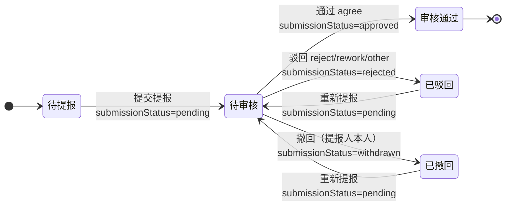
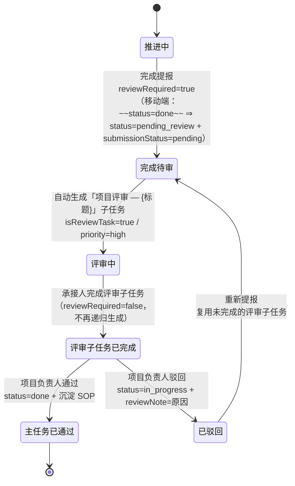

# 增量 PRD（增量 7）— OpenSchedule 移动端：审核功能对标既有审核实现

> 档位：**简单 PRD**（不含竞品 / 市场分析；用户未要求完整档）。
> 负责人：许清楚（PM）· 版本 **v1.0** · 实读基准：`D:\GLMclaw\workspace\openschedule`（本次写作时）
> 上游基线：`PRD-mobile.md` · `PRD-mobile-increment-1..5.md` · `PRD-mobile-increment-6-review-framework.md`（**本增量作废其 §4.3「审核标签」框架**）
> **本文只描述需求，不含任何 TS / JSX 代码，不写实现方案代码块。** 文中出现的字段名（如 `submissionStatus`）仅作**行内标注**，用于对齐既有数据语义，不代表实现。
> 凡引用代码事实均给 `文件:行号`；不确定处一律进入 §9「待确认问题」，**不臆造项目里不存在的能力**。

---

## 1. 文档头

### 1.1 需求原话（未做删改）

> 「你对标一下 D:\GLMclaw\workspace\openschedule 项目，按照他的审核来开发」

**释义**：不再自创审核设计，把移动端（`apps/mobile`）的审核功能**对齐到项目里已经存在的审核实现**上。

### 1.2 用户已拍板的三个决策（不可更改）

> ⚠️ **标题「三个决策」为起草时口径（D1–D3）**。**D4 / D5 / D6 系本 PRD 起草之后的追加拍板（发生于架构阶段）**，已回填于下表末尾，并附下方「回填说明」。权威登记处：`ARCH-mobile-increment-7-audit-alignment.md` §0（`:18-20`）。

| # | 决策 | 含义 |
| --- | --- | --- |
| D1 | **开发落点 = `apps/mobile`** | 只改移动端；**不改后端（`services/api`）、不改 web（`apps/web`）、不改 `services/ai`** |
| D2 | **范围 = 提报审核 + 完成评审** | **不做**内容修改 / 删除 / 子任务变更 / 承接人指派 / 调整时间等其余 `approvalType` 分支（属全量范围，本次排除） |
| D3 | **「5 类审核标签」框架作废** | `verification / delivery / routine / learning / initiation` 五类标签**整体废弃**，不得出现在本次 PRD 与后续实现中 |
| **D4**（起草后追加） | **引入存储态 `pending_review`** | 对齐 `schema.prisma:190`；完成提报后任务**不算完成**，审核通过才 `done`。**同时追加授权**修改「引入 `pending_review` 所必需」的既有断言（**唯一被授权事项**） |
| **D5**（起草后追加） | 四栏落在**新建独立「审核中心」页** | `MySubmissionsScreen` / `TodayFocusScreen` **保持不动** |
| **D6**（起草后追加） | 「待提报」栏**照搬 web 宽口径** | 依据 `AuditPage.tsx:107-113` |

> **D3 作废声明（显式）**：项目全链路（`apps/web` / `services/api` / `prisma/schema.prisma`）**不存在**「标签驱动审核」概念。`Task.tags` 仅为自由文本数组（`schema.prisma:208`；web 端 `types/task.ts:136`），与审核**零耦合**。`PRD-mobile-increment-6-review-framework.md` §1.3 / §4.3 的「审核标签」「业务标签 → 审核标签映射」**全部失效**，后续任何文档与实现不得引用。

> **D4 / D5 / D6 回填说明（显式）**：D4 / D5 / D6 系**本 PRD 起草之后的追加拍板**（发生于架构阶段），已登记于 `ARCH-mobile-increment-7-audit-alignment.md` §0（`:18-20`）；**本文档据此回填**，并**取代 §9 中相应问题的建议默认值**（Q1 → D4 · Q2 → D5 · Q4 → D6）。**回填日期**：增量 7 交付后复核日。
> ⚠️ **性质澄清（避免误读为设计冲突）**：§5.1 起草时写的是「**P0 默认 = 方案 B**，方案 A 需用户追加授权；否则返工」——这是**起草时的正确表述**；用户随后**正是通过 D4 给出了该授权**，架构阶段据此**采纳方案 A**，代码已按方案 A 交付（`TaskStatus` 含 `pending_review`，见 `src/types/task.ts:10`；`TASK_TRANSITIONS` 新增迁移边，见 `:139-143`；INV-1 放宽为 `completedAt != null ⟺ status ∈ {done, pending_review}`）。**⇒ 这不是两文档设计冲突，而是 PRD 的「决议回填」缺失。**

### 1.3 本增量范围声明

| 项 | 声明 |
| --- | --- |
| 交付物 | **仅本 PRD 文档**（对标基准 + 差异清单 + 四栏信息架构 + 完成评审流转 + 状态机 + 留痕 + 兼容性 + 待确认问题） |
| **不做** | 不写任何实现代码（无 TS / JSX / 伪代码）；**不改动任何源码或测试**；**不执行任何 git 操作**；不改后端 / web / Prisma |
| 允许的表达形式 | Mermaid 图、表格、字段名行内标注、文案示例 |
| 结论依据 | 全部锚定实读事实（`文件:行号`） |
| 进入开发的前置 | 用户对 §9 待确认问题拍板（**尤其 Q1 / Q2 / Q3**）后，方可进入架构与开发 ⇒ ✅ **已满足**：Q1 → **D4**、Q2 → **D5**、Q3 → **已定案（暂不改，`ARCH §8.4`）**；其余问题见 §9 逐条回填 |
| 硬约束（违反即返工） | 零新依赖 · 禁用 `react-native-reanimated` / `react-native-gesture-handler`（仅 RN 内置 `Animated`）· 样式数值只取自 `src/theme/tokens.ts` · ~~**不得修改既有测试断言**（可新增）~~ ⚠️ **已由 D4 追加限定豁免**：允许修改「引入 `pending_review` 所必需」的既有断言（**共 35 条**，逐条登记于 `ARCH §2.6` / `§8.2`；**不做任何超范围改动**）· 裸 `<Pressable>` 白名单恰好保持 6 个文件（`BottomSheet.tsx` / `Button.tsx` / `Card.tsx` / `ScreenHeader.tsx` / `SegmentedControl.tsx` / `SwipeableRow.tsx`），新交互一律用 `PressableScale` |

### 1.4 术语对照表（**沿用项目既有术语，不另造词**）

> 项目里存在**两套词汇**：web 审核中心的「审核」词汇（`approvalStatus` / `approvalType` / `kind`）与后端 Prisma 的「提报」词汇（`source` / `submissionStatus` / `reviewRequired` / `isReviewTask`）。移动端现有词汇**贴近后端**。本 PRD 的取向是：**交互与信息架构对齐 web 审核中心，字段落点对齐后端 Prisma，落到移动端已有字段上**（见 §3）。

| 术语 | 权威落点 | 说明 | 移动端现状 |
| --- | --- | --- | --- |
| **提报审核** | web 需求 4/7（`AuditPage.tsx:5-8`） | 普通成员提交「新事项」/「完成」，管理人员审核 | 有（`submissionStatus`） |
| **完成评审** | 后端 `reviewRequired` + `isReviewTask`（`schema.prisma:200-202`） | 完成任务后需评审，自动生成「项目评审」子任务 | **无**（移动端 `completeTask` 直接 `done`） |
| **审核意见** | web `OPINION_OPTIONS`（`AuditPage.tsx:50-55`） | 四选项：同意 / 不通过 / 退回重改 / 其他 | **无**（移动端只有「通过 / 驳回」二态） |
| **审核动作** | web `AuditLog.action`（`types/task.ts:227`） | 三动作：通过 / 驳回 / 撤回 | 部分（`approve` / `reject` / 无 `withdraw` 独立入口） |
| **审核留痕** | web `AuditLog`（`types/task.ts:223-235`） | 每次审核动作的意见 / 原因 / 操作人 / 时间 | **无**（移动端只有 `pushAudit` 团队动态，非结构化审核日志） |
| **提报记录** | `isSubmissionRecord(task)`（`utils/submission.ts:71-76`） | `source==='submission'` 且 `submissionKind != null` | 有 |
| **完成提报** | `resolveApproveBranch(task) === 'completion'`（`utils/submission.ts:84-88`） | 成员完成团队任务后送审 | 有 |
| **新事项提报** | `resolveApproveBranch ∈ {'task','project'}` | 申请新任务 / 申请立项 | 有 |
| **审核轮回态** | 非 `done` 且 `submissionStatus === 'pending'`（`utils/submission.ts:173-187`） | **合法态**，由「撤销审核通过」产生 | 有（受 4 套件保护） |
| **评审子任务** | `isReviewTask === true`（`schema.prisma:201`） | 自动生成的「项目评审 — {主任务标题}」任务 | **无** |
| **评审参与人** | `reviewerIds`（`schema.prisma:202`） | 评审任务参与人，管理员可邀请多人 | 有（`reviewerIds`，但语义被复用为「全部管理员」） |
| **待提报 / 待审核 / 审核通过 / 撤回审核** | web 四栏（`AuditPage.tsx:107-143`） | 审核中心四栏名称 | **无**（移动端是「今日到期 / 待我审核 / 临期预警」三分组 + 「我的提报」平铺列表） |
| ~~审核标签~~ | **不存在** | **D3 作废** | — |

---

## 2. 对标基准

### 2.1 基准 A：`apps/web` 审核中心（**交互与信息架构的权威参照**）

**文件**：`apps/web/src/pages/AuditPage.tsx`（574 行）、`apps/web/src/types/task.ts`（598 行）。

#### 2.1.1 四栏信息架构（需求 4）

文件头注释直接标注需求 4/5/6/7（`AuditPage.tsx:4-8`）。四栏判定条件**逐条实读**如下：

| 栏位 | 判定条件（源码） | 行号 |
| --- | --- | --- |
| **待提报** | `kind !== 'review'` **且** `status !== 'done'` **且** `status !== 'cancelled'` **且** `approvalStatus !== 'pending'` | `AuditPage.tsx:107-113` |
| **待审核** | `approvalStatus === 'pending'` | `AuditPage.tsx:116` |
| **审核通过** | `approvalStatus === 'approved'`，**且**受日期区间筛选（取 `auditLogs` 中最后一个 `action === 'approve'` 的 `createdAt` 落在区间内） | `AuditPage.tsx:119-128` |
| **撤回审核** | **不是任务流，而是日志流**：遍历所有相关任务的 `auditLogs`，取 `action !== 'approve'`（即 `reject` **或** `withdraw`）的日志条目，按日期筛选后**按 `createdAt` 倒序** | `AuditPage.tsx:131-143` |

> ⚠️ **实读发现的 web 既有行为（非缺陷声明，仅记录）**：第三栏「审核通过」的任务若 `status` 仍非 `done`/`cancelled`（如 `approvalType='proposal'` 通过后置 `in_progress`，见 `AuditPage.tsx:189`），会**同时出现在「待提报」栏**（因 `approvalStatus='approved' !== 'pending'`，满足 `:107-113`）。即「待提报」在 web 中是**宽口径**（含已通过但未完成）。移动端是否照搬，见 §9-Q4。

相关任务口径（需求 5）：管理人员 = 全部；普通人员 = `assigneeId` / `createdBy` / `participants` 命中本人（`AuditPage.tsx:65-70`、`:101-104`）。

#### 2.1.2 四选项审核意见（需求 7）

```
OPINION_OPTIONS = agree(同意) / reject(不通过) / rework(退回重改) / other(其他)   ← AuditPage.tsx:50-55
OPINION_META    = agree→green / reject→red / rework→orange / other→default      ← AuditPage.tsx:57-62
```

- 「审核动作」`action` 与「审核意见」`opinion` 是**两个独立字段**（`AuditPage.tsx:518-531`）：`action` 单选（通过 / 驳回 / 撤回，管理视图含前两者，成员仅「撤回」`AuditPage.tsx:520-527`），`opinion` 下拉四选一。
- **仅当 `opinion === 'other'` 时原因必填**（`AuditPage.tsx:532-544`）；其余三选项原因**可选**。
- 原因悬停展示：第三栏通过 `Tooltip` 展示「审核人 + 意见」（`AuditPage.tsx:456`）；第四栏通过 `Tooltip` 展示 `reason`（`AuditPage.tsx:481`）。
- **关键事实**：`opinion` **不影响任何状态**，仅写入 `AuditLog` 留痕（`AuditPage.tsx:153-162`）；状态只由 `action` 驱动。

#### 2.1.3 审核动作对状态的影响（`submitAudit`，`AuditPage.tsx:146-252`）

| `action` | 状态影响（源码行号） |
| --- | --- |
| **通过 approve** | `approvalStatus='approved'` + `approvalType=null`（`:169-170`）；分支：<br>· `approvalType==='completion'` → `status='done'`、写 `completedAt`、**沉淀 SOP**（`:171-177`）<br>· `approvalType==='content'` → 覆盖 `title`/`description`（`:178-182`）<br>· `approvalType==='assign'` → `assigneeId = recommendedAssigneeId`（`:183-186`）<br>· `approvalType==='proposal'` → `proposalStatus='approved'`、`status = assigneeId ? 'in_progress' : 'todo'`（`:187-190`）<br>· `pendingDelete` → 真正移除任务（含子孙）（`:225-238`） |
| **驳回 reject** | `approvalStatus='rejected'`（`:192`）；若 `pendingDelete` 则恢复任务（`approvalStatus='none'`）（`:194-198`） |
| **撤回 withdraw** | `approvalStatus='none'` + `approvalType=null`（`:201-202`）；`completion` → `completion=null`、`status='in_progress'`（`:203-206`） |

> **对照用户转述的「通过 → `status='done'`；驳回 → `status = assigneeId ? 'in_progress' : 'todo'`」**：**复核结论 = 转述不准确**。实读为：`status='done'` **仅发生在 `approvalType==='completion'` 分支**（`:171-172`）；`status = assigneeId ? 'in_progress' : 'todo'` **仅发生在 `approvalType==='proposal'` 分支**（`:189`）。`reject` 分支**完全不改 `status`**（`:191-198` 无 `status` 赋值）。本 PRD 以实读为准。

#### 2.1.4 管理人员直接修改（`submitEdit`，`AuditPage.tsx:254-271`）

管理人员在「待审核」栏可**直接改** `title` / `description` / `assigneeId`，**最终修改、无需再提审**。⇒ 属 D2 范围外（本次不做）。

#### 2.1.5 web 类型契约（`apps/web/src/types/task.ts`）

| 契约 | 定义 | 行号 |
| --- | --- | --- |
| `TaskStatus` | `todo / in_progress / blocked / done / cancelled`（注释：PendingReview 为 Phase 2 扩展态，暂不启用） | `:5-6` |
| `TaskKind` | `task / review / plan / project` | `:154` |
| `ReviewStatus` | `none / pending / passed` | `:157` |
| `ProposalStatus` | `none / pending / approved / rejected` | `:160` |
| `ApprovalType` | `proposal / assign / content / completion / reschedule / null` | `:169` |
| `ApprovalStatus` | `none / pending / approved / rejected` | `:172` |
| `APPROVAL_STATUS_META` | none=无需审核 / pending=待审核 / approved=审核通过 / rejected=已驳回 | `:174-179` |
| `APPROVAL_TYPE_META` | proposal=新任务提报 / assign=承接人指派 / content=任务内容变更 / completion=任务完成提报 / reschedule=调整时间申请 | `:181-187` |
| `AuditLog` | `{ id, taskId, action:'approve'\|'reject'\|'withdraw', opinion:'agree'\|'reject'\|'rework'\|'other', reason, operatorId, operatorName, createdAt }` | `:223-235` |
| `WorkspaceTask` | 含 `taskMode` / `kind` / `needReview` / `reviewStatus` / `proposalStatus` / `participants` / `reviewOfTaskId` / `approvalStatus` / `approvalType` / `recommendedAssigneeId` / `pendingContent` / `completion` / `auditLogs` / `dailyPlans` / `isDraft` / `pendingDelete` / `pendingSop` | `:337-403` |
| `TASK_TRANSITIONS` | `todo→[in_progress,blocked,cancelled]` / `in_progress→[todo,done,blocked,cancelled]` / `blocked→[in_progress,done,cancelled]` / `done→[todo,in_progress]` / `cancelled→[]` | `:521-527` |

### 2.2 基准 B：`services/api` 后端（**审核数据模型的权威定义**）

**文件**：`services/api/prisma/schema.prisma`（658 行）、`services/api/src/modules/tasks/tasks.service.ts`。

#### 2.2.1 `Task` 模型审核相关字段（`schema.prisma:182-238`）

| 字段 | 定义 | 行号 |
| --- | --- | --- |
| `status` | `todo / in_progress / blocked / done / cancelled`；注释：**Phase 2 扩展 `pending_review`** | `:190` |
| `source` | `published`（管理员发布）/ `submission`（普通成员提报，**需审核后进看板**） | `:196` |
| `submissionStatus` | `pending / approved / rejected`（**仅 `source=submission` 时有值**） | `:197` |
| `submissionNote` | 提报补充说明（≤500） | `:198` |
| `reviewNote` | 提报驳回 / 评审驳回原因（≤500） | `:199` |
| `reviewRequired` | **发布时选择是否需要评审** | `:200` |
| `isReviewTask` | **项目评审子任务标记** | `:201` |
| `reviewerIds` | `String[]`，**评审任务参与人（管理员可邀请多人）** | `:202` |

#### 2.2.2 「审核通过才进视图」的真实实现（`tasks.service.ts:84`）

```
where: { tenantId, projectId, deletedAt: null,
         OR: [{ source: 'published' }, { submissionStatus: 'approved' }] }
```

⇒ 普通成员提报（`source='submission'`）在 `submissionStatus='approved'` 前**不进任何列表**。

#### 2.2.3 发布 / 提报分流（`create`，`tasks.service.ts:139-230`）

- 判定：`isPublisher = isTenantAdmin(user) || project.ownerId === user.userId`（`:151`）。
- 校验：`dto.reviewRequired && !isPublisher` → `ForbiddenException('仅管理员/项目负责人可设置需要评审')`（`:157-159`）。
- 落库（`:181-184`）：`source = isPublisher ? 'published' : 'submission'`；`submissionStatus = isPublisher ? null : 'pending'`；`reviewRequired = isPublisher ? (dto.reviewRequired ?? false) : false`。

#### 2.2.4 完成评审（`complete`，`tasks.service.ts:332-405`）—— **本增量「完成评审」的唯一权威依据**

```
needsReview = task.reviewRequired && !task.isReviewTask                    ← :340
target      = needsReview ? PENDING_REVIEW : DONE                          ← :344
```

- `needsReview` 时走 `applyTransition(..., includePhase2: true)`，动作名 `task.submit_review`（`:345-351`）。
- **同一事务内**自动生成「项目评审」子任务（`:353-385`）：
  - **复用优先**：先查 `parentId = 主任务` 且 `isReviewTask = true` 且 `status != DONE` 的子任务，**存在就不重复建**（`:354-357`）——这是「驳回后重新提报复用评审子任务」的实现。
  - 新建字段：`title = '项目评审 — {主任务标题}'`（`:365`）、`parentId = 主任务`（`:364`）、`assigneeId = project.ownerId ?? task.createdBy ?? user.userId`（`:359`）、`priority='high'`（`:368`）、`source='published'`（`:372`）、`reviewRequired=false`（`:373`）、`isReviewTask=true`（`:374`）、`reviewerIds=[reviewAssignee]`（`:375`）。
  - 事务提交后发通知 `task.review.pending` 给 `project.ownerId ?? task.createdBy`（`:391-403`）。

#### 2.2.5 ⚠️ **后端没有任何审核审批端点**（关键事实）

`services/api/src/modules/tasks/tasks.controller.ts` 中检索 `approve|reject|submission|review` **零命中**（本次实读，grep 无结果）。

⇒ **后端只提供「完成 → 待评审 + 生成评审子任务」这一半；「审批通过 / 驳回」这一半在后端尚不存在，web 审核中心亦是 mock 驱动（`AuditPage.tsx:34-36` 用 `mockMe/mockUsers`，`:74` 用 `useWorkspaceTasks` 本地存储）。**

**PRD 结论（必须写入实现约束）**：移动端**不得**假设存在 `POST /tasks/:id/approve` 之类端点。移动端对齐的是**模型语义 + 交互结构**，落库仍走 mock（`USE_MOCK`）；真实 API 契约须待后端补齐，见 §9-Q6。

### 2.3 两套词汇的映射关系（本 PRD 的核心桥接）

| 语义 | web（`types/task.ts`） | 后端（`schema.prisma`） | 移动端现状（`src/types/task.ts`） |
| --- | --- | --- | --- |
| 是否提报来源 | — | `source: 'published' \| 'submission'`（`:196`） | `source?: 'published' \| 'submission'`（`:55`） |
| 提报审核态 | `approvalStatus`（`:172`） | `submissionStatus`（`:197`） | `submissionStatus`（`:13`，**多出 `draft` / `withdrawn`**） |
| 待审事项类型 | `approvalType`（`:169`） | （隐含于 `reviewRequired` / `isReviewTask` / `submissionStatus`） | **无**（仅 `submissionKind: 'project' \| 'task'`，`:15`） |
| 任务类别 | `kind: task \| review \| plan \| project`（`:154`） | `isReviewTask`（`:201`） | `isReviewTask?: boolean`（`:62`） |
| 需评审 | `needReview`（`:343`） | `reviewRequired`（`:200`） | `reviewRequired?: boolean`（`:61`） |
| 评审状态 | `reviewStatus: none \| pending \| passed`（`:157`） | `status === 'pending_review'`（`:190`） | **无** |
| 评审参与人 | `participants`（`:349`） | `reviewerIds`（`:202`） | `reviewerIds?: string[]`（`:63`） |
| 评审子任务指向主任务 | `reviewOfTaskId`（`:351`） | `parentId`（`:187`） | `parentId`（`:24`） |
| 审核留痕 | `auditLogs: AuditLog[]`（`:377`） | 无（走 audit 模块 `audit.record`，`tasks.service.ts:219-222`） | **无** |

**桥接结论**：移动端**不需要**照搬 web 的 `approvalStatus` / `approvalType` 字段；应新增**派生函数**从移动端已有字段（`source` / `submissionStatus` / `submissionKind` / `reviewRequired` / `isReviewTask` / `status`）算出 web 语义的审核视图。详见 §4 / §9-Q2。

---

## 3. 移动端现状差异清单

> 基准：`apps/mobile/src/types/task.ts`、`utils/submission.ts`、`services/task.service.ts`、`screens/TodayFocusScreen.tsx`、`screens/MySubmissionsScreen.tsx`。

| # | web / 后端有什么 | 移动端现在是什么 | 差距 | 影响面 |
| --- | --- | --- | --- | --- |
| 1 | web 四栏：待提报 / 待审核 / 审核通过 / 撤回审核（`AuditPage.tsx:107-143`） | 三分组「今日到期 / 待我审核 / 临期预警」（`TodayFocusScreen.tsx:150-155`）+ 「我的提报」单列表（`MySubmissionsScreen.tsx:132-168`） | **无四栏信息架构**；「撤回审核」栏完全缺失 | 新建视图 |
| 2 | web 四选项意见 `agree/reject/rework/other`（`AuditPage.tsx:50-55`） | 只有二态动作「通过 / 驳回」（`TodayFocusScreen.tsx:335-345`） | **无意见选项**、**无 `other` 必填原因** | 新增类型 + 审核抽屉 |
| 3 | web `AuditLog` 结构化留痕（`types/task.ts:223-235`） | 无审核日志；只有 `pushAudit(...)` 团队动态（如 `task.service.ts:1098`、`:1133`） | **无审核留痕模型** | 新增类型 + 落库 |
| 4 | web 撤回 `action='withdraw'` 由**提报人**发起（`AuditPage.tsx:435-439`） | 有 `withdrawSubmission`（`task.service.ts:958`）与 `withdrawCompletionAndNotify`（`:1169`） | 动作存在，但**无 `withdraw` 审核日志、无「撤回审核」栏** | 复用 + 留痕 |
| 5 | 后端 `pending_review` 状态（`schema.prisma:190`） | 无此状态；`TaskStatus` 仅五态（`types/task.ts:6`） | **无 `pending_review`** | **破坏性，见 Q1** |
| 6 | 后端完成时自动生成「项目评审」子任务（`tasks.service.ts:353-385`） | `completeTask` 直接 `status='done'` + `submissionStatus='pending'` + `reviewRequired=true` + `reviewerIds=allManagerIds()`（`task.service.ts:385-396`） | **无评审子任务概念**、评审人是「全部管理员」而非项目负责人 | **破坏性，见 Q1** |
| 7 | 后端 `reviewerIds` = 评审任务参与人，管理员可邀请多人（`schema.prisma:202`） | `reviewerIds` 被复用为「全部管理员 id」（`task.service.ts:393`） | 语义漂移：`reviewerIds` ≠ 评审参与人 | 见 Q3 |
| 8 | 后端 `reviewNote` = 提报驳回**或评审驳回**原因（`schema.prisma:199`） | `reviewNote` 仅提报驳回原因（`task.service.ts:1132`） | 语义未覆盖评审驳回 | 小 |
| 9 | 后端列表过滤 `OR:[published, submissionStatus=approved]`（`tasks.service.ts:84`） | `listTasksByProject` 仅按 `projectId` + `!isSubmissionRecord` 过滤（`task.service.ts:270-279`） | **未按「审核通过才进视图」过滤** | 中 |
| 10 | 后端 `reviewRequired` 仅发布者（管理员/项目负责人）可设（`tasks.service.ts:157-159`） | 无此门禁 | 权限缺口 | 中 |
| 11 | web 管理人员可改任务内容后生效（`AuditPage.tsx:254-271`） | 无 | **D2 排除，不做** | — |
| 12 | web `OPINION_META` 配色 green/red/orange/default | 移动端 token 有 `success/danger/warning` + `text.secondary`（`tokens.ts:51-55`、`:38`） | 可直接映射，**无需新增 token** | 零 |
| 13 | web `approvalType` 五分支 | 移动端无 | **D2 排除，仅保留 提报 / 完成 两类** | — |

### 3.1 移动端既有缺陷（本增量必须一并修正）

| # | 缺陷 | 证据 | 后果 |
| --- | --- | --- | --- |
| B1 | 驳回按钮阈值 `< 2` 与服务端 `REASON_MIN_LENGTH = 4` **不一致** | 按钮 `TodayFocusScreen.tsx:563`（`< 2`）vs `types/task.ts:150`（`= 4`）/ `utils/submission.ts:127-129` / `task.service.ts:1121-1124` | 输入 2~3 字时按钮可点，**必被服务端 42202 拒绝** |
| B2 | `handleRejectConfirm` **无 catch 分支** | `TodayFocusScreen.tsx:283-302`（`try/finally`，无 `catch`） | 失败时用户**看不到任何提示**，且 `rejecting` 复位后无反馈 |
| B3 | `reviewedBy` 取 `reviewerIds?.[0]`，**不是真实操作人** | `task.service.ts:1087` | 留痕归属错误；对齐 web `AuditLog.operatorId`（`AuditPage.tsx:159`）后必须改为真实操作人 |
| B4 | `listPendingReview` **完全不看 `status`** | `task.service.ts:234-243`（仅 `reviewRequired && submissionStatus==='pending' && reviewerIds.includes(userId)`） | 已 `done` 且 `pending` 的任务与「审核轮回态」混在同一队列 |
| B5 | `approve` **无条件**把 `status` 置 `done` | `task.service.ts:1090-1106`（completion 分支 `:1095`；新事项分支走 `landSubmissionRecord`） | 缺 `needsReview` 分支，无法表达「评审未过不能 done」 |
| B6 | `shouldClearReviewOnLeaveDone` 只在「从 `done` 迁出」时清理审核态 | `utils/submission.ts:199-204` | 属**有意为之**的窄口径（`:173-187` 有长注释说明），**不得修改** |

> B1 / B2 / B3 属明确缺陷，本次修正。B4 / B5 的修正**必须**先通过 Q1 拍板（涉及 `pending_review` 引入）。B6 **不动**（受 4 套件保护，`utils/submission.ts:179-187`）。

---

## 4. 提报审核（范围 D2 第一半）

### 4.1 四栏信息架构

移动端屏幕窄，**不采用 web 的四列并排**。落地方式：**用既有 `SegmentedControl`（`components/SegmentedControl.tsx:14-27`，支持 `badge` 角标）承载四个栏位**，语义与 web 四栏**一一对应**，每段内为纵向卡片列表。

| 栏位（沿用 web 命名） | 移动端入选条件（映射到移动端字段） | 排序 | 角标 |
| --- | --- | --- | --- |
| **待提报** | 相关任务 ∧ `!isReviewTask` ∧ `status ∉ {done, cancelled}` ∧ `submissionStatus !== 'pending'` | `dueAt` 升序 → `createdAt` 升序 | 条数 |
| **待审核** | 相关任务 ∧ `submissionStatus === 'pending'` | `updatedAt` 降序（最新提报在前） | 条数 |
| **审核通过** | 相关任务 ∧ `submissionStatus === 'approved'`，受**日期区间筛选**（按最后一条 `action==='approve'` 的审核日志时间） | `updatedAt` 降序 | 条数 |
| **撤回审核** | **日志流**：遍历相关任务的审核日志，取 `action !== 'approve'`（`reject` **或** `withdraw`），受日期区间筛选 | `createdAt` **降序** | 条数 |

- 「相关任务」口径**复用 web 语义**（`AuditPage.tsx:65-70`）：管理人员 = 全部；普通人员 = `assigneeId === me || createdBy === me || participants.includes(me)`。
- 角色判定**复用移动端既有权限机制**：`useCan('review:view_pending')`（`utils/permission.ts:24,45`，仅 `manager`）；**不引入 web 的 `workspace_role` 本地开关**。
- 日期筛选：移动端用 `DateTimeField`（`components/DateTimeField.tsx`）或复用既有日期选择，**不新增依赖**。
- 空态：复用 `EmptyState`（`components/StateViews.tsx`，见 `MySubmissionsScreen.tsx:122-130` 用法）。

> **「撤回审核」栏的性质必须说清**：它是**日志流**（一条日志一个条目，含任务标题 + 意见标签 + 动作标签 + 操作人 + 时间），**不是任务流**。同一任务可能产生多条。这与 web 完全一致（`AuditPage.tsx:476-503`）。

### 4.2 四选项审核意见

新增审核意见类型（取值与 web **逐字对齐**，`AuditPage.tsx:50-55`）：

| 取值 | 文案 | 配色映射（移动端 token） | 原因是否必填 |
| --- | --- | --- | --- |
| `agree` | 同意 | `colors.success`（`tokens.ts:51`） | 否（可选） |
| `reject` | 不通过 | `colors.danger`（`tokens.ts:55`） | 否（可选） |
| `rework` | 退回重改 | `colors.warning`（`tokens.ts:53`） | 否（可选） |
| `other` | 其他 | `colors.text.secondary`（`tokens.ts:38`） | **是（必填）** |

- 「其他」必填原因、其余可选 —— **逐字对齐** web（`AuditPage.tsx:532-544`）。
- 原因最小长度：**统一为 `REASON_MIN_LENGTH = 4`**（`types/task.ts:150`），同时修正 B1（`TodayFocusScreen.tsx:563` 的 `< 2` → `< REASON_MIN_LENGTH`）。web 无最小长度约束，此处**取移动端既有服务端约束**，理由见 §9-Q5。
- 悬停展示 → 移动端**无 hover**，改为**卡片内直接展示原因摘要（`numberOfLines={2}`）+ 点击展开**，对齐 web 的「悬停展示原因」意图（`AuditPage.tsx:481`）。

### 4.3 审核动作与状态影响（对齐实读，见 §2.1.3）

| 动作 | 角色 | 状态影响（移动端字段） | 对齐依据 |
| --- | --- | --- | --- |
| **通过 approve** | 管理人员（`review:view_pending`） | `submissionStatus='approved'`；**完成提报**分支 → `status='done'` + 写 `completedAt`；**新事项提报**分支 → 走既有 `landSubmissionRecord` 落地为正式事项 | `AuditPage.tsx:171-177` / `:187-190`；移动端 `task.service.ts:1090-1119` |
| **驳回 reject** | 管理人员 | `submissionStatus='rejected'`；`reviewNote = 原因`；完成提报 → `status='in_progress'` + `completedAt=null`；新事项提报 → 归档 | `AuditPage.tsx:191-198`；移动端 `task.service.ts:1126-1132` |
| **撤回 withdraw** | **提报人本人**（`isWithdrawable`，`utils/submission.ts:110-118`） | `submissionStatus='withdrawn'` → 该条目**退回「待提报」栏**（因 `submissionStatus !== 'pending'`）；完成提报撤回 → `status='in_progress'`、清 `completedAt` | `AuditPage.tsx:199-219`（需求 6）；移动端 `task.service.ts:1044-1062` |

> **与 web 的差异说明（必须保留）**：web 撤回后置 `approvalStatus='none'`，移动端置 `submissionStatus='withdrawn'`。二者对「回到待提报栏」的**效果等价**（都满足 `!== 'pending'`），但移动端**多保留了 `withdrawn` 终态**（`utils/submission.ts:32`，`SUBMISSION_TRANSITIONS.withdrawn = ['draft','pending']`）。⇒ **保留移动端现状**，不为了对齐 web 而抹掉 `withdrawn`（会打破 `increment5-qa.test.ts:698` 等断言）。见 §9-Q4。

### 4.4 权限

| 能力 | 权限键 | 角色 | 证据 |
| --- | --- | --- | --- |
| 查看待审队列 / 执行通过、驳回 | `review:view_pending` | 仅 `manager` | `utils/permission.ts:24,45` |
| 撤回本人提报 | `submission:withdraw` | `manager` + `member` | `utils/permission.ts:21,39` |
| 设置「需要评审」 | **本次不引入**（属发布侧） | — | 后端 `tasks.service.ts:157-159` |

纵深防护：无 `review:view_pending` 时**不得渲染**通过 / 驳回动作（对齐既有 `TodayFocusScreen.tsx:331-333` 的防御性门禁写法）。

---

## 5. 完成评审（范围 D2 第二半）

> **权威依据**：`services/api/src/modules/tasks/tasks.service.ts:332-405`。本节逐条对标，**不引入后端没有的能力**。

### 5.1 `pending_review` 状态引入（**破坏性，需拍板**）

> # ⚠️ 本节「P0 默认 = 方案 B」已被 **D4 决议取代**
>
> **用户追加授权后采纳方案 A（存储态 `pending_review`）**，**已实现并交付**（`src/types/task.ts:10` 的 `TaskStatus` 含 `pending_review`；`:139-143` 的 `TASK_TRANSITIONS` 新增迁移边 T10/T11/T12；`completeTask` 写入 `pending_review`）。
>
> - **决议来源**：**D4**（见 §1.2 与 `ARCH-mobile-increment-7-audit-alignment.md` §0 `:18-20`）；追加授权声明见 `ARCH §0` `:37`。
> - **授权范围**：**唯一**被授权的断言改动 = 「引入 `pending_review` 所必需」的既有断言，**共 35 条 + 2 处源码不变式**（逐条登记于 `ARCH §2.6` / `§8.2`）。
> - **本节下方原文一字未删**，仅就地加取代标注，作历史留痕。

后端语义（`schema.prisma:190`、`tasks.service.ts:340-344`）：任务「已完成待评审」时**不直接 `done`**，而是进入 `pending_review`。

**移动端现状的硬冲突**：移动端有**不变式 INV-1** `completedAt != null ⟺ status === 'done'`，被大量断言保护：
- `tests/increment2-qa.test.ts:23`（定义）、`:203`（四条写入路径遍历）
- `tests/increment4-qa.test.ts:60`、`:420-440`（**全量遍历 `db.tasks`**）
- `tests/increment2-completion.test.ts:264`、`:398`、`:415`
- 源码内注释与实现：`task.service.ts:1041`、`:1130`

⇒ 若引入**存储态** `pending_review` 且完成时写 `completedAt`，则 `status='pending_review'` 且 `completedAt != null` → **INV-1 全面违例** → 必须改既有断言，~~**违反硬约束**~~ ✅ **该障碍已由 D4 解除**：用户追加授权后，硬约束已按 §1.3 限定豁免，INV-1 已放宽为 `completedAt != null ⟺ status ∈ {done, pending_review}`。

~~**本 PRD 给出两方案（P0 默认 = 方案 B）**~~ ❌ **已被 D4 取代 —— 实际采纳方案 A（存储态 `pending_review`）**：

| 方案 | 做法 | 回归面 | 评价 |
| --- | --- | --- | --- |
| **A（忠实后端）** | `TaskStatus` 新增 `pending_review`；`completeTask` 对 `reviewRequired && !isReviewTask` 的任务写 `pending_review`；INV-1 放宽为 `completedAt != null ⟺ status ∈ {pending_review, done}` | ~~**需修改 ≥6 处既有断言 + 2 处源码不变式**~~ ⚠️ **回填更正：实际为 35 条断言 + 2 处源码不变式**（`ARCH §2.6` / `§8.2:1029` 逐条清单），原「≥6 处」系起草时粗估 | ~~需用户**追加授权**；否则返工~~ ✅ **授权已于 D4 给出，本方案被采纳** |
| **B（派生等价态，~~推荐~~）** ❌ **已被 D4 取代** | **不新增存储状态**。保留移动端既有「完成待审」组合 `status='done' + submissionStatus='pending' + reviewRequired=true`；在**视图层**由派生函数（§5.4）算出「待评审」语义用于展示与门禁 | **零回归**（既有断言全部保持） | 交互语义与后端等价；不触碰 INV-1 |

> 方案 B 的语义论证：后端 `pending_review` 的**唯一作用**是「阻止任务被当成已完成」并「挂起一个评审子任务」。移动端已有 `submissionStatus='pending'` 承担同一作用 —— 它已使任务**不进「今日到期」**（`task.service.ts:223`）、**进「待我审核」**（`:237-242`）。因此**新增存储态是冗余的**；`pending_review` 可作为**派生标签**存在。
>
> ⚠️ **回填标注（D4 后补）**：**该论证的结论已被 D4 推翻。** 用户选择**忠实后端语义**（保留 `pending_review` 存储态）；**代价 = 修改 35 条既有断言 + 2 处源码不变式**，已逐条登记于 `ARCH §2.6` / `§8.2`。上段论证保留作历史留痕，**不得**据此回退实现。

### 5.2 完成时自动生成「项目评审」子任务（对齐 `tasks.service.ts:353-385`）

| 后端行为 | 行号 | 移动端对齐要求 |
| --- | --- | --- |
| `needsReview = reviewRequired && !isReviewTask` | `:340` | 同式判定；`isReviewTask` 任务自身完成**不生成**评审子任务（防递归） |
| 复用未完成评审子任务（`status != done`） | `:354-357` | 同：先查 `parentId = 主任务 && isReviewTask && status !== 'done'`，**存在即复用** |
| 标题 `项目评审 — {主任务标题}` | `:365` | **逐字对齐**（含全角破折号与空格） |
| 承接人 `project.ownerId ?? task.createdBy ?? user.userId` | `:359` | 对齐：**项目负责人优先**；移动端需从 `db.projects` 取 `ownerId`（若缺则回落 `createdBy` → 当前用户） |
| `priority='high'` / `source='published'` / `reviewRequired=false` / `isReviewTask=true` / `reviewerIds=[承接人]` | `:368-375` | 同 |
| 事务提交后通知 `task.review.pending` | `:391-403` | 复用移动端 `pushNotificationOnce`（`task.service.ts:408`） |

> ⚠️ 移动端现状（`task.service.ts:393`）把 `reviewerIds` 写成 `allManagerIds()`（全部管理员）。这**偏离**后端 `reviewerIds = 评审参与人`（`schema.prisma:202`）语义。是否改为「评审子任务的承接人」，见 §9-Q3（改动会触及 `listPendingReview` 可见性，波及多套件）。

### 5.3 评审子任务闭环（**移动端需新增，后端尚无**）

后端只到「生成评审子任务」为止（§2.2.5：无审批端点）。闭环的**语义要求**如下（作为需求描述，实现仍走 mock）：

1. 评审子任务出现在**承接人的「待提报」/ 待办视图**（它是普通 `task`，`source='published'`，已进视图）。
2. 承接人完成评审子任务（走**正常 T4 完成**，因其 `reviewRequired=false`，**不再生成**下级评审子任务 —— `tasks.service.ts:340` 的 `!isReviewTask` 保证）。
3. 评审子任务 `done` 后，**项目负责人 / 租户 Admin** 才有权对**主任务**执行「通过」→ 主任务 `status='done'`；执行「驳回」→ 主任务 `status='in_progress'` + `completedAt=null` + `reviewNote=原因`。
4. 主任务 `done` 时按 web 语义**沉淀 SOP**（`AuditPage.tsx:175-176`）—— 移动端是否做 SOP 沉淀见 §9-Q7。

> **门禁**：主任务在「评审子任务未完成」时**不得**被通过（后端 `tasks.service.ts:366` 的描述文案明确写了「评审子任务完成后，项目负责人/租户 Admin 才能审批通过主任务」）。

### 5.4 派生函数（~~方案 B 的核心~~ ⇒ ⚠️ **回填更正：方案 A 之上的 web 语义桥接视图**）

需新增**纯函数**（~~放 `utils/submission.ts`~~ ⚠️ **回填更正：实际落点 `src/utils/audit.ts`**，与既有 `resolveApproveBranch` / `resolveReviewItemView` 同构，保持纯函数可测）：

| 派生项 | 输入 | 输出 |
| --- | --- | --- |
| `deriveApprovalStatus(task)` | `source` / `submissionStatus` / `isReviewTask` | `none` / `pending` / `approved` / `rejected`（web 四值，`types/task.ts:172`） |
| `deriveApprovalType(task)` | `source` / `submissionKind` / `reviewRequired` / `status` | `proposal` / `completion` / `null`（**仅两类**，D2 范围） |
| `derivePendingReview(task)` | `reviewRequired` / `isReviewTask` / `submissionStatus` | `boolean`（是否处于「待评审」语义，用于展示与门禁） |
| `canApproveMainTask(task, reviewChildren)` | 主任务 + 其评审子任务 | `boolean`（评审子任务未 `done` 时为 `false`，见 §5.3 门禁） |

> **设计原则**：派生函数**不落库、不改写既有字段**，因此对现有 38 套件**零回归**。~~这是方案 B 相对方案 A 的决定性优势。~~
>
> ⚠️ **回填标注（D4 后补）**：**§5.4 派生函数已实现且仍有效**（实际落点 `src/utils/audit.ts`：`deriveApprovalStatus:61` / `deriveApprovalType:82` / `derivePendingReview:92` / `canApproveMainTask:112`，另含四栏筛选 `filterPendingReport:159` / `filterPendingAudit:181` / `filterApproved:192` / `filterWithdrawnLogs:209`、`OPINION_OPTIONS:23` / `OPINION_META:31`）。但其**定位已变更**：
> - ~~「方案 B 的替代方案」（以派生语义**取代**存储态）~~
> - ⇒ **「方案 A 之上的 web 语义桥接视图」**（存储态 `pending_review` 由 D4 引入；派生函数负责把移动端字段投影为 web 的 `ApprovalStatus` / `ApprovalType` 语义，并承载四栏筛选与 `canApproveMainTask` 门禁）
>
> **⇒ 本节不得整体标为作废**；仅「它使方案 B 成立」这一论证失效。

---

## 6. 状态流转

### 6.1 提报审核状态图



- 「已撤回」与「已驳回」**均退回「待提报」栏**（入选条件 `submissionStatus !== 'pending'`，§4.1），语义符合需求 6（`AuditPage.tsx:199-219`）。
- 迁移合法性由既有守卫 `assertSubmissionTransition` / `canTransition` 把关（`utils/submission.ts:27-33`、`:91-95`），**迁移表不改**（`SUBMISSION_TRANSITIONS` 已受保护，见 `increment4-qa.test.ts:511-521` 历史争议）。

### 6.2 完成评审状态图



- 「复用未完成评审子任务」对应 `tasks.service.ts:354-357`。
- 「已驳回 → 完成待审」为**重新提报**路径；因复用逻辑存在，**不会重复创建评审子任务**（同一事务内 `:355-357` 查询命中即跳过 `:358-385`）。
- ~~图中 `status=done` 写法为**方案 B**；若采纳方案 A，则替换为 `status=pending_review`（见 §5.1）。~~ ⚠️ **回填标注（D4 后补）：已采纳方案 A ⇒ 本图中「完成待审」态的实际 `status` 为 `pending_review`（非 `done`）**；`主任务已通过` 节点的 `status=done` 不变（`approve` 动作仍落 `done`，见 `types/task.ts:143` 的 `pending_review → done`）。

### 6.3 状态 × 字段变化表

| 事件 | `status` | `submissionStatus` | `reviewRequired` | `reviewerIds` | `reviewNote` | `completedAt` | 审核日志 |
| --- | --- | --- | --- | --- | --- | --- | --- |
| 提交提报（新事项） | 不变 | `pending` | 不变 | 不变 | `null` | 不变 | 新增 `action` 由提报侧记录 |
| 提交完成提报 | ~~`done`（方案 A：`pending_review`）~~ ⚠️ **回填（D4）：`pending_review`** | `pending` | `true` | 见 Q3 | `null` | `now` | — |
| **通过**（完成提报） | `done` | `approved` | 不变 | 不变 | `null` | 保持 | `{action:'approve', opinion, reason, operatorId, operatorName, createdAt}` |
| **通过**（新事项） | 落地为正式事项 | `approved` | 不变 | 不变 | 不变 | — | 同上 |
| **驳回**（完成提报） | `in_progress` | `rejected` | 不变 | 不变 | **= 原因** | `null` | `{action:'reject', ...}` |
| **驳回**（新事项） | `cancelled`（归档） | `rejected` | 不变 | 不变 | **= 原因** | 不变 | `{action:'reject', ...}` |
| **撤回**（提报人本人） | 完成提报 → `in_progress` | `withdrawn` | 清 `false` | 清 `[]` | `null` | `null` | `{action:'withdraw', ...}` |
| 生成评审子任务 | `todo`（子任务） | `null` | `false` | `[承接人]` | — | — | — |
| 评审子任务完成 | `done`（子任务） | `null` | `false` | 不变 | — | `now` | — |

> 「撤回」行的 `reviewRequired` / `reviewerIds` 清理沿用**唯一构造点** `createClearedReviewState()`（`utils/submission.ts:149-158`），**禁止**另写第二份字段清单（`utils/submission.ts:144-148` 的硬约束）。

---

## 7. 审核留痕

### 7.1 数据承载

新增审核日志类型，**取值与 web 逐字对齐**（`apps/web/src/types/task.ts:223-235`）：

| 字段 | 类型 | 说明 |
| --- | --- | --- |
| `id` | `string` | 日志 id |
| `taskId` | `string` | 所属任务 |
| `action` | `'approve' \| 'reject' \| 'withdraw'` | 审核动作（**驱动状态**） |
| `opinion` | `'agree' \| 'reject' \| 'rework' \| 'other'` | 审核意见（**仅留痕**） |
| `reason` | `string` | 原因 / 备注（`other` 时必填） |
| `operatorId` | `string` | **真实操作人**（修正 B3：`task.service.ts:1087` 现取 `reviewerIds[0]`） |
| `operatorName` | `string` | 操作人展示名 |
| `createdAt` | `string` | ISO8601 UTC |

**挂载位置（待确认）**：web 挂在 `WorkspaceTask.auditLogs`（`:377`）；后端无此字段（走 `audit` 模块，`tasks.service.ts:219-222`）。移动端可选：① 挂 `Task.auditLogs`（对齐 web，改动小，但会扩展后端 DTO 面）；② 复用移动端既有 `db.auditLogs` / `pushAudit` 集合（对齐后端，但需结构化扩展）。**默认建议 ①**，理由：与 web 逐字对齐、四栏「撤回审核」栏可直接消费。见 §9-Q8。

### 7.2 消费点

| 消费点 | 用途 | web 对应 |
| --- | --- | --- |
| 第四栏「撤回审核」 | 取 `action !== 'approve'` 的日志，按 `createdAt` 倒序 | `AuditPage.tsx:131-143` |
| 第三栏「审核通过」日期筛选 | 取**最后一条** `action === 'approve'` 的 `createdAt` | `AuditPage.tsx:123-127` |
| 卡片悬停 / 展开原因 | 展示 `opinion` 标签 + `reason` | `AuditPage.tsx:456`、`:481` |
| 审核通过卡片 | 展示「审核人：{operatorName} · 意见：{opinion 文案}」 | `AuditPage.tsx:456` |

### 7.3 与既有 `pushAudit` 的关系

移动端现有 `pushAudit(action, actorId, taskId, text)` 写入的是**团队动态**（人类可读句子，如 `task.service.ts:1098`、`:1133`、`:1057-1061`）。

**要求**：**两者并存、职责分离** —— `pushAudit` 继续写团队动态；新增的结构化审核日志**不得**替换 `pushAudit`（替换会打破既有断言，如 `increment5-qa.test.ts` 对通知与动态的断言）。审核动作应**同时**产出两者。

---

## 8. 兼容性与受保护断言影响

### 8.1 测试规模

`apps/mobile` 现有 **38 个测试套件**（`tests/*.test.ts*`，本次实读计数 = 38），用户转述「730 测试」为用例数口径。其中**触及审核 / 提报域**的套件共 **15 个**：

`increment2-completion` · `increment2-focus-footer` · `increment2-qa` · `increment3-dedup-notify` · `increment3-qa` · `increment4-qa` · `increment4-withdraw` · `increment5-closure` · `increment5-qa` · `round2-regression` · `seed-integrity` · `seed-submissions` · `services` · `submission-flow` · `today-focus-gate`。

### 8.2 影响分级

| 级别 | 变更 | 受影响套件 | 结论 |
| --- | --- | --- | --- |
| **🔴 破坏性（~~须授权~~ ⇒ ✅ **授权已由 D4 给出**）** | 引入**存储态** `pending_review` + 改 INV-1（方案 A） | `increment2-qa`（`:23,203`）· `increment4-qa`（`:60,420-440`）· `increment2-completion`（`:264,398,415`）+ 源码 `task.service.ts:1041,1130`；⚠️ **回填更正：实际波及面为 35 条断言 + 2 处源码不变式**，逐条清单见 `ARCH §2.6` / `§8.2:1029` | ~~**默认不做**；若做需用户追加授权修改断言~~ ⚠️ **回填（D4）：已授权并已实施** —— 方案 A 被采纳，断言按 `ARCH §2.6` 清单同步修改（**仅限「引入 `pending_review` 所必需」，无超范围改动**） |
| **🟡 需评估** | 改 `reviewerIds` 语义（全部管理员 → 评审参与人，Q3） | `increment2-qa` · `increment2-completion` · `increment3-dedup-notify`（大量 `listPendingReview` 断言，见 §3.1 B4） | ⚠️ **回填：Q3 已定案「暂不改」**（保持全部管理员，`ARCH §8.4`）⇒ 本行结论 = **不改**，相关套件不受影响 |
| **🟡 需评估** | 改 `listTasksByProject` 过滤为 `OR:[published, submissionStatus=approved]`（§3 #9） | `seed-integrity` · `submission-flow` · `round2-regression` | 需确认是否属本次范围 |
| **🟢 零回归（可安全做）** | 新增派生函数（§5.4）· 新增审核日志类型 · 新增四栏视图 · 修正 B1 阈值 `< 2` → `< REASON_MIN_LENGTH` | 无（新增；B1 阈值**未被任何测试断言**，本次实读 grep 确认） | 直接做 |
| **🟢 零回归** | `handleRejectConfirm` 补 `catch`（B2） | 无（补 catch 不改成功路径） | 直接做 |
| **⛔ 禁止改动** | `SUBMISSION_TRANSITIONS`（`utils/submission.ts:27-33`）· `shouldClearReviewOnLeaveDone`（`:199-204`）· `withdrawCompletion` 函数体零通知（`:1169` 前，K24/K38）· `reviewSubmission` / `withdrawCompletion` **定义顺序**（`increment4-qa.test.ts:553`、`increment4-withdraw.test.ts:344` 源码切片断言） | — | **不得触碰** |

### 8.3 源码切片断言（位置硬约束）

存在**源码切片断言**（读取 `task.service.ts` 字符串并按函数边界切片）：

- `increment4-qa.test.ts:553`、`increment4-withdraw.test.ts:344`：以 `indexOf('export async function withdrawCompletion')` 与 `indexOf('export async function reviewSubmission')` 取「`withdrawCompletion` 函数体」，断言 `not.toContain('pushNotification')`。
- `increment5-closure.test.ts:12`（K38）明确要求包装函数定义在 `reviewSubmission` **之后**。

⇒ **实现时新增函数不得插在 `withdrawCompletion` 与 `reviewSubmission` 之间**，否则打破 2 处断言。

### 8.4 样式与依赖约束复核

| 约束 | 现状证据 | 结论 |
| --- | --- | --- |
| 零新依赖 | `package.json` 无 `reanimated` / `gesture-handler` | 四栏、审核抽屉均可由既有组件实现（`SegmentedControl` / `BottomSheet` / `PressableScale` / `Card` / `Tag` / `Button` / `TextField`） |
| 样式只取 tokens | `tokens.ts:15-221` 提供 `colors` / `spacing` / `radius` / `shadow` / `layout` / `motion` | 四选项配色用 `colors.success/danger/warning` + `colors.text.secondary`，**无需新增 token** |
| 裸 `<Pressable>` 白名单 6 文件 | `components/` 下白名单见 §1.3 | 新交互一律 `PressableScale` |

---

## 9. 待确认问题（按优先级排序）

> 每条给**建议默认值**与**影响面**。~~Q1 / Q2 / Q3 未拍板前**不应进入架构**。~~
>
> ⚠️ **回填标注（D4/D5/D6 后补）**：**前置已满足** —— Q1 → **D4**（采纳方案 A）· Q2 → **D5**（新建独立「审核中心」页）· Q3 → **已定案「暂不改」**（`ARCH §8.4`）· Q4 → **D6**（照搬宽口径）。下表逐条给出回填结论；**「建议默认值」列凡与已拍板决议不一致者，一律以「⚠️ 回填」行为准**。

| # | 问题 | 建议默认值 | 影响面 |
| --- | --- | --- | --- |
| **Q1** | **是否引入存储态 `pending_review`？** 后端有（`schema.prisma:190`），但移动端 INV-1（`completedAt != null ⟺ status === 'done'`）被 ≥6 处断言 + 2 处源码不变式保护 | ~~**不引入存储态**（§5.1 方案 B）：用 `status='done' + submissionStatus='pending' + reviewRequired=true` 作等价态，`pending_review` 仅作**派生标签**~~ | ~~决定是否触碰 INV-1 与 6 处断言；方案 A 需用户**追加授权修改既有断言**~~<br>✅ **回填（D4）：已拍板 = 采纳方案 A（引入存储态 `pending_review`）**；追加授权已给出，断言改动限于「引入 `pending_review` 所必需」（**35 条 + 2 处源码不变式**，`ARCH §2.6`） |
| **Q2** | **四栏视图落在哪个页面？** 新建独立「审核中心」页，还是改造 `MySubmissionsScreen` / `TodayFocusScreen`？ | **新建 `AuditCenter` 路由页**（`MainRootStackParamList` 增一项，`types/navigation.ts:12-26`），入口放「我的」页；`MySubmissionsScreen` / `TodayFocusScreen` **保持不动** | ✅ **回填（D5）：已拍板 = 采纳建议默认值**（新建独立「审核中心」页 `AuditCenter`；两个既有页面保持不动） |
| **Q3** | **`reviewerIds` 语义是否对齐后端「评审参与人」？** 移动端现状 = 全部管理员（`task.service.ts:393`），后端 = 评审任务参与人（`schema.prisma:202`） | **暂不改**（保持全部管理员），仅新增「评审子任务承接人」独立字段 | ✅ **回填：已定案 = 采纳建议默认值（暂不改）**，见 `ARCH §8.4`（`reviewerIds` 语义定案「暂不改」） |
| **Q4** | **是否照搬 web 的「待提报」宽口径**（已通过但未完成的任务会同时出现在「待提报」与「审核通过」两栏，`AuditPage.tsx:107-113`）？以及是否保留移动端独有的 `withdrawn` 终态？ | **照搬宽口径**（保证与 web 一致）；**保留 `withdrawn`**（不抹平为 `none`，否则打破 `increment5-qa.test.ts:698`） | ✅ **回填（D6）：已拍板 = 照搬 web 宽口径**（`AuditPage.tsx:107-113`）；`withdrawn` 终态保留（见 `ARCH §4.4` 的 D6 宽口径条目） |
| **Q5** | **驳回原因最小长度**：web 无限制，移动端服务端为 4（`types/task.ts:150`）。是否统一为 4？ | **统一为 4**，并修正 B1（`TodayFocusScreen.tsx:563` 的 `< 2`） | ✅ **回填：已按建议落地** —— B1 已修（现为 `TodayFocusScreen.tsx:566` 的 `< REASON_MIN_LENGTH`）；B2 已补 `catch`（`:298`） |
| **Q6** | **真实 API 契约**：后端**无** approve/reject 端点（§2.2.5），移动端 `USE_MOCK` 下的 `TODO(real-api)` 注释（如 `task.service.ts:1147`）应写成什么契约？ | **本次只写 mock 实现 + 保留 `TODO(real-api)` 占位**，契约待后端补齐后再定 | 影响联调排期，不影响本次开发 |
| **Q7** | **主任务审核通过时是否沉淀 SOP？** web 有（`AuditPage.tsx:175-176`），移动端无 SOP 库 | **本次不做**（移动端无 `sopLibrary` 等价物，属能力缺口） | 范围外；若要做需新增能力 |
| **Q8** | **审核日志挂载位置**：挂 `Task.auditLogs`（对齐 web，`types/task.ts:377`）还是复用移动端既有 `db.auditLogs`（对齐后端）？ | **挂 `Task.auditLogs`**（与 web 逐字对齐，四栏可直接消费） | ✅ **回填：已拍板 = 采纳建议默认值**（`Task.auditLogs` 方案 ①），见 `ARCH §4.3`（`AuditLog` 挂 `Task.auditLogs`） |
| **Q9** | **「退回重改」是否驱动状态？** web 中 `opinion` **不影响状态**（§2.1.2），仅 `action` 驱动 | **对齐 web：仅留痕，状态由 `action` 决定** | ✅ **回填：已拍板 = 采纳建议默认值（仅留痕）**，见 `ARCH §9-M8`（`opinion==='rework'` 仅留痕，不驱动状态） |
| **Q10** | **`reviewNote` 是否覆盖「评审驳回」语义？** 后端 `reviewNote` = 提报驳回 **或评审驳回**（`schema.prisma:199`），移动端仅提报驳回（`task.service.ts:1132`） | **扩展为两类共用**（评审驳回时写入主任务 `reviewNote`） | 小；影响驳回原因展示文案 |
| **Q11** | **管理人员「直接修改任务内容」是否要做？** web 有（`AuditPage.tsx:254-271`） | **不做**（D2 明确排除） | 范围铁律 |
| **Q12** | **`pending_review` 若采纳方案 A，是否同步改 `TASK_TRANSITIONS`？** 现表 `todo→` 不含 `done`（`types/task.ts:107`），而 `completeTask` 却写 `done`（既有事实，见 `increment3-dedup-notify.test.ts:32-33` 的偏差说明） | **方案 A 下须新增 `pending_review` 迁移边**；~~方案 B 下**不动**~~ | ✅ **回填：已拍板** —— 方案 A 下 `TASK_TRANSITIONS` **已新增 `pending_review` 迁移边**（`types/task.ts:139-143`：T10 `in_progress\|blocked → pending_review`、T11 `pending_review → done`、T12 `pending_review → in_progress`），受保护断言已按 D4 授权同步（`ARCH §2.2` / `§2.6` 分类 G/H） |

---

## 10. 明确不做什么（范围外清单）

| # | 不做 | 理由 |
| --- | --- | --- |
| N1 | **「5 类审核标签」框架（`verification/delivery/routine/learning/initiation`）** | **D3 作废**；项目全链路无此概念（`schema.prisma:208` 的 `tags` 与审核零耦合） |
| N2 | **内容修改 / 删除 / 子任务变更 / 承接人指派 / 调整时间** 等其余 `approvalType` 分支 | **D2 排除**；对齐 web 需 `pendingContent` / `pendingDelete` / `pendingSop` / `recommendedAssigneeId` 等一整套字段，属全量范围 |
| N3 | 管理人员「直接修改任务内容」（`AuditPage.tsx:254-271`） | D2 排除（N2 的子集） |
| N4 | 修改后端 `services/api`（含 Prisma schema、新增 approve/reject 端点） | **D1 落点约束**；且后端本无审批端点（§2.2.5） |
| N5 | 修改 web `apps/web` 审核中心 | **D1 落点约束** |
| N6 | 修改 `services/ai` | 与审核无关 |
| N7 | 引入任何新 npm 依赖；使用 `react-native-reanimated` / `react-native-gesture-handler` | 硬约束 |
| N8 | ~~修改既有测试断言~~ ⚠️ **回填（D4）：已获限定豁免** —— 仅允许修改「引入 `pending_review` 所必需」的既有断言（**35 条 + 2 处源码不变式**，`ARCH §2.6`）；**其余断言仍不得修改**。修改 `SUBMISSION_TRANSITIONS` / `shouldClearReviewOnLeaveDone` / `withdrawCompletion` 函数体 / 函数定义顺序 **仍禁止** | 硬约束 + 受保护断言（§8.2 / §8.3）；豁免范围见 `ARCH §2.6` |
| N9 | SOP 沉淀（`archiveSopFromTask`） | 移动端无 SOP 库（Q7） |
| N10 | 个人计划（`kind='plan'`）审核 | 移动端 `PersonalTask` 为独立集合（`PRD-mobile-increment-6` §1.3），与团队任务审核不同源；本次不合并 |
| N11 | 全量替换 `pushAudit` 为结构化审核日志 | 会打破既有断言（§7.3）；两者并存 |
| N12 | 执行任何 git 操作 | 硬约束 |

---

## 附录 A：证据索引（本次实读）

| 文件 | 关键行号 | 用途 |
| --- | --- | --- |
| `apps/web/src/pages/AuditPage.tsx` | `:4-8` 需求 4-7 · `:50-62` 意见四选项与配色 · `:65-70` 相关性判定 · `:101-143` 四栏筛选 · `:146-252` submitAudit · `:254-271` submitEdit · `:306-310` approvalType 标签 · `:377-389` 概览 · `:393-507` 四栏渲染 · `:510-550` 审核弹窗 · `:456`/`:481` 原因悬停 | 基准 A |
| `apps/web/src/types/task.ts` | `:5-6` TaskStatus · `:154` TaskKind · `:157` ReviewStatus · `:160` ProposalStatus · `:169` ApprovalType · `:172-187` ApprovalStatus/Type META · `:223-235` AuditLog · `:337-403` WorkspaceTask · `:521-527` TASK_TRANSITIONS | 基准 A 契约 |
| `services/api/prisma/schema.prisma` | `:182` Task 注释 · `:190` status · `:196-202` source/submissionStatus/submissionNote/reviewNote/reviewRequired/isReviewTask/reviewerIds · `:208` tags | 基准 B |
| `services/api/src/modules/tasks/tasks.service.ts` | `:84` 列表过滤 · `:139-159` 分流与校验 · `:181-184` 落库 · `:332-405` complete · `:354-357` 复用评审子任务 · `:359-375` 子任务字段 · `:391-403` 通知 · `:219-222` audit.record | 基准 B |
| `services/api/src/modules/tasks/tasks.controller.ts` | grep `approve\|reject\|submission\|review` 零命中 | 后端无审批端点 |
| `apps/mobile/src/types/task.ts` | `:6` TaskStatus · `:13` SubmissionStatus · `:15` SubmissionKind · `:54-67` Phase4 字段 · `:106-112` TASK_TRANSITIONS · `:150` REASON_MIN_LENGTH | 移动端现状 |
| `apps/mobile/src/utils/submission.ts` | `:27-33` 迁移表 · `:39` ApproveBranch · `:42-54` 文案 · `:71-76` isSubmissionRecord · `:84-88` resolveApproveBranch · `:110-118` isWithdrawable · `:127-129` isValidReviewReason · `:149-158` createClearedReviewState · `:173-204` 审核轮回态与清理口径 · `:222-243` resolveReviewItemView | 移动端现状 |
| `apps/mobile/src/services/task.service.ts` | `:209-231` listTodayDue · `:234-247` listPendingReview · `:270-279` listTasksByProject · `:377-420` completeTask · `:945-955` listMySubmissions · `:958+` withdrawSubmission · `:1044-1065` withdrawCompletion · `:1076-1149` reviewSubmission · `:1169-1201` withdrawCompletionAndNotify | 移动端现状与缺陷 |
| `apps/mobile/src/screens/TodayFocusScreen.tsx` | `:150-155` 三分组 · `:222-245` handleApprove · `:283-302` handleRejectConfirm（缺 catch） · `:330-353` buildActions · `:539-566` 驳回抽屉 · `:563` 阈值 `< 2` | 移动端现状与缺陷 |
| `apps/mobile/src/screens/MySubmissionsScreen.tsx` | `:35-41` 状态文案 · `:132-168` 列表渲染 | 移动端现状 |
| `apps/mobile/src/screens/TaskDetailScreen.tsx` | `:518` 唯一的「开始计时」入口 | 与审核解耦（无关联） |
| `apps/mobile/src/theme/tokens.ts` | `:15-58` colors · `:87-97` spacing · `:104-115` radius · `:204-221` layout | 样式约束 |
| `apps/mobile/src/utils/permission.ts` | `:21,39` submission:withdraw · `:24,45` review:view_pending | 权限 |
| `apps/mobile/src/types/navigation.ts` | `:12-26` MainRootStackParamList | 路由落点 |
| `apps/mobile/tests/` | `increment2-qa.test.ts:23,203` · `increment4-qa.test.ts:60,420-440`（INV-1） · `increment4-qa.test.ts:553` / `increment4-withdraw.test.ts:344`（源码切片） · `increment5-closure.test.ts:12`（K38） · `task-state-machine.test.ts:119`（REASON_MIN_LENGTH） · `increment5-qa.test.ts:698`（INV-12） | 受保护断言 |

---

## 附录 B：D4/D5/D6 回填的实现事实核验（本次实读）

> 本附录为**回填时新增**，用于佐证 §1.2 / §5.1 / §5.4 / §6 / §8.2 / §9 的回填标注；附录 A 为起草时快照，**保持原样未改**。

| 事实 | 实读证据 | 对应决议 |
| --- | --- | --- |
| `TaskStatus` 已含存储态 `pending_review` | `apps/mobile/src/types/task.ts:10`（类型定义）、`:7`（注释「增量 7 新增 `pending_review`」） | **D4** |
| `TASK_TRANSITIONS` 已新增 `pending_review` 迁移边 | `apps/mobile/src/types/task.ts:139-140`（`in_progress` / `blocked → pending_review`）、`:143`（`pending_review → done / in_progress / todo`）；边语义见 `:132-135`（T10/T11/T12） | **D4**（§9-Q12 回填） |
| 看板已新增「待评审」列 | `apps/mobile/src/types/task.ts:188`（注释）、`:193`（`BOARD_COLUMNS` 增 `pending_review` = 「待评审」） | ARCH **M3** |
| §5.4 派生函数**已交付且仍有效** | `apps/mobile/src/utils/audit.ts`：`OPINION_OPTIONS:23` · `OPINION_META:31` · `APPROVAL_STATUS_LABEL:39` · `AUDIT_ACTION_LABEL:47` · `deriveApprovalStatus:61` · `deriveApprovalType:82` · `derivePendingReview:92` · `canApproveMainTask:112` · `isTaskRelated:127` · `lastApproveLog:137` · `filterPendingReport:159` · `filterPendingAudit:181` · `filterApproved:192` · `filterWithdrawnLogs:209` | **D4**（§5.4 定位变更，**非作废**） |
| §5.4 落点为 `src/utils/audit.ts`（**非** §5.4 原文所写的 `utils/submission.ts`） | 同上 | 回填更正 |
| B1 已修（驳回阈值统一为 `REASON_MIN_LENGTH`） | `apps/mobile/src/screens/TodayFocusScreen.tsx:566`（`< REASON_MIN_LENGTH`，导入见 `:33`） | §9-Q5 回填 |
| B2 已修（`handleRejectConfirm` 补 `catch`） | `apps/mobile/src/screens/TodayFocusScreen.tsx:298`（`} catch (error) {`） | §9-Q5 回填 |
| 断言改动总量 = **35 条 + 2 处源码不变式**（**非** §5.1 原写的「≥6 处」） | `ARCH-mobile-increment-7-audit-alignment.md` §2.6（分类 A/B/C/G/H/P1/P2/R 逐条清单）、§8.2 `:1029`（合计口径）、§6-T05 `:942`（「共 35 条」） | **D4** 授权范围 |

> **回填结论**：D4 / D5 / D6 三项追加拍板**均已落地**，本 PRD 的相关「建议默认值」已逐条被取代；**§5.4 派生函数不属于作废范围**（其定位由「方案 B 的替代方案」变更为「方案 A 之上的 web 语义桥接视图」）。
