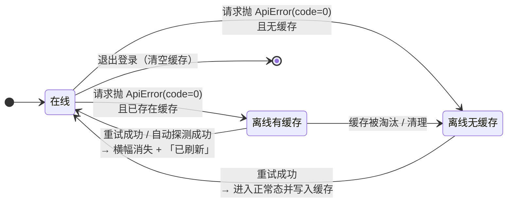

# 增量 PRD（增量 8）— OpenSchedule 移动端：全局离线态与错误态统一处理

> 档位：**简单 PRD**（不含竞品 / 市场分析；用户未要求完整档）。
> 负责人：许清楚（PM）· 版本 **v1.0** · 实读基准：`D:\GLMclaw\workspace\openschedule`（本次写作时）
> 上游基线：`PRD-mobile.md`（**本需求来源：§3 需求池 `M-P1-06`**，`:103`）· `ARCH-mobile.md` §10（`:561-575`，状态管理边界）· `PRD-mobile-increment-7-audit-alignment.md`（结构与颗粒度参照）
> **本文只描述需求，不含任何 TS / JSX 代码，不写实现方案代码块。** 文中出现的字段名 / 函数名仅作**行内标注**，用于对齐既有实现语义，不代表实现。
> 凡引用代码事实均给 `文件:行号`；不确定处一律进入 §7「待确认问题」，**不臆造项目里不存在的能力**。

---

## 1. 文档头

### 1.1 需求原话（未做删改）

> 「全局：离线态与错误态统一处理（缓存上次数据 + 重试）」

**验收要点（原文，`PRD-mobile.md:103`）**：

> **断网显示缓存与「重试」；恢复后自动刷新。**

**释义**：把「无网络」从「整屏报错」升级为「**降级可用**」——有缓存则照常展示上次数据并明确告知「这是缓存」、给出重试入口；恢复网络后**无需用户手动操作**即自动刷新；确实无缓存可展示时才落到整屏错误态。

### 1.2 本增量范围声明

| 项 | 声明 |
| --- | --- |
| 交付物 | **仅本 PRD 文档**（产品目标 + 用户故事 + 需求池 + UI 设计稿描述 + 关键产品决策 + 待确认问题） |
| **不做** | 不写任何实现代码（无 TS / JSX / 伪代码）；**不改动任何源码或测试**；**不执行任何 git 操作**；不改后端 / web / Prisma |
| 唯一需求来源 | `PRD-mobile.md:103`（`M-P1-06`）· 用户故事 `US-12`（`PRD-mobile.md:67`） |
| 允许的表达形式 | Mermaid 图、表格、ASCII 草图、字段名行内标注、文案示例 |
| 结论依据 | 全部锚定实读事实（`文件:行号`） |
| 进入开发的前置 | 主理人对 §7 待确认问题拍板（**尤其 Q1 / Q2 / Q6 / Q7**）后方可进入架构与开发 |
| 硬约束（违反即返工） | **零新增 npm 依赖**（不得引入 `@react-native-community/netinfo` / `expo-network` 等；`package.json:5-22` 现有依赖之外一律不得增加）· 禁用 `react-native-reanimated` / `react-native-gesture-handler`（仅 RN 内置 `Animated`）· 样式数值只取自 `src/theme/tokens.ts` · 裸 `<Pressable>` 白名单不得扩大（新交互一律 `PressableScale`）· 不修改既有测试断言 |

### 1.3 现状事实（本次实读，构成需求前提）

| # | 事实 | 证据 |
| --- | --- | --- |
| F1 | **统一异步三态 hook** 已存在，返回 `{ data, loading, error, refetch, retry, setData }`，带竞态 / 卸载保护；`refetch` 与 `retry` 同实现（保留当前数据） | `src/hooks/useAsync.ts:8-18`（返回值）、`:57-72`（run）、`:87` |
| F2 | 全项目 **39 处** `useAsync(...)` 调用点，覆盖 **16 个屏**（`src/screens/` 下 16 个文件） | 本次实读 grep 计数 |
| F3 | **状态视图三件套**已存在：`LoadingView`（骨架 / spinner）、`EmptyState`、`ErrorState`（**已带「重试」按钮**，默认文案「网络异常，请检查网络后重试」） | `src/components/StateViews.tsx:27`、`:62`、`:94-109` |
| F4 | 网络层异常已被**归一化**为 `ApiError(0, '网络连接失败，请检查网络后重试')` | `src/services/client.ts:112-115` |
| F5 | 全局状态 `AppProvider` **仅**承载 会话 / 角色 / 偏好 / 乐观更新登记；**不含任何网络或缓存状态** | `src/store/AppProvider.tsx:2-3`、`:51-88` |
| F6 | **存储能力已就绪**：`@react-native-async-storage/async-storage` 在依赖中（`package.json:7`），已有 `PREFERENCE_KEYS` / `DRAFT_KEYS` 命名约定 | `src/services/config.ts:20-34` |
| F7 | **无任何连通性检测**：全仓 `src/` 检索 `offline / NetInfo / connectiv / 离线 / 连通` **零命中**（仅 `utils/lane.ts` 的「连通重叠簇」为几何算法，无关） | 本次实读 grep |
| F8 | **无任何缓存层**：服务端数据由各屏 `useAsync` 局部持有，`AppProvider` 明确「不做全局缓存」 | `ARCH-mobile.md:568`、`AppProvider.tsx:3` |
| F9 | 根布局已有天然的**全局挂载点**：`App.tsx` 的 `<View style={styles.root}>` 包住 `<RootNavigator />`，位于 `<AppProvider>` 内 | `App.tsx:14-21` |
| F10 | 既有可复用的**提示 / 标签**载体：`UndoToast`（底部浮层 Toast，含进度条）、`Tag`（Chip 标签）、`Card`、`PressableScale`、`Button` | `src/components/UndoToast.tsx:27`、`src/components/Tag.tsx`、`src/components/index.ts` |
| F11 | 语义色齐备且**无需新增 token**：`colors.warning` / `warningFaint`（警告浅底）/ `danger` / `dangerFaint` / `success` / `text.secondary` | `src/theme/tokens.ts:36-38`、`:57-61` |
| F12 | **`USE_MOCK` 默认开启**（`process.env.EXPO_PUBLIC_USE_MOCK !== 'false'`），各 service **首行短路**，mock 分支**不经过** `client.ts` 的 `request()` | `src/services/config.ts:9-12`、`client.ts:88-90` |
| F13 | **`AppState`（RN 核心 API，零依赖）当前未被使用** | 本次实读 grep 零命中 |
| F14 | 现有 **44 个测试套件**（`apps/mobile/tests/*.test.ts(x)`；`tests/` 目录共 46 个文件，另含 `setup.ts` / `react-test-renderer.d.ts` 两个非套件文件） | 本次实读计数 |

> ⚠️ **由 F12 推导出的关键前提（必须写入验收口径）**：默认 `USE_MOCK=true` 时**不存在真实网络**，service 短路返回本地 mock，因此 `client.ts:114` 的 `ApiError(0)` **永远不会被触发** —— 即「断网」在默认配置下**无法自然复现**。⇒ 若不提供一个**可演示的离线触发手段**（见 §7-Q1 / Q2），`M-P1-06` 的验收要点「断网显示缓存与重试」**不可验证**。

---

## 2. 产品目标

**一句话定位**：让 OpenSchedule 移动端在**弱网 / 断网**时从「白屏报错」变成「**降级可用**」——看得到上次的数据、知道它是旧的、能一键重试、网络回来自己刷新。

| # | 目标（可衡量） | 衡量指标 |
| --- | --- | --- |
| G1 | 断网不再打断浏览 | 断网且**有缓存**时，页面仍渲染上次数据，**不出现整屏错误态**；缓存命中率（断网场景）≥ 90% |
| G2 | 用户始终知道当前状态 | 离线态有**全局唯一**横幅 + 数据「缓存」标记；「当前是缓存 / 已刷新」表达明确，无歧义 |
| G3 | 恢复无需用户操作 | 网络恢复后 **≤ 3s** 内自动刷新当前可见页面，并给出一次「已刷新」反馈；手动重试成功率 100% |

**解决的痛点**：

| 痛点 | 现状 | 目标态 |
| --- | --- | --- |
| 断网即整屏报错，已看过的内容全丢 | 断网 → `ErrorState` 占满整屏（`ProjectListScreen.tsx:87` 等 16 屏同构写法） | 断网 → 照常显示上次缓存 + 顶部离线横幅 |
| 用户不知道「是网断了还是服务坏了」 | 文案统一为「网络异常，请检查网络后重试」（`StateViews.tsx:102`） | 离线时明确「当前无网络连接」；服务端错误仍走原文案 |
| 恢复网络后需手动逐屏刷新 | 只有手动下拉 / 点重试 | 恢复后自动刷新，并提示「已刷新」 |
| 地铁 / 电梯 / 弱网场景体验差 | 无任何降级能力（F7 / F8） | 缓存 + 重试 + 自动恢复构成完整降级闭环 |

---

## 3. 用户故事

| 编号 | 角色 | 故事 | 覆盖验收点 | 优先级 |
| --- | --- | --- | --- | --- |
| US-08-01 | member / manager | 作为用户，我希望**在地铁里断网时仍能看到上次加载的待办与项目**，以便继续查看信息而不必等网络 | 断网显示缓存 | P0 |
| US-08-02 | member / manager | 作为用户，我希望**一眼看出当前看到的是缓存而不是最新数据**，以便判断信息是否可信 | 缓存态区分 | P0 |
| US-08-03 | member / manager | 作为用户，我希望**在离线横幅上直接点「重试」**，以便网络一恢复就立刻拿到最新数据 | 断网显示「重试」 | P0 |
| US-08-04 | member / manager | 作为用户，我希望**网络恢复后 App 自己刷新并告诉我「已刷新」**，以便不用逐屏下拉 | 恢复后自动刷新 | P0 |
| US-08-05 | 首次使用者 | 作为用户，我希望**在从未加载成功过（无缓存）且断网时看到明确的错误与重试**，以便知道该怎么办 | 首次无缓存 | P0 |
| US-08-06 | member | 作为用户，我希望**断网时尝试提交 / 流转能被明确拒绝并提示**，以便不误以为操作已成功 | 离线写操作 | P1 |

---

## 4. 需求池

> 分级口径：**P0 = 本次必做的最小闭环**（对应验收要点「断网显示缓存与「重试」；恢复后自动刷新」）；P1 = 显著提升可用性、但不阻塞闭环；P2 = 增强项。
> 编号沿用主 PRD 前缀：`M-P1-06-xx`。

### P0（Must have — 本次必做的最小闭环）

| 编号 | 需求描述 | 验收要点 |
| --- | --- | --- |
| **M-P1-06-01** | **缓存最近一次成功数据**：各屏 `useAsync` 取数成功后，把结果持久化到 AsyncStorage；缓存 key 含 `userId` 与 `role`（见 §7-Q4） | 成功一次后，杀掉进程重开（仍离线）能看到该缓存；缓存文件可被独立清理 |
| **M-P1-06-02** | **断网 + 有缓存 → 降级展示**：正常渲染缓存数据（不清空、不整屏报错），顶部出现**全局离线横幅**（含「重试」入口），数据区标注「缓存」与上次更新时间 | 断网进入任一有缓存的屏，能看到数据 + 横幅 + 缓存标记；页面**不出现** `ErrorState` |
| **M-P1-06-03** | **断网 + 无缓存 → 沿用既有错误态**：整屏 `ErrorState`，文案明确「无网络连接」，保留「重试」 | 全新安装 / 清缓存后断网进入，见整屏错误 + 「重试」；点击重试在有网后成功进入 |
| **M-P1-06-04** | **手动重试**：离线横幅的「重试」与各屏既有下拉刷新 / `ErrorState` 的「重试」均可触发重新取数；成功即退出离线态 | 三种入口都能恢复；重试中给出 loading 反馈（复用 `LoadingView` 语义，不新造组件） |
| **M-P1-06-05** | **恢复后自动刷新**：网络恢复（判定见 §6-D3）时，**自动**重新拉取当前已挂载页面的数据；成功后离线横幅消失并给出**一次**「已刷新」提示 | 断网 → 恢复网络（不碰屏幕）→ ≤3s 内页面变为最新数据 + 横幅消失 + 出现一次「已刷新」提示 |
| **M-P1-06-06** | **缓存态 / 实时态可区分**：离线且有缓存时，除全局横幅外，数据区需有**轻量「缓存」标记 + 上次更新时间**（相对时间，如「12 分钟前」）；在线时**无任何标记** | 在线与离线切换时，标记出现 / 消失正确；在线态不出现任何「缓存」字样 |
| **M-P1-06-07** | **缓存隔离与清理**：缓存按 `userId` + `role` 隔离；**退出登录时清空全部缓存**；角色切换后**不得**看到另一角色的缓存 | 切换演示角色 → 不串数据；退出登录 → 重登后无旧缓存残留 |

### P1（Should have）

| 编号 | 需求描述 | 验收要点 |
| --- | --- | --- |
| **M-P1-06-08** | **可演示的离线开关**（**验收前提，见 §1.3 警示**）：提供手动「模拟离线」入口，使默认 `USE_MOCK` 配置下也能复现离线态 | 打开开关 → 全局进入离线态（等价断网）；关闭 → 触发「恢复后自动刷新」 |
| **M-P1-06-09** | **缓存容量上限与淘汰**：限制缓存键数量 / 单条体积，超出按最近最少使用淘汰 | 缓存不会无界增长；超限后旧缓存被淘汰且不报错 |
| **M-P1-06-10** | **离线写操作统一提示**：离线时写操作（承接 / 流转 / 计时 / 评论 / 提报）**不排队、不静默失败**，明确提示「当前无网络连接，请稍后重试」，并沿用既有回滚 | 断网点赞同 / 流转 → 明确失败提示 + 状态回滚；恢复后可重做 |
| **M-P1-06-11** | **离线横幅可折叠**（若 §7-Q5 采纳「可关闭」）：折叠为右下角小圆点指示，点击展开 | 折叠 / 展开状态在会话内保持 |

### P2（Nice to have）

| 编号 | 需求描述 | 验收要点 |
| --- | --- | --- |
| **M-P1-06-12** | **缓存预渲染（stale-while-revalidate）**：冷启动先渲染缓存、后台静默刷新，再替换为最新数据 | 冷启动首屏出现更快；刷新后数据被替换且无闪烁 |
| **M-P1-06-13** | **缓存新鲜度提示细化**：超过阈值（如 24h）时把「缓存」标记升级为「缓存可能已过期」 | 过期阈值可配；文案随新鲜度变化 |
| **M-P1-06-14** | **恢复后刷新节流 / 合并**：短时间内的多次恢复事件合并为一次刷新 | 快速切前后台不会引发刷新风暴 |

---

## 5. UI 设计稿描述

> 约束：**不引入新组件库**；样式数值全部取自 `src/theme/tokens.ts`（`colors` / `spacing` / `radius` / `typography` / `shadow`）；新增的仅为**项目内组件**（1 个横幅 + 1 个缓存标记，缓存标记可直接复用既有 `Tag`）。配色沿用语义色：离线是**降级**而非**错误**，故用 `colors.warning` / `colors.warningFaint`（`tokens.ts:38,59`），**不用** `danger`。

### 5.1 状态矩阵（核心交互定义）

| 网络 | 是否有缓存 | 页面表现 | 全局横幅 | 数据标记 |
| --- | --- | --- | --- | --- |
| 在线 | 有 / 无 | 正常实时数据；成功后**写入 / 覆盖缓存** | 无 | 无 |
| **离线** | **有** | **照常渲染缓存数据**（列表 / 卡片 / 详情均正常） | **有**（含「重试」） | **有**（「缓存 · 上次更新 X 前」） |
| **离线** | **无** | 整屏 `ErrorState`（文案改为「当前无网络连接」）+「重试」 | 有（含「重试」） | 无 |
| 恢复 | 有（渲染缓存中） | 自动 refetch → 成功则替换为最新数据 | 消失 | 消失 + 一次「已刷新」提示 |

### 5.2 离线态页面草图（ASCII）

```
┌────────────────────────────────────────────────┐
│  [状态栏]                                       │
├────────────────────────────────────────────────┤
│ ⚠ 当前无网络连接 · 正在显示上次缓存内容  [重试] │ ← OfflineBanner（全局唯一，warning 系）
├────────────────────────────────────────────────┤
│  工作台                                         │
│  共 5 条待办                                    │
│  ┌──────────────────────────────────────────┐  │
│  │ [缓存]  上次更新 12 分钟前                 │  │ ← StaleBadge（复用 Tag + caption 文案）
│  └──────────────────────────────────────────┘  │
│  ┌── 待办卡片（缓存内容，正常渲染）─────────┐  │
│  │  高  完成季度复盘               今天 18:00 │  │
│  └──────────────────────────────────────────┘  │
│  ┌── 待办卡片 ──────────────────────────────┐  │
│  │  中  整理需求文档               明天 12:00 │  │
│  └──────────────────────────────────────────┘  │
│  …                                             │
└────────────────────────────────────────────────┘
```

**无缓存时的离线态**（沿用既有组件，仅文案区分）：

```
┌────────────────────────────────────────────────┐
│ ⚠ 当前无网络连接 · 正在显示上次缓存内容  [重试] │
├────────────────────────────────────────────────┤
│                                                │
│                   ( ⚠ )                        │  ← ErrorState（StateViews.tsx:94）
│                 加载失败                        │
│           当前无网络连接，请检查网络后重试        │
│                                                │
│               [ ⟳  重试 ]                       │
│                                                │
└────────────────────────────────────────────────┘
```

### 5.3 关键区块规格

| 区块 | 位置 | 内容与文案 | 交互 | 复用 / 新增 |
| --- | --- | --- | --- | --- |
| **离线横幅 OfflineBanner** | **全局唯一**，挂 `App.tsx` 的 `styles.root` 内、`<RootNavigator />` 之上（`App.tsx:14-21`）；贴状态栏下方，随页面滚动**固定不动** | 左：`Feather` 图标（`wifi-off` 语义）+ 主文案「当前无网络连接」；副文案「正在显示上次缓存内容」；右：「重试」文字按钮 | 点「重试」→ 触发全局重试；恢复后**自动消失**（淡出，复用 `motion` token） | **新增**组件（底色 `colors.warningFaint`、文字 `colors.warning`、圆角 `radius.card`，无阴影） |
| **缓存标记 StaleBadge** | 各屏数据区顶部（标题 / 副标题下方），仅在**离线且有缓存**时出现 | `Tag`：「缓存」+ `caption` 文案「上次更新 {相对时间}」 | 只读；在线时**不渲染** | **复用 `Tag`**（`components/Tag.tsx`）+ `utils/date.ts` 相对时间 |
| **「已刷新」提示** | 底部浮层（复用 `UndoToast` 的定位与动画手法），出现 ~2s 后自动消失 | 「网络已恢复，已刷新」 | 无需操作；不提供「撤销」（与 `UndoToast` 语义不同） | **复用样式手法**，新增一个**无操作按钮**的轻提示（见 §7-Q6） |
| **错误态 ErrorState** | 数据区 / 整屏 | 离线且**无缓存**：文案「当前无网络连接，请检查网络后重试」；其余失败：保持现状「网络异常，请检查网络后重试」 | 「重试」按钮（既有） | **复用** `StateViews.tsx:94`，仅新增可选 `message` 传参（已支持，`:89`） |
| **空态 EmptyState** | 数据区 | **不变**。缓存命中但数据为空数组时，仍显示 `EmptyState`（这是「空」，不是「错」） | 既有 | **复用，不改** |

### 5.4 离线状态机（Mermaid）



- 「恢复」的唯一判据 = **一次请求不再抛 `ApiError(code=0)`**（即网络层可用），见 §6-D3。
- 离线态为**全局态**（横幅唯一），但「有缓存 / 无缓存」是**逐屏**判定（各屏自己的缓存命中与否），故同一时刻不同屏可分别处于「离线有缓存」「离线无缓存」。

### 5.5 与既有 `ErrorState` / `EmptyState` 的关系（明确表态）

| 既有件 | 本次处置 | 理由 |
| --- | --- | --- |
| `ErrorState`（`StateViews.tsx:94`） | **保留，不改结构**；仅在离线场景传入更准确的 `message` | 已满足「错误必带重试」（`ARCH-mobile.md:570`）；改结构会波及 16 屏与多个测试套件 |
| `EmptyState`（`StateViews.tsx:62`） | **完全不动** | 「缓存为空」≠「加载失败」，二者语义不可混 |
| `LoadingView`（`StateViews.tsx:27`） | **不动**；重试中的 loading 复用它 | 统一三态口径不破坏 |
| 16 屏的 `loading ? LoadingView : error ? ErrorState : …` 三分支写法 | **升级为四态**：`loading ? LoadingView : (error && !有缓存) ? ErrorState : …`，并在「离线有缓存」时叠加横幅 + 缓存标记 | 这是本次需求的**核心改造点**（最小侵入：仅调整分支条件与叠加层，不改组件） |

---

## 6. 关键产品决策（明确表态 + 默认建议）

> 以下 5 条是本次需求的**产品骨架**。每条给出**明确表态**与**默认建议**；主理人若否决，请按 §7 逐条拍板。

### D1｜断网时「有缓存」显示什么？

**表态**：显示 **缓存数据 + 全局离线横幅 + 缓存标记 + 重试入口**，**不显示**整屏错误态。

- 页面主体**照常渲染**上次成功数据（不清空、不置灰、不遮罩）——「降级可用」是本需求的核心价值。
- 横幅文案「当前无网络连接 · 正在显示上次缓存内容」+「重试」，**明确告知这是旧数据**（避免用户误当最新数据做决策）。
- 数据区加轻量「缓存 · 上次更新 X 前」标记（`Tag`），使「缓存 / 实时」一眼可辨。
- **不**在缓存数据上叠加半透明遮罩 —— 遮罩会显著降低可读性，而离线浏览正是主场景。

### D2｜断网时「无缓存」显示什么？

**表态**：**沿用既有 `ErrorState`**（整屏、含「重试」），仅把文案改为更准确的「当前无网络连接，请检查网络后重试」。

- 不新造「离线空态」组件：`ErrorState` 已满足「明确告知 + 重试」两要素（`StateViews.tsx:94-109`），符合 `ARCH-mobile.md:570` 的统一口径。
- 触发条件明确：**该屏本次请求失败** ∧ **该屏无可用缓存**（首次进入 / 缓存被清理 / 新用户）。
- 与 D1 的边界：**同一次失败**下，有缓存走 D1、无缓存走 D2；二者由「缓存是否命中」决定，**与错误类型无关**（服务端 5xx 等错误也适用同一降级逻辑，但横幅文案区分「无网络」与「服务异常」——见 §7-Q10）。

### D3｜「恢复」如何界定？如何表达「已刷新」？

**表态**：

1. **恢复的判据** = **一次真实请求不再抛 `ApiError(code === 0)`**（`client.ts:114` 的网络层失败标志）且返回成功。**不**依赖系统级网络状态（零依赖约束下不可得，见 F7）。
2. **触发恢复尝试的三条路径**（零新增依赖）：
   - ① **用户主动**：点离线横幅「重试」/ 各屏下拉刷新 / `ErrorState` 的「重试」（复用既有 `refetch` / `retry`，`useAsync.ts:87`）；
   - ② **回到前台**：App 从后台回到前台时自动尝试一次（`AppState` 为 RN 核心 API，零依赖，当前未使用 F13）；
   - ③ **离线期间定时探测**：离线时按**退避间隔**自动探测（建议 5s → 10s → 30s 封顶，恢复后停止），探测命中即判定恢复。
3. **「已刷新」的表达**：**离线横幅自动消失**（主信号）+ 一次底部轻提示「网络已恢复，已刷新」（次信号，~2s 自动消失）。不使用弹窗打断。
4. **刷新范围**：**所有当前已挂载且处于缓存 / 失败态的取数点**各 `refetch()` 一次；短时间内多次恢复事件**合并为一次**（见 P2 `M-P1-06-14`）。

> **零依赖说明**：`@react-native-community/netinfo` / `expo-network` **均未安装且不得新增**（硬约束），故只能**被动推断**连通性；这也是 ②③ 两条主动尝试路径存在的原因 —— 没有系统级网络事件可用。

### D4｜缓存的作用范围、新鲜度与隔离？

**表态**：

| 维度 | 默认建议 | 理由 |
| --- | --- | --- |
| **缓存什么** | 各屏 `useAsync` 的**最近一次成功结果**（读接口数据）。**写操作不缓存、不排队** | 对齐主 PRD Q5 默认「仅读缓存 + 在线写」（`PRD-mobile.md:296`）与 `ARCH-mobile.md:589` R7 |
| **缓存粒度** | 一次 `useAsync` 调用 = 一个缓存条目（任务详情按 `taskId` 细分） | 与「服务端数据由各屏局部持有」的既有边界一致（`ARCH-mobile.md:568`） |
| **过期策略** | **不设硬性过期**（离线展示旧数据正是本需求目的）；但每条缓存带 `updatedAt`，UI 展示相对时间；另设**容量上限 + LRU 淘汰**（`M-P1-06-09`） | 硬过期会导致「有缓存却仍报错」，与 G1 冲突 |
| **隔离维度** | 缓存 key 含 **`userId` + `role`**；`signOut` 清空全部缓存 | 角色切换会改变可见数据（`PRD-mobile.md:91`、`AppProvider.tsx:73-74`），必须隔离，否则演示时会串数据 |
| **落盘位置** | AsyncStorage，key 前缀 `os.cache.`（与既有 `os.remember_me` / `os.draft_submission` 命名一致，`config.ts:20-34`） | 复用既有依赖与命名约定，零新增依赖 |

### D5｜离线横幅：全局唯一还是各屏各自？可否关闭？

**表态**：**全局唯一**，挂在根布局 `App.tsx`（`App.tsx:14-21`，位于 `AppProvider` 内、`RootNavigator` 之上），**默认不可关闭**，网络恢复后**自动消失**。

- **全局唯一**的理由：离线是**设备级状态**，各屏各自挂会产生重复、位置漂移、状态不一致三类问题；挂根布局只需渲染一次。
- **不可关闭**的理由：它是**状态指示器**（类似信号格），不是一次性提示；若可关闭，用户关闭后会误以为数据是最新的。
- 若主理人认为常驻横幅打扰，备选方案：**折叠为右下角小圆点**（`M-P1-06-11`），点击展开——列入 §7-Q5 待拍板。

---

## 7. 待确认问题（每条给默认建议）

> 前 4 条（Q1 / Q2 / Q6 / Q7）**建议在进入架构前拍板**，其余可并行推进。

| # | 问题 | 建议默认值 | 影响面 |
| --- | --- | --- | --- |
| **Q1** | **零依赖下如何检测「断网」？** 无 `NetInfo` / `expo-network`（硬约束），且 `USE_MOCK=true` 时**无真实请求**（F12）⇒ 网络失败信号根本不会产生 | **被动推断**：以「请求抛 `ApiError(code===0)`」为离线信号（`client.ts:114`）；恢复靠「重试 + 回前台 + 退避探测」三条主动路径（§6-D3） | 决定整个离线判定的技术可行性；**不拍板则无法开工** |
| **Q2** | **是否提供「模拟离线」开关？放哪里、对谁可见？** 没有它，默认 mock 配置下 `M-P1-06` 的验收要点**不可验证**（§1.3 警示） | **提供**，落「我的」页设置区，**仅 `__DEV__` / 演示构建可见**（与既有「演示角色切换」同类，`PRD-mobile.md:91`） | 决定 QA 能否验收；影响「我的」页 UI（新增一个开关条目） |
| **Q3** | **缓存是否设 TTL？** 无 TTL 可能展示很久以前的旧数据 | **不设硬 TTL**，改为「展示相对更新时间 + 容量上限 + LRU」（§6-D4）；超 24h 时文案升级为「可能已过期」（P2 `M-P1-06-13`） | 影响缓存层设计与 UI 文案 |
| **Q4** | **缓存隔离维度是否含 `role`？** 角色切换是纯前端演示功能，但会改变可见数据 | **含 `userId` + `role`**；`signOut` 清空全部缓存 | 影响缓存 key 设计与演示正确性 |
| **Q5** | **离线横幅可否关闭？** 常驻横幅可能被认为打扰 | **不可关闭**（状态指示器），恢复后自动消失；如需减打扰，采纳「折叠为小圆点」（`M-P1-06-11`） | 影响横幅组件与 `M-P1-06-11` 是否进入 P1 |
| **Q6** | **缓存层落点**：扩展既有 `useAsync`（新增可选 `cacheKey`）还是新增包装 hook？ | **新增 `useCachedAsync` 包装 hook**，**`useAsync` 本体不动** | 39 处调用点零回归；架构据此定文件落点 |
| **Q7** | **连通性状态是否放进 `AppProvider`？** 现约定全局态**仅** 会话 / 角色 / 偏好 / 乐观登记（`ARCH-mobile.md:568`） | **不进 `AppProvider`**，新增独立 `ConnectivityProvider`（连通性是**设备态**，非服务端数据，不违反「不做全局缓存」的本意，但需架构显式确认边界） | 影响 `ARCH-mobile.md` §10 边界表述是否需更新 |
| **Q8** | **「已刷新」提示的组件形态**：复用 `UndoToast`（但无「撤销」语义）还是新增轻提示组件？ | **复用 `UndoToast` 的样式与动画手法**，新增一个**无操作按钮**的轻提示（不改造 `UndoToast` 本身，避免影响既有乐观更新链路） | 影响组件增量与既有测试 |
| **Q9** | **缓存预渲染（冷启动先渲染缓存再刷新）是否本次做？** | **不做**，列 P2（`M-P1-06-12`）；本次仅在**请求失败时回退缓存** | 影响实现复杂度与首屏体验目标 |
| **Q10** | **横幅文案是否区分「无网络」与「服务端异常」？** 后端 5xx 也走同一降级逻辑 | **区分**：`ApiError(code===0)` → 「当前无网络连接」；其余 → 「服务暂时不可用」；二者都显示缓存 + 重试 | 影响文案分支与缓存降级的适用条件 |
| **Q11** | **离线时写操作是否排队补传？** | **不排队**（`M-P1-06-10`：明确提示 + 回滚）；离线写入列「明确不做」（§8-N4） | 范围铁律；避免数据一致性风险 |
| **Q12** | **恢复后刷新的节流窗口取值？** | **1s 合并窗口**（`M-P1-06-14`）；避免快速切前后台引发刷新风暴 | 小；影响探测与刷新调度 |

---

## 8. 明确不做什么（范围外清单）

| # | 不做 | 理由 |
| --- | --- | --- |
| N1 | **离线写入 / 写操作排队补传**（离线计时后补传等） | 主 PRD Q5 默认「仅读缓存 + 在线写」（`PRD-mobile.md:296`）；一致性风险高 |
| N2 | **引入任何新 npm 依赖**（`netinfo` / `expo-network` / `swr` / `react-query` 等） | 硬约束；`ARCH-mobile.md:15` 已明确不引 TanStack Query |
| N3 | **使用 `react-native-reanimated` / `react-native-gesture-handler`** | 硬约束；仅 RN 内置 `Animated` |
| N4 | **修改 `useAsync` 既有签名与行为** | 39 处调用点 + 多套测试；本次改为新增包装 hook（Q6） |
| N5 | **修改既有测试断言** | 硬约束 |
| N6 | **改动 `ErrorState` / `EmptyState` / `LoadingView` 的结构与既有样式** | 16 屏共用 + `ARCH-mobile.md:570` 统一口径；本次只调分支条件与传参 |
| N7 | **把服务端数据放进全局 store（全局缓存）** | `ARCH-mobile.md:568` 明确禁止；缓存走 AsyncStorage + hook 层 |
| N8 | **系统级网络状态监听**（`NetInfo` / 原生事件） | 零依赖下不可得（F7） |
| N9 | **修改后端 / web / Prisma** | 落点约束；本需求纯移动端 |
| N10 | **缓存预渲染（SWR）与离线过期强制拦截** | 列 P2；本次不做（Q9 / Q3） |
| N11 | **执行任何 git 操作** | 硬约束 |

---

## 附录 A：证据索引（本次实读）

| 文件 | 关键行号 | 用途 |
| --- | --- | --- |
| `docs/mobile-app/PRD-mobile.md` | `:103`（`M-P1-06` 需求来源）· `:67`（`US-12`）· `:91`（角色切换）· `:296`（Q5 仅读缓存） | 需求来源 |
| `docs/mobile-app/ARCH-mobile.md` | `:14`（不引 Zustand）· `:15`（不引 TanStack Query）· `:568`（状态管理边界）· `:570`（三态统一）· `:573`（乐观更新）· `:589`（R7 离线写入） | 架构约束 |
| `apps/mobile/src/hooks/useAsync.ts` | `:8-18`（返回值）· `:57-72`（run / 竞态保护）· `:87`（refetch ≡ retry） | 现状 F1 |
| `apps/mobile/src/components/StateViews.tsx` | `:27`（LoadingView）· `:62`（EmptyState）· `:89`（ErrorState message 可选）· `:94-109`（ErrorState + 重试） | 现状 F3 / 复用 |
| `apps/mobile/src/services/client.ts` | `:112-115`（网络层异常 → `ApiError(0, …)`）· `:88-90`（mock 不经过 request） | 现状 F4 / 离线信号 |
| `apps/mobile/src/services/config.ts` | `:9-12`（USE_MOCK）· `:20-34`（PREFERENCE_KEYS / DRAFT_KEYS 命名约定） | 现状 F6 / F12 |
| `apps/mobile/src/store/AppProvider.tsx` | `:2-3`（职责：不含网络 / 缓存）· `:51-88`（全局态字段）· `:215-231`（signOut 清理） | 现状 F5 / 隔离 |
| `apps/mobile/App.tsx` | `:14-21`（`AppProvider` → `styles.root` → `RootNavigator`） | 全局挂载点 F9 |
| `apps/mobile/src/components/UndoToast.tsx` | `:27-132`（底部 Toast + 进度条 + 动画手法） | 复用载体 F10 / Q8 |
| `apps/mobile/src/components/Tag.tsx` · `index.ts` | Tag / Card / PressableScale / Button 导出 | 复用载体 F10 |
| `apps/mobile/src/theme/tokens.ts` | `:36-38`（warningFaint 等浅底）· `:57-61`（success / warning / danger） | 配色 F11 |
| `apps/mobile/src/screens/ProjectListScreen.tsx` | `:84-88`（`loading ? LoadingView : error ? ErrorState : …` 三分支同构写法） | 改造点 §5.5 |
| `apps/mobile/src/screens/` | 16 个屏文件（`WorkspaceScreen` / `TodayFocusScreen` / `BoardScreen` / `TaskDetailScreen` / `CalendarScreen` / `ProfileScreen` / `AuditCenterScreen` …） | 影响面 F2 |
| `apps/mobile/tests/` | 44 个测试套件（`*.test.ts(x)`） | 回归面 F14 |

---

## 附录 B：本次需求的一句话总结（供主理人快速拍板）

> 断网时**不报错**——有缓存就展示缓存 + 顶部「无网络」横幅（带重试）+ 「缓存 / 上次更新」标记；没缓存才整屏报错（沿用 `ErrorState`）；网络一恢复**自动刷新**并提示「已刷新」。缓存按「用户 + 角色」隔离、退出登录清空、不设硬过期。**零新增依赖**——连通性靠请求失败被动推断 + 重试 / 回前台 / 退避探测三条主动路径恢复。**须拍板 4 件事**：Q1 检测方式、Q2 是否加「模拟离线」开关（否则验收无法执行）、Q6 缓存层落点、Q7 连通性状态是否独立于 `AppProvider`。
