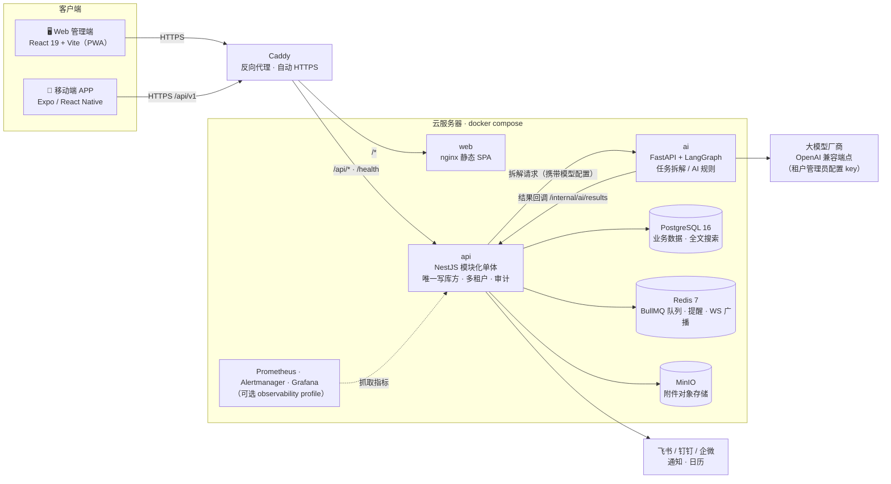
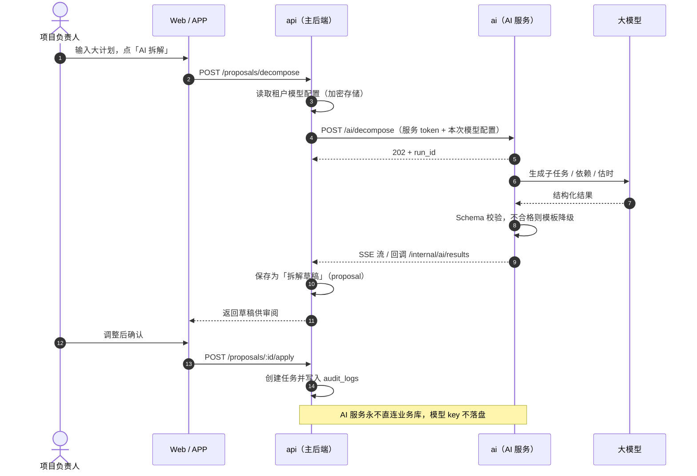
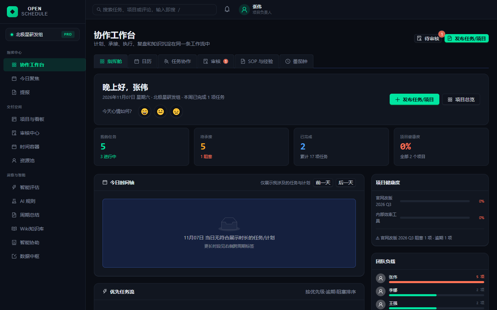
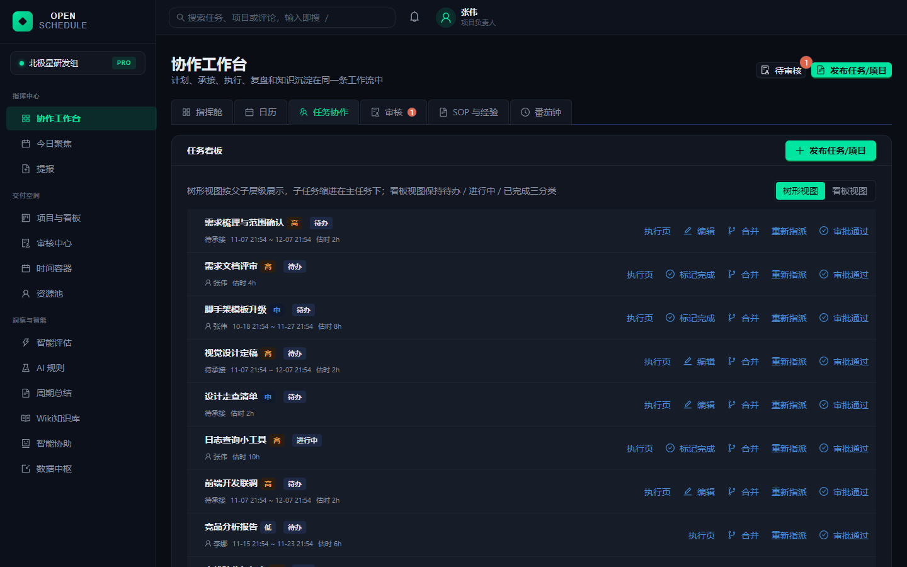
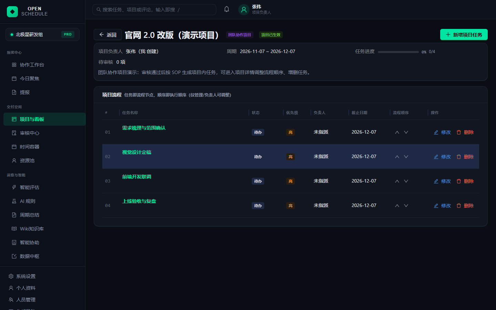
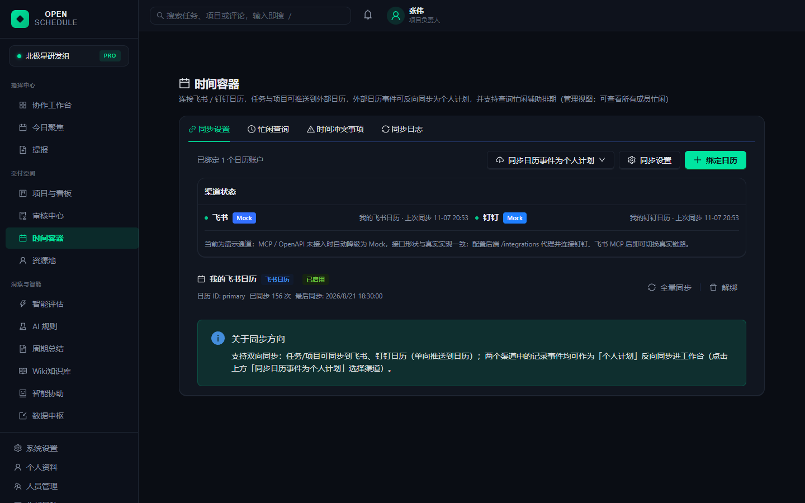
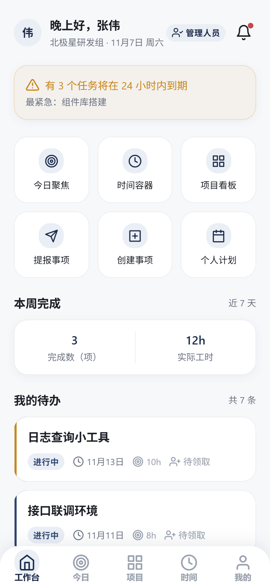
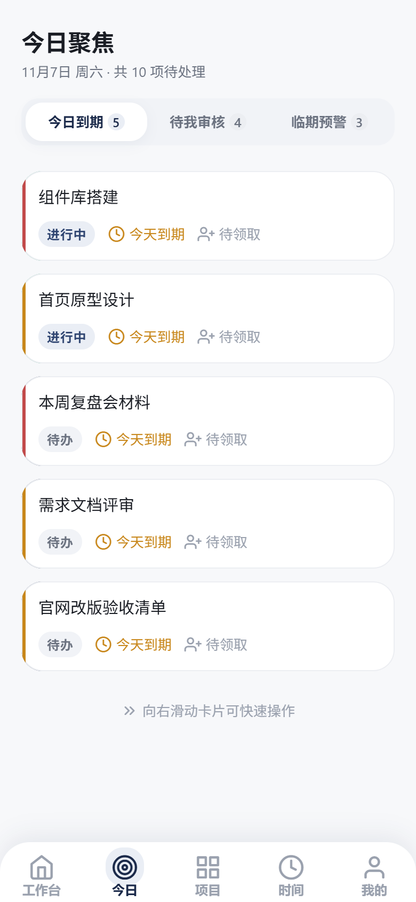
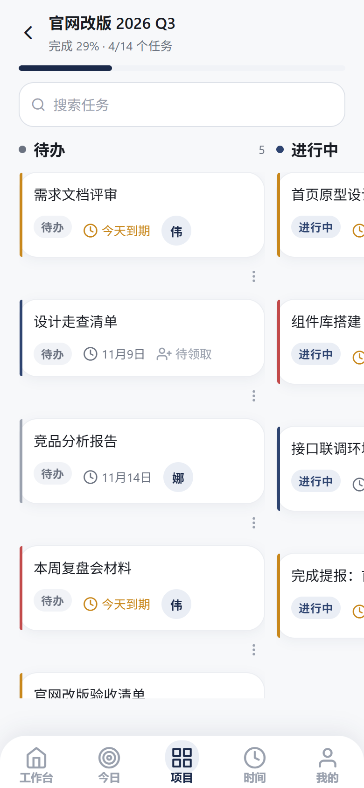
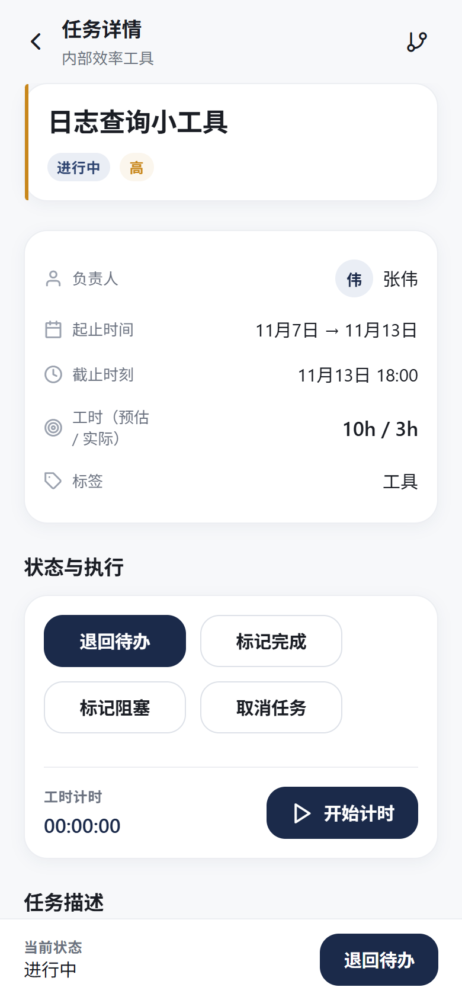

# OpenSchedule

面向 5–50 人中小团队的协作计划平台：一端是团队管理（大计划规划、AI 辅助拆解、任务分配、成员看板），另一端是个人计划（任务领取/转移、估时计时、定时提醒、完成总结）。AI 以「拆解草稿 → 人确认 → 落库」的半自动闭环参与执行，临期保障、智能评估、周报等能力分三期落地——先确定性协作闭环，后 AI 增强，**AI 只提议、人确认，全程审计留痕**。

## 项目介绍

**定位**：OpenSchedule 把「计划—拆解—派工—执行—复盘」装进一个双端打通的产品。团队端管理大计划与成员，个人端聚焦今日任务与时间管理；AI 特色能力（拆解草稿、临期保障、智能评估）全部走「提议—审批」闸门，保证 AI 不直接改库。功能全景共 8 组 77 条（Phase 1 收敛 18 条纯 P0），完整口径见《OpenSchedule 完整开发方案》。

**架构**：pnpm workspaces 单仓（monorepo），两个客户端 + 两个服务——
`apps/web`（React 19 + Vite SPA + TanStack Query/Zustand + @dnd-kit，PWA）、
`apps/mobile`（Expo 57 / React Native 0.86 移动端 APP，iOS / Android / Web 三端，中英双语 + 暗色 + 离线）、
`services/api`（NestJS 模块化单体 + Prisma + PostgreSQL，**唯一写库方**，`tenant_id` 多租户铁律 + `audit_logs` 审计留痕）、
`services/ai`（Python 3.12 FastAPI + LangGraph，模型为团队管理员配置的 OpenAI 兼容端点，独立部署、**永不直连业务库**）；
基础设施为 PostgreSQL 16（全文搜索）+ Redis 7（BullMQ 队列 / zset 延迟提醒 / WS 广播）+ MinIO（S3 兼容对象存储）；`packages/` 为共享包（`domain-events` 领域事件契约、`workspace-rules` 前后端共用的工作区规则纯函数）。

**当前进度**（2026-11，详见 [`docs/ddd/production-progress.md`](docs/ddd/production-progress.md)）：

| 部分 | 状态 |
|------|------|
| Web + 主后端 + AI 服务 | 生产化 R1–R12 代码完成；GitHub Actions CI 7 个 job 全绿（含真实 PostgreSQL 16 迁移与 e2e） |
| 移动端 APP | 12 个功能增量完成，jest 59 suites / 1019 tests 通过；已关联 EAS 项目，待真机构建与真实后端联调 |
| 生产部署 | 方案为云服务器单机 docker compose（`deploy/docker-compose.prod.yml`）；上线门禁见 [`docs/ops/go-no-go.md`](docs/ops/go-no-go.md)，当前 Go 5 / No-Go 3（ZAP 安全扫描、目标机备份恢复演练、Sentry/告警实触发待在真实环境完成） |

## 系统架构

### 部署拓扑（单机 docker compose）

Caddy 是生产环境唯一的对外入口（自动 HTTPS）：`/api/*` 转发到主后端，其余路径交给 Web 静态站点。Web 与移动端 APP 都只调用同一套 REST API；主后端是**唯一写库方**，AI 服务不接触业务库。



### AI 拆解闭环：AI 只提议，人确认后才落库



## 界面预览

> 截图来自内置演示数据（mock 模式），可按「快速开始」在本地复现。

### Web 管理端

| 协作工作台 · 指挥舱 | 任务协作（树形视图） |
|:---:|:---:|
|  |  |
| **项目详情 · 流程顺序** | **时间容器 · 飞书 / 钉钉日历同步** |
|  |  |

### 移动端 APP

| 工作台 | 今日聚焦 | 项目看板 | 任务详情 |
|:---:|:---:|:---:|:---:|
|  |  |  |  |

## 快速开始

### 前置要求

| 依赖 | 版本 | 说明 |
|------|------|------|
| Node.js | ≥ 22 LTS | 前端与主后端运行时 |
| pnpm | ≥ 9 | 包管理（corepack 启用：`corepack enable`，或 `npm i -g pnpm`） |
| Python | ≥ 3.12 | AI 服务（建议装 [uv](https://docs.astral.sh/uv/) 管理依赖） |
| Docker | Compose v2 | 本地开发栈（本仓库 compose 无 `version` 字段，需 v2 语法） |

### 依赖快照：node_modules 已入库（clone 后免安装直接运行）

本仓库将 **node_modules 作为依赖快照纳入版本控制**（root / apps/web / apps/mobile / services/api 四处，含 esbuild、Prisma 引擎等平台二进制，约 51 万个文件）。`git clone` 后**无需执行 `pnpm install`，离线即可直接启动**，保证在任何机器上的运行效果与提交时一致。

- 版本口径不变：`pnpm-lock.yaml`（pnpm 9.15.5 / Node ≥ 22）与 `apps/mobile/package-lock.json` 照常提交、照常评审。增删依赖后正常 `pnpm install`，然后把 node_modules 的改动**像代码一样提交**（`git add -A` 会一并纳入）。
- 代价提示：索引约 51 万文件，`git status` / `git checkout` / `git pull` 等操作会明显变慢，仓库体积较大——这是「免安装直接跑」的预期代价。
- Windows 注意：少量 React Native 原生源码路径极深（超过 260 字符），clone 前需开启长路径支持（`git config --global core.longpaths true`，并确认系统已启用「Win32 长路径」），否则这些文件会检出失败；缺失只影响 Android/iOS 原生编译，不影响 Web / API / Metro 打包运行。
- Python 服务（services/ai）依赖不落库（`.venv` 含绝对路径、无法跨机复用）：首次运行执行一次 `cd services/ai && uv sync --frozen`，按 uv.lock 精确复现。

### 方式 A：一键容器启动（前后端 + 基础设施全容器）

```bash
git clone <仓库地址> && cd openschedule
cp .env.example .env      # 首次必须：生成本地环境变量（真实凭据不进 git）
pnpm docker:up            # 等价 docker compose --env-file .env -f deploy/docker-compose.yml up -d --build
pnpm docker:ps            # 查看状态；api/web/ai 的 /health 通过后显示 healthy
```

启动后访问：

| 服务 | 地址 |
|------|------|
| 前端 SPA | http://localhost:5173 |
| 主后端 API | http://localhost:3000（/health 探活） |
| AI 服务 | http://localhost:8300（/health 探活） |
| MinIO 控制台 | http://localhost:9001（minioadmin / minioadmin123） |

> 停止：`pnpm docker:down`；重置全部本地数据：`docker compose --env-file .env -f deploy/docker-compose.yml down -v`（⚠️ 会清空数据卷）。

### 方式 B：基础设施容器 + 本地起三个服务（日常开发推荐）

```bash
cp .env.example .env
pnpm build:packages       # 构建共享包（domain-events / workspace-rules，api 依赖其 dist）
pnpm docker:infra         # 仅启动 pg + redis + minio（容器）
pnpm prisma:migrate       # 首次：创建数据库结构（Prisma migrate dev，见下节）

# 三个终端分别启动（或一条命令 pnpm dev 并行跑）
pnpm dev:api              # 终端 1：NestJS（watch 模式）→ http://localhost:3000
pnpm dev:web              # 终端 2：Vite dev server（HMR）→ http://localhost:5173
pnpm dev:ai               # 终端 3：FastAPI（--reload）→ http://localhost:8300（需 uv）
```

> `dev:ai` 依赖 `services/ai` 的依赖就绪（`cd services/ai && uv sync`）；无 uv 时兜底
> `cd services/ai && python -m uvicorn app.main:app --reload --port 8300`。

### 方式 C：只看界面（演示数据，无需后端与 Docker）

```bash
# Web 管理端：内置演示数据，任意邮箱 + 任意密码即可登录
cd apps/web && VITE_USE_MOCK=true npx vite          # → http://localhost:5173

# 移动端 APP：未配置 EXPO_PUBLIC_API_URL 时自动走演示数据
cd apps/mobile && npm run web                        # 浏览器预览 → http://localhost:8081
cd apps/mobile && npm start                          # 手机装 Expo Go 扫码预览
```

移动端演示账号 `zhangwei@example.com` / `openschedule`（登录页底部「点击填入」）。移动端连真实后端、EAS 构建见 [`apps/mobile/README.md`](apps/mobile/README.md)。

### 生产部署

单台云服务器 + docker compose：`deploy/server/bootstrap.sh` 装环境 → `deploy/server/gen-env.sh` 生成密钥与配置 → `docker compose -f deploy/docker-compose.prod.yml up -d`。Caddy 自动签发 HTTPS 证书（需域名解析到服务器）；推送 `v*` tag 由 `.github/workflows/release.yml` 构建镜像并经 SSH 发布。完整步骤、告警处置与回滚见 [`docs/ops/runbook.md`](docs/ops/runbook.md)、[`docs/ops/release-plan.md`](docs/ops/release-plan.md)。

### 首次 prisma migrate

- `services/api/prisma/schema.prisma` 是 **DDL 唯一权威来源**（方案 chapter_02 §2），迁移文件随仓库提交。
- 本地：`pnpm prisma:migrate`（= `prisma migrate dev`，开发用，自动生成迁移）。
- 容器：`.env` 中 `DB_AUTO_MIGRATE=true` 时 api 启动自动 `migrate deploy`（开发默认；**生产建议关掉**，改由流水线单独执行 `pnpm prisma:deploy`）。
- 常用：`pnpm prisma:generate`（改 schema 后重新生成 Client）、`pnpm prisma:studio`（可视化查看）。

### 环境变量说明

`cp .env.example .env` 后按需修改。变量按方案 chapter_03 §3.7 分 **15 组**，要点：

| 组 | 关键变量 | 阶段 |
|----|----------|------|
| 1 应用 | APP_ENV / APP_PORT / APP_PUBLIC_URL / CORS_ORIGINS | Phase 1 |
| 2 数据库 | DATABASE_URL / DB_POOL_MAX / DB_SSL | Phase 1 |
| 3 Redis | REDIS_URL / REDIS_PREFIX | Phase 1 |
| 4 安全 | JWT_ACCESS_SECRET / JWT_REFRESH_SECRET / TTL / ENCRYPTION_KEY | Phase 1 |
| 5 对象存储 | STORAGE_PROVIDER / ENDPOINT / BUCKET / ACCESS_KEY / PUBLIC_BASE_URL | Phase 1 |
| 6 邮件 | MAIL_PROVIDER / SMTP_HOST / SMTP_PORT / SMTP_USER / MAIL_FROM | Phase 1 |
| 7 WebPush | VAPID_PUBLIC_KEY / VAPID_PRIVATE_KEY / VAPID_SUBJECT | Phase 1 |
| 8 IM 通知 | 企微/飞书/钉钉 webhook base | Phase 1 |
| 9 AI 模型 | 模型 key 不走环境变量：管理员在「设置 → AI 模型」配置（D-14）；AI_DECOMPOSE_TIMEOUT_MS / 预算告警 | Phase 1 |
| 10 日历 OAuth | GOOGLE / FEISHU / WECOM 凭据 | Phase 2 |
| 11 沙箱 | SANDBOX_PROVIDER / E2B_API_KEY | Phase 3 |
| 12 浏览器自动化 | BROWSER_PROVIDER | Phase 3 |
| 13 Git 集成 | GITHUB / GITLAB 凭据 | Phase 3 |
| 14 可观测性 | SENTRY_DSN / LOG_LEVEL | Phase 1 |
| 15 种子/迁移 | DB_AUTO_MIGRATE / SEED_DEMO_DATA | Phase 1 |

容器场景无需改地址：compose 自动把 `localhost` 覆盖为服务名（见 [`deploy/readme.md`](deploy/readme.md)）。
端口约定：web 5173 / api 3000 / ai 8300 / pg 5432 / redis 6379 / minio 9000+9001。

## 目录结构

```
openschedule/
├── pnpm-workspace.yaml          # workspace：apps/*、services/*、packages/*
├── package.json                 # 根脚本（dev:* / build:packages / prisma:* / docker:*）
├── .env.example                 # 环境变量模板（15 组）
├── apps/
│   ├── web/                     # Web 管理端（React 19 + Vite + PWA）★ 含 Dockerfile
│   └── mobile/                  # 移动端 APP（Expo + React Native，npm 管理，独立 package-lock）
├── services/
│   ├── api/                     # 主后端（NestJS 模块化单体 + Prisma）★ 唯一写库方
│   │   ├── src/modules/         #   29 个领域模块（auth/rbac/projects/tasks/workspace/proposals/...）
│   │   └── prisma/              #   schema.prisma + migrations（DDL 权威来源）
│   └── ai/                      # AI 服务（Python FastAPI + LangGraph，uv 管理）
├── packages/
│   ├── domain-events/           # 领域事件契约（payload 单一来源）
│   └── workspace-rules/         # 工作区规则纯函数（api 与 web 共用）
├── deploy/
│   ├── docker-compose.yml       # 本地开发栈：pg + redis + minio + api + web + ai
│   ├── docker-compose.prod.yml  # 生产单机栈：caddy + 应用 + 数据 + 备份 + 可观测性
│   ├── caddy/                   # 反向代理与自动 HTTPS
│   ├── server/                  # 服务器初始化（bootstrap.sh）与密钥生成（gen-env.sh）
│   ├── postgres/                # 初始化、备份、恢复、恢复校验脚本
│   ├── observability/           # Prometheus / Alertmanager / Grafana / 告警转发 IM
│   └── drill/                   # 恢复演练脚本与证据
├── docs/                        # 设计、进度、运维、移动端过程文档（见「文档导航」）
├── tests/                       # 跨服务门禁：authz 租户隔离 / security / qa
├── qa-load/                     # k6 压测脚本
└── .github/workflows/
    ├── ci.yml                   # lint / build / api-test / web-test / ai-test / audit / migration
    └── release.yml              # 推 v* tag：构建镜像 → SSH 发布 → 目标机迁移
```

## 开发约定

- **分支**：`main` 为主干；功能分支 `feat/<主题>`、修复分支 `fix/<主题>`，经 PR 合入 `main`。
- **提交**：Conventional Commits（`feat:` / `fix:` / `docs:` / `chore:` / `refactor:` / `test:`）。
- **合并**：PR 需 CI 全绿（lint / build / 三端测试 / 依赖审计 / 迁移校验，见 `.github/workflows/ci.yml`）；DoD 8 条（单测/OpenAPI 契约进 CI/冒烟 E2E/多租户隔离 ≥5 用例/审计断言/迁移可回滚/前端 375px 清单/AI schema 合规率 ≥99%）。
- **代码规范**（方案 chapter_02 通用约定）：DB 字段 `snake_case`、API/DTO `camelCase`；主键 UUID（建议 UUIDv7）；时间 `timestamptz`（UTC 存储、前端按用户时区渲染）；**全部业务表强制 `tenant_id`**；软删统一 `deleted_at`；所有写操作落 `audit_logs`；模块间只经 service 层或事件交互，禁止跨模块直接查表。
- **包名约定**：`@openschedule/web`（apps/web）、`@openschedule/api`（services/api）；根脚本按路径 filter（`--filter "./apps/web"`），包名不同也不影响。
- **AI 服务纪律**：永不直连业务库；结果一律回调主服务内部 API（`API_INTERNAL_URL`）；模型 key 只由主服务加密保存、随请求下发，AI 服务不落盘。

## 文档导航

| 想了解 | 看这里 |
|------|------|
| 生产化设计与架构决策（ADR） | [`docs/ddd/production-ddd-design.md`](docs/ddd/production-ddd-design.md) |
| 各批次进度与验证证据 | [`docs/ddd/production-progress.md`](docs/ddd/production-progress.md) |
| 待决与已决事项 | [`docs/decisions/OPEN-DECISIONS.md`](docs/decisions/OPEN-DECISIONS.md) |
| 上线门禁 / 运维手册 / 发布与回滚 | [`docs/ops/go-no-go.md`](docs/ops/go-no-go.md)、[`docs/ops/runbook.md`](docs/ops/runbook.md)、[`docs/ops/release-plan.md`](docs/ops/release-plan.md) |
| 移动端（PRD / 架构 / QA，按增量） | [`apps/mobile/README.md`](apps/mobile/README.md)、[`docs/mobile-app/`](docs/mobile-app/) |
| 本地与生产 compose 服务说明 | [`deploy/readme.md`](deploy/readme.md) |
| AI 服务 | [`services/ai/readme.md`](services/ai/readme.md) |

> 早期《OpenSchedule 完整开发方案》（README 中「方案 §x」的出处）未收录在本仓库；其规格已落到上述设计文档与代码中，以仓库内文档为准。
